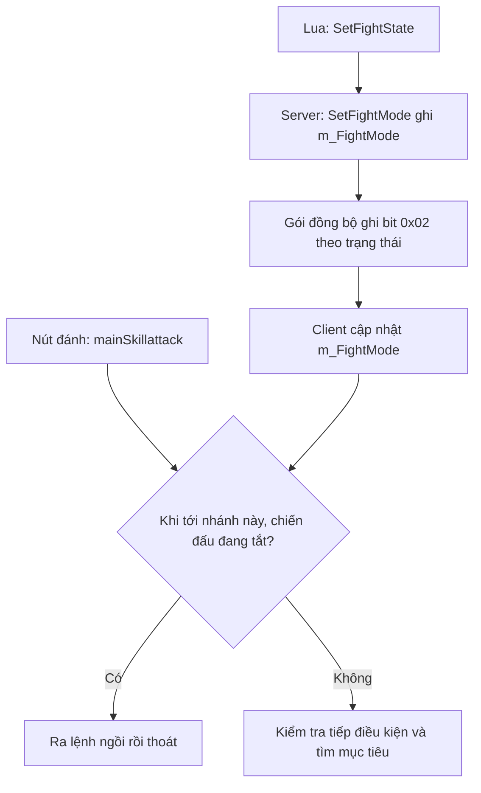

TÓM TẮT 1: [NGUỒN] DONE cho phần khảo sát tĩnh: đã đối chiếu 4/4 tệp nguồn được giao (JX1_OPS/DESIGN/HIEU-TRANG-THAI-CHIEN-DAU.md:110–117).
TÓM TẮT 2: [NGUỒN] Nếu nút đánh đi tới nhánh chế độ chiến đấu đang tắt, client ra lệnh ngồi rồi thoát (KNpcAI.cpp:1406–1423).
TÓM TẮT 3: [NGUỒN] `SetFightState` gọi `SetFightMode`; bit `0x02` chuyển chế độ chiến đấu từ server sang client (ScriptFuns.cpp:21133–21141; KNpc.cpp:8210–8216; KProtocolProcess.cpp:3147–3150).
TÓM TẮT 4: [NGUỒN] Giữ nguyên tài liệu đã có, bàn giao đề xuất Test-36 và bổ sung mục Kết quả vào task (JX1_OPS/DESIGN/HIEU-TRANG-THAI-CHIEN-DAU.md:94–166).
TÓM TẮT 5: [CHƯA KIỂM] Test-36 chỉ là đề xuất; chưa chạy build, game, exe, VM hay kết nối mạng. Tổng quan thực hiện commit; tệp nhịp ngoài worktree bị từ chối ghi.

# HG-02b — Hiểu game: trạng thái chiến đấu và nút đánh

Loại: khảo sát  
Chủ đề: Vì sao bấm nút đánh ngoài chế độ chiến đấu làm nhân vật ngồi, và kiểm tra cách bật chế độ chiến đấu trên Test-36 như thế nào.  
Từ khóa: trạng thái chiến đấu, nút đánh, ngồi, mainSkillattack, m_FightMode, 0x02, SetFightMode, SetFightState, Test-36  
Trạng thái: DONE — hoàn tất khảo sát tĩnh và đề xuất phép thử; hạng mục ghi nhịp ngoài worktree bị chặn.  
Độ phủ: 4/4 tệp nguồn; 1/1 đề xuất Test-36, chưa thực hiện.  
Liên quan: [Tài liệu trạng thái chiến đấu](../DESIGN/HIEU-TRANG-THAI-CHIEN-DAU.md), [mục lục tri thức](../DESIGN/MUC-LUC-TRI-THUC.md), [task HG-02b](../TASKS/HG-02b.md).  
Cần tôi quyết định: không.

## Phạm vi và độ phủ

Tên tệp rút gọn dưới đây trỏ tới bốn đường dẫn tuyệt đối trong mục **Nguồn bổ sung** của task. Client là bản `Client2912-20260116T044348Z-3-001`, dưới `Classes/gamecore`; server là cây `jxOnline/gameserver/Sources/Core/Src`. Chưa đối chiếu các bản này với bản đang cài hoặc đang chạy trên Test-36.

| Phần tử | Độ phủ | Bằng chứng |
|---|---|---|
| Nút đánh phía client | Đã phủ | `mainSkillattack` và nhánh ngồi: `KNpcAI.cpp:1326`, `KNpcAI.cpp:1406–1423`. |
| Client nhận bit chiến đấu | Đã phủ | Gói đầy đủ và rút gọn: `KProtocolProcess.cpp:2937–2940`, `KProtocolProcess.cpp:3005–3008`, `KProtocolProcess.cpp:3059–3061`, `KProtocolProcess.cpp:3147–3150`. |
| Server ghi trạng thái, đóng gói bit và áp dụng luật bản đồ | Đã phủ | `KNpc.cpp:7732–7733`, `KNpc.cpp:7806–7814`, `KNpc.cpp:8059–8060`, `KNpc.cpp:8210–8221`, `KNpc.cpp:15328–15335`. |
| API Lua để đặt và xem trạng thái | Đã phủ | `ScriptFuns.cpp:21133–21151`, `ScriptFuns.cpp:26147–26148`. |
| Test-36 | Đã phủ ở mức đề xuất | Quy trình dưới đây; chưa kiểm tra trong game. |

## Giải mã tên

Không có tên riêng của kỹ năng, trang bị, quái, NPC hay bản đồ trong phạm vi. Các định danh và tên môi trường dưới đây dùng ký tự ASCII. Báo cáo này dùng UTF-8 không BOM; bằng chứng dựa trên dòng lệnh trong source, không dựa trên phần chú thích có ký tự lỗi khi đọc mặc định.

| Tên gốc | Mã hóa | Chữ đúng / diễn giải | Nguồn file:dòng |
|---|---|---|---|
| `mainSkillattack` | ASCII | Hàm xử lý khi bấm nút đánh | `KNpcAI.cpp:1326` |
| `m_FightMode` | ASCII | Chế độ chiến đấu của nhân vật | `KNpcAI.cpp:1406`; `KNpc.cpp:15330` |
| `m_btSomeFlag`, `0x02` | ASCII | Trường cờ đồng bộ và bit chế độ chiến đấu | `KNpc.cpp:8210–8216`; `KProtocolProcess.cpp:3147–3150` |
| `SetFightMode`, `SetFightState`, `GetFightState` | ASCII | Hàm ghi chế độ; hai tên gọi Lua để đặt và đọc chế độ | `KNpc.cpp:15328–15335`; `ScriptFuns.cpp:26147–26148` |
| `Test-36` | ASCII | Môi trường dự kiến kiểm tra | `JX1_OPS/DESIGN/HIEU-TRANG-THAI-CHIEN-DAU.md:128–131` |

## Sắp theo cấu trúc game

| Tầng | Vai trò |
|---|---|
| Người chơi và client | Nút đánh đọc chế độ chiến đấu cục bộ rồi chọn nhánh xử lý. |
| Nhân vật và bản đồ trên server | Lua có thể đặt chế độ của nhân vật; luật bản đồ cũng có thể ép chế độ. |
| Đồng bộ | Hai dạng gói chuyển chế độ server sang client qua bit `0x02`. |
| Kiểm thử | So sánh hai lần bấm khi tắt và khi bật trong cùng điều kiện. |

## Đã xác minh

- [THẤY] Khi hàm xử lý nút đánh tới điều kiện `m_FightMode == 0`, nó bỏ mục tiêu đang chọn, gọi `SendSerCommand(do_sit)` và `SendClientCmdSit(TRUE)`, rồi thoát. Khi qua được nhánh này, hàm còn kiểm điều kiện khác trước khi tìm đối thủ, chẳng hạn đang bị loạn hoặc mục tiêu đang nhảy. Bật chế độ chiến đấu giúp qua nhánh ngồi; riêng thao tác bật chưa bảo đảm nhân vật vung kiếm (`KNpcAI.cpp:1406–1457`).
- [THẤY] Với nhân vật hợp lệ trong ngữ cảnh Lua, `SetFightState(1)` chuyển số khác 0 thành đúng rồi gọi `SetFightMode`. Setter ghi `m_FightMode`; trên server, nếu đối tượng là người chơi, setter còn gọi `m_cPK.CloseAll()`. `GetFightState()` đọc trạng thái phía server (`ScriptFuns.cpp:21133–21151`, `ScriptFuns.cpp:26147–26148`; `KNpc.cpp:15328–15335`).
- [THẤY] Hai gói `PLAYER_SYNC` và `PLAYER_NORMAL_SYNC` mang cùng ý nghĩa cho bit `0x02`: client đọc bit có bật để đặt `m_FightMode` là `1`, nếu không thì đặt `0`. Trong đường gói rút gọn, mã ghi bit trước khi áp luật bản đồ: `m_nWFight == 1` và hết bảo hộ thì ép bật; `m_nWFight == 0` thì ép tắt. Vì vậy bit trong lần đóng gói đó có thể khác giá trị sau khi áp luật; cần phân biệt giá trị đọc phía server với trạng thái client đã nhận (`KNpc.cpp:7732–7733`, `KNpc.cpp:7806–7814`, `KNpc.cpp:8059–8060`, `KNpc.cpp:8210–8221`; `KProtocolProcess.cpp:3005–3008`, `KProtocolProcess.cpp:3147–3150`).

## Mục sổ thông số

| Nhóm | Tên/hằng số | File:dòng | Giá trị | Đơn vị | Ảnh hưởng | Đổi an toàn | Nguồn đo |
|---|---|---|---|---|---|---|---|
| Trạng thái | `m_FightMode`; đối số Lua `SetFightState` | `KNpcAI.cpp:1406`; `ScriptFuns.cpp:21140`; `KNpc.cpp:15328–15335` | `0` = tắt; đầu vào Lua khác `0` = bật | Cờ trạng thái; số đầu vào | Qua hoặc vào nhánh ngồi; setter phía server còn gọi `CloseAll()` cho người chơi | CẨN THẬN | Đọc tĩnh |
| Đồng bộ | `m_btSomeFlag & 0x02` | `KNpc.cpp:8210–8216`; `KProtocolProcess.cpp:3147–3150` | `0x02` là mặt nạ bit chiến đấu | Mặt nạ bit | Cho biết trạng thái khi đóng gói | KHÔNG đổi trong phạm vi này | Đọc tĩnh |
| Luật bản đồ | `m_nWFight`, `m_ProtectTime` | `KNpc.cpp:8218–8221` | `m_nWFight` bằng `0` ép tắt; bằng `1` và `m_ProtectTime == 0` ép bật | Cờ bản đồ; chỉ kiểm điều kiện bằng `0`, chưa đối chiếu đơn vị thời gian | Có thể ghi đè trạng thái trên server sau khi tạo bit trong gói rút gọn | KHÔNG đổi trong phạm vi này | Đọc tĩnh |

## Đề xuất quan sát trên Test-36

[TÀI LIỆU] Chỉ đề xuất: dùng nhân vật thử, chọn bản đồ cho phép giữ chế độ chiến đấu và một mục tiêu hợp lệ trong tầm. Ghi trạng thái và hoạt ảnh khi bấm ở chế độ tắt. Nếu Test-36 có điểm chạy Lua kiểm thử đã được duyệt, gọi `SetFightState(1)` cho nhân vật thử, kiểm tra `GetFightState()`, rồi bấm lại khi client đã nhận chế độ bật nếu có cách quan sát sẵn. So sánh vung kiếm với ngồi; nếu chưa vung kiếm, ghi riêng chế độ server, chế độ client và điều kiện mục tiêu. Khôi phục trạng thái ban đầu theo thủ tục của môi trường thử. Nguồn: `ScriptFuns.cpp:21133–21151`, `KNpc.cpp:8215–8221`, `KNpc.cpp:15328–15335`, `KNpcAI.cpp:1406–1457`.

## Chưa xác minh

- [CHƯA KIỂM] Chưa xác nhận điểm gọi Lua được duyệt, luật bản đồ, trạng thái đồng bộ thực tế hoặc hoạt ảnh trên Test-36. Chưa chạy build, game, exe, VM, mạng hay thử nghiệm runtime. Kiểm tra thực hiện trong lượt này là kiểm tra tĩnh các dòng nguồn.
- [CHƯA KIỂM] Chưa đọc đường gọi từ giao diện hoặc phần triển khai của lệnh ngồi ngoài bốn tệp; kết luận áp dụng từ khi `mainSkillattack` tới nhánh đã trích, không khẳng định gói tin đã đến server hoặc hoạt ảnh đã phát trong game.

## Phát hiện khi chuẩn hóa

- Worktree đã có phần HG-02b tại `JX1_OPS/DESIGN/HIEU-TRANG-THAI-CHIEN-DAU.md:94–166`. Giữ nguyên phần đó và kết luận lịch sử `PARTIAL` của HG-02. Bằng chứng `KNpc.cpp:7806–7814` thuộc gói đầy đủ; sơ đồ HG-02b mô tả gói rút gọn và có thể đối chiếu bằng `KNpc.cpp:8059–8060`, `KNpc.cpp:8210–8221`. Hai đường đều dùng bit `0x02`.
- Máy không nhận lệnh `rg`; `Select-String` giới hạn vào các tệp được giao đã định vị đúng hàm và dòng nguồn. Lệnh `Add-Content` cho `D:\JX-wt\HG-02b.nhip` trả `Access to the path ... is denied`. Tệp nhịp nằm ngoài vùng ghi; không thử đổi quyền và không tạo tệp khác. Tổng quan có thể ghi nhịp từ môi trường có quyền tại đường dẫn này.

## Bàn giao

- Giữ nguyên tài liệu đầu ra đã có; nộp báo cáo này và mục **Kết quả** cuối task. Không stage, commit hay push theo yêu cầu; Tổng quan thực hiện commit.
- Đề xuất chỉ mục để Tổng quan gộp vào nhóm **Phím tắt, nút, tự động chiến đấu** (`JX1_OPS/DESIGN/MUC-LUC-TRI-THUC.md:13`). Hàng gồm đủ cột của chuẩn, ghi ở đây để giữ đúng phạm vi tệp được giao:

| File | Loại | Chủ đề | Từ khóa | Trạng thái | Độ phủ | Liên quan |
|---|---|---|---|---|---|---|
| `JX1_OPS/DESIGN/HIEU-TRANG-THAI-CHIEN-DAU.md` | khảo sát | Chế độ chiến đấu và nhánh ngồi của nút đánh | `mainSkillattack`, `m_FightMode`, `0x02`, `SetFightMode`, `SetFightState` | DONE khảo sát tĩnh | 4/4 tệp nguồn; Test-36 đề xuất | `JX1_OPS/REPORTS/HG-02b.md` |

Kỹ năng đã dùng: jx1-retrofit, jx1-read-server, jx1-read-client, jx1-parameters, jx1-knowledge, jx1-report.
