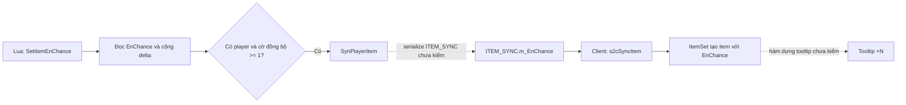

TÓM TẮT 5 DÒNG
1. [THẤY] LuaSetItemEnChance cộng giá trị đầu vào vào EnChance hiện tại (ScriptFuns.cpp:10920-10922).
2. [THẤY] Với nIsSyn >= 1 và có player, hàm gọi SynPlayerItem (ScriptFuns.cpp:10924-10929).
3. [THẤY] Bộ nhận s2cSyncItem phía client đưa ITEM_SYNC.m_EnChance vào khi tạo item (client KProtocolProcess.cpp:1707-1749).
4. [CHƯA KIỂM] Chưa kiểm tra payload sau serialize hoặc hàm dựng tooltip “+N” (client KProtocolProcess.cpp:1736-1749 chỉ cho thấy chuyển dữ liệu vào ItemSet).
5. [CHƯA KIỂM] Chỉ đọc tĩnh; không chạy build, exe, VM hay runtime theo phạm vi task (HG-03b.md:27-29). Không commit.

# HG-03b — Luồng cường hóa từ Lua tới client
Loại: tổng hợp
Chủ đề: Theo dõi EnChance qua lời gọi đồng bộ và bộ nhận gói ở client.
Từ khóa: cường hóa, SetItemEnChance, SynPlayerItem, s2cSyncItem, EnChance, client
Trạng thái: PARTIAL — còn thiếu bằng chứng payload và hàm trình bày tooltip.
Độ phủ: 2/4 phần: setter Lua và bộ nhận client đã xác minh; serialize và tooltip chưa xác minh.
Liên quan: JX1_OPS/DESIGN/HIEU-CAP-CUONG-HOA-LUA.md; JX1_OPS/DESIGN/KE-HOACH-TAI-HIEN-HIEU-UNG.md; JX1_OPS/TASKS/HG-03b.md
Cần tôi quyết định: không

## Luồng chính

## Phạm vi và độ phủ
| Hạng mục | Kết quả | Bằng chứng / giới hạn |
|---|---|---|
| Setter Lua thay đổi EnChance | Đã phủ | ScriptFuns.cpp:10912-10931 |
| SynPlayerItem serialize/gửi m_EnChance | Chưa phủ | Chưa đọc định nghĩa hàm này trong nguồn task |
| Client nhận m_EnChance qua s2cSyncItem | Đã phủ | Client KProtocolProcess.cpp:1707-1782 |
| Nguồn định dạng tooltip “+N” | Chưa phủ | Không thấy hàm giao diện trong các file task nêu |

## Giải mã tên
| Tên gốc | Mã hóa | Chữ đúng | Nguồn |
|---|---|---|---|
| SetItemEnChance | Mã định danh ASCII | SetItemEnChance | ScriptFuns.cpp:10912 |
| SynPlayerItem | Mã định danh ASCII | SynPlayerItem | ScriptFuns.cpp:10928 |
| s2cSyncItem | Mã định danh ASCII | s2cSyncItem | Server KProtocolProcess.cpp:1720; client KProtocolProcess.cpp:1707 |
| nIsSyn / m_EnChance | Mã định danh ASCII | nIsSyn / m_EnChance | ScriptFuns.cpp:10916; client KProtocolProcess.cpp:1736 |

Không có tên riêng game cần giải mã GBK hoặc TCVN3.

## Sắp theo cấu trúc game
| Thứ tự luồng | Thành phần | Trạng thái |
|---|---|---|
| 1 | Lua tăng EnChance theo delta | Đã xác minh |
| 2 | Server gọi SynPlayerItem theo điều kiện | Lời gọi đã xác minh; payload chưa xác minh |
| 3 | Client nhận trường và chuyển vào ItemSet | Đã xác minh |
| 4 | Giao diện hiện “+N” | Chưa xác minh |

Đây là luồng dữ liệu, không phải danh mục theo phái, trang bị hay bản đồ.

## Kết quả
[THẤY] LuaSetItemEnChance đọc chỉ số vật phẩm, lượng thay đổi và cờ đồng bộ; lấy EnChance hiện tại, cộng delta, rồi gọi SynPlayerItem khi có player và nIsSyn >= 1 (C:\Jx1CocoV3\SwordOnline\SwordOnline\jxOnline\gameserver\Sources\Core\Src\ScriptFuns.cpp:10912-10931).

[THẤY] Bộ nhận s2cSyncItem ở source server tạo item thường bằng cách truyền ITEM_SYNC.m_EnChance vào AddCilentItem; các nhánh item vàng cũng truyền trường này vào hàm tạo tương ứng (C:\Jx1CocoV3\SwordOnline\SwordOnline\jxOnline\gameserver\Sources\Core\Src\KProtocolProcess.cpp:1720-1797). Bản client đăng ký s2c_syncitem và trong s2cSyncItem truyền m_EnChance vào các nhánh ItemSet (C:\Jx1CocoV3\Folder\Client2912-20260116T044348Z-3-001\Client2912\Client\Classes\gamecore\KProtocolProcess.cpp:98,1707-1782).

[CHƯA KIỂM] Setter có gọi đồng bộ theo điều kiện; các đoạn đã đọc không cho thấy thiếu lời gọi ở đó. Chưa đọc định nghĩa SynPlayerItem nên chưa xác nhận giá trị được chép vào payload gửi đi hay xác định bước hỏng.

[CHƯA KIỂM] Client nhận trường EnChance để tạo vật phẩm, nhưng file được nêu trong task không chỉ ra hàm dựng chữ “+N”. Báo cáo trước ghi nhận vật phẩm thử không có “+N” (JX1_OPS/DESIGN/HIEU-CAP-CUONG-HOA-LUA.md:50).

Ghi chú đối chiếu: trong source server tại root được task nêu, s2cSyncItem ở dòng 1720. Dòng 2976 thuộc SyncObjectState, dòng 3098 đọc FightMode; hai dòng sau không phải xử lý EnChance trong bản này (KProtocolProcess.cpp:2974-2983,3098-3105).

## Mục sổ thông số
| Nhóm | Tên/hằng số | file:dòng | Giá trị | Đơn vị | Ảnh hưởng | Đổi an toàn | Nguồn đo |
|---|---|---|---|---|---|---|---|
| Đồng bộ item | nIsSyn | ScriptFuns.cpp:10916,10926 | >= 1 | cờ | Gọi SynPlayerItem nếu player index hợp lệ | CẨN THẬN | Đọc tĩnh; chưa đo runtime |

## Đã xác minh / Chưa xác minh
ĐÃ XÁC MINH: setter cộng delta vào EnChance hiện tại và gọi SynPlayerItem theo điều kiện; bộ nhận client chuyển m_EnChance vào quá trình tạo vật phẩm.

CHƯA XÁC MINH: payload thực tế do SynPlayerItem tạo/gửi, hàm định dạng tooltip “+N”, và hành vi runtime. Không suy hành vi runtime từ source.

## Đề xuất tối ưu
Chưa đề xuất sửa mã. Để kết luận nguyên nhân, cần đọc đúng định nghĩa SynPlayerItem và hàm dựng tooltip của bản client tương ứng.

## Bàn giao
PARTIAL. Không sửa mã, không chạy build/exe/VM/mạng, không commit.
Dòng chỉ mục gợi ý cho PM: HG-03b | tổng hợp | Luồng EnChance Lua → client | cường hóa, SetItemEnChance, SynPlayerItem, s2cSyncItem, m_EnChance | PARTIAL | 2/4 phần | HIEU-CAP-CUONG-HOA-LUA.md
Kỹ năng đã dùng: jx1-retrofit, jx1-read-server, jx1-read-client, jx1-parameters, jx1-knowledge, jx1-report.
