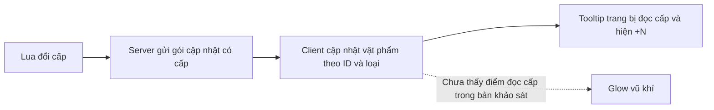

TÓM TẮT 5 DÒNG
1. [NGUỒN] DONE phần khảo sát tĩnh. Đã phủ 4/5 mắt xích trong nguồn HG-03c.
2. [NGUỒN] Server đưa `m_EnChance` vào gói cập nhật. Tooltip đọc cấp từ vật phẩm client để dựng `+N` nếu đạt điều kiện (`S/KItemList.cpp:4383,4404,4482`, `C/vn/gameui/KuiItemdescVN.cpp:167,1146-1176`).
3. [NGUỒN] Đã viết `JX1_OPS/DESIGN/HIEU-CAP-CUONG-HOA-LUA-2.md` và ghi mục Kết quả cuối task.
4. [CHƯA KIỂM] Chưa xác nhận điểm glow đọc cấp trong Client2912, bố cục gói của binary hoặc nguyên nhân thực tế của lần thử thiếu `+N`.
5. [CHƯA KIỂM] Chưa chạy build, exe, VM, mạng hoặc thử trong game theo phạm vi đọc tĩnh. Tổng quan phụ trách commit, hiện chưa có SHA.

# HG-03c — Bàn giao khảo sát cấp cường hóa
Loại: khảo sát\
Chủ đề: Kiểm tra gói cập nhật trang bị, tooltip và điểm đọc cấp để vẽ glow.\
Từ khóa: cường hóa, SetItemEnChance, SynPlayerItem, s2c_syncequipitem, ITEM_SYNC, tooltip +N, glow\
Trạng thái: DONE — hoàn tất phần đọc tĩnh, đã ghi phần còn thiếu bằng chứng.\
Độ phủ: 4/5 mắt xích đã xác minh.\
Liên quan: [Tài liệu kết quả](../DESIGN/HIEU-CAP-CUONG-HOA-LUA-2.md), [HG-03b](HG-03b.md), [H-03](H-03-cuong-hoa.md), [H-04](H-04-hieu-ung-vu-khi.md)\
Cần tôi quyết định: không

## Phạm vi và độ phủ

| Mắt xích | Kết quả | Nguồn |
|---|---|---|
| Lua đổi cấp | Đã phủ | `S/ScriptFuns.cpp:10912-10929`, `S/KItem.cpp:3800-3818` |
| Gói cập nhật từ server | Đã phủ | `S/KItemList.cpp:4379-4385,4404,4481-4482` |
| Client cập nhật vật phẩm | Đã phủ | `C/gamecore/KProtocol.h:968`, `C/gamecore/KProtocolProcess.cpp:172,1555-1562,1640-1651` |
| Tooltip hiện cấp | Đã phủ | `C/vn/gameui/KuiItemdescVN.cpp:167-168,1146-1176,1239-1260` |
| Glow đọc cấp | Chưa phủ điểm đọc cấp | `C/vn/gamecore/KNpcResVN.cpp:670-671`, `C/gamescene/KgameWorld.cpp:8185-8219,11660-11733` |

## Giải mã tên

| Tên gốc | Mã hóa | Chữ đúng hoặc diễn giải | Nguồn file:dòng |
|---|---|---|---|
| `SynPlayerItem` | ASCII | Đồng bộ cập nhật vật phẩm | `S/KItemList.cpp:4379` |
| `ITEM_SYNC.m_EnChance` | ASCII | Cấp cường hóa trong gói cập nhật | `C/gamecore/KProtocol.h:968,992` |
| `+N` | ASCII | Hậu tố cấp cường hóa | `C/vn/gameui/KuiItemdescVN.cpp:1175` |

Phạm vi này không có tên riêng trong game cần giải mã GBK hoặc TCVN3.

## Sắp theo cấu trúc game

Bảng phạm vi theo vòng đời trang bị, từ thay cấp đến hiển thị. Nhóm đồ xanh, tím và vàng được đối chiếu ở bước cập nhật của client (`C/gamecore/KProtocolProcess.cpp:1640-1651`).

## Đã xác minh / Chưa xác minh

`S/` và `C/` dùng hai gốc mã nguồn cố định của task, được khai triển ở phần đối chiếu từng bước của [tài liệu kết quả](../DESIGN/HIEU-CAP-CUONG-HOA-LUA-2.md).

- [THẤY] `SynPlayerItem` gửi mã `s2c_syncequipitem`. Bộ nhận tìm vật phẩm đã có theo ID và chỉ cập nhật cấp theo các nhánh đã ghi. Nếu ID chưa có hoặc đồ nằm ngoài các nhánh xử lý, cấp không được cập nhật qua lần đồng bộ đó. Tooltip dựng `+N` cho trang bị có cấp khác 0. (`S/KItemList.cpp:4383-4385,4404,4481-4482`, `C/gamecore/KProtocolProcess.cpp:1555-1562,1640-1651`, `C/gamecore/KItem.h:372`, `C/vn/gameui/KuiItemdescVN.cpp:167-168,1146-1176`.)
- [TÀI LIỆU] HG-03b khảo sát luồng tạo vật phẩm qua `s2cSyncItem`. H-04 dẫn glow ở source qh9A. Hai báo cáo là căn cứ đối chiếu cho các đường đã ghi trước đó. (`HG-03b.md:58-64`, `H-04-hieu-ung-vu-khi.md:30-31,48-58`.)
- [CHƯA KIỂM] Chưa xác nhận có đường glow đọc cấp trong Client2912. Chưa định vị được bản khai báo `ITEM_SYNC` phía server trong gốc đã giao để đối chiếu bố cục đầu cuối. `S/KCore.h:67` dẫn đến `KProtocol.h`, còn `S/KItemList.cpp:4404,4482` xác nhận trường đã được điền khi đóng gói. Chưa kiểm thao tác vẽ lại tooltip đang mở hoặc nguyên nhân lỗi từng gặp trong game. Không chạy thử runtime theo phạm vi task.
- Kiểm tra đã thực hiện: dùng `Select-String` và đọc đoạn mã có số dòng để đối chiếu hai đầu gói, thao tác lưu cấp và đường dựng nhãn. Máy thiếu `rg`, thư mục header phỏng đoán `Core/Inc` không có. Đã chuyển sang tìm trong các thư mục include được project nêu và đối chiếu khai báo gói trong client. Nhịp tiến độ được báo trong phiên, do `D:/JX-wt/HG-03c.nhip` nằm ngoài vùng sandbox cho phép ghi.

## Mục sổ thông số

| Nhóm | Tên/hằng số | file:dòng | Giá trị | Đơn vị | Ảnh hưởng | Đổi an toàn | Nguồn đo |
|---|---|---|---|---|---|---|---|
| Đồng bộ Lua | `nIsSyn` | `S/ScriptFuns.cpp:10926` | ≥ 1 | Cờ | Gọi đồng bộ nếu có người chơi | CẨN THẬN | Đọc tĩnh |
| Cấp server | `nN` | `S/KItem.cpp:3804-3806,3817` | 0–30 | Cấp | Khoảng cấp ghi từ lời gọi Lua | CẨN THẬN | Đọc tĩnh |
| Tiêu đề tooltip | `nItemGenre`, `nEnChance` | `C/vn/gameui/KuiItemdescVN.cpp:1146-1176` | 0, khác 0 | Mã loại, cấp | Thêm chữ `+N` cho trang bị | CẨN THẬN | Đọc tĩnh |

## Đề xuất tối ưu

Chưa có căn cứ đề xuất sửa mã. Khi đối chiếu lần thử thiếu `+N`, kiểm cờ đồng bộ, ID và loại vật phẩm phía client, rồi kiểm thời điểm tooltip được dựng. Với glow, đối chiếu đúng bản client dùng cho lần thử để nhận diện điểm đọc cấp.

## Bàn giao

Tổng quan thực hiện commit. Dòng đề xuất cho `JX1_OPS/DESIGN/MUC-LUC-TRI-THUC.md`:

| Hồ sơ | Loại | Chủ đề | Từ khóa | Trạng thái | Độ phủ | Liên quan |
|---|---|---|---|---|---|---|
| `HIEU-CAP-CUONG-HOA-LUA-2.md` | khảo sát | Cấp cường hóa từ Lua tới tooltip và glow | SynPlayerItem, ITEM_SYNC, s2c_syncequipitem, +N, glow | DONE | 4/5 mắt xích | HG-03b, H-03, H-04 |

Kỹ năng đã dùng: jx1-retrofit, jx1-read-server, jx1-read-client, jx1-parameters, jx1-knowledge, jx1-report.
