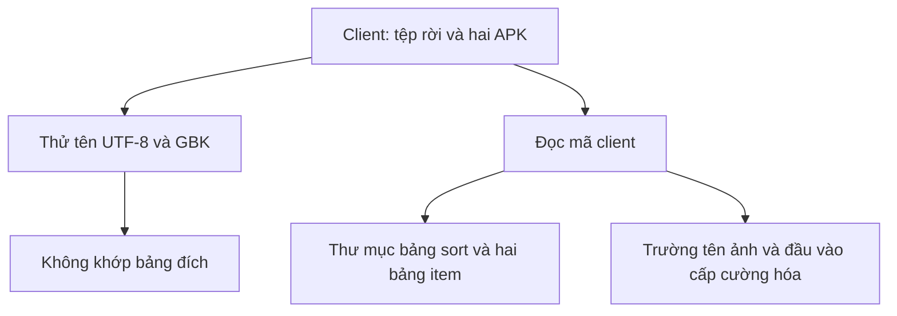

## TÓM TẮT 5 DÒNG
1. [NGUỒN] DONE — Khảo sát tĩnh client theo tiêu chí HG-04, gồm trường hợp không tìm thấy bảng (`JX1_OPS/TASKS/HG-04.md:18–20`).
2. [NGUỒN] Đã tìm 3 tệp chính, không thấy tệp nào ở các vị trí đã kiểm. Mã client xác nhận thư mục sort, hai đường dẫn bảng item và vị trí trường tên ảnh (`Classes/gamecore/CoreUseNameDef.h:35`, `Classes/gamecore/KBasPropTbl.cpp:16–23, 1425`).
3. [NGUỒN] Đã viết `JX1_OPS/DESIGN/HIEU-BANG-SORT-VA-ITEM.md` và ghi mục Kết quả cuối task HG-04.
4. [CHƯA KIỂM] Chưa có dữ liệu gốc để đọc tên SPR cụ thể. Sandbox từ chối ghi tệp nhịp ở thư mục cha.
5. [CHƯA KIỂM] Không chạy build, EXE, VM hoặc mạng. Bàn giao thay đổi tại chỗ cho Tổng quan commit.

# HG-04 — Khảo sát bảng sort và bảng item vũ khí trong client

Loại: khảo sát  
Chủ đề: Vị trí bảng thứ tự vẽ nhân vật nữ, bảng item và nguồn tên ảnh vũ khí.  
Từ khóa: HG-04, JX1, 女主角贴图顺序表.ini, thứ tự vẽ, vũ khí, MeleeWeapon, rangeweapon, cường hóa, SPR  
Trạng thái: DONE. Đã hoàn thành khảo sát và ghi nơi đã tìm theo tiêu chí task.  
Độ phủ: Đã tìm 3/3 tệp chính, thấy 0/3 trong các vị trí và gói đã kiểm.  
Liên quan: [Tài liệu HG-04](../DESIGN/HIEU-BANG-SORT-VA-ITEM.md), [Quy luật vẽ bộ phận](../DESIGN/QUY-LUAT-VE-BO-PHAN.md)  
Cần tôi quyết định: không

## Phạm vi và độ phủ

| Nội dung | Đã phủ / chưa phủ | Bằng chứng |
|---|---|---|
| Bảng sort nữ | Đã tìm ở tệp rời và trong mục lục hai APK. Chưa thấy tệp. | `JX1_OPS/TASKS/HG-04.md:19`, `Classes/gamecore/KNpcResNode.cpp:365–369, 1210–1212`. |
| Bảng vũ khí cận chiến | Đã xác định đường dẫn trong mã và tìm theo tên. Chưa thấy tệp. | `Classes/gamecore/KBasPropTbl.cpp:16–22, 830–831`. |
| Bảng vũ khí đánh xa | Đã xác định đường dẫn trong mã và tìm theo tên. Chưa thấy tệp. | `Classes/gamecore/KBasPropTbl.cpp:16–23, 830–831`. |
| Cấp cường hóa và tên SPR | Đã đối chiếu cách mã nhận cấp cường hóa và cách tra ảnh. Chưa đọc được tiêu đề, dữ liệu gốc hay tên SPR cụ thể. | `Classes/gamecore/KItemGenerator.CPP:405–416`, `Classes/gamecore/KBasPropTbl.cpp:1419–1432`, `Classes/gamecore/KNpcRes.cpp:1280–1285`. |

## Giải mã tên

| Tên gốc | Mã hóa | Chữ đúng / nghĩa tiếng Việt | Nguồn file:dòng |
|---|---|---|---|
| `女主角贴图顺序表.ini` | UTF-8 trong task, đã thử GBK (CP936) | `女主角贴图顺序表.ini` — Bảng thứ tự lớp ảnh nhân vật nữ. | `JX1_OPS/TASKS/HG-04.md:19` |
| `人物类型.txt` | GBK (CP936) trong mã | `人物类型.txt` — Bảng loại nhân vật. | `Classes/gamecore/CoreUseNameDef.h:30` |
| `动作贴图顺序表` | GBK (CP936) trong mã | `动作贴图顺序表` — Cột tên bảng thứ tự lớp ảnh theo động tác. | `Classes/gamecore/KNpcResNode.cpp:366` |

## Sắp theo cấu trúc game

- **Nhân vật nữ → động tác → hướng → khung.** Có đường tra trong mã. Chưa có dòng dữ liệu INI để xếp theo các mục trong game. `Classes/gamecore/KNpcResNode.cpp:1237–1275`.
- **Trang bị → vũ khí cận chiến / đánh xa → ảnh vật phẩm / ảnh khi cầm.** Đã biết hai bảng mà client đọc và đường tra ảnh khi cầm. Chưa có danh sách từng món để xếp. `Classes/gamecore/KBasPropTbl.cpp:22–23, 1419–1425`, `Classes/gamecore/KNpcRes.cpp:1280–1285`.

## Mục sổ thông số

| Nhóm | Tên/hằng số | File:dòng | Giá trị | Đơn vị | Ảnh hưởng | Đổi an toàn | Nguồn đo |
|---|---|---|---|---|---|---|---|
| Vũ khí cơ bản | `m_szImageName` | `Classes/gamecore/KBasPropTbl.cpp:113–118, 1419–1425` | 5 | Vị trí cột, đếm từ 1 | Tên ảnh vật phẩm mà client đọc | CẨN THẬN | Đọc mã client, thiếu đầu cột thật |
| Vũ khí cơ bản | `m_nLevel` | `Classes/gamecore/KBasPropTbl.cpp:101–103, 1419–1432` | 12 | Vị trí cột, đếm từ 1 | Trường cấp độ món đồ | CẨN THẬN | Đọc mã client |
| Cường hóa | `nEnChance` | `Classes/gamecore/KItem.cpp:3515–3529` | 0–30 sau khi kẹp | Cấp cường hóa | Mức được lưu và dùng để tính lại thuộc tính phù hợp trong nhánh này | CẨN THẬN | Đọc mã client, chưa đo runtime |
| Ảnh đang cầm | Tên SPR theo món và động tác | `Classes/gamecore/KNpcRes.cpp:1280–1285` | Chưa biết | Tên tệp | Ảnh vũ khí trên nhân vật | CẨN THẬN | Đọc đường tra trong mã, thiếu bảng gốc |

## Đã xác minh / Chưa xác minh

- **Đã xác minh.** Gốc đọc là `D:/Android/b/Client`. Đã lọc tên bằng PowerShell ở gốc và các vị trí tài nguyên ghi trong tài liệu HG-04. Đã đọc mục lục ZIP của hai APK có sẵn, mỗi APK theo UTF-8 và GBK. Cả hai lần đọc của từng APK cho 0 mục khớp tên cần tìm hoặc tệp PAK. Các đường dẫn trong mã tính từ gốc client. `JX1_OPS/TASKS/HG-04.md:19, 23`, `Classes/gamecore/KBasPropTbl.cpp:830–831`.
- **Đã xác minh.** `Resources/package.ini:5, 28` và `data/data/package.ini:30, 38` khai báo `update10.pak` và `setting.pak`. Không thấy bản tệp của hai gói ở các vị trí tài nguyên đã lọc. Không có bằng chứng gán bảng cụ thể cho một PAK.
- **Chưa xác minh.** Tiêu đề bảng thật, giá trị từng món, cấp cường hóa sinh ra ban đầu, tên SPR cụ thể, hành động đi bộ và kết quả trong game. Không chạy build, EXE, VM, test runtime hoặc kết nối mạng. `JX1_OPS/TASKS/HG-04.md:26–28`.

## Lỗi và cách xử lý

- Máy không có `rg` (PowerShell trả `CommandNotFoundException`). Dùng `Select-String` và `Get-ChildItem -Filter` theo tên và thư mục tài nguyên.
- Ghi `D:/JX-wt/HG-04.nhip` trả `UnauthorizedAccessException`. Thư mục cha nằm ngoài phạm vi ghi của sandbox. Các mốc khảo sát được cập nhật trong cuộc trao đổi.

## Đề xuất tối ưu và bàn giao

Khi có bản sao dữ liệu chứa bảng, ưu tiên bảng loại nhân vật rồi đến INI được chỉ định, hai bảng vũ khí và bảng ngoại hình. Đọc đầu cột và một dòng thật của mỗi nhóm để đối chiếu trường ảnh và cấp cường hóa.

Hàng đề xuất cho mục lục tri thức, để Tổng quan gộp:

| File | Loại | Chủ đề | Từ khóa | Trạng thái | Độ phủ | Liên quan |
|---|---|---|---|---|---|---|
| `DESIGN/HIEU-BANG-SORT-VA-ITEM.md` | khảo sát | Bảng sort nữ và bảng item vũ khí | HG-04, thứ tự vẽ, vũ khí, cường hóa, SPR | DONE | Đã tìm 3/3 tệp chính, thấy 0/3 | `DESIGN/QUY-LUAT-VE-BO-PHAN.md` |

Tổng quan phụ trách commit. Kết luận trong tài liệu cũ được giữ nguyên.

Kỹ năng đã dùng: `jx1-retrofit` (khuôn), `jx1-read-client`, `jx1-parameters`, `jx1-knowledge`, `jx1-report`. Đã đọc `jx1-read-server`. Task chỉ cấp nguồn client nên không tra source server.
