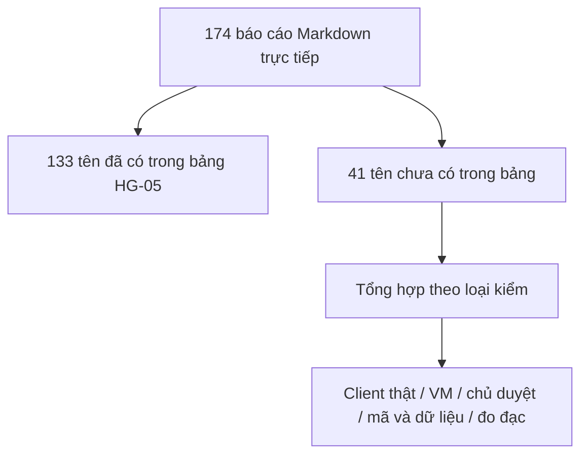

TÓM TẮT 5 DÒNG
1. [NGUỒN] Tạo tài liệu phần còn lại của danh sách CHƯA KIỂM, so 174 báo cáo Markdown trực tiếp.
2. [THẤY] Bảng cũ nêu 133 tên tệp; 41 tệp chưa được nêu tên; tóm tắt HG-05 ghi con số khác là 82 báo cáo.
3. [NGUỒN] Đầu ra: JX1_OPS/DESIGN/DANH-SACH-CHUA-KIEM-2.md; đã cập nhật mục Kết quả của task.
4. [CHƯA KIỂM] Không xác nhận triển khai/runtime; đã dùng một lệnh tìm đệ quy vượt giới hạn Q-51 và dừng việc tìm rộng.
5. [CHƯA KIỂM] Không chạy build, exe, VM hoặc mạng; tệp nhịp ngoài worktree bị từ chối ghi; chưa commit.

# HG-05b — Báo cáo bàn giao

Loại: tổng hợp
Chủ đề: Rà các báo cáo chưa được nêu tên trong bảng HG-05 và gộp các câu hỏi còn mở theo loại cần kiểm.
Từ khóa: HG-05b, chưa kiểm, client, VM, đọc mã, runtime, báo cáo, độ phủ
Trạng thái: PARTIAL — tài liệu đã tạo; không tuân thủ đầy đủ giới hạn Q-51 trong một lệnh định vị source và không ghi được tệp nhịp.
Độ phủ: 174/174 tệp Markdown trực tiếp đã được so tên; bảng cũ nêu 133 tệp, 41 tệp không được nêu.
Liên quan: JX1_OPS/DESIGN/DANH-SACH-CHUA-KIEM-2.md; JX1_OPS/DESIGN/DANH-SACH-CHUA-KIEM.md; HG-05.
Cần tôi quyết định: có — mọi bước VM, client thật, hoặc thay đổi nhánh cần theo phê duyệt phù hợp.

## Đã xác minh

- JX1_OPS/TASKS/HG-05b.md nêu đầu ra, phạm vi và các nhóm kiểm.
- Đã so tên trong bảng JX1_OPS/DESIGN/DANH-SACH-CHUA-KIEM.md với 174 tệp Markdown trực tiếp ở JX1_OPS/REPORTS/; 133 tên khớp, 41 tên chưa khớp. Bảng cũ ghi 21 nhóm nguồn và phần tóm tắt ghi 82 báo cáo (DANH-SACH-CHUA-KIEM.md:1-5,37-57). Hai con số 133 và 82 có tiêu chí khác nhau hoặc chưa rõ; không sửa báo cáo cũ.
- Đã rà tóm tắt/nhãn liên quan trong 41 tệp và gộp câu hỏi chưa mở vào bảng ở tài liệu đầu ra, giữ file:dòng và các nhãn theo nguồn. Ví dụ: VM (A-07-buoc1b-snapshot-da-va.md:4-5), kiểm kỹ năng (A-15a-ky-nang-phai-1-4.md:5), asset/PAK (K-02.md:4), duyệt thử (O-01-duyet-B-02.md:1-8), runtime (J-05-cat-khung-animation.md:5).
- Đọc tĩnh một đoạn mã server và một đoạn client: C:/Jx1CocoV3/SwordOnline/SwordOnline/jxOnline/gameserver/Sources/Core/Src/KSkills.cpp:221-243 và C:/Jx1CocoV3/Folder/Client2912-20260116T044348Z-3-001/Client2912/Client/Classes/gamescene/KgameWorld.cpp:231-246. Chỉ dùng làm ví dụ ranh giới giữa đọc source và runtime; không sửa source, không dùng để đổi kết luận cũ.
- Đã tạo JX1_OPS/DESIGN/DANH-SACH-CHUA-KIEM-2.md; đã thêm ## Kết quả vào cuối tệp task.

## Chưa xác minh

- Không kiểm tra lại game, bản chạy, PAK, DB, thiết bị, VM, mạng, hiệu năng hoặc kết quả test cũ; không chạy build/test/exe.
- Rà bổ sung giới hạn ở tóm tắt, phần đầu và nhãn tìm được; không đọc toàn bộ 41 báo cáo. Một số phần đầu được đọc lại khi chia nhóm.
- Có một lệnh PowerShell dùng Get-ChildItem -Recurse trên cây Classes và Sources để tìm hai tệp mã, vượt giới hạn Q-51. Tôi đã dừng việc tìm rộng; không dùng kết quả tìm rộng để lập luận về game. Tệp A-15c hiện ký tự lỗi khi đọc UTF-8, đã ghi nhận thay vì đoán nội dung (A-15c-ky-nang-phai-9-cuoi.md:1-5).
- Đã thử ghi D:\JX-wt\HG-05b.nhip ở mốc bắt đầu nhưng hệ thống từ chối quyền ghi ngoài worktree. Không thử vượt sandbox và không commit theo yêu cầu.

Lỗi và cách thử: rg không có trong môi trường; một lệnh định vị source bằng Get-ChildItem -Recurse vượt giới hạn Q-51. Đã dừng truy vấn rộng và ghi rõ giới hạn; chưa có phép thử runtime.

Bàn giao: PM/Tổng quan nhận tài liệu để xem xét và commit. Không có SHA hoặc bằng chứng push.

Kỹ năng đã dùng: jx1-retrofit, jx1-read-server, jx1-read-client, jx1-parameters, jx1-knowledge, jx1-report.
