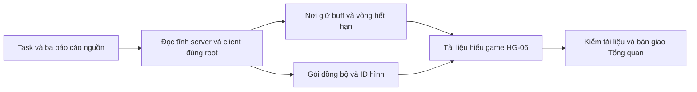

TÓM TẮT 1/5 — [NGUỒN][THẤY] DONE phạm vi khảo sát tĩnh HG-06: tài liệu trả lời 4/4 câu hỏi về giữ buff, hết hạn, đồng bộ và gắn hình (`../TASKS/HG-06.md:19–21`).
TÓM TẮT 2/5 — [NGUỒN][THẤY] Đã đối chiếu danh sách buff, bộ đếm riêng và dữ liệu hoàn tác; phân biệt tác dụng buff với ID hình (`S/KNpc.h:208–219,452–485`; `S/KNpc.cpp:2258–2304,10489–10503`).
TÓM TẮT 3/5 — [NGUỒN][THẤY] Đầu ra là `JX1_OPS/DESIGN/HIEU-BUFF-TRANG-THAI.md`; có sơ đồ, bảng độ phủ, giải mã tên, sổ thông số và các nhãn độ chắc.
TÓM TẮT 4/5 — [CHƯA KIỂM] Chưa kiểm runtime/giây từng kỹ năng; nhịp ngoài worktree bị giới hạn quyền ghi; báo cáo cũ giữ nguyên (`../TASKS/HG-06.md:23–30`).
TÓM TẮT 5/5 — [CHƯA KIỂM] Không build/chạy game/exe/VM/mạng; không commit/push theo yêu cầu phiên, chưa có SHA, Tổng quan commit hộ.

# HG-06 — Bàn giao khảo sát trạng thái, buff và thời gian hiệu lực

Loại: khảo sát
Chủ đề: Bàn giao tài liệu hiểu game HG-06 và giới hạn xác minh.
Từ khóa: HG-06, trạng thái, buff, aura, m_LeftTime, StateInfo, StateSpecialId, SPR
Trạng thái: DONE — tài liệu khảo sát tĩnh hoàn tất; yêu cầu ghi nhịp ngoài worktree bị chặn bởi vùng ghi.
Độ phủ: 4/4 câu hỏi; chưa kiểm kê tổng số kỹ năng/buff; 0 ca runtime.
Liên quan: ../DESIGN/HIEU-BUFF-TRANG-THAI.md; H-02-magic-attrib.md; H-06-he-thong-an.md; J-03-hoat-anh-ky-nang.md
Cần tôi quyết định: không

## Phạm vi và độ phủ

| Câu hỏi / yêu cầu | Kết quả | Bằng chứng |
|---|---|---|
| [THẤY] Lưu ở đâu | Đã trả lời | `S/KNpc.h:129–134,208–219,452–485`. |
| [THẤY] Hết hạn thế nào | Đã trả lời | `S/KNpc.cpp:2258–2357,10401–10503`. |
| [THẤY] Gửi cho client thế nào | Đã trả lời | `S/KNpc.cpp:7886–8052,10078–10090,10385–10394`; `C/gamecore/KProtocolProcess.cpp:2371–2393,2571–2608,4236–4244`. |
| [THẤY] Gắn hình ra sao | Đã trả lời | `C/gamecore/KNpc.cpp:711–714,2856–2862`; `C/gamecore/KNpcRes.cpp:2095–2165`. |
| [CHƯA KIỂM] Runtime, binary, mọi kỹ năng | Không chạy/không suy diễn | `JX1_OPS/TASKS/HG-06.md:25–30`. |
| [TÀI LIỆU] Nhịp mốc lớn | BỊ CHẶN — chưa ghi `D:/JX-wt/HG-06.nhip` | Nằm ngoài writable root `D:/JX-wt/HG-06`; không thử vượt sandbox hoặc ghi tệp thay thế ngoài phạm vi. |

## Giải mã tên

| Tên gốc | Mã hóa | Chữ đúng UTF-8 | Nguồn file:dòng |
|---|---|---|---|
| `KStateNode`, `m_LeftTime`, `StateInfo`, `SPR` | ASCII; không cần chuyển GBK/TCVN3 | Định danh cơ chế, không phải tên riêng kỹ năng/NPC/vật phẩm | `S/KNpc.h:208–219`; `C/gamecore/KProtocol.h:359`; `C/gamecore/KNpcRes.cpp:2161` |

## Sắp theo cấu trúc game và danh sách nguồn đã khoanh

[TÀI LIỆU] Tài liệu xếp theo nhân vật → nhận buff → đếm hạn → đồng bộ → vẽ. Không lập catalog theo phái vì task hỏi cơ chế chung (`JX1_OPS/TASKS/HG-06.md:19–25`).

- [TÀI LIỆU] Đọc chuẩn báo cáo và task trước; lập nhóm nguồn từ ba báo cáo H-02, H-06, J-03 theo `JX1_OPS/TASKS/HG-06.md:23–25`. Đọc sáu skill đúng tại `.agents/skills`; mục lục tri thức và phần tìm liên quan của GS001-MAP chỉ dùng định vị theo skill.
- [THẤY] Server mở các tệp cụ thể trong `S`: `KNpc.h/.cpp`, `KSkills.cpp`, `KSkillList.cpp`, `KPlayer.h/.cpp`, `KProtocolProcess.cpp`, `KSkillManager.cpp`, `KRegion.cpp`; tìm có lọc symbol ở `KSubWorld.cpp`, `KNpcSet.cpp`. Bằng chứng kết luận tập trung tại `S/KNpc.h:208–219,452–485`, `S/KNpc.cpp:2258–2357,7886–8052,10365–10504`, `S/KSkills.cpp:3348–3472`, `S/KRegion.cpp:1100–1127`.
- [THẤY] Client mở các tệp cụ thể dưới `C/gamecore`: `KNpc.h/.cpp`, `KProtocol.h`, `KProtocolProcess.cpp`, `GameDataDef.h`, `KSkills.cpp`, `KNpcRes.h/.cpp`, `KNpcResNode.h/.cpp`; renderer `C/vn/gamecore/KNpcResVN.cpp`. Bằng chứng: `C/gamecore/KProtocolProcess.cpp:2371–2393,2571–2608,4236–4244`; `C/gamecore/KNpcRes.cpp:2095–2165`; `C/vn/gamecore/KNpcResVN.cpp:164–168,238–299,330–345,505–526`.
- [TÀI LIỆU] `S` và `C` là đúng hai root định nghĩa trong tài liệu đầu ra, lấy từ `JX1_OPS/TASKS/HG-06.md:25`. Không đọc toàn cây Folder/SwordOnline, không đọc bí mật/dump, không gọi Graphify exe hoặc mạng.

## Kết quả chuyên môn

- [THẤY] Buff hữu hạn giữ dữ liệu hoàn tác; cùng ID/cấp trong nhánh thường làm mới hạn. Hạn âm bỏ qua giảm, 0 được xét gỡ trước lệnh giảm (`S/KNpc.cpp:2258–2304,10401–10503`).
- [THẤY] Phần tác dụng của chủ thể và phần hình đồng bộ có đường riêng. Client hiện nhận `StateInfo` qua gói nhân vật thường kỳ; câu gọi cập nhật của gói trạng thái riêng bị comment (`S/KNpc.cpp:7932`; `C/gamecore/KProtocolProcess.cpp:2607,3445–3454`).
- [THẤY] Cờ độc/băng/choáng không phải số giây còn lại; ID hình được tra thành SPR và chia lớp đầu/thân/chân (`S/KNpc.cpp:7998–8013`; `C/gamecore/KProtocolProcess.cpp:2571–2578`; `C/gamecore/KNpcRes.cpp:2095–2165`).
- [TÀI LIỆU] Ba báo cáo cũ không bị sửa. Phần nghi vấn trùng biến đầu ra `GetInfo` trong J-03 được kiểm lại ở root client task, giữ giới hạn chưa tái hiện runtime (`J-03-hoat-anh-ky-nang.md:90`; `C/gamecore/KNpcRes.cpp:2143`; `C/gamecore/KNpcResNode.cpp:907–910`).

## Mục sổ thông số

[TÀI LIỆU] Sổ đầy đủ nằm trong tài liệu đầu ra, mục “Mục sổ thông số”, không tạo sổ phụ theo skill `.agents/skills/jx1-parameters/SKILL.md:5–13`. Các điểm chính đã kiểm: `FRAME2TIME = 18`, `GAME_UPDATE_TIME = 10` (`S/KNpc.cpp:78,80`); client có 18 ô hình, chia ba lớp được 6/lớp (`C/gamecore/GameDataDef.h:132`; `C/gamecore/KNpcRes.cpp:2150`). Không quy thành số đo giây runtime.

## Đã xác minh / Chưa xác minh

**ĐÃ XÁC MINH:** [THẤY] Các khai báo và nhánh mã dẫn trong bảng độ phủ; active code được phân biệt với comment và nhánh `_SERVER`. Kiểm tra tài liệu sau ghi được ghi ở mục bàn giao bên dưới.

**CHƯA XÁC MINH:** [CHƯA KIỂM] Tổng số buff/ID/cấp, dữ liệu SPR/Settings/PAK thực nạp, binary/packing server, thời hạn offline/chuyển server/chết, số giây thực, đồng bộ dưới độ trễ. Không chạy test gameplay/build/exe/VM/mạng theo `JX1_OPS/TASKS/HG-06.md:25–30`; không có kết quả “test game đạt”.

## Kiểm tra tài liệu thực chạy

- [THẤY] Đã đọc lại toàn bộ hai tài liệu mới và phần kết quả cuối task sau khi ghi; đủ bốn mục trả lời, bảng phạm vi, giải mã tên, sổ thông số và giới hạn chưa kiểm.
- [THẤY] Kiểm bằng PowerShell/.NET: hai tài liệu mới đều có đúng 5 dòng `TÓM TẮT 1/5` đến `5/5`, một cặp hàng rào mã cho sơ đồ Mermaid; cả ba tệp ghi đều giải mã UTF-8 nghiêm ngặt được, không BOM, không ký tự thay thế U+FFFD.
- [THẤY] Task có đúng một tiêu đề `## Kết quả` và 4 dòng kết quả. Chỉ kiểm tài liệu; chưa chạy trình dựng Mermaid hoặc bất kỳ test gameplay/build nào.

## Lỗi thao tác, cách xử lý và kết quả

| Lỗi / giới hạn | Cách xử lý | Kết quả |
|---|---|---|
| Đọc đầu bằng encoding mặc định làm chữ Việt sai | Chọn UTF-8 cho task/báo cáo; đọc source GBK bằng StreamReader khi cần | Đọc được nội dung; đầu ra mới dùng UTF-8 không BOM. |
| Thử sai vị trí skill ngoài worktree | Chuyển đúng `.agents/skills` của worktree | Đã nạp đủ sáu skill được yêu cầu. |
| `rg` không có | Dùng `Select-String`, tìm tệp có lọc tên và đọc đoạn giới hạn | Khoanh được tệp thật, không cài công cụ. |
| Một kết quả gộp báo cáo quá dài bị cắt | Lấy lại phần H-06 chưa hiện và tìm đúng dòng cần dùng | Không dùng phần bị cắt làm bằng chứng. |
| Lỗi chuỗi JavaScript/PowerShell, mảng một phần tử và tham số encoding | Sửa lệnh đọc nội tuyến; dùng StreamReader với offset/count | Các đoạn cần thiết đã đọc được; không tạo parser/script phụ, không ghi source. |
| Một lần ghép thiếu cấp thư mục client và một lần nhầm vị trí renderer | Sửa theo đúng root task và đường dẫn `vn/gamecore` đã biết | Đã kiểm file canonical; không thay bằng mirror. |
| Nhịp yêu cầu nằm ngoài worktree | Giữ ranh giới writable root; báo trong chat và báo cáo | Chưa tạo/cập nhật tệp `.nhip`, không lách bằng đường dẫn khác. |

## Đề xuất tối ưu, phát hiện khi chuẩn hóa và bàn giao

[TÀI LIỆU] Chỉ đề xuất tăng độ chắc bằng đối chiếu version dữ liệu/binary và task kiểm chứng riêng khi được cấp quyền; không đề xuất sửa hiệu ứng vũ khí. Kết luận cũ không đổi (`JX1_OPS/TASKS/HG-06.md:20,28–30`; `JX1_OPS/DESIGN/CHUAN-BAO-CAO.md:25–29`).

[TÀI LIỆU] Phạm vi ghi của phiên: tài liệu đầu ra, báo cáo này và nối 3–5 dòng kết quả cuối task theo yêu cầu trực tiếp. Không sửa front matter task, mục lục chung, BAI_HOC hoặc tạo `REPORTS/_CHIMUC/HG-06.tsv` ngoài vùng được giao. PM có thể gộp dòng chỉ mục đề xuất: “Trạng thái/buff/thời hạn | DESIGN/HIEU-BUFF-TRANG-THAI.md | KNpc, KProtocolProcess, KNpcRes | khảo sát tĩnh” (`JX1_OPS/TASKS/HG-06.md:13,28–31`; `JX1_OPS/DESIGN/CHUAN-BAO-CAO.md:30`).

Commit SHA: chưa tạo — phiên yêu cầu không commit, Tổng quan commit hộ. Chưa push; không thử mạng và không có bằng chứng GitHub. Nhịp `D:/JX-wt/HG-06.nhip`: **BỊ CHẶN — chưa ghi**, do ngoài writable root; cần môi trường được cấp đường ghi đó nếu tiếp tục yêu cầu nhịp tệp.

Kỹ năng đã dùng: jx1-retrofit (rào chắn giữ nguyên báo cáo cũ), jx1-read-server, jx1-read-client, jx1-parameters, jx1-knowledge, jx1-report.
