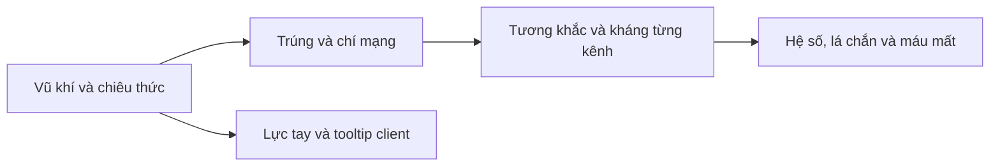

## TÓM TẮT 5 DÒNG

1. [NGUỒN] DONE — đã giải thích 5/5 nhóm đầu vào và thứ tự 6/6 kênh trong nhánh nhận đòn khảo sát. `JX1_OPS/DESIGN/HIEU-CONG-THUC-SAT-THUONG.md:32,79`.
2. [NGUỒN] Đã lần từ vũ khí và dữ liệu chiêu đến cách mục tiêu chịu kháng, chí mạng, giảm trừ và mất máu. `S/KItemList.cpp:105`, `S/KSkills.cpp:3225`, `S/KNpc.cpp:4466,5067,5978`.
3. [NGUỒN] Đã đối chiếu H-01, H-02, T-02 và T-03. Ví dụ đòn vật lý giả định cho kết quả 82 hoặc 165 máu tùy chí mạng. `JX1_OPS/DESIGN/HIEU-CONG-THUC-SAT-THUONG.md:100,117`.
4. [NGUỒN] Đầu ra là `JX1_OPS/DESIGN/HIEU-CONG-THUC-SAT-THUONG.md` và mục Kết quả trong task. Tổng quan phụ trách commit.
5. [CHƯA KIỂM] Đã kiểm số học PowerShell. Chưa build, chạy exe, VM, mạng hoặc đo runtime. `JX1_OPS/TASKS/HG-08.md:27–32`.

# HG-08 — Bàn giao khảo sát công thức sát thương

- Loại: khảo sát
- Chủ đề: Đường tính sát thương server và giới hạn của chỉ số hiển thị client.
- Từ khóa: sát thương, vũ khí, kỹ năng, ngũ hành, kháng, chí mạng, CalcDamage, HG-08
- Trạng thái: DONE — tài liệu và ghi nhận kết quả đã hoàn tất trong worktree.
- Độ phủ: 5/5 nhóm đầu vào, 6/6 kênh của nhánh chính, 4/4 báo cáo đối chiếu.
- Liên quan: [tài liệu công thức](../DESIGN/HIEU-CONG-THUC-SAT-THUONG.md), [H-01](H-01-ngu-hanh.md), [H-02](H-02-magic-attrib.md), [T-02](T-02.md), [T-03](T-03.md).
- Cần tôi quyết định: không.

## Phạm vi và độ phủ

Các tiền tố `S/`, `H/`, `E/`, `C/` chỉ đúng các gốc đọc trong [tài liệu công thức](../DESIGN/HIEU-CONG-THUC-SAT-THUONG.md#cách-đọc-bằng-chứng).

| Phần tử | Kết quả | Dẫn chứng |
|---|---|---|
| Vũ khí và điểm nhân vật | Đã phủ | `S/KItemList.cpp:105–160`, `S/KPlayer.cpp:2859–2876` |
| Kỹ năng | Đã phủ ghép chiêu và sáu kênh | `S/KSkills.cpp:3247–3257,3677–3747`, `S/KNpc.cpp:5978–6233` |
| Ngũ hành | Đã phủ chiều khắc và kháng mỗi kênh | `S/KNpc.cpp:5100–5266` |
| Giảm trừ | Đã phủ thứ tự hệ số và lá chắn trong nhánh đã đọc | `S/KNpc.cpp:5268–5719` |
| Chí mạng | Đã phủ chí mạng, ngoại lệ độc và nhánh chí tử | `S/KNpc.cpp:4636–4866,5075–5080` |
| Client | Đã phủ lực tay, tooltip và sai khác tương khắc tại đoạn ghép | `C/gamecore/KPlayer.cpp:5698–5719`, `C/gamecore/KSkills.cpp:3866–3879`, `C/gamecore/KNpc.cpp:3243–3252` |
| H-01 / H-02 / T-02 / T-03 | Đã phủ 4/4 | `H-01-ngu-hanh.md:166–221`, `H-02-magic-attrib.md:82–114,176–178`, `T-02.md:67–86`, `T-03.md:123,143–169` |
| Bản game đang chạy | Chưa phủ | `JX1_OPS/TASKS/HG-08.md:27–32` |

## Giải mã tên

| Tên gốc | Mã hóa | Chữ đúng UTF-8 | Nguồn file:dòng |
|---|---|---|---|
| 金系 / 木系 / 水系 / 火系 / 土系 | GBK | Hệ Kim / hệ Mộc / hệ Thủy / hệ Hỏa / hệ Thổ, theo đúng thứ tự | `C/gamecore/GameDataDef.h:332–336` |

## Sắp theo cấu trúc game

Trang bị và điểm nhân vật → chiêu → từng kênh sát thương → kháng và lá chắn của mục tiêu. Các bộ trang bị, chiêu theo phái và quái theo bản đồ không thuộc phạm vi thống kê của HG-08.

## Mục sổ thông số

| Nhóm | Tên/hằng số | file:dòng | Giá trị | Đơn vị | Ảnh hưởng | Đổi an toàn | Nguồn đo |
|---|---|---|---|---|---|---|---|
| Vũ khí | `STRENGTH_SET_DAMAGE_VALUE`, `DEXTERITY_SET_DAMAGE_VALUE` | `S/KPlayer.h:37–38`, `S/KPlayer.cpp:2862–2872` | 5 / 5 | Điểm thuộc tính trên một điểm sát thương nền | Chia sức mạnh cho vũ khí gần hoặc thân pháp cho vũ khí xa | CẨN THẬN | Hằng số mã |
| Đánh trúng | `MIN_HIT_PERCENT`, `MAX_HIT_PERCENT` | `H/GameDataDef.h:120`, `S/KNpc.h:63`, `S/KNpc.cpp:10995–11012` | 10 đến 95 | % | Chặn tỷ lệ sau khi tính đánh và né | CẨN THẬN | Hằng số mã |
| Tương khắc | `magic_seriesdamage_p` | `S/KSkills.cpp:3725–3730`, `S/KNpc.cpp:5100–5157` | Theo dữ liệu chiêu. Chưa đo giá trị đang nạp. | Điểm phần trăm kháng | Trừ khi đúng cặp khắc | CẨN THẬN | Đọc tĩnh các lời gọi |
| Kháng | `MAX_RESIST` và trần kênh | `H/GameDataDef.h:116`, `S/KNpc.cpp:5161–5259` | 150 toàn cục. Trần kênh lấy theo mục tiêu. | Điểm phần trăm kháng | Chặn sau khi tính tương khắc | CẨN THẬN | Mã và trường chỉ số mục tiêu |
| PK | `m_nPKDamageRate` | `S/KNpcSet.cpp:93–107`, `S/KNpc.cpp:5364–5369` | 20 mặc định. Chưa đo giá trị đang nạp. | % | Nhân sau khi chia sát thương trong nhánh PK mặc định | CẨN THẬN | Mặc định khi đọc cấu hình hoặc khi không nạp được |
| Hệ số người đánh | Nhân trong các nhánh 0–4 | `S/KNpc.cpp:5410–5435` | 60 | % | Nhân sát thương sau nhánh theo đối tượng | CẨN THẬN | Hằng trong mã |
| Chí mạng | `bDeadly` | `S/KNpc.cpp:4636–4658,4699–4704,4750–4755,4777–4782,4807–4811,4850–4855` | ×2 cho năm kênh. Độc ×4 trên trường điểm. | Hệ số | Đổi đầu vào kênh trước `CalcDamage` | CẨN THẬN | Đọc tĩnh |
| Chí tử | `bFatally` | `S/KNpc.cpp:4861–4866,5075–5080` | 1/10 máu đang có khi phép thử thành công | Điểm sinh lực | Trừ ngay và trả về từ nhánh chí tử | CẨN THẬN | Đọc tĩnh |

## Phát hiện khi đối chiếu

- **[THẤY]** Chí mạng độc nhân hai lần cùng trường điểm ở `S/KNpc.cpp:4807–4811`. Đoạn xử lý chu kỳ còn ghi máu sau lời gọi `CalcDamage` ở `S/KNpc.cpp:2032–2039`. [CHƯA KIỂM] Tổng tác động trong runtime.
- **[THẤY]** Lá chắn theo % có đường xử lý khi thiếu nội lực tại `S/KNpc.cpp:5616–5628`. Đoạn lá chắn sau đó ghi đè mức đã chặn ở `S/KNpc.cpp:5632–5655`. [CHƯA KIỂM] Các nhánh này xuất hiện thế nào trong bản đang chạy.
- **[TÀI LIỆU][THẤY]** Đối chiếu được phần kháng và khác biệt tương khắc của H-01 trong hai gốc HG-08. Kết quả của T-02 và T-03 vẫn là khung đo và dự đoán tĩnh. `H-01-ngu-hanh.md:166–221`, `T-02.md:67–86`, `T-03.md:143–169`.

## Đã xác minh / Chưa xác minh

- **Đã xác minh.** Đã đọc các hàm và điểm gọi liệt kê trong bảng phạm vi. Kiểm bằng PowerShell với phép chia cắt về 0, thu được 82/165 máu ở ví dụ vật lý, 250/300 sau kháng trong ví dụ tương khắc và 300/250 trước/sau trong ví dụ nối với T-03.
- **Chưa xác minh.** Bản cài, dữ liệu đang nạp, tần suất chí mạng, tổng độc theo chu kỳ và kết quả thử trong game. Chưa thực hiện build, exe, VM hay mạng theo phạm vi HG-08.
- **Lỗi và cách xử lý.** `rg` không có trong môi trường. Đã chuyển sang `Select-String` và đọc giới hạn dòng. Hai tên đường dẫn dự kiến không khớp cây nguồn. Đã tìm được `CoreShell.cpp` và header dùng chung dưới `jxOnline/header`. Đường dẫn `D:/JX-wt/HG-08.nhip` báo `Access to the path ... is denied` vì nằm ngoài vùng ghi. Mốc tạm trong worktree được gộp vào bảng dưới để giữ phạm vi bàn giao.

## Đề xuất tối ưu

Nếu có lượt thử riêng được duyệt, dùng khung T-02 để đổi một biến mỗi lượt. Ghi riêng sát thương sau kháng, nội lực mất và máu mất. Ưu tiên đối chiếu hai mức nội lực đủ và thiếu, cùng một ca độc có và không chí mạng. `T-02.md:67–86`, `S/KNpc.cpp:4807–4843,5616–5628`.

## Bàn giao

Tổng quan phụ trách commit. Hàng sau dùng để gộp chỉ mục vì task chỉ định vùng ghi và hai tệp bàn giao, còn tệp TSV riêng nằm ngoài vùng đó.

| File | Loại | Chủ đề | Từ khóa | Trạng thái | Độ phủ | Liên quan |
|---|---|---|---|---|---|---|
| `DESIGN/HIEU-CONG-THUC-SAT-THUONG.md` | khảo sát | Công thức sát thương từ vũ khí và chiêu đến máu mục tiêu | sát thương, lực tay, ngũ hành, giảm trừ, chí mạng, CalcDamage, HG-08 | DONE | 5/5 nhóm, 6/6 kênh, 4/4 đối chiếu tĩnh | H-01, H-02, T-02, T-03 |

| Giờ ghi (UTC+07:00) | Bước | Tiến độ ước tính |
|---|---|---:|
| 19/11/2026 01:12:31 | Ghi bù mốc bắt đầu sau khi đường dẫn ngoài worktree bị từ chối | 0% |
| 19/11/2026 01:12:31 | Đối chiếu bốn báo cáo, định vị nguồn tính đòn | 25% |
| 19/11/2026 01:13:56 | Lần xong luồng server và đối chiếu hiển thị client | 65% |
| 19/11/2026 01:16:21 | Kiểm xong số học các ví dụ và giới hạn runtime | 75% |
| 19/11/2026 01:20:49 | Viết xong tài liệu và báo cáo, chuyển sang rà soát | 95% |
| 19/11/2026 01:28:05 | Rà soát ba tệp bàn giao: UTF-8 không BOM, cấu trúc bắt buộc và liên kết nội bộ đều đạt | 100% |

Kỹ năng đã dùng: `jx1-retrofit`, `jx1-read-server`, `jx1-read-client`, `jx1-parameters`, `jx1-knowledge`, `jx1-report`.
