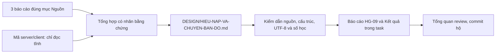

TÓM TẮT 1/5: [NGUỒN] DONE phần tài liệu HG-09: trả lời 5/5 nhóm câu hỏi tĩnh; nguồn: JX1_OPS/DESIGN/HIEU-NAP-VA-CHUYEN-BAN-DO.md:53–61.
TÓM TẮT 2/5: [NGUỒN] Phân biệt 28 ID thiếu .wor trong 800 mục được chọn với 28 đường dẫn thiếu trên toàn catalog; không xác nhận 28 lỗi runtime; nguồn: JX1_OPS/REPORTS/K-02-ban-do.md:41–43, :173.
TÓM TẮT 3/5: [NGUỒN] Đã tạo tài liệu DESIGN, báo cáo này và bổ sung Kết quả cuối task; các dẫn nguồn trực tiếp dùng đúng hai root của task, số liệu cũ giữ nguyên.
TÓM TẮT 4/5: [NGUỒN] Kiểm tra tĩnh tài liệu chính PASS; ghi D:\JX-wt\HG-09.nhip bị Access denied do ngoài vùng ghi, các mốc có trong báo cáo này.
TÓM TẮT 5/5: [CHƯA KIỂM] Không build, exe game, VM, mạng hoặc test trong game; không stage/commit/push theo chỉ thị, Tổng quan review và commit hộ; chưa có SHA mới.

# HG-09 — Bàn giao hiểu nạp và chuyển bản đồ

Loại: tổng hợp
Chủ đề: Bàn giao tài liệu giải thích chọn/nạp bản đồ trên server, trap chuyển nơi chơi và client đổi cảnh.
Từ khóa: HG-09, bản đồ, MapList, WorldSet, .wor, trap, ChangeWorld, WORLD_SYNC, LoadMapC
Trạng thái: DONE — hoàn thành nội dung tĩnh; riêng tệp nhịp ngoài worktree bị sandbox chặn.
Độ phủ: 5/5 nhóm câu hỏi; 3/3 tệp tài liệu/task được giao; 0/1 tệp nhịp ngoài vùng ghi.
Liên quan: JX1_OPS/TASKS/HG-09.md; JX1_OPS/DESIGN/HIEU-NAP-VA-CHUYEN-BAN-DO.md; JX1_OPS/REPORTS/I-04-khao-sat-map.md; JX1_OPS/REPORTS/K-02-ban-do.md; JX1_OPS/REPORTS/E-11-hoi-mau-vat-pham-doi-ban-do.md
Cần tôi quyết định: không — Tổng quan có thể nhận tài liệu để review; không cần đổi quyền trong lượt này.

## Sơ đồ bàn giao

## Phạm vi và độ phủ

| Phần tử được giao | Kết quả | Bằng chứng |
|---|---|---|
| Server: MapList/WorldSet | Đã phủ mã tĩnh | `JX1_OPS/DESIGN/HIEU-NAP-VA-CHUYEN-BAN-DO.md:75–83`. |
| Server: .wor/vùng và lỗi nạp | Đã phủ mã tĩnh | `JX1_OPS/DESIGN/HIEU-NAP-VA-CHUYEN-BAN-DO.md:85–95`. |
| Con số 28 và các mẫu số | Đã phủ số liệu kế thừa và giới hạn | `JX1_OPS/DESIGN/HIEU-NAP-VA-CHUYEN-BAN-DO.md:97–124`. |
| Trap/cổng, NewWorld/ChangeWorld | Đã phủ cơ chế, chưa phủ mỗi trap và handoff liên GS | `JX1_OPS/DESIGN/HIEU-NAP-VA-CHUYEN-BAN-DO.md:126–152`. |
| Client đổi bản đồ | Đã phủ đường nhận đồng bộ, mở cảnh/vùng | `JX1_OPS/DESIGN/HIEU-NAP-VA-CHUYEN-BAN-DO.md:154–164`. |
| Đầu ra DESIGN và REPORTS | Đã tạo, tiếng Việt có dấu | Tài liệu chính và báo cáo này, đúng đường dẫn người dùng yêu cầu. |
| Kết quả cuối task | Đã bổ sung 4 dòng nội dung | `JX1_OPS/TASKS/HG-09.md:33–37`. |
| `D:\JX-wt\HG-09.nhip` | BỊ CHẶN — chưa ghi được | Một lần thử WriteAllText trả Access denied; không đổi quyền, không thử đường vòng. Bảng nhịp bên dưới giữ các mốc trong vùng ghi. |

## Giải mã tên

Báo cáo bàn giao không thêm tên riêng kỹ năng, trang bị, quái, NPC hoặc bản đồ. Tài liệu chính có bảng tên ví dụ và giới hạn byte tên hiển thị tại `JX1_OPS/DESIGN/HIEU-NAP-VA-CHUYEN-BAN-DO.md:63–69`. Không tự mở thêm bảng tên ngoài danh sách Nguồn.

## Sắp theo cấu trúc game

Thứ tự nội dung: GS chọn ID → .wor → vùng/ô trap → script → đích local/khác GS → cảnh client; không sắp theo thứ tự tệp. Căn cứ và nguồn từng mắt xích: `JX1_OPS/DESIGN/HIEU-NAP-VA-CHUYEN-BAN-DO.md:71–73`.

## Nguồn đã dùng, giới hạn đọc

- Đọc chuẩn `JX1_OPS/DESIGN/CHUAN-BAO-CAO.md`, task `JX1_OPS/TASKS/HG-09.md` và sáu skill local được chỉ định trước phần đọc mã. Tra hẹp mục liên quan trong `DESIGN/MUC-LUC-TRI-THUC.md` và `CONTEXT-PACK/GS001-MAP.md` theo skill; không sửa hai tệp đó.
- Báo cáo đúng mục Nguồn: `I-04-khao-sat-map.md`, `K-02-ban-do.md`, `E-11-hoi-mau-vat-pham-doi-ban-do.md` dưới `JX1_OPS/REPORTS/`. Chỉ lấy phần liên quan nạp/chuyển map; giữ nguyên các báo cáo cũ.
- Root server: `C:/Jx1CocoV3/SwordOnline/SwordOnline/jxOnline/gameserver/Sources/`. Tệp được định vị/đọc: `Core/Src/KCore.cpp`, `KSubWorldSet.cpp`, `KSubWorld.cpp`, `KRegion.cpp`, `KNpc.cpp`, `ScriptFuns.cpp`, `KPlayer.cpp`, `KProtocolProcess.cpp`, `Core/Src/Scene/SceneDataDef.h`, `Engine/Src/KIniFile.cpp`, `Engine/Src/KPakFile.cpp`. Các tên .cpp rút gọn ở giữa cùng thuộc `Core/Src/`.
- Root client: `C:/Jx1CocoV3/Folder/Client2912-20260116T044348Z-3-001/Client2912/Client/Classes/`. Tra symbol `gamecore/KCore.cpp`; đọc `gamecore/KSubWorld.cpp`, `gamecore/KProtocolProcess.cpp`, `gamescene/KScenePlaceC.cpp`, `gamescene/KScenePlaceRegionC.cpp`, `gamescene/SceneDataDef.h`.
- Dùng Select-String theo tên tệp/symbol và đọc đoạn có giới hạn; không liệt kê đệ quy các cây lớn. Không dùng Graphify vì task cấm exe; không đọc thêm PAK, cấu hình tài khoản, khóa hoặc mật khẩu. Các nguồn mã không ASCII có comment legacy/lẫn; chỉ dùng symbol, chuỗi và biểu thức ASCII cho kết luận mã.

## Đã xác minh

- **[THẤY]** `LoadSerMaps` chọn ID theo Count và phân loại Map OK/Fail theo giá trị trả về; `LoadMapS` trả -1 khi .wor không mở được. Nguồn: `S/Core/Src/KSubWorldSet.cpp:448–500`; `S/Core/Src/KSubWorld.cpp:913–929`. Các ký hiệu S/C/R được khai báo tại `JX1_OPS/DESIGN/HIEU-NAP-VA-CHUYEN-BAN-DO.md:23–29`.
- **[THẤY]** Trap gọi script main; NewWorld nhân tọa độ với 32; ChangeWorld tách cùng map, local và yêu cầu đổi GS. Nguồn: `S/Core/Src/KNpc.cpp:15298–15325, :14932–15045`; `S/Core/Src/ScriptFuns.cpp:6728–6749`.
- **[THẤY]** Client nhận world sync và mở cảnh/vùng theo ID mới. Nguồn: `C/gamecore/KProtocolProcess.cpp:3214–3248`; `C/gamecore/KSubWorld.cpp:736–818`; `C/gamescene/KScenePlaceC.cpp:537–597`.
- **[TÀI LIỆU]** 772/800 ID có .wor, 28 ID chưa thấy; toàn catalog 956/993 ID có .wor và 37 chưa thấy, gộp đường dẫn được 296/324. Không đổi kết luận K-02 hoặc nâng thành kết quả chạy. Nguồn: `JX1_OPS/REPORTS/K-02-ban-do.md:41–47, :173`.

## Chưa xác minh

- Executable/source có trùng phiên bản không, WorldSet/PAK thực dùng, danh sách chính xác 28 ID trong Count và log runtime tương ứng. HG-09 không tái kiểm asset; K-02 cũng để giới hạn runtime ở `JX1_OPS/REPORTS/K-02-ban-do.md:173`.
- Từng ô trap gắn script nào, toàn bộ nhịp trigger, tài nguyên từng vùng, cơ chế phục hồi cảnh khi thiếu dữ liệu và handoff liên GS; các điểm dừng được ghi tại `JX1_OPS/DESIGN/HIEU-NAP-VA-CHUYEN-BAN-DO.md:113–115, :132, :148, :164, :187`.
- Không chạy build/test game, exe game, VM hoặc mạng. Không đo ABI, thời gian đổi bản đồ, FPS hay hiệu năng.

## Mục sổ thông số

Sổ liên quan đã nằm trong tài liệu chính để tránh hai bảng lệch nhau: `JX1_OPS/DESIGN/HIEU-NAP-VA-CHUYEN-BAN-DO.md:166–181`. Có 10 hàng, phân biệt số liệu báo cáo và giá trị mã tĩnh, có đơn vị/ảnh hưởng/mức đổi an toàn/nguồn đo. Không thay cấu hình.

## Kiểm tra thực chạy và lỗi/cách thử/kết quả

| Việc | Cách kiểm hoặc lỗi | Kết quả |
|---|---|---|
| Git trước ghi | `git status --short --branch` một lần | Đúng `task/HG-09`, cây làm việc ban đầu sạch. Hai đầu ra chưa tồn tại; không có phần cũ để làm lại. |
| Đọc tài liệu/mã | PowerShell Get-Content/Select-String, trích dòng theo tệp | Đối chiếu được đường nạp server, trap và client; không chạy code dự án. |
| Hiển thị tiếng Việt | Lần đầu console hiện sai dấu | Đặt Console.OutputEncoding UTF-8 và đọc lại đúng phần cần thiết; không sửa encoding nguồn. |
| Đầu ra bị cắt | Một lượt gom quá nhiều báo cáo làm output bị truncate | Đọc lại hẹp phần bị cắt; các lượt sau giảm phạm vi. Không dùng phần mất nội dung để kết luận. |
| Tìm mã | `rg` không có | Chuyển Select-String giới hạn tên tệp; không cài công cụ. |
| Nhịp ngoài worktree | WriteAllText tới `D:\JX-wt\HG-09.nhip` | Access denied; dừng ghi đường đó, giữ mốc trong báo cáo; không vượt sandbox. |
| Kiểm cấu trúc tài liệu chính | UTF-8 strict, không BOM/U+FFFD; 5 dòng tóm tắt, 5 nhóm nội dung, 1 Mermaid đóng đủ, các mục bắt buộc, không khoảng trắng cuối dòng | PASS tại mốc 01:18:56 ngày 19/11/2026 UTC+07:00; không phải test game. |
| Đối chiếu số học kế thừa | 772+28=800; 956+37=993; 296+28=324; 872−800=72; 72+121=193 | PASS; chỉ kiểm nhất quán số trong báo cáo, không tái kiểm dữ liệu gốc. |
| Kiểm tra cuối hai tài liệu và task | Đọc lại UTF-8 strict; kiểm 5 dòng tóm tắt, metadata, mục bắt buộc, cặp hàng rào Mermaid, không BOM/U+FFFD/khoảng trắng cuối dòng; task có đúng 1 mục Kết quả và 4 dòng nội dung | PASS lúc 01:20:33 ngày 19/11/2026 UTC+07:00; không phải kiểm thử runtime. |

## Nhịp làm việc

Tệp nhịp yêu cầu nằm ngoài vùng sandbox được ghi. Mốc bắt đầu đã thử ghi nhưng bị từ chối; giờ chính xác của lần thử không lưu được. Các giờ sau được lấy bằng Get-Date trong phiên này, ngày 19/11/2026, UTC+07:00.

| Giờ máy | Bước | Ước tính |
|---|---|---:|
| Chưa lưu được giờ chính xác | Bắt đầu: Git, chuẩn, task, skill; thử ghi nhịp bị từ chối | 5% |
| 01:12:01 | Xong đọc phần liên quan của ba báo cáo, chốt tệp mã cần đối chiếu | 20% |
| 01:13:06 | Xong nạp server/trap, đang đối chiếu client | 50% |
| 01:14:04 | Xong đối chiếu server và client, bắt đầu viết | 70% |
| 01:17:02 | Đã viết tài liệu chính, kiểm dẫn nguồn và bàn giao | 85% |
| 01:18:56 | Sắp xong: tài liệu chính qua kiểm tra tĩnh, chốt báo cáo/task | 95% |
| 01:20:33 | Hoàn tất hai tài liệu và Kết quả task, kiểm tra cuối PASS | 100% |

## Đề xuất tối ưu

Không đề xuất chỉnh mã/cấu hình trong HG-09. Task tiếp theo, nếu được duyệt kiểm thử, đối chiếu 28 ID với đúng bộ asset/log cùng phiên bản trước; xem `JX1_OPS/DESIGN/HIEU-NAP-VA-CHUYEN-BAN-DO.md:197–199`. Chưa có số đo cải thiện.

## Bàn giao

- Chỉ tạo hai tệp đầu ra và thêm mục Kết quả vào task. Không sửa source, báo cáo cũ, BAI_HOC, mục lục, cấu hình hay quyền truy cập.
- Không stage, commit hoặc push theo chỉ thị hiện tại. Chưa có SHA mới; Tổng quan review và commit hộ. Không có bằng chứng push GitHub và không tuyên bố đã push.
- Không tạo `REPORTS/_CHIMUC/HG-09.tsv` vì ngoài vùng được giao; hàng đề nghị để Tổng quan gộp: `JX1_OPS/DESIGN/HIEU-NAP-VA-CHUYEN-BAN-DO.md | tổng hợp | Nạp và chuyển bản đồ | MapList, WorldSet, .wor, trap, ChangeWorld, WORLD_SYNC | DONE | 5/5 câu hỏi tĩnh | I-04, K-02, E-11`.
- Hàng đề nghị mục lục tri thức đã ghi tại `JX1_OPS/DESIGN/HIEU-NAP-VA-CHUYEN-BAN-DO.md:205`.
- Kỹ năng đã dùng: jx1-retrofit, jx1-read-server, jx1-read-client, jx1-parameters, jx1-knowledge, jx1-report.
