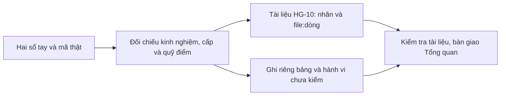

TÓM TẮT 1: [NGUỒN] DONE phần tài liệu HG-10: 6/6 câu hỏi có câu trả lời hoặc nhãn CHƯA KIỂM; giữ nguyên kết luận hai sổ tay. `JX1_OPS/DESIGN/HIEU-CAP-KINH-NGHIEM.md:36–45,126–131`.
TÓM TẮT 2: [NGUỒN] [THẤY] Lên một cấp thưởng 5 tiềm năng và 1 điểm kỹ năng; nhánh đã đọc đặt kinh nghiệm về 0, không giữ phần dư. `S/KPlayer.cpp:60–62,3264–3279`.
TÓM TẮT 3: [NGUỒN] Đã tạo `JX1_OPS/DESIGN/HIEU-CAP-KINH-NGHIEM.md`, báo cáo này và bổ sung mục Kết quả cuối task theo yêu cầu.
TÓM TẮT 4: [CHƯA KIỂM] Chưa có dữ liệu hai bảng, header đường dẫn server, luật Lua và hành vi thực chạy; không ghi được nhịp ngoài vùng sandbox cho phép ghi. `S/KPlayerSet.cpp:19,1291–1322`; `S/KPlayer.cpp:5405,5483–5497`.
TÓM TẮT 5: [CHƯA KIỂM] Không build, chạy exe, VM hoặc mạng; không stage/commit/push, chưa có SHA; Tổng quan thực hiện commit theo yêu cầu của người giao.

# HG-10 — Báo cáo khảo sát cấp, kinh nghiệm và điểm tiềm năng

Loại: khảo sát
Chủ đề: Bàn giao tài liệu hiểu hệ thống tăng trưởng nhân vật từ nguồn server/client được giao.
Từ khóa: cấp nhân vật, kinh nghiệm, tiềm năng, điểm kỹ năng, LevelUp, AddSelfExp, DirectAddExp, level_exp, level_add
Trạng thái: DONE — hoàn thành đầu ra tài liệu; dữ liệu thiếu và nhịp ngoài sandbox được công khai bên dưới.
Độ phủ: 6/6 câu hỏi, 2/2 sổ tay đối chiếu, 2/2 tên bảng xác định phía client; 0/2 bảng dữ liệu mở được.
Liên quan: [Tài liệu HG-10](../DESIGN/HIEU-CAP-KINH-NGHIEM.md), [Sổ tay nhân vật](../DESIGN/SO-TAY-NHAN-VAT.md), [Sổ tay kỹ năng](../DESIGN/SO-TAY-KY-NANG.md), [Task](../TASKS/HG-10.md).
Cần tôi quyết định: không; Tổng quan có thể bổ sung nguồn bảng trong task sau.

## Phạm vi và độ phủ

| Phần việc | Trạng thái | Bằng chứng / đầu ra |
|---|---|---|
| Cộng kinh nghiệm, ngưỡng và lên cấp | Đã phủ tĩnh | [THẤY] `S/KPlayer.cpp:2935–3059,3099–3179,3232–3279`; tài liệu mục 1–3 |
| Bảng ở Settings | Đã định vị cách gọi; chưa có số từng hàng | [THẤY] `C/CoreUseNameDef.h:103–104`; `S/KPlayerSet.cpp:1291–1333`; tài liệu mục 2 |
| Thưởng/tiêu điểm tiềm năng | Đã phủ tĩnh, luật Lua chưa kiểm | [THẤY] `S/KPlayer.cpp:2571–2721,3277,5400–5430`; tài liệu mục 4 |
| Điểm kỹ năng và kinh nghiệm luyện chiêu | Đã phủ nhánh đã đọc, dữ liệu/Lua chưa kiểm | [THẤY] `S/KPlayer.cpp:3156–3208,3279,5460–5576`; tài liệu mục 5 |
| Client nhận kết quả lên cấp | Đã phủ tĩnh | [THẤY] `C/KPlayer.cpp:4517–4539,4554–4568` |
| Đối chiếu hai sổ tay | Đã phủ 2/2, không sửa sổ tay | [TÀI LIỆU] `JX1_OPS/DESIGN/SO-TAY-NHAN-VAT.md:7–17,34–42`; `SO-TAY-KY-NANG.md:110–117`; tài liệu mục 6 |
| Giới hạn thực hiện | Không build, exe, VM, mạng hoặc sửa mã; nhịp ngoài sandbox chưa ghi | Quyền tại `JX1_OPS/TASKS/HG-10.md:27–31`; sandbox chỉ cho ghi trong worktree và thư mục tạm |

**Quy ước nguồn:** `S/` và `C/` được khai báo đầy đủ tại `JX1_OPS/DESIGN/HIEU-CAP-KINH-NGHIEM.md:47–57`. Server đọc chú thích bằng GBK/CP936; client dùng định danh ASCII và phần mã đọc được, không suy từ chú thích lỗi. Tài liệu mới ghi UTF-8 không BOM.

## Giải mã tên

Không nêu tên riêng kỹ năng, trang bị, quái, NPC hoặc bản đồ. Bảng tên trường và bốn thuộc tính nằm tại `JX1_OPS/DESIGN/HIEU-CAP-KINH-NGHIEM.md:59–68`; không đổi chuỗi gốc hay tự nhận là nhãn giao diện.

| Tên gốc | Mã hóa | Chữ đúng / ý nghĩa | Nguồn file:dòng |
|---|---|---|---|
| `level_exp.txt` | ASCII | Bảng ngưỡng kinh nghiệm theo cấp | [THẤY] `C/CoreUseNameDef.h:103`; `S/KPlayerSet.cpp:1291–1301` |
| `level_add.txt` | ASCII | Bảng hệ số tăng chỉ số theo hệ | [THẤY] `C/CoreUseNameDef.h:104`; `S/KPlayerSet.cpp:1303–1319` |

## Sắp theo cấu trúc game

Tài liệu đi theo nhân vật → kinh nghiệm → lên cấp → nhận/tiêu điểm → đối chiếu sổ tay; cách đọc bảng theo cấp và hệ được giữ riêng. Không sắp thành một danh sách file thay cho lời giải thích game. `JX1_OPS/DESIGN/HIEU-CAP-KINH-NGHIEM.md:70–131`.

## Đã xác minh

- **[THẤY]** `DirectAddExp()` và `AddSelfExp()` tự cộng kinh nghiệm và gọi lên cấp; không gộp điều kiện của chúng. `LevelUp()` tăng một cấp, quỹ 5/1 điểm và xóa kinh nghiệm. `S/KPlayer.cpp:3099–3179,3232–3279`.
- **[THẤY]** Client có đường dẫn hai bảng, hai phía nạp bằng cột và thứ tự hàng; hàm lên cấp phía server gửi dữ liệu cho client. `C/CoreUseNameDef.h:103–104`; `C/KPlayerSet.cpp:243–285`; `S/KPlayerSet.cpp:1291–1333`; `S/KPlayer.cpp:3339–3351`.
- **[THẤY]** Tiêu tiềm năng cần số dương, không vượt quỹ ở bốn hàm; nâng kỹ năng thường trừ điểm sau khi nâng thành công và còn kiểm điều kiện. `S/KPlayer.cpp:2571–2721,5460–5576`.
- **[TÀI LIỆU]** Sổ tay nhân vật hiện tập trung hình ảnh; sổ tay kỹ năng để mở đường học đầy đủ. HG-10 đối chiếu và bổ sung, không sửa kết luận cũ. `JX1_OPS/DESIGN/SO-TAY-NHAN-VAT.md:7–17,34–42`; `JX1_OPS/DESIGN/SO-TAY-KY-NANG.md:110–117,142–145`.

## Chưa xác minh

- **[CHƯA KIỂM]** Hai bảng dữ liệu thực tế, giá trị kinh nghiệm từng cấp, mức tăng chỉ số từng hệ và literal header server còn thiếu. Không lấy ngưỡng khởi tạo 48 thay dữ liệu bảng. `S/KPlayer.cpp:60,161–162`; `S/KPlayerSet.cpp:19,1291–1322`.
- **[CHƯA KIỂM]** Cấu hình thật, giới hạn cấp từng người, luật Lua, script nâng riêng và mọi đường thưởng/đặt cấp khác. `S/KGameglobalSet.cpp:126`; `S/KPlayer.cpp:3235–3242,5405–5413,5483–5497`.
- **[CHƯA KIỂM]** Runtime và tính tương ứng source/binary; task không cho build, exe, VM hoặc mạng. Kết quả là khảo sát tĩnh, không có số đo hay kiểm thử game.

## Mục sổ thông số

Các giá trị dưới đây là đọc mã, không phải cấu hình đã nạp hoặc số đo runtime. Đánh giá đổi không cấp quyền sửa trong HG-10.

| Nhóm | Tên/hằng số | file:dòng | Giá trị | Đơn vị | Ảnh hưởng | Đổi an toàn | Nguồn đo |
|---|---|---|---|---|---|---|---|
| Thưởng cấp | `PLAYER_LEVEL_ADD_ATTRIBUTE` | `S/KPlayer.cpp:61,3277` | [THẤY] 5 | điểm/lần tăng cấp | Quỹ tiềm năng chưa dùng | CẨN THẬN — cần kiểm mọi đường thưởng/đồng bộ | Đọc tĩnh; chưa đo |
| Thưởng cấp | `PLAYER_LEVEL_ADD_SKILL` | `S/KPlayer.cpp:62,3279` | [THẤY] 1 | điểm/lần tăng cấp | Quỹ điểm kỹ năng chưa dùng | CẨN THẬN — ảnh hưởng cân bằng và dữ liệu nhân vật | Đọc tĩnh; chưa đo |
| Ngưỡng khởi tạo | `PLAYER_LEVEL_1_EXP` | `S/KPlayer.cpp:60,161–162` | [THẤY] 48; chưa phải hàng bảng xác nhận | điểm kinh nghiệm | Giá trị gán khi khởi tạo đối tượng | CẨN THẬN — phải đối chiếu bảng và luồng đăng nhập | Đọc tĩnh; chưa đo |
| Trần kỹ thuật | `MAX_LEVEL` | `S/KPlayerSet.h:6`; `S/KPlayer.cpp:3268–3273` | [THẤY] 500 | cấp | Giới hạn mã và số phần tử ngưỡng | CẨN THẬN — liên quan mảng, dữ liệu, client và binary | Đọc tĩnh; chưa đo |
| Trần cấu hình | `PlayerMaxLevel` | `S/KGameglobalSet.cpp:126`; `S/KPlayer.cpp:3237–3242` | [THẤY] Dự phòng 1000; giá trị nạp chưa kiểm | cấp | Kiểm riêng tại `DirectAddExp`, cộng thêm `m_nLimitMaxLevel` | CẨN THẬN — không coi đây là trần hiệu lực chung | Đọc tĩnh; chưa đo |
| Ngưỡng từng cấp | `GetLevelExp(L)` | `S/KPlayerSet.cpp:1297–1299,1329–1333` | [CHƯA KIỂM] Hàng L+1, cột 2; thiếu giá trị | điểm kinh nghiệm | Điều kiện chuyển cấp | CẨN THẬN — chưa có bảng để đánh giá | Đọc cách nạp; chưa mở bảng |
| Tăng chỉ số | `level_add.txt`, cột 2–13 | `S/KPlayerSet.cpp:1306–1319` | [CHƯA KIỂM] Thiếu giá trị từng hệ | Tùy chỉ số/cấp hoặc điểm thuộc tính | Sinh lực, thể lực, nội lực, kháng và hệ số khác | CẨN THẬN — thiếu bảng gốc | Đọc cách nạp; chưa mở bảng |

## Kiểm tra thực chạy và xử lý vướng mắc

| Kiểm tra / vướng mắc | Cách làm và kết quả |
|---|---|
| Điểm bắt đầu | `git status --short --branch` chạy một lần: nhánh `task/HG-10`, không có thay đổi sẵn; hai đầu ra HG-10 chưa tồn tại nên không có phần dở để làm lại. |
| Công cụ tìm kiếm | Lệnh `rg` đầu tiên báo không được nhận diện. Chuyển sang `Select-String` và `Get-ChildItem` lọc tên; không cài công cụ hoặc chạy Graphify. |
| Chữ Việt trên console | Lượt đọc đầu hiển thị sai do console/encoding. Đặt console UTF-8 và đọc tài liệu bằng UTF-8 để xác nhận; không đổi nội dung nguồn. Chú thích server đọc GBK/CP936; chữ lỗi có sẵn trong client được bỏ khỏi căn cứ. |
| Tệp bảng và header thiếu | Kiểm các đường cụ thể và tìm theo đúng tên như tài liệu mục 2; không trả về bảng. Header server thiếu ở đường include và trong `Sources`; giữ nhãn CHƯA KIỂM, không đi tìm root khác hoặc mở dữ liệu tài khoản. |
| Đọc lại đầu ra | Đã kiểm tiếng Việt/UTF-8 không BOM, đủ 5 dòng tóm tắt, metadata, Mermaid, độ phủ, giải mã tên, trình tự game, nhãn, nguồn và mục xác minh; kiểm tra bàn giao cuối giới hạn đúng ba tệp được giao. |
| Nhịp sống | Không ghi `D:/JX-wt/HG-10.nhip`: tệp là anh em của worktree, nằm ngoài vùng được phép ghi; chính sách không cho yêu cầu nâng quyền. Không thử vượt sandbox, không ghi nhịp sang tệp khác ngoài phạm vi. Mốc thông báo trong phiên: bắt đầu, xong đọc/đối chiếu, xong bản tài liệu, kiểm tra bàn giao. |
| Build/test game | Chưa chạy, theo đúng lệnh cấm của task. Không ghi nhận build hoặc runtime đạt. Kiểm tra cấu trúc văn bản không thay thế kiểm thử game. |

## Đề xuất tối ưu

- Bổ sung đúng bản `level_exp.txt`, `level_add.txt` và header tương ứng để thay các ô CHƯA KIỂM bằng số liệu có nguồn; không chép bảng từ phiên bản khác.
- Khi có task cho chạy thử, ưu tiên ca vừa chạm ngưỡng, vượt nhiều ngưỡng, chạm trần cấp và nâng điểm bị Lua từ chối; hiện đây chỉ là đề xuất, chưa chạy.

## Bàn giao

- Chỉ tạo tài liệu trong `vung_file`, báo cáo này và thêm kết quả cuối task theo chỉ định trực tiếp; không sửa mã, hai sổ tay hay `BAI_HOC.md`.
- Không tạo `_CHIMUC/HG-10.tsv` riêng vì ngoài phạm vi ghi được giao. Hàng mục lục bên dưới để Tổng quan gộp vào `JX1_OPS/DESIGN/MUC-LUC-TRI-THUC.md`; không tự sửa mục lục.
- Không stage, commit hoặc push; chưa có SHA. Tổng quan phụ trách commit và có thể ghi nhịp tại đường dẫn được yêu cầu bằng tiến trình có quyền phù hợp.

| file | loại | chủ đề | từ khóa | trạng thái | độ phủ | liên quan |
|---|---|---|---|---|---|---|
| `JX1_OPS/DESIGN/HIEU-CAP-KINH-NGHIEM.md` | khảo sát | Cấp, kinh nghiệm và điểm tiềm năng | cấp; kinh nghiệm; tiềm năng; LevelUp; AddSelfExp; DirectAddExp; level_exp; level_add | DONE — tĩnh, có giới hạn | 6/6 câu hỏi; 0/2 bảng dữ liệu | `SO-TAY-NHAN-VAT.md`; `SO-TAY-KY-NANG.md`; `REPORTS/HG-10.md` |

Kỹ năng đã dùng: jx1-retrofit, jx1-read-server, jx1-read-client, jx1-parameters, jx1-knowledge, jx1-report — đã nạp từ `.agents/skills`; chỉ áp dụng trong quyền task, không đổi kết luận cũ hoặc tự commit theo hướng dẫn chung của skill.
