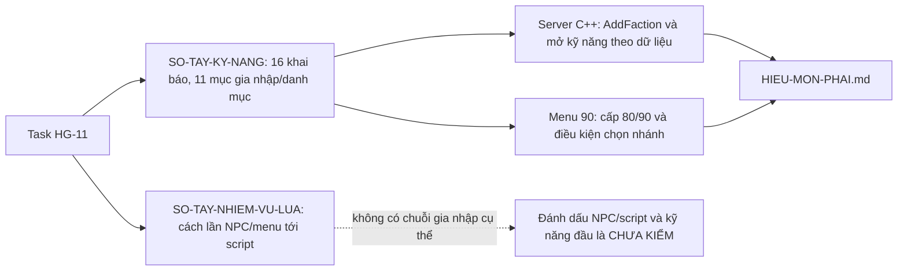

TÓM TẮT 1: [NGUỒN] HG-11 hoàn tất tài liệu môn phái/kỹ năng; phân biệt mục khai báo, danh mục và phần chưa đủ nguồn. `JX1_OPS/DESIGN/HIEU-MON-PHAI.md:1–5`.
TÓM TẮT 2: [NGUỒN] Có 16 mục khai báo, trong đó 11 mục đầu có dòng gia nhập và danh mục kỹ năng trong sổ nguồn. `JX1_OPS/DESIGN/SO-TAY-KY-NANG.md:34,41–57`.
TÓM TẮT 3: [NGUỒN] Menu 90 có cổng cấp 80 cùng kiểm tra kỹ năng/cờ nhiệm vụ; kỹ năng đầu cụ thể từng phái chưa có ánh xạ đủ. `JX1_OPS/DESIGN/SO-TAY-KY-NANG.md:112–113`.
TÓM TẮT 4: [NGUỒN] Server `AddFaction`/`OpenCurSkillLevel` và bộ nhận dữ liệu client đã đọc tĩnh; không xác định tên NPC/hội thoại. `C:/Jx1CocoV3/SwordOnline/SwordOnline/jxOnline/gameserver/Sources/Core/Src/KPlayerFaction.cpp:63–137`; `C:/Jx1CocoV3/Folder/Client2912-20260116T044348Z-3-001/Client2912/Client/Classes/gamecore/KProtocolProcess.cpp:89–99,1271–1312`.
TÓM TẮT 5: [CHƯA KIỂM] Không build/chạy game, exe, VM hoặc mạng; không commit; không có SHA; các bước còn thiếu được ghi trong tài liệu.

# HG-11 — Báo cáo hoàn tất

Loại: khảo sát
Chủ đề: Đối chiếu môn phái, điều kiện vào, kỹ năng ban đầu và đường NPC/script theo nguồn tĩnh được giao.
Từ khóa: môn phái, kỹ năng, Thiếu Lâm, Võ Đang, wudang, 武当, SKILLNORMAL, AddMagic
Trạng thái: DONE — đầu ra hoàn thành theo tiêu chí, các chi tiết chưa đủ chứng cứ ghi rõ CHƯA KIỂM.
Độ phủ: 16/16 mục khai báo đã được đưa vào; 11/16 có gia nhập/danh mục; chưa xác định được ánh xạ kỹ năng đầu từng phái.
Liên quan: `JX1_OPS/DESIGN/SO-TAY-KY-NANG.md`, `JX1_OPS/DESIGN/SO-TAY-NHIEM-VU-LUA.md`, `JX1_OPS/DESIGN/MUC-LUC-TRI-THUC.md`.
Cần tôi quyết định: không.

## Phạm vi và độ phủ

| Phần việc | Kết quả | Bằng chứng |
| --- | --- | --- |
| Môn phái trong dữ liệu | 16 mục; 11 dòng đầu có danh mục gia nhập/kỹ năng; 5 dòng cuối mới xác nhận khai báo | `JX1_OPS/DESIGN/SO-TAY-KY-NANG.md:34,41–57` |
| Điều kiện vào | Luồng C++ nhận ID phái đã đối chiếu; tiền đề gia nhập/hội thoại cụ thể chưa kiểm | `C:/Jx1CocoV3/SwordOnline/SwordOnline/jxOnline/gameserver/Sources/Core/Src/KPlayerFaction.cpp:63–94`; `JX1_OPS/DESIGN/SO-TAY-KY-NANG.md:112` |
| Kỹ năng đầu | Sổ ghi `SKILLNORMAL` → `AddMagic`; không có ánh xạ đủ mã/cấp theo từng phái | `JX1_OPS/DESIGN/SO-TAY-KY-NANG.md:112`; đầu ra `JX1_OPS/DESIGN/HIEU-MON-PHAI.md` |
| NPC/script dẫn tới | Chưa xác định tên/đường gọi; mã C++ phái không chỉ ra NPC | `JX1_OPS/DESIGN/SO-TAY-NHIEM-VU-LUA.md:130`; `C:/Jx1CocoV3/SwordOnline/SwordOnline/jxOnline/gameserver/Sources/Core/Src/KPlayerFaction.cpp:63–137` |
| Đối chiếu client/server | Kiểm tra bộ xử lý dữ liệu phái/kỹ năng ở client và lưu/mở phái ở server | `C:/Jx1CocoV3/Folder/Client2912-20260116T044348Z-3-001/Client2912/Client/Classes/gamecore/KProtocolProcess.cpp:89–99,1271–1312`; `C:/Jx1CocoV3/SwordOnline/SwordOnline/jxOnline/gameserver/Sources/Core/Src/KPlayerFaction.cpp:63–137` |

## Giải mã tên

Tên được giữ theo cách viết trong sổ kỹ năng; tên gốc là GBK theo tài liệu đó. Chưa đối chiếu lại byte gốc trong lượt này. `JX1_OPS/DESIGN/SO-TAY-KY-NANG.md:61–82`.

| Tên gốc | Mã hóa | Chữ đúng | Nguồn |
| --- | --- | --- | --- |
| 少林派 | GBK | Thiếu Lâm | `JX1_OPS/DESIGN/SO-TAY-KY-NANG.md:63–82` |
| 天王帮 | GBK | Thiên Vương | `JX1_OPS/DESIGN/SO-TAY-KY-NANG.md:63–82` |
| 唐门 | GBK | Đường Môn | `JX1_OPS/DESIGN/SO-TAY-KY-NANG.md:63–82` |
| 五毒教 | GBK | Ngũ Độc | `JX1_OPS/DESIGN/SO-TAY-KY-NANG.md:63–82` |
| 峨嵋派 | GBK | Nga My | `JX1_OPS/DESIGN/SO-TAY-KY-NANG.md:63–82` |
| 翠烟门 | GBK | Thúy Yên | `JX1_OPS/DESIGN/SO-TAY-KY-NANG.md:63–82` |
| 丐帮 | GBK | Cái Bang | `JX1_OPS/DESIGN/SO-TAY-KY-NANG.md:63–82` |
| 天忍教 | GBK | Thiên Nhẫn | `JX1_OPS/DESIGN/SO-TAY-KY-NANG.md:63–82` |
| 武当派 | GBK | Võ Đang | `JX1_OPS/DESIGN/SO-TAY-KY-NANG.md:63–82` |
| 昆仑派 | GBK | Côn Lôn | `JX1_OPS/DESIGN/SO-TAY-KY-NANG.md:63–82` |
| 华山派 | GBK | Hoa Sơn | `JX1_OPS/DESIGN/SO-TAY-KY-NANG.md:63–82` |
| 李寻欢 | GBK | Lý Tầm Hoan | `JX1_OPS/DESIGN/SO-TAY-KY-NANG.md:63–82` |
| 桃花岛 | GBK | Đào Hoa Đảo | `JX1_OPS/DESIGN/SO-TAY-KY-NANG.md:63–82` |
| 明教 | GBK | Minh Giáo | `JX1_OPS/DESIGN/SO-TAY-KY-NANG.md:63–82` |
| 段氏 | GBK | Đoàn Thị | `JX1_OPS/DESIGN/SO-TAY-KY-NANG.md:63–82` |
| 自创门派 | GBK | Tự sáng môn phái | `JX1_OPS/DESIGN/SO-TAY-KY-NANG.md:63–82` |

## Sắp theo cấu trúc game

**[TÀI LIỆU]** Đầu ra sắp theo ID phái → nhánh menu 90 → cấp yêu cầu/tối đa; không coi nhánh menu là kỹ năng đầu. Dòng 0–10 có dữ liệu nhánh, ID 11–15 để CHƯA KIỂM. `JX1_OPS/DESIGN/SO-TAY-KY-NANG.md:91,95–106`.

## Đã xác minh / Chưa xác minh

- **Đã xác minh, mức tài liệu/source tĩnh:** hai báo cáo được giao đã đọc; mã server `KPlayerFaction.cpp` kiểm tra ID và mở kỹ năng theo cấu hình; client `KProtocolProcess.cpp` xử lý gói dữ liệu phái/kỹ năng. Đây không phải xác nhận runtime.
- **Chưa xác minh:** điều kiện gia nhập cụ thể, ánh xạ kỹ năng đầu theo từng phái, NPC/script hội thoại, phái thực sự mở ở runtime.
- **Kiểm tra:** đọc tĩnh có giới hạn tại `C:/Jx1CocoV3/Folder/Client2912-20260116T044348Z-3-001/Client2912/Client/Classes` và `C:/Jx1CocoV3/SwordOnline/SwordOnline/jxOnline/gameserver/Sources`; không chạy build/test game, exe, VM hay mạng.

## Mục sổ thông số

Giá trị dưới đây là đọc tĩnh gián tiếp từ sổ kỹ năng, chưa đo runtime. `JX1_OPS/DESIGN/SO-TAY-KY-NANG.md:34,95–106,113`.

| Nhóm | Tên/giá trị | Nguồn file:dòng | Đơn vị | Ảnh hưởng | Đổi an toàn | Nguồn đo |
| --- | --- | --- | --- | --- | --- | --- |
| Phái | 16 khai báo; 11 mục có gia nhập/danh mục | `JX1_OPS/DESIGN/SO-TAY-KY-NANG.md:34,41–57` | mục dữ liệu | Độ phủ danh mục | CẨN THẬN | TÀI LIỆU, đọc tĩnh gián tiếp |
| Menu 90 | Cấp 80 ở 10 phái; Hoa Sơn cấp 90 | `JX1_OPS/DESIGN/SO-TAY-KY-NANG.md:95–106,113` | cấp nhân vật | Cổng menu/nhánh kỹ năng theo tài liệu | CẨN THẬN | TÀI LIỆU, đọc tĩnh gián tiếp |
| Nhánh | Cấp tối đa 20; ngoại lệ dòng Võ Đang ID 365 tối đa 30 | `JX1_OPS/DESIGN/SO-TAY-KY-NANG.md:95–105` | cấp kỹ năng | Trần dòng kỹ năng | CẨN THẬN | TÀI LIỆU, đọc tĩnh gián tiếp |
| Kỹ năng đầu | Mã/cấp từng phái chưa ánh xạ đủ | `JX1_OPS/DESIGN/SO-TAY-KY-NANG.md:112` | chưa xác minh | Không suy thành cổng gameplay | CẨN THẬN | CHƯA KIỂM |

## Đề xuất tối ưu

Không đề xuất thay đổi cấu hình/gameplay. Nếu cần nâng mức xác minh, giao task đọc tĩnh giới hạn đúng Lua/dữ liệu gia nhập để tìm tiền đề, tên NPC và ánh xạ `SKILLNORMAL` cho từng ID; không dùng thứ tự nhánh menu 90 làm đại diện.

## Lỗi tra cứu và xử lý

- Lần kiểm tra ban đầu dùng `-Include` với `Get-ChildItem -LiteralPath`, nhưng PowerShell không áp bộ lọc trong dạng lệnh đó nên kết quả có cả tệp build. Dừng ngay, không dùng tệp build làm bằng chứng; lần sau lọc theo phần mở rộng `.cpp/.h` rồi mở đúng tệp nguồn.
- `rg` không có trong môi trường. Dùng PowerShell `Select-String` trên các tệp và symbol cụ thể; không cài thêm công cụ.

## Bàn giao

- Đã tạo `JX1_OPS/DESIGN/HIEU-MON-PHAI.md` và báo cáo này; task ghi kết quả ở cuối `JX1_OPS/TASKS/HG-11.md`.
- Không commit theo yêu cầu task; không có SHA hoặc trạng thái push.
- Mục lục đề nghị PM gộp: `Môn phái, kỹ năng khởi đầu | JX1_OPS/DESIGN/HIEU-MON-PHAI.md | KPlayerFaction.cpp::AddFaction/OpenCurSkillLevel | khảo sát tĩnh`.
- Kỹ năng đã dùng: `jx1-retrofit` (kiểm khuôn, không retrofit báo cáo cũ), `jx1-read-server`, `jx1-read-client`, `jx1-parameters`, `jx1-knowledge`, `jx1-report`.

liên quan: `JX1_OPS/DESIGN/SO-TAY-KY-NANG.md`, `JX1_OPS/DESIGN/SO-TAY-NHIEM-VU-LUA.md`, `JX1_OPS/DESIGN/MUC-LUC-TRI-THUC.md`.
