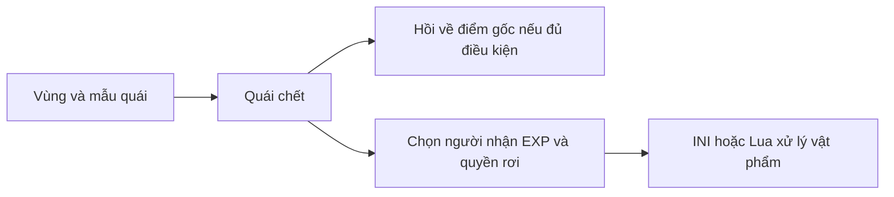

# TÓM TẮT 5 DÒNG
1. [NGUỒN] DONE phần khảo sát tĩnh: trả lời 4/4 câu hỏi và đối chiếu 2/2 sổ tay theo `TASKS/HG-12.md:17–23`.
2. [THẤY] [NGUỒN] `ReviveFrame` lấy từ mẫu hoặc script; rơi đồ đi qua INI/Lua; EXP xét sát thương, cự ly và cấp. `KNpcTemplate.cpp:732`, `KNpc.cpp:2483–2506`, `KNpcDeathCalcExp.cpp:125–221`.
3. [NGUỒN] Đầu ra: [tài liệu hiểu game](../DESIGN/HIEU-QUAI-HOI-SINH-VAT-PHAM-ROI.md); đã thêm `Kết quả` vào [task](../TASKS/HG-12.md).
4. [CHƯA KIỂM] Từng map/quái, bảng đang gắn, tỉ lệ rơi quan sát được và EXP thực nhận chưa đối chiếu trong game.
5. [CHƯA KIỂM] Không build, chạy exe, VM, game hoặc mạng; không stage/commit theo yêu cầu, Tổng quan sẽ commit.

# HG-12 — Bàn giao khảo sát quái hồi sinh và vật phẩm rơi

Loại: khảo sát\
Chủ đề: Quy tắc hồi sinh, rơi vật phẩm và kinh nghiệm khi hạ quái.\
Từ khóa: điểm sinh, hồi sinh, respawn, ReviveFrame, rơi đồ, RandRate, kinh nghiệm, EXP\
Trạng thái: DONE — hoàn tất nội dung khảo sát và bàn giao trong worktree; tệp nhịp ngoài worktree bị chặn.\
Độ phủ: 4/4 câu hỏi mục tiêu, 2/2 sổ tay; chưa đo runtime.\
Liên quan: [Tài liệu hiểu game](../DESIGN/HIEU-QUAI-HOI-SINH-VAT-PHAM-ROI.md), [Sổ tay quái, NPC và bản đồ](../DESIGN/SO-TAY-QUAI-NPC-BAN-DO.md), [Sổ tay kinh tế](../DESIGN/SO-TAY-KINH-TE.md).\
Cần tôi quyết định: không

Các tham chiếu tên tệp C++ cùng root server/client như quy ước ở đầu tài liệu hiểu game. Tài liệu dùng UTF-8; tên kỹ thuật trích từ source dùng ASCII.

## Phạm vi và độ phủ

| Phạm vi | Độ phủ | Bằng chứng |
|---|---|---|
| Điểm sinh và điều kiện hồi | Đã phủ | `KRegion.cpp:201`, `KNpcSet.cpp:533–536`, `KNpc.cpp:2671–2698`, `KNpc.cpp:13905` |
| Thời gian hồi và ghi đè | Đã phủ ở mức đọc tĩnh | `KNpcTemplate.cpp:732`, `KNpc.cpp:3398`, `KNpc.cpp:6843–6849`, `ScriptFuns.cpp:19386–19416` |
| Bảng rơi và tỉ lệ | Đã phủ ở mức quy tắc, chưa đo | `KNpcTemplate.cpp:129–212`, `KNpc.cpp:11884–11900`, `KNpc.cpp:12617–12640` |
| Kinh nghiệm | Đã phủ ở mức công thức, chưa đo | `KNpcTemplate.cpp:877–884`, `KNpcDeathCalcExp.cpp:125–221`, `KPlayer.cpp:2936–3154` |
| Đối chiếu sổ tay và client | Đã phủ nội dung liên quan | `SO-TAY-QUAI-NPC-BAN-DO.md:49–52`, `SO-TAY-KINH-TE.md:91–108`, `gamecore/KProtocolProcess.cpp:508–512`, `gamecore/KProtocolProcess.cpp:2721–2766` |

## Giải mã tên

Không đưa thêm tên hiển thị của quái, NPC, vật phẩm hay bản đồ. Ca kỹ thuật trong sổ kinh tế được ghi ở mục Giải mã tên của [tài liệu hiểu game](../DESIGN/HIEU-QUAI-HOI-SINH-VAT-PHAM-ROI.md#giải-mã-tên).

## Sắp theo cấu trúc game

[THẤY] Map/vùng → mẫu và điểm sinh → lúc quái chết → hồi sinh, đồ rơi, EXP. Sổ dưới đây xếp theo các khâu này. `KRegion.cpp:201`, `KNpcSet.cpp:533–536`, `KNpc.cpp:2472–2506`, `KNpc.cpp:2671–2698`.

## Mục sổ thông số

| Nhóm | Tên/hằng số | file:dòng | Giá trị | Đơn vị | Ảnh hưởng | Đổi an toàn | Nguồn đo |
|---|---|---|---|---|---|---|---|
| Nhịp server | `GAME_FPS` | `MultiServer/GameServer/KSOServer.cpp:90`, `MultiServer/GameServer/KSOServer.cpp:1441–1450` | 18 | frame/giây danh định | Cơ sở đổi thời gian | CẨN THẬN | Hằng số và vòng lặp trong mã; chưa đo |
| Mẫu | `DeathFrame` | `KNpcTemplate.cpp:662`, `KNpc.cpp:2543` | 12 mặc định khi đọc mẫu | frame | Giai đoạn chết trước khi xét hồi | CẨN THẬN | Đọc tĩnh |
| Hồi sinh | `m_ReviveFrame` / `ReviveFrame` | `KNpc.cpp:405`, `KNpcTemplate.cpp:732`, `KNpc.cpp:11213` | 1.080 lúc khởi tạo; 2.400 mặc định khi đọc mẫu | frame | Chờ tương ứng 60 và khoảng 133,3 giây ở 18 Hz | CẨN THẬN | Đọc tĩnh, quy đổi frame/18; chưa đo |
| Rơi đồ | `Count`, `RandRange`, `RandRate` | `KNpcTemplate.cpp:138`, `KNpcTemplate.cpp:164`, `KNpcTemplate.cpp:198` | Theo bảng; ví dụ 52 mục, miền 1.000.000, tổng trọng số 68.000 | mục; kích thước miền; trọng số | Chọn mục theo dải, có thể trượt | CẨN THẬN | Mã nạp và mẫu dẫn lại từ `SO-TAY-KINH-TE.md:95` |
| Rơi đồ | `nTypeNum` | `KNpcTemplate.cpp:177`, `KNpc.cpp:11778–11788`, `KNpc.cpp:11870–11900` | 2 mặc định ở loader được gọi; nhánh chết dùng 3 khi số lượt còn không dương | lượt thử | Số lần thử rơi, có thể bị thay bởi `m_CurrentTreasure` | CẨN THẬN | Đọc tĩnh |
| Kinh nghiệm | `PLAYER_SHARE_EXP_DISTANCE` | `KPlayer.cpp:63`, `KPlayer.cpp:2976–2979`, `KPlayer.cpp:3003–3006` | 768 | đơn vị cự ly game | Xét thành viên cùng map để chia đội | CẨN THẬN | Đọc tĩnh |
| Kinh nghiệm | `ServerExp` | `KPlayer.cpp:3115–3116` | 1 mặc định khi đọc; cộng giá trị nhiệm vụ 27 trước khi nhân | hệ số | Điều chỉnh EXP cá nhân | CẨN THẬN | Mặc định trong mã; chưa đối chiếu cấu hình đang dùng |

## Đã xác minh / Chưa xác minh

- **Đã xác minh:** đo bằng đọc tĩnh và đối chiếu `file:dòng`. Điểm hồi dùng tọa độ gốc (`KNpc.cpp:13903–13921`). Đã kiểm thân `LoseSingleItem` đang hoạt động ở `KNpc.cpp:12606` và loader được `InitDropRate` gọi ở `KNpcTemplate.cpp:547`, tránh nhầm các thân tương tự. Hai sổ tay giữ nguyên.
- **Chưa xác minh:** giá trị theo từng hàng mẫu và bảng thực gắn, nhánh Lua được gọi trong phiên, thời gian hồi thực đo, tỉ lệ rơi và EXP thực nhận. Không chạy build/test game, server, client, exe, VM hoặc mạng theo phạm vi duyệt.

## Đề xuất kiểm chứng tiếp

Nếu có đợt được duyệt, chọn một bản ghi quái thường và một ca boss đã biết map, tra đúng mẫu `ReviveFrame`, file INI và callback Lua trước khi đo. Ghi riêng thời gian chết, thời gian chờ hồi, số lần thử rơi/số món tạo và EXP của người đi lẻ/đội để đối chiếu từng nhánh. HG-12 không thay thông số.

## Bàn giao

- Sau khi kiểm Git, nhánh `task/HG-12` sạch và chưa có đầu ra. `rg` không có; đã dùng `Select-String` và đọc đoạn giới hạn bằng PowerShell. Tên dò `KScriptFuns.cpp` không tồn tại; đã xác định và đọc đúng `ScriptFuns.cpp`.
- Thử ghi nhịp tại `D:\JX-wt\HG-12.nhip` ở mốc bắt đầu trả về `Access to the path 'D:\JX-wt\HG-12.nhip' is denied.` Sandbox chỉ cho ghi trong worktree, nên không ghi được các mốc tiếp theo ở đường dẫn này.
- Tổng quan sẽ commit ba tệp được giao. Hàng đề xuất cho `DESIGN/MUC-LUC-TRI-THUC.md`: `Quái hồi sinh, vật phẩm rơi và EXP | DESIGN/HIEU-QUAI-HOI-SINH-VAT-PHAM-ROI.md, REPORTS/HG-12.md | KRegion::LoadServerNpc, KNpc::Revive, KNpc::LoseSingleItem, KNpcDeathCalcExp::CalcExp | khảo sát tĩnh`. Không sửa mục lục hay tạo TSV ngoài vùng được giao.
- Kỹ năng đã dùng: jx1-retrofit, jx1-read-server, jx1-read-client, jx1-parameters, jx1-knowledge, jx1-report.
