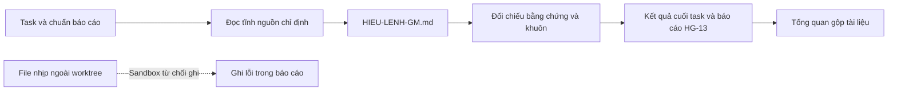

TÓM TẮT 1 — [NGUỒN] PARTIAL toàn yêu cầu: đã hoàn tất nội dung khảo sát HG-13; file nhịp ngoài worktree bị từ chối ghi. Phạm vi nội dung: `JX1_OPS/TASKS/HG-13.md:19-31`.
TÓM TẮT 2 — [NGUỒN] Đã phân loại 7 lệnh GM trực tiếp, 9 tên Fs cũ và 9 wrapper Lua gm_*; tách rõ mã còn hoạt động, mã chú thích và quyền chưa kiểm: `S/Core/Src/KProtocolProcess.cpp:8185-8238`, `S/Core/Src/KGMCommand.cpp:9-25`, `S/Core/Src/ScriptFuns.cpp:26451-26459`.
TÓM TẮT 3 — [NGUỒN] Đầu ra `JX1_OPS/DESIGN/HIEU-LENH-GM.md`; đã ghi mục Kết quả cuối task. Báo cáo C-01/C-03 chỉ dùng làm nguồn, giữ nguyên kết luận.
TÓM TẮT 4 — [CHƯA KIỂM] Thiếu D-02 và console.ps1; chưa kiểm script GM triển khai, xác thực gateway, binary và quyền thực tế. Không đoán tập lệnh console.
TÓM TẮT 5 — [CHƯA KIỂM] Chưa chạy build, test nghiệp vụ, exe, VM hoặc mạng; không commit/push theo yêu cầu, chưa có SHA mới; Tổng quan gộp tài liệu và xử lý quyền ghi nhịp nếu cần.

# HG-13 — Bàn giao khảo sát lệnh GM và công cụ quản trị

Loại: khảo sát
Chủ đề: Bàn giao tài liệu hiểu lệnh GM, đường gọi và giới hạn xác minh quyền.
Từ khóa: lệnh GM, Game Master, gs001, console, Lua, gm_operation, jxadm, jxweb
Trạng thái: PARTIAL — nội dung tài liệu DONE theo tiêu chí khảo sát tĩnh; yêu cầu NHỊP không hoàn tất do đường dẫn ngoài sandbox.
Độ phủ: tài liệu xử lý 6/6 nhóm câu hỏi, có nhãn cho mắt xích chưa kiểm; kiểm kê đủ 7 nhánh GM trực tiếp, 9 tên Fs và 9 wrapper gm_* trong các bảng đã định vị.
Liên quan: `JX1_OPS/TASKS/HG-13.md`, `JX1_OPS/DESIGN/HIEU-LENH-GM.md`, `JX1_OPS/REPORTS/C-01-jxadm.md`, `JX1_OPS/REPORTS/C-03-jxweb.md`
Cần tôi quyết định: không

## Sơ đồ bàn giao

## Phạm vi và độ phủ

| Phần việc | Kết quả | Căn cứ |
|---|---|---|
| Nhận việc và tiếp tục phần thiếu | Đã kiểm Git một lần: nhánh `task/HG-13`, sạch; hai đầu ra chưa tồn tại nên tạo mới | Lệnh thực chạy `git status --short --branch` và `Test-Path` đầu phiên |
| Nguồn task yêu cầu | Đã đọc chuẩn, task; tìm thấy C-01/C-03; không thấy D-02 và console.ps1 | `JX1_OPS/TASKS/HG-13.md:23-25`; kiểm tồn tại/lọc tên bằng PowerShell |
| Client → server và 7 lệnh | Đã đối chiếu tĩnh | `C/vn/gamescence/KgameWorldVN.cpp:4359-4512`, `C/gamecore/KProtocol.cpp:1208-1216`, `S/Core/Src/KProtocolProcess.cpp:323,349-362,8185-8238` |
| Bộ Fs cũ | Đã đối chiếu đủ 9 tên, chỗ gọi và hàm rỗng | `S/Core/Src/KGMCommand.cpp:9-25,88-165`, `S/Core/Src/KGMProcess.cpp:32-40,82-93`, `S/Core/Src/KPlayerChat.cpp:491-496`, `S/Core/Src/KPlayer.cpp:8752-8782` |
| Lua và quyền | Đã đối chiếu wrapper, điểm nạp bảng/cờ và đích script; còn thiếu triển khai Lua/gateway | `S/Core/Src/ScriptFuns.cpp:6329-6365,20612-20761,26451-26459`, `S/Core/Src/CoreServerShell.cpp:316-325`, `S/Core/Src/KPlayerDBFuns.cpp:591-594` |
| Công cụ ngoài game | Dẫn lại đúng giới hạn của hai báo cáo; không sửa nguồn cũ | `JX1_OPS/REPORTS/C-01-jxadm.md:13,29-37,51-65`, `JX1_OPS/REPORTS/C-03-jxweb.md:14-23,53-57` |
| NHỊP | BỊ CHẶN tại `D:/JX-wt/HG-13.nhip`; không có bằng chứng đã ghi được bất kỳ mốc nào | Lỗi thực `UnauthorizedAccessException` / `Access to the path ... is denied.` |

## Giải mã tên

| Tên gốc | Mã hóa | Chữ đúng / giải nghĩa UTF-8 | Nguồn file:dòng |
|---|---|---|---|
| `GM`, `Game Master`, `c2s_gmcommand` | ASCII | Người quản trị game và loại gói GM | `S/Core/Src/KProtocolProcess.cpp:323,8185-8238` |
| `gs001` | ASCII | Tên đích build ở một cấu hình GameServer | `S/MultiServer/GameServer/GameServer.vcxproj:107` |
| `Lua`, `gm_operation` | ASCII | Hệ script và tên hàm xử lý thao tác GM | `S/Core/Src/CoreServerShell.cpp:325` |
| `jxadm`, `jxweb` | ASCII | Công cụ kế hoạch quản trị và trang trạng thái nội bộ | `JX1_OPS/REPORTS/C-01-jxadm.md:13`, `JX1_OPS/REPORTS/C-03-jxweb.md:14-18` |

## Sắp theo cấu trúc game

Đầu ra có bảng giải nghĩa định danh ASCII; không đưa tên riêng kỹ năng, vật phẩm, NPC hoặc bản đồ vào phạm vi. Các tên lệnh giữ nguyên, xếp theo nhân vật/tiền, liên GS, script/thế giới, quyền và công cụ. Nguồn: các bảng lệnh trong `JX1_OPS/DESIGN/HIEU-LENH-GM.md`, đối chiếu `S/Core/Src/KProtocolProcess.cpp:8206-8235` và `S/Core/Src/ScriptFuns.cpp:26451-26459`.

## Đã xác minh

- **Có đường gửi GM trong client VN:** ô chat nhận tiền tố riêng và gửi gói `c2s_gmcommand`; không suy đây là bản client đang phát hành: `C/vn/gamescence/KgameWorldVN.cpp:4500-4512`, `C/gamecore/KProtocol.cpp:1208-1216`.
- **Có bảy nhánh xử lý trực tiếp:** tiền, Xu, cấp cho một người/các ô người chơi và thoát GS. Toàn hàm nhận không thấy kiểm cờ GM; chưa kết luận vượt quyền thực tế: `S/Core/Src/KProtocolProcess.cpp:8185-8238`.
- **Không coi mọi Fs là dùng được:** ba nhóm chạy/nạp lại file bị chú thích; `DoScript` trả TRUE ngay; đường chat và relay cũng có phần bị vô hiệu: `S/Core/Src/KGMCommand.cpp:128-159`, `S/Core/Src/KPlayer.cpp:8752-8782`, `S/Core/Src/KGMProcess.cpp:32-40,82-93`.
- **Quyền có nhiều điểm riêng:** hai bảng GM, cờ `m_isGm`, helper `CheckGmName`; chưa có căn cứ xem chúng là một chốt áp dụng cho mọi lệnh: `S/Core/Src/KCore.cpp:596,658`, `S/Core/Src/KCore.h:308-321`, `S/Core/Src/KPlayerDBFuns.cpp:591-594`, `S/Core/Src/KPlayer.cpp:6054-6069`.
- **Lua có tuyến liên GS:** hàm wrapper gửi yêu cầu; GS chuyển sang `gm_operation.lua`. Không đồng nhất việc gửi yêu cầu với thay đổi đã thành công: `S/Core/Src/ScriptFuns.cpp:20612-20761`, `S/MultiServer/GameServer/KSOServer.cpp:4167-4180`, `S/Core/Src/CoreServerShell.cpp:316-325`.

Quy ước root: `S` = `C:/Jx1CocoV3/SwordOnline/SwordOnline/jxOnline/gameserver/Sources`; `C` = `C:/Jx1CocoV3/Folder/Client2912-20260116T044348Z-3-001/Client2912/Client/Classes`. Đây là phiên bản đường dẫn task giao, chưa đối chiếu với binary. Không chép mã nguồn game vào báo cáo; chỉ mô tả và dẫn file:dòng.

## Chưa xác minh và test

- Chưa có D-02 hoặc `C:/JX/sql/console.ps1`; chưa xác nhận tập lệnh và chốt quyền console. Phần `main` đã đọc không có bộ phân tích câu lệnh quản trị: `S/MultiServer/GameServer/GameServer.cpp:183-215`.
- Chưa đọc nội dung script Lua triển khai GM, script/menu gọi và tuyến gateway; chưa xác minh cấp quyền đang áp dụng, nhật ký, lưu bền tiền/cấp hoặc an toàn khi thoát tiến trình: `S/Core/Src/CoreServerShell.cpp:325`, `S/Core/Src/KProtocolProcess.cpp:8206-8235`.
- **Đã thực chạy:** kiểm Git đầu phiên; kiểm đường dẫn; tìm symbol và đọc đoạn bằng PowerShell; kiểm tra văn bản đầu ra và xem diff tài liệu. Đây là kiểm tra tài liệu, không phải test game.
- **Chưa chạy:** build, unittest C-01/C-03, game test, exe, VM, mạng, kết nối SQL hoặc thử bất kỳ lệnh GM nào. Những kết quả test được C-01/C-03 ghi là lịch sử của các báo cáo đó, không phải kết quả HG-13.

## Mục sổ thông số

| Nhóm | Tên/hằng số | file:dòng | Giá trị | Đơn vị | Ảnh hưởng | Đổi an toàn | Nguồn đo |
|---|---|---|---|---|---|---|---|
| Gói trực tiếp | Bản sao chuỗi GM | `S/Core/Src/KProtocolProcess.cpp:8191-8193` | 256 / tối đa chép 255 | byte | Độ dài bản sao trong hàm nhận | KHÔNG trong task | Đọc tĩnh, chưa đo |
| Bộ Fs | Tên lệnh `szCmd` | `S/Core/Src/KGMCommand.cpp:64-76` | 20 | byte | Cần khảo sát riêng giới hạn parser nếu có nhiệm vụ sửa | KHÔNG trong task | Đọc tĩnh, không thử dữ liệu lỗi |
| Nạp cấu hình | `LocalSerTxt` | `S/Core/Src/ScriptFuns.cpp:20337-20342,20443-20448` | 4 / 18 | mã lựa chọn | Nạp lại hai đối tượng bảng GM; hiệu lực runtime chưa kiểm | KHÔNG trong task | Đọc tĩnh, không nạp lại |

## Lỗi, cách thử và kết quả

| Vấn đề | Cách thử thực tế | Kết quả và xử lý |
|---|---|---|
| File NHỊP nằm ngoài writable root | Một lần gọi `WriteAllText` tới đúng `D:/JX-wt/HG-13.nhip`, định ghi giờ/bước/5% | `UnauthorizedAccessException`, access denied. Không đổi ACL, không nâng quyền, không ghi vòng qua đường dẫn khác. Các mốc sau dùng cập nhật hội thoại; không nhận đã ghi nhịp |
| Không có `rg` | Một lượt gọi tìm file/từ khóa bằng `rg`; cả hai câu lệnh trong lượt báo không nhận diện tên | Báo một lần rồi chuyển `Select-String`/`Get-ChildItem` có lọc; không cài công cụ |
| Thiếu nguồn console | `Test-Path` đường dẫn task và lọc tên D-02 trong REPORTS | Không có; ghi CHƯA KIỂM, không tìm repo khác và không bịa cách dùng |
| Mã hóa chú thích source | Lượt đọc bằng mã hóa mặc định hiện chữ Hán lỗi | Các đoạn cần hiểu Hán về sau dùng CP936; kết luận dựa symbol/câu lệnh và trạng thái comment. Không lấy chữ lỗi làm tên game, không sửa source |

## Đề xuất tối ưu và bàn giao

- PM có thể mở nhiệm vụ kiểm toàn tuyến phân quyền GM và đối chiếu Lua/gateway trước khi viết hướng dẫn thao tác. HG-13 không sửa lỗi nguồn hoặc cấu hình.
- Nếu cần hoàn thiện console, bổ sung đúng D-02 và bản `console.ps1` đã lọc thông tin nhạy cảm. Nếu cần file nhịp, Tổng quan/chủ phiên xử lý trong phiên có quyền ghi đúng đường dẫn; đây không chặn nội dung tài liệu đã nộp.
- Không tạo `_CHIMUC/HG-13.tsv`, không sửa mục lục hoặc `BAI_HOC.md` vì ngoài vùng sửa được giao. Quy tắc tạo chỉ mục của retrofit dành cho đợt chuẩn hóa; task này tạo tài liệu mới. Đề xuất hàng để PM gộp vào mục lục:

| Chủ đề | Báo cáo / tài liệu | File, hàm chính | Độ chắc |
|---|---|---|---|
| Lệnh GM, Lua quản trị, console và quyền | `DESIGN/HIEU-LENH-GM.md`, `REPORTS/HG-13.md`, C-01, C-03 | `KProtocolProcess::GMCommand`, `KGMCommand`, `ScriptFuns`, `gm_OperationRequest` | Khảo sát tĩnh; console và quyền toàn tuyến chưa kiểm |

Commit: không yêu cầu; không stage/commit/push, chưa có SHA mới. Tổng quan commit hộ. Phạm vi ghi gồm đúng đầu ra DESIGN, báo cáo HG-13 và mục Kết quả cuối task theo prompt; các báo cáo cũ giữ nguyên.

liên quan: `JX1_OPS/DESIGN/HIEU-LENH-GM.md`; `JX1_OPS/TASKS/HG-13.md`; `JX1_OPS/REPORTS/C-01-jxadm.md`; `JX1_OPS/REPORTS/C-03-jxweb.md`.

Kỹ năng đã dùng: jx1-retrofit, jx1-read-server, jx1-read-client, jx1-parameters, jx1-knowledge, jx1-report.
