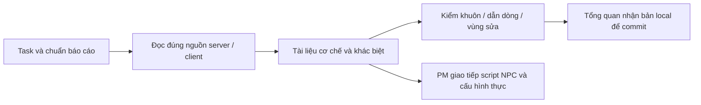

TÓM TẮT 1: [NGUỒN] PARTIAL — đã đối chiếu tĩnh 8/10 nhóm độ bền và sửa đồ; còn script NPC, cấu hình thực chưa có trong nguồn đọc được giao.
TÓM TẮT 2: [NGUỒN] Đã ghi cơ chế hao mòn, 15 vị trí mặc định, giá sửa số nguyên, chốt sửa và khác biệt xử lý độ bền 0; nguồn: JX1_OPS/DESIGN/HIEU-DO-BEN-SUA-DO.md.
TÓM TẮT 3: [NGUỒN] Đầu ra chính là JX1_OPS/DESIGN/HIEU-DO-BEN-SUA-DO.md; kèm báo cáo này và mục Kết quả cuối task theo yêu cầu.
TÓM TẮT 4: [CHƯA KIỂM] Không chạy build/game/exe/VM/mạng; tệp nhịp ở ngoài vùng sandbox ghi nên các mốc được ghi trong báo cáo.
TÓM TẮT 5: [NGUỒN] Không có SHA/push vì không stage/commit/push; bàn giao Tổng quan commit và PM giao tiếp phần dữ liệu còn thiếu.

# HG-14 — Báo cáo khảo sát độ bền và sửa đồ

Loại: tổng hợp
Chủ đề: Bàn giao tài liệu đọc tĩnh cơ chế hao mòn, sửa thường và phần NPC còn thiếu bằng chứng.
Từ khóa: HG-14, trang bị, độ bền, sửa đồ, KItem, KItemList, RepairItem, Abrade
Trạng thái: PARTIAL — tài liệu đã viết; thiếu bằng chứng script NPC và cấu hình đang nạp.
Độ phủ: 8 trên tổng 10 nhóm nội dung; 15 vị trí mặc định đã liệt kê; không đếm runtime là đã phủ.
Liên quan: JX1_OPS/TASKS/HG-14.md; JX1_OPS/DESIGN/HIEU-DO-BEN-SUA-DO.md; JX1_OPS/DESIGN/CHUAN-BAO-CAO.md.
Cần tôi quyết định: không — chưa yêu cầu mở rộng quyền hoặc chạy game.



## Phạm vi và độ phủ

| Phần việc | Kết quả |
|---|---|
| Giữ local có sẵn và đúng nhánh | Git ban đầu: `task/HG-14`; chỉ có task HG-14 chưa theo dõi; chưa có tài liệu/báo cáo HG-14 |
| Cơ chế độ bền, ba loại sự kiện và tháo/đổi đồ | Đã đối chiếu source; dẫn dòng trong tài liệu chính |
| Bảng 15 vị trí và giá sửa | Đã ghi mặc định nguồn, tách khỏi giá trị runtime |
| Sửa thường, độ bền 0 và khác biệt hai phía | Đã phủ bằng đọc tĩnh; không nhận là đã thử trong game |
| Script NPC/vị trí/giá sửa đặc biệt | Chưa phủ: trong root Sources không tìm được tệp `*.lua` |
| Cấu hình thực nạp | Chưa phủ: chỉ thấy lời gọi nạp macro và giá trị dự phòng |
| Tệp nhịp theo đường dẫn yêu cầu | Bị giới hạn sandbox: `D:/JX-wt/HG-14.nhip` nằm ngoài root ghi `D:/JX-wt/HG-14`; không thử vượt quyền |
| Chỉ mục chung / TSV | Chỉ đề xuất hàng trong báo cáo; không tạo/sửa tệp ngoài vùng được giao |

## Giải mã tên và sắp theo cấu trúc game

[THẤY] Bảng giải mã tên gồm 15 nhãn vị trí ASCII và tên NPC UTF-8 được đặt trong tài liệu chính; nguồn gốc: `S/KItemList.cpp:9400–9443`, `C/gamecore/CoreShell.cpp:4399` theo quy ước root của tài liệu. Nội dung đi theo vòng đời sử dụng → hao mòn → cảnh báo/hỏng → sửa/thanh toán; không dựng thêm bộ/từng món khi thiếu dữ liệu.

## Kết quả đã xác minh

| Nội dung | Bằng chứng nguồn thật; S/C mở rộng theo tài liệu chính |
|---|---|
| Ra chiêu, nhận sát thương, đổi vùng có điểm gọi hao mòn | S/KNpc.cpp:3629; S/KNpc.cpp:5727; S/KNpc.cpp:3271 |
| Hao mòn phụ thuộc hệ số và vị trí | S/KItemSet.cpp:80–142; S/KItem.cpp:1905–1926 |
| Giá sửa là phép toán số nguyên, có phần theo cấp và số ô thuộc tính | S/KItem.cpp:3629–3669 |
| Thu tiền thành công và kết nối hợp lệ mới đi vào nhánh hồi độ bền | S/KPlayer.cpp:10967–10985 |
| Nút sửa có thật trong source; lời nhắc NPC chưa chứng minh NPC hoạt động | C/gameui/KuiRoleState.cpp:1950,2133; C/gamecore/CoreShell.cpp:4399–4404 |
| Không thể nói chắc độ bền 0 tự xóa món tại hai hàm đã đọc | S/KItemList.cpp:9498–9499,9537–9538 |
| Cầu nối Lua có hàm đặt/đọc độ bền; chưa có script gọi thực tế | S/ScriptFuns.cpp:16158–16206,26041–26043 |

## Chưa xác minh và kiểm thử

- [CHƯA KIỂM] NPC thực, bản đồ/tọa độ, nội dung script, phí/nguyên liệu sửa đặc biệt, tệp hệ số thực và danh sách cấm sửa.
- [CHƯA KIỂM] Tác động đủ lên chiến đấu và đồng bộ ở 0; chưa kiểm hai enum liên quan ngoại lệ mặt nạ. Không đổi kết luận cũ hoặc sửa mã để làm hai phía giống nhau.
- [THẤY] Thực chạy: `git status --short --branch` một lần trước ghi; tìm tên tệp có lọc; `Select-String` và đọc các đoạn ngắn. Kiểm tài liệu cuối lượt dùng UTF-8 không BOM, năm dòng tóm tắt, Mermaid, mục Chưa kiểm, dẫn nguồn và so sánh thay đổi.
- [CHƯA KIỂM] Build, test game, exe, VM, mạng: chưa chạy theo rào chắn task. Không có phép đo tỷ lệ hao mòn hoặc giá runtime.

## Mục sổ thông số và đề xuất tối ưu

[THẤY] Sổ thông số nằm trong tài liệu chính, gồm sentinel `-1`, hệ số hao `0/âm/dương`, mặc định `256/64`, ba hệ số giá `100/10/1000`, chốt client `≤1`, và `ForbitRepairSet`. Nguồn: S/KItem.cpp:1907–1920; S/KItemSet.cpp:76–142; C/gamecore/CoreShell.cpp:4402; S/KPlayer.cpp:10944. Tất cả là đọc tĩnh, không cấp quyền chỉnh thông số.

[THẤY] Đề xuất ưu tiên giao task đối chiếu chốt client/server và đường báo hỏng trước khi thống nhất hướng dẫn người chơi; sau đó bổ sung dữ liệu/script đúng root. Không kết luận đã có lỗi runtime từ khác biệt source (S/KItemList.cpp:2909,9484–9510; C/gamecore/KItemList.cpp:2235).

## Lỗi, cách thử và kết quả

| Vấn đề | Cách xử lý / kết quả |
|---|---|
| Không có `rg` | Báo một lần; chuyển PowerShell có lọc tên, không cài công cụ |
| `Get-ChildItem -LiteralPath ... -Include` trả danh sách rộng hơn dự kiến | Dừng cách liệt kê đó; dùng `-Path ... -Filter` từng mẫu tên, đầu ra giới hạn; không đọc nội dung các tệp ngoài chủ đề |
| Ép GBK cho một số client làm sai chữ/số dòng | Chốt lại đoạn liên quan bằng UTF-8 và số dòng `Select-String`; giữ nguyên nguồn, ghi rõ trộn mã |
| Root Sources không có tệp Lua được tìm thấy | Dừng ở cầu nối C++; ghi phần NPC chưa kiểm, không quét sang root dữ liệu khác |
| Không ghi được nhịp đúng yêu cầu do ranh giới sandbox | Không thử ghi ngoài root; lưu mốc trong bảng dưới, không coi đó là đã tạo tệp `.nhip` |

## Mốc tiến độ

| Giờ địa phương | Bước | Ước tính |
|---|---|---:|
| Chưa lưu giờ riêng lúc bắt đầu | Đã kiểm Git, task, chuẩn và sáu skill; không ghi được tệp nhịp ngoài root | 0% |
| 2026-11-19 02:27:22 +07:00 | Đã đối chiếu nguồn chính server/client; đã nhận diện phần script/cấu hình thiếu | 70% |
| 2026-11-19 02:31:13 +07:00 | Đã viết hai đầu ra, kiểm UTF-8 không BOM, 5 dòng tóm tắt và Mermaid; đang chốt dẫn dòng và bàn giao | 90% |
| 2026-11-19 02:32:38 +07:00 | Kiểm tra cấu trúc đạt; đã đọc lại Kết quả cuối task; sắp bàn giao sau lượt xem diff | 95% |

## Kiểm tra đầu ra thực chạy

| Kiểm tra | Kết quả |
|---|---|
| Tài liệu chính: tồn tại, 5 dòng tóm tắt ở đầu, Mermaid, mục Chưa kiểm | PASS |
| Dẫn nguồn trong tài liệu chính | 109 điểm dẫn `S/...:dòng` hoặc `C/...:dòng` phân biệt; vượt mức tối thiểu 10; không tính là 109 phép thử runtime |
| Khuôn bổ sung: phạm vi, giải mã tên, sổ thông số | PASS |
| Báo cáo: 5 dòng tóm tắt, Mermaid, giới hạn kiểm chứng | PASS |
| Mã hóa ba tệp đích | PASS — đọc UTF-8 nghiêm ngặt, không BOM, không có ký tự thay thế U+FFFD |
| Cuối task | PASS — đúng một mục Kết quả với 4 dòng; chỉ nối kết quả, giữ nội dung giao việc |
| Xem thay đổi | Thực hiện một lượt `git diff --no-index` theo ba đường dẫn sau lần ghi cuối; mã thoát 1 của diff tệp mới là khác biệt dự kiến |

## Bàn giao

- [TÀI LIỆU] Ba tệp được phép theo yêu cầu lượt này: tài liệu đích, báo cáo này và mục Kết quả cuối task. Không sửa source, báo cáo cũ, mục lục chung hoặc `docs-analysis/BAI_HOC.md`.
- [TÀI LIỆU] Không stage/commit/push; chưa có SHA. Tổng quan nhận bản local để commit. PM giao rõ nguồn Lua/cấu hình cho phần tiếp theo; không yêu cầu chạy game trong task hiện tại.
- [TÀI LIỆU] Hàng đề xuất cho `JX1_OPS/DESIGN/MUC-LUC-TRI-THUC.md`: `| Trang bị, độ bền và sửa đồ | HG-14 | KItem, KItemList, Abrade, RepairItem; PARTIAL 8/10; NPC/script và cấu hình thực chưa kiểm | JX1_OPS/DESIGN/HIEU-DO-BEN-SUA-DO.md |`.
- [TÀI LIỆU] Hàng đề xuất cho `REPORTS/_CHIMUC/HG-14.tsv` bên dưới; không tạo TSV vì nằm ngoài vùng file được giao. PM có thể gộp cùng chỉ mục.

```tsv
file	loại	chủ đề	từ khóa	trạng thái	độ phủ	liên quan
JX1_OPS/DESIGN/HIEU-DO-BEN-SUA-DO.md	khảo sát	Trang bị, độ bền và sửa đồ	độ bền; sửa đồ; KItem; KItemList; Abrade; RepairItem	PARTIAL	8/10 nhóm; 15 vị trí mặc định	JX1_OPS/TASKS/HG-14.md; JX1_OPS/REPORTS/HG-14.md
```

Kỹ năng đã dùng: jx1-retrofit, jx1-read-server, jx1-read-client, jx1-parameters, jx1-knowledge, jx1-report. Không có báo cáo cũ cần retrofit; chỉ áp dụng khuôn và ghi phát hiện riêng.
