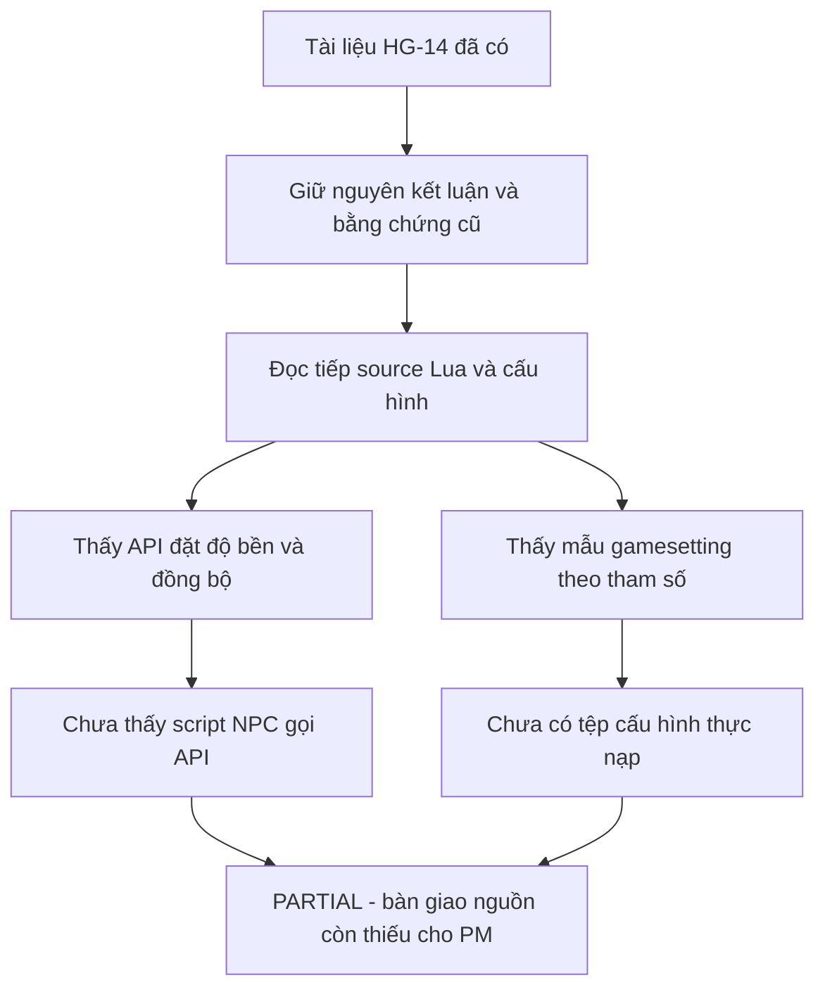

TÓM TẮT 1: [NGUỒN] [TÀI LIỆU] PARTIAL — tiếp tục tài liệu đã có, giữ nguyên kết luận cũ; còn thiếu script NPC và cấu hình thực nạp (JX1_OPS/DESIGN/HIEU-DO-BEN-SUA-DO.md:1–15).
TÓM TẮT 2: [NGUỒN] [THẤY] Đã kiểm ba cầu nối Lua đặt độ bền, đồng bộ và bảng đăng ký; chưa chứng minh NPC nào gọi (S/ScriptFuns.cpp:16158–16174,16211–16249,16253–16299,26041–26048).
TÓM TẮT 3: [NGUỒN] [THẤY] Bổ sung mẫu cấu hình gamesetting theo tham số và phép tìm chuỗi con trong danh sách cấm sửa (S/KCore.cpp:262–265; S/KPlayer.cpp:10944–10964).
TÓM TẮT 4: [CHƯA KIỂM] Chưa có Lua/INI rời trong hai root nguồn đã duyệt; chưa có vị trí NPC, phí đặc biệt và hành vi trong game (JX1_OPS/TASKS/HG-14b.md:20,24,33).
TÓM TẮT 5: [CHƯA KIỂM] Không build/test game, exe, VM, mạng; không commit/push theo yêu cầu, Tổng quan tiếp nhận commit; nhịp ngoài workspace bị giới hạn ghi (JX1_OPS/TASKS/HG-14b.md:27–30).

# HG-14b — Tiếp nối khảo sát độ bền và sửa đồ

Loại: khảo sát
Chủ đề: Bổ sung bằng chứng Lua và cấu hình cho tài liệu độ bền đã có, giữ giới hạn về NPC thực tế.
Từ khóa: trang bị, độ bền, sửa đồ, durability, KItem, KItemList, SetCurDurability, SetAndSycItem, SetSpecItemParam, ForbitRepairSet
Trạng thái: PARTIAL — hoàn tất phần đọc tiếp trong hai root được giao; chưa có script NPC/cấu hình dữ liệu để khép kín mục tiêu.
Độ phủ: tài liệu giữ mức 8/10 nhóm; đợt này xác minh 3/3 cầu nối đặt độ bền và 1/1 mẫu đường dẫn gamesetting; 0 script NPC được xác minh.
Liên quan: JX1_OPS/DESIGN/HIEU-DO-BEN-SUA-DO.md; JX1_OPS/TASKS/HG-14b.md; JX1_OPS/DESIGN/CHUAN-BAO-CAO.md; JX1_OPS/REPORTS/HG-14.md.
Cần tôi quyết định: không — PM cần giao tiếp nguồn dữ liệu cụ thể, không cần mở rộng quyền trong lượt này.

## Sơ đồ chính



[THẤY] Sơ đồ mô tả bằng chứng tĩnh, không phải kết quả chạy game: S/ScriptFuns.cpp:16158–16174,26041–26048; S/KCore.cpp:261–265.

## Phạm vi và độ phủ

| Phần tử phạm vi | Kết quả | Nguồn / giới hạn |
|---|---|---|
| Khi nào giảm độ bền | Đã có; giữ nguyên, không khảo sát lại | [TÀI LIỆU] JX1_OPS/DESIGN/HIEU-DO-BEN-SUA-DO.md:99–130 |
| Độ bền thấp/0 | Đã có giới hạn và khác biệt hai phía; giữ nguyên | [TÀI LIỆU] JX1_OPS/DESIGN/HIEU-DO-BEN-SUA-DO.md:132–140 |
| Nút sửa và điều kiện client | Đã đối chiếu đoạn liên quan sửa hỏng | [THẤY] C/gamecore/CoreShell.cpp:4382–4419 |
| Giá sửa thường và cấm sửa | Đã đối chiếu công thức, thanh toán, phép tìm chuỗi | [THẤY] S/KItem.cpp:3648–3669; S/KPlayer.cpp:10931–10985 |
| Lua đặt/đọc độ bền | Đã kiểm 3 đường đặt, 2 hàm đọc và bảng đăng ký | [THẤY] S/ScriptFuns.cpp:16158–16343,26041–26048 |
| Mẫu cấu hình | Đã thấy tên theo tham số; chưa biết giá trị thực | [THẤY] S/KCore.cpp:261–265; S/KItemSet.cpp:74–78 |
| Script NPC, menu, bản đồ, tọa độ và phí đặc biệt | Chưa phủ | [CHƯA KIỂM] 0 tệp `*.lua` rời trong mỗi root nguồn; C/gamecore/CoreShell.cpp:4399 chỉ là lời nhắc |
| Cấu hình hệ số, danh sách cấm thực nạp | Chưa phủ | [CHƯA KIỂM] 0 tệp `*.ini` rời trong mỗi root nguồn; S/KPlayer.cpp:10944–10952 chỉ là điểm đọc |

## Giải mã tên

| Tên gốc | Mã hóa | Chữ đúng UTF-8 | Nguồn file:dòng |
|---|---|---|---|
| `Thợ Rèn Thần Bí` | UTF-8 tại đoạn chuỗi được kiểm | Thợ Rèn Thần Bí; chưa có ID/vị trí hay script gắn NPC | C/gamecore/CoreShell.cpp:4399,4404 |

[TÀI LIỆU] Các tên nhóm trang bị của tài liệu chính giữ nguyên bảng giải mã sẵn có, không giải mã lại hoặc tự gán GBK/TCVN3 cho chuỗi ASCII (JX1_OPS/DESIGN/HIEU-DO-BEN-SUA-DO.md:66–87). Comment source có dấu hiệu trộn mã; chỉ dùng định danh và câu lệnh ASCII cho kết luận Lua/cấu hình (S/ScriptFuns.cpp:16163–16174; S/KCore.cpp:262–265).

## Sắp theo cấu trúc game và kết quả

### Chọn món để sửa

[THẤY] Sửa thường qua client vẫn chặn độ bền ≤1 và trạng thái chiến đấu, kiểm tiền rồi mới gửi yêu cầu. Việc chuỗi client nhắc tên NPC không cho biết nơi đứng hay phí sửa của NPC (C/gamecore/CoreShell.cpp:4402–4414).

### Nếu script xử lý độ bền

- [THẤY] `SetCurDurability` nhận chỉ số món và độ bền, giới hạn trên bằng tối đa rồi đồng bộ; không có tính/thu phí trong chính thân hàm (S/ScriptFuns.cpp:16160–16174).
- [THẤY] `SetAndSycItem` dùng tham số thứ 7 cho độ bền; `SetSpecItemParam` dùng khóa 6. Cả hai có nhánh đặt độ bền rồi đồng bộ (S/ScriptFuns.cpp:16222,16236–16247,16281–16297).
- [THẤY] Ba hàm này cùng hai hàm đọc đã được đăng ký tên cho Lua; đó là bằng chứng API có sẵn, chưa phải bằng chứng NPC cụ thể gọi chúng (S/ScriptFuns.cpp:26041–26048).
- [THẤY] `Sale` chỉ mở luồng cửa hàng trong đoạn đã kiểm; không tự suy có sửa đồ từ việc mở cửa hàng (S/ScriptFuns.cpp:5418–5427).

### Thanh toán và cấu hình

[THẤY] Phí sửa thường vẫn do `GetRepairPrice` tính theo số nguyên; server kiểm `ForbitRepairSet` bằng `strstr`, tức tìm chuỗi con trong tên món. Khi thu tiền thành công và chỉ số kết nối không âm, nhánh mới đặt độ bền tối đa rồi gửi cập nhật (S/KItem.cpp:3666; S/KPlayer.cpp:10944–10985).

[THẤY] Mẫu cấu hình là `\Settings\gamesetting_%s.ini`, với `%s` nhận `nParmName` của hàm khởi tạo; chưa biết giá trị tham số thực hoặc nội dung tệp được nạp (S/KCore.cpp:249,261–265). Nguồn còn có lời gọi mở `\package.ini` dưới `_SERVER`, nên kết quả không thấy Lua/INI rời không loại trừ tài nguyên trong gói hoặc ngoài hai root (S/KCore.cpp:255–256).

## Mục sổ thông số

| Nhóm | Tên/hằng số | file:dòng | Giá trị | Đơn vị | Ảnh hưởng | Đổi an toàn (CÓ/CẨN THẬN/KHÔNG) | Nguồn đo |
|---|---|---|---|---|---|---|---|
| Lua | `nability > -2` | S/ScriptFuns.cpp:16166–16174 | Nhận từ -1; giới hạn trên theo tối đa | Điểm độ bền / sentinel | Đặt độ bền và đồng bộ | CẨN THẬN — thiếu script gọi | Đọc tĩnh, chưa đo |
| Lua | Tham số 7 / khóa 6 | S/ScriptFuns.cpp:16222,16281 | 7 / 6 | Vị trí tham số / mã thuộc tính | Hai cách chọn dữ liệu độ bền | CẨN THẬN | Đọc tĩnh |
| Cấu hình | `nParmName` | S/KCore.cpp:261–265 | Chưa biết giá trị thực | Chuỗi | Chọn tệp gamesetting | CẨN THẬN | Đọc tĩnh; chưa nạp runtime |
| Cấm sửa | `Count`, `ItemName_i` | S/KPlayer.cpp:10944–10953 | Count dự phòng 0; giá trị thực chưa biết | Số mục / chuỗi con | Chặn sửa theo tên | CẨN THẬN | Đọc tĩnh |

## Đã xác minh / Chưa xác minh

### Đã xác minh

- [THẤY] Đã đọc trực tiếp các đoạn nêu trên tại đúng root server/client task chỉ định; bí danh `S`/`C` theo JX1_OPS/DESIGN/HIEU-DO-BEN-SUA-DO.md:55–60. Source không được sửa.
- [THẤY] Lệnh tìm tệp thực chạy: `Get-ChildItem -LiteralPath <root> -Filter '*.lua' -File -Recurse` và cùng lệnh với `*.ini`, riêng từng root. Kết quả mỗi bộ lọc là 0; chỉ tìm tên trong hai root đã duyệt (JX1_OPS/TASKS/HG-14b.md:24,33).
- [TÀI LIỆU] Phần cũ được giữ nguyên; phần mới là mục **Bổ sung HG-14b** sau nội dung cũ, không thay kết luận PARTIAL (JX1_OPS/DESIGN/HIEU-DO-BEN-SUA-DO.md:13,213).

### Chưa kiểm

- [CHƯA KIỂM] Chưa có Lua NPC, liên kết dữ liệu NPC/menu/bản đồ, phí/nguyên liệu sửa đặc biệt, cấu hình hệ số hoặc danh sách cấm thực nạp (S/ScriptFuns.cpp:26041–26048; S/KPlayer.cpp:10944–10952).
- [CHƯA KIỂM] Không chạy build/test game, exe, VM, mạng; không dùng Graphify trong lượt này. Các khác biệt client/server và hành vi khi độ bền 0 vẫn chưa kiểm runtime, giữ ghi chú cũ (JX1_OPS/DESIGN/HIEU-DO-BEN-SUA-DO.md:192–197; JX1_OPS/TASKS/HG-14b.md:27–30).

## Lỗi, cách thử và kết quả

| Vấn đề | Cách xử lý / kết quả |
|---|---|
| `rg` không có trong phiên | Lần gọi đầu báo CommandNotFound; chuyển ngay sang `Select-String` và `Get-ChildItem -Filter`, không cài công cụ |
| Lần đọc đầu hiển thị sai dấu do mặc định PowerShell | Đọc sửa bằng UTF-8 và đặt OutputEncoding UTF-8; không sửa nội dung nguồn vì lỗi hiển thị |
| Không có Lua/INI rời trong root đã duyệt | Xác minh bằng bộ lọc tên; không tìm sang root khác, không đoán script |
| Nhịp tại `D:\JX-wt\HG-14b.nhip` ngoài workspace ghi | Không ghi/không thử vượt giới hạn; tiến độ thông báo trong phiên và ghi kết quả ở đây |
| Chuẩn yêu cầu TSV nhưng task giới hạn vùng ghi | Không tạo `REPORTS/_CHIMUC/HG-14b.tsv`; đề xuất hàng dữ liệu ngay bên dưới để PM gộp |
| Kiểm cấu trúc tài liệu thực chạy | Tài liệu chính và báo cáo đều đủ 5 dòng tóm tắt, 1 khối Mermaid, mục Chưa kiểm, hơn 10 dẫn file:dòng; đọc lại phần ghi và kiểm UTF-8 không BOM đạt. Đây là kiểm tài liệu, không phải test game |

## Đề xuất tối ưu và bàn giao

[CHƯA KIỂM] Chưa đề xuất chỉnh hệ số/giá; PM cần giao root dữ liệu chỉ đọc có script NPC, bảng gắn NPC và tệp cấu hình theo tham số khởi tạo. Khi có nguồn đó, đối chiếu nơi mở menu, món nhận sửa, điều kiện, phí/nguyên liệu và cách đồng bộ; kiểm thử game là task riêng cần được duyệt (S/KCore.cpp:262–265; S/ScriptFuns.cpp:16158–16174; JX1_OPS/TASKS/HG-14b.md:27–30).

[TÀI LIỆU] Không stage/commit/push theo yêu cầu người giao; không có SHA mới và không có bằng chứng push. Tổng quan commit ba tệp tài liệu của lượt này. Đã ghi mục **Kết quả** cuối task; không sửa `BAI_HOC` hoặc source (JX1_OPS/TASKS/HG-14b.md:13,21,30).

Hàng đề xuất cho `JX1_OPS/DESIGN/MUC-LUC-TRI-THUC.md` và chỉ mục TSV; PM gộp, không tạo tệp ngoài vùng:

```tsv
file	loại	chủ đề	từ khóa	trạng thái	độ phủ	liên quan
JX1_OPS/DESIGN/HIEU-DO-BEN-SUA-DO.md	khảo sát	Độ bền và sửa đồ; bổ sung HG-14b	độ bền; sửa đồ; durability; KItem; KItemList; SetCurDurability; ForbitRepairSet	PARTIAL	8/10 nhóm; thêm 3 cầu nối Lua; thiếu NPC/cấu hình thực	JX1_OPS/REPORTS/HG-14b.md; JX1_OPS/TASKS/HG-14b.md
```

Kỹ năng đã dùng: jx1-retrofit, jx1-read-server, jx1-read-client, jx1-parameters, jx1-knowledge, jx1-report.
