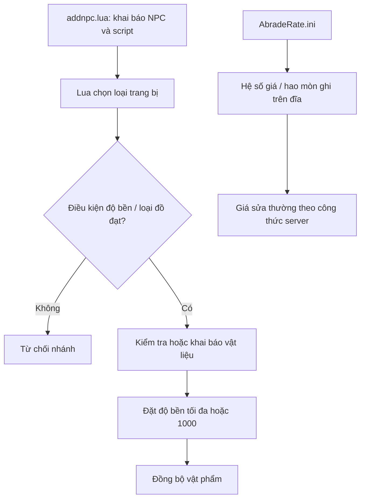

TÓM TẮT 1: [NGUỒN] DONE — bổ sung nguồn Lua/INI về NPC sửa đồ, nhánh phục hồi, hệ số giá và danh sách cấm sửa.
TÓM TẮT 2: [NGUỒN] Đã tính ví dụ phí sửa 5.051 đơn vị tiền bằng hệ số trên đĩa và đầu vào món giả định; không phải báo giá runtime.
TÓM TẮT 3: [NGUỒN] Hai Lua khai báo phục hồi đồ xanh/Hoàng Kim; lời mô tả vật liệu của Thợ Rèn lệch với số trong nhánh mã.
TÓM TẮT 4: [CHƯA KIỂM] Cấu hình được nạp, NPC hoạt động, mức tiêu hao và sửa trong phiên game chưa xác minh.
TÓM TẮT 5: [CHƯA KIỂM] Chỉ đọc tĩnh; không chạy game/exe, VM, build hoặc mạng. Tệp nhịp ngoài worktree bị từ chối quyền ghi.

# HG-14c — Bổ sung nguồn Lua/INI về sửa đồ

Loại: khảo sát
Chủ đề: Đối chiếu tĩnh Lua phục hồi trang bị, điểm khai báo NPC và cấu hình độ bền/giá sửa được task chỉ định.
Từ khóa: độ bền, sửa đồ, Thợ Rèn Thần Bí, Nhiếp Thí Trần, Kim Nguyên Bảo, AbradeRate, ForbitRepairSet, Lua, INI
Trạng thái: DONE — các nguồn tĩnh được giao đã đối chiếu; runtime và một sai khác vật liệu còn chưa xác minh.
Độ phủ: 4/4 nhóm nguồn chỉ định; chưa xác nhận cấu hình đang nạp hoặc hành vi runtime.
Liên quan: JX1_OPS/DESIGN/HIEU-DO-BEN-SUA-DO.md; JX1_OPS/REPORTS/XD-HG14.md; JX1_OPS/TASKS/HG-14c.md.
Cần tôi quyết định: không.

## Sơ đồ chính

## Phạm vi và độ phủ

| Phần tử task | Kết quả | Bằng chứng / giới hạn |
|---|---|---|
| Khai báo NPC | Đã đối chiếu hai khai báo được nêu | `G/script/tnlteam/npc/addnpc.lua:50–60`; chưa xác minh NPC hiện diện trong game |
| Lua sửa đồ | Đã đối chiếu hai script và các nhánh vật liệu/độ bền | `G/script/global/npcchucnang/thorenthanbilaman.lua:37–123`; `G/script/global/npcchucnang/nhiepthitran.lua:164–185,214–235` |
| Hệ số độ bền/giá | Đã đọc giá trị được giao | `G/Settings/item/AbradeRate.ini:1–24`; chưa biết cấu hình nào được nạp |
| Danh sách cấm sửa | Đã đọc section được giao | `G/Settings/gamesetting.ini:84–86`; chuỗi tên ở dạng GBK, chưa biết tệp được chọn |

## Giải mã tên

| Tên gốc | Mã hóa | Chữ đúng UTF-8 | Nguồn file:dòng |
|---|---|---|---|
| `Thî RÌn ThÇn BÝ` | TCVN3 | Thợ Rèn Thần Bí | `G/script/tnlteam/npc/addnpc.lua:60`; đối chiếu `JX1_OPS/REPORTS/XD-HG14.md:54` |
| `NhiÕp ThÝ TrÇn` | TCVN3 | Nhiếp Thí Trần | `G/script/tnlteam/npc/addnpc.lua:50–56`; đối chiếu `JX1_OPS/REPORTS/XD-HG14.md:55` |
| `Kim Nguyªn B¶o` | TCVN3 | Kim Nguyên Bảo | `G/script/global/npcchucnang/nhiepthitran.lua:178,228`; đối chiếu `JX1_OPS/REPORTS/XD-HG14.md:56` |

## Sắp theo cấu trúc game: NPC → loại trang bị → phục hồi

| NPC / vị trí trong bảng khai báo | Loại và điều kiện | Vật liệu, lệnh và kết quả đã thấy |
|---|---|---|
| Thợ Rèn Thần Bí; loại 199, map ID 176, tọa độ 1314,3196 | Đồ xanh: từ chối độ bền >2. Hoàng Kim: từ chối >2 và yêu cầu chỉ số Gold dương. | Cửa sổ ghi 10 KNB cho đồ xanh, nhưng nhánh kiểm `nHave >= 5` và gọi `DelItemCount(3,5,2,1,245,-1,-1)`; cửa sổ Hoàng Kim ghi 20 KNB, nhánh kiểm `nHave >= 10` và gọi xóa với tham số 10. Độ bền được đặt tối đa. Chưa xác nhận tham số hàm tương ứng chính xác với số vật liệu bị trừ (`G/script/global/npcchucnang/thorenthanbilaman.lua:37–38,54–71,86–123`). |
| Nhiếp Thí Trần; loại 769, map ID 11, 1, 37, 176, 162, 78, 80 | Hoàng Kim: từ chối khi độ bền >2, yêu cầu Gold dương. Đồ xanh: từ chối khi độ bền >0, yêu cầu Gold không dương. | Lua khai báo `Kim Nguyên Bảo`, `tbProp={4,343,1}`, số lượng 1 cho Hoàng Kim và `{4,343,0}`, số lượng 10 cho đồ xanh. Sau nhánh thanh toán thành công, đặt độ bền 1000 và đồng bộ (`G/script/global/npcchucnang/nhiepthitran.lua:164–185,214–235`). |

Các khai báo trên là dữ liệu trên đĩa. Chúng chưa chứng minh NPC/menu được nạp hay lệnh thanh toán có kết quả như mong đợi trong game. Tên bản đồ của các ID chưa được đối chiếu.

## Hệ số và ví dụ phí sửa

`G/Settings/item/AbradeRate.ini` ghi `ItemPriceScale=1`, `MagicPriceScale=100`, `LevelPriceScale=500`; `Attack/Weapon=1024`, `Defend/Head=1024` (`:1–7,22–24`). `G/Settings/gamesetting.ini:84–86` ghi `[ForbitRepairSet]`, `Count=1` và một tên được mã hóa GBK. Đây là nội dung các tệp đã chỉ định, chưa phải bằng chứng chúng được nạp.

[THẤY — ví dụ giả định] Công thức số nguyên của giá sửa thường được ghi tại `S/KItem.cpp:3648–3669`. Lấy cấp món `L=10`, giá gốc `P=10.000`, độ bền tối đa `D=1.000`, hiện tại `d=500`, và `N=2` ô thuộc tính khác 0 (tất cả là đầu vào minh họa): `A=(P×1)/100=100`; `B=A×(D−d)/D=50`; `giá=L×500 + B×(100+N)/100 = 5.051`. Các số liệu món là giả định, không lấy từ món thật; chưa xác minh đơn vị hiển thị hay giá runtime.

## Mục sổ thông số

| Nhóm | Tên/hằng số | file:dòng | Giá trị | Đơn vị | Ảnh hưởng | Đổi an toàn (CÓ/CẨN THẬN/KHÔNG) | Nguồn đo |
|---|---|---|---|---|---|---|---|
| Giá sửa | `ItemPriceScale` | `G/Settings/item/AbradeRate.ini:2` | 1 | Hệ số | Thành phần giá gốc | CẨN THẬN | Đọc tĩnh; chưa biết có nạp |
| Giá sửa | `MagicPriceScale` | `G/Settings/item/AbradeRate.ini:3` | 100 | Hệ số | Thành phần thuộc tính | CẨN THẬN | Đọc tĩnh; chưa đo món thật |
| Giá sửa | `LevelPriceScale` | `G/Settings/item/AbradeRate.ini:4` | 500 | Hệ số | Thành phần theo cấp | CẨN THẬN | Đọc tĩnh; chưa đo món thật |
| Hao mòn | `Attack/Weapon`, `Defend/Head` | `G/Settings/item/AbradeRate.ini:6–7,22–24` | 1024, 1024 | Hệ số R | Tỷ lệ thử hao mòn theo cấu hình | CẨN THẬN | Đọc tĩnh; chưa biết cấu hình đang hoạt động |
| Cấm sửa | `ForbitRepairSet/Count/ItemName_0` | `G/Settings/gamesetting.ini:84–86` | 1 mục; chuỗi GBK | Số mục / tên | Có thể lọc món khỏi sửa thường | CẨN THẬN | Đọc tĩnh; chưa biết tệp được nạp |
| NPC | Điều kiện và vật liệu hai nhánh | Hai Lua trong bảng phạm vi | Các giá trị tại bảng cấu trúc | Điểm độ bền / vật liệu | Chọn và thực hiện nhánh phục hồi | CẨN THẬN | Đọc tĩnh; chưa xác minh tiêu hao thực tế |

## Đã xác minh / Chưa xác minh

**Đã xác minh:** các dòng Lua/INI được mở trực tiếp; vị trí và giá trị ghi trên đĩa được trích theo file:dòng. Tên TCVN3/GBK được đối chiếu với `JX1_OPS/REPORTS/XD-HG14.md:54–58`.

**Chưa xác minh:** cấu hình thực nạp, script và NPC hoạt động, tọa độ/map thực tế, số vật liệu tiêu hao theo chữ ký hàm, giá của món thật, danh sách cấm đang hiệu lực và kết quả sửa trong phiên game. Không chạy build, Lua, game/exe, VM hoặc mạng. Không tạo TSV chỉ mục vì task giới hạn tệp được sửa.

Không ghi được `D:/JX-wt/HG-14c.nhip`: phiên làm việc từ chối ghi ở ngoài worktree `D:/JX-wt/HG-14c`; dừng sau lần từ chối, không thử đường vòng. Không stage, commit hoặc push theo yêu cầu.

Hàng đề xuất để PM gộp vào `JX1_OPS/DESIGN/MUC-LUC-TRI-THUC.md`: `Độ bền và sửa đồ | HG-14; HG-14b; HG-14c; XD-HG14 | nguồn C++ và Lua/INI, hệ số giá, hai NPC phục hồi | đối chiếu tĩnh; runtime chưa xác minh`.

Kỹ năng đã dùng: jx1-retrofit, jx1-read-server, jx1-read-client, jx1-parameters, jx1-knowledge, jx1-report.
