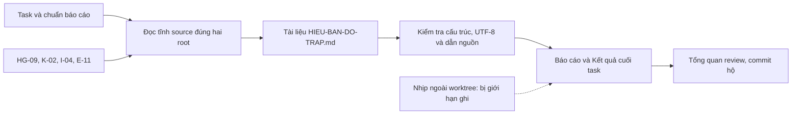

TÓM TẮT 1/5: [NGUỒN] DONE phần tài liệu đọc tĩnh HG-15; PARTIAL toàn yêu cầu vì không ghi được nhịp ngoài vùng filesystem cho phép. Phạm vi nội dung: JX1_OPS/TASKS/HG-15.md:20–31.
TÓM TẮT 2/5: [NGUỒN] [THẤY] Đã nối WorldSet → MapList → .wor → vùng/trap → script → đích → cảnh client; phân biệt SetPos với NewWorld. Nguồn: JX1_OPS/DESIGN/HIEU-BAN-DO-TRAP.md:81–148.
TÓM TẮT 3/5: [NGUỒN] Đầu ra có 5 dòng tóm tắt, Mermaid, 7/7 nhóm phạm vi, giải mã tên, tọa độ và sổ thông số; số 28 giữ nhãn tài liệu. Nguồn: JX1_OPS/DESIGN/HIEU-BAN-DO-TRAP.md:1–179.
TÓM TẮT 4/5: [CHƯA KIỂM] Chưa tái kiểm 28 ID/asset, ánh xạ từng trap, cổng thực chạy hoặc chuyển GS; nhịp D:/JX-wt/HG-15.nhip nằm ngoài gốc được phép ghi của phiên. Giới hạn nội dung: JX1_OPS/DESIGN/HIEU-BAN-DO-TRAP.md:187–194.
TÓM TẮT 5/5: [CHƯA KIỂM] Không build, chạy game/exe, VM, mạng hoặc test game; không stage/commit/push theo yêu cầu, chưa có SHA mới; Tổng quan review và commit hộ.

# HG-15 — Bàn giao tài liệu bản đồ, cổng dịch chuyển và trap

Loại: tổng hợp
Chủ đề: Kết quả thực hiện tài liệu hiểu game HG-15 và giới hạn xác minh.
Từ khóa: bản đồ, MapList, WorldSet, trap, cổng làng, tọa độ, SetPos, NewWorld, .wor, HG-15
Trạng thái: PARTIAL — tài liệu đạt tiêu chí; yêu cầu nhịp ngoài worktree chưa thực hiện do giới hạn ghi của phiên.
Độ phủ: 7/7 nhóm nội dung tĩnh; ví dụ 4/4 cổng là nguồn tài liệu; 0/28 ID tái kiểm asset/runtime; 3 tệp bàn giao trong worktree.
Liên quan: JX1_OPS/TASKS/HG-15.md; JX1_OPS/DESIGN/HIEU-BAN-DO-TRAP.md; JX1_OPS/DESIGN/HIEU-NAP-VA-CHUYEN-BAN-DO.md; JX1_OPS/REPORTS/K-02-ban-do.md; JX1_OPS/REPORTS/I-04-khao-sat-map.md; JX1_OPS/REPORTS/E-11-hoi-mau-vat-pham-doi-ban-do.md
Cần tôi quyết định: không — Tổng quan nhận bàn giao; phiên này không yêu cầu mở rộng quyền.

## Sơ đồ bàn giao

## Phạm vi và độ phủ

| Phần được giao | Kết quả | Bằng chứng |
|---|---|---|
| Chọn/nạp bản đồ | [THẤY] Đã phủ MapList, WorldSet, .wor và vùng | `JX1_OPS/DESIGN/HIEU-BAN-DO-TRAP.md:81–91` |
| Tọa độ | [THẤY] Phân biệt ID, vùng, ô, MPS, đối số Lua; phép nhân 32 | `JX1_OPS/DESIGN/HIEU-BAN-DO-TRAP.md:93–105` |
| Trap và script | [THẤY] Đã phủ nạp ID theo ô, kiểm ID nhớ, gọi main và thiếu script | `JX1_OPS/DESIGN/HIEU-BAN-DO-TRAP.md:107–115` |
| Cổng làng | [TÀI LIỆU] Giữ nguyên bốn ví dụ E-11; không nhận là đọc lại Lua | `JX1_OPS/REPORTS/E-11-hoi-mau-vat-pham-doi-ban-do.md:263–274` |
| Đổi map và đổi GS | [THẤY] Ba nhánh; [CHƯA KIỂM] kết quả bàn giao GS | `JX1_OPS/DESIGN/HIEU-BAN-DO-TRAP.md:130–140` |
| Cảnh client | [THẤY] Đã nối WORLD_SYNC, LoadMapC, OpenPlace, LoadRe | `JX1_OPS/DESIGN/HIEU-BAN-DO-TRAP.md:142–148` |
| 28 ID thiếu .wor | [TÀI LIỆU] Giữ mẫu số 800/993/324; [CHƯA KIỂM] lỗi runtime | `JX1_OPS/REPORTS/K-02-ban-do.md:41–43, :173`; tài liệu HG-15 `:150–162` |
| Báo cáo và kết quả task | Đã tạo báo cáo này; ghi mục Kết quả cuối task | `JX1_OPS/TASKS/HG-15.md:32` |
| Nhịp tại đường dẫn chỉ định | Chưa phủ — ngoài gốc ghi cho phép | `D:/JX-wt/HG-15.nhip` là đường dẫn yêu cầu, không phải tệp đã tạo |

## Giải mã tên

**[TÀI LIỆU]** Báo cáo bàn giao chỉ dùng thuật ngữ kỹ thuật ASCII và tiếng Việt UTF-8. Tên địa danh trong ví dụ nằm ở tài liệu đầu ra, có bảng riêng nêu rõ chưa giải mã byte TCVN3/GBK. Không bổ sung tên game hoặc bản dịch đoán. Nguồn: `JX1_OPS/DESIGN/HIEU-BAN-DO-TRAP.md:68–75`.

## Sắp theo cấu trúc game

**[THẤY]** Thân tài liệu đi theo GS → ID bản đồ → vùng → ô trap → script → đích → client; bảng bàn giao theo đúng chuỗi đó. Nguồn: `JX1_OPS/DESIGN/HIEU-BAN-DO-TRAP.md:77–79`.

## Nguồn đã đọc và cách giới hạn phạm vi

- Chuẩn báo cáo và task được đọc trước nguồn. Nhánh kiểm tra ban đầu là `task/HG-15`, Git status không có thay đổi có sẵn; hai đầu ra HG-15 chưa tồn tại nên không có phần cũ phải làm lại.
- Đã nạp đúng sáu skill trong `.agents/skills`: jx1-retrofit, jx1-read-server, jx1-read-client, jx1-parameters, jx1-knowledge, jx1-report. Chỉ tra mục liên quan của mục lục tri thức và GS001-MAP để định vị.
- Danh sách source được chốt từ task và dẫn đường của tài liệu HG-09: server `Core/Src/{KCore,KSubWorldSet,KSubWorld,KRegion,KNpc,KPlayer,ScriptFuns,KProtocolProcess}.cpp`, `Core/Src/KRegion.h`, `Core/Src/Scene/SceneDataDef.h`, `Engine/Src/{KIniFile,KPakFile}.cpp`; client `gamecore/{KProtocolProcess,KSubWorld}.cpp`, `gamescene/{KScenePlaceC,KScenePlaceRegionC}.cpp`, `gamescene/SceneDataDef.h`. Hai root đầy đủ có tại `JX1_OPS/DESIGN/HIEU-BAN-DO-TRAP.md:25–30`.
- Nguồn báo cáo theo chuỗi dẫn của HG-09: chỉ đọc đoạn liên quan K-02 về .wor, E-11 về trap/cổng, I-04 về danh mục và tọa độ. Không quét thư mục game lớn, không giải PAK, không mở cấu hình nhạy cảm, không chạy Graphify/exe.
- Đoạn đọc tối đa 400 dòng/lần; các lần mở source tiếp theo là khoảng dòng khác hoặc tra symbol cần thiết. Riêng chuẩn/task được đọc lại bằng UTF-8 để khắc phục lần hiển thị đầu sai mã hóa; tài liệu HG-09 chỉ tra lại số dòng của vài dẫn chứng trước khi bàn giao.

## Đã xác minh / Chưa xác minh

### Đã xác minh

- **[THẤY]** Mã hiện tại nối đủ bảy nhóm nội dung; mọi kết luận trực tiếp có dòng source trong tài liệu. Ví dụ phép nhân 32: `C:/Jx1CocoV3/SwordOnline/SwordOnline/jxOnline/gameserver/Sources/Core/Src/ScriptFuns.cpp:5205, :6746`.
- **[TÀI LIỆU]** 28 ID trong Count=800 khác 37 ID toàn catalog và 28 đường dẫn; không thay kết luận cũ. Nguồn: `JX1_OPS/REPORTS/K-02-ban-do.md:41–43`; `JX1_OPS/DESIGN/HIEU-NAP-VA-CHUYEN-BAN-DO.md:99–115`.
- Kiểm tra tệp bằng PowerShell thực chạy: tài liệu giải thích có đúng 5 dòng tóm tắt, Mermaid, mục Chưa kiểm, bảng phạm vi, giải mã tên, sổ thông số; có 91 dẫn nguồn khác nhau và 21 đường dẫn nguồn phân giải được. Cả ba tệp qua kiểm UTF-8 nghiêm ngặt, không BOM và không ký tự thay thế U+FFFD; task có 4 dòng Kết quả. Rà nguồn đã sửa các dẫn dòng HG-09 về đúng mục 63–69 và 99–115.
- Kiểm tra số học thực chạy riêng cho 772+28=800, 956+37=993, 296+28=324 và phép đổi ví dụ 1539×32=49248, 3112×32=99584. Đây là kiểm tra tài liệu, không phải phép đo game.

### Chưa kiểm

- **[CHƯA KIỂM]** Không build, chạy exe/game, VM, mạng, test trong game hay đo hiệu năng. Phạm vi cấm: `JX1_OPS/TASKS/HG-15.md:28–31`.
- **[CHƯA KIỂM]** Chưa tái kiểm danh sách 28 ID, bộ PAK, cấu hình khởi động, ánh xạ từng ô trap → Lua, tên hiển thị, nhịp kích hoạt hoặc chuyển GS. Điểm nối tiếp và nguồn được ghi ở `JX1_OPS/DESIGN/HIEU-BAN-DO-TRAP.md:187–194`.
- Không tạo hoặc cập nhật `D:/JX-wt/HG-15.nhip`: chính sách filesystem của phiên chỉ cho ghi trong `D:/JX-wt/HG-15` và thư mục tạm; không có quyền ghi tệp cạnh worktree. Không thử vượt sandbox, không có lỗi lệnh ghi bị từ chối để trích. Các mốc bắt đầu/đối chiếu xong/chuẩn bị viết đã được thông báo trong hội thoại; chúng không thay thế tệp nhịp yêu cầu.

## Mục sổ thông số

| Nhóm | Tên/hằng số | file:dòng | Giá trị | Đơn vị | Ảnh hưởng | Đổi an toàn | Nguồn đo |
|---|---|---|---|---|---|---|---|
| Tọa độ | SetPos/NewWorld | `JX1_OPS/DESIGN/HIEU-BAN-DO-TRAP.md:175` | ×32 | MPS/đơn vị Lua | Tránh trộn tọa độ | KHÔNG | [THẤY] đọc tĩnh, không đo game |
| Phạm vi map | Count; thiếu trong Count | `JX1_OPS/REPORTS/K-02-ban-do.md:43` | 800; 28 | mục; ID | Đúng mẫu số kiểm kê | CẨN THẬN | [TÀI LIỆU] |
| Lưới | REGION_GRID_WIDTH/HEIGHT | `JX1_OPS/DESIGN/HIEU-BAN-DO-TRAP.md:173` | 16 × 32 | ô/vùng | Ô mang ID trap | KHÔNG | [THẤY] đọc tĩnh |

Sổ đầy đủ và nguồn source nằm tại `JX1_OPS/DESIGN/HIEU-BAN-DO-TRAP.md:164–179`; không có quyền sửa thông số được cấp bởi bảng này.

## Lỗi, cách thử và kết quả

| Vấn đề | Cách xử lý | Kết quả / bước tiếp |
|---|---|---|
| Không có lệnh rg | Thử một lần, nhận CommandNotFoundException; chuyển Select-String và Get-ChildItem có lọc tên, không cài | Đọc được nguồn đúng phạm vi; không thử lại rg |
| Tiếng Việt hiển thị sai ở lượt đầu | Đặt OutputEncoding UTF-8 và đọc chuẩn/task bằng Encoding UTF8 | Đã đọc đúng chữ; đầu ra mới kiểm UTF-8 không BOM; không sửa file gốc |
| Dòng dẫn HG-09 chưa đúng vị trí | Tra đúng tiêu đề/khóa liên quan, sửa dẫn trong tài liệu mới | Dẫn phần giải mã về 63–69, phần mẫu số về 99–115; không đổi HG-09 |
| Kiểm đường dẫn nhận nhầm bí danh S/ trong JX1_OPS/ | Thêm điều kiện biên trước bí danh trong biểu thức kiểm, chạy lại một lần | PASS 21 đường dẫn; lỗi nằm ở phép kiểm, không phải thiếu source |
| Tệp nhịp ngoài gốc ghi | Giữ ranh giới filesystem; ghi giới hạn trong báo cáo | PARTIAL ở yêu cầu nhịp; Tổng quan tiếp nhận, không đổi quyền/config |

## Đề xuất tối ưu

**[ĐỀ XUẤT — CHƯA KIỂM]** Task tiếp theo nên nối một cổng cụ thể từ ô trap tới Lua, rồi kiểm tài nguyên đích và cảnh client bằng cùng phiên bản. Chưa chạy thử hoặc hứa cải thiện hiệu năng. Căn cứ chuỗi kiểm: `JX1_OPS/DESIGN/HIEU-BAN-DO-TRAP.md:202–204`.

## Bàn giao

- Ba tệp được giao: `JX1_OPS/DESIGN/HIEU-BAN-DO-TRAP.md`, `JX1_OPS/REPORTS/HG-15.md`, và phần Kết quả cuối `JX1_OPS/TASKS/HG-15.md`. Không tạo TSV/chỉnh mục lục, BÀI HỌC hoặc báo cáo cũ ngoài phạm vi.
- Không stage/commit/push theo yêu cầu; chưa có SHA mới. Tổng quan nhận review và commit hộ. Không phát sinh lỗi Git/push, nên không nhận là đã push hoặc bị lỗi push.
- Hàng đề nghị cho mục lục: **Bản đồ, cổng dịch chuyển và trap | DESIGN/HIEU-BAN-DO-TRAP.md | MapList, WorldSet, CheckTrap, SetPos, NewWorld, LoadMapC | Đọc tĩnh; asset/runtime chưa kiểm**. Hàng này cũng là dữ liệu để PM gộp chỉ mục khi phù hợp; không sinh thêm file ngoài vùng.
- Trạng thái bàn giao: **PARTIAL toàn yêu cầu do tệp nhịp; DONE phần tài liệu HG-15**. Không cần sửa kết luận cũ, sửa mã hoặc chạy game để hoàn thành phần tài liệu này.
- Kỹ năng đã dùng: jx1-retrofit, jx1-read-server, jx1-read-client, jx1-parameters, jx1-knowledge, jx1-report.
