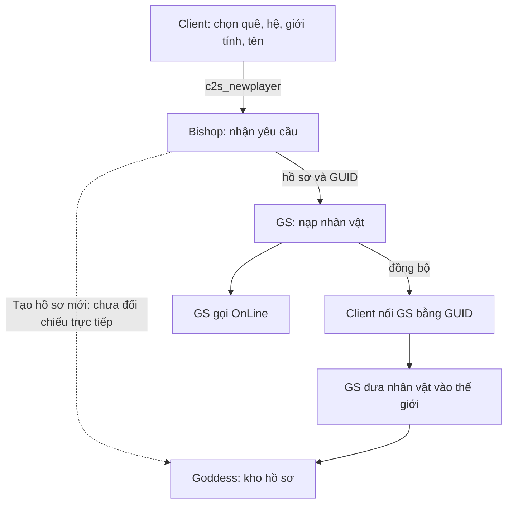

TÓM TẮT 1: [NGUỒN] PARTIAL — hoàn tất khảo sát tĩnh bổ sung luồng tạo nhân vật trong đúng phạm vi source được giao.
TÓM TẮT 2: [NGUỒN] Đã đối chiếu client gửi gói tạo mới, GS nạp hồ sơ/chỉ số/vị trí và móc gọi OnLine; chưa xác định dữ liệu khởi tạo thực tế.
TÓM TẮT 3: [NGUỒN] Cập nhật `JX1_OPS/DESIGN/HIEU-TAO-NHAN-VAT-MOI.md`; đã ghi `## Kết quả` vào cuối task.
TÓM TẮT 4: [CHƯA KIỂM] Thiếu nội dung online.lua, newplayer, cấu hình thực và nhánh tạo hồ sơ Bishop/Goddess; chưa build/chạy client, server, VM, exe hay mạng.
TÓM TẮT 5: [NGUỒN] Không commit/push theo yêu cầu; không có SHA. Tổng quan commit hộ; muốn chốt dữ liệu cần giao thêm đúng source gateway, script và cấu hình.

# HG-16b — Sự kiện đăng nhập và khởi tạo nhân vật mới

- Loại: khảo sát
- Chủ đề: Đối chiếu tĩnh đường chọn hệ/giới tính và khởi tạo nhân vật mới qua client, Bishop, GS và kho hồ sơ.
- Từ khóa: tạo nhân vật, ngũ hành, quê xuất phát, KSelPlayer, KuiNewPlayer, Bishop, Goddess, online.lua, HG-16b
- Trạng thái: PARTIAL — đầu ra tài liệu đã hoàn thành; một số dữ liệu gốc nằm ngoài nguồn được giao.
- Độ phủ: 6/6 nhóm trong mục tiêu đã được đối chiếu; 1/6 có bằng chứng mã trực tiếp đủ cho phần luồng nhìn thấy, 5/6 còn thiếu dữ liệu hoặc nhánh khởi tạo.
- Liên quan: `JX1_OPS/DESIGN/HIEU-TAO-NHAN-VAT-MOI.md`, `JX1_OPS/REPORTS/HG-16.md`, `JX1_OPS/REPORTS/A-02-luong-dang-nhap.md`.
- Cần tôi quyết định: không.

## Phạm vi và độ phủ

| Nhóm mục tiêu | Độ phủ | Bằng chứng |
|---|---|---|
| Chọn hệ, giới tính, quê và tên | Đã phủ một phần | Client gửi tên, giới tính, hệ và mã quê trong `NEW_PLAYER_COMMAND`. `C/gameui/KuiNewPlayer.cpp:616-646`. |
| Chỉ số khởi đầu | Đã phủ một phần | GS đọc nhóm thuộc tính theo hệ và gọi đường nạp chỉ số từ hồ sơ; chưa có giá trị cấu hình hoặc xác nhận điểm gọi khi tạo mới. `S/Core/Src/KPlayerSet.cpp:1568-1585`; `S/Core/Src/KPlayer.cpp:2485-2500`. |
| Vật phẩm phát | Chưa phủ đủ | GS nạp vật phẩm đã lưu; chưa thấy nguồn phát đồ khởi tạo. `S/Core/Src/KPlayerDBFuns.cpp:818-897`. |
| Bản đồ xuất phát | Đã phủ một phần | GS ưu tiên vị trí tạm/điểm hồi sinh/vị trí đã lưu; chưa biết mã quê chuyển thành điểm xuất hiện đầu tiên thế nào. `S/Core/Src/KPlayerDBFuns.cpp:464-548`. |
| `online.lua` và `newplayer` | Đã phủ một phần | Có lời gọi `OnLine`; chưa đọc được thân script hoặc vị trí xử lý `newplayer`. `S/Core/Src/KPlayer.cpp:1036-1042`. |
| Client → Bishop → GS → Goddess | Đã phủ một phần | Client và GS có bằng chứng trực tiếp; vai trò kho hồ sơ được dẫn từ A-02. Nhánh tạo/lưu hồ sơ lần đầu chưa đối chiếu. `C/gameui/KuiNewPlayer.cpp:616-646`; `S/MultiServer/GameServer/KSOServer.cpp:3804-3812`; `JX1_OPS/REPORTS/A-02-luong-dang-nhap.md:109-112`. |

## Giải mã tên

| Tên gốc | Mã hóa | Chữ đúng | Nguồn file:dòng |
|---|---|---|---|
| `jin` / `金`, `mu` / `木`, `shui` / `水`, `huo` / `火`, `tu` / `土` | ASCII / UTF-8 | Kim (金), Mộc (木), Thủy (水), Hỏa (火), Thổ (土) | `C/gameui/KuiNewPlayer.cpp:994` |
| `man` / `男`, `girl` / `女` | ASCII / UTF-8 | Nam (男), nữ (女) | `C/gameui/KuiNewPlayer.cpp:995-997` |

## Sắp theo cấu trúc game

| Thứ tự | Nội dung đã xác định |
|---|---|
| Nhân vật → ngũ hành → giới tính | Mã client gửi hệ và giới tính; các giá trị cấu hình dùng để tạo hồ sơ chưa đủ bằng chứng. `C/gameui/KuiNewPlayer.cpp:633-646`. |
| Nhân vật → chỉ số | GS có bộ khóa chỉ số theo năm hệ và đường đọc tệp theo hệ/giới tính; chưa xác minh đó là lối khởi tạo nhân vật mới. `S/Core/Src/KPlayerSet.cpp:1570-1582`; `S/Core/Src/KPlayer.cpp:3383-3394`. |
| Hành trang → từng món | Chỉ xác minh cách đọc danh sách vật phẩm đã lưu; không có danh sách đồ phát ban đầu. `S/Core/Src/KPlayerDBFuns.cpp:818-897`. |
| Thế giới → quê chọn → điểm vào | Client gửi ID quê; GS đặt nhân vật theo vị trí hồ sơ hoặc cấu hình dự phòng. Chưa có bảng nối ID quê với bản đồ/tọa độ đầu tiên. `C/gameui/KuiNewPlayer.cpp:633-646`; `S/Core/Src/KPlayerDBFuns.cpp:478-548`. |

## Đã xác minh

- [THẤY] Client tạo gói `c2s_newplayer` có giới tính, ngũ hành, ID quê và tên; [THẤY] client đánh dấu đang tạo sau khi gửi. `C/gameui/KuiNewPlayer.cpp:616-646,651-653`.
- [THẤY] GS đọc giá trị thuộc tính theo hệ từ tệp cấu hình và có hàm gán bộ chỉ số; chú thích của hàm nói hàm chưa được gọi, và tìm kiếm trong `.cpp/.h` của `Sources/Core/Src` không tìm thấy call site trong vùng đó. `S/Core/Src/KPlayerSet.cpp:1568-1585`; `S/Core/Src/KPlayer.cpp:2485-2500`; `S/Core/Src/KPlayer.h:490`.
- [THẤY] `SetLevel` lập tên tệp theo `hệ × 2 + giới tính` và đọc chỉ số nhóm `ROLE`; không có nội dung tệp cấu hình trong Sources được giao. `S/Core/Src/KPlayer.cpp:3377-3394`.
- [THẤY] Vị trí mặc định là map ID 53, điểm hồi sinh 19; giá trị có thể bị `ServerConfig.PlayerRevPosId` ghi đè. Đây không phải bằng chứng map xuất phát của nhân vật mới. `S/Core/Src/KGameglobalSet.cpp:26-27,124`; `S/Core/Src/KPlayerDBFuns.cpp:521-544`.
- [THẤY] GS gọi `OnLine` với trạng thái thế giới, tên bản đồ và cờ `m_IsFirstLogin`. `S/Core/Src/KPlayer.cpp:1036-1042`.

## Chưa xác minh

- [CHƯA KIỂM] Chưa đối chiếu trực tiếp nhánh tạo/lưu hồ sơ lần đầu ở Bishop/Goddess; A-02 chỉ là nguồn dẫn về đường đăng nhập nhân vật đã có. `JX1_OPS/REPORTS/A-02-luong-dang-nhap.md:70-71,109-112`.
- [CHƯA KIỂM] Chưa có tệp hoặc dữ liệu để xác nhận chỉ số, vật phẩm phát, cấp, tên bản đồ và tọa độ ban đầu. Nội dung script `\\script\\system\\online.lua`, cơ chế `newplayer` và chống phát thưởng lặp cũng chưa rõ. `S/Core/Src/KPlayer.cpp:1036-1042`; `JX1_OPS/TASKS/HG-16b.md:19-35`.
- [CHƯA KIỂM] Chỉ đọc tĩnh các bản mã trên đĩa do task chỉ định; chưa xác nhận phiên bản đang chạy, chưa build/chạy game, VM, exe hay mạng.

## MỤC SỔ THÔNG SỐ

| Nhóm | Tên/hằng số | file:dòng | Giá trị | Đơn vị | Ảnh hưởng | Đổi an toàn | Nguồn đo |
|---|---|---|---|---|---|---|---|
| Thuộc tính | Khóa `Strength`, `Dexterity`, `Vitality`, `Engergy`, `Lucky` theo hệ | `S/Core/Src/KPlayerSet.cpp:1570-1582` | Cấu hình chưa đọc; mặc định đọc là 0 hoặc `PLAYER_FIRST_LUCKY`. | Điểm thuộc tính | Chỉ số cơ sở nhân vật. | CẨN THẬN — thiếu dữ liệu cấu hình/runtime. | Đọc tĩnh mã nguồn; chưa đo runtime. |
| Điểm vào dự phòng | `PlayerInfo.mSubWorld`, `PlayerInfo.mReviveId`; `ServerConfig.PlayerRevPosId` | `S/Core/Src/KGameglobalSet.cpp:26-27,124` | Mặc định 53/19, cấu hình có thể ghi đè. | ID | Dùng cho vị trí dự phòng; không khẳng định quê khởi đầu. | CẨN THẬN — chưa đối chiếu cấu hình triển khai. | Đọc tĩnh mã nguồn; chưa đo runtime. |
| Tệp theo hệ/giới tính | `NewPlayerIni%02d.ini` | `S/Core/Src/KPlayer.cpp:3383-3394` | Số thứ tự = `hệ × 2 + giới tính`; chưa có nội dung tệp. | Chỉ số tệp | `SetLevel` đọc chỉ số nhóm `ROLE`. | CẨN THẬN — chưa chứng minh được gọi lúc tạo. | Đọc tĩnh mã nguồn; chưa đo runtime. |

## Đề xuất tối ưu

Không đề xuất sửa hoặc tối ưu mã trong task khảo sát chỉ đọc này. Để chốt dữ liệu tân thủ, bước tiếp theo là giao đúng source gateway cùng tệp script/cấu hình của phiên bản cần khảo sát; chưa có số đo runtime làm căn cứ tối ưu.

## Lỗi, cách thử và kết quả

`rg` không có trong môi trường, nên chuyển sang `Select-String` và `Get-ChildItem` lọc theo tên tệp/ký hiệu trong đường dẫn task chỉ định. Một truy vấn đầu tiên bao gồm cả tệp nhị phân Debug; kết quả đó được loại bỏ và truy vấn lại chỉ trên `.cpp`/`.h`. Không có build/test runtime theo quyền task.

## Bàn giao

Đã cập nhật tài liệu thiết kế và mục `## Kết quả` trong task. Không stage/commit/push; không có SHA, tổng quan commit hộ. Tệp nhịp `D:\JX-wt\HG-16b.nhip` không ghi được do quyền ghi bị giới hạn trong worktree.

Trạng thái: **PARTIAL** — thiếu nguồn trực tiếp cho dữ liệu tạo nhân vật và script; không đổi kết luận cũ.

liên quan: `JX1_OPS/DESIGN/MUC-LUC-TRI-THUC.md`, `JX1_OPS/REPORTS/HG-16.md`, `JX1_OPS/REPORTS/A-02-luong-dang-nhap.md`.

Kỹ năng đã dùng: jx1-retrofit, jx1-read-server, jx1-read-client, jx1-parameters, jx1-knowledge, jx1-report.
