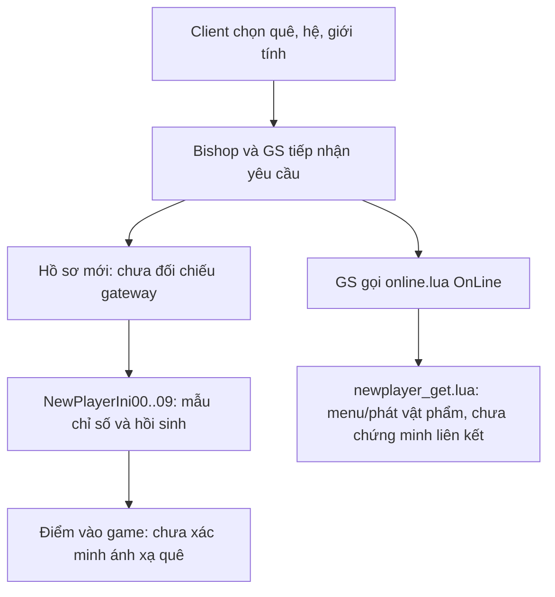

TÓM TẮT 1: [NGUỒN] PARTIAL — đã bổ sung nguồn Lua/INI cho luồng tạo nhân vật; còn thiếu bằng chứng runtime và nhánh tạo hồ sơ phía gateway.
TÓM TẮT 2: [NGUỒN] Xác minh tĩnh 10 mẫu NewPlayerIni theo ngũ hành/giới tính, thuộc tính nền, trường hồi sinh và các nhánh phát vật phẩm của newplayer_get.lua.
TÓM TẮT 3: [NGUỒN] Cập nhật JX1_OPS/DESIGN/HIEU-TAO-NHAN-VAT-MOI.md và lập báo cáo này.
TÓM TẮT 4: [CHƯA KIỂM] Chưa xác minh script đang chạy, NPC được gắn, hồ sơ mới thực tế, bản đồ/quê xuất phát và món nhận trong game.
TÓM TẮT 5: [CHƯA KIỂM] Không build, không chạy client/server/exe/VM/mạng; tệp nhịp ngoài worktree bị từ chối quyền ghi.

# HG-16c — Bổ sung nguồn tạo nhân vật mới

Loại: khảo sát
Chủ đề: Đối chiếu Lua/INI tân thủ với luồng client → Bishop → GS khi tạo nhân vật.
Từ khóa: tạo nhân vật, NewPlayerIni, newplayer_get, online.lua, RevivePos, ngũ hành, giới tính, HG-16c
Trạng thái: PARTIAL — nguồn cấu hình đã đọc, nhưng chưa nối được với nhánh tạo hồ sơ và runtime.
Độ phủ: 6/8 mục có bằng chứng tĩnh; 2/8 chưa xác minh (gateway tạo hồ sơ và nơi xuất hiện đầu tiên).
Liên quan: ../DESIGN/HIEU-TAO-NHAN-VAT-MOI.md; HG-16; XD-HG14; A-02.
Cần tôi quyết định: không.

## Phạm vi và độ phủ

| Phần | Trạng thái | Bằng chứng |
|---|---|---|
| Mẫu chỉ số theo hệ/giới tính | Đã phủ tĩnh | G/Settings/player/NewPlayerIni00.ini:11-23 đến NewPlayerIni09.ini:11-23 |
| Thuộc tính nền theo hệ | Đã phủ tĩnh | G/Settings/npc/player/NewPlayerBaseAttribute.ini:1-34 |
| Điểm hồi sinh trong mẫu | Đã phủ tĩnh | G/Settings/player/NewPlayerIni00.ini:14-16 đến NewPlayerIni09.ini:14-16 |
| Bảng điểm hồi sinh | Đã phủ tĩnh | G/Settings/RevivePos.ini:18-22 |
| Móc đăng nhập | Đã phủ tĩnh | G/script/System/online.lua:11-17; S/Core/Src/KPlayer.cpp:1036-1042 |
| Script phát vật phẩm tân thủ | Một phần | G/script/Utf8Script/npc/newplayer_get.lua:144-164,430-459,479-517 |
| Nối với tạo hồ sơ gateway | Chưa phủ | A-02 chỉ cung cấp mô tả gián tiếp: JX1_OPS/REPORTS/A-02-luong-dang-nhap.md:70-71,109-112 |
| Nơi xuất hiện lần đầu | Chưa phủ | G/Settings/RevivePos.ini:18-22 có dữ liệu nhưng chưa có đường gọi/ánh xạ quê |

## Giải mã tên

| Tên gốc | Mã hóa | Chữ đúng | Nguồn file:dòng |
|---|---|---|---|
| metal, wood, water, fire, earth | ASCII khóa INI | Kim, Mộc, Thủy, Hỏa, Thổ | G/Settings/npc/player/NewPlayerBaseAttribute.ini:1,8,15,22,29; C/gameui/KuiNewPlayer.cpp:994 |
| newplayer_get | ASCII tên tệp | Script NPC tân thủ | G/script/Utf8Script/npc/newplayer_get.lua:8 |
| OnLine, huanyin | ASCII tên hàm | Móc đồng bộ/đăng nhập; nghĩa bên trong huanyin chưa xác định | G/script/System/online.lua:11-17 |
| Tên vật phẩm trong lời thoại | Ký tự nguồn đọc không đúng UTF-8 | Chưa giải mã | G/script/Utf8Script/npc/newplayer_get.lua:141,452,454,513,515 |

## Sắp theo cấu trúc game

1. Nhân vật → ngũ hành → giới tính: Kim 00/01, Mộc 02/03, Thủy 04/05, Hỏa 06/07, Thổ 08/09; bsex=0/1 (G/Settings/player/NewPlayerIni00.ini:11-23 đến NewPlayerIni09.ini:11-23).
2. Nhân vật → chỉ số: ipower, iagility, iouter, iinside; giá trị từng mẫu nằm trong bảng ở tài liệu DESIGN.
3. Nhân vật → hồi sinh: các mẫu có irevivalid=20, irevivalx=10, irevivaly=0; nhóm [20] có khóa 10–12 (G/Settings/RevivePos.ini:18-22).
4. NPC tân thủ → lựa chọn → vật phẩm: menu, giveitem, XINSHOUA, LINGQUJIHUOA; có kiểm cờ tác vụ nhưng chưa chứng minh là luồng tạo nhân vật (G/script/Utf8Script/npc/newplayer_get.lua:8-18,144-164,430-459,479-517).

## Mục sổ thông số

| Nhóm | Tên | Giá trị đọc tĩnh | Nguồn | Đổi an toàn |
|---|---|---|---|---|
| Tân thủ | ipower/iagility/iouter/iinside | 10 mẫu, theo bảng DESIGN | G/Settings/player/NewPlayerIni00.ini:20-23 đến NewPlayerIni09.ini:20-23 | CẨN THẬN; chưa đo runtime |
| Hệ/giới tính | bsex/ifiveprop | Cặp 0/1; mã hệ 0–4 | G/Settings/player/NewPlayerIni00.ini:11-12 đến NewPlayerIni09.ini:11-12 | CẨN THẬN |
| Nền hệ | Strength/Dexterity/Vitality/Engergy/Lucky | 0/0/0/0/1 cho mỗi nhóm | G/Settings/npc/player/NewPlayerBaseAttribute.ini:1-34 | CẨN THẬN |
| Hồi sinh | irevivalid/irevivalx/irevivaly | 20/10/0 | G/Settings/player/NewPlayerIni00.ini:14-16 đến NewPlayerIni09.ini:14-16 | CẨN THẬN |

## Đã xác minh

- Đã đọc tĩnh online.lua, newplayer_get.lua, mười INI mẫu, INI thuộc tính nền và RevivePos.ini.
- Đã cập nhật tài liệu DESIGN với file:dòng, bảng phạm vi, giải mã tên, cấu trúc game và sổ thông số.
- Giữ trạng thái PARTIAL vì chưa có caller gateway hoặc kiểm runtime chứng minh dữ liệu được dùng khi tạo.

## Chưa xác minh

Chưa xác minh nhánh Bishop/Goddess tạo và lưu hồ sơ mới; NPC đang gắn newplayer_get.lua; vật phẩm thực tế, cấp ban đầu, ánh xạ quê → bản đồ và tác động của huanyin. Không chạy build, game, exe, VM hoặc mạng.

## Lỗi, cách thử và kết quả

Lệnh rg không có trong shell nên dùng PowerShell đọc đúng các tệp đã khoanh. Ghi D:\JX-wt\HG-16c.nhip bị UnauthorizedAccessException ngay mốc bắt đầu; không thử lại bằng đường dẫn khác. Không sửa mã nguồn, cấu hình hay tệp ngoài phạm vi.

## Bàn giao

Đã sửa JX1_OPS/DESIGN/HIEU-TAO-NHAN-VAT-MOI.md và tạo báo cáo này. Chưa stage/commit theo yêu cầu. Bước tiếp theo của PM: đối chiếu gateway tạo hồ sơ và xác nhận script/NPC trên đúng phiên bản triển khai.

Trạng thái: PARTIAL
Kỹ năng đã dùng: jx1-retrofit, jx1-read-server, jx1-read-client, jx1-parameters, jx1-knowledge, jx1-report.
