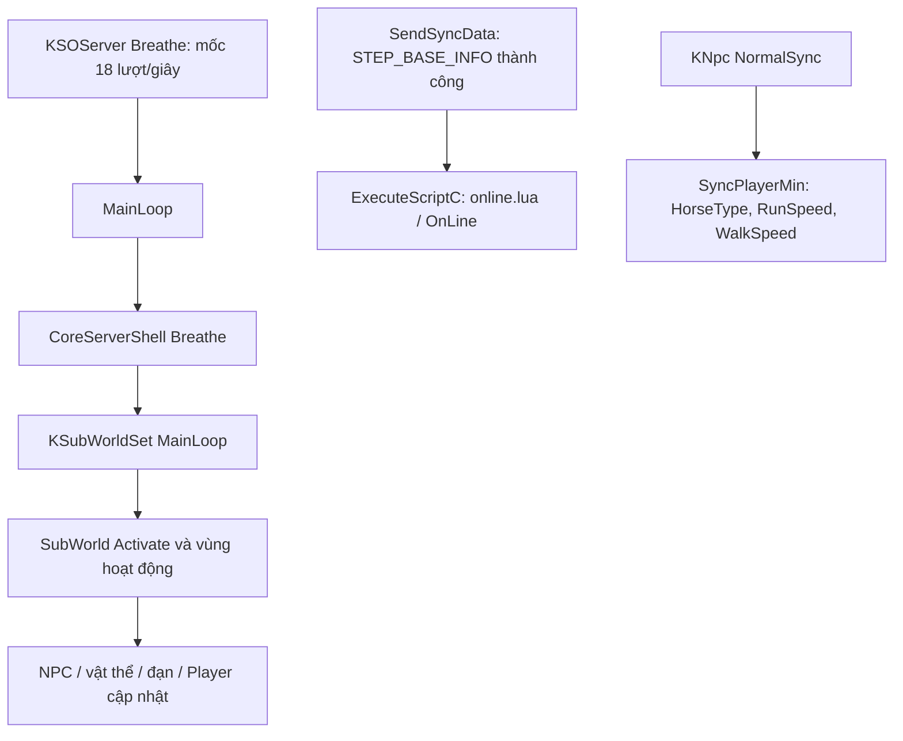

TÓM TẮT 1/5: [NGUỒN][THẤY] Tick server có mốc danh nghĩa 18 lượt/giây, chạy qua MainLoop và cập nhật SubWorld/vùng hợp lệ. (MultiServer/GameServer/KSOServer.cpp:90,1425-1450; Core/Src/KSubWorld.cpp:269-333)
TÓM TẮT 2/5: [NGUỒN][THẤY] Trong vùng hoạt động, NPC, vật thể, đạn và Player có các nhánh cập nhật riêng; chưa đo chi phí hoặc nhịp runtime. (Core/Src/KRegion.cpp:1100-1195; Core/Src/KNpc.cpp:939-1004; Core/Src/KPlayer.cpp:257-315)
TÓM TẮT 3/5: [NGUỒN][THẤY] OnLine được gọi ở bước SendSyncData thông tin cơ bản sau khi gửi gói thành công, không thấy chu kỳ mỗi phút tại callsite này. (Core/Src/KPlayer.cpp:980-1042)
TÓM TẮT 4/5: [CHƯA KIỂM] SyncPlayerMin có dữ liệu cưỡi/tốc độ; chưa xác định SyncObjectState hoặc nguyên nhân giật ngựa trên client/runtime. (Core/Src/KNpc.cpp:8058-8180; SO-TAY-NGUA-PHI-PHONG.md:100)
TÓM TẮT 5/5: [CHƯA KIỂM] Chỉ đọc tĩnh; không build/chạy exe/VM/mạng và không commit theo yêu cầu bàn giao của Tổng quan.

# HG-S1 — Hiểu game: tick gs001, online.lua và trạng thái cưỡi ngựa

Loại: tổng hợp
Chủ đề: Đối chiếu tĩnh vòng cập nhật gs001, lời gọi OnLine và dữ liệu cưỡi ngựa đồng bộ.
Từ khóa: vòng tick, Activate, Active, OnLine, online.lua, cưỡi ngựa, m_bRideHorse, SyncPlayerMin, SyncObjectState
Trạng thái: PARTIAL — phần tick và callsite OnLine đã đối chiếu; chưa xác định được đường gói vị trí/nguyên nhân giật ngựa.
Độ phủ: 4/4 câu hỏi đã phân tích; 3 mục có kết luận source tĩnh, 1 mục chỉ khoanh vùng trạng thái và tốc độ.
Liên quan: SO-18, SO-12, SO-TAY-NGUA-PHI-PHONG.
Cần tôi quyết định: không

## Sơ đồ chính

[TÀI LIỆU] Sơ đồ thể hiện thứ tự lời gọi đọc tĩnh, không phải phép đo thời gian chạy hay thứ tự gói vị trí trên dây. (MultiServer/GameServer/KSOServer.cpp:1425-1450,4360-4373; Core/Src/CoreServerShell.cpp:2227-2251; Core/Src/KSubWorldSet.cpp:601-612; Core/Src/KSubWorld.cpp:269-333; Core/Src/KRegion.cpp:1100-1195; Core/Src/KNpc.cpp:8058-8180; Core/Src/KPlayer.cpp:980-1042)

liên quan: JX1_OPS/HIEU-GAME/06-mang-goi-tin/SO-TAY-VONG-LAP-SERVER.md; JX1_OPS/HIEU-GAME/06-mang-goi-tin/SO-TAY-GOI-TIN.md; JX1_OPS/HIEU-GAME/01-trang-bi-cuong-hoa/SO-TAY-NGUA-PHI-PHONG.md.

## Phạm vi và độ phủ

| Phần tử | Trạng thái | Kết quả |
|---|---|---|
| Tick và phần việc mỗi lượt | Đã phủ tĩnh | Mốc source 18 lượt/giây; vùng hoạt động cập nhật NPC, vật thể, đạn, Player. Tần số runtime/chi phí chưa đo. |
| online.lua và lỗi script | Đã phủ tĩnh có giới hạn | Callsite OnLine nằm trong STEP_BASE_INFO; nhánh lỗi script trả FALSE nhưng callsite vẫn đặt bRet=TRUE. Hook không xác nhận nội dung live. |
| Cưỡi ngựa và đồng bộ | Phủ một phần | m_bRideHorse điều kiện tính thuộc tính ngựa; SyncPlayerMin gửi HorseType và tốc độ. Chưa thấy SyncObjectState/client position trong bốn tệp source được chỉ định riêng. |

## Giải mã tên

[TÀI LIỆU] Tên trong phạm vi là định danh ASCII (`Activate`, `Active`, `OnLine`, `m_bRideHorse`, `HorseType`, `SyncPlayerMin`); không có tên riêng tiếng Hán hoặc TCVN3 cần giải mã. Comment Hán ở một số source hiển thị lỗi khi đọc UTF-8, nên không dùng comment đó làm căn cứ. (Core/Src/KNpc.cpp:939-1004,7784-7796,8058-8180; Core/Src/KPlayer.cpp:257-315,980-1042)

## Sắp theo cấu trúc game

[TÀI LIỆU] Trình bày theo luồng chạy: vòng ngoài → core/MainLoop → SubWorld → vùng hoạt động → NPC/vật thể/đạn/Player; sau đó tách riêng lời gọi OnLine và trạng thái cưỡi vì chúng không phải cùng bước cập nhật. (MultiServer/GameServer/KSOServer.cpp:1425-1450,4360-4373; Core/Src/KSubWorld.cpp:269-333; Core/Src/KRegion.cpp:1100-1195)

## Kết quả đối chiếu

[THẤY] KSOServer dùng GAME_FPS=18 để xét lượt MainLoop; mỗi lượt duyệt SubWorld. Đồng hồ bản đồ hợp lệ tăng trong Activate, còn KNpc::Activate xử lý ProcessState, AI, ProcCommand và ProcStatus. KPlayer::Active là nhánh riêng, trong đó m_nPlayerTime giảm một khi còn dương. Đây là bộ đếm source, không phải phép đo thời gian thực. (MultiServer/GameServer/KSOServer.cpp:90,1425-1450; Core/Src/KSubWorldSet.cpp:601-612; Core/Src/KSubWorld.cpp:269-293; Core/Src/KNpc.cpp:939-1004; Core/Src/KPlayer.cpp:257-315)

[THẤY] Callsite `ExecuteScriptC("\\script\\system\\online.lua", "OnLine", ...)` nằm trong `KPlayer::SendSyncData`, nhánh STEP_BASE_INFO, sau khi gửi gói cơ bản thành công. Bản hook `online.fixed.lua` chỉ là mẫu thử. Trong `CoreServerShell`, mốc giây 0 gọi `servertimer.lua` Main; KSOServer ghi thống kê ở bội số 1080 lượt. Không thấy các mốc đó gọi OnLine. (Core/Src/KPlayer.cpp:980-1042; docs-analysis/out/online.fixed.lua:42-45,90-92; Core/Src/CoreServerShell.cpp:2227-2251; MultiServer/GameServer/KSOServer.cpp:1453-1459)

[THẤY] Nhánh `Script error [tên_tệp]` trong ExecuteScriptC xuất hiện khi g_GetScript không trả về script và hàm trả FALSE. Khi script có sẵn, wrapper gọi ExecuteScriptD; lỗi CallFunction/catch cũng trả FALSE. Caller OnLine không kiểm giá trị này và đặt bRet=TRUE khi gói đồng bộ đã gửi thành công, nên đường lỗi bắt và trả về ở đây không tự đặt điều kiện dừng MainLoop. Chưa thể loại trừ script chạy lâu/treo hoặc ảnh hưởng runtime vì không chạy thử. (Core/Src/KPlayer.cpp:8415-8443,8089-8155,1036-1046; MultiServer/GameServer/KSOServer.cpp:1425-1450)

[CHƯA KIỂM] Bản hook gọi `GetMaptimeInfo`, còn bảng ScriptFuns có đăng ký phân biệt `GetMaptimeInfo` và `GetMapTimeInfo`; handler mới trả bảy số 0 cho player hợp lệ. Chưa đối chiếu đúng script trên server hoặc binary, nên không quy kết khác biệt chữ hoa/thường là nguyên nhân thông báo. Đường D:/JX-source không tồn tại ở vị trí task nêu. (docs-analysis/out/online.fixed.lua:92; Core/Src/ScriptFuns.cpp:21749-21764,26248,26418)

[THẤY] KPlayer.cpp:3716-3769 tính lại thuộc tính trang bị; ô ngựa chỉ áp thuộc tính khi m_bRideHorse đúng. KNpc gán HorseType theo cờ cưỡi và gửi RunSpeed/WalkSpeed trong đồng bộ người chơi thường cũng như s2c_syncplayermin. Đoạn dựng gói đã đọc không cho thấy tọa độ. (Core/Src/KPlayer.cpp:3716-3769; Core/Src/KNpc.cpp:7729-7796,8058-8180; JX1_OPS/HIEU-GAME/01-trang-bi-cuong-hoa/SO-TAY-NGUA-PHI-PHONG.md:99-100)

[CHƯA KIỂM] Trong bốn tệp source được chỉ định riêng (KPlayer.cpp, KSubWorld.cpp, KNpc.cpp, ScriptFuns.cpp) chưa thấy định nghĩa/consumer SyncObjectState. Chưa xác minh client, chu kỳ gửi/nhận vị trí, thứ tự gói hay hiện tượng runtime; không thể kết luận nguyên nhân “giật ngựa” chỉ từ cờ cưỡi và tốc độ. (Core/Src/KPlayer.cpp:3716-3769; Core/Src/KNpc.cpp:8058-8180; JX1_OPS/HIEU-GAME/06-mang-goi-tin/SO-TAY-GOI-TIN.md:1-5)

## MỤC SỔ THÔNG SỐ

| Nhóm | Tên/hằng số | file:dòng | Giá trị | Đơn vị | Ảnh hưởng | Đổi an toàn | Nguồn đo |
|---|---|---|---|---|---|---|---|
| Nhịp server | GAME_FPS | MultiServer/GameServer/KSOServer.cpp:90 | 18 | lượt danh nghĩa/giây | Điều kiện xét lượt MainLoop | CẨN THẬN | Đọc tĩnh, chưa đo runtime |
| Bộ đếm Player | m_nPlayerTime | Core/Src/KPlayer.cpp:283-304 | giảm 1 khi dương | lượt gọi Active | Xử lý bộ đếm người chơi | CẨN THẬN | Đọc tĩnh; giá trị khởi tạo ngoài phạm vi |
| Trạng thái ngựa | m_bRideHorse / HorseType | Core/Src/KNpc.cpp:7784-7790,8174-8179 | cờ cưỡi / -1 nếu không cưỡi | cờ / mã loại | Trạng thái cưỡi trong đồng bộ | CẨN THẬN | Đọc tĩnh |
| Tốc độ | RunSpeed / WalkSpeed | Core/Src/KNpc.cpp:7795-7796,8083-8084 | giá trị hiện thời trong source | nội bộ | Dữ liệu tốc độ được đồng bộ | CẨN THẬN | Đọc tĩnh; không quy đổi quãng đường |

## Đề xuất tối ưu

[TÀI LIỆU] Chưa đề xuất sửa mã từ đọc tĩnh. Muốn xác định nguyên nhân giật cần đo trạng thái cưỡi, tốc độ, vị trí và khung hình client trong một task có quyền thử nghiệm riêng; phạm vi này cấm chạy VM/exe/mạng. (Core/Src/KNpc.cpp:8058-8180; MultiServer/GameServer/KSOServer.cpp:1425-1450)

## Đã xác minh / Chưa xác minh

- [THẤY] Đã đối chiếu tĩnh tick, nhánh cập nhật NPC/Player, callsite OnLine và các trường cưỡi/tốc độ SyncPlayerMin theo các source và dòng nêu trên.
- [CHƯA KIỂM] Nguồn D:/JX-source không có tại đường dẫn task; hook test không xác nhận Lua đang chạy. SyncObjectState, client receiver, vị trí và nguyên nhân runtime chưa kiểm.
- Chưa chạy test/build, exe, VM hoặc mạng theo quyền task. Không có số đo runtime.

## Bàn giao

Tạo sổ tay `JX1_OPS/HIEU-GAME/07-server-luu-tru/SO-TAY-TICK-GS001.md`. Kết quả cuối đã ghi ở task. Không commit/push; Tổng quan tiếp nhận commit. Ghi nhịp ở `D:\JX-wt\HG-S1.nhip` bị từ chối do đường dẫn nằm ngoài vùng ghi khả dụng.

Đề xuất PM gộp vào mục lục tri thức; dòng chỉ mục đề xuất: `JX1_OPS/HIEU-GAME/07-server-luu-tru/SO-TAY-TICK-GS001.md` | `tổng hợp` | `Vòng tick gs001, OnLine và trạng thái cưỡi ngựa` | `tick, Activate, Active, OnLine, online.lua, cưỡi ngựa, SyncPlayerMin, SyncObjectState` | `PARTIAL` | `3/4 câu hỏi có kết luận tĩnh; nguyên nhân giật chưa kiểm` | `SO-18; SO-12; SO-TAY-NGUA-PHI-PHONG`.

Kỹ năng đã dùng: jx1-retrofit, jx1-read-server, jx1-read-client (đọc hướng dẫn; không đọc source client vì task không nêu root client), jx1-parameters, jx1-knowledge, jx1-report.