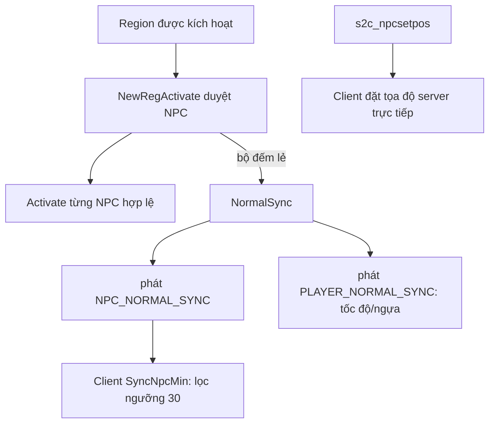

[NGUỒN] PARTIAL — đã đối chiếu xử lý gói ngựa/vị trí phía client và vòng NPC phía server; chỉ đọc tĩnh, chưa kết luận nguyên nhân giật.
[NGUỒN] `CORRECT_SYNC_RANGE=30` lọc đồng bộ NPC theo từng trục; `s2c_npcsetpos` đặt trực tiếp tọa độ server. (`Client/gamecore/KNpc.cpp:1527`; `KProtocolProcess.cpp:2311–2364,2431–2440`)
[TÀI LIỆU] I-03 có 9 map mẫu, 33–359 bản ghi NPC/map; mật độ trung bình là 0,46–1,44 bản ghi/region đọc được. (`I-03-khao-sat-quai-vat.md:228–240`)
[CHƯA KIỂM] Chưa có toàn bộ tập map chính, số NPC trong region hoạt động, hoặc phép đo để xác nhận thứ hạng nghi phạm #B-090.
[CHƯA KIỂM] Không build, chạy exe, VM, game hoặc mạng; không commit theo yêu cầu, Tổng quan nhận phần commit.

# HG-S2 — Hiểu game: giật ngựa phía client và số quái/NPC ăn tick

Loại: khảo sát
Chủ đề: Đọc tĩnh luồng đồng bộ ngựa/vị trí client, số bản ghi NPC map và ảnh hưởng tiềm năng tới vòng tick server.
Từ khóa: giật ngựa, cưỡi ngựa, CORRECT_SYNC_RANGE, SyncNpcMin, SyncPlayerMin, NormalSync, NewRegActivate, NPC, #B-090
Trạng thái: PARTIAL — đường xử lý và ngưỡng đã xác minh tĩnh; số liệu map chỉ có mẫu, chưa đo runtime.
Độ phủ: 9/9 map mẫu của I-03; tổng số “map chính” chưa đếm được vì task không định nghĩa tập này và chưa kiểm kê toàn bộ Settings/PAK.
Liên quan: `JX1_OPS/REPORTS/HG-S1.md`, `JX1_OPS/REPORTS/SO-04.md`, `JX1_OPS/REPORTS/I-03-khao-sat-quai-vat.md`, `JX1_OPS/REPORTS/I-04-khao-sat-map.md`, `JX1_OPS/HOP-THU/A-B.md` (#B-090).
Cần tôi quyết định: không.

Nguồn client: `C:/Jx1CocoV3/Folder/Client2912-20260116T044348Z-3-001/Client2912/Client/Classes`.
Nguồn server: `C:/Jx1CocoV3/SwordOnline/SwordOnline/jxOnline/gameserver/Sources/Core/Src`.
Settings đọc trực tiếp: `C:/Jx1CocoV3/Folder/ServerNew-20260116T043145Z-3-001/ServerNew/_bin_v2_/gs`; đây là cây dữ liệu riêng, không khẳng định đồng phiên bản với source server. Task không ghim commit cho các cây source.

## Phạm vi và độ phủ

| Phần | Trạng thái | Bằng chứng / giới hạn |
|---|---|---|
| Nhận gói vị trí/ngựa phía client | Đã phủ tĩnh | Handler cho `s2c_syncnpcmin`, `s2c_syncplayermin`, `s2c_syncnpcminplayer`, `s2c_npcsetpos`. `Client/gamecore/KProtocolProcess.cpp:54–60,186` |
| Ngưỡng và kéo vị trí | Đã phủ tĩnh | `CORRECT_SYNC_RANGE=30`; `SyncNpcMin` loại gói nếu một trục vượt 30. `s2cnpcsetpos` đặt thẳng tọa độ, không thấy dùng ngưỡng này. `Client/gamecore/KNpc.cpp:1527,1609–1613`; `KProtocolProcess.cpp:2311–2364,2431–2440` |
| Nội suy vị trí | Phủ một phần | Có phép tính điểm trung gian theo số frame còn lại nhưng chưa thấy điểm nạp `m_sSyncPos` trong Classes; chưa gắn được với gói sửa vị trí server. `Client/gamecore/KNpc.cpp:10097–10155` |
| Dữ liệu NPC và region | Phủ 9 map mẫu | Bản ghi/region tĩnh từ I-03; không phải số NPC sống. `I-03-khao-sat-quai-vat.md:228–240,258` |
| Nghi phạm tick #B-090 | Đã so source, chưa đo | Loop NPC và broadcast phù hợp với giả thuyết chi phí tăng theo danh sách/region; chưa có số CPU/tick để xác nhận thứ hạng. `A-B.md:1855–1864`; `Server/Core/Src/KRegion.cpp:1106–1127`; `KNpc.cpp:8043–8052` |
| Build/runtime | Chưa phủ | Không build, chạy exe, VM, game, mạng hoặc phép đo theo phạm vi task. |

## Phát hiện chính

- [THẤY] Client map opcode `s2c_syncnpcmin` vào `SyncNpcMin`, `s2c_syncplayermin` vào `SyncPlayerMin`, `s2c_syncnpcminplayer` vào `SyncNpcMinPlayer`, và `s2c_npcsetpos` vào `s2cnpcsetpos`. `C:/Jx1CocoV3/Folder/Client2912-20260116T044348Z-3-001/Client2912/Client/Classes/gamecore/KProtocolProcess.cpp:54–60,186`.
- [THẤY] `CORRECT_SYNC_RANGE` có giá trị 30. `SyncNpcMin` chuyển tọa độ server sang map/region rồi trả về nếu `abs(ndx)>30` hoặc `abs(ndy)>30`; đây là kiểm tra theo từng trục quanh người chơi hiện tại. `Client/gamecore/KNpc.cpp:1527`; `KProtocolProcess.cpp:2417–2440`.
- [THẤY] Nhánh sửa vị trí trong `SyncNpcMin` loại nhân vật local khỏi cập nhật tọa độ; với NPC thường/đồng hành, nó ghi tọa độ/offset và region khi nhận trạng thái. Vì vậy chưa có căn cứ gọi `CORRECT_SYNC_RANGE` là ngưỡng kéo nhân vật của chính người chơi. `Client/gamecore/KProtocolProcess.cpp:2521–2562`.
- [THẤY] `SyncNpcMinPlayer` kiểm tra ID là nhân vật local; nó gán tọa độ server khi local chưa có region hoặc region đích chưa được nạp. `s2cnpcsetpos` cũng ghi MapX/MapY/offset trực tiếp và chuyển sang đứng. `Client/gamecore/KProtocolProcess.cpp:2637–2713,2311–2364`.
- [THẤY] `SyncPlayerMin` cập nhật `RunSpeed`, `WalkSpeed`, `HorseType` và thuộc tính trang bị; không ghi tọa độ trong handler này. `Client/gamecore/KProtocolProcess.cpp:3059–3074`.
- [THẤY] `KNpc::MovePos` có ngưỡng 30 nhưng điều kiện loại trừ Player; lời gọi `ForceSyncPos(TRUE)` ở đó bị comment. `Client/gamecore/KNpc.cpp:1605–1613`.
- [TÀI LIỆU] Chín map mẫu trong I-03 có 33–359 bản ghi NPC/map, 33–359 phần lớn là `shKind=0`; trung bình số bản ghi mọi Kind chia region đọc được là 0,46–1,44. Đây là mật độ dữ liệu tĩnh, không phải instance đang sống hay vùng đang hoạt động. `I-03-khao-sat-quai-vat.md:228–240,258`.
- [THẤY] Tệp cấu hình được đọc trực tiếp có header/mẫu trong `Settings/Npcs.txt`, `MapList Count=1000` và `WorldSet Count=800`; đây là header/giới hạn cấu hình, không xác nhận map được nạp. `C:/Jx1CocoV3/Folder/ServerNew-20260116T043145Z-3-001/ServerNew/_bin_v2_/gs/Settings/Npcs.txt:1–2`; `C:/Jx1CocoV3/Folder/ServerNew-20260116T043145Z-3-001/ServerNew/_bin_v2_/gs/Settings/MapList.ini:1–2`; `C:/Jx1CocoV3/Folder/ServerNew-20260116T043145Z-3-001/ServerNew/_bin_v2_/gs/maps/WorldSet_gs001.ini:1–8`.

## Đối chiếu kết luận #B-090

| Xếp hạng giữ nguyên từ #B-090 | Mức hỗ trợ trong task này | Kết quả |
|---|---|---|
| 1. NPC `Activate` + `NormalSync` | Có hỗ trợ cấu trúc: region hoạt động duyệt danh sách NPC; `NormalSync` chạy trên nhịp counter và broadcast tới region hiện tại/region nối. `KRegion.cpp:1106–1127`; `KNpc.cpp:8043–8052` | Có thể tăng việc theo số NPC trong region, nhưng chưa có số NpcList/region hoặc phép đo CPU. Dữ liệu 9 map chỉ hỗ trợ định tính. |
| 2. printf/console | #B-090 chưa xác định printf nào nằm trên đường nóng. `A-B.md:1857` | Không có số đếm mới trong source được giao. |
| 3. Lỗi script/ghi log | #B-090 ghi chưa đo. `A-B.md:1858,1864` | Không mở log runtime hoặc đo chi phí trong task này. |
| 4. Hook dump phi phong | #B-090 ghi chưa kiểm; nêu cây SC-006B b13. `A-B.md:1850,1859` | Không xác nhận hook có trong phiên bản source được giao. |
| 5. Timer bù trễ | #B-090 yêu cầu avg/max/over để phân biệt. `A-B.md:1860–1864` | Không có phép đo tick mới. |

[TÀI LIỆU] Giữ nguyên thứ hạng nghi vấn và trạng thái chưa đo của #B-090. Source hiện tại hỗ trợ về mặt luồng rằng nhiều NPC trong active region có thể phát sinh nhiều xử lý hơn; số liệu map tổng không chứng minh đây là nguyên nhân giật hoặc xếp trên các nghi phạm khác. A-B ghi source #B-090 là SC-006B b13, không đồng nhất phiên bản với cây C:/Jx1CocoV3 được giao. `A-B.md:1850,1855–1864`.

## Giải mã tên

Không ghi tên riêng quái/NPC/bản đồ; dùng ID map. Các tên trong bảng là định danh ASCII, được giữ nguyên.

| Tên gốc | Mã hóa | Chữ đúng / ý nghĩa | Nguồn |
|---|---|---|---|
| `CORRECT_SYNC_RANGE` | ASCII | Hằng số ngưỡng đồng bộ | `Client/gamecore/KNpc.cpp:1527` |
| `NPC_NORMAL_SYNC`, `PLAYER_NORMAL_SYNC`, `NPC_PLAYER_TYPE_NORMAL_SYNC` | ASCII | Kiểu cấu trúc gói; giữ nguyên tên source | `Client/gamecore/KProtocol.h:119,360–371` |
| `NewRegActivate`, `NormalSync` | ASCII | Hàm vòng region/đồng bộ NPC | `Server/Core/Src/KRegion.cpp:1100`; `KNpc.cpp:7886` |
| `SyncNpcMin`, `SyncNpcMinPlayer`, `SyncPlayerMin`, `s2cnpcsetpos` | ASCII | Hàm nhận gói trên client | `Client/gamecore/KProtocolProcess.cpp:186,2410,2637,3059` |

## Sắp theo cấu trúc game

1. Region server hoạt động → danh sách NPC → `Activate` → `NormalSync` → broadcast.
2. Client nhận packet → kiểm tra ID/region/ngưỡng → cập nhật NPC, tải region hoặc đặt tọa độ server.
3. Dữ liệu map giữ theo ID tăng dần (3, 4, 5, 9, 10, 12, 26, 50, 75); chỉ là 9 map mẫu, chưa đủ nguồn để nhóm toàn bộ map chính theo khu vực.

## Mục sổ thông số

| Nhóm | Tên/hằng số | file:dòng | Giá trị | Đơn vị | Ảnh hưởng | Đổi an toàn | Nguồn đo |
|---|---|---|---:|---|---|---|---|
| Đồng bộ client | `CORRECT_SYNC_RANGE` | `KNpc.cpp:1527`; `KProtocolProcess.cpp:2435,2439` | 30 | bước MapX/MapY mỗi trục | Lọc gói NPC xa vị trí client trong `SyncNpcMin` | CẨN THẬN | Đọc source; chưa đo runtime |
| Vòng region | `m_nNpcSyncCounter` | `KRegion.cpp:1117,1125–1127` | lẻ; reset khi `> 2 × node count` | lượt NewRegActivate | Gọi `NormalSync` xen kẽ, còn `Activate` duyệt từng NPC hợp lệ | CẨN THẬN | Đọc source; không có số đo CPU |
| Catalog map | `MapList Count` | `GS/Settings/MapList.ini:1–2` | 1000 | mục khai báo | Số cấu hình, không phải map hoạt động | CẨN THẬN | Đọc Settings tĩnh |
| Danh sách map gs001 | `WorldSet Count` | `GS/maps/WorldSet_gs001.ini:1–8` | 800 | mục khai báo | Số mục cấu hình giới hạn | CẨN THẬN | Đọc Settings tĩnh |

## Đã xác minh / Chưa xác minh

- [THẤY] Đã kiểm tra trực tiếp symbol và dòng hiện tại tại cây client Classes và server Core/Src được ghi trong task; các cây không có commit/version chung được ghim.
- [THẤY] Đã đọc header/dòng đầu của `Npcs.txt`, `MapList.ini`, `WorldSet_gs001.ini` trong package ServerNew; package dữ liệu được giữ tách biệt với cây source server.
- [TÀI LIỆU] Số liệu chín map trích I-03: tổng bản ghi trong PAK được đếm theo ID map, bản ghi dùng chung có thể bị tính lại và không biểu thị NPC đang sống. `I-03-khao-sat-quai-vat.md:224–240,258`.
- [CHƯA KIỂM] Chưa có danh sách đầy đủ map chính, số NPC trong từng region hoạt động, vị trí/đích gói gây snap thực tế, tác động của nội suy trong runtime, hoặc phép đo so sánh 5 nghi phạm #B-090.
- Không build, chạy exe, VM, game hoặc mạng; không sửa mã/config; không commit/push.

## Đề xuất tối ưu

[CHƯA KIỂM] Chưa đề xuất đổi hằng số hoặc code. Nếu được giao đo riêng, cần ghép gói vị trí, độ lệch theo X/Y, số NPC của active region và tick avg/max/over tại đúng thời điểm khựng; chỉ khi đó mới đánh giá nới ngưỡng hay tối ưu đường server.

## Bàn giao

Đề xuất PM thêm dòng vào `JX1_OPS/DESIGN/MUC-LUC-TRI-THUC.md`: `Hiểu game: giật ngựa và đồng bộ vị trí | SO-TAY-GIAT-NGUA-CLIENT.md | CORRECT_SYNC_RANGE, SyncNpcMin, SyncPlayerMin, NPC, tick, NormalSync, NewRegActivate, #B-090 | PARTIAL — kiểm tĩnh, 9 map mẫu, chưa đo runtime`.

Không tạo `_CHIMUC/HG-S2.tsv` vì file chỉ mục không nằm trong `vung_file` được giao. Tổng quan xử lý commit theo yêu cầu; không push. Không ghi được `D:\JX-wt\HG-S2.nhip` vì đường dẫn ở ngoài vùng ghi hiện tại.

Kỹ năng đã dùng: jx1-retrofit, jx1-read-server, jx1-read-client, jx1-parameters, jx1-knowledge, jx1-report.
