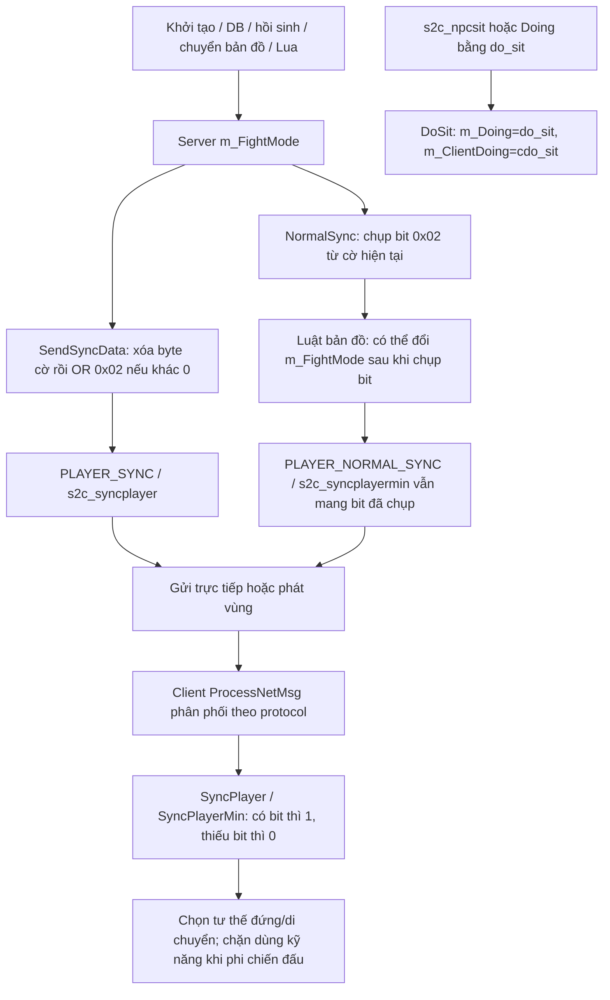

TÓM TẮT 1: [NGUỒN][THẤY] DONE khảo sát tĩnh: kiểm kê 21 vị trí ghi/gọi setter ở server, 6 vị trí ghi ở client và 2 nơi đóng gói cờ; xem bảng 29 mục, nguồn tiêu biểu `S/KNpc.cpp:15328–15335`, `C/KProtocolProcess.cpp:3005–3008`.
TÓM TẮT 2: [NGUỒN][THẤY] Hai gói dùng bit `0x02`; `NormalSync()` đóng gói trước khi luật bản đồ đổi cờ, tạo khả năng gói mang giá trị trước lần đổi: `S/KNpc.cpp:8210–8221`.
TÓM TẮT 3: [NGUỒN][THẤY] Cờ 0 là phi chiến đấu; ngồi thực dùng `do_sit/cdo_sit`, không thể đồng nhất hai trạng thái: `C/KNpc.cpp:2018–2028`, `C/KNpc.cpp:2166–2183`.
TÓM TẮT 4: [CHƯA KIỂM] Đầu ra là báo cáo này và mục Kết quả cuối task; chưa xác minh binary/runtime. Nhịp ngoài worktree bị sandbox từ chối ghi; không có báo cáo HG2-02 cũ để sửa kết luận.
TÓM TẮT 5: [CHƯA KIỂM] Không chạy build, exe, VM hay mạng; không commit/push theo yêu cầu, chưa có SHA; Tổng quan tiếp nhận tài liệu và commit hộ.

# HG2-02 — Đồng bộ cờ chiến đấu 0x02 giữa server và client

Loại: khảo sát
Chủ đề: Nguồn đặt/xóa chế độ chiến đấu, đường đóng gói/nhận cờ và phân biệt với động tác ngồi.
Từ khóa: chiến đấu, phi chiến đấu, ngồi, m_FightMode, SetFightMode, 0x02, PLAYER_SYNC, PLAYER_NORMAL_SYNC, NormalSync, 战斗模式
Trạng thái: DONE — hoàn tất phạm vi đọc mã và bảng ≥ 8 mục; ghi nhịp ngoài sandbox bị chặn, không ảnh hưởng bằng chứng đọc tĩnh.
Độ phủ: 29/29 vị trí trong kiểm kê thao tác tường minh: 21 server, 6 client, 2 nơi đóng gói; không phải độ phủ thực thi hay chứng minh không có ghi bộ nhớ gián tiếp.
Liên quan: `JX1_OPS/TASKS/HG2-02.md`; `JX1_OPS/DESIGN/CHUAN-BAO-CAO.md`; `JX1_OPS/DESIGN/MUC-LUC-TRI-THUC.md`; `JX1_OPS/CONTEXT-PACK/GS001-MAP.md`.
Cần tôi quyết định: không — phần khảo sát đã xong; sửa mã hoặc kiểm thử runtime là task riêng.



[THẤY] Căn cứ sơ đồ: `S/KNpc.cpp:7730–7734,7806–7822,8057–8061,8210–8244`; `S/KRegion.cpp:2251–2278`; `C/KProtocolProcess.cpp:54–58,124,212–228,3005–3008,3147–3150,663–674`; `C/KNpc.cpp:2018–2028,2166–2213`. Mũi tên mô tả quan hệ mã, không chứng minh thứ tự gói trên mạng thực tế.

## 1. Nguồn, quy ước và cách đọc

- [TÀI LIỆU] Task giới hạn đọc client Classes và server gameserver/gateway Sources, yêu cầu luồng gói và bảng ít nhất 8 mục: `JX1_OPS/TASKS/HG2-02.md:16–21`. Chuẩn yêu cầu giữ kết luận cũ, thêm phạm vi, giải mã và chỉ mục: `JX1_OPS/DESIGN/CHUAN-BAO-CAO.md:1` trở đi.
- [THẤY] Git trước ghi: `## task/HG2-02`, không có dòng thay đổi; báo cáo đích chưa tồn tại. Không khởi động lại việc đã có bằng chứng. Gốc tương đối trong worktree không tồn tại; đã xác nhận các gốc nguồn dưới đây bằng `Test-Path`, không sửa nguồn.
- Quy ước `S/<file>:dòng` = `C:/Jx1CocoV3/SwordOnline/SwordOnline/jxOnline/gameserver/Sources/Core/Src/<file>:dòng`.
- Quy ước `C/<file>:dòng` = `C:/Jx1CocoV3/Folder/Client2912-20260116T044348Z-3-001/Client2912/Client/Classes/gamecore/<file>:dòng`.
- `P:704` = `C:/Jx1CocoV3/SwordOnline/SwordOnline/jxOnline/gameserver/Sources/Core/Core.vcxproj:704`.
- Gốc gateway đã tra: `C:/Jx1CocoV3/SwordOnline/SwordOnline/jxOnline/gateway/Sources`. Tên thư mục client là định danh bản trên đĩa; chưa xác minh nó trùng APK/binary đang sử dụng.
- Nhãn: **THẤY** = đối chiếu trực tiếp mã/lệnh đọc; **TÀI LIỆU** = yêu cầu hoặc bản đồ; **CHƯA KIỂM** = chưa đo/thực chạy. Giả thuyết luôn ghi riêng. Số dòng dùng phép đọc văn bản nhất quán; chú thích Hán liên quan được đối chiếu GBK, không sửa encoding nguồn.
- [THẤY] Không có Graphify tại `graphify-out/.graphify_root` và `graphify-out/GRAPH_REPORT.md` trong các gốc Sources/Classes đã kiểm. Bản đồ GS001 chỉ định vị; kết luận dưới đây dùng tệp thật và dòng hiện tại.

### Danh sách tệp cần đọc từ nguồn task và phần mở rộng theo symbol

| Nhóm | Tệp được chọn | Mục đích |
|---|---|---|
| Server chính | `S/KNpc.cpp`, `S/KNpc.h` | Khởi tạo, setter, đóng gói, luật bản đồ, giữ cờ khi chuyển server |
| Server caller | `S/KPlayer.cpp`, `S/KPlayerSet.cpp`, `S/KPlayerDBFuns.cpp`, `S/CoreServerShell.cpp` | Hồi sinh, rời/đăng nhập, lưu/nạp, khôi phục chuyển server |
| Server điều khiển | `S/KSubWorld.cpp`, `S/ScriptFuns.cpp`, `S/KProtocolProcess.cpp` | Chuyển bản đồ, Lua, nhánh nhận lệnh và phân biệt macro/comment |
| Server truyền gói | `S/KRegion.cpp`, `P` | Đích phát vùng; xác định tệp chính trong project |
| Bản sao chỉ tra symbol | `S/KNpc_backup.cpp`, `S/KPlayer - Copy - Copy.cpp` | Tách kết quả tìm kiếm khỏi mã chính; không lấy làm bản thay thế |
| Client chính | `C/KProtocolProcess.cpp`, `C/KProtocol.h`, `C/KProtocolDef.h`, `C/KNpc.cpp`, `C/KNpc.h` | Dispatch, hai gói, giải mã bit, khởi tạo/setter và động tác |
| Client định vị thêm | `C/KNpcSet.cpp` và các tệp chứa tham chiếu `m_FightMode` | Kiểm tra dùng cờ và tìm ghi tường minh; không khảo sát toàn bộ UI/AI |

[THẤY] Đã tìm theo tên tệp/symbol trong đúng ba gốc nguồn task. Lọc riêng `*.cpp` và `*.h`, không dùng danh sách đệ quy cả ổ đĩa. Không thấy `KProtocol.h`/`KProtocolDef.h` trong server Sources. Project có include `..\..\Headers` ngoài gốc Sources (`P:423,539`); không mở rộng sang đó nên chưa đối chiếu ABI hai đầu.

## 2. Phạm vi và độ phủ

| Phần tử phạm vi | Độ phủ | Bằng chứng / giới hạn |
|---|---|---|
| Các ghi/gọi setter tường minh server | Đã phủ 21/21 vị trí kiểm kê | Bảng S01–S21 bên dưới, mỗi dòng có nguồn |
| Đặt/xóa bit trong gói | Đã phủ 2/2 nơi đóng gói | `S/KNpc.cpp:7806–7814,8210–8230` |
| Ghi tường minh client | Đã phủ 6/6 vị trí kiểm kê | Bảng C01–C06 |
| Luồng gói đầy đủ | Đã phủ | `S/KNpc.cpp:7730–7734,7816–7822`; `C/KProtocolProcess.cpp:54,2937–2945,3005–3008` |
| Luồng gói cập nhật | Đã phủ | `S/KNpc.cpp:8057–8061,8235–8244`; `C/KProtocolProcess.cpp:55,3059–3066,3147–3150` |
| Khôi phục và lưu/nạp | Đã phủ tĩnh | `S/CoreServerShell.cpp:2663–2674`; `S/KPlayerDBFuns.cpp:467,535,806,1550–1572` |
| Luật bản đồ và thứ tự đóng gói | Đã phủ | `S/KNpc.cpp:8210–8221` |
| Đích phát và điều kiện không gửi | Đã phủ đoạn gửi liên quan | `S/KRegion.cpp:2251–2278`; chưa đo giao nhận |
| Ngồi thực so với phi chiến đấu | Đã phủ đường liên quan | `C/KNpc.cpp:2166–2192`; `C/KProtocolProcess.cpp:663–674,2475–2479` |
| Macro, comment, bản sao | Đã tách | `S/KProtocolProcess.cpp:366,5414,9038–9054`; `P:704,748,920` |
| Gateway Sources | Đã tìm symbol, không có kết quả dương tính | `*.cpp`/`*.h`: 0 dòng khớp bộ mẫu; không suy rằng gateway không vận chuyển gói |
| ABI/header server ngoài Sources | Chưa phủ | Ngoài gốc đọc task; đường include tại `P:423,539` |
| Binary, dữ liệu bản đồ/Lua triển khai, gói thực, thời gian lặp | Chưa phủ | Task cấm build/exe/VM/mạng; không khẳng định lỗi runtime |

### Giải mã tên

Không đưa tên riêng kỹ năng, trang bị, NPC hay bản đồ vào kết luận; không suy tên từ ID hồi sinh. Các định danh kỹ thuật giữ nguyên ASCII. Thuật ngữ Hán liên quan được giải mã như sau:

| Tên gốc / định danh | Mã hóa | Chữ đúng UTF-8 / nghĩa | Nguồn file:dòng |
|---|---|---|---|
| `战斗模式` (byte GBK `D5 BD B6 B7 C4 A3 CA BD`) | GBK | `战斗模式` — chế độ chiến đấu | `S/KNpc.cpp:8216` |
| `m_FightMode`, `SetFightMode` | ASCII, biểu diễn được trong UTF-8 | Cờ chế độ chiến đấu và hàm đặt cờ | `S/KNpc.h:835,1064`; `S/KNpc.cpp:15328–15335` |
| `PLAYER_SYNC`, `PLAYER_NORMAL_SYNC` | ASCII | Gói người chơi đầy đủ, gói người chơi cập nhật | `C/KProtocol.h:36–66,76–119` |
| `do_sit`, `cdo_sit` | ASCII | Trạng thái ngồi logic, động tác ngồi phía client | `C/KNpc.cpp:2180–2181` |

### Sắp theo cấu trúc game

Báo cáo xếp theo vòng đời nhân vật → luật bản đồ/Lua → đóng gói server → truyền/nhận client → động tác. Không sắp theo tên thư mục hay thứ tự file; không có danh mục phái/trang bị/quái cần phân nhóm.

## 3. Bảng đầy đủ các vị trí đặt/xóa cờ — 29 mục

[THẤY] S01–S21 là ghi trực tiếp hoặc lời gọi setter trong nhánh mã server chính đã đọc; C01–C06 là sáu phép ghi phía client; P01–P02 là hai nơi tạo byte cờ. Mỗi điểm nguồn chỉ đếm một lần dù có nhiều caller runtime. Các bản sao, khai báo, comment và nhánh `#ifndef _SERVER` trong cây server được tách ở mục 4.

| Mã | Nguồn | Thao tác / điều kiện thấy trong mã | Khả năng đưa về 0 / ảnh hưởng |
|---|---|---|---|
| S01 | `S/KNpc.cpp:140,408–409` | `Init()` đặt cờ hiện tại và cờ cũ bằng 0 | Giá trị khởi tạo; không tự là lệnh ngồi |
| S02 | `S/KNpc.cpp:15328–15335` | `SetFightMode(bFightMode)` gán tham số; với người chơi server còn gọi PK `CloseAll()` | Tham số 0 xóa cờ; thân hàm không tự dựng hai gói PLAYER nêu trên |
| S03 | `S/KNpc.cpp:8218–8219` | `m_ProtectTime==0` và `m_nWFight==1` → gán 1 | Bật chiến đấu sau khi bit gói đã được chụp |
| S04 | `S/KNpc.cpp:8220–8221` | `m_nWFight==0` → gán 0 | Xóa cờ không kèm điều kiện thời gian bảo vệ |
| S05 | `S/CoreServerShell.cpp:2663–2674`; `S/KNpc.cpp:15102–15112` | Khôi phục chuyển server lấy `m_OldFightMode`, được lưu trước chuyển | Có thể khôi phục 0 hoặc 1, không mặc định luôn 0 |
| S06 | `S/KPlayer.cpp:1176–1193` | `QuitGame`: nhánh `nIsNoReturn` gọi setter FALSE | Nguồn xóa cờ lúc xử lý rời game tại loại bản đồ này |
| S07 | `S/KPlayer.cpp:7185–7205` | `UseTownPortal()` đổi thế giới rồi setter 0 | Xóa cờ sau chuyển về vị trí hồi sinh |
| S08 | `S/KPlayer.cpp:7211–7240` | `BackToTownPortal()` qua các kiểm tra và đổi thế giới rồi setter TRUE | Bật lại cờ khi quay lại; nhánh return trước đó không đến setter |
| S09 | `S/KPlayer.cpp:7248,7268–7274` | `Revive`, `case 0` → gán 1 | Hồi sinh kiểu này bật cờ |
| S10 | `S/KPlayer.cpp:7275–7290` | `case 1`, loại chứa `City/Country/Capital/Battlefield` → gán 0 | Nguồn phi chiến đấu theo loại bản đồ đích |
| S11 | `S/KPlayer.cpp:7292–7295` | Nhánh còn lại của `case 1` → gán 1 | Bật cờ ở loại bản đồ khác |
| S12 | `S/KPlayer.cpp:7443–7452` | `m_GameliveTime<=0 && nIsNoReturn` khi vào game → setter FALSE rồi đổi thế giới | Có thể đăng nhập với cờ 0 |
| S13 | `S/KPlayerDBFuns.cpp:467,523–535,806` | Nạp cờ DB qua `m_FigthVal`; nếu không tìm được bản đồ thì biến tạm bị đổi FALSE | DB cũ bằng 0 hoặc fallback có thể đưa cờ về 0 |
| S14 | `S/KPlayerSet.cpp:814–824` | Nhánh `nIsNoReturn` gọi `Npc[Player[nIndex].m_nIndex].SetFightMode(FALSE)` | Xóa đúng NPC được truy qua Player trong nhánh này |
| S15 | `S/KPlayerSet.cpp:1020–1023,1042–1055` | `PrepareLoginFailed`, nhánh `nIsNoReturn` dùng **`Npc[nIndex]`** để setter FALSE | Có ghi 0; khác cách lấy NPC ở S14, cần xác minh quan hệ chỉ số |
| S16 | `S/KProtocolProcess.cpp:5485–5491,5541–5548` | `NpcSunyiCommand`, nhánh Model 1, đổi thế giới thành công `reg==1`, loại `City/Country/Capital/Battlefield` → setter 0 | Nguồn xóa sau lệnh chuyển bản đồ |
| S17 | `S/KProtocolProcess.cpp:5550–5553` | Nhánh loại bản đồ khác, `reg==1` → setter 1 | Bật cờ; không dùng các dòng 9046/9051 đang comment |
| S18 | `S/KSubWorld.cpp:2469,2495–2505` | `MovePlayerOutMap`, người chơi trong danh sách vùng → setter `nFigthstate` sau `ChangeWorld` | Tham số 0 xóa, khác 0 truyền nguyên vào setter |
| S19 | `S/KSubWorld.cpp:2527–2540` | Cùng hàm, người chơi trong danh sách ngoài vùng → setter `nFigthstate` | Nhánh thứ hai có cùng nguồn tham số |
| S20 | `S/ScriptFuns.cpp:13073–13081,13095–13108` | `LuaMovePlayerInMap` lấy tham số 3 rồi truyền `nFigthstate` vào setter | Script có thể yêu cầu 0; chưa đọc dữ liệu Lua triển khai |
| S21 | `S/ScriptFuns.cpp:21133–21140,26147` | Lua `SetFightState`: setter nhận `(tham số 1 != 0)` | Chuẩn hóa 0 → FALSE, khác 0 → TRUE |
| C01 | `C/KNpc.cpp:138,458–459` | `Init()` đặt cờ hiện tại/cũ bằng 0 | Nếu chưa nhận gói phù hợp, giá trị khởi tạo còn là 0 |
| C02 | `C/KNpc.cpp:9963–9967` | Setter client gán trực tiếp tham số | Có thể nhận 0; tìm symbol trong Classes không thấy caller ngoài định nghĩa/khai báo |
| C03 | `C/KProtocolProcess.cpp:2937–2945,3005–3006` | `SyncPlayer`, tìm được NPC và có bit `0x02` → gán 1 | Cập nhật bật cờ từ gói đầy đủ |
| C04 | `C/KProtocolProcess.cpp:3007–3008` | `SyncPlayer`, không có bit → gán 0 | Gói đầy đủ ghi đè cờ client về 0 |
| C05 | `C/KProtocolProcess.cpp:3059–3066,3147–3148` | `SyncPlayerMin`, tìm được NPC và có bit → gán 1 | Cập nhật bật cờ từ gói cập nhật |
| C06 | `C/KProtocolProcess.cpp:3149–3150` | `SyncPlayerMin`, không có bit → gán 0 | Gói cập nhật ghi đè về 0, không giữ giá trị 1 cũ |
| P01 | `S/KNpc.cpp:7806–7814` | `SendSyncData`: khởi tạo byte 0, OR `0x02` nếu NPC của Player có cờ khác 0 | Khi cờ 0, bit bị bỏ trống do xây lại byte; không cần `&= ~0x02` |
| P02 | `S/KNpc.cpp:8210–8230` | `NormalSync`: byte 0 rồi OR `0x02` theo `m_FightMode` hiện tại, sau đó mới áp luật bản đồ | Bit truyền có thể khác cờ server sau S03/S04 trong cùng lần gọi |

## 4. Luồng gói và các kết quả tìm kiếm không được nhập nhầm

### 4.1 Hai đường mang bit chiến đấu

| Gói | Server dựng/gửi | Client nhận/ghi |
|---|---|---|
| `PLAYER_SYNC` / `s2c_syncplayer` | `SendSyncData`: loại gói và ID tại `S/KNpc.cpp:7730–7734`, cờ tại `7806–7814`; `bBroadCast` chọn gửi gần vùng hoặc `PackDataToClient(nClient,...)` tại `7816–7822` | Dispatch `C/KProtocolProcess.cpp:54`; ép kiểu/tìm ID tại `2937–2945`; ghi cờ tại `3005–3008` |
| `PLAYER_NORMAL_SYNC` / `s2c_syncplayermin` | Loại gói tại `S/KNpc.cpp:8057–8061`, bit tại `8210–8216`; phát vùng hiện tại và các vùng kết nối tại `8235–8244` | Dispatch `C/KProtocolProcess.cpp:55`; ép kiểu/tìm ID tại `3059–3066`; ghi cờ tại `3147–3150` |

- [THẤY] Client phân phối bằng byte đầu gói rồi gọi handler: `C/KProtocolProcess.cpp:212–228`. Hai handler đều bỏ qua khi không tìm thấy ID; các phép ghi cờ không có điều kiện chỉ áp cho nhân vật của chính client: `C/KProtocolProcess.cpp:2942–2945,3005–3008,3063–3066,3147–3150`.
- [THẤY] `0x02` là mặt nạ trong byte `m_btSomeFlag`, không phải protocol ID. `0x04` là SleepMode và được giải mã riêng, không phải tư thế ngồi: `C/KProtocol.h:47,87`; `C/KProtocolProcess.cpp:3005–3012,3147–3155`.
- [THẤY] Phát vùng chỉ gọi gửi khi có Player/NPC hợp lệ, chỉ số kết nối không âm, `m_bSleepMode==FALSE` và `g_pServer` tồn tại; vòng lặp bị giới hạn bởi `nMaxCount`: `S/KRegion.cpp:2251–2278`. Không có kiểm tra loại người phát ra khỏi danh sách trong đoạn này; chưa đo người nhận thực tế.
- [THẤY] Gói riêng `s2c_syncnpcminplayer` gửi cho chính người chơi ở `S/KNpc.cpp:8247–8258` không thay thế hai gói mang bit: cấu trúc phía client chỉ chứa protocol, ID, vị trí/offset và thời gian còn lại, không có byte cờ: `C/KProtocol.h:362–371`.

### 4.2 Macro, bản sao, comment và lưu DB

- [THẤY] Các phép giải mã tại `S/KProtocolProcess.cpp:3098–3101,3312–3315` thuộc nhánh bắt đầu `#ifndef _SERVER` ở `366`, đổi sang nhánh server tại `5414`; chúng không phải thêm bốn phép ghi trong bản server `_SERVER`. Client thật của task là cây `C/`, không dùng số dòng của cây `S/` thay thế.
- [THẤY] `S/KProtocolProcess.cpp:9046,9051` nằm trong khối comment `9038–9054`. `S/KPlayer.cpp:1191,7181` cũng là comment; không đếm là tác nhân runtime.
- [THẤY] `S/KPlayerDBFuns.cpp:506` là gán biến tạm trong khối comment `497–513`; nhánh fallback đang có mã thực gán FALSE ở `535`. Không nhập hai điểm này làm một.
- [THẤY] Các kết quả tại `S/KNpc_backup.cpp:418,8392,8795,8798,8800,15980` và `S/KPlayer - Copy - Copy.cpp:1172,7160,7195,7227,7245,7250,7396` là tệp bản sao. `Core.vcxproj` có mục biên dịch tệp chính tại `P:704,748,920`; tìm nguyên tên hai bản sao trong project không có kết quả. Điều này chỉ xác định project đã đọc, không chứng minh mọi hệ build khác đều loại chúng.
- [THẤY] Lưu DB có hai nhánh sao chép cờ hiện tại và một nhánh ghi 0 tại `S/KPlayerDBFuns.cpp:1550–1572`. Lần nạp sau đọc trường đó ở `467` rồi gán cho NPC ở `806`; đây là đường gián tiếp duy trì cờ 0 qua lưu/nạp, không phải gói `0x02` được lưu nguyên byte.

## 5. Chỗ có thể khiến client còn cờ 0 và chỗ thực sự làm ngồi

### 5.1 Thứ tự đóng gói trong NormalSync

[THẤY] Thứ tự mã là xóa byte → chụp bit từ cờ → áp luật bản đồ → gửi byte đã chụp (`S/KNpc.cpp:8210–8236`). Bảng sau là suy diễn điều kiện trực tiếp từ thứ tự này, **không phải kết quả test**:

| Cờ trước gọi | Luật bản đồ | Bit 0x02 trong gói | Cờ server sau luật | Client nếu xử lý gói này |
|---|---|---|---|---|
| 0 | `m_nWFight==1`, bảo vệ bằng 0 | 0 | 1 | Vẫn ghi 0 — cửa sổ lệch theo thứ tự mã |
| 1 | `m_nWFight==0` | 1 | 0 | Ghi 1 — cửa sổ lệch theo chiều ngược lại |
| 0 | `m_nWFight==1`, bảo vệ khác 0 | 0 | 0 | Vẫn 0; điều kiện bật chưa đạt |
| 1 | `m_nWFight==1`, bảo vệ khác 0 | 1 | 1 | Vẫn 1; mã không tự xóa vì còn bảo vệ |
| 0 hoặc 1 | Giá trị luật không bằng 0/1 | Theo cờ đầu vào | Không đổi bởi hai câu if này | Theo bit được chụp |

[CHƯA KIỂM — GIẢ THUYẾT] Trường hợp hàng đầu có thể làm client chậm một lần cập nhật thành công so với lần server đổi 0→1. Nếu lần sau vẫn có cờ 1, đi qua các guard và gói được nhận thì việc đóng gói có thể sửa lại; không có căn cứ nói cửa sổ này tự gây kẹt vĩnh viễn hoặc kéo dài bao nhiêu mili giây. Nguồn điều kiện: `S/KNpc.cpp:7889–7895,7908–7909,8215–8221`; nơi ghi đè: `C/KProtocolProcess.cpp:3147–3150`.

### 5.2 Phân loại nguyên nhân cần phân biệt

| Trường hợp | Mức xác minh | Nguồn / ý nghĩa |
|---|---|---|
| Server thực sự đang cờ 0 | THẤY đường mã | Luật bản đồ S04, chuyển/hồi sinh S06–S17, Lua S18–S21, DB S13; gói bỏ bit là phản ánh giá trị đã chụp, chưa đủ kết luận lỗi |
| Đã đổi server lên 1 nhưng gói đang dựng còn bit 0 | THẤY thứ tự; CHƯA KIỂM runtime | `S/KNpc.cpp:8215–8219`; giả thuyết lệch một lần cập nhật ở mục 5.1 |
| Client mới khởi tạo hoặc gói không tìm được NPC | THẤY nhánh | `C/KNpc.cpp:458`; `C/KProtocolProcess.cpp:2942–2945,3063–3066`; handler không đến phép ghi mới |
| Không có lần cập nhật hữu hiệu tiếp theo | THẤY guard; CHƯA KIỂM tình huống | `S/KNpc.cpp:7889–7909`; `S/KRegion.cpp:2251–2278`; chưa đo rơi gói, khoảng lặp hoặc trạng thái sleep thực |
| Một gói cờ 0 được xử lý sau gói cờ 1 | THẤY phép ghi đè; CHƯA KIỂM thứ tự giao nhận | `C/KProtocolProcess.cpp:3005–3008,3147–3150`; không khẳng định mạng đã đảo thứ tự |
| Chỉ số Player/NPC khác nhau tại nhánh login thất bại | THẤY khác biểu thức; CHƯA KIỂM lỗi | `S/KPlayerSet.cpp:1020–1023,1051–1055` dùng `Npc[nIndex]`, khác `824`; cần đối chiếu chỉ số runtime trước khi kết luận tác động |

### 5.3 Ngồi thực là đường động tác riêng

- [THẤY] Với cờ 0, nhánh đứng chọn `cdo_stand/cdo_stand1`, chạy chọn `cdo_run`, đi chọn `cdo_walk`; không chọn `cdo_sit`: `C/KNpc.cpp:2018–2028,2097–2103,2811–2817`.
- [THẤY] `DoSit()` mới gán `m_Doing=do_sit` và `m_ClientDoing=cdo_sit`; hàm không kiểm `m_FightMode`, còn `OnSit()` giữ frame cuối: `C/KNpc.cpp:2166–2192`. Vì vậy cờ 0 không đồng nghĩa ngồi, và riêng thân `DoSit()` cũng không yêu cầu cờ phải 0.
- [THẤY] Đường lệnh ngồi: dispatch `s2c_npcsit` tại `C/KProtocolProcess.cpp:124` → `NetCommandSit` → `SendSerCommand(do_sit)` tại `663–674`; nhánh xử lý lệnh gọi `DoSit()` ở `C/KNpc.cpp:10221–10222`. Đường đồng bộ hành vi khác: `SyncNpcMin` thấy `Doing==do_sit` thì gọi `ProcNetCommand(do_sit)` tại `C/KProtocolProcess.cpp:2475–2479`.
- [THẤY] Cờ 0 có thể làm kỹ năng của người chơi bị trả về sớm ở `C/KNpc.cpp:2207–2213`. Nhánh giải mã bit chỉ gán cờ, không gọi `DoSit()` (`C/KProtocolProcess.cpp:3005–3008,3147–3150`). [CHƯA KIỂM — GIẢ THUYẾT] Nếu trước đó nhân vật đã ngồi, việc lệnh kỹ năng bị chặn có thể khiến người dùng vẫn thấy ngồi; chưa tái hiện thao tác/UI hoặc đo sprite thực tế.

## 6. Mục sổ thông số

| Nhóm | Tên/hằng số | file:dòng | Giá trị | Đơn vị | Ảnh hưởng | Đổi an toàn | Nguồn đo |
|---|---|---|---|---|---|---|---|
| Gói | Mặt nạ chiến đấu | `C/KProtocol.h:47,87`; `S/KNpc.cpp:7810,8216` | `0x02` = 2 | Mặt nạ bit | Có bit → 1, thiếu bit → 0 ở client | KHÔNG đổi riêng một đầu | Đọc tĩnh; chưa đo |
| Gói | Khởi tạo byte cờ | `S/KNpc.cpp:7806,8210` | 0 | Byte cờ | Bỏ bit chiến đấu khi không OR thêm | CẨN THẬN | Đọc tĩnh; chưa đo |
| Trạng thái | `m_FightMode` | `S/KNpc.h:835`; `C/KNpc.h:781` | Kiểu `BYTE`; phía nhận gán 0/1 | Trạng thái | Phi chiến đấu/chiến đấu, không phải mã động tác | CẨN THẬN | Đọc tĩnh; chưa đo |
| Luật bản đồ | `m_nWFight` | `S/KNpc.cpp:8218–8221` | 1: bật khi hết bảo vệ; 0: xóa | Giá trị luật | Có thể ghi đè cờ đã đặt từ caller | CẨN THẬN; chưa đọc dữ liệu bản đồ | Đọc tĩnh; chưa đo |
| Bảo vệ | `m_ProtectTime` | `S/KNpc.cpp:8218` | So sánh bằng 0 | Đơn vị chưa xác minh trong khảo sát này | Chặn điều kiện bật từ luật 1 khi khác 0 | CẨN THẬN | Đọc tĩnh; không đổi sang giây |
| Cờ khác | SleepMode / PK | `C/KProtocol.h:47,87`; `C/KProtocolProcess.cpp:2998–3012` | `0x04`; `0x01/0x10` | Mặt nạ bit | Tách khỏi bit chiến đấu và ngồi | KHÔNG gộp ý nghĩa | Đọc tĩnh; chưa đo |
| Cập nhật | Chu kỳ / độ trễ giao nhận | `S/KNpc.cpp:7886–7895,8235–8244` | Chưa đo | ms / lần nhận | Quyết định thời gian biểu hiện cửa sổ lệch | CẨN THẬN | Không có test runtime; không dùng 0 thay thiếu số đo |

## 7. Đã xác minh / Chưa xác minh

### Đã xác minh

- [THẤY] Đối chiếu các symbol và đoạn mã ở bảng 29 mục, hai định nghĩa gói client, dispatch, guard phát vùng, lưu/nạp và động tác; các căn cứ đều ở tệp thật với dòng trong báo cáo.
- [THẤY] Lệnh tìm nội dung: `Select-String` với các mẫu `m_FightMode\s*[|&^+*/-]?=(?!=)`, `SetFightMode\s*\(`, `m_btSomeFlag.*0x02`, `0x02.*m_btSomeFlag`; lọc tên `*.cpp` và `*.h` riêng. Server Sources: 51 dòng khớp thô, bao gồm khai báo/comment/nhánh client/bản sao; gateway: 0. Đã tách về 21 điểm server chính thay vì coi 51 là số tác nhân.
- [THẤY] Đã tìm thêm mọi tham chiếu `m_btSomeFlag` trong server Core/Src và client Classes để kiểm tra hai điểm reset/OR và hai điểm giải mã. Phần đọc tham chiếu client khác chỉ phục vụ định vị, không thêm kết luận về toàn bộ tính năng UI/AI.
- [THẤY] Đã xác nhận project chứa tệp chính tại `P:704,748,920`, macro `_SERVER` trong cấu hình server tại `P:424,540`; chưa biên dịch project.

### Chưa xác minh

- [CHƯA KIỂM] Không chạy unit/integration test, build, game/server exe, VM, kết nối mạng, bắt gói hay thay đổi cấu hình. Lý do: phạm vi task chỉ đọc mã; đây không phải xác nhận kiểm thử đạt.
- [CHƯA KIỂM] Chưa xác minh header server ngoài Sources, kích thước/offset `sizeof`, cách đóng gói binary, tính tương thích thực với APK, commit nguồn hay binary được triển khai.
- [CHƯA KIỂM] Chưa đọc giá trị bản đồ hoặc script Lua triển khai; chưa biết tình huống thực tế đang chạy qua S03/S04 hay caller nào, và chưa chứng minh nguyên nhân duy nhất của biểu hiện ngồi.
- [CHƯA KIỂM] Bộ tìm là kiểm kê ký hiệu tường minh trong `*.cpp/*.h`, không phải phân tích toàn bộ phép ghi gián tiếp, macro sinh mã, assembly hay toàn bộ luồng gateway.

## 8. Lỗi gặp, cách xử lý và phát hiện khi chuẩn hóa

| Lỗi / chỗ lệch | Cách thử | Kết quả / xử lý |
|---|---|---|
| Console đọc tài liệu đầu lượt hiện chữ lỗi | Chuyển console sang UTF-8 và dùng `-Encoding UTF8` cho tài liệu | Đọc được tiếng Việt; không chuyển mã hay sửa file nguồn chỉ để sửa hiển thị |
| Không có `rg` | Lệnh tra symbol ban đầu báo không nhận diện | Báo một lần rồi dùng `Select-String`; không cài thêm công cụ |
| Đường nguồn tương đối không có trong worktree; client có thêm tầng `Client2912` | `Test-Path`, liệt kê trực tiếp thư mục client có tên lọc | Tìm được đúng gốc đã ghi ở mục 1; không dùng nguồn thay thế khác version |
| `-Include` kết hợp `-LiteralPath` ở PowerShell lọt tệp không mong muốn | Kết quả thử lọc có cả `.cod`/tệp phụ | Không dùng chúng làm bằng chứng; đổi sang từng `-Filter '*.cpp'`, `-Filter '*.h'`, hoàn tất tìm lại trong đúng gốc |
| Metadata worktree của task có chuỗi `D:\JX-wt$id` | Đối chiếu đường worktree/nhánh người dùng chỉ định và Git đầu lượt | Làm ở `D:\JX-wt\HG2-02`, nhánh `task/HG2-02`; giữ nguyên metadata, chỉ thêm Kết quả theo yêu cầu |
| Ghi nhịp `D:\JX-wt\HG2-02.nhip` bị từ chối | Ghi UTF-8 bằng `WriteAllText` tại mốc bắt đầu | `Access to the path ... is denied.`; đường nằm ngoài writable root. Không vượt sandbox/đổi quyền; các mốc tiếp theo được ghi trong trao đổi, không nhận là đã ghi nhịp thành công |
| Chuẩn/retrofit yêu cầu tệp `_CHIMUC`, nhưng không thuộc vùng ghi task | Đối chiếu vùng ghi với yêu cầu chỉ sửa báo cáo và thêm kết quả task | Không tạo tệp ngoài vùng; đề xuất hàng chỉ mục ở mục 10 để PM gộp |

[TÀI LIỆU/THẤY] Báo cáo HG2-02 chưa có trước lượt này; không có kết luận cũ bị thay. Những điểm mới cần giữ nổi bật là thứ tự đóng gói, sự khác nhau giữa cờ và động tác, và biểu thức chỉ số tại `S/KPlayerSet.cpp:1055`; không tự sửa mã hoặc chuyển chúng thành lỗi runtime đã xác nhận.

Mốc đối chiếu nguồn hoàn tất: **19/11/2026 23:37:18 +07:00**, ước tính 75%; mốc chuẩn bị ghi/kiểm tra: **23:38:34 +07:00**, ước tính 85%. Đây là nhật ký trong báo cáo, không thay thế tệp nhịp bị từ chối.

## 9. Đề xuất tối ưu — chưa triển khai

1. [CHƯA KIỂM — ĐỀ XUẤT] Khi có task sửa mã riêng, cân nhắc áp luật bản đồ trước khi đóng gói và dùng chung bước tạo byte cờ cho hai loại gói. Căn cứ là thứ tự khác giá trị trong `S/KNpc.cpp:8210–8221`; cần kiểm tác dụng phụ PK `CloseAll()` trước khi gom mọi phép gán qua setter (`15328–15335`).
2. [CHƯA KIỂM — ĐỀ XUẤT] Nếu được duyệt test sau này, ưu tiên bảng điều kiện mục 5.1, chuyển bản đồ/hồi sinh/đăng nhập, NPC đã ngồi và chưa ngồi; kiểm cả `m_FightMode`, `m_Doing`, `m_ClientDoing`, loại gói và ID. Căn cứ phân biệt trạng thái ở `C/KNpc.cpp:2018–2028,2166–2213`.
3. [CHƯA KIỂM — ĐỀ XUẤT] Xác minh Player index so với NPC index ở `S/KPlayerSet.cpp:1020–1055` trước khi đề xuất sửa S15; không sửa theo suy đoán.

## 10. Bàn giao

- Trạng thái: **DONE cho khảo sát tĩnh HG2-02**. Bảng đủ 29 mục, có sơ đồ, nguồn:dòng, nhãn, phạm vi, giải mã, sổ thông số và các giới hạn thực thi.
- Tệp bàn giao: `JX1_OPS/REPORTS/HG2-02.md`; thêm mục `Kết quả` cuối `JX1_OPS/TASKS/HG2-02.md` theo yêu cầu trực tiếp. Không sửa mã nguồn, cấu hình game, báo cáo cũ hoặc `BAI_HOC.md`.
- Commit/SHA/push: **không thực hiện theo yêu cầu; chưa có SHA**. Tổng quan commit hộ; không có tuyên bố đã push hay lỗi Git bị bịa.
- Nhịp: **BỊ CHẶN GHI** tại đường ngoài writable root; PM nắm hạn chế này qua báo cáo. Không thay quyền/credential/config để vượt lỗi.
- Bước tiếp theo: PM gộp chỉ mục, tiếp nhận hai điểm cần khảo sát tiếp (thứ tự đóng gói và chỉ số Player/NPC). Mọi kiểm thử runtime cần task được duyệt riêng.

Hàng TSV đề xuất cho PM gộp vào `_CHIMUC` / `MUC-LUC-TRI-THUC` (không tạo tệp chỉ mục ngoài vùng):

```tsv
file	loại	chủ đề	từ khóa	trạng thái	độ phủ	liên quan
JX1_OPS/REPORTS/HG2-02.md	khảo sát	Đồng bộ cờ chiến đấu server–client	chiến đấu, ngồi, 战斗模式, m_FightMode, 0x02, NormalSync	DONE	29/29 vị trí tường minh; chưa đo runtime	JX1_OPS/TASKS/HG2-02.md; JX1_OPS/DESIGN/CHUAN-BAO-CAO.md
```

Kỹ năng đã dùng: `jx1-retrofit`, `jx1-read-server`, `jx1-read-client`, `jx1-parameters`, `jx1-knowledge`, `jx1-report` (đã đọc trong `.agents/skills`; áp dụng trong phạm vi task và quyền ghi hiện có).
