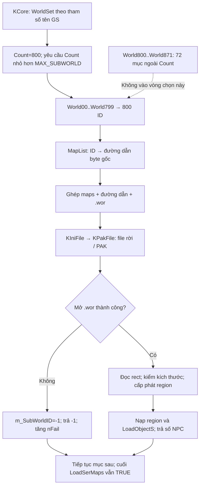

TÓM TẮT 1/5: [NGUỒN][THẤY] DONE trong phạm vi đọc tĩnh HG2-03: catalog có 993 ID; WorldSet gs001 có 872 mục, Count=800; không đồng nhất số khai báo với số map đang chạy (GS/Settings/MapList.ini:2–6684; GS/maps/WorldSet_gs001.ini:2–875).
TÓM TẮT 2/5: [NGUỒN][THẤY] Trong 800 mục được chọn nếu qua kiểm tra sức chứa: 772 ID khớp .wor/rect trong hai PAK, 28 ID thuộc 22 đường dẫn không khớp PAK và không thấy file rời; bảng đủ 28 ID ở mục 6.2 (S/KSubWorldSet.cpp:448–464; E/KPakList.cpp:75–111; GS/package.ini:2–4).
TÓM TẮT 3/5: [NGUỒN][THẤY] Nếu mở .wor thất bại, LoadMapS đặt m_SubWorldID=-1 và trả -1; vòng tải tăng nFail rồi tiếp tục, cuối hàm vẫn TRUE; map có 0 NPC vẫn được đếm thành công ở lớp gọi (S/KSubWorld.cpp:925–929; S/KSubWorldSet.cpp:483–500).
TÓM TẮT 4/5: [NGUỒN][THẤY] Tái lập phạm vi cũ 955/993 ID khớp .wor trong hai PAK, 38 ID không khớp; bổ sung riêng ID 995 có .wor rời, nằm ngoài Count; giữ nguyên báo cáo cũ (JX1_OPS/REPORTS/I-03-khao-sat-quai-vat.md:224–227; GS/Settings/MapList.ini:6684; GS/maps/fongkieu/kiem_mon_quan.wor:4; GS/maps/WorldSet_gs001.ini:875).
TÓM TẮT 5/5: [CHƯA KIỂM] Chưa build/test game, chạy exe, VM hoặc mạng; chưa xác nhận binary, cấu hình sức chứa thực và map runtime. Không commit/push theo yêu cầu; PM tiếp nhận hai file. Nhịp ngoài worktree bị giới hạn ghi (S/KCore.cpp:283; S/KSubWorldSet.cpp:449–453; JX1_OPS/TASKS/HG2-03.md:17–21).

# HG2-03 — Nạp bản đồ gs001 và 28 ID không khớp .wor

Loại: khảo sát\
Chủ đề: Đối chiếu catalog, danh sách chọn của gs001, dữ liệu .wor và nhánh lỗi nạp bản đồ bằng đọc tĩnh.\
Từ khóa: bản đồ, nạp thế giới, gs001, MapList, WorldSet_gs001, KSubWorld, LoadMapS, .wor, PAK\
Trạng thái: DONE — hoàn tất phạm vi khảo sát tĩnh; điều kiện runtime chưa được xác nhận.\
Độ phủ: 4/4 đầu vào chính; 993/993 ID catalog; 872/872 mục WorldSet; 800/800 mục trong Count; 28/28 ID cần làm rõ; 2/2 PAK bản đồ được package.ini khai báo.\
Liên quan: [Task HG2-03](../TASKS/HG2-03.md), [Chuẩn báo cáo](../DESIGN/CHUAN-BAO-CAO.md), [I-04](I-04-khao-sat-map.md), [I-03](I-03-khao-sat-quai-vat.md), [Mục lục tri thức](../DESIGN/MUC-LUC-TRI-THUC.md).\
Cần tôi quyết định: không — chưa đề nghị thay đổi dữ liệu, cấu hình hoặc chạy thử.

## 1. Luồng chính



[THẤY] Luồng trên lấy từ S/KCore.cpp:653–656; S/KSubWorldSet.cpp:441–500; S/KSubWorld.cpp:913–1056; E/KIniFile.cpp:72–132; E/KPakFile.cpp:245–274. Các số 772/28 là kết quả kiểm kê dữ liệu, không phải log chạy luồng này.

## 2. Phạm vi và độ phủ

### 2.1. Gốc nguồn và danh sách tệp

[THẤY] Worktree báo cáo là `D:/JX-wt/HG2-03`, nhánh `task/HG2-03`; Git đầu lượt sạch, báo cáo chưa tồn tại. Task để nguyên chuỗi mẫu `worktree: D:\JX-wt$id`; dùng đường dẫn cụ thể trong lệnh giao của chủ, không sửa metadata đó. Căn cứ phạm vi: JX1_OPS/TASKS/HG2-03.md:7–11, :17–21.

| Bí danh | Gốc chỉ đọc |
|---|---|
| SV | `C:/Jx1CocoV3/SwordOnline/SwordOnline/jxOnline/gameserver/Sources` |
| S | `SV/Core/Src` |
| E | `SV/Engine/Src` |
| CL | `C:/Jx1CocoV3/Folder/Client2912-20260116T044348Z-3-001/Client2912/Client/Classes` |
| GS | `C:/Jx1CocoV3/Folder/ServerNew-20260116T043145Z-3-001/ServerNew/_bin_v2_/gs` |
| PAKTOOL | `C:/Jx1CocoV3/docs-analysis/tools/pak_extract.py` — module có sẵn, chỉ dùng hàm đọc/giải nén trong bộ nhớ |

[THẤY] Danh sách mở theo nguồn task, sau đó chỉ mở caller/callee cần cho kiểm chứng: hai tệp S/KSubWorld.cpp và S/KSubWorldSet.cpp; S/KCore.cpp, S/KSubWorld.h; E/KIniFile.cpp/.h, E/KPakFile.cpp, E/KPakList.cpp, E/KFilePath.cpp; CL/gamecore/KSubWorld.cpp, KSubWorldSet.cpp, KCore.cpp; CL/engine/KbugInfo.h, XPackFile.cpp; GS/Settings/MapList.ini, GS/maps/WorldSet_gs001.ini, GS/package.ini; hai PAK và đường dẫn .wor suy ra từ catalog. Cấu trúc PAK được đối chiếu tại CL/engine/KbugInfo.h:273–295 và CL/engine/XPackFile.cpp:94–100; module đọc tại PAKTOOL:136–169.

[TÀI LIỆU] Chỉ dùng tài liệu định vị liên quan: JX1_OPS/CONTEXT-PACK/GS001-MAP.md:2–3; JX1_OPS/DESIGN/MUC-LUC-TRI-THUC.md:15; JX1_OPS/DESIGN/THE-GIOI-TONG-QUAN.md:14, :83–91; I-04:55–58, :78–80; I-03:224–227. Dòng source trong báo cáo cũ không được dùng thay dòng hiện tại. Không cần mở mã gateway để giải thích nhánh nạp map ở gameserver; không tái tạo Graphify khi không có bản đồ graph tại gốc đã kiểm.

| Phần tử phạm vi | Độ phủ | Bằng chứng / giới hạn |
|---|---|---|
| Luồng chọn WorldSet | Đã phủ | S/KCore.cpp:653–656; chưa biết tham số binary thực |
| Vòng Count và xử lý thành/bại | Đã phủ | S/KSubWorldSet.cpp:441–500 |
| Đường dẫn, .wor, rect, region/NPC | Đã phủ nhánh liên quan | S/KSubWorld.cpp:913–1056; chưa kiểm từng vùng |
| Catalog gốc | Đã phủ 993/993 ID | GS/Settings/MapList.ini:2–6684; 324 đường dẫn khác nhau |
| Danh sách WorldSet | Đã phủ 872/872 mục | GS/maps/WorldSet_gs001.ini:2–875; ID không trùng |
| Mục trong Count | Đã phủ 800/800 ID | World00–World799; GS/maps/WorldSet_gs001.ini:4–803 |
| Mục ngoài Count | Đã phủ 72/72 ID | World800–World871; GS/maps/WorldSet_gs001.ini:804–875 |
| Catalog vắng khỏi WorldSet | Đã phủ 121/121 ID | Hiệu tập catalog với 872 ID; chi tiết mục 6.1 |
| Đối chiếu hai PAK | Đã phủ 993/993 tên theo ID | GS/package.ini:2–4; bảng chỉ mục và giải nén .wor; không giải nén toàn vùng |
| File rời theo đường dẫn catalog | Đã kiểm tồn tại 993/993 đường dẫn theo ID | Có một ID ngoài Count; không quét đệ quy cây maps |
| 28 ID trong Count không khớp .wor | Đã phủ 28/28 | Bảng 6.2; 22 đường dẫn khác nhau |
| Khác biệt client/server | Đã phủ điểm cần phân biệt | CL/gamecore/KSubWorld.cpp:750–762; CL/gamecore/KSubWorldSet.cpp:199–227 |
| Sức chứa thực, PAK thực mount, map runtime | Chưa phủ | Chưa đọc cấu hình Gameconfig thực; chưa chạy exe/VM |
| Thay đổi source/cấu hình, mạng, kiểm thử game | Ngoài phạm vi | Task HG2-03:17–21; chỉ khảo sát |

## 3. Giải mã tên

[THẤY] Tên dưới đây lấy từ **giá trị đường dẫn ID**, không thay thế trường `ID_name`. Byte gốc được giữ nguyên dưới dạng hex; phần Hán giải mã GBK/CP936 sang Unicode để tài liệu đọc bằng UTF-8. Không lowercase Unicode trước khi băm tên. Các nhãn Việt cũ trong `ID_name` trộn mã; chưa chuyển TCVN3 và không dùng chúng để đoán tên. Ví dụ hai trường khác nhau tại GS/Settings/MapList.ini:5–6; cách lấy đường dẫn tại S/KSubWorld.cpp:913–921.

| ID | Tên gốc: hex byte giá trị ID, giữ nguyên | Mã hóa | Chữ đúng UTF-8 / đường dẫn game | Nguồn file:dòng |
|---|---|---|---|---|
| 63 | `c1bdbafec7f85ccceccdf5b0ef5cb0efd6dabcd231` | GBK (CP936) | `两湖区\天王帮\帮众家1` | GS/Settings/MapList.ini:748 |
| 64 | `c1bdbafec7f85ccceccdf5b0ef5cb0efd6dabcd232` | GBK (CP936) | `两湖区\天王帮\帮众家2` | GS/Settings/MapList.ini:751 |
| 88 | `d6d0d4adc4cfc7f85ccee4b5b1c5c95cd1c5cad231` | GBK (CP936) | `中原南区\武当派\雅室1` | GS/Settings/MapList.ini:1057 |
| 89 | `d6d0d4adc4cfc7f85ccee4b5b1c5c95cd1c5cad232` | GBK (CP936) | `中原南区\武当派\雅室2` | GS/Settings/MapList.ini:1060 |
| 107 | `d6d0d4adb1b1c7f85cc9d9c1d6c5c95cb5dcd7d3b7bf31` | GBK (CP936) | `中原北区\少林派\弟子房1` | GS/Settings/MapList.ini:1243 |
| 108 | `d6d0d4adb1b1c7f85cc9d9c1d6c5c95cb5dcd7d3b7bf32` | GBK (CP936) | `中原北区\少林派\弟子房2` | GS/Settings/MapList.ini:1245 |
| 133 | `cef7b1b1b1b1c7f85cc0a5c2d8c5c95cb5dcd7d3b7bf31` | GBK (CP936) | `西北北区\昆仑派\弟子房1` | GS/Settings/MapList.ini:1593 |
| 134 | `cef7b1b1b1b1c7f85cc0a5c2d8c5c95cb5dcd7d3b7bf32` | GBK (CP936) | `西北北区\昆仑派\弟子房2` | GS/Settings/MapList.ini:1595 |
| 156 | `cef7c4cfc4cfc7f85cb4e4d1ccc3c55cb5dcd7d3b7bf31` | GBK (CP936) | `西南南区\翠烟门\弟子房1` | GS/Settings/MapList.ini:1878 |
| 157 | `cef7c4cfc4cfc7f85cb4e4d1ccc3c55cb5dcd7d3b7bf32` | GBK (CP936) | `西南南区\翠烟门\弟子房2` | GS/Settings/MapList.ini:1880 |
| 159 | `cef7c4cfc4cfc7f85cb4e4d1ccc3c55cc3c5c2a5` | GBK (CP936) | `西南南区\翠烟门\门楼` | GS/Settings/MapList.ini:1899 |
| 191 | `bdadc4cfc7f85ccee5b6bebdcc5cb5dcd7d3b7bf31` | GBK (CP936) | `江南区\五毒教\弟子房1` | GS/Settings/MapList.ini:2259 |
| 192 | `bdadc4cfc7f85ccee5b6bebdcc5cb5dcd7d3b7bf32` | GBK (CP936) | `江南区\五毒教\弟子房2` | GS/Settings/MapList.ini:2261 |
| 95 | `cef7c4cfb1b1c7f85cd0c2cad6bfcdd5bb` | GBK (CP936) | `西南北区\新手客栈` | GS/Settings/MapList.ini:1156 |
| 96 | `c1bdbafec7f85cd0c2cad6bfcdd5bb` | GBK (CP936) | `两湖区\新手客栈` | GS/Settings/MapList.ini:1160 |
| 97 | `cef7c4cfb1b1c7f85cbdadbdf2d0c2cad6b6b4` | GBK (CP936) | `西南北区\江津新手洞` | GS/Settings/MapList.ini:1164 |
| 98 | `c1bdbafec7f85cb0cdc1ead0c2cad6b6b4` | GBK (CP936) | `两湖区\巴陵新手洞` | GS/Settings/MapList.ini:1168 |
| 334 | `ccd8cae2d3c3b5d85cb1c8cee4b4f3bbe1bbe1b3a1` | GBK (CP936) | `特殊用地\比武大会会场` | GS/Settings/MapList.ini:3147 |
| 335 | `ccd8cae2d3c3b5d85cb1c8cee4b3a1` | GBK (CP936) | `特殊用地\比武场` | GS/Settings/MapList.ini:3152 |
| 356 | `ccd8cae2d3c3b5d85cc7d0b4e8b3a1` | GBK (CP936) | `特殊用地\切磋场` | GS/Settings/MapList.ini:3359 |
| 592 | `ccd8cae2d3c3b5d85cb0efbbe1d7a8d3c35cd0c2cad6b4e5b0efbbe1b5d8cdbc` | GBK (CP936) | `特殊用地\帮会专用\新手村帮会地图` | GS/Settings/MapList.ini:4511 |
| 598, 599, 600, 601, 602, 603, 604 | `ccd8cae2d3c3b5d85cb0efbbe1d7a8d3c35cb3c7cad0b0efbbe1b5d8cdbc` | GBK (CP936) | `特殊用地\帮会专用\城市帮会地图` | GS/Settings/MapList.ini:4540; GS/Settings/MapList.ini:4543; GS/Settings/MapList.ini:4546; GS/Settings/MapList.ini:4549; GS/Settings/MapList.ini:4552; GS/Settings/MapList.ini:4555; GS/Settings/MapList.ini:4558 |
| 902, 903, 904 | `ccd8cae2d3c3b5d85ccbcebdf0424f5353c4a3cabdd5bdb3a1` | GBK (CP936) | `特殊用地\宋金BOSS模式战场` | GS/Settings/MapList.ini:6086; GS/Settings/MapList.ini:6093; GS/Settings/MapList.ini:6100 |
| 975 | `ccd8cae2d3c3b5d85c6a696e676a696368616e67` | GBK (CP936) | `特殊用地\jingjichang` | GS/Settings/MapList.ini:6586 |
| 976 | `ccd8cae2d3c3b5d85c7169616e63686f6e676c6f75` | GBK (CP936) | `特殊用地\qianchonglou` | GS/Settings/MapList.ini:6591 |
| 985, 994 | `ccd8cae2d3c3b5d85c6269616e6a696e676469676f6e67` | GBK (CP936) | `特殊用地\bianjingdigong` | GS/Settings/MapList.ini:6636; GS/Settings/MapList.ini:6679 |
| 987 | `cef7b1b1c4cfc7f85cbbaac9bdc5c932303133` | GBK (CP936) | `西北南区\华山派2013` | GS/Settings/MapList.ini:6646 |
| 988 | `ccd8cae2d3c3b5d85c736a776172` | GBK (CP936) | `特殊用地\sjwar` | GS/Settings/MapList.ini:6659 |
| 995 | `666f6e676b6965755c6b69656d5f6d6f6e5f7175616e` | ASCII | `fongkieu\kiem_mon_quan` | GS/Settings/MapList.ini:6684 |

[THẤY] Bảng bao phủ mọi tên đường dẫn được dùng trong hai bảng ID thiếu PAK bên dưới. Các tên kỹ thuật `gs001`, `MapList`, `WorldSet`, tên hàm và `fongkieu/kiem_mon_quan` là định danh, không tự gán bản dịch hay tên thương mại.

## 4. Sắp theo cấu trúc game

[THẤY] Bảng 6.2 được xếp theo nhóm nội dung đọc từ đường dẫn: khu môn phái → khu tập sự → khu thi đấu → bản đồ bang hội, rồi giữ các ID dùng chung đường dẫn cạnh nhau. Đây là nhóm định vị tài nguyên, không suy quy tắc PK, cấp học, quyền vào hay sự kiện đang hoạt động. Căn cứ trực tiếp: GS/Settings/MapList.ini:748–751, :1057–1060, :1156–1168, :1243–1245, :1593–1595, :1878–1899, :2259–2261, :3147–3152, :3359, :4511–4558.

## 5. Cách kiểm kê và ý nghĩa “nạp được”

1. [THẤY] Tách khóa ASCII và giữ byte gốc từng giá trị. Catalog nhận khóa số `ID=path`; WorldSet nhận `WorldNN=ID`. Có 993 ID catalog, 872 ID WorldSet; chọn đúng chỉ số 0..799 theo S/KSubWorldSet.cpp:448–464 và GS/maps/WorldSet_gs001.ini:2.
2. [THẤY] Lập tên byte `\maps\<path>.wor`; lowercase ASCII trên byte; tính ID 32-bit với ký tự có dấu theo E/KPakList.cpp:75–89, nối đường dẫn theo :98–111 và E/KFilePath.cpp:259–275. Không dùng `name_to_id()` của module trên chuỗi Unicode Hán vì hàm đó lowercase Unicode rồi mã hóa Latin-1 (PAKTOOL:36–45).
3. [THẤY] Đọc chỉ mục PAK qua `read_pak()`, kiểm header, chỉ mục đủ chiều dài, ID sắp tăng và không trùng; chỉ giải nén các entry .wor có hash khớp bằng `extract()`. Xác nhận có trường `rect` gồm bốn số và cạnh phải/dưới không nhỏ hơn trái/trên. Hàm nguồn dùng `right-left+1`, `bottom-top+1` tại S/KSubWorld.cpp:948–968. Bộ đếm lần này: 0 lỗi giải nén/rect ở các ID có entry; không có ID catalog đồng thời khớp cả hai PAK. Căn cứ định dạng: CL/engine/KbugInfo.h:273–295; PAKTOOL:136–169.
4. [THẤY] Kiểm tồn tại đúng tên file rời suy từ catalog, không liệt kê đệ quy thư mục lớn. Có ID 995 với file GS/maps/fongkieu/kiem_mon_quan.wor:4; 28 ID trong Count đều không có file rời ở tên đã tra. Đây là kiểm tra trên bản dữ liệu đĩa, không đo cách ANSI/codepage của binary thực.
5. [CHƯA KIỂM] “772 ID có .wor/rect” chỉ là điều kiện dữ liệu đầu vào. Chưa chạy KIniFile/LoadMapS, chưa kiểm mọi region, trap, đối tượng, NPC, cấp phát, cấu hình sức chứa hoặc nguồn PAK thực được mount. Không gán nhãn “772 map đã nạp thành công” hay số quái runtime.

[THẤY] `GS/package.ini:2–4` khai báo `Path=\pak`, `0=maps01.pak`, `1=maps.pak`. E/KPakList.cpp:148–166 duyệt thứ tự số; :56–65 dừng ở PAK đầu có ID. E/KPakFile.cpp:254–270 có hai thứ tự ưu tiên file rời/PAK và đều có fallback. Không thấy file .wor rời không đủ chứng minh thiếu tài nguyên nếu PAK có entry.

| PAK | Kích thước (byte) | Entry | Offset chỉ mục (byte, từ đầu file) | Offset dữ liệu |
|---|---:|---:|---:|---:|
| GS/pak/maps01.pak | 626.551 | 706 | 615.255 | 32 |
| GS/pak/maps.pak | 14.542.936 | 87.245 | 13.147.016 | 32 |

[THẤY] Số ở bảng đọc từ header PAK và đối chiếu định nghĩa CL/engine/KbugInfo.h:273–295. PAK là nhị phân, vì vậy chỉ rõ offset byte thay vì bịa số dòng.

## 6. Catalog khai báo và khả năng cung cấp .wor

### 6.1. Đối chiếu toàn phạm vi

[THẤY] Các hàng dưới chia hết 993 ID catalog, không cộng chồng. “Có PAK/rect” đếm **ID**, không đếm số file vật lý; 993 ID dùng 324 đường dẫn. Nguồn tập hợp: GS/Settings/MapList.ini:5–6684; GS/maps/WorldSet_gs001.ini:4–875; phương pháp ở mục 5, E/KPakList.cpp:75–111.

| Tập ID | Số ID | Có .wor PAK/rect | Chỉ có .wor rời | Không thấy ở hai PAK/file rời | Được vòng Count=800 chọn? |
|---|---:|---:|---:|---:|---|
| World00–World799 | 800 | 772 | 0 | 28 | Có, nếu qua guard sức chứa |
| World800–World871 | 72 | 65 | 1 | 6 | Không |
| Catalog vắng toàn bộ WorldSet | 121 | 118 | 0 | 3 | Không |
| **Tổng catalog** | **993** | **955** | **1** | **37** | **800 ID thuộc tập chọn** |

[THẤY] Đẳng thức kiểm tra: `800=772+28`; `872=800+72`; `993=800+72+121=955+1+37`; riêng hai PAK `993-955=38`. Các tập ID và nguồn:

| Tập | Danh sách ID đầy đủ, viết gọn bằng khoảng đóng | Nguồn |
|---|---|---|
| 800 ID được chọn | 1-463, 512-660, 673-820, 829-834, 841-870, 875-878 | GS/maps/WorldSet_gs001.ini:4–803 |
| 772 ID có PAK/rect trong tập chọn | 1-62, 65-87, 90-94, 99-106, 109-132, 135-155, 158, 160-190, 193-333, 336-355, 357-463, 512-591, 593-597, 605-660, 673-820, 829-834, 841-870, 875-878 | Cùng tập World00–World799, trừ bảng 6.2; E/KPakList.cpp:75–111 |
| 28 ID không thấy .wor trong tập chọn | 63-64, 88-89, 95-98, 107-108, 133-134, 156-157, 159, 191-192, 334-335, 356, 592, 598-604 | Từng dòng ở bảng 6.2 |
| 72 ID ngoài Count | 879-885, 917-932, 934-947, 959-988, 991-995 | GS/maps/WorldSet_gs001.ini:804–875 |
| 121 ID catalog vắng toàn bộ WorldSet | 464-511, 661-672, 821-828, 835-840, 871-874, 886-916, 933, 948-958 | Hiệu tập GS/Settings/MapList.ini:5–6684 với GS/maps/WorldSet_gs001.ini:4–875 |

### 6.2. Đủ 28 ID trong Count không khớp .wor

[THẤY] Tất cả 28 hàng có khóa ID trong catalog và khóa World nằm dưới 800; hash không xuất hiện trong cả hai chỉ mục PAK, đồng thời không thấy file rời theo đường dẫn. Tên Hán và byte gốc tương ứng ở mục 3. Cột hash là ID tên `\maps\<path>.wor`, không phải SHA-256. Nguồn thuật toán: E/KPakList.cpp:75–111; nguồn chọn: S/KSubWorldSet.cpp:458–464.

| ID map | Khóa World | Nhóm cấu trúc game | Hash tên 32-bit | Nguồn file:dòng |
|---|---|---|---|---|
| 63 | World62 | Môn phái: phòng/cổng | `D5D1A7B1` | GS/Settings/MapList.ini:748; GS/maps/WorldSet_gs001.ini:66 |
| 64 | World63 | Môn phái: phòng/cổng | `D7A8AD46` | GS/Settings/MapList.ini:751; GS/maps/WorldSet_gs001.ini:67 |
| 88 | World87 | Môn phái: phòng/cổng | `BD779030` | GS/Settings/MapList.ini:1057; GS/maps/WorldSet_gs001.ini:91 |
| 89 | World88 | Môn phái: phòng/cổng | `BECE99C5` | GS/Settings/MapList.ini:1060; GS/maps/WorldSet_gs001.ini:92 |
| 107 | World106 | Môn phái: phòng/cổng | `D63B2D37` | GS/Settings/MapList.ini:1243; GS/maps/WorldSet_gs001.ini:110 |
| 108 | World107 | Môn phái: phòng/cổng | `D3AF665A` | GS/Settings/MapList.ini:1245; GS/maps/WorldSet_gs001.ini:111 |
| 133 | World132 | Môn phái: phòng/cổng | `6358440F` | GS/Settings/MapList.ini:1593; GS/maps/WorldSet_gs001.ini:136 |
| 134 | World133 | Môn phái: phòng/cổng | `7CC39132` | GS/Settings/MapList.ini:1595; GS/maps/WorldSet_gs001.ini:137 |
| 156 | World155 | Môn phái: phòng/cổng | `F3370E91` | GS/Settings/MapList.ini:1878; GS/maps/WorldSet_gs001.ini:159 |
| 157 | World156 | Môn phái: phòng/cổng | `CCBB5BC4` | GS/Settings/MapList.ini:1880; GS/maps/WorldSet_gs001.ini:160 |
| 159 | World158 | Môn phái: phòng/cổng | `113F219E` | GS/Settings/MapList.ini:1899; GS/maps/WorldSet_gs001.ini:162 |
| 191 | World190 | Môn phái: phòng/cổng | `291D7110` | GS/Settings/MapList.ini:2259; GS/maps/WorldSet_gs001.ini:194 |
| 192 | World191 | Môn phái: phòng/cổng | `2AD466A5` | GS/Settings/MapList.ini:2261; GS/maps/WorldSet_gs001.ini:195 |
| 95 | World94 | Khu tập sự | `9FC24A69` | GS/Settings/MapList.ini:1156; GS/maps/WorldSet_gs001.ini:98 |
| 96 | World95 | Khu tập sự | `FCCD53C9` | GS/Settings/MapList.ini:1160; GS/maps/WorldSet_gs001.ini:99 |
| 97 | World96 | Khu tập sự | `0103AF7F` | GS/Settings/MapList.ini:1164; GS/maps/WorldSet_gs001.ini:100 |
| 98 | World97 | Khu tập sự | `50753A06` | GS/Settings/MapList.ini:1168; GS/maps/WorldSet_gs001.ini:101 |
| 334 | World333 | Khu thi đấu | `6654B581` | GS/Settings/MapList.ini:3147; GS/maps/WorldSet_gs001.ini:337 |
| 335 | World334 | Khu thi đấu | `D4F1CAB2` | GS/Settings/MapList.ini:3152; GS/maps/WorldSet_gs001.ini:338 |
| 356 | World355 | Khu thi đấu | `F4D4DC70` | GS/Settings/MapList.ini:3359; GS/maps/WorldSet_gs001.ini:359 |
| 592 | World543 | Bản đồ bang hội | `C1AB2E70` | GS/Settings/MapList.ini:4511; GS/maps/WorldSet_gs001.ini:547 |
| 598 | World549 | Bản đồ bang hội | `0B88D704` | GS/Settings/MapList.ini:4540; GS/maps/WorldSet_gs001.ini:553 |
| 599 | World550 | Bản đồ bang hội | `0B88D704` | GS/Settings/MapList.ini:4543; GS/maps/WorldSet_gs001.ini:554 |
| 600 | World551 | Bản đồ bang hội | `0B88D704` | GS/Settings/MapList.ini:4546; GS/maps/WorldSet_gs001.ini:555 |
| 601 | World552 | Bản đồ bang hội | `0B88D704` | GS/Settings/MapList.ini:4549; GS/maps/WorldSet_gs001.ini:556 |
| 602 | World553 | Bản đồ bang hội | `0B88D704` | GS/Settings/MapList.ini:4552; GS/maps/WorldSet_gs001.ini:557 |
| 603 | World554 | Bản đồ bang hội | `0B88D704` | GS/Settings/MapList.ini:4555; GS/maps/WorldSet_gs001.ini:558 |
| 604 | World555 | Bản đồ bang hội | `0B88D704` | GS/Settings/MapList.ini:4558; GS/maps/WorldSet_gs001.ini:559 |

[THẤY] 28 ID tương ứng 22 đường dẫn/hash khác nhau: riêng 598–604 cùng trỏ một đường dẫn và hash `0B88D704` (GS/Settings/MapList.ini:4540–4558). Vì vậy không diễn giải “28 map” thành 28 tệp .wor vật lý độc lập. Phần chọn cuối Count vẫn gồm World799=878, không gồm World800=879 (GS/maps/WorldSet_gs001.ini:803–804).

### 6.3. Mười ID ngoài Count không khớp hai PAK

[THẤY] Đây là phần còn lại của tập **38 ID không khớp PAK**; không cộng vào 28 ID của vòng chọn gs001. Tên đã giải mã ở mục 3; trạng thái WorldSet lấy từ GS/maps/WorldSet_gs001.ini:4–875.

| ID | Quan hệ WorldSet | File rời / giới hạn | Nguồn |
|---|---|---|---|
| 902 | Vắng trong cả 872 mục | Không thấy file rời theo đường dẫn khai báo | GS/Settings/MapList.ini:6086 |
| 903 | Vắng trong cả 872 mục | Không thấy file rời theo đường dẫn khai báo | GS/Settings/MapList.ini:6093 |
| 904 | Vắng trong cả 872 mục | Không thấy file rời theo đường dẫn khai báo | GS/Settings/MapList.ini:6100 |
| 975 | Có trong World800–World871; ngoài Count | Không thấy file rời theo đường dẫn khai báo | GS/Settings/MapList.ini:6586 |
| 976 | Có trong World800–World871; ngoài Count | Không thấy file rời theo đường dẫn khai báo | GS/Settings/MapList.ini:6591 |
| 985 | Có trong World800–World871; ngoài Count | Không thấy file rời theo đường dẫn khai báo | GS/Settings/MapList.ini:6636 |
| 987 | Có trong World800–World871; ngoài Count | Không thấy file rời theo đường dẫn khai báo | GS/Settings/MapList.ini:6646 |
| 988 | Có trong World800–World871; ngoài Count | Không thấy file rời theo đường dẫn khai báo | GS/Settings/MapList.ini:6659 |
| 994 | Có trong World800–World871; ngoài Count | Không thấy file rời theo đường dẫn khai báo | GS/Settings/MapList.ini:6679 |
| 995 | Có trong World800–World871; ngoài Count | Có file rời, rect 96,96,118,117; chưa chạy nạp | GS/Settings/MapList.ini:6684; GS/maps/fongkieu/kiem_mon_quan.wor:4 |

[THẤY] ID 995 có World871=995 ở GS/maps/WorldSet_gs001.ini:875 và rect rời ở GS/maps/fongkieu/kiem_mon_quan.wor:4. Bổ sung này không đổi kết luận cũ của I-03 về **hai PAK**, cũng không biến ID 995 thành map được Count=800 chọn (I-03:224–227; S/KSubWorldSet.cpp:458–464).

### 6.4. Mẫu dương để truy vết entry

[THẤY] Các mẫu sau đều thuộc GS/pak/maps.pak. Offset tính từ đầu PAK, entry chỉ mục dài 16 byte theo CL/engine/KbugInfo.h:286–295. Kích thước là .wor sau giải nén. Có dữ liệu vẫn không thay điều kiện WorldSet hoặc chứng minh runtime (S/KSubWorldSet.cpp:458–464).

| ID | Quan hệ Count | Hash tên | Byte entry chỉ mục | Byte dữ liệu nén | Byte sau giải nén | rect | Nguồn catalog |
|---|---|---|---:|---:|---:|---|---|
| 1 | Trong Count | `7D40CFB4` | 13793000 | 6138835 | 280 | 73,84,121,114 | GS/Settings/MapList.ini:5 |
| 3 | Trong Count | `58785D1E` | 13602728 | 6670596 | 280 | 47,112,73,129 | GS/Settings/MapList.ini:32 |
| 140 | Trong Count | `414FC946` | 13485768 | 5979526 | 249 | 142,97,158,118 | GS/Settings/MapList.ini:1636 |
| 195 | Trong Count | `514EC204` | 13566392 | 1773667 | 291 | 32,80,102,107 | GS/Settings/MapList.ini:2299 |
| 878 | Trong Count | `2C3DDF2B` | 13375656 | 3203517 | 92 | 92,97,140,126 | GS/Settings/MapList.ini:5919 |
| 879 | Ngoài Count | `ADA92B8F` | 14066440 | 3687053 | 94 | 106,100,153,128 | GS/Settings/MapList.ini:5927 |
| 957 | Vắng trong WorldSet | `8081315E` | 13810088 | 2852635 | 92 | 98,98,103,102 | GS/Settings/MapList.ini:6489 |

## 7. Hậu quả khi thiếu .wor: điều thấy trong source

| Trường hợp | Kết quả tĩnh trong source | Bằng chứng |
|---|---|---|
| Không có key ID/path hợp lệ | GetString mặc định chuỗi rỗng; ghép thành tên .wor tương ứng rồi thử mở, chưa tự tạo map hợp lệ | S/KSubWorld.cpp:913–925; E/KIniFile.h:53 |
| Không mở được .wor ở file rời và PAK | Ghi thông báo lỗi đường dẫn, đặt m_SubWorldID=-1, trả -1 | S/KSubWorld.cpp:925–929; E/KPakFile.cpp:254–274 |
| Thiếu .wor | Thoát trước khi đọc rect, cấp phát m_Region, tải vùng và LoadObjectS; lần gọi đó không hoàn tất khởi tạo map | S/KSubWorld.cpp:925–929, :948–979, :997–1043 |
| Tìm map sau thất bại này | SearchWorld so ID đã lưu; slot mang -1 không còn khớp ID map yêu cầu | S/KSubWorldSet.cpp:419–426; S/KSubWorld.cpp:928 |
| Một map nạp lỗi | Tăng nFail, tiếp tục các mục còn lại; LoadSerMaps cuối hàm vẫn TRUE | S/KSubWorldSet.cpp:458–500 |
| Có .wor nhưng kích thước vùng không dương | Đặt ID=-1, trả -2; khác với lỗi mở .wor trả -1 | S/KSubWorld.cpp:948–968 |
| Cấp phát m_Region trả NULL | Nhánh kiểm tra đặt ID=-1, trả -2; chưa kiểm hành vi ngoại lệ cấp phát của binary | S/KSubWorld.cpp:979–988 |
| LoadMapS trả 0 NPC | Được lớp gọi xếp thành công vì điều kiện nNpcmun>=0; không phải “map rỗng nên lỗi” | S/KSubWorld.cpp:821, :1056; S/KSubWorldSet.cpp:483–487 |
| Có .wor và region gặp vấn đề | Load() vùng nằm trong if, LoadObjectS có catch; chỉ có rect không chứng minh toàn bộ dữ liệu vùng đầy đủ | S/KSubWorld.cpp:1004–1009, :1041–1049 |
| Count chạm/vượt sức chứa | LoadSerMaps trả FALSE trước vòng for nếu Count>=MAX_SUBWORLD | S/KSubWorldSet.cpp:449–453 |
| Phía gọi lõi | Gọi LoadSerMaps nhưng không rẽ nhánh theo giá trị trả tại chỗ này | S/KCore.cpp:653–656 |
| Client có hình/đường dẫn map | Không chứng minh map server đã nạp: client dùng LoadMapC/OpenPlace; bản LoadSerMaps trong client nằm trong comment | CL/gamecore/KSubWorld.cpp:724, :750–762; CL/gamecore/KSubWorldSet.cpp:199–227 |

[THẤY] Vì vậy source cho thấy lỗi có thể chỉ xuất hiện trong bộ đếm/log từng map và slot map mất ID, thay vì làm dừng toàn bộ vòng nạp. [CHƯA KIỂM] Chưa kết luận biểu hiện đăng nhập, truyền tống, treo/crash hoặc hình ảnh trên client; chưa lần hết các caller chuyển map và chưa chạy binary. Không khẳng định 28 lỗi đã xảy ra trên máy đang vận hành. Căn cứ giới hạn: S/KSubWorld.cpp:925–929; S/KSubWorldSet.cpp:483–500; CL/gamecore/KSubWorld.cpp:750–762.

## 8. MỤC SỔ THÔNG SỐ

| Nhóm | Tên/hằng số | file:dòng | Giá trị | Đơn vị | Ảnh hưởng | Đổi an toàn | Nguồn đo |
|---|---|---|---|---|---|---|---|
| Catalog | List/Count | GS/Settings/MapList.ini:2 | 1000; thực đếm 993 ID | ID khai báo / ID thực | Không dùng Count này làm số vòng WorldSet | CẨN THẬN | Đọc tĩnh khóa ASCII |
| Chọn map | Init/Count | GS/maps/WorldSet_gs001.ini:2 | 800 | mục World | Chọn chỉ số 0..799 nếu qua guard | CẨN THẬN | Đọc tĩnh |
| Chọn map | Số khóa World vật lý | GS/maps/WorldSet_gs001.ini:4–875 | 872; ngoài Count 72 | mục / ID | 72 mục không tự được xét | CẨN THẬN | Đọc tĩnh |
| Sức chứa | MAX_SUBWORLD | S/KSubWorld.h:4–7; S/KCore.cpp:283 | Server: nMaxSubWorldCount; giá trị cấu hình thực chưa đối chiếu, mặc định GetInteger là 1 | slot | Count>=giá trị này bị từ chối | CẨN THẬN | Đọc source, chưa đo runtime |
| Khóa thiếu | WorldNN mặc định | S/KSubWorldSet.cpp:460–461 | 5000 | ID map | Key World thiếu sẽ dùng ID này | CẨN THẬN | Đọc source |
| Lỗi tài nguyên | LoadMapS | S/KSubWorld.cpp:925–929 | -1 | mã trả về | Mở .wor thất bại, ID=-1 | KHÔNG | Đọc source; không phải tham số vận hành |
| Lỗi vùng/cấp phát | LoadMapS | S/KSubWorld.cpp:964–988 | -2 | mã trả về | Đường lỗi khác mở file | KHÔNG | Đọc source |
| Điều kiện thành công lớp gọi | nNpcmun>=0 | S/KSubWorldSet.cpp:483–487 | Bao gồm 0 | số NPC trả về | Không lấy số map thành công làm số quái | KHÔNG | Đọc source |
| Bao phủ .wor | Trong Count | GS/package.ini:2–4; GS/maps/WorldSet_gs001.ini:4–803; E/KPakList.cpp:75–111 | 772 khớp, 28 không thấy; 22 đường dẫn thiếu | ID / đường dẫn | Điều kiện dữ liệu, chưa chứng minh nạp map | KHÔNG | Kiểm kê tĩnh, chưa đo runtime |
| Hình học | Kích thước rect | S/KSubWorld.cpp:948–955 | right-left+1; bottom-top+1 | region | Bao gồm cả hai biên phải/dưới | CẨN THẬN | Đọc source và .wor |

Đánh giá an toàn không cấp quyền sửa. Không đề nghị tăng Count để “nạp đủ 872” khi chưa kiểm sức chứa, region, bộ nhớ và mục đích các ID ngoài giới hạn.

## 9. Đề xuất tối ưu và ca kiểm tra bàn giao — chưa thực hiện

- [THẤY] Ưu tiên đối chiếu 22 đường dẫn của 28 ID, gồm nhóm dùng chung 598–604, thay vì xử lý 28 bản sao tài nguyên (GS/Settings/MapList.ini:4540–4558; bảng 6.2).
- [CHƯA KIỂM] Nếu có task cho sửa riêng: giữ bản hoàn tác, kiểm byte GBK, đối chiếu bản dữ liệu đúng phiên bản; chỉ quyết định bổ sung tài nguyên hay bỏ ID khỏi tập chọn sau khi xác nhận thiết kế game. Chưa biết các mục thiếu là tài nguyên bỏ sót hay khai báo di sản.
- [CHƯA KIỂM] Nếu sau này được phép chạy trong môi trường cô lập: xác nhận tham số gs001, MaxSubWorldCount>800, PAK mount, log per-ID; đối chiếu 772/28 dự kiến ở điều kiện .wor, rồi kiểm region/NPC. Không nhận đây là kết quả chạy hiện tại (S/KCore.cpp:283, :653–656; S/KSubWorldSet.cpp:449–500).
- [CHƯA KIỂM] Có thể giao task cải thiện báo lỗi/tổng hợp thất bại theo ID; hiện tại TRUE cuối vòng không bảo đảm mọi map thành công. Chưa sửa source hoặc cấu hình (S/KSubWorldSet.cpp:483–500).

## 10. Đã xác minh / Chưa xác minh

### ĐÃ XÁC MINH — bằng đọc và kiểm kê tĩnh

- [THẤY] Đủ 993 ID catalog, 872 ID WorldSet, phân hoạch 800+72+121; 28 ID cụ thể có bảng và nguồn từng dòng. Không thiếu ID nào trong tập cần khảo sát (GS/Settings/MapList.ini:5–6684; GS/maps/WorldSet_gs001.ini:4–875).
- [THẤY] Hai PAK có chỉ mục đầy đủ, sắp tăng, không trùng ID trong từng PAK; 955 ID catalog có .wor giải nén được và rect hợp lệ, 0 lỗi ở những entry này. Thực chạy Python `-B -I -`, chỉ import module có sẵn bằng runpy và gọi read_pak/extract trong bộ nhớ; không gọi main xuất tệp (PAKTOOL:136–169, :172–209).
- [THẤY] 28 ID trong Count không khớp cả hai PAK, không có file rời theo tên khai báo; ngoài Count có một file .wor rời cho ID 995 (GS/Settings/MapList.ini:6684; GS/maps/fongkieu/kiem_mon_quan.wor:4).
- [THẤY] Đã đối chiếu trực tiếp nhánh trả -1/-2, bộ đếm và TRUE cuối vòng; không chạy hoặc biên dịch game (S/KSubWorld.cpp:925–988; S/KSubWorldSet.cpp:483–500).
- [TÀI LIỆU] Kết quả I-03 955/993 và 38 ID không khớp **trong hai PAK** được tái lập cùng phạm vi; I-04 872 mục/Count=800 được tái lập. Giữ nguyên các báo cáo cũ (I-03:224–227; I-04:72–80).

### CHƯA XÁC MINH

- [CHƯA KIỂM] Binary có cùng source/định nghĩa ký tự có dấu hay không; tham số tên GS, Gameconfig/MaxSubWorldCount, chế độ file rời/PAK, mount và codepage thực. Số 772 là tập điều kiện .wor, không phải số map runtime (S/KCore.cpp:283, :653–656; E/KPakFile.cpp:254–270).
- [CHƯA KIỂM] Toàn bộ dữ liệu region, vật cản, spawn, trap, NPC động, .mps và quyền vào map; không suy số NPC/quái từ .wor hoặc số map (S/KSubWorld.cpp:997–1056).
- [CHƯA KIỂM] Build, unit/integration test, đăng nhập/chuyển map, VM và mạng: chưa chạy, không được giao. Ca bàn giao mục 9 đều chưa chạy.
- [CHƯA KIỂM] Trường tên Việt legacy chưa chuyển TCVN3; chỉ dùng byte đường dẫn Hán giải mã GBK cho bảng tên (GS/Settings/MapList.ini:5–6).

### Lỗi, cách thử, kết quả

| Vấn đề | Cách xử lý trong lượt | Kết quả / phần còn lại |
|---|---|---|
| Đầu ra Get-Content mặc định làm lỗi hiển thị dấu Việt | Đặt output UTF-8, đọc tài liệu bằng -Encoding UTF8; nguồn legacy đọc theo byte/GBK | Đọc lại đúng hai tài liệu đầu do lỗi mã hóa; báo cáo ghi UTF-8 không BOM |
| Máy thiếu rg | Báo một lần; dùng Select-String và đường dẫn cụ thể | Hoàn tất định vị, không cài thêm công cụ |
| Nguồn không nằm tương đối trong worktree | Kiểm đúng đường dẫn canonical đã được dẫn; giới hạn vào tệp/symbol liên quan | Đọc được nguồn gốc, không tìm hoặc liệt kê đệ quy các cây lớn |
| Số dòng client khi giải mã legacy không nhất quán | Đối chiếu dòng bằng byte LF; không dùng số dòng lệch của KCore client làm bằng chứng | Giữ trích dẫn điểm client đã kiểm tại KSubWorld/KSubWorldSet |
| Yêu cầu nhịp D:/JX-wt/HG2-03.nhip nằm ngoài writable root | Không thử vượt sandbox/approval; cập nhật các mốc trong trao đổi | BỊ CHẶN – CHƯA GHI NHỊP; quyền ghi chỉ có D:/JX-wt/HG2-03 |
| Chỉ mục TSV theo chuẩn nằm ngoài vùng_file | Đưa hàng bàn giao vào báo cáo cho PM gộp | Không tạo file REPORTS/_CHIMUC/HG2-03.tsv ngoài phạm vi |
| Kiểm tra whitespace đầu ra | Bỏ dòng trống thừa cuối hai file; giữ CRLF sẵn có của task và xét CRLF đúng khi kiểm diff | Kiểm lại 5 dòng tóm tắt, 28 ID, 29 tên/hex và liên kết; chưa chạy game |

## 11. Dấu vân tay dữ liệu và nguồn

[THẤY] SHA-256 tính trên bytes nguồn, để phân biệt bản dữ liệu trong lần đọc; không chứng minh binary hay bộ đang chạy.

| Tệp | SHA-256 |
|---|---|
| GS/Settings/MapList.ini | `46c4a3d27a1fe7bcdea73d294b255ed84d9d0ed9c236afe856effe62fd1702a9` |
| GS/maps/WorldSet_gs001.ini | `535319b393ebf9524d6c8e2570cb793d5d95b74d4da7a11372940f40cee1ba52` |
| GS/package.ini | `32501cc995247e4c9e8e4723955330ac58fb36bb95ba5fa7bdb214a2910bbe6d` |
| GS/pak/maps.pak | `cc20687fdcc0c0d566c804ccb14c3feeb98479246ce21b0c87c77e063b150dbf` |
| GS/pak/maps01.pak | `d3572b337b9f20a2f263c4be373e5102f1cf0cfd655c80ca988b9b0168fec45b` |
| GS/maps/fongkieu/kiem_mon_quan.wor | `f5cecc62821e426e3f861ce5a33aadbfc50a7a6d14fd0f0f52647806a9806812` |
| S/KSubWorld.cpp | `99ba91f892d74762c7c1a8c3e241926257075475ab91483d2c7a0ffa0178d657` |
| S/KSubWorldSet.cpp | `18e9a84ff8311c0c30f0b5b21b47e5674bcf4cd9f545648e8ddba49829c82eaa` |
| E/KPakFile.cpp | `d5a697fffb6e74d93dd4e3ea0ae63a40a7a23a39f5ba180e907d6ebd2392b369` |
| E/KPakList.cpp | `9bf918e80dcfee50d4a1e2dcbd36ef04842da317886cd784ce4e990cab1a5fb0` |

## 12. Bàn giao

- Trạng thái chuyên môn: **DONE — khảo sát tĩnh đủ phạm vi HG2-03**; chưa chứng minh nạp runtime.
- Đầu ra: báo cáo này và mục `Kết quả` cuối JX1_OPS/TASKS/HG2-03.md theo yêu cầu trực tiếp. Giữ nguyên kết luận I-03/I-04, source và dữ liệu gốc.
- Không stage/commit/push theo yêu cầu; không có SHA commit mới. PM/Tổng quan kiểm diff hai file rồi tiếp nhận commit. Không có thao tác mạng.
- Nhịp ngoài worktree chưa ghi do giới hạn filesystem; đây là hạn chế bàn giao, không phải bằng chứng thử ghi thất bại hoặc lý do dừng khảo sát.
- Hàng TSV đề xuất để PM gộp vào chỉ mục; không ghi file ngoài vùng được giao:

```tsv
file	loại	chủ đề	từ khóa	trạng thái	độ phủ	liên quan
JX1_OPS/REPORTS/HG2-03.md	khảo sát	Nạp bản đồ gs001 và 28 ID không khớp .wor	bản đồ,gs001,MapList,WorldSet_gs001,KSubWorld,LoadMapS,PAK	DONE tĩnh	993 ID catalog; 872 World; 800 chọn; 28 ID/22 đường dẫn thiếu; 2 PAK	I-03;I-04;JX1_OPS/TASKS/HG2-03.md
```

- Hàng đề xuất cho JX1_OPS/DESIGN/MUC-LUC-TRI-THUC.md: `| Nạp map gs001 và thiếu .wor | HG2-03 | KSubWorld::LoadMapS; WorldSet_gs001; MapList; hai PAK | Đối chiếu tĩnh 800 ID chọn: 772 có .wor/rect, 28 ID/22 đường dẫn không thấy; chưa kiểm runtime |`.
- Kỹ năng đã dùng: `jx1-retrofit`, `jx1-read-server`, `jx1-read-client`, `jx1-parameters`, `jx1-knowledge`, `jx1-report` (đã đọc từ `.agents/skills`).

## Phát hiện khi chuẩn hóa

[TÀI LIỆU][THẤY] Không sửa kết luận cũ: I-03 đếm 38 ID không khớp .wor trong hai PAK; lần này vẫn là 38, trong đó 28 thuộc tập chọn và 10 ngoài Count. File rời của ID 995 chỉ bổ sung một nguồn ngoài PAK, nên số “không thấy trong cả PAK/file rời” là 37 trên toàn catalog. Hai phạm vi đếm phải được giữ riêng (I-03:224–227; GS/Settings/MapList.ini:6684; GS/maps/fongkieu/kiem_mon_quan.wor:4; S/KSubWorldSet.cpp:458–464).

[THẤY] Task dùng đường dẫn mẫu và thiếu báo cáo ban đầu; lệnh giao đã xác định rõ worktree/nhánh nên không tự chặn việc. Chuẩn yêu cầu thêm TSV nhưng vùng_file chỉ cho báo cáo, cộng mục Kết quả task được chủ yêu cầu riêng; hàng chỉ mục đã bàn giao ở trên, không mở rộng vùng sửa (JX1_OPS/TASKS/HG2-03.md:7–11; JX1_OPS/DESIGN/CHUAN-BAO-CAO.md:25–30).
