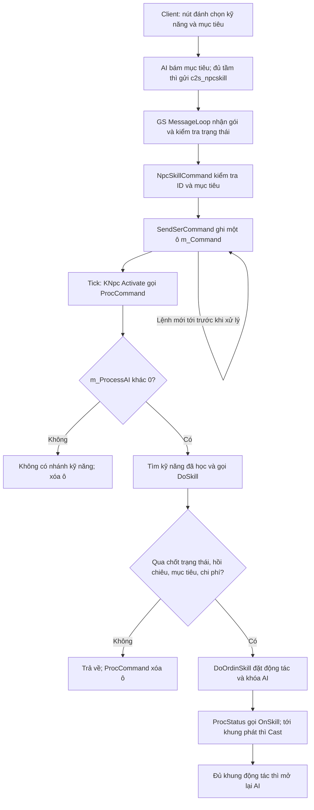

TÓM TẮT 1: [NGUỒN][THẤY] Hoàn tất khảo sát tĩnh client → gameserver bằng bảng 18 mục; ô lệnh là một biến `NPC_COMMAND m_Command` (`S/Core/Src/KNpc.h:895`).
TÓM TẮT 2: [NGUỒN][THẤY] Lệnh mới ghi đè ô; lúc `m_ProcessAI == 0`, kỹ năng không được xử lý nhưng ô vẫn bị xóa (`S/Core/Src/KNpc.cpp:6604`, `S/Core/Src/KNpc.cpp:1373`, `S/Core/Src/KNpc.cpp:1406`).
TÓM TẮT 3: [NGUỒN][TÀI LIỆU] Bàn giao ghi nhận 525 nhận, 80 chạy, 291 ghi đè, 154 bỏ lúc bận; phép tính cho 15,24% chạy, giữ nguyên kết luận cũ “~15%” (`JX1_OPS/STATE/BAN-GIAO.md:38`).
TÓM TẮT 4: [CHƯA KIỂM] Chưa đối chiếu bộ đếm với binary/log gốc và sát thương thực; ghi nhịp ngoài worktree bị từ chối quyền, nên trạng thái chung PARTIAL; phần khảo sát đã xong.
TÓM TẮT 5: [CHƯA KIỂM] Không build/chạy game, exe, VM hay kết nối mạng; không commit theo prompt, Tổng quan nhận bàn giao để commit và xử lý đường dẫn nhịp.

# HG2-05 — Làn lệnh gs001: vì sao chỉ khoảng 15% lệnh kỹ năng được chạy

Loại: khảo sát
Chủ đề: Luồng gửi, nhận, lưu một ô và thi hành lệnh kỹ năng; đối chiếu cơ chế nguồn với số liệu bàn giao #274/#275.
Từ khóa: kỹ năng, làn lệnh, gs001, c2s_npcskill, NPC_COMMAND, SendSerCommand, ProcCommand, m_ProcessAI, ghi đè, busy discard.
Trạng thái: PARTIAL — khảo sát tĩnh DONE, đủ 18 mục; tệp nhịp bắt buộc ngoài worktree bị sandbox chặn ghi.
Độ phủ: đã phủ 10/10 phần khảo sát tĩnh trong bảng dưới; 0/3 hạng mục xác minh runtime, đúng giới hạn task; ghi nhịp ngoài worktree bị chặn.
Liên quan: `JX1_OPS/TASKS/HG2-05.md`; `JX1_OPS/DESIGN/CHUAN-BAO-CAO.md`; `JX1_OPS/STATE/BAN-GIAO.md:37`; `JX1_OPS/STATE/BAN-GIAO.md:38`; `JX1_OPS/HOP-THU/BAN-GIAO-CHAT-19-11-2140.md:37`.
Cần tôi quyết định: không — không đề nghị triển khai sửa server trong task này; Tổng quan xử lý giới hạn ghi nhịp khi tiếp nhận.

## Nguồn và quy ước bằng chứng

- `[THẤY]`: trực tiếp thấy nhánh mã hoặc kiểm tra văn bản trong lượt này; không đồng nghĩa đã chạy thành công.
- `[TÀI LIỆU]`: dẫn lại ghi chép cũ, chưa đo lại. `[CHƯA KIỂM]`: chưa có bằng chứng trực tiếp cho điều kiện/runtime tương ứng.
- `[NGUỒN]`/`[CHƯA KIỂM]` trong năm dòng đầu theo chuẩn báo cáo; ba nhãn trên phân biệt mức xác minh chi tiết theo task.
- `C/` = `C:/Jx1CocoV3/Folder/Client2912-20260116T044348Z-3-001/Client2912/Client/Classes/`.
- `S/` = `C:/Jx1CocoV3/SwordOnline/SwordOnline/jxOnline/gameserver/Sources/`.
- `G/` = `C:/Jx1CocoV3/SwordOnline/SwordOnline/jxOnline/gateway/Sources/`.
- Mọi dẫn `C/...:dòng`, `S/...:dòng`, `G/...:dòng` được ghép với gốc trên thành đường dẫn thật; không dùng số dòng từ bản đồ làm bằng chứng.
- Không có commit nguồn ghim trong task. Các kết luận mã áp dụng cho cây nguồn trên đĩa đã đọc, chưa xác minh khớp APK/exe dùng cho phép đo #274/#275.

Danh sách đọc được giới hạn từ hai gốc nguồn của task, bổ sung theo caller/callee trực tiếp:

| Nhóm | Tệp đã dùng làm bằng chứng |
|---|---|
| Client: thao tác và AI | `C/gamescene/KgameWorld.cpp`; `C/gamecore/CoreShell.cpp`; `C/gamecore/KNpcAI.cpp`; `C/gamecore/KNpc.cpp` |
| Client: gói kỹ năng | `C/gamecore/KProtocol.cpp`; `C/gamecore/KProtocol.h`; `C/gamecore/KProtocolDef.h` |
| Server: nhận và phân phối | `S/MultiServer/GameServer/KSOServer.cpp`; `S/Core/Src/CoreServerShell.cpp`; `S/Core/Src/KPlayerSet.cpp`; `S/Core/Src/KProtocolProcess.cpp` |
| Server: ô lệnh và thi hành | `S/Core/Src/KNpc.h`; `S/Core/Src/KNpc.cpp` |
| Server: lịch cập nhật | `S/Core/Src/KSubWorldSet.cpp`; `S/Core/Src/KSubWorld.cpp`; `S/Core/Src/KRegion.cpp` |
| Gateway: ranh giới phân phối | `G/MultiServer/Bishop/GameServer.cpp` |
| Bối cảnh cần thiết | Chuẩn báo cáo, task, sáu skill được giao; mục liên quan của `GS001-MAP.md`, `MUC-LUC-TRI-THUC.md`, `CONG-CU.md`; bản đồ code tại `C:/Jx1CocoV3/CLAUDE.md:55`; hai đoạn bàn giao nêu trong Liên quan |

Chỉ tìm tên/symbol tại nhánh cần thiết; không quét đệ quy không lọc `Folder/`, `SwordOnline/` hay `D:/JX-wt/`. Không có Graphify tại các vị trí của đúng cây nguồn đã kiểm tra; không dùng graph của cây dựng khác để thay bằng chứng nguồn. Những lần tìm symbol trong `KPlayer.cpp`, `CoreShell.cpp` phía server và bản UI VN chỉ phục vụ định vị, không suy thành luồng đang chạy.

## Sơ đồ luồng chính



Nguồn sơ đồ: `C/gamecore/KNpcAI.cpp:827`; `S/MultiServer/GameServer/KSOServer.cpp:1598`; `S/Core/Src/KProtocolProcess.cpp:5581`; `S/Core/Src/KNpc.cpp:1296`; `S/Core/Src/KNpc.cpp:3609`; `S/Core/Src/KNpc.cpp:3836`; `S/Core/Src/KNpc.cpp:4016`. Nhánh thi hành động tác minh họa kỹ năng thông thường, không bao trùm mọi loại kỹ năng đặc biệt.

## Phạm vi và độ phủ

| STT | Phần tử phạm vi | Độ phủ | Nguồn hoặc giới hạn |
|---|---|---|---|
| 1 | Nút đánh → chọn kỹ năng, khóa mục tiêu | Đã phủ tĩnh | `C/gamescene/KgameWorld.cpp:2998`; `C/gamecore/KNpcAI.cpp:1477`; `C/gamecore/KNpcAI.cpp:1485` |
| 2 | AI tiếp cận → gửi gói | Đã phủ tĩnh | `C/gamecore/KNpcAI.cpp:631`; `C/gamecore/KNpcAI.cpp:772`; `C/gamecore/KNpcAI.cpp:828` |
| 3 | Các trường gói kỹ năng | Đã phủ tĩnh | `C/gamecore/KProtocol.h:494`; `C/gamecore/KProtocol.cpp:245` |
| 4 | GS nhận gói, lọc phiên và chuyển bộ xử lý | Đã phủ tĩnh | `S/MultiServer/GameServer/KSOServer.cpp:3730`; `S/Core/Src/KPlayerSet.cpp:1268`; `S/Core/Src/KProtocolProcess.cpp:215` |
| 5 | Kiểm tra ID, chuyển ID mục tiêu thành chỉ số | Đã phủ tĩnh | `S/Core/Src/KProtocolProcess.cpp:5588`; `S/Core/Src/KProtocolProcess.cpp:5599` |
| 6 | Một ô lệnh; chặn trước khi ghi; ghi đè | Đã phủ tĩnh | `S/Core/Src/KNpc.h:895`; `S/Core/Src/KNpc.cpp:6591`; `S/Core/Src/KNpc.cpp:6604` |
| 7 | Lịch tick → cập nhật NPC → đọc ô | Đã phủ tĩnh | `S/Core/Src/CoreServerShell.cpp:2250`; `S/Core/Src/KRegion.cpp:1120`; `S/Core/Src/KNpc.cpp:1000` |
| 8 | Bận, xóa lệnh, chốt DoSkill và khung Cast | Đã phủ tĩnh | `S/Core/Src/KNpc.cpp:1373`; `S/Core/Src/KNpc.cpp:1406`; `S/Core/Src/KNpc.cpp:3647`; `S/Core/Src/KNpc.cpp:4016` |
| 9 | Bảng phân phối của Bishop được chọn | Đã phủ giới hạn | `G/MultiServer/Bishop/GameServer.cpp:125`; chưa khảo sát toàn gateway hoặc xác minh tuyến mạng thực |
| 10 | Đối chiếu #274/#275 và phép tính tỷ lệ | Đã phủ tài liệu, số học | `JX1_OPS/STATE/BAN-GIAO.md:37`; `JX1_OPS/STATE/BAN-GIAO.md:38` |
| 11 | Định nghĩa và phạm vi bộ đếm của phép đo cũ | Chưa phủ runtime | Không có log gốc/binary tương ứng trong nguồn đã đọc; chỉ dẫn lại bàn giao |
| 12 | Xác nhận source khớp APK/exe đo | Chưa phủ runtime | Không build, không đọc/chạy binary để đối chiếu trong task |
| 13 | Sát thương, tỷ lệ hụt, nguyên nhân tốn tick thực | Chưa phủ runtime | Không đo lại; không đồng nhất “chạy lệnh” với “gây sát thương” |

## Giải mã tên

Báo cáo không liệt kê tên riêng kỹ năng, trang bị, quái, NPC hoặc bản đồ; không phát sinh tên Hán/Việt cũ cần chuyển GBK/TCVN3. Các tên kỹ thuật dưới đây giữ nguyên, không thay tên gốc.

| Tên gốc | Mã hóa | Chữ đúng / nghĩa dùng trong báo cáo | Nguồn file:dòng |
|---|---|---|---|
| `gs001` | ASCII trong tài liệu UTF-8 | Máy chủ game được bàn giao nhắc tới | `JX1_OPS/STATE/BAN-GIAO.md:37` |
| `Bishop` | ASCII trong đường dẫn | Thành phần gateway được đọc giới hạn | `G/MultiServer/Bishop/GameServer.cpp:123` |
| `NPC_SKILL_COMMAND` | ASCII | Gói yêu cầu dùng kỹ năng | `C/gamecore/KProtocol.h:500` |
| `m_Command` | ASCII | Ô lệnh chung của một NPC | `S/Core/Src/KNpc.h:895` |

Chú thích Hán trong source server được đọc bằng GBK (Windows-936); các đoạn `.cpp` client nêu trong luồng đọc bằng UTF-8; cấu trúc gói tại `C/gamecore/KProtocol.h:494` đối chiếu bằng GBK. Lần hiển thị sai mã hóa ban đầu đã được đọc lại có chọn encoding trước khi chốt dòng dẫn; không sửa byte nguồn.

## Sắp theo cấu trúc game

Trình bày theo vòng đời thao tác chiến đấu: người chơi chọn chiêu → nhân vật tiếp cận → gửi yêu cầu → máy chủ nhận → lưu ý định hành động → kiểm tra điều kiện → phát chiêu. Đây là cơ chế chung, không phải danh sách kỹ năng theo phái/nhánh/cấp học, nên không tự gán phái hoặc tên chiêu chưa đọc dữ liệu.

## Kết quả đọc tĩnh — 18 mục

| STT | Bước trong game / symbol | Điều đã thấy và nơi lệnh có thể dừng | Nhãn và bằng chứng |
|---|---|---|---|
| 1 | Bấm nút đánh (`mianSkillCallback` → `MainAttack`) | UI gọi `MainAttack(0)`, CoreShell chuyển sang `mainSkillattack`; chưa khẳng định đây là UI của APK đo. | [THẤY] `C/gamescene/KgameWorld.cpp:2998`; `C/gamecore/CoreShell.cpp:457` |
| 2 | Chọn chiêu, chọn mục tiêu (`mainSkillattack`) | Không ở chế độ chiến đấu thì gửi ngồi rồi trả về; chọn mục tiêu vào `m_nPeopleIdx`, chọn kỹ năng trái/phải. Đây là chốt trước khi phát gói kỹ năng. | [THẤY] `C/gamecore/KNpcAI.cpp:1406`; `C/gamecore/KNpcAI.cpp:1477`; `C/gamecore/KNpcAI.cpp:1485`; `C/gamecore/KNpcAI.cpp:1490` |
| 3 | Bám và áp sát mục tiêu (`Activate` → `ProcessPlayer` → `FollowPeople`) | Client chỉ gọi AI khi `m_ProcessAI` bật; AI người chơi theo mục tiêu đã khóa. Đủ tầm mới ghi lệnh cục bộ và gửi yêu cầu; xa thì chuyển sang di chuyển. | [THẤY] `C/gamecore/KNpc.cpp:640`; `C/gamecore/KNpcAI.cpp:68`; `C/gamecore/KNpcAI.cpp:631`; `C/gamecore/KNpcAI.cpp:772`; `C/gamecore/KNpcAI.cpp:827`; `C/gamecore/KNpcAI.cpp:836` |
| 4 | Đóng gói (`SendClientCmdSkill`) | Gửi loại `c2s_npcskill`, ID chiêu và hai tham số. Khi đánh NPC ở nhánh trên: X = -1, Y = ID mục tiêu; không có trường số thứ tự yêu cầu trong cấu trúc này. | [THẤY] `C/gamecore/KProtocolDef.h:261`; `C/gamecore/KProtocol.h:494`; `C/gamecore/KProtocol.cpp:245`; `C/gamecore/KNpcAI.cpp:828` |
| 5 | GS nhận nhiều gói (`MessageLoop`) | Vòng nhận duyệt từng kết nối và đọc gói liên tiếp, gọi `PlayerFsMessageProcess`; một lượt nhận có thể đưa nhiều yêu cầu tới cùng ô trước khi NPC xử lý. | [THẤY] `S/MultiServer/GameServer/KSOServer.cpp:1577`; `S/MultiServer/GameServer/KSOServer.cpp:1592`; `S/MultiServer/GameServer/KSOServer.cpp:1598`; `S/MultiServer/GameServer/KSOServer.cpp:1604` |
| 6 | Lọc phiên và phân phối giao thức | Sai kích thước gói thì trả về; chỉ phiên đang chơi chuyển thông điệp thường vào CoreServerShell. PlayerSet còn kiểm tra kết nối, ID nhân vật và không đang chuyển server; bảng hàm đưa `c2s_npcskill` đến `NpcSkillCommand`. | [THẤY] `S/MultiServer/GameServer/KSOServer.cpp:3730`; `S/MultiServer/GameServer/KSOServer.cpp:3746`; `S/MultiServer/GameServer/KSOServer.cpp:3761`; `S/Core/Src/CoreServerShell.cpp:523`; `S/Core/Src/KPlayerSet.cpp:1265`; `S/Core/Src/KProtocolProcess.cpp:215`; `S/Core/Src/KProtocolProcess.cpp:358` |
| 7 | Kiểm tra yêu cầu (`NpcSkillCommand`) | Bỏ ID chiêu ngoài `(0, MAX_SKILL)`, tham số Z âm, X âm khác -1; trường hợp chỉ định NPC phải tìm được NPC xung quanh, rồi đổi ID sang chỉ số nội bộ mới ghi lệnh. | [THẤY] `S/Core/Src/KProtocolProcess.cpp:5588`; `S/Core/Src/KProtocolProcess.cpp:5591`; `S/Core/Src/KProtocolProcess.cpp:5596`; `S/Core/Src/KProtocolProcess.cpp:5599`; `S/Core/Src/KProtocolProcess.cpp:5603` |
| 8 | Chặn trước khi ghi (`SendSerCommand`) | `m_randmove.nTime > 0` chặn một số lệnh, gồm `do_skill`, bằng `return`; chưa ghi vào ô và cũng không xóa ô cũ ở nhánh này. | [THẤY] `S/Core/Src/KNpc.cpp:6588`; `S/Core/Src/KNpc.cpp:6591`; `S/Core/Src/KNpc.cpp:6597`; `S/Core/Src/KNpc.cpp:6600` |
| 9 | Ghi đè ý định đang chờ (`m_Command`) | Chỉ một thành viên `NPC_COMMAND`; hàm ghi thẳng loại lệnh và ba tham số, không kiểm tra ô cũ. Đây là ô chung: lệnh đi bộ cũng vào `SendSerCommand`, nên có thể thay kỹ năng đang chờ. | [THẤY] `S/Core/Src/KNpc.h:895`; `S/Core/Src/KNpc.cpp:6604`; `S/Core/Src/KNpc.cpp:6607`; `S/Core/Src/KProtocolProcess.cpp:5449` |
| 10 | Chờ lượt xử lý game | Hàm chu kỳ chạy `MessageLoop` trước điều kiện thời gian của `MainLoop`; MainLoop → Breathe → MainLoop thế giới → bản đồ → vùng → NPC. Không có quan hệ một gói đến tương ứng một lần thi hành NPC. | [THẤY] `S/MultiServer/GameServer/KSOServer.cpp:1431`; `S/MultiServer/GameServer/KSOServer.cpp:1442`; `S/MultiServer/GameServer/KSOServer.cpp:4373`; `S/Core/Src/CoreServerShell.cpp:2250`; `S/Core/Src/KSubWorldSet.cpp:601`; `S/Core/Src/KSubWorld.cpp:305`; `S/Core/Src/KRegion.cpp:1120` |
| 11 | Đọc ô khi cập nhật nhân vật (`Activate`) | Chống cập nhật lặp cùng frame, dừng khi chuyển server; `ProcessState()` có thể trả về trước xử lý ô. Nếu đi tiếp, `ProcCommand(m_ProcessAI)` chạy trước `ProcStatus()`. Dừng sớm ở đây chưa phải xóa ô. | [THẤY] `S/Core/Src/KNpc.cpp:943`; `S/Core/Src/KNpc.cpp:951`; `S/Core/Src/KNpc.cpp:993`; `S/Core/Src/KNpc.cpp:1000`; `S/Core/Src/KNpc.cpp:1003` |
| 12 | Rảnh: lấy chiêu trong danh sách đã học | Với nAI khác 0 và vùng hợp lệ, nhánh `do_skill` tìm chiêu, chọn làm chiêu hiện tại rồi gọi `DoSkill`. Không tìm thấy thì `DoStand`; sau switch vẫn xóa ô. | [THẤY] `S/Core/Src/KNpc.cpp:1302`; `S/Core/Src/KNpc.cpp:1321`; `S/Core/Src/KNpc.cpp:1324`; `S/Core/Src/KNpc.cpp:1328`; `S/Core/Src/KNpc.cpp:1406` |
| 13 | Bận: bỏ kỹ năng đang chờ | Với nAI = 0, switch chỉ xử lý một số loại khác, không có `do_skill`; đi qua default rồi đặt `CmdKind = do_none`. Không giữ kỹ năng để thử lại sau khi rảnh. | [THẤY] `S/Core/Src/KNpc.cpp:1371`; `S/Core/Src/KNpc.cpp:1373`; `S/Core/Src/KNpc.cpp:1402`; `S/Core/Src/KNpc.cpp:1406` |
| 14 | Đã gọi `DoSkill` vẫn có thể không phát | Kiểm bản đồ/vùng, trạng thái, chế độ chiến đấu; chặn hồi chiêu thường hoặc trên ngựa; kiểm khả năng phát chiêu và chi phí. Khi hàm trả về, `ProcCommand` vẫn xóa yêu cầu. | [THẤY] `S/Core/Src/KNpc.cpp:3611`; `S/Core/Src/KNpc.cpp:3615`; `S/Core/Src/KNpc.cpp:3622`; `S/Core/Src/KNpc.cpp:3647`; `S/Core/Src/KNpc.cpp:3655`; `S/Core/Src/KNpc.cpp:3673`; `S/Core/Src/KNpc.cpp:1406` |
| 15 | Đặt hồi chiêu, đồng bộ và kiểm mục tiêu cuối | Trong nhánh qua điều kiện, nguồn đặt thời điểm dùng tiếp, tạo `s2c_skillcast`, còn có chốt Y và kiểm ID/bản đồ mục tiêu trước phát đồng bộ. Số lần vào hàm chưa chứng minh phát thành công. | [THẤY] `S/Core/Src/KNpc.cpp:3682`; `S/Core/Src/KNpc.cpp:3693`; `S/Core/Src/KNpc.cpp:3699`; `S/Core/Src/KNpc.cpp:3710`; `S/Core/Src/KNpc.cpp:3737` |
| 16 | Động tác giữ nhân vật bận | Các kiểu thông thường tới `DoOrdinSkill`; chọn động tác `do_attack` hoặc `do_magic`, tính số frame theo tốc độ, rồi đặt `m_ProcessAI = 0`. Các nhánh cận chiến đặc biệt có xử lý riêng, không suy mọi loại chiêu giống nhau. | [THẤY] `S/Core/Src/KNpc.cpp:3748`; `S/Core/Src/KNpc.cpp:3795`; `S/Core/Src/KNpc.cpp:3814`; `S/Core/Src/KNpc.cpp:3829`; `S/Core/Src/KNpc.cpp:3836` |
| 17 | Phát chiêu tại khung động tác (`OnSkill`) | `ProcStatus` gọi `OnSkill` cho động tác đánh/phép; tới khung hiệu lực mới gọi `Cast`, còn phải kiểm mục tiêu. Hoàn tất động tác mở lại AI; kỹ năng đã bị mục 13 xóa không được khôi phục ở đây. | [THẤY] `S/Core/Src/KNpc.cpp:1223`; `S/Core/Src/KNpc.cpp:3984`; `S/Core/Src/KNpc.cpp:3989`; `S/Core/Src/KNpc.cpp:4001`; `S/Core/Src/KNpc.cpp:4016`; `S/Core/Src/KNpc.cpp:4022`; `S/Core/Src/KNpc.cpp:1406` |
| 18 | Ranh giới gateway được đọc | Bảng hàm `CGameServer::Create` phía Bishop đăng ký thông báo đăng nhập/vào/ra game và cập nhật máy chủ; bảng được đọc không đăng ký `c2s_npcskill`. Bộ xử lý kỹ năng chứng minh được nằm ở gameserver; không suy rộng thành đã kiểm mọi tuyến gateway/mạng. | [THẤY] `G/MultiServer/Bishop/GameServer.cpp:125`; `G/MultiServer/Bishop/GameServer.cpp:127`; `G/MultiServer/Bishop/GameServer.cpp:140`; `S/Core/Src/KProtocolProcess.cpp:215` |

### Hai trường hợp mất lệnh chính

1. **Ghi đè trước lúc đọc ô:** kỹ năng A được ghi, rồi kỹ năng B hoặc lệnh đi bộ tới cùng NPC trước `ProcCommand`; lần ghi sau thay cả loại và tham số. Khi xử lý chỉ còn ý định cuối. Đây là diễn giải điều kiện mã, không phải chuỗi gói đã đo (`S/Core/Src/KNpc.cpp:6604`; `S/Core/Src/KProtocolProcess.cpp:5449`; `S/Core/Src/KNpc.cpp:1306`).
2. **Bỏ lúc bận:** kỹ năng đã vào ô, nhưng tới lượt xử lý `m_ProcessAI = 0`; không gọi `DoSkill`, rồi xóa ô. Vì `ProcCommand` đứng trước `ProcStatus`, ngay lượt `OnSkill` có thể kết thúc động tác và bật lại AI thì lệnh vẫn có thể bị bỏ từ trước trong lượt đó (`S/Core/Src/KNpc.cpp:1000`; `S/Core/Src/KNpc.cpp:1003`; `S/Core/Src/KNpc.cpp:1373`; `S/Core/Src/KNpc.cpp:1406`; `S/Core/Src/KNpc.cpp:3987`).

[THẤY] Hai cơ chế này giải thích khả năng mất yêu cầu ở tầng xử lý game sau khi đã nhận gói. [CHƯA KIỂM] Chưa thể gán từng sự kiện log cũ cho từng nhánh hoặc khẳng định đây là nguyên nhân duy nhất khiến quái không chết; thiếu định nghĩa bộ đếm và dữ liệu sát thương. Bằng chứng cơ chế: `S/Core/Src/KNpc.cpp:6604`, `S/Core/Src/KNpc.cpp:1406`; số liệu dẫn lại: `JX1_OPS/STATE/BAN-GIAO.md:38`.

## Đối chiếu số liệu bàn giao #274/#275

[TÀI LIỆU] Nguồn trực tiếp của các số dưới là `JX1_OPS/STATE/BAN-GIAO.md:38`, khoảng 21:49–21:51 ngày 19/11. Bàn giao cho Chat cũng dẫn A #274 với 80/525 tại `JX1_OPS/HOP-THU/BAN-GIAO-CHAT-19-11-2140.md:37`; không đọc lại log console, không chạy lại phép đo.

| Mục trong bàn giao | Số lệnh | Tỷ lệ trên 525 | Mức xác minh |
|---|---:|---:|---|
| Nhận kỹ năng | 525 | 100% | [TÀI LIỆU] mẫu số do bàn giao ghi |
| Chạy | 80 | 15,24% | [TÀI LIỆU] số đếm; phép chia đã kiểm bằng PowerShell |
| `skill_over` — bị ghi đè | 291 | 55,43% | [TÀI LIỆU] chưa đối chiếu nơi tăng bộ đếm |
| `busy discard` — bị bỏ khi bận | 154 | 29,33% | [TÀI LIỆU] chưa đối chiếu nơi tăng bộ đếm |
| Không chạy theo hai nhóm trên | 445 | 84,76% | Tính `291 + 154`; giữ nguyên cách diễn đạt cũ “~85%” |

[THẤY] Kiểm số học: `80 + 291 + 154 = 525`; `80 / 525 × 100 = 15,238095…%`. [CHƯA KIỂM] Tổng khớp không tự chứng minh các bộ đếm không chồng lặp, cùng thời điểm reset, hay “chạy” nghĩa là qua `DoSkill`, phát `Cast` hoặc gây sát thương. Không thấy chuỗi `skill_over`, `busy discard`, `skill_recv` trong ba file `S/Core/Src/KNpc.cpp`, `S/Core/Src/KProtocolProcess.cpp`, `S/MultiServer/GameServer/KSOServer.cpp` đã tìm; không suy rằng toàn bộ dự án không có bộ đếm.

[TÀI LIỆU] #275 ghi khi rỗi 18/18, tick trung bình khoảng 0,7 ms; lúc có người chơi khoảng 116 ms, tối đa 864 ms, SvrFPS 16 ở mốc 21:49 (`JX1_OPS/STATE/BAN-GIAO.md:37`). [THẤY] Nguồn có bước nhận gói trước bước cập nhật game và chỉ một ô chờ, phù hợp với khả năng gói dồn ghi đè (`S/MultiServer/GameServer/KSOServer.cpp:1431`; `S/MultiServer/GameServer/KSOServer.cpp:1442`; `S/Core/Src/KNpc.cpp:6604`). [CHƯA KIỂM] Chưa chứng minh quan hệ định lượng giữa tick nặng và 291/154, chưa xác định phần tốn CPU; không đổi kết luận của tài liệu cũ.

## Mục sổ thông số

| Nhóm | Tên/hằng số | file:dòng | Giá trị | Đơn vị | Ảnh hưởng | Đổi an toàn | Nguồn đo |
|---|---|---|---|---|---|---|---|
| Ô lệnh | `m_Command` | `S/Core/Src/KNpc.h:895`; `S/Core/Src/KNpc.cpp:6604` | 1 ô/NPC trong đường ghi đã đọc | lệnh chờ | Lệnh mới thay lệnh chưa xử lý | CẨN THẬN | [THẤY] đọc tĩnh; không đo runtime |
| Cờ bận | `m_ProcessAI` | `S/Core/Src/KNpc.cpp:3836`; `S/Core/Src/KNpc.cpp:1302`; `S/Core/Src/KNpc.cpp:1406` | 0 trong động tác; nAI = 0 không xử lý kỹ năng | cờ | Có thể xóa yêu cầu tới lúc bận | KHÔNG chỉnh riêng để bỏ khóa | [THẤY] đọc tĩnh |
| Mục tiêu | `nMpsX` / `nMpsY` | `C/gamecore/KNpcAI.cpp:828`; `S/Core/Src/KProtocolProcess.cpp:5594` | -1 / ID NPC; server đổi ID thành index | quy ước giao thức | Không tìm được NPC thì không ghi ô | KHÔNG đổi độc lập hai đầu | [THẤY] đọc tĩnh |
| ID chiêu | `ParamX`, `MAX_SKILL` | `S/Core/Src/KProtocolProcess.cpp:5588` | `0 < ParamX < MAX_SKILL`; chưa chốt trị số macro | ID | Ngoài miền bị trả về trước ô | CẨN THẬN | [THẤY] điều kiện; chưa đọc được định nghĩa header của đúng server |
| Nhịp danh nghĩa | `GAME_FPS` | `S/MultiServer/GameServer/KSOServer.cpp:1442`; `JX1_OPS/STATE/BAN-GIAO.md:37` | điều kiện lịch dùng macro; tài liệu ghi 18/18 | tick/giây | Nếu 18 Hz thì chu kỳ danh nghĩa `1000/18 ≈ 55,56 ms` | CẨN THẬN | [THẤY] công thức lịch; [TÀI LIỆU] 18; chưa đối chiếu định nghĩa macro |
| Thời gian ra đòn | `nTotalFrame` | `S/Core/Src/KNpc.cpp:3814`; `S/Core/Src/KNpc.cpp:3829` | theo AttackFrame/CastFrame và tốc độ hiện tại | frame logic | Chi phối cửa sổ giữ AI bận | CẨN THẬN | [THẤY] công thức; chưa có giá trị nhân vật runtime |
| Hồi chiêu | `GetDelayPerCast` / `GetHorsePerCast` | `S/Core/Src/KNpc.cpp:3647`; `S/Core/Src/KNpc.cpp:3682`; `S/Core/Src/KNpc.cpp:3684` | tùy dữ liệu chiêu; chưa chốt số | đơn vị thời gian logic của SubWorld | Chặn yêu cầu trước lúc phát động tác | CẨN THẬN | [THẤY] dùng trong điều kiện; chưa đo/đọc dữ liệu từng chiêu |
| Mẫu bàn giao | nhận/chạy/ghi đè/bỏ bận | `JX1_OPS/STATE/BAN-GIAO.md:38` | 525 / 80 / 291 / 154 | lệnh, khoảng 21:49–21:51 | Cơ sở diễn đạt ~15% | KHÔNG sửa số liệu cũ | [TÀI LIỆU] chưa tái đo |

Đánh giá “đổi an toàn” không cấp quyền sửa. Không tham số nào được chỉnh trong task; số thiếu ghi chưa chốt/chưa đo, không thay bằng 0.

## Đề xuất tối ưu — chưa triển khai

1. Trước khi chọn cách sửa, đối chiếu binary có bộ đếm và định nghĩa rõ các mốc: nhận hợp lệ, vào ô, ghi đè, bỏ bận, gọi `DoSkill`, gọi `Cast`, sát thương. Cần số ô còn chờ ở đầu/cuối mẫu để kiểm cân bằng; lý do là các chốt tách biệt tại `S/Core/Src/KProtocolProcess.cpp:5588`, `S/Core/Src/KNpc.cpp:1406`, `S/Core/Src/KNpc.cpp:3673`, `S/Core/Src/KNpc.cpp:4016`.
2. Nếu được giao task sửa riêng, thiết kế rõ kỹ năng chờ khi bận, thời hạn yêu cầu, xử lý mục tiêu đã mất và quan hệ với lệnh đi/chuyển server. Cân nhắc giữ yêu cầu cuối còn hợp lệ hoặc hàng chờ hữu hạn; cần chọn chính sách gameplay trước khi sửa chỗ ghi/xóa ô (`S/Core/Src/KNpc.cpp:6604`; `S/Core/Src/KNpc.cpp:1299`; `S/Core/Src/KNpc.cpp:1406`). Không đề nghị bật cưỡng bức `m_ProcessAI` vì cờ đang khóa động tác (`S/Core/Src/KNpc.cpp:3836`).
3. Tách bài đo tải tick khỏi bài đo lệnh kỹ năng, chỉ làm trên môi trường được duyệt ở task tiếp theo. #275 chưa tách được phần tốn tick; nguồn hiện tại chưa đủ để quy riêng cho Lua hoặc AI (`JX1_OPS/STATE/BAN-GIAO.md:37`; `S/Core/Src/CoreServerShell.cpp:2229`; `S/Core/Src/KSubWorldSet.cpp:601`).

## Đã xác minh / Chưa xác minh

**ĐÃ XÁC MINH — đọc tĩnh và kiểm văn bản:**

- Chuỗi client chuẩn bị/gửi gói, server phân phối, ghi đè và xóa lệnh lúc bận; nguồn cụ thể nằm trong bảng 18 mục. Phân biệt code hoạt động với khối comment: nhánh vòng lặp đang hoạt động ở `S/Core/Src/KSubWorldSet.cpp:601`; đoạn thử song song phía trước đã bị comment.
- Đường thi hành có nhiều mức: lấy chiêu ở `S/Core/Src/KNpc.cpp:1321`, qua chốt tại `S/Core/Src/KNpc.cpp:3673`, rồi phát ở `S/Core/Src/KNpc.cpp:4016`; không dùng chung một nhãn “đã đánh trúng”.
- Đã chạy lệnh đọc/tìm văn bản cục bộ và phép tính PowerShell cho 525/80/291/154; chưa có kiểm thử hành vi game.
- Kiểm tra tài liệu bằng PowerShell đã đạt: 5 dòng tóm tắt, 18 dòng bảng kết quả, 1 khối Mermaid, đủ 8 mục bắt buộc được kiểm, UTF-8 không BOM, không có ký tự thay thế U+FFFD; 97 dẫn nguồn `C/S/G` khác nhau đều có file và số dòng trong giới hạn. Kiểm này không xác minh hành vi mã hoặc rendering của Mermaid.
- Đã xem diff báo cáo mới và phần thêm cuối task; kiểm whitespace đạt khi chấp nhận CRLF của task, không có dấu cách/tab cuối dòng. Không đổi cấu hình Git trên đĩa.

**CHƯA XÁC MINH:** source khớp binary/APK đo; định nghĩa bộ đếm và cửa sổ mẫu; thao tác người chơi thực dùng nhánh UI nào; thông số chiêu/nhân vật đang lưu; tỷ lệ gây sát thương; nguyên nhân chiếm CPU/tick; kết quả của bất kỳ cách sửa nào. Không build, không chạy game/exe/VM, không kết nối mạng và không sửa nguồn/cấu hình.

## Lỗi, cách thử và kết quả

| Việc | Lỗi hoặc giới hạn thực tế | Cách xử lý / kết quả |
|---|---|---|
| Tiếp tục công việc | Git ban đầu sạch, nhánh `task/HG2-05`; báo cáo chưa tồn tại | Tạo báo cáo mới; không làm lại báo cáo có sẵn; không đổi metadata task |
| Định vị nguồn | `Folder/` và `SwordOnline/` không nằm trong worktree báo cáo | Đọc bản đồ code đúng chủ đề, xác nhận gốc nguồn thật nêu ở trên; không dùng cây dựng khác |
| Tìm chuỗi | `rg` báo không được nhận diện | Báo một lần; dùng `Select-String`/`Get-ChildItem` lọc tên, không cài công cụ |
| Hiển thị tiếng Việt/Hán | Lần đọc mặc định hiển thị sai encoding; dùng GBK cho vài `.cpp` client cũng làm lệch hiển thị/dòng | Chốt lại bằng UTF-8 cho các `.cpp` client, GBK cho đoạn server/header; không sửa nguồn |
| Graphify | Không thấy graph tại gốc source server/client tương ứng đã kiểm | Không tạo/cập nhật graph; đối chiếu trực tiếp file thật theo caller/callee |
| Định nghĩa header server | Không tìm thấy `GameDataDef.h` trong `S/`; các vị trí `S/Headers/...` thử không tồn tại | Giữ macro `MAX_SKILL`, `GAME_FPS` ở dạng biểu thức; không lấy trị số từ cây source khác |
| Kiểm whitespace Windows | `git diff --check` mặc định coi CR cuối 10 dòng thêm của task là trailing whitespace | Xác nhận task có 31 CRLF, không LF lẻ, không dấu cách/tab cuối dòng; chạy lại với `-c core.whitespace=trailing-space,space-before-tab,cr-at-eol` đạt. Chỉ áp dụng cho lệnh kiểm, không sửa cấu hình Git |
| Nhịp ngoài worktree | Thử ghi `D:/JX-wt/HG2-05.nhip` bằng `WriteAllText` tại mốc bắt đầu nhận `UnauthorizedAccessException: Access to the path ... is denied` | Bị chặn bởi vùng ghi; không đổi quyền, không dùng đường vòng. Không ghi được các mốc vào đường dẫn yêu cầu; bàn giao Tổng quan xử lý |

Mốc cục bộ ghi nhận trong báo cáo: `2026-11-19 23:35:45 +07:00` — hoàn tất đối chiếu luồng chính, khoảng 80%; `2026-11-19 23:36:51 +07:00` — chốt dẫn nguồn, chuyển viết báo cáo, khoảng 90%; `2026-11-19 23:41:54 +07:00` — báo cáo và kết quả task đã ghi, kiểm tra cấu trúc/dẫn nguồn đạt, khoảng 98%, chuẩn bị xem diff cuối. Đây không thay thế tệp `.nhip` bắt buộc; giờ mốc bắt đầu không lưu được do lần ghi bị từ chối.

## Bàn giao

- Phần khảo sát tĩnh: DONE; trạng thái chung PARTIAL chỉ vì không ghi được nhịp đúng đường dẫn. Báo cáo này và mục `Kết quả` cuối task là hai file thay đổi được prompt cho phép; không sửa báo cáo cũ, source, cấu hình hay `BAI_HOC.md`.
- Không stage/commit/push theo yêu cầu; chưa có SHA mới. Tổng quan nhận phần tài liệu để commit hộ. Không có lỗi push vì không thử push.
- Giữ nguyên kết luận/số liệu #274/#275; những điểm chưa kiểm và giới hạn mới được nêu công khai ở đây, không sửa lặng tài liệu cũ.
- Không tạo `REPORTS/_CHIMUC/HG2-05.tsv` vì ngoài `vung_file`; hàng TSV đề xuất dưới đây để PM gom. `MUC-LUC-TRI-THUC.md` cũng do PM cập nhật, không sửa trong task.

```tsv
file	loại	chủ đề	từ khóa	trạng thái	độ phủ	liên quan
JX1_OPS/REPORTS/HG2-05.md	khảo sát	Làn lệnh kỹ năng gs001: một ô, ghi đè và bỏ khi bận	kỹ năng;gs001;c2s_npcskill;NPC_COMMAND;ProcCommand;m_ProcessAI	PARTIAL	10/10 phần tĩnh;18 mục;0/3 runtime;nhịp bị chặn	JX1_OPS/STATE/BAN-GIAO.md:37;JX1_OPS/STATE/BAN-GIAO.md:38
```

Hàng đề xuất cho mục lục tri thức: `Làn lệnh kỹ năng, một ô, ghi đè, bỏ lúc bận | HG2-05 | KNpc::SendSerCommand, ProcCommand, DoSkill, OnSkill | đã đối chiếu nguồn; số đo #274/#275 dẫn lại, chưa kiểm runtime`.

Kỹ năng đã dùng: jx1-retrofit (giữ kết luận cũ và chuẩn trình bày), jx1-read-server, jx1-read-client, jx1-parameters, jx1-knowledge, jx1-report.

## Phát hiện khi chuẩn hóa

[THẤY] Báo cáo HG2-05 chưa có lúc bắt đầu; không có nội dung cũ bị viết lại. Cụm “một ô kỹ năng” trong bàn giao được giải thích chi tiết bằng ô lệnh chung `m_Command`, nơi cả kỹ năng và đi bộ cùng ghi (`JX1_OPS/STATE/BAN-GIAO.md:38`; `S/Core/Src/KNpc.h:895`; `S/Core/Src/KProtocolProcess.cpp:5449`; `S/Core/Src/KNpc.cpp:6604`). Tỷ lệ “chạy” giữ nguyên ý nghĩa được bàn giao mô tả; chưa nâng thành tỷ lệ phát chiêu hoặc sát thương.
