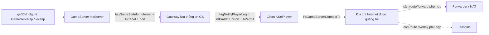

TÓM TẮT 1: [NGUỒN] `InitServer` đọc `<parmName>_cfg.ini`; khi nhánh `m_IsWm` chạy, `GameServer.Ip` và `localIp` lần lượt ghi đè địa chỉ internet/intranet (SwordOnline/SwordOnline/jxOnline/gameserver/Sources/MultiServer/GameServer/KSOServer.cpp:704-719,872-885).
TÓM TẮT 2: [NGUỒN] Nhánh đó kiểm tra containment bằng `strstr` (chuỗi con literal, không kiểm tra subnet) và trả lỗi nếu `Ip` không chứa `localIp`; constructor khởi tạo `m_IsWm=TRUE` trong source hiện tại (KSOServer.cpp:326,887-890).
TÓM TẮT 3: [NGUỒN] GameServer gửi cả hai địa chỉ cùng cổng cho Gateway; Gateway lấy địa chỉ Internet làm `nIPAddr` để trả quyền vào game cho client (KSOServer.cpp:4189-4202; gateway `Bishop/GameServer.cpp:683-688,1073-1077`).
TÓM TẮT 4: [NGUỒN] Khi được phép vào game, client đổi `nIPAddr` thành địa chỉ dạng chấm và kết nối trực tiếp địa chỉ/cổng đó; tác động mạng thực tế qua forwarder/Tailscale chưa đo (client `KSelPlayer.cpp:1116-1128`).
TÓM TẮT 5: [NGUỒN] Chỉ đọc source/cấu hình mẫu; không build, chạy executable, VM hoặc mạng; địa chỉ triển khai thực tế và đường đi qua NAT/forwarder/Tailscale chưa xác minh.

# HG2-06 — Địa chỉ gửi cho client: gs00N_cfg.ini Ip và KSOServer
Loại: khảo sát
Chủ đề: Theo vết địa chỉ IP GameServer từ cấu hình và đăng ký Gateway tới gói cho phép client vào game.
Từ khóa: địa chỉ client, `gs00N_cfg.ini`, `Ip`, `localIp`, `KSOServer.cpp`, GameServer, forwarder, Tailscale
Trạng thái: DONE — đã hoàn tất khảo sát tĩnh theo phạm vi; route thực tế chưa kiểm tra theo giới hạn task.
Độ phủ: 10/11 mục trong bảng đã phủ bằng source tĩnh; mục còn lại là xác minh định tuyến thực tế qua forwarder/Tailscale, ngoài phạm vi vì task cấm kết nối mạng.
Liên quan: `JX1_OPS/TASKS/HG2-06.md`, `JX1_OPS/DESIGN/CHUAN-BAO-CAO.md`, `JX1_OPS/DESIGN/MUC-LUC-TRI-THUC.md`, `JX1_OPS/REPORTS/A-02-luong-dang-nhap.md`.
Cần tôi quyết định: không.

Các bước nét liền được đọc từ source tĩnh. Hai nét đứt nêu điều kiện mạng cần thiết về mặt đường đi; không khẳng định cấu hình mạng cụ thể đang hoạt động.

## Phạm vi và độ phủ
| # | Mục cần kiểm tra | Trạng thái | Bằng chứng |
|---:|---|---|---|
| 1 | Nạp file `<parmName>_cfg.ini` | Đã phủ | `KSOServer.cpp:704-719` ghép tên cấu hình và nạp file. |
| 2 | Cấu hình client `GameServer.Ip` / `localIp` | Đã phủ tĩnh | Mẫu `gs001_cfg.ini` có hai key dưới `[GameServer]`; xem giới hạn về phiên bản/copy ở phần thân, `Folder/ServerNew-20260116T043145Z-3-001/ServerNew/_bin_v2_/gs/gs001_cfg.ini:21-24`. |
| 3 | Ghi đè địa chỉ internet/intranet theo cấu hình | Đã phủ tĩnh | `KSOServer.cpp:869-885`: gọi hàm lấy IP trước, rồi nếu `m_IsWm` tải `Ip` vào `m_dwInternetIp`, `localIp` vào `m_dwIntranetIp`. |
| 4 | Điều kiện “`Ip` phải chứa `localIp`” | Đã phủ | `KSOServer.cpp:884-890`: đọc hai chuỗi và `strstr(Ip, localIp)`; không khớp thì `InitServer` trả `FALSE`. |
| 5 | Giá trị khởi tạo của `m_IsWm` | Đã phủ tĩnh | `KSOServer.cpp:326` gán `TRUE`; không coi đây là quan sát runtime. |
| 6 | Lắng nghe cổng GameServer | Đã phủ tĩnh | `KSOServer.cpp:860-867` mở `INADDR_ANY` tại `m_nServerPort`; không chứng minh firewall/NAT cho phép truy cập. |
| 7 | Gửi IP/cổng GameServer cho Gateway | Đã phủ | `KSOServer.cpp:4189-4202` điền `nIPAddr_Internet`, `nIPAddr_Intraner`, `nPort` vào `tagGameSvrInfo` và gửi qua `m_pGatewayClient`. |
| 8 | Gateway lưu hai IP nhận được | Đã phủ | `Bishop/GameServer.cpp:683-688` sao chép IP Internet/intranet từ `pGSI` và đổi thành chuỗi để lưu. |
| 9 | Gateway trả địa chỉ nào cho client | Đã phủ tĩnh | Nhánh không kiểm tra dự phòng ở `Bishop/GameServer.cpp:1073-1077` trả `m_nServerIP_Internet` và `m_nServerPort`; nhánh cấp quyền cũng dùng cặp này ở `1040-1044,1064-1068`. Các nhánh từ chối gửi địa chỉ 0 và mã cổng ở `1045-1063`. |
| 10 | Client dùng địa chỉ nhận được | Đã phủ | Client chỉ đi tiếp khi `bPermit` qua các nhánh từ chối ở `KSelPlayer.cpp:1073-1091`; chuyển `nIPAddr` thành chuỗi và gọi `FsGameServerConnectTo(Address,nPort)` ở `1116-1128`. |
| 11 | Forwarder/NAT hoặc Tailscale hoạt động thực tế | Chưa phủ | Cấm kết nối mạng theo `JX1_OPS/TASKS/HG2-06.md:17`; source chỉ chứng minh client dùng IP Gateway quảng bá, không xác minh route, NAT, ACL hay tunnel. |

## Giải mã tên
| Tên gốc | Mã hóa | Chữ đúng | Nguồn file:dòng |
|---|---|---|---|
| `GameServer` | ASCII/UTF-8, tên section | `GameServer` | `KSOServer.cpp:878,881`; mẫu cfg `:21-24` |
| `Ip` | ASCII/UTF-8, khóa cấu hình | `Ip` | `KSOServer.cpp:878,884`; mẫu cfg `:23` |
| `localIp` | ASCII/UTF-8, khóa cấu hình | `localIp` | `KSOServer.cpp:881,885`; mẫu cfg `:22` |
| `Gateway` | ASCII/UTF-8, vai trò/tên section | `KSOServer.cpp:727-728`; `Bishop/GameServer.cpp:683-688` |
| `Tailscale` | ASCII/UTF-8, tên riêng Latin | `Tailscale` | `JX1_OPS/TASKS/HG2-06.md:19` |

Trong phạm vi kết luận không có tên riêng chữ Hán cần giải mã GBK; các comment tiếng Hoa trong source không được dùng làm tên riêng hay kết luận.

## Sắp theo cấu trúc game
Dữ liệu được xếp theo cấu trúc mạng của game: cấu hình GS → khởi tạo/đăng ký GS → Gateway cấp quyền → client kết nối → đường truyền mạng. Không áp dụng phân loại phái/map/NPC vì task chỉ khảo sát kết nối.

## Thân báo cáo
### Kết quả khảo sát tĩnh
`InitServer` tạo tên cấu hình bằng hậu tố `_cfg.ini` từ `parmName`, sau đó nạp tệp; thất bại nạp thì trả `FALSE` (`KSOServer.cpp:704-719`). Source gọi `GetLocalIpAddress` để lấy hai địa chỉ trước (`:869-870`). Trong nhánh `m_IsWm`, source đọc `GameServer.Ip` và `GameServer.localIp`, gán lần lượt vào trường Internet và intranet, rồi kiểm tra chuỗi bằng `strstr`; `Ip` không chứa `localIp` thì thoát khởi tạo với `FALSE` (`:872-890`). Constructor gán `m_IsWm=TRUE` ở source hiện tại (`:326`), nhưng không có chạy server để xác nhận trạng thái thực tế.

Server mở `m_nServerPort` trên `INADDR_ANY` (`KSOServer.cpp:860-867`). Khi nhận yêu cầu `s2c_querygameserverinfo`, GameServer gửi `tagGameSvrInfo` cho Gateway, gồm IP Internet, IP intranet, cổng và thông tin khác (`:4189-4202`; kiểu cấu trúc ở client `KProtocol.h:1671-1679`). Gateway chép hai IP (`Bishop/GameServer.cpp:683-688`) và khi cấp quyền vào game điền IP Internet/cổng server vào thông báo client (`:1040-1044,1064-1068,1073-1077`). Nhánh từ chối không gửi IP này (`:1045-1063`).

Client ở `KSelPlayer` đổi `nIPAddr` sang dạng chấm, gọi `FsGameServerConnectTo(Address,nPort)`, rồi gửi gói `tagLogicLogin`/GUID trên kết nối mới (`KSelPlayer.cpp:1116-1134`). Vì thế, theo source, Gateway là nơi chọn IP được quảng bá nhưng client tự kết nối tới địa chỉ GameServer đó; kết nối client→GameServer không được proxy qua socket Gateway trong đoạn luồng này.

### Forwarder và Tailscale
Nếu IP/cổng Gateway quảng bá không có đường đi từ máy client tới listener GameServer, kết nối trực tiếp sẽ thất bại; nếu forwarder/NAT chuyển đúng cổng tới listener và chính IP quảng bá là đầu vào mà client tới được thì đường đó có thể hoạt động. Với Tailscale, route overlay chỉ hữu ích khi địa chỉ được quảng bá là địa chỉ/đích có thể định tuyến qua overlay và máy client/server có kết nối tương ứng. Đây là suy luận điều kiện từ việc client kết nối trực tiếp `Address:nPort`, không phải kết quả thử mạng (`KSelPlayer.cpp:1116-1128`; `KSOServer.cpp:860-867`). Trong đoạn `InitServer` được kiểm tra, sau khi gọi hàm lấy IP, nhánh `m_IsWm` ghi đè hai giá trị bằng cfg; đoạn này không cấu hình hay kiểm tra forwarder/NAT. Điều kiện `strstr` chỉ là containment dạng chuỗi: nếu địa chỉ `Ip` quảng bá của forwarder/Tailscale không chứa nguyên chuỗi `localIp`, GS sẽ trả `FALSE` ở khâu khởi tạo dù hai địa chỉ có thể định tuyến được với nhau. Ngược lại, thỏa điều kiện chuỗi không chứng minh có route.

Đã đọc một cấu hình mẫu `gs001_cfg.ini`: hai key `GameServer.localIp` và `GameServer.Ip` cùng có mặt, hiện chứa cùng một chuỗi địa chỉ; không chép giá trị địa chỉ vào báo cáo. Đây là bản trong `Folder/ServerNew-20260116T043145Z-3-001/ServerNew/_bin_v2_/gs/`, khác root source C++ mà task chỉ định, nên chỉ là một mẫu cấu hình, không chứng minh cfg đang chạy hoặc khớp với bản binary/server hiện hành (`gs001_cfg.ini:21-24`). Theo đúng cấu hình ví dụ này, phép kiểm tra chứa chuỗi sẽ thỏa vì hai chuỗi bằng nhau; không suy rộng sang các file `gs002...` trở đi.

### MỤC SỔ THÔNG SỐ
| Nhóm | Tên/hằng số | file:dòng | Giá trị | Đơn vị | Ảnh hưởng | Đổi an toàn (CÓ/CẨN THẬN/KHÔNG) | Nguồn đo |
|---|---|---|---|---|---|---|---|
| GameServer config | `GameServer.Ip` | `KSOServer.cpp:878,884`; mẫu cfg `:23` | Cấu hình được nạp vào `m_dwInternetIp`; giá trị triển khai không trích lộ | IPv4 dạng chuỗi trong mẫu | IP được Gateway quảng bá cho client theo nhánh cấp quyền | CẨN THẬN — thay đổi có thể làm client không tới đúng listener; chưa kiểm route | Đọc tĩnh source/cfg; không đo runtime |
| GameServer config | `GameServer.localIp` | `KSOServer.cpp:881,885`; mẫu cfg `:22` | Cấu hình được nạp vào `m_dwIntranetIp`; giá trị triển khai không trích lộ | IPv4 dạng chuỗi trong mẫu | IP intranet được gửi cho Gateway; tham gia điều kiện `Ip` chứa `localIp` | CẨN THẬN — chưa xác minh ý nghĩa của các thành phần downstream ngoài IP và string check đã đọc | Đọc tĩnh source/cfg; không đo runtime |
| Khởi tạo GS | `m_IsWm` | `KSOServer.cpp:326,872` | Constructor gán `TRUE`; nhánh dùng cfg được thực thi nếu cờ vẫn giữ giá trị này | Boolean | Chọn nhánh ghi đè IP từ cfg | CẨN THẬN — chưa khảo sát toàn bộ trạng thái runtime | Đọc tĩnh source |
| GameServer listener | `GameServer.Port` / `m_nServerPort` | `KSOServer.cpp:722-725,860`; mẫu cfg `:21-24` | Mặc định source 56766; có thể bị `g_nPort` ghi đè; mẫu cfg chứa cổng riêng, không xem là runtime | Cổng TCP | Listener GS và cổng được Gateway báo lại client | CẨN THẬN — cần route/forward và kiểm thử được duyệt trước khi đổi | Đọc tĩnh source/cfg; không đo runtime |
| Đăng ký Gateway | `tagGameSvrInfo.nIPAddr_Internet`, `.nIPAddr_Intraner`, `.nPort` | `KSOServer.cpp:4191-4201`; cấu trúc `KProtocol.h:1673-1679` | Hai địa chỉ và cổng lấy từ biến GS | Địa chỉ IP, cổng | Đồng bộ địa chỉ GS cho Gateway | CẨN THẬN — chưa xác minh tương thích cấu hình triển khai | Đọc tĩnh source |

### Đề xuất tối ưu
Không đề xuất sửa config hoặc code. Khi có yêu cầu kiểm thử mạng riêng, cần đối chiếu IP quảng bá với listener, route/firewall/port-forward và peer Tailscale trong một phạm vi được duyệt; task hiện tại không cấp quyền kiểm tra đó.

## Đã xác minh
- Source: `SwordOnline/SwordOnline/jxOnline/gameserver/Sources/MultiServer/GameServer/KSOServer.cpp:704-719,860-890,4189-4202` — `InitServer`, listener và gửi `tagGameSvrInfo`.
- Source: `SwordOnline/SwordOnline/jxOnline/gateway/Sources/MultiServer/Bishop/GameServer.cpp:683-688,1040-1077` — lưu hai IP, chọn IP Internet/cổng gửi về client.
- Source: `SwordOnline/SwordOnline/jxOnline/gateway/Sources/MultiServer/Bishop/GamePlayer.cpp:2411-2433` — Bishop chờ phản hồi quyền rồi gửi gói nhận được tới client; nhánh từ chối ở `2165-2190`.
- Source: `Folder/Client2912-20260116T044348Z-3-001/Client2912/Client/Classes/gameui/KSelPlayer.cpp:1073-1091,1116-1134` — kiểm quyền, kết nối IP/cổng nhận được, gửi login.
- Source: `Folder/Client2912-20260116T044348Z-3-001/Client2912/Client/Classes/gamecore/KProtocol.h:1671-1679` — cấu trúc `tagGameSvrInfo`.
- Tệp cấu hình mẫu: `Folder/ServerNew-20260116T043145Z-3-001/ServerNew/_bin_v2_/gs/gs001_cfg.ini:21-24` — có hai key IP dưới section GameServer; giá trị đã lược khỏi báo cáo.

## Chưa xác minh
- Không xác nhận được các file cấu hình nào đang được server hiện hành nạp, hay trạng thái runtime của `m_IsWm`/`g_nPort`/listener.
- Không xác minh định tuyến NAT, firewall, forwarder hoặc Tailscale, và không kiểm tra handshake/kết nối thực tế.
- Không chạy build, exe, VM hoặc mạng theo task. Bằng chứng là khảo sát tĩnh source và một cfg mẫu ngoài worktree; không được hiểu là xác nhận trạng thái triển khai.

## Bàn giao
- Trạng thái: `DONE` cho khảo sát tĩnh theo tiêu chí task; route mạng runtime để `CHƯA XÁC MINH` do giới hạn task.
- Không commit theo yêu cầu giao task cho PM tổng quan commit; chưa có SHA.
- Không tạo file chỉ mục ngoài `vung_file` của task.
- Không ghi được `D:\JX-wt\HG2-06.nhip`: workspace cho phép ghi chỉ nằm trong `D:\JX-wt\HG2-06`; lần ghi ngoài root trả `Access is denied`. Không sửa quyền để vượt giới hạn.
- `JX1_OPS/TASKS/HG2-06.md` ghi vùng file được giao chỉ gồm `JX1_OPS/REPORTS/HG2-06.md`; mục `Kết quả cuối` được đặt ở cuối báo cáo trong phạm vi được phép, không sửa file task.
- Kỹ năng đã dùng: `jx1-retrofit`, `jx1-read-server`, `jx1-read-client`, `jx1-parameters`, `jx1-knowledge`, `jx1-report`.

## Kết quả cuối
`DONE` — đã đối chiếu luồng địa chỉ tĩnh từ cfg/`KSOServer.cpp` qua Gateway tới client và mô tả điều kiện forwarder/Tailscale. Không xác minh tuyến mạng thực tế hoặc cfg đang chạy. Đầu ra: `JX1_OPS/REPORTS/HG2-06.md`; không commit.
