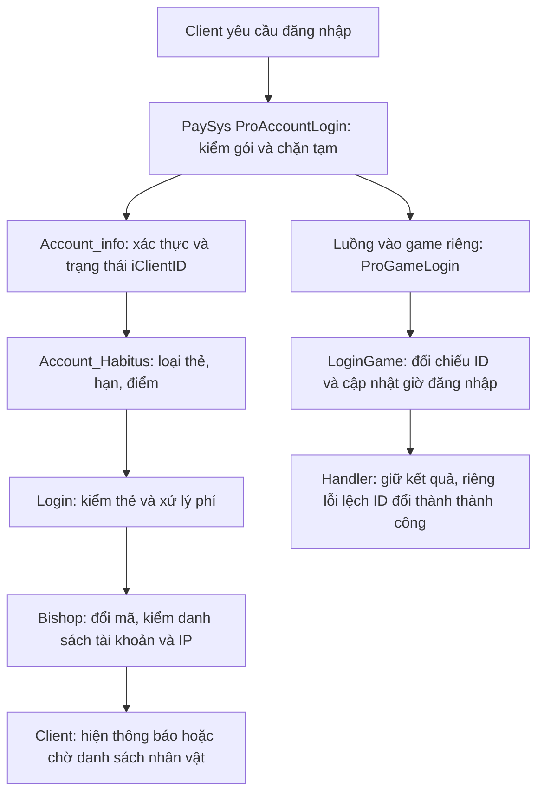

TÓM TẮT 1: [NGUỒN][THẤY] DONE — khảo sát tĩnh tài khoản chơi qua `Account_info`, `Account_Habitus` và `S3PAccount`, tách xác thực với vào game (`S3PAccount.cpp:35`, `S3PAccount.cpp:134`).
TÓM TẮT 2: [NGUỒN][THẤY] Thẻ tháng cần hạn còn dương; thẻ điểm cần điểm lớn hơn phí đăng nhập; handler đổi lỗi lệch ID của `LoginGame` thành thành công (`S3PAccount.cpp:72`, `S3PAccount.cpp:106`, `S3PDBSocketPool.cpp:799`).
TÓM TẮT 3: [NGUỒN][THẤY] Báo cáo có 19 mục điều kiện, 8 mã trả về và đường đổi mã sang client (`AccountLoginDef.h:23`, `GamePlayer.cpp:1032`, `Klogin.cpp:959`).
TÓM TẮT 4: [CHƯA KIỂM] Chưa xác minh dữ liệu, cấu hình đang dùng, kết quả SQL hay bản đang chạy; không đọc tài khoản thật. Ghi nhịp ngoài worktree bị từ chối quyền ghi, chi tiết ở Bàn giao.
TÓM TẮT 5: [CHƯA KIỂM] Không chạy build/test game, exe, VM hoặc mạng theo task; không commit/push theo yêu cầu, Tổng quan gom commit; bước tiếp theo là PM rà soát các điểm cần kiểm thử riêng.

# HG2-07 — Tài khoản chơi: Account_Info, Account_Habitus, S3PAccount

Loại: khảo sát
Chủ đề: Điều kiện tài khoản được xác thực, kiểm hạn sử dụng và mã trả về khi đăng nhập/vào game.
Từ khóa: tài khoản chơi, đăng nhập, hạn thẻ, thẻ điểm, Account_Info, Account_Habitus, S3PAccount, LoginGame, LOGIN_R_TIMEOUT
Trạng thái: DONE — hoàn tất khảo sát tĩnh trong phạm vi; bước ghi nhịp ngoài worktree bị chặn riêng.
Độ phủ: đã phủ 8/8 nhóm khảo sát dưới đây; bảng điều kiện 19 mục, bảng mã 8 mục; không tuyên bố phủ toàn bộ hệ thống đăng nhập.
Liên quan: `JX1_OPS/TASKS/HG2-07.md`, `JX1_OPS/DESIGN/CHUAN-BAO-CAO.md`, `JX1_OPS/DESIGN/MUC-LUC-TRI-THUC.md`.
Cần tôi quyết định: không — phạm vi đọc tĩnh đã đủ; sửa hành vi hoặc chạy thử cần task riêng.



[THẤY] Sơ đồ mô tả các nhánh đã đọc, không khẳng định toàn bộ trình tự runtime: `S3PDBSocketPool.cpp:682`, `S3PAccount.cpp:50`, `S3PAccount.cpp:593`, `GamePlayer.cpp:1016`, `GamePlayer.cpp:1175`, `Klogin.cpp:946`, `S3PDBSocketPool.cpp:769`.

## Phạm vi và độ phủ

| Nhóm trong cấu trúc đăng nhập | Mức phủ | Bằng chứng và giới hạn |
|---|---|---|
| 1. Gói xác thực và chặn thử lại tạm thời | Đã phủ | [THẤY] `S3PDBSocketPool.cpp:685`, `S3PDBSocketPool.cpp:699`, `S3PDBSocketPool.cpp:431`; không gửi gói thật. |
| 2. Danh tính và trạng thái tài khoản trong Account_info | Đã phủ | [THẤY] `S3PAccount.cpp:50`, `S3PAccount.cpp:62`, `S3PAccount.cpp:99`; không đọc bảng thật. |
| 3. Loại thẻ, hạn và điểm trong Account_Habitus | Đã phủ | [THẤY] `S3PAccount.cpp:593`, `S3PAccount.cpp:611`, `S3PAccount.cpp:638`. |
| 4. Phí đăng nhập và dữ liệu trả kèm | Đã phủ | [THẤY] `S3PAccount.cpp:66`, `S3PAccount.cpp:104`, `S3PDBSocketPool.cpp:399`; không đọc INI thật. |
| 5. Bước LoginGame và mã handler gửi đi | Đã phủ | [THẤY] `S3PAccount.cpp:134`, `S3PDBSocketPool.cpp:783`, `S3PDBSocketPool.cpp:799`. |
| 6. Theo dõi hạn, trừ thời gian và thoát | Đã phủ phần liên quan | [THẤY] `S3PAccount.cpp:167`, `S3PAccount.cpp:334`, `S3PAccount.cpp:368`, `S3PAccount.cpp:538`; chưa đo bộ lập lịch. |
| 7. Đổi mã và lọc bổ sung tại Bishop | Đã phủ phần liên quan | [THẤY] `GamePlayer.cpp:1032`, `GamePlayer.cpp:1175`, `GamePlayer.cpp:1194`, `GamePlayer.cpp:1241`; trạng thái danh sách/UI chưa kiểm. |
| 8. Định nghĩa mã và phản hồi client | Đã phủ source | [THẤY] `AccountLoginDef.h:23`, `LoginDef.h:69`, `Klogin.cpp:945`; chưa xác minh bản APK/binary. |

### Danh sách tệp đọc và quy ước nguồn

[TÀI LIỆU] Danh sách được giới hạn theo mục Nguồn của task, bắt đầu từ `S3PAccount.cpp/.h`, rồi bổ sung định nghĩa và caller/callee trực tiếp. Root dưới đây thuộc `C:/Jx1CocoV3`, chỉ đọc; source không nằm trong worktree báo cáo. `GS001-MAP.md` và mục lục tri thức chỉ dùng định vị, không thay bằng chứng mã hiện tại.

- `G = C:/Jx1CocoV3/SwordOnline/SwordOnline/jxOnline/gateway/Sources`.
- `A = G/Sword3PaySys/S3AccServer`.
- `C = C:/Jx1CocoV3/Folder/Client2912-20260116T044348Z-3-001/Client2912/Client/Classes`.
- Các dẫn `tên-tệp:dòng` bên dưới mở rộng theo bảng này; số dòng là dòng vật lý của file hiện tại, không dùng số dòng Graphify.

| Tệp được viện dẫn | Vị trí chính xác theo root trên | Đoạn dùng |
|---|---|---|
| S3PAccount.cpp | `A/S3PAccount.cpp` | `:35` Login; `:134` LoginGame; `:167` Logout; `:334` ElapseTime; `:368` QueryTimeAndPiont; `:553` GetAccountGameID; `:582` GetLeftSecondsOfDeposit. |
| S3PAccount.h | `A/S3PAccount.h` | `:28` chữ ký API và giá trị mặc định của tham số phí. |
| AccountLoginDef.h | `A/AccountLoginDef.h` | `:17` giới hạn khai báo; `:23` mã; `:72` cấu trúc trả về. |
| S3PDBSocketPool.cpp | `A/S3PDBSocketPool.cpp` | `:366` đăng ký handler; `:399` phí; `:418` chặn tạm; `:682` xác thực; `:769` vào game; `:967` gọi nạp phí. |
| S3PDBSocketPool.h | `A/S3PDBSocketPool.h` | `:62` bộ nạp phí; `:87` biến phí; `:110` danh sách chặn. |
| S3PDBConnectionPool.cpp | `A/S3PDBConnectionPool.cpp` | `:17`, `:19`, `:101` nguồn ID dùng để nhận diện đóng băng; không đọc thông tin kết nối. |
| S3PDBConVBC.h | `A/S3PDBConVBC.h` | `:32`, `:33` hợp đồng bool của QuerySql/Do; chưa đọc backend/ảnh hưởng số dòng. |
| GamePlayer.cpp | `G/MultiServer/Bishop/GamePlayer.cpp` | `:1011` nhận kết quả; `:1131` trả client và lọc bổ sung; `:1386` gửi mã cuối. |
| LoginDef.h | `C/gamescene/LoginDef.h` | `:50` giới hạn khai báo; `:69` mã client; `:91` trường thời gian/điểm. |
| Klogin.cpp | `C/gameui/Klogin.cpp` | `:945` xử lý kết quả và khóa thông báo. |

[CHƯA KIỂM] Không cần mở source gameserver để kết luận về nhánh tài khoản nêu trên. Không khảo sát tạo tài khoản, đổi mật khẩu, chọn nhân vật, chuyển bản đồ, backend SQL, dữ liệu người chơi hay chứng minh giao thức tương thích giữa hai cây source.

## Giải mã tên

[THẤY] Phần chú thích Hán được đọc bằng GBK/CP936; báo cáo ghi UTF-8 không BOM. Tên kỹ thuật ASCII giữ nguyên, không dịch thành một tên game khác. Báo cáo không sử dụng tên riêng của NPC, kỹ năng, trang bị hay bản đồ; không có tên Việt TCVN3 cần giải mã.

| Tên gốc giữ nguyên | Mã hóa nguồn | Chữ đúng/ý nghĩa tiếng Việt | Nguồn file:dòng |
|---|---|---|---|
| `Account_Info` / `Account_info` | ASCII; task dùng cách viết thứ nhất | Thông tin tài khoản; câu SQL được đọc dùng chính xác `Account_info`. Tính phân biệt hoa/thường của DB chưa kiểm. | `JX1_OPS/TASKS/HG2-07.md:3`, `S3PAccount.cpp:50` |
| `Account_Habitus` | ASCII | Dữ liệu loại thẻ, hạn, điểm và thời gian còn lại. | `S3PAccount.cpp:593` |
| `S3PAccount`, `S3AccServer` | ASCII | Lớp xử lý tài khoản trong source dịch vụ tài khoản. | `S3PAccount.h:22`, `S3PDBSocketPool.cpp:702` |
| `Bishop`, `CGamePlayer` | ASCII | Lớp trung gian nhận kết quả PaySys và trả client. | `GamePlayer.cpp:1008`, `GamePlayer.cpp:1016` |
| `Klogin` | ASCII | Lớp giao diện xử lý phản hồi đăng nhập. | `Klogin.cpp:946`, `Klogin.cpp:959` |
| `月卡` | GBK/CP936 | Thẻ tháng (`月卡`), nhánh loại 0. | `S3PAccount.cpp:72`, `S3PAccount.cpp:73` |
| `点卡` | GBK/CP936 | Thẻ điểm (`点卡`), nhánh loại 1. | `S3PAccount.cpp:80`, `S3PAccount.cpp:81` |
| `会员类型` | GBK/CP936 | Loại hội viên (`会员类型`), lấy từ iFlag rồi trả nVipType. | `S3PAccount.cpp:66`, `S3PAccount.cpp:606`, `S3PAccount.cpp:638` |

## Sắp theo cấu trúc game

[THẤY] Các bảng sau đi theo chuỗi người chơi đăng nhập → dữ liệu tài khoản → quyền dùng thẻ → bước vào game → phản hồi → theo dõi phiên, thay vì theo thứ tự file. Đây là tài khoản cấp người chơi, không có cấu trúc phái/nhánh kỹ năng hoặc bộ trang bị để sắp: `S3PDBSocketPool.cpp:377`, `S3PDBSocketPool.cpp:378`, `S3PAccount.cpp:35`, `S3PAccount.cpp:134`.

## Điều kiện được chấp nhận và trường hợp bị từ chối

| STT | Bước/điều kiện | Kết quả đọc được từ source | Nhãn và bằng chứng |
|---|---|---|---|
| 1 | Gói xác thực phải có dữ liệu, đúng sizeof, Version = ACCOUNT_CURRENT_VERSION và đúng Type. | Sai khuôn: handler giữ bRet = FALSE, ghi nhánh lỗi; không có aReturn.nReturn gửi trong nhánh đó. Type AccountUserVerify đi xác minh riêng, không phải Login thường. | [THẤY] `S3PDBSocketPool.cpp:684`, `S3PDBSocketPool.cpp:685`, `S3PDBSocketPool.cpp:688`, `S3PDBSocketPool.cpp:705`, `S3PDBSocketPool.cpp:761`. |
| 2 | Tên nằm trong m_UserNames của KGatewayDataProcess. | Trả E_ACCOUNT_OR_PASSWORD (3), không gọi Login. Lỗi 3 ghi lại thời điểm; AutoTime xóa tối đa một mục đủ ít nhất 1 giây mỗi lượt. Không phải bằng chứng khóa tài khoản vĩnh viễn. | [THẤY] `S3PDBSocketPool.cpp:699`, `S3PDBSocketPool.cpp:708`, `S3PDBSocketPool.cpp:738`, `S3PDBSocketPool.cpp:741`, `S3PDBSocketPool.cpp:431`. |
| 3 | Kết nối DB pConn = NULL khi vào Login. | ACTION_FAILED (2). | [THẤY] `S3PAccount.cpp:37`, `S3PAccount.cpp:39`. |
| 4 | QuerySql xác thực không thành công. | Giữ ACTION_FAILED (2). Với handler đã khởi tạo nVipType = 0, không chạy nhánh trừ điểm. | [THẤY] `S3PAccount.cpp:37`, `S3PAccount.cpp:52`, `S3PAccount.cpp:104`, `S3PDBSocketPool.cpp:696`. |
| 5 | Không có hàng khớp cAccName và cPassword theo collation Chinese_PRC_CS_AS. | E_ACCOUNT_OR_PASSWORD (3); tên tài khoản và so sánh mật khẩu là điều kiện SQL, không đọc giá trị thật. | [THẤY] `S3PAccount.cpp:50`, `S3PAccount.cpp:54`, `S3PAccount.cpp:55`. |
| 6 | iClientID lấy từ Account_info không NULL và không bằng 0. | Nếu bằng GetGMID() thì E_ACCOUNT_FREEZE (8), khác thì E_ACCOUNT_EXIST (4). GetGMID là ID lấy từ nguồn DB khi khởi tạo, không được giả định luôn bằng 0. | [THẤY] `S3PAccount.cpp:62`, `S3PAccount.cpp:99`, `S3PDBConnectionPool.cpp:19`, `S3PDBConnectionPool.cpp:101`. |
| 7 | Có tài khoản hợp lệ nhưng đọc Account_Habitus không thành công hoặc không có hàng. | Login gộp lỗi getter thành E_ACCOUNT_NODEPOSIT (5), kể cả getter giữ ACTION_FAILED do truy vấn lỗi. | [THẤY] `S3PAccount.cpp:64`, `S3PAccount.cpp:92`, `S3PAccount.cpp:587`, `S3PAccount.cpp:595`, `S3PAccount.cpp:597`. |
| 8 | iFlag = 0, datediff(second, getdate(), dEndDate) > 0, cập nhật Account_info trả true. | Thẻ tháng được chấp nhận, ACTION_SUCCESS (1). Không có điều kiện còn tối thiểu 30 phút trong nhánh thực thi này. | [THẤY] `S3PAccount.cpp:72`, `S3PAccount.cpp:74`, `S3PAccount.cpp:75`, `S3PAccount.cpp:611`, `S3PAccount.cpp:638`; chú thích 30 phút ở `S3PAccount.cpp:64`. |
| 9 | Thẻ tháng đã đến/hết hạn: chênh lệch ngày <= 0. | Getter đưa liLeft và liGameTime về 0, phát lệnh đưa iLeftSecond về 0; Login trả E_ACCOUNT_NODEPOSIT (5). Thời gian này tính theo getdate() phía SQL. | [THẤY] `S3PAccount.cpp:593`, `S3PAccount.cpp:619`, `S3PAccount.cpp:623`, `S3PAccount.cpp:88`. |
| 10 | iFlag = 1, điểm > 0 và điểm > nPayExtPiont; cập nhật Account_info trả true. | Thẻ điểm được chấp nhận, sau đó phát lệnh trừ phí. Nhánh này không bắt buộc dEndDate còn hạn; getter lấy điểm dương độc lập với hạn ngày. | [THẤY] `S3PAccount.cpp:80`, `S3PAccount.cpp:83`, `S3PAccount.cpp:106`, `S3PAccount.cpp:107`, `S3PAccount.cpp:627`. |
| 11 | Thẻ điểm có số điểm <= phí, kể cả bằng đúng phí. | Phát lệnh đặt nExtPoint trong DB về 0, trả E_ACCOUNT_NODEPOSIT (5). Không phải phép kiểm >= phí. Với phí giả định 10 theo fallback source: 10 bị từ chối, 11 qua nhánh điểm và phát lệnh trừ còn 1; ví dụ suy ra tĩnh, chưa chạy SQL. | [THẤY] `S3PAccount.cpp:106`, `S3PAccount.cpp:110`, `S3PAccount.cpp:111`, `S3PDBSocketPool.cpp:410`. |
| 12 | nVipType sau khi gán iFlag vào WORD khác 0/1, hoặc thẻ tháng không còn giây, hoặc thẻ điểm không còn điểm. | Không đạt nhánh chấp nhận, E_ACCOUNT_NODEPOSIT (5). Không mở rộng kết luận này cho mọi giá trị iFlag vượt miền WORD; kiểu NULL/lạ do provider trả về chưa được chạy thử. | [THẤY] `S3PAccount.cpp:66`, `S3PAccount.cpp:72`, `S3PAccount.cpp:80`, `S3PAccount.cpp:88`, `S3PAccount.cpp:638`, `S3PAccount.h:28`. |
| 13 | Lệnh cập nhật Account_info trong nhánh thẻ hợp lệ trả false. | Giữ ACTION_FAILED (2). Nhánh xử lý phí đặt bên ngoài kiểm iRet == ACTION_SUCCESS, vì thế thẻ điểm vẫn có thể đi qua lệnh trừ/đặt 0 dù cập nhật trước đó thất bại. | [THẤY] `S3PAccount.cpp:37`, `S3PAccount.cpp:75`, `S3PAccount.cpp:83`, `S3PAccount.cpp:104`. |
| 14 | Do trừ điểm hoặc đặt Account_Habitus.iClientID = 0 trả false. | Hai giá trị trả về này không được dùng để sửa iRet. nExtPoint trả kèm đã được gán trước khi trừ phí, không tự cập nhật lại trong hàm. Không chứng minh số dư thực sau SQL. | [THẤY] `S3PAccount.cpp:67`, `S3PAccount.cpp:113`, `S3PAccount.cpp:120`, `S3PAccount.cpp:124`, `S3PAccount.cpp:131`. |
| 15 | Bước LoginGame đọc ID không thành công. | GetAccountGameID trả 3 khi không có hàng, 2 khi NULL kết nối/lỗi truy vấn; LoginGame trả tiếp kết quả đó. Không kiểm lại mật khẩu/hạn ở bước này. | [THẤY] `S3PAccount.cpp:137`, `S3PAccount.cpp:142`, `S3PAccount.cpp:553`, `S3PAccount.cpp:565`, `S3PAccount.cpp:579`. |
| 16 | LoginGame đọc được ID trùng ClientID đầu vào. | Phát lệnh cập nhật dLoginDate = getdate() theo tên tài khoản; Do true → 1, false → 2. Điều kiện ID nằm trong C++, câu SQL đang dùng không chứa điều kiện iClientID. | [THẤY] `S3PAccount.cpp:145`, `S3PAccount.cpp:150`, `S3PAccount.cpp:151`, `S3PAccount.cpp:157`. |
| 17 | LoginGame đọc được ID khác ClientID đầu vào. | Hàm trả E_ACCOUNT_ACCESSDENIED (6), nhưng ProGameLogin đổi nReturn thành ACTION_SUCCESS (1), bRet = TRUE rồi gửi s2c_gamelogin. Đây là khác biệt giữa kết quả hàm và gói handler gửi. | [THẤY] `S3PAccount.cpp:162`, `S3PDBSocketPool.cpp:783`, `S3PDBSocketPool.cpp:799`, `S3PDBSocketPool.cpp:802`, `S3PDBSocketPool.cpp:811`. |
| 18 | Bishop trả kết quả cho client, ngoài mã từ PaySys. | Có bộ lọc danh sách cho phép VIP, cấm tài khoản và cấm IP, dùng strstr; nRet khác 0 đặt nReg = false rồi OR mã bổ sung. Các danh sách thực và kết quả ghép mã chưa kiểm. | [THẤY] `GamePlayer.cpp:1175`, `GamePlayer.cpp:1184`, `GamePlayer.cpp:1203`, `GamePlayer.cpp:1250`, `GamePlayer.cpp:1284`, `GamePlayer.cpp:1292`, `GamePlayer.cpp:1386`, `GamePlayer.cpp:1402`. |
| 19 | Theo dõi phiên bằng QueryTimeAndPiont/ElapseTime. | Cần ID trùng và thẻ tháng còn giây hoặc thẻ điểm còn điểm; không đạt trả 6. ElapseTime trừ min(dwDecSecond, dwSecond) với loại 0, loại 1 không trừ thời gian tại đây. Chưa xác minh caller xử lý 6 bằng ngắt phiên hay cách khác. | [THẤY] `S3PAccount.cpp:377`, `S3PAccount.cpp:389`, `S3PAccount.cpp:394`, `S3PAccount.cpp:400`, `S3PAccount.cpp:347`, `S3PAccount.cpp:349`, `S3PAccount.cpp:359`. |

### Hai bảng dữ liệu đóng vai trò gì

| Nguồn | Trường tác động tới khảo sát | Ý nghĩa trong code |
|---|---|---|
| Account_info | cAccName, cPassword, iClientID, dLoginDate, dLogoutDate | [THẤY] Xác thực, nhận diện trạng thái ID, ghi mốc vào/ra. Login đang ghi iClientID = 0 và dLoginDate = NULL, không gán ClientID đầu vào; Logout đang xóa ID theo tên, nhánh kiểm ID cũ nằm trong comment: `S3PAccount.cpp:50`, `S3PAccount.cpp:74`, `S3PAccount.cpp:82`, `S3PAccount.cpp:294`, `S3PAccount.cpp:321`. |
| Account_Habitus | cAccName, iFlag, dEndDate, iLeftSecond, nExtPoint, iClientID, dBeginDate | [THẤY] iFlag chọn loại thẻ; hạn ngày thành nLeftTime, iLeftSecond thành nGameLeftTime sau kẹp âm về 0, điểm âm/không dương thành 0. iLeftSecond không được dùng thay cho hạn ngày để chấp nhận thẻ tháng. ElapseAll còn lọc iClientID và dBeginDate không NULL khi tính lại giây: `S3PAccount.cpp:546`, `S3PAccount.cpp:593`, `S3PAccount.cpp:613`, `S3PAccount.cpp:614`, `S3PAccount.cpp:627`, `S3PAccount.cpp:638`. |

[THẤY] Thoát phiên có thể điều chỉnh dEndDate bằng nGameExtTime rồi tính lại giây; điểm ở nhánh đang chạy được cập nhật qua `View_AccountMoney`, không phải đoạn cộng điểm Account_Habitus đã bị comment. Kết quả Logout dựa vào lệnh cập nhật Account_info cuối hàm, không tổng hợp tất cả lỗi trước đó: `S3PAccount.cpp:183`, `S3PAccount.cpp:229`, `S3PAccount.cpp:245`, `S3PAccount.cpp:257`, `S3PAccount.cpp:260`, `S3PAccount.cpp:269`, `S3PAccount.cpp:321`, `S3PAccount.cpp:323`. Không mở view/schema hay dữ liệu thật.

## Bảng 8 mã trả về và đổi mã tới client

[THẤY] Cột mã nguồn là định nghĩa PaySys tại `AccountLoginDef.h:23`; cột số client lấy từ cây client được giao (`LoginDef.h:70`). Không đồng nhất hai miền mã chỉ vì trùng số. Bảng mô tả switch đổi mã trước bộ lọc bổ sung Bishop; mã cuối còn được ghi tại `GamePlayer.cpp:1386`.

| Mã PaySys | Tên gốc | Nhánh/ý nghĩa liên quan | Đổi mã trong VerifyAccount và nhánh UI client |
|---|---|---|---|
| 0x1 = 1 | ACTION_SUCCESS | [THẤY] Thẻ hợp lệ và cập nhật Account_info đạt: `S3PAccount.cpp:77`, `S3PAccount.cpp:85`. | [THẤY] LOGIN_R_SUCCESS = 1; client chờ danh sách nhân vật và lưu thời gian/điểm, chưa chứng minh đã vào bản đồ: `GamePlayer.cpp:1041`, `Klogin.cpp:946`, `Klogin.cpp:949`. |
| 0x2 = 2 | ACTION_FAILED | [THẤY] NULL DB, lỗi truy vấn hoặc cập nhật chính thất bại: `S3PAccount.cpp:37`, `S3PAccount.cpp:39`, `S3PAccount.cpp:151`. | [THẤY] default → LOGIN_R_FAILED = 2, khóa G_LOGIN_FAIL: `GamePlayer.cpp:1098`, `GamePlayer.cpp:1103`, `Klogin.cpp:984`. |
| 0x3 = 3 | E_ACCOUNT_OR_PASSWORD | [THẤY] Không có hàng xác thực hoặc chặn thử lại: `S3PAccount.cpp:55`, `S3PDBSocketPool.cpp:708`. | [THẤY] LOGIN_R_ACCOUNT_OR_PASSWORD_ERROR = 3, khóa G_LOGIN_INVALID_ACCOUNT: `GamePlayer.cpp:1060`, `Klogin.cpp:961`. |
| 0x4 = 4 | E_ACCOUNT_EXIST | [THẤY] ID khác 0/NULL, không phải GetGMID: `S3PAccount.cpp:99`. | [THẤY] LOGIN_R_ACCOUNT_EXIST = 4, nhưng UI dùng khóa G_LOGIN_NO_ACCOUNT. Chưa mở bản dịch nên không gán câu thông báo tiếng Việt: `GamePlayer.cpp:1069`, `Klogin.cpp:967`, `Klogin.cpp:968`. |
| 0x5 = 5 | E_ACCOUNT_NODEPOSIT | [THẤY] Hết hạn, thiếu điểm, loại không hợp lệ, thiếu/lỗi dữ liệu thẻ: `S3PAccount.cpp:89`, `S3PAccount.cpp:94`, `S3PAccount.cpp:111`. | [THẤY] LOGIN_R_TIMEOUT = 5, khóa G_LOGIN_TIMEOUT; tên TIMEOUT này bao gồm cả thiếu tiền, không đủ để kết luận lỗi mạng: `GamePlayer.cpp:1085`, `GamePlayer.cpp:1092`, `Klogin.cpp:989`. |
| 0x6 = 6 | E_ACCOUNT_ACCESSDENIED | [THẤY] Lệch ID ở LoginGame hoặc từ chối QueryTimeAndPiont: `S3PAccount.cpp:162`, `S3PAccount.cpp:400`, `S3PAccount.cpp:404`. | [THẤY] Không có case riêng trong switch VerifyAccount đã đọc, sẽ vào default nếu xuất hiện ở đó; riêng ProGameLogin đổi 6 → 1 trước khi gửi: `GamePlayer.cpp:1032`, `GamePlayer.cpp:1098`, `S3PDBSocketPool.cpp:799`. Không gán 6 này thành LOGIN_R_IN_PROGRESS chỉ vì trùng số. |
| 0x7 = 7 | E_ADDRESS_OR_PORT | [THẤY] Thuộc ServerLogin/CheckAddress của kết nối dịch vụ, không phải nhánh kiểm hạn Login người chơi: `S3PAccount.cpp:426`, `S3PAccount.cpp:513`. | [THẤY] Không có case riêng trong switch VerifyAccount, nếu tới đó sẽ thành LOGIN_R_FAILED. Không gán thành LOGIN_R_NO_IN_PROGRESS của client: `GamePlayer.cpp:1098`, `GamePlayer.cpp:1103`, `LoginDef.h:76`. |
| 0x8 = 8 | E_ACCOUNT_FREEZE | [THẤY] ID tài khoản bằng GetGMID trong nhánh ID khác 0/NULL: `S3PAccount.cpp:62`, `S3PAccount.cpp:99`. | [THẤY] LOGIN_R_FREEZE = 11, khóa G_LOGIN_FREEZE; không phải LOGIN_R_VALID = 8: `GamePlayer.cpp:1080`, `LoginDef.h:77`, `LoginDef.h:81`, `Klogin.cpp:973`. |

[CHƯA KIỂM] Không xác minh câu chữ thực trong gói ngôn ngữ, việc chọn `Klogin` hay biến thể giao diện khác khi build, phiên bản giao thức/binary, mã #3092 trên màn hình, hoặc việc caller/bộ lập lịch thực tế ngắt người chơi khi hết hạn. Chú thích #3092 ở `S3PAccount.cpp:148` không phải định nghĩa nReturn hay kết quả tái hiện.

## Mục sổ thông số

| Nhóm | Tên/hằng số | file:dòng | Giá trị | Đơn vị | Ảnh hưởng | Đổi an toàn (CÓ/CẨN THẬN/KHÔNG) | Nguồn đo |
|---|---|---|---|---|---|---|---|
| Kiểu thẻ | iFlag / nVipType | `S3PAccount.cpp:72`, `S3PAccount.cpp:80`, `S3PAccount.cpp:638` | 0 = tháng; 1 = điểm | Mã loại | Chọn phép kiểm giây hay điểm; loại khác bị từ chối. | CẨN THẬN | [THẤY] Đọc tĩnh; không đo DB/runtime. |
| Hạn tháng | datediff(second, getdate(), dEndDate) | `S3PAccount.cpp:593`, `S3PAccount.cpp:611` | > 0 | Giây theo SQL | Điểm biên 0 không đạt; không có ngưỡng 30 phút thực thi ở Login. | CẨN THẬN | [THẤY] Đọc tĩnh; chú thích không thay điều kiện code. |
| Phí | Local/PayExtPiont | `S3PDBSocketPool.cpp:405`, `S3PDBSocketPool.cpp:408`, `S3PDBSocketPool.cpp:410`, `S3PDBSocketPool.cpp:415`, `S3PDBSocketPool.cpp:967` | Fallback chuỗi "10", atoi; giá trị cấu hình đang dùng chưa kiểm | Điểm/lần Login loại 1 | Kiểm nghiêm ngặt điểm > phí; Main gọi nạp phí trước vòng xử lý. | CẨN THẬN | [THẤY] Đọc bộ nạp; không mở acc_setup.ini, không quy đổi tiền thật. |
| API phí | nPayExtPiont trong khai báo Login | `S3PAccount.h:28`, `S3PDBSocketPool.cpp:702` | Tham số mặc định 0; handler truyền m_PayExtPiont tường minh | Điểm | Mặc định API 0 không chứng minh đăng nhập thực tế miễn phí. | CẨN THẬN | [THẤY] Đọc tĩnh. |
| Thời gian trả kèm | nLeftTime / nGameLeftTime | `S3PAccount.cpp:68`, `S3PAccount.cpp:69`, `S3PAccount.cpp:613`, `S3PAccount.cpp:614` | Hạn theo ngày / iLeftSecond kẹp âm về 0 | Giây | Hai trường khác nguồn, không đồng nhất thành một số giờ chơi. | CẨN THẬN | [THẤY] Đọc tĩnh; không có số đo người chơi. |
| Trừ thời gian | dwDecSecond | `S3PAccount.cpp:349`, `S3PAccount.cpp:351` | min(dwDecSecond, dwSecond), chỉ loại 0 | Giây/lần gọi | Mức trừ theo yêu cầu, chưa xác minh chu kỳ gọi hay số dòng SQL cập nhật. | CẨN THẬN | [THẤY] Đọc tĩnh. |
| Chặn thử lại | m_UserNames / AutoTime | `S3PDBSocketPool.cpp:426`, `S3PDBSocketPool.cpp:431`, `S3PDBSocketPool.cpp:433`, `S3PDBSocketPool.cpp:741` | (nNow - thời điểm lỗi) / 1000 >= 1; xóa một mục/lượt | Mili giây → giây | Chặn tạm lỗi 3; thử lại lỗi tiếp có thể ghi lại thời điểm. | CẨN THẬN | [THẤY] Đọc tĩnh; không đo độ trễ thực. |
| Khuôn gói | ACCOUNT_CURRENT_VERSION | `AccountLoginDef.h:32`, `S3PDBSocketPool.cpp:688` | 1 | Phiên bản cấu trúc PaySys | Sai khuôn không chạy nhánh trả kết quả thông thường. | CẨN THẬN | [THẤY] Đọc tĩnh; không coi là phiên bản client/game. |

## Đề xuất tối ưu

- [THẤY] Nếu mở task sửa mã riêng, cần chốt hành vi mong muốn tại biên điểm = phí, vì hiện code từ chối và phát lệnh xóa điểm: `S3PAccount.cpp:106`, `S3PAccount.cpp:110`. Báo cáo giữ nguyên hành vi nguồn, không tự đổi thành >=.
- [THẤY] Nên kiểm thử tách kết quả hàm LoginGame và kết quả handler, nhất là trường hợp ID khác nhau; hiện 6 bị đổi thành 1: `S3PAccount.cpp:162`, `S3PDBSocketPool.cpp:799`.
- [THẤY] Task kiểm thử được duyệt sau nên giả lập lỗi từng lệnh DB và đối chiếu số dư trước/sau, vì kết quả các lệnh phụ bị bỏ qua và số điểm trả kèm lấy trước trừ phí: `S3PAccount.cpp:67`, `S3PAccount.cpp:113`, `S3PAccount.cpp:124`. Chưa kết luận cách sửa transaction khi chưa đọc backend/schema.
- [THẤY] Khi hỗ trợ lỗi đăng nhập, phân biệt E_ACCOUNT_EXIST với khóa UI G_LOGIN_NO_ACCOUNT và thiếu tiền với LOGIN_R_TIMEOUT; cần bản dịch/build thật để xác nhận câu người chơi thấy: `GamePlayer.cpp:1069`, `GamePlayer.cpp:1092`, `Klogin.cpp:968`, `Klogin.cpp:990`.

## Đã xác minh / Chưa xác minh

### Đã xác minh

- [THẤY] Đã mở source thật tại root và các dòng trong danh sách nguồn; đối chiếu khai báo, nhánh đang chạy và comment. Điều kiện thẻ, hiệu ứng SQL được phát, mã cục bộ, mã handler và đổi mã client có bằng chứng trong các bảng; không coi lệnh SQL trong source là lệnh đã thực thi.
- [THẤY] Đã kiểm tra Git status/branch một lần trước khi ghi: `## task/HG2-07`, không có thay đổi local; báo cáo HG2-07 chưa tồn tại nên tạo mới, không làm lại phần đã có. Tệp task có trường worktree dạng mẫu; dùng worktree cụ thể mà prompt giao.
- [THẤY] Kiểm tra tài liệu thực chạy sau ghi: UTF-8 nghiêm ngặt, không BOM/ký tự thay thế; đúng 5 dòng tóm tắt, đủ 19 mục điều kiện và 8 mã, đủ mục bắt buộc, nguồn dẫn tồn tại/đúng số dòng, và diff hai file được giao. Đây là kiểm tra tài liệu, không phải test game.

### Chưa xác minh

- [CHƯA KIỂM] Build/test game, chương trình, VM, snapshot, dịch vụ, mạng và đăng nhập thật đều chưa chạy vì task chỉ cho đọc tĩnh. Không đọc bảng tài khoản hay credential/khóa, không mở INI kết nối.
- [CHƯA KIỂM] Chưa xác minh schema/view, provider trả NULL, số hàng bị cập nhật, khóa/transaction, tính đồng thời, múi giờ SQL và giá trị cấu hình thực. QuerySql/Do chỉ khai báo bool ở `S3PDBConVBC.h:32`, `S3PDBConVBC.h:33`; không suy thành cập nhật thành công một hàng.
- [CHƯA KIỂM] Chưa chứng minh binary đang dùng tương ứng source, chuỗi dịch thực tế, thời gian chặn quan sát được, hay việc tài khoản đã vào bản đồ sau khi xác thực. Root client có thêm tầng `Client2912`, đã định vị lại đúng file; không thay bằng cây client khác.

## Bàn giao

- Kết quả: `JX1_OPS/REPORTS/HG2-07.md`; cập nhật duy nhất mục Kết quả cuối `JX1_OPS/TASKS/HG2-07.md` theo prompt. Không sửa source, cấu hình, báo cáo cũ, mục lục chung hoặc BAI_HOC.
- Commit/push: chưa thực hiện theo yêu cầu “Không cần commit: Tổng quan commit hộ”; chưa có SHA. Không có bằng chứng push và không nhận đã push.
- Nhịp: lần ghi mốc bắt đầu tại `D:/JX-wt/HG2-07.nhip` thất bại với `UnauthorizedAccessException: Access to the path ... is denied.` Đường dẫn ở ngoài writable root `D:/JX-wt/HG2-07`; giữ nguyên quyền, không thử cách vượt chặn hoặc ghi sang vị trí thay thế chưa được giao. Các mốc sau không thể lưu tại đường dẫn đó trong phiên này.
- Lỗi/cách thử/kết quả: `rg` không có → dùng Select-String và Get-ChildItem có lọc tên, không cài; đường dẫn source tương đối không có trong worktree → đối chiếu chính xác cây `C:/Jx1CocoV3` đã được nêu trong chỉ dẫn; đường dẫn client rút gọn thiếu tầng `Client2912` → định vị một cấp trong đúng thư mục phiên bản và đọc đúng Classes. Lần đọc tài liệu đầu bằng encoding mặc định hiển thị lỗi → đọc UTF-8 tường minh; source Hán đọc GBK/CP936. Không lặp lại thao tác quyền ghi đã thất bại.
- Kiểm dẫn nguồn: lần đầu bộ kiểm ghép nhầm đường dẫn với mảng PowerShell nên báo không đạt; sửa biểu thức ngay trong lệnh kiểm, chạy lại 263 lượt dẫn ban đầu đều đạt. Không tạo parser/script phụ và không cần đọc lại toàn source. Diff cuối cũng rà các dẫn bổ sung về kiểu WORD và dBeginDate từ đoạn source đã đọc.
- PM: gom commit hai file; có thể cấp vùng ghi nhịp cho phiên tiếp theo nếu cần. Các ca chạy thử chỉ thực hiện trong task được duyệt riêng; không cần quyết định để hoàn tất báo cáo tĩnh này.

### Dòng chỉ mục đề xuất để PM gộp

[TÀI LIỆU] Chuẩn báo cáo/skill retrofit yêu cầu TSV; `REPORTS/_CHIMUC/HG2-07.tsv` không nằm trong vung_file nên không tạo. Hàng dưới đây cung cấp đủ cột để PM gộp; không sửa mục lục chung.

```tsv
file	loại	chủ đề	từ khóa	trạng thái	độ phủ	liên quan
JX1_OPS/REPORTS/HG2-07.md	khảo sát	Tài khoản chơi: điều kiện đăng nhập, hạn thẻ và mã lỗi	đăng nhập; Account_Info; Account_Habitus; S3PAccount; LoginGame; LOGIN_R_TIMEOUT	DONE	8/8 nhóm; 19 điều kiện; 8 mã; khảo sát tĩnh	JX1_OPS/TASKS/HG2-07.md; JX1_OPS/DESIGN/CHUAN-BAO-CAO.md
```

| Chủ đề | Báo cáo / tài liệu | File, hàm chính | Độ chắc |
|---|---|---|---|
| Tài khoản chơi, kiểm hạn thẻ, phí và mã đăng nhập | `JX1_OPS/REPORTS/HG2-07.md` | `S3PAccount.cpp:35`, `S3PAccount.cpp:134`, `S3PAccount.cpp:582`, `S3PDBSocketPool.cpp:799`, `GamePlayer.cpp:1032`, `Klogin.cpp:945` | Khảo sát tĩnh; chưa xác minh runtime |

## Phát hiện khi chuẩn hóa

[TÀI LIỆU] Báo cáo này được tạo mới vì chưa có tệp để tiếp tục; không đổi kết luận, số liệu hay bằng chứng của báo cáo cũ. Chỉ áp dụng khuôn chuẩn và để PM gộp chỉ mục.

[THẤY] Các điểm khác với chú thích/tên gọi phải giữ khi tổng hợp: chú thích 30 phút không phải điều kiện thực thi (`S3PAccount.cpp:64`, `S3PAccount.cpp:72`); mã 6 của LoginGame không còn là 6 trong phản hồi handler (`S3PAccount.cpp:162`, `S3PDBSocketPool.cpp:802`); khóa UI của ACCOUNT_EXIST có tên NO_ACCOUNT (`Klogin.cpp:967`, `Klogin.cpp:968`). Không âm thầm sửa chúng.

Kỹ năng đã dùng: jx1-retrofit, jx1-read-server, jx1-read-client, jx1-parameters, jx1-knowledge, jx1-report.
