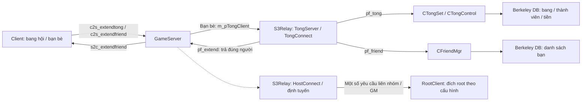

TÓM TẮT 1: [NGUỒN][THẤY] Đã khảo sát 14/14 mục bang hội, bạn bè và root trong mã S3Relay; bàn giao PARTIAL vì tệp NHỊP ngoài sandbox chưa ghi được (R/TongConnect.cpp:72–105; lỗi thao tác tại mục 10).
TÓM TẮT 2: [NGUỒN][THẤY] Bang hội có RAM và ba bảng Berkeley DB; bảng bạn bè lấy đường dẫn/tên từ cấu hình, chưa xác nhận nơi lưu runtime (R/TONGDB.CPP:41–55; R/FriendMgr.cpp:26–49).
TÓM TẮT 3: [NGUỒN][THẤY] Lỗi root không làm nhánh khởi tạo dừng ngay; một số đường liên nhóm cần root, trong khi kết bạn được xử lý qua TongServer (R/Global.cpp:408–422,515; R/HostConnect.cpp:389–405; R/TongConnect.cpp:866–925).
TÓM TẮT 4: [CHƯA KIỂM] “7777 không có tiến trình nghe” là tiền đề task, chưa đo; chưa đối chiếu giá trị số RELAY_ROUTE_PORT và binary triển khai (JX1_OPS/TASKS/HG2-08.md:19; R/Global.h:29; R/Global.cpp:411).
TÓM TẮT 5: [NGUỒN] Không build, chạy exe/VM hay thử mạng; không commit/push theo yêu cầu. Tổng quan nhận tài liệu local để commit hộ, PM xử lý quyền ghi NHỊP; phạm vi chỉ đọc theo JX1_OPS/TASKS/HG2-08.md:17.

# HG2-08 — Bang hội và bạn bè trong S3Relay

Loại: khảo sát
Chủ đề: Cấu trúc dữ liệu, gói tin, nơi lưu bang hội/bạn bè và ảnh hưởng có điều kiện khi không kết nối được root.
Từ khóa: bang hội, bạn bè, S3Relay, TongServer, FriendMgr, Berkeley DB, pf_tong, pf_friend, root, 7777
Trạng thái: PARTIAL — nội dung khảo sát tĩnh hoàn tất; yêu cầu ghi NHỊP bị sandbox chặn.
Độ phủ: 14 trên tổng 14 mục khảo sát tĩnh; chưa ghi được tệp NHỊP bắt buộc. Đã phủ không có nghĩa kiểm hết mọi hàm/gói hoặc xác nhận runtime.
Liên quan: JX1_OPS/TASKS/HG2-08.md; JX1_OPS/DESIGN/CHUAN-BAO-CAO.md; JX1_OPS/DESIGN/MUC-LUC-TRI-THUC.md.
Cần tôi quyết định: có — PM/chủ workspace xử lý vùng ghi NHỊP nếu cần hoàn tất điều kiện hành chính; chưa đề nghị đổi cấu hình game.

## 1. Nguồn và phương pháp

Ngày nhiệm vụ: 19/11/2026. Đã kiểm worktree `D:\JX-wt\HG2-08`, nhánh `task/HG2-08`; lúc bắt đầu Git sạch và chưa có báo cáo HG2-08. Nguồn chỉ đọc được định vị từ gốc đã có trong bối cảnh dự án; không sửa bản nguồn.

| Bí danh trích dẫn | Gốc nguồn thật |
|---|---|
| `R/` | `C:\Jx1CocoV3\SwordOnline\SwordOnline\jxOnline\gateway\Sources\MultiServer\S3Relay\` |
| `S/` | `C:\Jx1CocoV3\SwordOnline\SwordOnline\jxOnline\gameserver\Sources\` |
| `C/` | `C:\Jx1CocoV3\Folder\Client2912-20260116T044348Z-3-001\Client2912\Client\Classes\` |

Danh sách nguồn dùng làm bằng chứng, rút từ ba cây nguồn ở `JX1_OPS/TASKS/HG2-08.md:21`:

- Bang hội: `R/KTongSet.h/.cpp`, `R/KTongControl.h`, `R/TONGDB.H/.CPP`, `R/DBTable.h/.cpp`.
- Bạn bè/đầu nhận: `R/FriendMgr.h/.cpp`, `R/TongConnect.cpp`, `R/TongServer.cpp`, `R/HostConnect.cpp`.
- Root: `R/Global.h/.cpp`, `R/RootClient.cpp`.
- Gameserver: `S/MultiServer/GameServer/KSOServer.cpp`, `S/Core/Src/KNewProtocolProcess.cpp`.
- Client: `C/gamecore/KRelayProtocol.h`, `C/gamecore/KTongProtocol.h`, `C/gamecore/KPlayer.cpp`, `C/gamecore/KPlayerTong.cpp`, `C/gamecore/KProtocolProcess.cpp`, `C/gameui/KuiTongCreateSheet.cpp`.

`[THẤY]` = thấy trực tiếp ở mã/đầu ra thao tác, chỉ xác minh tĩnh. `[TÀI LIỆU]` = task hoặc chú thích, chưa nâng thành hành vi chạy. `[CHƯA KIỂM]` = chưa đủ bằng chứng trong phạm vi. Suy luận từ nhánh mã được ghi rõ. Bản đồ/Graphify chỉ định vị, không thay mã thật.

Mã hóa: phần Hán trong header relay và `C/gamecore/KTongProtocol.h` đọc bằng GBK/CP936. `C/gamecore/KPlayer.cpp`, `C/gamecore/KPlayerTong.cpp`, `S/MultiServer/GameServer/KSOServer.cpp` vượt kiểm tra UTF-8 nghiêm ngặt. `C/gamecore/KProtocolProcess.cpp`, `C/gameui/KuiTongCreateSheet.cpp` không vượt kiểm tra toàn tệp dù có đoạn UTF-8 đọc được: ghi nhận dấu hiệu trộn/lỗi mã hóa, chưa xác nhận mọi chuỗi UI. Số dòng đã chốt theo byte LF để tránh lệch khi giải mã sai bảng mã; không chuẩn hóa lại nguồn.

## 2. Sơ đồ quan hệ chính



[THẤY] Các cạnh bạn bè: `C/gamecore/KPlayer.cpp:2624–2639`; `S/MultiServer/GameServer/KSOServer.cpp:3610–3622,3659–3688,1721–1743`; `R/TongConnect.cpp:79–105,117–140`. Bang hội tại relay: `R/TongConnect.cpp:512–574`; chỉ đối chiếu điểm đầu client và điểm nhận relay, chưa lần hết bộ chuyển đổi yêu cầu tạo bang ở GS. Root: `R/HostConnect.cpp:389–405,427–445`.

## 3. Phạm vi và độ phủ — 14 mục

| STT | Phần tử theo cấu trúc game | Độ phủ | Kết quả và bằng chứng |
|---|---|---|---|
| 1 | Bang hội: thao tác client | Đã phủ điểm đầu | [THẤY] UI gọi `TongOperation(GTOI_TONG_CREATE)`; gamecore tạo `TONG_APPLY_CREATE_COMMAND`, bọc `c2s_extendtong` (`C/gameui/KuiTongCreateSheet.cpp:324–339`; `C/gamecore/KPlayerTong.cpp:160–168`). |
| 2 | Bang hội: bộ quản lý RAM | Đã phủ cấu trúc | [THẤY] `CTongSet` giữ mảng con trỏ `CTongControl`, nhân đôi khi hết chỗ; 100 không phải trần cứng số bang (`R/KTongSet.h:14,33–34`; `R/KTongSet.cpp:360–380`). |
| 3 | Bang hội: từng bang/thành viên | Đã phủ cấu trúc | [THẤY] Có ID/tên bang, phe, tiền, cấp, bản đồ, thống kê, bang chủ, mảng chức vụ và `STONG_MEMBER*`; thành viên có ID/tên, điểm/cấp (`R/KTongControl.h:13–19,43–95`). |
| 4 | Bang hội: bản ghi lưu | Đã phủ cấu trúc | [THẤY] `TTongStruct`, `TMemberStruct`, `TMoneyStruct` tách dữ liệu bang, người, tiền; thành viên ghi tên bang, chức vụ, chỉ số, điểm/cấp (`R/TONGDB.H:26–64`). |
| 5 | Bang hội: gói tạo/gia nhập | Đã phủ hai thao tác | [THẤY] `Proc0_Tong` kiểm ID/chiều dài, gọi `Create`/`AddMember`, trả gói thành công/thất bại cho GS (`R/TongConnect.cpp:484–602`). |
| 6 | Bang hội: ghi/nạp lại | Đã phủ đường chính | [THẤY] Tạo bang gọi ghi bang và bang chủ; khởi tạo gọi `Open`, `InitFromDB`, nạp danh sách/chi tiết (`R/KTongSet.cpp:394–409,1234–1253,1271–1302`; `R/Global.cpp:502–513`). |
| 7 | Bang hội: nơi lưu | Đã phủ tên logic | [THẤY] Ba cặp môi trường/bảng `TongDB/TongTable`, `TongMemberDB/MemberTable`, `TongMoneyDB/MoneyTable`; chỉ mục thành viên theo tên bang (`R/TONGDB.CPP:41–55`). |
| 8 | Bạn bè: mô hình RAM | Đã phủ cấu trúc | [THẤY] `PLAYERSMAP` theo tên người; mỗi `PLAYERINFO` có `loaded`, `dirty`, bản đồ tên bạn → nhóm (`R/FriendMgr.h:48–69`). |
| 9 | Bạn bè: xin kết bạn/chấp nhận | Đã phủ đường chính | [THẤY] Tra người gửi/nhận qua TongServer, theo dõi yêu cầu bằng `pckgid`; không chuyển được trả `answerUnable`; chấp nhận gọi `PlayerAddFriend` (`R/TongConnect.cpp:866–977`). |
| 10 | Bạn bè: nhóm/xóa | Đã phủ đầu xử lý | [THẤY] Có bộ xử lý phân nhóm, xóa; xóa gọi `PlayerDelFriend`; thêm bạn tạo liên kết RAM hai chiều ở nhóm `friend` (`R/TongConnect.cpp:982–1015,1077–1089`; `R/FriendMgr.cpp:509–525`). |
| 11 | Bạn bè: danh sách/trạng thái | Đã phủ đường chính | [THẤY] Login nạp người, thông báo online; logout thông báo offline; danh sách gồm nhóm, tên, trạng thái tra qua TongServer (`R/FriendMgr.cpp:141–216,310–367,387–450`; `R/HostConnect.cpp:108,133`). |
| 12 | Bạn bè: DB/lịch ghi | Đã phủ định dạng | [THẤY] Khóa là tên nhân vật; dữ liệu gồm số bạn và cặp tên/nhóm có độ dài byte; có ghi nền và ghi khi `Uninitialize` (`R/FriendMgr.h:118–137`; `R/FriendMgr.cpp:100–134,958–1069,1073–1076,1242–1252`). |
| 13 | Bạn bè: GS ↔ client | Đã phủ điểm chuyển gói | [THẤY] GS chọn `m_pTongClient`, gắn người gửi; chiều về kiểm ID, bọc `s2c_extendfriend`; client gọi `AddList`/`SyncState` (`S/MultiServer/GameServer/KSOServer.cpp:3621,3659–3688,1728–1743`; `C/gamecore/KProtocolProcess.cpp:4368–4379,4430–4467`). |
| 14 | Root: khởi tạo/định tuyến | Đã phủ nhánh liên quan | [THẤY] RootClient kết nối tới đích cấu hình; lỗi không dừng ngay; khối retry root bị chú thích; có nhánh liên nhóm/GM cần root (`R/Global.cpp:408–422,515,911–931`; `R/HostConnect.cpp:389–405,427–445`). |

Ngoài độ phủ: [CHƯA KIỂM] runtime, toàn bộ chiến bang, mọi ID giao thức, tương thích layout giữa binary/source và mọi chức danh cấu hình thật. Không mở các header mà `R/Global.h:29–35` dẫn ra ngoài hai cây `Sources` cho phép.

## 4. Giải mã tên

Không có tên riêng cụ thể của kỹ năng, trang bị, quái, NPC hay bản đồ trong kết quả này. Bảng giữ chữ Hán gốc của các thuật ngữ game; byte biểu diễn tính bằng GBK/CP936, không thay chữ trong nguồn. ID kỹ thuật/tên bảng DB là ASCII, giữ nguyên.

| Tên gốc | Mã hóa / byte hex | Chữ đúng UTF-8 và nghĩa Việt | Nguồn file:dòng |
|---|---|---|---|
| 帮会 | GBK: `B0 EF BB E1` | 帮会 — bang hội | `R/KTongControl.h:23,59` |
| 帮主 | GBK: `B0 EF D6 F7` | 帮主 — bang chủ | `R/KTongControl.h:63–65` |
| 长老 | GBK: `B3 A4 C0 CF` | 长老 — trưởng lão | `R/KTongControl.h:53,70` |
| 队长 | GBK: `B6 D3 B3 A4` | 队长 — đội trưởng | `R/KTongControl.h:54,78` |
| 帮众 | GBK: `B0 EF D6 DA` | 帮众 — bang chúng/thành viên thường | `R/KTongControl.h:55,89` |
| 好友 | GBK: `BA C3 D3 D1` | 好友 — hảo hữu/bạn bè | `C/gamecore/KTongProtocol.h:100–108` |
| 朋友 | GBK: `C5 F3 D3 D1` | 朋友 — bạn bè | `R/TongConnect.cpp:853` |

[CHƯA KIỂM] Chưa có mẫu tên Việt cũ TCVN3 cần giải mã trong phần trích; chưa kiểm mọi chuỗi client. Tên hiển thị chức vụ được lấy từ `tongsettings.ini`, chưa đọc cấu hình đang dùng (`R/KTongSet.cpp:26–44`).

## 5. Sắp theo cấu trúc game và diễn giải

### 5.1. Bang hội → chức vụ → thành viên → nơi lưu

[THẤY] Bang chủ, mảng trưởng lão/đội trưởng rồi danh sách thành viên thường được khai báo tách nhau. `STONG_MEMBER` giữ tên/ID, điểm/cấp; không suy giới hạn người/bang từ kích thước mảng con trỏ bang (`R/KTongControl.h:13–19,63–89`; `R/KTongSet.cpp:360–380`).

[THẤY] `ZDBTable` mở môi trường theo `path`, bảng chính theo `name`, kiểu `DB_BTREE`; tên không tự có đuôi `.db`, chỉ mục phụ đặt `<tên bảng>.<chỉ số>`. Đường dẫn bang là tương đối nên vị trí tuyệt đối phụ thuộc thư mục làm việc của tiến trình; chưa kiểm runtime (`R/DBTable.cpp:23–49,69–83`; `R/TONGDB.CPP:43–55`).

[THẤY] Ghi bang theo khóa tên bang, thành viên theo tên nhân vật và có chỉ mục tên bang; `ChangeMoney` ghi riêng theo tên bang. `TTongStruct` cũng có trường tiền, nên không tuyên bố bảng tiền riêng là nguồn duy nhất của mọi thao tác tiền (`R/TONGDB.CPP:119–150,343–358`; `R/TONGDB.H:28–29,60–64`).

[THẤY] Hai con số 100 và 300 thuộc hai cấu trúc khác nhau: cấp phát con trỏ bang và mảng danh sách trong DB. Tạo bang có nhánh nhân đôi; chưa thử giới hạn nạp lại/biên 300, không coi đây là giới hạn vận hành đã đo (`R/KTongSet.h:14`; `R/KTongSet.cpp:360–380`; `R/TONGDB.H:14,87`).

### 5.2. Bạn bè → nhóm → trạng thái → nơi lưu

[THẤY] Client bọc `ASK_ADDFRIEND_CMD` trong `tagExtendProtoHeader`, đặt `pf_friend`, ID xin kết bạn và tên người nhận. GS chọn đường Tong cho `c2s_extendfriend`, khác `c2s_extend` qua transfer (`C/gamecore/KPlayer.cpp:2624–2639`; `S/MultiServer/GameServer/KSOServer.cpp:3610–3622`).

[THẤY] Relay kiểm người gửi bằng phần GS gắn thêm, tìm người nhận trong các kết nối Tong của relay, gửi lời mời và nhận phản hồi. `PlayerAddFriend` thêm hai phía ở nhóm `friend`; các nhánh `cheating/pCheated` nằm trong chú thích không được tính là logic hoạt động (`R/TongConnect.cpp:866–977`; `R/TongServer.cpp:139–159`; `R/FriendMgr.cpp:509–529`).

[THẤY] Nơi lưu bạn bè lấy từ `[database] path/file` trong `relay_friendcfg.ini`; khởi tạo đối tượng đọc/ghi và đọc riêng. Không ghi một tên tệp bạn bè cố định cho bản đang chạy vì chưa đọc cấu hình/data runtime (`R/FriendMgr.cpp:26–49,61–70`; `R/FriendMgr.h:105–107`).

[THẤY] Khóa DB là tên người; bản ghi có `BYTE count` rồi các tên bạn/nhóm có tiền tố độ dài `BYTE`. Chưa xác minh tương thích binary và biên độ dài trên dữ liệu thật (`R/FriendMgr.h:118–137`; `R/FriendMgr.cpp:958–960,980–1069`).

[THẤY] Ghi nền phụ thuộc `updateinterval`, `storeplayerperudtdb`; hàm nền thoát sớm khi hạn mức ghi bằng 0. Dừng bình thường gọi `_StoreSomeone` trong `Uninitialize`; logout riêng có lệnh ghi bị chú thích. Không kết luận kết bạn/logout đồng nghĩa đã ghi bền ngay. Có cờ `DB_TXN_NOSYNC`, chưa thử mất điện/dừng đột ngột (`R/FriendMgr.cpp:83–94,100–134,374–375,884–954,1073–1076,1242–1252`; `R/DBTable.cpp:44–47`).

### 5.3. Bảng 8 nhóm gói liên quan

| Tính năng | Gói/lớp bọc | Nội dung và bằng chứng |
|---|---|---|
| Định danh | `EXTEND_HEADER` | [THẤY] Hai trường `BYTE`: family, ID; header client không chứng minh mọi header server giống hệt (`C/gamecore/KRelayProtocol.h:14–35`; `R/TongConnect.cpp:77–105`). |
| Tạo bang | `STONG_CREATE_COMMAND`; `enumC2S_TONG_CREATE` | [THẤY] Phe, cấp, tên người/bang, ID/tham số trả; trả create success/fail (`R/TongConnect.cpp:512–554`). |
| Gia nhập | `STONG_ADD_MEMBER_COMMAND` | [THẤY] Tên bang/người, cấp; trả add-member success/fail (`R/TongConnect.cpp:561–602`). |
| Kết bạn | `ASK_ADDFRIEND_CMD`; `REP_ADDFRIEND_CMD/SYNC` | [THẤY] `pckgid`, tên đối tượng, đồng ý/từ chối/không thực hiện được (`C/gamecore/KTongProtocol.h:130–153`; `R/TongConnect.cpp:866–977`). |
| Nhóm/xóa | `GROUP_FRIEND`; `ERASE_FRIEND` | [THẤY] Chuỗi thẻ nhóm/người hoặc một tên bạn cần xóa (`C/gamecore/KTongProtocol.h:158–172`; `R/TongConnect.cpp:982–1015,1077–1089`). |
| Danh sách | `ASK_SYNCFRIENDLIST`; `REP_SYNCFRIENDLIST` | [THẤY] `pckgid`, cờ `full`, nhóm/tên/trạng thái; bộ lọc bỏ offline khi `!full` ở relay bị chú thích (`C/gamecore/KTongProtocol.h:184–197`; `R/FriendMgr.cpp:424–450`). |
| Trạng thái | `FRIEND_STATE` | [THẤY] Online/offline và chuỗi tên; client gọi `SyncState` (`C/gamecore/KTongProtocol.h:200–205`; `R/FriendMgr.cpp:213–220,331–338`; `C/gamecore/KProtocolProcess.cpp:4464–4467`). |
| Trả đúng người | `EXTEND_PASSTOSOMEONE` / `s2c_extendfriend` | [THẤY] Tham số kết nối, ID tên, độ dài; GS kiểm người nhận rồi bọc về client (`R/TongConnect.cpp:117–140`; `S/MultiServer/GameServer/KSOServer.cpp:1728–1743`). |

## 6. Root 7777 không có tiến trình nghe: ảnh hưởng gì?

[TÀI LIỆU] Số **7777** và nhận định “không có tiến trình nghe” đến từ task, chưa phải phép đo (`JX1_OPS/TASKS/HG2-08.md:19`). [THẤY] Mã dùng `RELAY_ROUTE_PORT`, lấy địa chỉ root từ cấu hình và gọi `g_RootClient.Startup`: kết nối đi ra, khác `g_TongServer.Startup` mở dịch vụ riêng. Chưa mở định nghĩa số ở header dẫn ngoài phạm vi (`R/Global.cpp:408–422,471–481`; `R/Global.h:29`).

| Điều kiện | Ảnh hưởng và mức chắc | Bằng chứng |
|---|---|---|
| Chỉ không thấy listener 7777 trên máy relay | [THẤY, suy luận tĩnh] Chưa đủ kết luận lỗi: phải biết có đúng đích root cấu hình không; nhánh này dùng vai trò client | `R/Global.cpp:408–418` |
| Không kết nối được đúng đích root | [THẤY] Ghi lỗi, gọi `gOnOneClientClose(oneclient_root)`, chạy tiếp; cuối `gInitialize` có `return TRUE`. Không chứng minh các bước khác chắc chắn thành công | `R/Global.cpp:418–422,425–513,515` |
| Bang hội/DB tại cùng relay | [THẤY, suy luận tĩnh] Các đường tạo/ghi/nạp đã đọc không yêu cầu root; thiếu root không tự chứng minh bang hội hỏng. Vẫn cần Tong, DB, GS và điều kiện riêng | `R/TongConnect.cpp:512–574`; `R/KTongSet.cpp:394–409`; `R/Global.cpp:502–513` |
| Bạn bè giữa GS cùng nối vào relay này | [THẤY, suy luận tĩnh] Tra và trả qua TongServer; không tìm thấy người nhận thì trả `answerUnable`, không tự tìm sang root trong đường này | `R/TongServer.cpp:139–159`; `R/TongConnect.cpp:117–140,887–925` |
| Tìm đường tài khoản ở nhóm khác | [THẤY] Chỉ gửi root nếu `IsReady`; nếu không thì phản hồi mất đường. Không quy chụp nhánh này cho mọi gói bạn bè | `R/HostConnect.cpp:389–405` |
| Tìm đường GM | [THẤY] Gửi qua root khi sẵn sàng; nếu không rơi vào nhánh mất đường | `R/HostConnect.cpp:427–445` |
| Nối relay ngang hàng theo thông tin root | [THẤY] `s2c_gatewayinfo` từ root là một đường gọi `gConnectToSibling`; mất root thì không nhận thông tin qua đường đó. Chưa kết luận mọi cách nối ngang hàng đều bị khóa | `R/RootClient.cpp:182–202` |
| Root xuất hiện lại sau lỗi đầu | [THẤY] Có timer theo `retryinterval`, nhưng thân thử gọi `Startup` cho root trong `gReOneClient` nằm trong `/* ... */`; không báo tự phục hồi root đã hoạt động | `R/Global.cpp:849–861,911–931` |

**[THẤY, suy luận tĩnh] Thiếu kết nối root ảnh hưởng các nhánh định tuyến cần root; chưa có căn cứ nói toàn bộ bang hội/bạn bè mất chức năng.** Kết luận chỉ cho những nhánh đã dẫn, không phải kết quả thử chạy. [CHƯA KIỂM] Listener, địa chỉ/cổng thật, tình trạng kết nối, liên cụm và khả năng phục hồi của binary triển khai.

## 7. Mục sổ thông số

| Nhóm | Tên/hằng số | file:dòng | Giá trị | Đơn vị | Ảnh hưởng | Đổi an toàn | Nguồn đo |
|---|---|---|---|---|---|---|---|
| Root | `RELAY_ROUTE_PORT` | `R/Global.cpp:411`; `JX1_OPS/TASKS/HG2-08.md:19` | Macro; task gọi 7777, chưa kiểm định nghĩa số | Cổng | Đích RootClient | CẨN THẬN | Đọc tĩnh; 7777 là tài liệu, chưa đo |
| Tong | `m_nTongPort` | `S/MultiServer/GameServer/KSOServer.cpp:308,736` | Mặc định 5005, `[Tong] Port` có thể ghi đè | Cổng | GS → Tong | CẨN THẬN | [THẤY] mặc định source, chưa đọc cấu hình thật |
| Bang | `defTONG_SET_INIT_POINT_NUM` | `R/KTongSet.h:14`; `R/KTongSet.cpp:60–61,377` | 100 khởi đầu, nhân đôi khi hết | Con trỏ | Dung lượng mảng RAM | CẨN THẬN | [THẤY] tĩnh, không phải trần bang |
| Bang | `MAX_TONG_COUNT` | `R/TONGDB.H:14,87` | 300 | Phần tử `TTongList` | Mảng danh sách DB | CẨN THẬN | [THẤY] khai báo, chưa thử biên |
| Bạn bè | `updateinterval` | `R/FriendMgr.cpp:86–94`; `R/Global.cpp:994–1003` | Mặc định đọc 0; chỉ đặt timer nếu > 0 | ms theo API `SetTimer` | Nhịp ghi nền | CẨN THẬN | [THẤY] tĩnh, chưa đo giá trị chạy |
| Bạn bè | `storeplayerperudtdb` | `R/FriendMgr.cpp:83,1073–1076` | Mặc định 0; 0 thoát hàm ghi nền | Người/lượt theo tên hạn mức | Khối lượng ghi; chưa thử chính xác biên vòng lặp | CẨN THẬN | [THẤY] tĩnh, chưa đo |
| Bạn bè | `DB_FRIENDRECORDLIST.count` | `R/FriendMgr.h:132–136`; `R/FriendMgr.cpp:1034–1035` | `BYTE` | Trường đếm | Định dạng lưu, chưa xác nhận ràng buộc số bạn | KHÔNG đổi riêng lẻ | [THẤY] cấu trúc, chưa thử tương thích |
| Bạn bè | Trạng thái | `C/gamecore/KTongProtocol.h:200–205` | `stateOffline=0`, `stateOnline=1` theo enum | Mã | Cập nhật trạng thái client | KHÔNG đổi riêng lẻ | [THẤY] header, chưa đối chiếu mọi binary |

Mức đánh giá không cấp quyền sửa; không có số đo hiệu năng hoặc giá trị cấu hình triển khai trong báo cáo.

## 8. Đề xuất tối ưu / bước kiểm tiếp

1. [THẤY → đề xuất] PM đối chiếu định nghĩa số `RELAY_ROUTE_PORT` khi phạm vi đọc được mở rộng; xác định đúng đích trước khi diễn giải listener (`R/Global.h:29`; `R/Global.cpp:408–418`).
2. [THẤY → đề xuất] Mở task riêng đánh giá chủ đích vô hiệu hóa retry root, không tự bỏ chú thích trong khảo sát này (`R/Global.cpp:911–931`).
3. [THẤY → đề xuất] Khi được duyệt, tách ca bang/bạn cùng relay, liên nhóm, mất root rồi phục hồi, đọc lại DB sau dừng bình thường; chưa đặt số hiệu năng hoặc báo test đạt (`R/TongConnect.cpp:866–977`; `R/HostConnect.cpp:389–405`; `R/FriendMgr.cpp:100–134`).
4. [THẤY → đề xuất] Kiểm cấu hình ghi nền và độ bền DB trước khi đổi tần suất; chưa đề xuất số mới (`R/FriendMgr.cpp:83–94,1073–1076`; `R/DBTable.cpp:44–47`).

## 9. Đã xác minh / Chưa xác minh

### ĐÃ XÁC MINH

- [THẤY] Cấu trúc bang/thành viên, bạn bè, ba bảng bang, cấu hình bảng bạn và các điểm bọc/giải bọc bạn bè; bằng chứng từng phần tại bảng 14 mục và mục 5.
- [THẤY] Các nhánh root thất bại, mất đường, khối retry bị chú thích; bằng chứng mục 6.
- [THẤY] Đã thực chạy đọc tệp/tìm chuỗi, kiểm Git, kiểm giải mã UTF-8 nghiêm ngặt, chốt số dòng LF, tính byte GBK và kiểm tra tài liệu đầu ra. Đây là kiểm tĩnh, không phải test game.

### CHƯA XÁC MINH

- [CHƯA KIỂM] Build, exe/DLL, VM, mạng, listener, kết nối dịch vụ: không chạy theo giới hạn task (`JX1_OPS/TASKS/HG2-08.md:17`).
- [CHƯA KIỂM] Định nghĩa số `RELAY_ROUTE_PORT`, đường DB tuyệt đối lúc chạy, cấu hình ghi nền/data thật, binary triển khai, mọi giới hạn biên.
- [CHƯA KIỂM] Toàn bộ chuyển đổi bang tại GS, chiến bang và tương thích mọi ID/layout client/server; không suy từ các điểm nối đã đọc.
- [THẤY — bị chặn] Không ghi được `D:\JX-wt\HG2-08.nhip`; không có bằng chứng các mốc NHỊP đã lưu, xem mục 10.

## 10. Lỗi, cách thử và phát hiện khi chuẩn hóa

| Việc/phát hiện | Cách thử và kết quả thật | Xử lý/giới hạn |
|---|---|---|
| Không có `rg` | Tìm chuỗi trả `The term 'rg' is not recognized` | Chuyển sang `Select-String`/đọc đoạn giới hạn, không cài |
| Nguồn tương đối thiếu trong worktree báo cáo | `Test-Path` các đường `Folder/...`, `SwordOnline/.../Sources` tương đối trả False | Định vị gốc đã có trong bối cảnh; chỉ đọc tệp liên quan trong ba cây nguồn task |
| NHỊP ngoài vùng writable | `WriteAllText` tới `D:\JX-wt\HG2-08.nhip` trả `Access to the path 'D:\JX-wt\HG2-08.nhip' is denied.` | Không đổi quyền, không ghi vòng, không lặp ghi mù. Mốc tiến độ thông báo trong hội thoại; tệp NHỊP chưa ghi được |
| Mã hóa không đồng nhất | Kiểm UTF-8 nghiêm ngặt và đối chiếu đoạn Hán; có tệp UTF-8, có tệp trộn/lỗi | Chốt số dòng LF; chỉ giải mã GBK ở đoạn có căn cứ, không sửa nguồn |
| Lần ghi báo cáo đầu không áp dụng | `apply_patch` báo không tìm được mốc `## task/HG2-08`; đọc lại xác nhận báo cáo chưa tồn tại và task chưa bị ghi dở | Mốc nhầm là dòng trạng thái nhánh; tách tạo báo cáo và nối kết quả cuối task, không ghi đè nội dung cũ |
| Kiểm diff phát hiện CR cuối dòng phần nối task | `git diff --check` lần đầu trả 2 vì các dòng CRLF mới bị coi là trailing whitespace, dù không có dấu cách/tab cuối dòng | Chỉ đổi xuống dòng của phần `Kết quả` mới sang LF; đối chiếu tiền tố task cũ không đổi. Chạy lại `git diff --check` trả 0; báo cáo UTF-8 không BOM, 5 dòng tóm tắt, 14 mục phạm vi, 8 nhóm gói, 1 Mermaid |
| Chưa có báo cáo HG2-08 cũ | Kiểm tồn tại đầu lượt: không có tệp | Tạo mới, không thay kết luận cũ; không tạo `_CHIMUC` ngoài vùng giao, đề xuất hàng trong mục 11 |
| Chú thích khác mã hoạt động | Retry root, ghi bạn khi logout bị chú thích; mảng bang có nhánh tăng | Nêu riêng, không khôi phục mã hoặc suy runtime (`R/Global.cpp:914–928`; `R/FriendMgr.cpp:374–375`; `R/KTongSet.cpp:360–380`) |

## 11. Bàn giao

- **PARTIAL** toàn yêu cầu: khảo sát tĩnh hoàn tất, bảng phạm vi 14 mục và bảng gói 8 mục; điều kiện ghi NHỊP bị sandbox chặn.
- Đầu ra `JX1_OPS/REPORTS/HG2-08.md`; nối riêng mục `Kết quả` cuối `JX1_OPS/TASKS/HG2-08.md` theo yêu cầu trực tiếp. Không đổi frontmatter task, mã nguồn/cấu hình game.
- Không stage/commit/push theo yêu cầu; **chưa có SHA mới**. Tổng quan nhận tài liệu local để commit hộ; đây không phải lỗi Git/push.
- PM/chủ workspace xử lý NHỊP trong vùng được phép; đối chiếu header cổng và mở ca kiểm runtime riêng nếu cần. Task này không cấp quyền chạy các ca đó.
- Hàng chỉ mục đề xuất cho mục lục/bảng gộp của PM, chưa ghi sang tệp khác:

```tsv
file	loại	chủ đề	từ khóa	trạng thái	độ phủ	liên quan
JX1_OPS/REPORTS/HG2-08.md	khảo sát	Bang hội/bạn bè trong S3Relay và root	bang hội, bạn bè, S3Relay, TongServer, FriendMgr, Berkeley DB, root, 7777	PARTIAL: NHỊP bị sandbox chặn	14/14 mục tĩnh; chưa kiểm runtime	JX1_OPS/TASKS/HG2-08.md; JX1_OPS/DESIGN/CHUAN-BAO-CAO.md
```

Kỹ năng đã dùng: jx1-retrofit (khuôn/giữ kết luận cũ; không mở rộng vùng ghi chỉ mục), jx1-read-server, jx1-read-client, jx1-parameters, jx1-knowledge, jx1-report. Đã nạp sáu `SKILL.md` trong `.agents/skills` của worktree; chỉ thị trực tiếp của người giao ưu tiên hơn thao tác commit/tạo tệp ngoài vùng giao trong skill.
