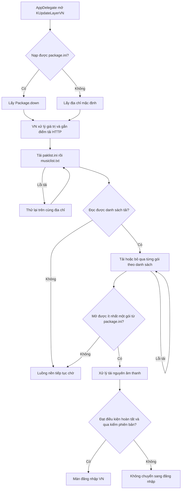

TÓM TẮT 1 [NGUỒN][THẤY] Khảo sát tĩnh DONE, phủ 13/13 mục của luồng cập nhật. Bản Client2912 chọn màn VN và dùng bộ tải chung. `Classes/AppDelegate.cpp:183`, `Classes/vn/gamescence/KUpdateLayerVN.h:24`.
TÓM TẮT 2 [NGUỒN][THẤY] Client chọn một địa chỉ từ `[Package] down`. Chỉ khi không nạp được `package.ini` mới dùng `ERROR_OUT_STR`. Các vòng tải lại giữ địa chỉ đã chọn. `Classes/vn/gamescence/KUpdateLayerVN.cpp:260–302`, `Classes/gamescene/KUpdateLayer.cpp:963–1029`.
TÓM TẮT 3 [NGUỒN][TÀI LIỆU] Mẫu `paklist.ini` liệt kê 32 gói tải. Mẫu `package.ini` liệt kê 34 gói để mở cục bộ, trong đó hai gói chỉ có mặt ở danh sách mở. `Resources/paklist.ini:1–70`, `Resources/package.ini:1–37`.
TÓM TẮT 4 [NGUỒN][THẤY] Vòng tải có thể thử lại mãi khi lỗi kéo dài. Khi không đọc được danh sách tải hoặc không mở được gói cục bộ nào, luồng tải nền thiếu trạng thái để đi tiếp. `Classes/gamescene/KUpdateLayer.cpp:762–839`, `Classes/gamescene/KUpdateLayer.cpp:963–1129`.
TÓM TẮT 5 [CHƯA KIỂM] Chưa build, chạy exe, chạy VM, thử client hay kết nối mạng. Chưa xác nhận lỗi thực tế, địa chỉ đang phục vụ hoặc thời gian tải. Bàn giao tài liệu trong worktree để Tổng quan commit.

# HG2-09 — Tải dữ liệu client và nguyên nhân kẹt màn cập nhật

- Loại: khảo sát
- Chủ đề: Client chọn địa chỉ tải, lấy danh sách gói và mở dữ liệu cục bộ trước khi vào màn đăng nhập.
- Từ khóa: HG2-09, màn cập nhật, tải nối tiếp, CDN, paklist.ini, package.ini, KUpdateLayer, KUpdateLayerVN, KDownLoadFile
- Trạng thái: DONE (đã đối chiếu tĩnh 13 mục theo tiêu chí task)
- Độ phủ: đã phủ 13 trên tổng 13 mục luồng client, gồm ba tệp C++ đích
- Liên quan: [Task HG2-09](../TASKS/HG2-09.md), [Chuẩn báo cáo](../DESIGN/CHUAN-BAO-CAO.md), [Mục lục tri thức](../DESIGN/MUC-LUC-TRI-THUC.md)
- Cần tôi quyết định: không



## Phạm vi và độ phủ

`Classes/` và `Resources/` bên dưới tính từ `Folder/Client2912-20260116T044348Z-3-001/Client2912/Client/`. `[THẤY]` là mã đã đọc trực tiếp. `[TÀI LIỆU]` là tệp mẫu đi kèm. `[CHƯA KIỂM]` là hành vi chưa xác nhận khi chạy.

| # | Mục theo luồng client | Độ phủ | Kết quả và bằng chứng |
|---|---|---|---|
| 1 | Chọn màn cập nhật | Đã phủ | [THẤY] `AppDelegate` chạy `KUpdateLayerVN::scene()`. Lớp VN chỉ ghi đè `init()` và `loadSuccess()`, dùng chung `update()` và `Run()` của lớp gốc. `Classes/AppDelegate.cpp:179–185`, `Classes/vn/gamescence/KUpdateLayerVN.h:24–47`, `Classes/gamescene/KUpdateLayer.cpp:1279–1285`. |
| 2 | Chuẩn bị tệp cấu hình | Đã phủ | [THẤY] Màn VN tạo thư mục `data` theo đường dẫn ghi đã chọn và gọi `copyData("package.ini")`. Hàm lấy tệp qua `FileUtils` rồi mở đích ở chế độ ghi đè. `Classes/vn/gamescence/KUpdateLayerVN.cpp:25–44`, `Classes/vn/gamescence/KUpdateLayerVN.cpp:114–152`, `Classes/gamescene/KUpdateLayer.cpp:629–669`. |
| 3 | Chọn địa chỉ CDN | Đã phủ | [THẤY] VN lấy một giá trị `down` hoặc giá trị mặc định khi nạp INI thất bại, sau đó gọi `SimplyDecrypt` và gắn tiền tố HTTP. Xem bảng chọn địa chỉ bên dưới. `Classes/vn/gamescence/KUpdateLayerVN.cpp:250–302`. |
| 4 | Lấy danh sách tải | Đã phủ | [THẤY] Luồng nền tải `data/paklist.ini` rồi `data/musiclist.txt`. Với mỗi tệp, lượt đầu ghi đè, các lượt sau tắt cờ ghi đè. Dòng tải `paklist_vn.ini` nằm trong chú thích. `Classes/gamescene/KUpdateLayer.cpp:38–40`, `Classes/gamescene/KUpdateLayer.cpp:955–1029`, `Classes/gamescene/KUpdateLayer.h:31`. |
| 5 | Đọc danh sách gói | Đã phủ | [THẤY] `update()` đọc `[list] count`, `isopen` và từng cặp `pak_N` / `pak_N_r`. Nếu không đọc được INI, `count` không dương hoặc không cấp được bộ nhớ, nhánh này thiếu bước chuyển sang `STATE_DWON_LISTDATA`. `Run()` tiếp tục đợi trạng thái đó. `Classes/gamescene/KUpdateLayer.cpp:762–806`, `Classes/gamescene/KUpdateLayer.cpp:1032–1040`. |
| 6 | Chọn gói để tải | Đã phủ | [THẤY] `Run()` duyệt danh sách theo chỉ số. Với `isopen=0`, chỉ nhánh thỏa thêm `isBreak && !isReLoad` mới bỏ qua gói. Cờ `pak_N_r` bật ghi đè ở lần đầu của gói. `Classes/gamescene/KUpdateLayer.cpp:788–798`, `Classes/gamescene/KUpdateLayer.cpp:1050–1083`. |
| 7 | Mở tệp đích và hỏi kích thước | Đã phủ | [THẤY] `DownLoadFile()` mở tệp đích trước, đặt `STATE_NO_FILE` nếu không mở được. Nó hỏi kích thước từ xa bằng yêu cầu không lấy thân, mặc định tối đa 5 giây. Kết quả `-1` hoặc `0` đưa về `STATE_NO_URLFILE`. `Classes/engine/KDownLoadFile.cpp:116–153`, `Classes/engine/KDownLoadFile.cpp:304–354`. |
| 8 | Tải nội dung và tải nối tiếp | Đã phủ | [THẤY] Tệp chưa đủ byte được tải nối tiếp từ độ dài cục bộ khi tắt ghi đè. Tải nội dung thành công trả `STATE_NEXT_FILE`. Nhánh duyệt gói chỉ tăng chỉ số khi nhận `STATE_WANCHENG_FILE`. Ở lượt kế tiếp, bộ tải hỏi lại kích thước và trả trạng thái này nếu độ dài cục bộ dương và bằng hoặc lớn hơn độ dài từ xa. Phép so kích thước không kiểm hàm băm. `Classes/engine/KDownLoadFile.cpp:134–164`, `Classes/engine/KDownLoadFile.cpp:182–209`, `Classes/engine/KDownLoadFile.cpp:253–263`, `Classes/gamescene/KUpdateLayer.cpp:1080–1117`. |
| 9 | Thử lại và hiện cảnh báo | Đã phủ | [THẤY] Các vòng tải danh sách, nhạc và gói đều không có giới hạn lượt. Lỗi khởi tạo bộ tải nội dung, lỗi mở tệp và lỗi kích thước từ xa có các nhánh cảnh báo riêng. Lỗi từ `curl_easy_perform()` ở bước tải nội dung chỉ trả `false` sau khi đặt `STATE_OK_NET`. `Classes/gamescene/KUpdateLayer.cpp:696–759`, `Classes/gamescene/KUpdateLayer.cpp:963–1118`, `Classes/engine/KDownLoadFile.cpp:167–209`. |
| 10 | Mở gói cục bộ | Đã phủ | [THẤY] `KPakList::Open()` đọc `[Package] Path` và các khóa số, trả số gói thực sự mở được. Khi số đó bằng 0, màn cập nhật ở `STATE_LOAD_MUSIC`, còn luồng nền đợi `STATE_DWON_MUSIC`. Chỉ cần một gói mở được để qua bước này. `Classes/engine/KPakList.cpp:136–205`, `Classes/gamescene/KUpdateLayer.cpp:809–839`, `Classes/gamescene/KUpdateLayer.cpp:1120–1129`. |
| 11 | Nạp nhạc và âm thanh | Đã phủ | [THẤY] Sau khi mở gói, client đọc danh sách nhạc và dữ liệu âm thanh. Hai lỗi đọc đầu đặt `STATE_ON_FIEL_UP`, nhưng lần đọc bảng đối tượng thành công có thể ghi đè bằng `STATE_FLS_UP`. Nếu lần đọc bảng đối tượng thất bại, nó đặt `STATE_ON_FIEL_UP`. `Classes/gamescene/KUpdateLayer.cpp:1132–1155`, `Classes/gamescene/KUpdateLayer.cpp:1159–1208`. |
| 12 | Báo tiến độ và hoàn tất | Đã phủ | [THẤY] Phần trăm tổng dùng mẫu số 32. Điều kiện chuyển cảnh lại cần bộ đếm đạt ngưỡng tài nguyên và trạng thái `STATE_NONE_UP`. Khi `STATE_FLS_UP` đến, `update()` nâng bộ đếm nếu còn thiếu rồi đặt `STATE_NONE_UP`. Vì vậy số 100% trên thanh tổng có thể xuất hiện trước khi được chuyển cảnh. `Classes/vn/gamescence/KUpdateLayerVN.cpp:134–137`, `Classes/gamescene/KUpdateLayer.cpp:842–847`, `Classes/gamescene/KUpdateLayer.cpp:896–919`. |
| 13 | Điều kiện vào màn đăng nhập VN | Đã phủ | [THẤY] Android dưới API 25 bị chặn tại `loadSuccess()`. Nhánh Android đủ API và nhánh iOS so `CilentVer/mobilever` trong `xfsverjx.ini` với `CLIENT_UI_PHIENBAN`. Thiếu tệp hoặc lệch phiên bản đều trả `false` và hiện cảnh báo. `Classes/vn/gamescence/KUpdateLayerVN.cpp:364–428`. |

## Giải mã tên

Phạm vi này có tên tệp, gói và chuỗi giao diện. Các định danh dưới đây được giữ nguyên. Chuỗi từ `string_cn.xml` đã ở UTF-8 theo khai báo XML. Hai chú thích Hán từ `KPakList.cpp` được đọc lại bằng GBK (CP936).

| Tên gốc | Mã hóa | Chữ đúng (UTF-8) | Nguồn file:dòng |
|---|---|---|---|
| `package.ini`, `paklist.ini`, `musiclist.txt` | ASCII | Cấu hình mở gói và địa chỉ tải, danh sách gói tải, danh sách nhạc | `Classes/gamescene/KUpdateLayer.cpp:40`, `Classes/gamescene/KUpdateLayer.cpp:217`, `Classes/gamescene/KUpdateLayer.h:31` |
| `package_temp.ini`, `paklist_vn.ini`, `xfsverjx.ini` | ASCII | Cấu hình địa chỉ nhập tay, tên danh sách VN trong chú thích, tệp kiểm phiên bản | `Classes/gamescene/KUpdateLayer.cpp:462`, `Classes/gamescene/KUpdateLayer.cpp:965`, `Classes/vn/gamescence/KUpdateLayerVN.cpp:398` |
| `updata01.pak`, `update10.pak`, `script_skill.pak`, `update_music.pak` | ASCII | Tên gói giữ nguyên, gồm hai gói ví dụ trong danh sách tải và hai gói chỉ có trong danh sách mở mẫu | `Resources/paklist.ini:8`, `Resources/paklist.ini:70`, `Resources/package.ini:4–6` |
| `网络障碍`, `网络障碍或补丁不存在`, `补丁丢失` | UTF-8 | Lỗi kết nối, lỗi kết nối hoặc bản vá không tồn tại, thiếu bản vá | `Resources/string_cn.xml:134–139` |
| `分配内存`, `检测是否能打开PAK包` | GBK (CP936) | Cấp phát bộ nhớ (分配内存), kiểm tra có mở được gói PAK (检测是否能打开PAK包) | `Classes/engine/KPakList.cpp:183`, `Classes/engine/KPakList.cpp:189` |

## Sắp theo cấu trúc game

[TÀI LIỆU] Đây là phần khởi động client. Thứ tự đọc là cấu hình địa chỉ → danh sách tải → mở PAK → nhạc và âm thanh → kiểm phiên bản đăng nhập. Hai danh sách có thứ tự riêng. Chẳng hạn `updata01.pak` đứng đầu danh sách tải mẫu, còn `update10.pak` đứng cuối danh sách tải nhưng ở khóa `1` trong danh sách mở. `script_skill.pak` và `update_music.pak` chỉ có trong danh sách mở mẫu. `Resources/paklist.ini:7–8`, `Resources/paklist.ini:69–70`, `Resources/package.ini:4–12`.

## Thứ tự chọn địa chỉ tải

| Đường đi | Điều kiện và cách chọn | Bằng chứng |
|---|---|---|
| VN, bước khởi tạo | [THẤY] Khi cho phép tải qua mạng, đọc `[Package] down` nếu `KIniFile::Load()` thành công. Chỉ dùng `ERROR_OUT_STR` khi `Load()` trả lỗi. Nhánh đọc `down` không kiểm kết quả riêng của `GetString()`. Cả hai giá trị đi qua `SimplyDecrypt` rồi vào URL gốc HTTP. Các dòng dựng HTTPS nằm trong chú thích. | `Classes/vn/gamescence/KUpdateLayerVN.cpp:250–302` |
| Lớp gốc, bước khởi tạo | [THẤY] Cũng chọn `down` hoặc `ERROR_OUT_STR` theo kết quả nạp INI. Dùng trực tiếp giá trị trong URL gốc HTTP. Dòng gọi `SimplyDecrypt` ở nhánh này là chú thích. | `Classes/gamescene/KUpdateLayer.cpp:337–362` |
| Sau khi tải lỗi | [THẤY] Luồng nền lặp qua `DownLoadFile()` trên cùng `downPtr`. Mỗi URL là địa chỉ gốc cộng tên tệp. `GetInst()` chỉ đặt URL khi tạo đối tượng dùng chung lần đầu, nên gọi lại hàm này không tự đổi đích của đối tượng đang tồn tại. Hai màn cập nhật và bộ tải không có nhánh tự thử CDN thứ hai sau lỗi. | `Classes/gamescene/KUpdateLayer.cpp:963–1029`, `Classes/gamescene/KUpdateLayer.cpp:1059–1118`, `Classes/engine/KDownLoadFile.cpp:16–34`, `Classes/engine/KDownLoadFile.cpp:134–142` |
| Nhập địa chỉ thủ công | [THẤY] `startInPutCallback()` lấy `down` từ `data/package_temp.ini`, dựng URL với cổng cố định, đặt `isOver` và gọi `startload()`. `startload()` bỏ qua nếu đã đặt `isHaveClient`. Callback này không nằm trên đường thử lại tự động. [CHƯA KIỂM] Chưa xác nhận nút gọi callback trong APK. | `Classes/gamescene/KUpdateLayer.cpp:451–475`, `Classes/gamescene/KUpdateLayer.cpp:1279–1287` |

[THẤY] Mã mặc định `_clientNoNetWork=false`. Nếu cờ này được bật trước khởi tạo thì màn VN bỏ qua việc tạo bộ tải. Hàm `update()` cũng trả về sớm khi cờ bật và `isOver` vẫn tắt. `Classes/gamecore/KCore.cpp:124`, `Classes/vn/gamescence/KUpdateLayerVN.cpp:250–303`, `Classes/gamescene/KUpdateLayer.cpp:42–58`, `Classes/gamescene/KUpdateLayer.cpp:684–705`.

[THẤY] Khi thấy cảnh báo VN “Mất kết nối hoặc không đúng phiên bản” trong lúc tải, nhánh tương ứng là `STATE_ON_URLFIEL_UP`. Trạng thái đó đến từ bước hỏi kích thước trả `-1` hoặc `0`. Phép so phiên bản thực sự chạy sau bước mở dữ liệu, trong `loadSuccess()`. `Resources/string_vn.xml:195–196`, `Classes/gamescene/KUpdateLayer.cpp:736–746`, `Classes/gamescene/KUpdateLayer.cpp:977–979`, `Classes/engine/KDownLoadFile.cpp:142–152`, `Classes/vn/gamescence/KUpdateLayerVN.cpp:364–428`.

## Mục sổ thông số

| Nhóm | Tên/hằng số | file:dòng | Giá trị | Đơn vị | Ảnh hưởng | Đổi an toàn | Nguồn đo |
|---|---|---|---|---|---|---|---|
| Mạng | Hỏi kích thước, `CURLOPT_TIMEOUT` | `Classes/engine/KDownLoadFile.cpp:315–322` | 5 | giây mỗi lần gọi | Quá hạn ở bước hỏi kích thước | CẨN THẬN | [THẤY] Đọc tĩnh |
| Mạng | Tải nội dung, `CURLOPT_TIMEOUT` | `Classes/engine/KDownLoadFile.cpp:137`, `Classes/engine/KDownLoadFile.cpp:182–192` | 20 | giây mỗi lần gọi | Hết thời gian của lần tải nội dung | CẨN THẬN | [THẤY] Đọc tĩnh |
| Cảnh báo | `ERROR_TIME_OUT` | `Classes/gamescene/KUpdateLayer.cpp:38`, `Classes/gamescene/KUpdateLayer.cpp:696–759` | 30 | lượt `update()` trên nhánh lỗi | Ngưỡng hiện cảnh báo, không phải 30 giây hay giới hạn số lượt tải | CẨN THẬN | [THẤY] Đọc tĩnh |
| Thử lại | Nhịp chờ của vòng nền | `Classes/gamescene/KUpdateLayer.cpp:988–992`, `Classes/gamescene/KUpdateLayer.cpp:1113–1117` | `Sleep(500)` trên WIN32, `sleep(0.5)` ở nhánh còn lại | ms trên WIN32, chưa đo nhánh còn lại | Khoảng chờ theo lời gọi trong mã | CẨN THẬN | [THẤY] Đọc tĩnh, chưa suy thời gian từ `sleep(0.5)` |
| Danh sách tải | `count` và `isopen` | `Classes/gamescene/KUpdateLayer.cpp:775–784`, `Resources/paklist.ini:2–3` | mặc định 0 và 1, mẫu 32 và 1 | gói, cờ | Cấp số mục và chọn nhánh tải | CẨN THẬN | [THẤY] Mã, [TÀI LIỆU] mẫu |
| Ghi đè | `pak_N_r` | `Classes/gamescene/KUpdateLayer.cpp:790–798`, `Resources/paklist.ini:69–70` | mặc định 0, gói số 31 trong mẫu là 1 | cờ | Bắt đầu lại tệp ở lượt đầu của gói có cờ | CẨN THẬN | [THẤY] Mã, [TÀI LIỆU] mẫu |
| Mở gói | `MAX_PAK` | `Classes/engine/KPakList.h:44`, `Classes/engine/KPakList.cpp:171–179` | 50 | khóa số thử đọc | Giới hạn duyệt cấu hình mở PAK | CẨN THẬN | [THẤY] Đọc tĩnh |
| Tiến độ | `fkTotal` và `m_nAllLoadResources` | `Classes/gamescene/KUpdateLayer.cpp:913–919`, `Classes/vn/gamescence/KUpdateLayerVN.cpp:134–137` | 32 và 1000 | nấc đếm nội bộ | Thanh tổng và điều kiện hoàn tất dùng hai ngưỡng khác nhau | CẨN THẬN | [THẤY] Đọc tĩnh |
| Đăng nhập | Ngưỡng Android | `Classes/vn/gamescence/KUpdateLayerVN.cpp:366–377` | 25 | cấp API | Dưới ngưỡng sẽ hiện cảnh báo hệ điều hành | CẨN THẬN | [THẤY] Đọc tĩnh |

## Đề xuất tối ưu

Nếu có task sửa, ưu tiên cho hai bước chờ danh sách tải và mở gói cục bộ trả lỗi riêng khi không thể tiếp tục. Với lỗi tải, nên có điểm dừng sau số lượt hữu hạn và phân biệt lỗi lấy kích thước, lỗi tải nội dung và lỗi ghi đĩa. Các vị trí để đối chiếu khi sửa là `Classes/gamescene/KUpdateLayer.cpp:762–839`, `Classes/gamescene/KUpdateLayer.cpp:963–1129` và `Classes/engine/KDownLoadFile.cpp:116–209`.

## Đã xác minh / Chưa xác minh

- **Đã xác minh [THẤY]** bằng đọc tĩnh ba tệp C++ trong task và các khai báo, điểm gọi trực tiếp. Đã đối chiếu chênh lệch 32 gói tải và 34 gói mở trên hai tệp mẫu, gồm hai tên gói chỉ có ở danh sách mở. `JX1_OPS/TASKS/HG2-09.md:18–21`, `Resources/paklist.ini:2–70`, `Resources/package.ini:4–37`.
- **Chưa xác minh [CHƯA KIỂM]** nguồn hay phiên bản tệp mà CDN đang phục vụ, hành vi thực tế khi mạng hoặc đĩa lỗi, và APK được cài. Tra `JX1_OPS/CONTEXT-PACK/GS001-MAP.md` và lọc tên tệp ngay tại cấp `SwordOnline/SwordOnline/jxOnline/{gameserver,gateway}/Sources` chưa tìm được điểm nối đến luồng này. Kết luận về chọn địa chỉ chỉ dựa trên client. `Classes/vn/gamescence/KUpdateLayerVN.cpp:250–302`, `Classes/engine/KDownLoadFile.cpp:134–142`.
- **Kiểm tra đã làm** đối chiếu tĩnh mã, tệp mẫu và số dòng. **Chưa chạy** build, exe, VM, kiểm thử runtime hay mạng theo phạm vi task.
- **Vướng khi đọc** worktree tài liệu thiếu hai cây mã nguồn. Đã định vị bản Client2912 theo thư mục nguồn được task nêu, rồi đọc các tệp đích tại chỗ. Máy thiếu `rg`, đã chuyển sang `Select-String` và đọc theo khoảng dòng.

## Bàn giao

Đã cập nhật mục Kết quả của task. Chưa stage, commit hay push vì Tổng quan phụ trách commit. Tệp `D:/JX-wt/HG2-09.nhip` nằm ngoài vùng ghi của phiên. Các mốc nhịp đã được ghi trong chat.

Hàng đề xuất cho `JX1_OPS/DESIGN/MUC-LUC-TRI-THUC.md`:

| Chủ đề | Báo cáo / tài liệu | File, hàm chính | Độ chắc |
|---|---|---|---|
| HG2-09, tải dữ liệu client, chọn CDN và điểm kẹt | `REPORTS/HG2-09.md` | `KUpdateLayerVN::init`, `KUpdateLayer::Run`, `downloadFile::DownLoadFile` | khảo sát tĩnh |

Hàng chỉ mục TSV để Tổng quan gộp khi cập nhật chỉ mục riêng.

```tsv
file	loại	chủ đề	từ khóa	trạng thái	độ phủ	liên quan
REPORTS/HG2-09.md	khảo sát	Tải dữ liệu client và nguyên nhân kẹt màn cập nhật	HG2-09, màn cập nhật, tải nối tiếp, CDN, paklist.ini, package.ini, KUpdateLayer, KUpdateLayerVN, KDownLoadFile	DONE	13/13 mục luồng client	TASKS/HG2-09.md, DESIGN/CHUAN-BAO-CAO.md
```

Kỹ năng đã dùng: jx1-retrofit, jx1-read-server, jx1-read-client, jx1-parameters, jx1-knowledge, jx1-report.
