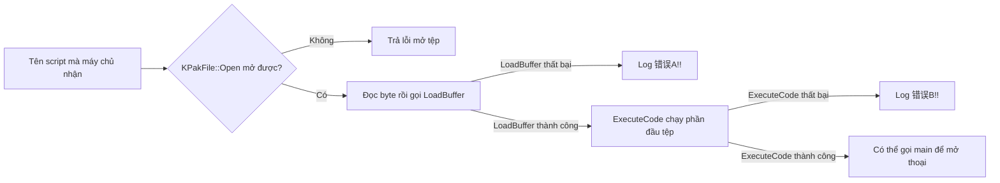

- **TÓM TẮT 1** [NGUỒN] [THẤY] DONE cho khảo sát tĩnh. Đã đọc 2/2 tệp Lua của NPC người qua đường số 5 ở Thành Đô. `GS/U+0086:1`, `GS/U+2020:1`.
- **TÓM TẮT 2** [NGUỒN] [THẤY] Hai tên trên đĩa khác đúng một ký tự Unicode, nhưng qua hai cách khôi phục byte đều cho tên GBK `西南北区-成都府-路人5石喆对话.lua`. `GS/U+0086:1`, `GS/U+2020:1`.
- **TÓM TẮT 3** [NGUỒN] [THẤY] Hai tệp khác nội dung thoại và có cùng khung `main(sel)` → `Say(…, 0)` → `end;`. Lỗi giải mã GBK nằm trong chuỗi thoại. `GS/U+0086:3–7`, `GS/U+2020:3–7`.
- **TÓM TẮT 4** [CHƯA KIỂM] Kiểm tra lệch tên hoặc đường dẫn trước nếu lỗi xảy ra lúc mở tệp. Nếu log có hậu tố `错误A!!`, kiểm tra Lua ở bước nạp bộ đệm. `SV/Engine/Src/KLuaScript.cpp:131,159–168`.
- **TÓM TẮT 5** [CHƯA KIỂM] Chưa chạy Lua, build, exe game hoặc VM. Bàn giao hai tệp Markdown để Tổng quan commit. `JX1_OPS/TASKS/HG2-10.md:17–21`.

# HG2-10 — Hai tên Lua gần trùng của NPC Thành Đô

- Loại: khảo sát
- Chủ đề: So sánh tên GBK, nội dung Lua và các bước nạp script của người qua đường số 5 ở Thành Đô.
- Từ khóa: HG2-10, Thành Đô, 成都府, Thạch Triết, 石喆, GBK, TCVN3, Lua, `KLuaScript::Load`
- Trạng thái: DONE — đã hoàn tất khảo sát tĩnh. Chưa truy được nhánh lỗi của phiên chạy.
- Độ phủ: 2/2 tệp Lua mục tiêu và 9/10 hạng mục đối chiếu. Hạng mục thứ 10 cần bằng chứng từ phiên chạy.
- Liên quan: [Chuẩn báo cáo](../DESIGN/CHUAN-BAO-CAO.md), [Mục lục tri thức](../DESIGN/MUC-LUC-TRI-THUC.md), [I-05 — NPC chức năng](I-05-npc-chuc-nang.md)
- Cần tôi quyết định: không



[TÀI LIỆU] Ghi chú gốc nêu chuỗi `…5石?对话.lua` và để ngỏ tên hay cú pháp. Ghi chú không có hậu tố log hay đường dẫn đầy đủ. [THẤY] Sơ đồ mô tả các nhánh trong mã game server. `CLAUDE.md:73`, `SV/Engine/Src/KLuaScript.cpp:123–194`, `SV/Core/Src/KPlayer.cpp:7509–7515,7533–7545`.

## Phạm vi và độ phủ

Các đường dẫn nguồn dưới đây tương đối với `C:\Jx1CocoV3`. `GS` là `Folder/ServerNew-20260116T043145Z-3-001/ServerNew/_bin_v2_/gs`. `SV` và `GW` lần lượt là `SwordOnline/SwordOnline/jxOnline/gameserver/Sources` và `SwordOnline/SwordOnline/jxOnline/gateway/Sources`. `Client` là `Folder/Client2912-20260116T044348Z-3-001/Client2912/Client/Classes`. Gốc `GS` đối chiếu từ `JX1_OPS/REPORTS/I-05-npc-chuc-nang.md:47–49` và cây tệp thực tế.

`GS/U+0086` và `GS/U+2020` trong các dẫn chiếu là hai tệp trong `GS/script/Î÷Äϱ±Çø/³É¶¼/³É¶¼/·ÈËnpc`. Tên tệp đầy đủ nằm ở bảng Giải mã tên. Dòng 1 của mỗi tệp chứa tên Hán tương ứng.

| Hạng mục | Độ phủ | Đối chiếu và nguồn |
|---|---|---|
| Tệp 187 byte | Đã phủ | [THẤY] Tên chứa `U+0086`. Đọc tên, chú thích và nội dung. `GS/U+0086:1–7`. |
| Tệp 126 byte | Đã phủ | [THẤY] Tên chứa `U+2020` (`†`). Cùng thư mục với tệp 187 byte. `GS/U+2020:1–7`. |
| Tên GBK và tên trên đĩa | Đã phủ | [THẤY] Hai tên cùng khôi phục về `86 B4` tại chữ `喆`. `Test-Path -LiteralPath` không thấy tên Hán trong thư mục đang chứa hai tệp. `GS/U+0086:1`, `GS/U+2020:1`. |
| Cú pháp và mã hóa thân Lua | Đã phủ | [THẤY] Cùng cấu trúc hàm. Dòng 5 khác nội dung và có byte không giải được theo GBK nghiêm ngặt. `GS/U+0086:3–7`, `GS/U+2020:3–7`. |
| Mở đường dẫn và tìm trong gói PAK | Đã phủ | [THẤY] Nhánh tệp rời dùng `fopen` với chuỗi đường dẫn byte. Thứ tự thử tệp rời và PAK tùy chế độ. `SV/Engine/Src/KFile.cpp:43–55,72–99`, `SV/Engine/Src/KPakFile.cpp:245–274`. |
| Tra script theo ID | Đã phủ | [THẤY] `g_FileName2Id` tính từ byte của tên. `KPlayer::ExecuteScript` tra script theo ID trước khi gọi hàm. `SV/Engine/Src/KFilePath.cpp:444–459`, `SV/Core/Src/KPlayer.cpp:7502–7515,7533–7545`. |
| Nạp bộ đệm và thực thi Lua | Đã phủ | [THẤY] Phân biệt ba điểm lỗi ở mở tệp, `LoadBuffer` và `ExecuteCode`. `SV/Engine/Src/KLuaScript.cpp:96–115,131–194`. |
| Đối chiếu mã gateway | Đã phủ | [THẤY] Loader gateway cũng mở tệp trước rồi mới nạp bộ đệm và thực thi. `GW/Engine/Src/KLuaScript.cpp:120,128,156,171`. |
| Nhận kết quả thoại phía client | Đã phủ | [THẤY] Client chuyển gói `s2c_scriptaction` cho `OnScriptAction`. `Client/gamecore/KProtocolProcess.cpp:103,3208–3210`. |
| Lỗi của phiên chạy được ghi nhận | Chưa phủ | [CHƯA KIỂM] Chưa có log nguyên văn, đường dẫn NPC thực nhận, thứ tự gói PAK hoặc bảng mã của tiến trình. `CLAUDE.md:73`, `SV/Engine/Src/KPakFile.cpp:254–270`. |

## Giải mã tên

Ký hiệu `\u0086` ghi nguyên điểm mã của ký tự điều khiển U+0086 trên đĩa để có thể đọc bảng bằng UTF-8. Dấu `†` là U+2020. Việc đưa tên Unicode về byte dùng ISO-8859-1 cho tệp 187 byte và Windows-1252 cho tệp 126 byte. Sau đó giải mã cả hai bằng GBK (CP936).

| Tên gốc | Mã hóa | Chữ đúng (UTF-8) | Nguồn tệp:dòng |
|---|---|---|---|
| `Î÷Äϱ±Çø` | GBK qua ISO-8859-1 | Khu Tây Nam Bắc (`西南北区`) | [THẤY] Thư mục của `GS/U+0086:1`, `GS/U+2020:1` |
| `³É¶¼` | GBK qua ISO-8859-1 | Thành Đô (`成都`). Tên xuất hiện ở hai cấp thư mục. | [THẤY] Đường dẫn của `GS/U+0086:1`, `GS/U+2020:1` |
| `·ÈËnpc` | GBK qua ISO-8859-1 | NPC người qua đường (`路人npc`) | [THẤY] Thư mục chứa `GS/U+0086:1`, `GS/U+2020:1` |
| `Î÷Äϱ±Çø-³É¶¼¸®-·ÈË5ʯ\u0086´¶Ô»°.lua` | GBK qua ISO-8859-1 | `西南北区-成都府-路人5石喆对话.lua` — thoại người qua đường số 5, Thạch Triết (`石喆`), phủ Thành Đô (`成都府`) | [THẤY] Tên trên đĩa và chú thích `GS/U+0086:1` |
| `Î÷Äϱ±Çø-³É¶¼¸®-·ÈË5ʯ†´¶Ô»°.lua` | GBK qua Windows-1252 | `西南北区-成都府-路人5石喆对话.lua` — cùng tên Hán | [THẤY] Tên trên đĩa và chú thích `GS/U+2020:1` |
| `Th¹ch triÕt` | TCVN3 | Thạch Triết (`石喆`) | [THẤY] Tên đầu lời thoại tại `GS/U+0086:5`, đối chiếu `GS/U+0086:1` |

## Sắp theo cấu trúc game

[THẤY] Khu Tây Nam Bắc (`西南北区`) → Thành Đô (`成都`, tên phủ `成都府` trong chú thích) → NPC người qua đường → số 5 Thạch Triết (`石喆`) → hai bản lời thoại 187 và 126 byte. Phân nhóm dựa trên thư mục và chú thích. ID NPC, vị trí xuất hiện và bản thoại được chọn trong game vẫn chưa xác minh. `GS/U+0086:1,5`, `GS/U+2020:1,5`.

## Đối chiếu cú pháp và khả năng nạp

[THẤY] Cả hai có chú thích Hán đọc được bằng GBK ở dòng 1. Ở dòng 5, mỗi câu `Say` có hai dấu nháy ASCII, hai dấu ngoặc tròn, số `0` làm đối số thứ hai và không có dấu gạch chéo ngược. Bộ giải mã CP936 nghiêm ngặt dừng ở `D0 20` trong tệp 187 byte và `F5 20` trong tệp 126 byte. Hai cặp byte nằm giữa dấu nháy. Phần tên tiếng Việt của tệp 187 byte đọc được theo TCVN3. Hai tệp dùng CRLF, bắt đầu bằng `--` và không có BOM hay byte NUL. `GS/U+0086:1–8`, `GS/U+2020:1–8`.

[CHƯA KIỂM] Lệch tên là khả năng cần kiểm tra trước nếu máy chủ thất bại ở bước mở. Hai tên trên đĩa đều mở được bằng đúng đường dẫn Unicode liệt kê từ hệ thống tệp, còn tên Hán khôi phục không tồn tại trong cùng thư mục. Đường dẫn byte được chuyển vào `fopen` hoặc tra PAK. Kết quả còn tùy chuỗi được chuyển vào, cách tiến trình diễn giải byte và gói dữ liệu thực nạp. Hai tên chỉ hội tụ thành một khi khôi phục từng tên theo bảng ở trên. `GS/U+0086:1`, `GS/U+2020:1`, `SV/Engine/Src/KFilePath.cpp:185–208,444–459`, `SV/Engine/Src/KFile.cpp:55,88–98`, `SV/Engine/Src/KPakFile.cpp:254–270`.

[THẤY] Nếu chữ ký log khớp `Load Script … 错误A!!` thì đoạn mã đã mở và đọc đủ tệp, sau đó `LoadBuffer` trả lỗi. Bước này có thể thất bại khi thiếu trạng thái Lua hoặc khi `Lua_CompileBuffer` trả lỗi. Hậu tố `错误B!!` chỉ nhánh `ExecuteCode` trả lỗi sau khi `LoadBuffer` thành công. Trong hai tệp khảo sát, lời gọi `Say` nằm trong hàm `main`. [CHƯA KIỂM] Chưa chạy trình biên dịch Lua trong engine để xác nhận hai tệp qua được bước này. `SV/Engine/Src/KLuaScript.cpp:104–115,131–190`, `GS/U+0086:3–7`, `GS/U+2020:3–7`.

## Sổ thông số

| Nhóm | Tên/hằng số | Tệp:dòng | Giá trị | Đơn vị | Ảnh hưởng | Đổi an toàn | Nguồn đo |
|---|---|---|---|---|---|---|---|
| Tệp Lua | Kích thước tệp | `GS/U+0086:1–8`, `GS/U+2020:1–8` | 187 / 126 | byte | Phân biệt hai bản có cùng tên Hán khôi phục | KHÔNG trong task | Đo tĩnh bằng độ dài tệp |
| Tệp Lua | Xuống dòng | `GS/U+0086:1–8`, `GS/U+2020:1–8` | 8 CRLF mỗi tệp | cặp byte CRLF | Xác định ranh giới từng dòng khi so cú pháp | KHÔNG trong task | Đếm byte trên tệp rời |
| Tên Lua | Mã GBK của `喆` | `GS/U+0086:1`, `GS/U+2020:1` | `86 B4` | hai byte | Hai tên quy về cùng chữ Hán | KHÔNG trong task | Mã hóa lại tên theo mỗi bảng rồi giải CP936 |
| Game server | `m_nPakFileMode` | `SV/Engine/Src/KPakFile.cpp:254–270` | `0` ưu tiên tệp rời, nhánh còn lại ưu tiên PAK nếu có | chế độ | Có thể đổi nguồn byte được đọc | KHÔNG trong task | Nhánh mã nguồn. Giá trị lúc chạy chưa đo. |

## Đã xác minh / Chưa xác minh

- **Đã xác minh** [THẤY] Đã chạy các phép kiểm chỉ đọc bằng PowerShell/.NET: liệt kê tên, kiểm đường dẫn chính xác, giải mã CP936 nghiêm ngặt, thử UTF-8 nghiêm ngặt, đếm byte xuống dòng và kiểm dấu câu ASCII ở dòng `Say`. Hai thân tệp đều không hợp lệ nếu đọc toàn bộ bằng UTF-8 nghiêm ngặt. `GS/U+0086:1–8`, `GS/U+2020:1–8`.
- **Chưa xác minh** [CHƯA KIỂM] Nhánh lỗi của phiên chạy, tệp được chọn, và khả năng biên dịch bằng engine thực. Chưa chạy Lua, build, exe game, VM hoặc kết nối mạng theo phạm vi task. `CLAUDE.md:73`, `SV/Engine/Src/KLuaScript.cpp:96–194`, `JX1_OPS/TASKS/HG2-10.md:17–21`.

Lần tìm `*5石*.lua` trả 0 vì tên trên đĩa hiển thị sai mã. Tìm theo byte GBK diễn giải qua ISO-8859-1 ra đúng hai tệp. Đường dẫn suy từ tên hiển thị ban đầu thiếu một cấp `成都`, nên dùng đối tượng tệp trả về từ hệ thống để lấy đường dẫn chính xác. Máy không có `rg`, đã dùng `Select-String` và `Get-ChildItem` trong thư mục đã định vị.

## Đề xuất tối ưu

[CHƯA KIỂM] Khi có log của đúng phiên lỗi, đối chiếu hậu tố với ba nhánh trong loader và kiểm đường dẫn trước khi chọn bản thoại. Nếu cần chuẩn hóa tên trong một task sau, giữ cả hai bản để so nội dung vì chúng quy về cùng một tên Hán. `SV/Engine/Src/KLuaScript.cpp:131,159–190`, `GS/U+0086:5`, `GS/U+2020:5`.

## Bàn giao

Đã ghi mục **Kết quả** ở cuối [task HG2-10](../TASKS/HG2-10.md). Tổng quan commit hai tệp Markdown. Dòng đề xuất cho mục lục hoặc chỉ mục được để trong báo cáo theo vùng ghi của task.

```tsv
file	loại	chủ đề	từ khóa	trạng thái	độ phủ	liên quan
JX1_OPS/REPORTS/HG2-10.md	khảo sát	Hai tên Lua gần trùng của NPC Thành Đô	HG2-10, Thành Đô, 成都府, Thạch Triết, 石喆, GBK, TCVN3, Lua	DONE	2/2 tệp Lua, 9/10 hạng mục đối chiếu	I-05-npc-chuc-nang.md, CHUAN-BAO-CAO.md
```

Hệ thống từ chối `Add-Content` vào `D:\JX-wt\HG2-10.nhip` ngoài worktree với lỗi `UnauthorizedAccessException`. Các mốc giờ địa phương (+07:00) được ghi tại đây.

| Giờ | Bước | Ước tính |
|---|---|---:|
| 2026-11-19 23:30:21 | Bắt đầu, kiểm tra nhánh và đọc task | 5% |
| 2026-11-19 23:31:47 | Đọc chuẩn, task và định vị các nguồn | 25% |
| 2026-11-19 23:35:37 | Khoanh đúng hai ứng viên và đối chiếu nhánh mở tệp | 55% |
| 2026-11-19 23:37:16 | Đọc hai tệp, chốt byte tên và vị trí lỗi giải mã | 80% |
| 2026-11-19 23:39:29 | Hoàn tất đối chiếu mã, soạn báo cáo và cập nhật task | 95% |

Kỹ năng đã dùng: `jx1-retrofit`, `jx1-read-server`, `jx1-read-client`, `jx1-parameters`, `jx1-knowledge`, `jx1-report`.
