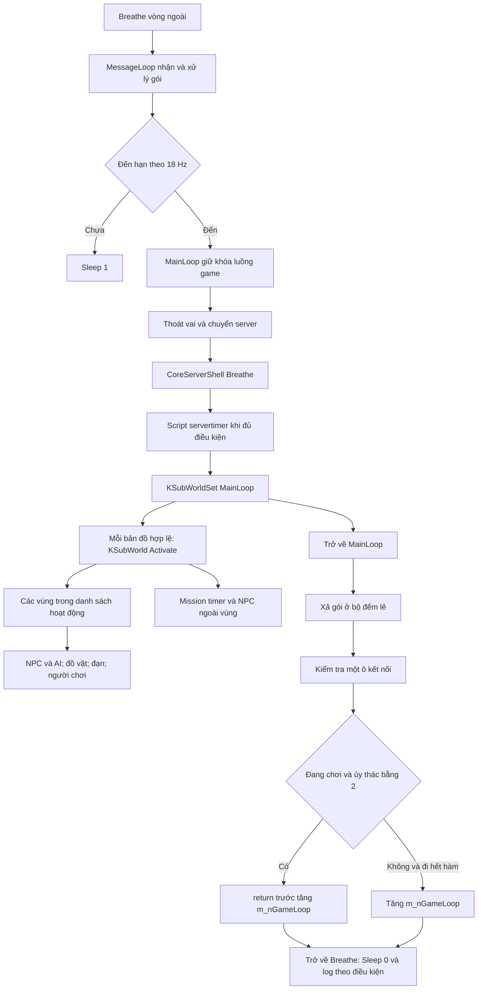

TÓM TẮT 1: [NGUỒN][THẤY] DONE về khảo sát tĩnh: đã lập bảng 20 công việc từ vòng ngoài gs001 đến bản đồ, vùng và người chơi; S/MultiServer/GameServer/KSOServer.cpp:1425-1469,4360-4444; S/Core/Src/KSubWorld.cpp:269-349.
TÓM TẮT 2: [NGUỒN][THẤY] Nhịp đích là 18 tick/giây; SvrFPS dùng trung bình tích lũy từ kỳ bộ đếm, không phải thời lượng riêng từng tick; S/MultiServer/GameServer/KSOServer.cpp:90,1433-1457.
TÓM TẮT 3: [NGUỒN][THẤY] Đầu ra có sơ đồ, độ phủ, 20 mục công việc, mô hình theo số người và sổ thông số; nguồn chính: S/Core/Src/KRegion.cpp:1100-1201,2223-2279,2643-2685.
TÓM TẮT 4: [CHƯA KIỂM] Chưa đo hàm nào gây chậm phiên cũ; nhánh thoát trước tăng bộ đếm và phát đồng bộ theo mật độ là ứng viên cần kiểm tra; S/MultiServer/GameServer/KSOServer.cpp:4381-4386,4438; S/Core/Src/KNpc.cpp:8030-8053.
TÓM TẮT 5: [CHƯA KIỂM] Không chạy build/test game, exe, VM hoặc mạng; không commit/push theo yêu cầu; PM gộp tài liệu và xử lý ngoại lệ nhịp ở mục Bàn giao.

# HG2-11 — Tick gs001 và SvrFPS: các việc chạy mỗi tick

Loại: khảo sát  
Chủ đề: Vòng điều độ gs001, công việc trong mỗi tick và các yếu tố làm chi phí tăng theo số người hoặc mật độ vùng.  
Từ khóa: nhịp máy chủ, gs001, SvrFPS, GAME_FPS, KSubWorld, KRegion, đồng bộ, AI, timer, ủy thác  
Trạng thái: DONE — đủ mục tiêu khảo sát mã và bảng 20 mục; ngoại lệ thao tác nhịp được ghi riêng, chưa có xác nhận runtime.  
Độ phủ: 10/10 nhóm khảo sát tĩnh trong bảng phạm vi; không phải đọc toàn bộ source hay đo khả năng chịu tải.  
Liên quan: JX1_OPS/TASKS/HG2-11.md; JX1_OPS/DESIGN/CHUAN-BAO-CAO.md; JX1_OPS/CONTEXT-PACK/GS001-MAP.md; JX1_OPS/DESIGN/MUC-LUC-TRI-THUC.md; JX1_OPS/HOP-THU/A-B.md:31-32,82-86.  
Cần tôi quyết định: không — nội dung khảo sát hoàn tất; chạy đo hoặc sửa mã cần một nhiệm vụ được duyệt riêng.  
Ngày khảo sát: 19/11/2026, múi giờ +07:00.

## Sơ đồ chính

[THẤY] Sơ đồ rút từ các lời gọi thực thi, không lấy các khối OpenMP hay AutoSave đang bị chú thích làm đường chạy. Nguồn: S/MultiServer/GameServer/KSOServer.cpp:1428-1469,4363-4386,4438; S/Core/Src/CoreServerShell.cpp:2229-2251; S/Core/Src/KSubWorldSet.cpp:521-607,610-629; S/Core/Src/KSubWorld.cpp:301-333.

## Phạm vi và độ phủ

| Nhóm thuộc mục tiêu | Đã phủ / chưa phủ | Bằng chứng và giới hạn |
|---|---|---|
| 1. Cổng nhịp, Sleep và SvrFPS | Đã phủ | [THẤY] S/MultiServer/GameServer/KSOServer.cpp:90,1425-1475; chưa đọc timer implementation hay đo thời gian thật. |
| 2. Nhận thông điệp trước tick | Đã phủ | [THẤY] S/MultiServer/GameServer/KSOServer.cpp:1479-1617; không khảo sát nội bộ từng bộ xử lý giao thức. |
| 3. Thoát vai, chuyển server, kiểm tra kết nối | Đã phủ | [THẤY] S/MultiServer/GameServer/KSOServer.cpp:4370-4438,4682-4922. |
| 4. Lõi và bộ bản đồ | Đã phủ | [THẤY] S/Core/Src/CoreServerShell.cpp:2229-2251; S/Core/Src/KSubWorldSet.cpp:505-630. |
| 5. Bản đồ và danh sách vùng hoạt động | Đã phủ | [THẤY] S/Core/Src/KSubWorld.cpp:269-349; S/Core/Src/KRegion.cpp:2602-2685. |
| 6. NPC, AI và đồng bộ lân cận | Đã phủ | [THẤY] S/Core/Src/KNpc.cpp:939-1072,7886-8053; S/Core/Src/KNpcAI.cpp:48-134; không đọc sâu từng thuật toán AI. |
| 7. Đồ vật và đạn | Đã phủ tại điểm gọi | [THẤY] S/Core/Src/KRegion.cpp:1130-1182; chưa tính chi phí nội bộ KObj/KMissle. |
| 8. Người chơi, timer và mission | Đã phủ tại luồng điều độ | [THẤY] S/Core/Src/KPlayer.cpp:257-368; S/Core/Src/KTaskFuns.cpp:118-132,190-196; S/Core/Src/KMissionArray.h:15-33,113-131; S/Core/Src/KMission.cpp:80-83,185-192. |
| 9. Phân biệt lưu vai, đăng nhập và việc mỗi tick | Đã phủ | [THẤY] S/Core/Src/KPlayer.cpp:983-1043; S/Core/Src/KPlayerSet.cpp:1774-1795; S/Core/Src/KSubWorldSet.cpp:610; không khảo sát mọi đường lưu vai trong toàn hệ thống. |
| 10. Đối chiếu client và ghi chép cũ | Đã phủ có giới hạn | [THẤY] C/gamecore/CoreShell.cpp:2806-2811; C/gamecore/KSubWorld.cpp:143-162. [TÀI LIỆU] JX1_OPS/HOP-THU/A-B.md:82-86; không xác nhận lại số đo. |
| Nội dung Lua, cấu hình đang nạp, binary đang chạy | Chưa phủ; ngoài khảo sát mã hiện tại | [CHƯA KIỂM] Task chỉ cho đọc các cây Sources/Classes; chưa đọc hay chạy servertimer.lua, online.lua hoặc các script timer đích. |
| Đo SvrFPS tức thời, profiler, tải 1/nhiều người | Chưa phủ; không được chạy trong task | [CHƯA KIỂM] Không kết nối VM/mạng và không chạy exe/build/test game. |
| Nội bộ gateway | Chưa phủ nội dung; không cần để chứng minh chuỗi tick gs001 | [THẤY] Điểm giao tiếp được đọc ở KSOServer::MessageLoop; không suy CPU gateway từ mã gs001. |

## Giải mã tên

[THẤY] Phạm vi này không dùng tên riêng của kỹ năng, trang bị, quái hay bản đồ. Các tên hàm/ID gốc là ASCII; không tự gán tên cho bản đồ ID 208. Bảng dưới giữ nguyên một số thuật ngữ Hán trong chú thích đã đọc bằng GBK/CP936. Nguồn: S/Core/Src/KNpc.cpp:976-980; S/MultiServer/GameServer/KSOServer.cpp:1430,1450; S/Core/Src/KSubWorld.cpp:281; S/Core/Src/KPlayer.cpp:1041.

| Tên/chuỗi gốc giữ nguyên | Mã hóa nguồn | Chữ đúng UTF-8 và nghĩa dùng trong báo cáo | Nguồn file:dòng |
|---|---|---|---|
| 主循环 | GBK/CP936 | 主循环 — vòng lặp chính | S/MultiServer/GameServer/KSOServer.cpp:1450 |
| 网关协议循环 | GBK/CP936 | 网关协议循环 — vòng xử lý giao thức gateway | S/MultiServer/GameServer/KSOServer.cpp:1431 |
| 每秒18帧 | GBK/CP936 | 每秒18帧 — chú thích 18 nhịp mỗi giây; nhịp thực vẫn phải đo | S/Core/Src/KSubWorld.cpp:281 |
| 执行上线脚本 | GBK/CP936 | 执行上线脚本 — chạy script khi lên mạng/đăng nhập | S/Core/Src/KPlayer.cpp:1041 |
| gs001, SvrFPS, KSubWorld, KRegion | ASCII | Giữ nguyên định danh; không phải tên riêng cần dịch GBK | JX1_OPS/TASKS/HG2-11.md:3,20; S/MultiServer/GameServer/KSOServer.cpp:1454; S/Core/Src/KSubWorld.cpp:269; S/Core/Src/KRegion.cpp:1100 |

## Sắp theo cấu trúc game

[THẤY] Trình bày theo máy chủ → lõi thế giới → bản đồ → vùng → NPC/đồ vật/đạn/người chơi → timer và đồng bộ. Thứ tự này theo chuỗi gọi thực ở S/MultiServer/GameServer/KSOServer.cpp:4370-4379; S/Core/Src/KSubWorldSet.cpp:601-607; S/Core/Src/KSubWorld.cpp:301-333; S/Core/Src/KRegion.cpp:1106-1194. Không lập bảng theo phái/nhánh/cấp học vì nhiệm vụ không khảo sát dữ liệu kỹ năng.

## Nguồn đọc và quy ước bằng chứng

- S = C:/Jx1CocoV3/SwordOnline/SwordOnline/jxOnline/gameserver/Sources.
- C = C:/Jx1CocoV3/Folder/Client2912-20260116T044348Z-3-001/Client2912/Client/Classes.
- Root gateway được kiểm tra tồn tại: C:/Jx1CocoV3/SwordOnline/SwordOnline/jxOnline/gateway/Sources; không đọc sâu vì mục tiêu nằm ở gs001/Core.
- [THẤY] = đọc mã/tài liệu hiện hữu đúng tệp và dòng; chỉ chứng minh nội dung tĩnh. [TÀI LIỆU] = dẫn ghi chép của lượt trước. [CHƯA KIỂM] = giả thuyết, mô hình suy luận hoặc runtime chưa xác nhận.
- [THẤY] Root thực có thêm lớp Client2912 so với tên viết tắt trong task. Source nằm ngoài worktree báo cáo và chỉ được đọc; không gán source này thành binary của VM.
- [THẤY] Chỉ mở tệp theo chuỗi gọi cần thiết: KSOServer.cpp; CoreServerShell.cpp; KSubWorldSet.cpp; KSubWorld.cpp/.h; KRegion.cpp/.h; KNpc.cpp; KNpcAI.cpp; KPlayer.cpp/.h; KPlayerSet.cpp; KMissionArray.h; KMission.cpp/.h; KTaskFuns.cpp/.h; phía client chỉ CoreShell.cpp và KSubWorld.cpp. KCore.cpp chỉ được tìm symbol để định vị, không làm bằng chứng vòng tick.
- [THẤY] GS001-MAP.md và MUC-LUC-TRI-THUC.md chỉ dùng định vị. Không có GRAPH_REPORT.md/.graphify_root ở những vị trí root đã kiểm; dùng tìm symbol trong tệp thật, không tạo lại graph. Giới hạn nguồn gián tiếp: JX1_OPS/CONTEXT-PACK/GS001-MAP.md:1-9; JX1_OPS/DESIGN/MUC-LUC-TRI-THUC.md:3,14.
- [THẤY] Báo cáo này viết UTF-8 không BOM. Các đoạn server dùng GBK/CP936; một số chú thích client CoreShell.cpp:2809-2810 vẫn lỗi chữ khi đọc cả UTF-8 lẫn GBK. Chỉ dùng định danh ASCII ở đoạn đó, không phục dựng tên bằng phỏng đoán.

## 1. Phân biệt vòng ngoài, tick logic và SvrFPS

[THẤY] Khi inGo, core shell và trạng thái chạy hợp lệ, Breathe gọi MessageLoop trước khi so thời gian. Tick logic chỉ được vào khi 1000 × m_nGameLoop ≤ m_Timer.GetElapse() × GAME_FPS. Vì vậy việc xử lý gói không được giới hạn bằng đúng một lần mỗi tick; khi chưa tới hạn vẫn có xử lý MessageLoop rồi Sleep(1). Nguồn: S/MultiServer/GameServer/KSOServer.cpp:1428-1450,1463-1469.

[THẤY] Đường tick đọc được chạy tuần tự qua vòng for các bản đồ; MainLoop giữ g_csFlow hoặc mutex theo nhánh biên dịch. Những đoạn OpenMP trong KSubWorldSet::MainLoop nằm trong khối chú thích. Chỉ kết luận về đường gọi này, không kết luận toàn bộ tiến trình gs001 chỉ có một luồng. Nguồn: S/MultiServer/GameServer/KSOServer.cpp:4363-4373; S/Core/Src/KSubWorldSet.cpp:521-607,613-629.

[THẤY] SvrFPS được in khi m_nGameLoop ≥ 1080 và chia hết cho 1080; tử số là m_nGameLoop × 1000, mẫu là thời gian timer đã trôi. Bộ đếm được đặt lại tại ngưỡng 1.512.000 ở Breathe. Đây là trung bình tích lũy của kỳ bộ đếm, hiển thị số nguyên, không có cửa sổ riêng cho tick vừa chạy. Điều kiện in là điều kiện trên giá trị bộ đếm, không phải bộ hẹn giờ log độc lập. Nguồn: S/MultiServer/GameServer/KSOServer.cpp:1433-1438,1453-1460.

[CHƯA KIỂM] Quy đổi theo nhịp đích: 1000/18 ≈ 55,56 ms/tick; 1080/18 = 60 giây; 1.512.000/18 = 84.000 giây = 23 giờ 20 phút. Tick chậm hoặc bộ đếm không tăng làm các mốc thực khác đi. Trung bình làm trơn và phép chia nguyên có thể che dao động ngắn; chưa đo sai lệch timer hoặc thời gian Sleep thực trên hệ đang chạy. Căn cứ công thức: S/MultiServer/GameServer/KSOServer.cpp:90,1433-1468.

## 2. Bảng 20 công việc và chi phí theo số người

Quy ước mô hình [CHƯA KIỂM]: P = người chơi hợp lệ được xử lý trong vùng; C = số ô kết nối m_nMaxGameStaus; W = MAX_SUBWORLD; R = số vùng nằm trong danh sách hoạt động; N = số NPC được duyệt ở vùng hoạt động đầy đủ; O = số đồ vật; M = số đạn; D = NPC ngoài vùng; H = mission đang dùng. Đây là biến đếm công việc, không phải số đo CPU. Với mỗi hàng, [THẤY] áp dụng cho điều kiện/lời gọi có nguồn; độ lớn O(...) và phần phụ thuộc người chơi là suy luận [CHƯA KIỂM].

| # | Công việc theo luồng game | Nhịp/điều kiện thực | Chi phí tăng theo tải [CHƯA KIỂM] | Bằng chứng [THẤY] |
|---|---|---|---|---|
| 01 | Nhận gateway, dữ liệu vai, trung chuyển, chat, bang và gói client | Mỗi Breathe hợp lệ, trước cổng tick; các hàng đợi có điều kiện dừng riêng | Quét C ô và xử lý số gói lấy ra; tăng theo gói/người, không chỉ theo P | S/MultiServer/GameServer/KSOServer.cpp:1431,1495-1605 |
| 02 | Dọn vai đăng nhập quá hạn/đang thoát | Đầu mỗi MainLoop; cần gateway và core shell | Quét tối đa MAX_PLAYER − 1 ô; thêm chi phí nhánh thoát có điều kiện | S/MultiServer/GameServer/KSOServer.cpp:4370,4791-4809,4854-4917 |
| 03 | Chuyển server | Mỗi MainLoop khi gateway/core hợp lệ; xử lý vai đang chuyển | O(C) lượt kiểm tra; công việc tăng theo số vai chuyển đồng thời | S/MultiServer/GameServer/KSOServer.cpp:4371,4682-4705,4744-4787 |
| 04 | Script lịch toàn máy chủ servertimer.lua | Tra script mỗi core Breathe; gọi Main khi GameTime % 18 = 0 và giây hệ thống bằng 0 | Chi phí tra script mỗi tick cộng thời gian Lua khi đến điều kiện; không xác nhận đúng một lần mỗi phút | S/Core/Src/CoreServerShell.cpp:2229-2250 |
| 05 | Duyệt bộ bản đồ | Mỗi core tick; duyệt W ô, bản đồ ID âm tự thoát | O(W) kiểm tra cộng công việc bản đồ hợp lệ; không tỷ lệ trực tiếp với P | S/Core/Src/KSubWorldSet.cpp:601-612; S/Core/Src/KSubWorld.cpp:269-272 |
| 06 | Tăng thời gian bản đồ, giảm bộ đếm | Mỗi Activate bản đồ hợp lệ | O(1) cho mỗi bản đồ được gọi; không phải chỉ bản đồ đang có người | S/Core/Src/KSubWorld.cpp:281-293 |
| 07 | Duyệt vùng hoạt động | Nhánh server duyệt m_cActRegionIdx | O(R); người chơi phân tán có thể tăng R; đồ vật/đạn cũng giữ vùng hoạt động | S/Core/Src/KSubWorld.cpp:301-305; S/Core/Src/KRegion.cpp:2643-2685 |
| 08 | Đồng bộ NPC thường | Vùng IsActiveAll; bộ đếm vùng lẻ thì mọi NPC hợp lệ trong danh sách được gọi NormalSync | Chi phí nguồn NPC nhân số người nhận lân cận; có thể tăng mạnh khi tập trung đông | S/Core/Src/KRegion.cpp:1106-1127; S/Core/Src/KNpc.cpp:8030-8053 |
| 09 | Cập nhật NPC, trạng thái, lệnh, động tác, thuộc tính nhân vật | Mỗi NPC hợp lệ ở vùng IsActiveAll; có chặn cùng frame và các nhánh thoát | Tổng chi phí Activate trên N NPC; mỗi NPC có trạng thái/kỹ năng khác nhau | S/Core/Src/KRegion.cpp:1113-1120; S/Core/Src/KNpc.cpp:939-1003,1062-1072 |
| 10 | AI người chơi/quái/đồng hành | Trong NPC Activate khi m_ProcessAI và không phải kind_dialoger; AI thường có m_NextAITime, một số nhánh đi trước cổng này | O(N) lượt kiểm tra ngoài; thời gian AI thực phụ thuộc loại và kỳ AI; không mặc định mọi AI nặng chạy đủ 18 lần/giây | S/Core/Src/KNpc.cpp:997-998; S/Core/Src/KNpcAI.cpp:53-134 |
| 11 | Đồ vật còn sống và đồng bộ đồ vật | Mọi vùng đã vào NewRegActivate; đồ vật IsAlive mới Activate; SyncState chọn theo bộ đếm | O(O) duyệt danh sách; nội bộ Activate/SyncState chưa đo | S/Core/Src/KRegion.cpp:1133-1170 |
| 12 | Đạn/kỹ năng đang bay | Mỗi đạn có chỉ số hợp lệ trong vùng được duyệt | O(M) lời gọi ngoài; nội bộ va chạm/kỹ năng chưa đọc, không giả định mỗi lời gọi có giá cố định | S/Core/Src/KRegion.cpp:1173-1182 |
| 13 | Logic người chơi và gói trạng thái gửi cho chính họ | Danh sách Player của vùng; KPlayer::Active bỏ qua mất kết nối/chuyển server | O(P) gọi ngoài; mỗi người hợp lệ xếp một gói CURPLAYER_NORMAL_SYNC; kèm chat/PK, hết hạn và giới hạn cấp | S/Core/Src/KRegion.cpp:1184-1194; S/Core/Src/KPlayer.cpp:260-368,1147-1172 |
| 14 | Timer cá nhân và OnTimer | Kiểm mỗi Active; callback chỉ chạy khi m_dwTimeTaskTime đến hạn và có ID timer | O(P) kiểm tra cộng tổng thời gian callback đến hạn; có thể dồn nhiều người cùng tick | S/Core/Src/KPlayer.cpp:339; S/Core/Src/KTaskFuns.cpp:118-132,190-196 |
| 15 | Mission/timer trên bản đồ | Mỗi bản đồ hợp lệ, sau các vùng; chỉ duyệt mission/timer đang dùng | O(H + số timer đang dùng) lượt kiểm tra, cộng Lua đến hạn; vẫn có thể chạy khi không có người gần | S/Core/Src/KSubWorld.cpp:321-323; S/Core/Src/KSubWorld.h:25,104; S/Core/Src/KMissionArray.h:15-33,113-131; S/Core/Src/KMission.cpp:80-83,185-192 |
| 16 | NPC ngoài vùng, gồm đối tượng chờ hồi sinh | Duyệt m_NoneRegionNpcList mỗi bản đồ hợp lệ | O(D) lượt duyệt ngoài; không loại khỏi chi phí chỉ vì người chơi đang đứng bản đồ vắng | S/Core/Src/KSubWorld.cpp:325-333 |
| 17 | Xả gói đã gom ra client | MainLoop khi m_nGameLoop lẻ | Khoảng 9 lượt/giây chỉ nếu bộ đếm tăng đều 18 Hz; giá thật phụ thuộc API, hàng đợi và dữ liệu | S/MultiServer/GameServer/KSOServer.cpp:4378-4379 |
| 18 | Ping/timeout một ô kết nối | lnID = m_nGameLoop % C; kiểm một ô, có nhánh return khi ủy thác bằng 2 | O(1) kiểm tra mỗi lượt đến đây; một vòng đủ ô cần C tick nếu bộ đếm tăng đều | S/MultiServer/GameServer/KSOServer.cpp:4381-4429,4438 |
| 19 | In NetCount, GameLoop, SvrFPS | Breathe sau MainLoop, theo điều kiện bộ đếm chia hết 1080 | Chi phí console có điều kiện; không có số đo độ chậm I/O | S/MultiServer/GameServer/KSOServer.cpp:1451-1460 |
| 20 | Lưu vai có điều kiện và đối chiếu AutoSave | Nhánh chuyển server có gọi SavePlayerData; AutoSave tại vòng bản đồ đang bị chú thích | Không được quy thành mọi người đều lưu mỗi tick; thời gian tuần tự hóa/I/O chưa đo | S/MultiServer/GameServer/KSOServer.cpp:4704-4719; S/Core/Src/KSubWorldSet.cpp:610; S/Core/Src/KPlayerSet.cpp:1774-1795 |

## 3. Ước lượng chi phí khi số người tăng

[CHƯA KIỂM] Mô hình tách phần quét cố định và phần nội dung: chi phí một MainLoop gồm quét MAX_PLAYER và C, duyệt W bản đồ, R vùng, các danh sách NPC/đồ vật/đạn/người chơi, callback đến hạn, xếp gói cho người nhận và xả gói khi đủ điều kiện. Thời gian giữa hai tick còn chứa các lần MessageLoop của vòng ngoài; không thể thay thế toàn bộ bằng P nhân một hằng số. Căn cứ cấu trúc vòng lặp: S/MultiServer/GameServer/KSOServer.cpp:1431-1450,1577-1605,4690-4705,4807-4809; S/Core/Src/KSubWorldSet.cpp:601-607; S/Core/Src/KRegion.cpp:1106-1194.

[THẤY] Người chơi hoặc NPC hoạt động ở gần làm vùng chuyển sang ALL; có đồ vật/đạn mà không có hai nhóm trên thì vùng chuyển sang WAIT. Cả ALL/WAIT đều có thể nằm trong danh sách vùng hoạt động; phần NPC của NewRegActivate bị chặn bởi IsActiveAll, phần đồ vật/đạn không nằm trong khối chặn đó. Một người có thể ảnh hưởng vùng của họ và tám vùng nối, nhưng các vùng chồng lặp không được cộng thành chín lần chi phí độc lập. Nguồn: S/Core/Src/KRegion.cpp:1106-1135,1173-1194,2602-2618,2649-2685; S/Core/Src/KRegion.h:287-293.

[THẤY] NormalSync gửi tới vùng hiện tại và tối đa tám vùng nối; KRegion::BroadCast duyệt danh sách Player, bỏ người mất kết nối hoặc ngủ. Điều kiện khoảng cách MAX_SYNC_RANGE nằm trong chú thích. Giới hạn truyền vào đường này là MAX_PLAYER; hằng MAX_BROADCAST_COUNT = 100 không được dùng làm hạn mức cho NormalSync ở đây. nMaxCount còn giảm theo nút đã duyệt, kể cả không xếp được gói; không đồng nhất nó với số người đã nhận. Nguồn: S/Core/Src/KNpc.cpp:8030-8053; S/Core/Src/KRegion.cpp:2229,2251-2278; S/Core/Src/KRegion.h:15.

[CHƯA KIỂM] Minh họa riêng một lượt phát NPC_NORMAL_SYNC: giả định P nhân vật hợp lệ cùng vùng hoạt động, đều thức/có kết nối, đều qua điều kiện NormalSync, đủ hạn mức MAX_PLAYER và mỗi người là một nguồn đồng bộ. Khi đó khoảng P × P lời gọi PackDataToClient cho loại gói này, gồm cả gửi cho chính nguồn; không phải số gói TCP thực hay số byte.

| Kịch bản giả định | Nguồn nhân vật | Người nhận mỗi nguồn | Lời gọi xếp gói cho một lượt phát đầy đủ |
|---|---:|---:|---:|
| Cùng vùng, 10 người | 10 | 10 | 100 |
| Cùng vùng, 50 người | 50 | 50 | 2.500 |
| Cùng vùng, 100 người | 100 | 100 | 10.000 |

[CHƯA KIỂM] Bảng là phép nhân, không chứng minh server đang chứa từng mức người hay đã đạt tải đó. Khi có Nq quái cùng khu vực, riêng loại đồng bộ này có thành phần gần (P + Nq) × P trong lượt phát; khi tản ra, số người nhận từng nguồn có thể giảm nhưng số vùng/quái được kích hoạt tăng. Bộ đếm vùng gửi tất cả NPC ở lượt lẻ, không chia một NPC duy nhất mỗi tick; nhịp không đúng 9 Hz tuyệt đối vì bộ đếm đặt lại sau khi vượt 2 × số nút và số nút có thể đổi. Căn cứ: S/Core/Src/KRegion.cpp:1108-1127,2251-2278; S/Core/Src/KNpc.cpp:8043-8053; S/Core/Src/KRegion.cpp:2602-2618.

[CHƯA KIỂM] Chưa có hệ số ms/người, ns/NPC, ngưỡng tải tối đa hoặc tỷ lệ CPU từng hàm. Không suy một người nhẹ chỉ từ P = 1: người đó có thể kích hoạt nhiều quái, nhiều đạn, script đến hạn hay đường lỗi bộ đếm. Căn cứ các đường gọi: S/Core/Src/KRegion.cpp:2649-2656; S/Core/Src/KNpc.cpp:991-1003; S/Core/Src/KSubWorld.cpp:321-333; S/MultiServer/GameServer/KSOServer.cpp:4381-4386,4438.

## 4. Điểm nghẽn khả dĩ và đối chiếu ghi chép cũ

### 4.1. Nhánh ủy thác có thể làm bộ đếm không tiến

[THẤY] MainLoop chọn một ô bằng m_nGameLoop % m_nMaxGameStaus. Nếu ô có chỉ số người hợp lệ, trạng thái enumPlayerPlaying và IsCharacterLiXian trả về 2 thì hàm return trước lệnh ++m_nGameLoop. Getter trả Player[nIndex].m_nLiXian. Phần dọn vai, chuyển server, core tick và xả gói đã nằm trước điểm return. Nguồn: S/MultiServer/GameServer/KSOServer.cpp:4370-4386,4438; S/Core/Src/CoreServerShell.cpp:2437-2442.

[CHƯA KIỂM] Nếu điều kiện trên còn đúng qua các lượt, cùng giá trị bộ đếm tiếp tục chọn cùng ô; cổng nhịp dùng bộ đếm đó trong khi lõi vẫn có thể được gọi lại. Đây là ứng viên cần ưu tiên kiểm tra cho hiện tượng bận một lõi hoặc SvrFPS bất thường. Không khẳng định phiên 21:48–21:52 có vai/trạng thái này, không ghi thành nguyên nhân đã xác nhận và không sửa mã trong task. Nguồn cấu trúc: S/MultiServer/GameServer/KSOServer.cpp:1442-1457,4370-4386,4438.

### 4.2. Đồng bộ theo mật độ và đợt gói gom

[CHƯA KIỂM] Nhiều NPC cùng đồng bộ ở lượt lẻ, phát tới danh sách người nhận ở tối đa chín vùng, có thể tạo đợt xếp gói lớn. Xả gói ngoài core cũng theo bộ đếm lẻ nên cần phân biệt thời gian tính trạng thái, xếp gói và thực gửi. Không lấy số lời gọi PackDataToClient làm băng thông mạng thực. Nguồn: S/Core/Src/KRegion.cpp:1117-1127,2251-2278; S/Core/Src/KNpc.cpp:8043-8053; S/MultiServer/GameServer/KSOServer.cpp:4378-4379.

### 4.3. AI, timer và công việc tồn tại dù ít người

[CHƯA KIỂM] Ứng viên tiếp theo là chi phí trạng thái/lệnh NPC, AI theo loại, đạn/đồ vật và Lua đến hạn. AI thường có cổng m_NextAITime, còn ProcessPlayer, nhánh theo chủ và đồng hành nằm trước cổng AI thường; không gán chung một chu kỳ cho mọi nhánh. Nguồn: S/Core/Src/KNpc.cpp:989-1003; S/Core/Src/KNpcAI.cpp:53-134; S/Core/Src/KRegion.cpp:1133-1182; S/Core/Src/KTaskFuns.cpp:118-132.

[THẤY] Mission và NPC ngoài vùng chạy sau vòng vùng trên mỗi bản đồ hợp lệ. Timer cá nhân tới hạn sẽ gọi OnTimer theo tệp từ bảng timer; nội dung Lua cụ thể chưa đọc. Vì vậy không thể chỉ đếm người trong bản đồ đang nhìn để đại diện toàn bộ công việc server. Nguồn: S/Core/Src/KSubWorld.cpp:321-333; S/Core/Src/KMission.cpp:80-83,185-192; S/Core/Src/KTaskFuns.cpp:120-129,190-196.

### 4.4. Hàng đợi vào có thể kéo dài lượt ngoài

[THẤY] MaxClienLoop có mặc định đọc cấu hình là 50, không phải số 10 ghi trong một số chú thích. Ở vòng client, kiểm nCurLoop > giới hạn trước khi lấy gói rồi mới tăng; với giới hạn dương L và hàng đợi đủ dữ liệu, đường này cho đến L + 1 gói mỗi kết nối mỗi MessageLoop. Nếu giá trị ≤ 0, nhánh giới hạn bị bỏ qua và vòng dựa vào hàng đợi rỗng để dừng. Đây là phân tích điều kiện mã; giá trị cấu hình đang nạp chưa biết. Nguồn: S/MultiServer/GameServer/KSOServer.cpp:743,750,1591-1605.

[CHƯA KIỂM] Cụm xử lý đầu vào, các handler và chờ khóa đều có thể làm tick đến muộn trước khi bắt đầu core. Chưa đo độ dài hàng đợi hay thời gian giữ/chờ g_csFlow. Nguồn: S/MultiServer/GameServer/KSOServer.cpp:1431-1442,1486-1489,1577-1605,4363-4373.

### 4.5. online.lua và lưu vai không được mặc định là việc mỗi tick

[THẤY] Điểm gọi online.lua::OnLine đã thấy thuộc KPlayer::SendSyncData, nhánh STEP_BASE_INFO sau khi xếp CURPLAYER_SYNC thành công; không nằm trong KPlayer::Active. Đường script cá nhân kiểm mỗi tick ở đây là timer và callback OnTimer. Chưa loại trừ một script có thể tự đăng ký timer hoặc được gọi từ đường khác chưa đọc. Nguồn: S/Core/Src/KPlayer.cpp:257-368,983-1043; S/Core/Src/KTaskFuns.cpp:190-196.

[THẤY] PlayerSet.AutoSave ở KSubWorldSet::MainLoop bị chú thích. Hàm AutoSave tồn tại với điều kiện thời gian 60 × 5 × 18 tick và sau một lần lưu thành công thì break; không chứng minh hàm đang được gọi từ nơi khác. Trong đường chuyển server đã thấy lời gọi SavePlayerData có điều kiện; chi phí tuần tự hóa và ghi dữ liệu chưa đo. Nguồn: S/Core/Src/KSubWorldSet.cpp:610; S/Core/Src/KPlayerSet.cpp:1774-1795; S/MultiServer/GameServer/KSOServer.cpp:4704-4719.

### 4.6. Giữ nguyên kết luận cũ và giới hạn đối chiếu

[TÀI LIỆU] Ghi chép B→A ngày 19/11/2026 lúc 22:06 dẫn phiên 21:48–21:52, CPU một lõi, khoảng ngắt tối đa 657 ms, 62 khoảng trên 250 ms, tick 116/864 ms và kết luận của tác giả là nghẽn vòng lặp gs001. Đây là ghi chép được task yêu cầu đối chiếu; lượt này không đo lại và không sửa số liệu/kết luận cũ. Nguồn: JX1_OPS/HOP-THU/A-B.md:82-86.

[THẤY] Mã phù hợp để đặt điểm đo tại vòng ngoài, MainLoop, bản đồ, vùng, AI và timer. [CHƯA KIỂM] Mã tĩnh không đủ phân bổ các khoảng 116/864 ms cho một hàm cụ thể hoặc chứng minh/loại bỏ hoàn toàn nguyên nhân ở tiến trình khác. Điểm cần làm rõ thêm so với lời nhắn cũ là SvrFPS tích lũy và vai trò online.lua/AutoSave trong đường gọi đang đọc; đây là chú giải khảo sát mới, không thay kết luận cũ. Nguồn: S/MultiServer/GameServer/KSOServer.cpp:1431-1457,4370-4386; S/Core/Src/KPlayer.cpp:983-1043; S/Core/Src/KSubWorldSet.cpp:610.

## 5. Mục sổ thông số

Tất cả là đọc tĩnh hoặc phép quy đổi; không có giá trị đo runtime. Đánh giá đổi an toàn không cấp quyền sửa cấu hình/mã.

| Nhóm | Tên/hằng số | file:dòng | Giá trị | Đơn vị | Ảnh hưởng | Đổi an toàn (CÓ/CẨN THẬN/KHÔNG) | Nguồn đo |
|---|---|---|---|---|---|---|---|
| Điều độ | GAME_FPS | S/MultiServer/GameServer/KSOServer.cpp:90,1442 | 18 | tick/giây đích | Cổng điều độ; 1000/18 ≈ 55,56 ms danh định | KHÔNG — không có căn cứ đổi độc lập toàn bộ hệ thống | Đọc tĩnh; chưa đo |
| Log | Điều kiện chia hết | S/MultiServer/GameServer/KSOServer.cpp:1453 | 1080 | giá trị bộ đếm tick | ≈60 giây chỉ khi bộ đếm tăng đúng 18 Hz; không phải timer log độc lập | CẨN THẬN | Đọc tĩnh và quy đổi |
| Log | SvrFPS | S/MultiServer/GameServer/KSOServer.cpp:1454-1457 | GameLoop × 1000 / elapsed | tick/giây trung bình tích lũy, số nguyên | Không biểu diễn riêng tick vừa chậm | KHÔNG — không dùng thay profiler | Đọc công thức; elapsed theo cơ sở 1000 trong Breathe, chưa kiểm implementation timer |
| Điều độ | Đặt lại bộ đếm | S/MultiServer/GameServer/KSOServer.cpp:1433-1438 | 1.512.000 | tick đếm | 23 giờ 20 phút theo giả định 18 Hz | CẨN THẬN | Đọc tĩnh và quy đổi |
| Chờ | Sleep khi chưa tới hạn / sau MainLoop | S/MultiServer/GameServer/KSOServer.cpp:1451,1463-1468 | 1 / 0 | đối số API | Nhường lịch; không đảm bảo thời gian chờ thực đúng 1 ms hay 0 ms | CẨN THẬN | Đọc tĩnh; chưa đo lịch hệ điều hành |
| Lịch Lua | GAME_FPS và giây bằng 0 | S/Core/Src/CoreServerShell.cpp:2227-2240 | 18; wSecond = 0 | tick modulo; giây hệ thống | Điều kiện gọi servertimer.lua::Main | CẨN THẬN | Đọc tĩnh; chưa đọc Lua |
| Gói vào | Overload/MaxClienLoop | S/MultiServer/GameServer/KSOServer.cpp:743,750,1595-1602 | Mặc định 50; giá trị đang nạp chưa biết | gói theo bộ đếm vòng/client | Với L dương, vòng client đọc tối đa L+1 khi đủ dữ liệu; ≤0 bỏ cổng giới hạn | CẨN THẬN | Đọc tĩnh; chưa đọc cấu hình runtime |
| Ô kết nối | m_nMaxGameStaus | S/MultiServer/GameServer/KSOServer.cpp:742,749,770-775 | Có đọc mặc định 5000 rồi gán lại MAX_PLAYER ở đoạn khởi tạo | ô | Chi phí quét và chu kỳ kiểm ping; không dùng 5000 làm giá trị cuối | CẨN THẬN | Đọc thứ tự gán; MAX_PLAYER thực chưa định lượng |
| Đồng bộ | m_nNpcSyncCounter | S/Core/Src/KRegion.cpp:1117-1127 | Gửi ở số lẻ; đặt lại khi > 2 × số nút NPC | lần Activate vùng ALL | Các NPC đồng bộ cùng lượt; chu kỳ đổi khi số nút đổi | CẨN THẬN | Đọc tĩnh |
| Phạm vi phát | Vùng hiện tại + vùng nối | S/Core/Src/KNpc.cpp:8031-8053 | Tối đa 1 + 8 | vùng | Tăng số người được xét cho mỗi nguồn | CẨN THẬN | Đọc tĩnh |
| Hạn mức phát | MAX_BROADCAST_COUNT / nMaxCount của NormalSync | S/Core/Src/KRegion.h:15; S/Core/Src/KNpc.cpp:8043 | 100 / MAX_PLAYER | nút người nhận được xét | Đường NormalSync dùng MAX_PLAYER, không phải 100 | CẨN THẬN | Đọc tĩnh |
| Lọc phát | MAX_SYNC_RANGE | S/Core/Src/KRegion.cpp:2229,2266-2269 | 32; điều kiện khoảng cách bị chú thích | đơn vị ô tọa độ của mã | Không được coi bán kính này là bộ lọc đang hoạt động | CẨN THẬN | Đọc tĩnh |
| AI | m_NextAITime, m_AIMAXTime | S/Core/Src/KNpcAI.cpp:91-94 | Lần tới = thời gian bản đồ + khoảng AI từng NPC; chưa đọc giá trị | tick bản đồ | Cổng AI thường; nhánh đặc biệt có thể đi trước | CẨN THẬN | Đọc tĩnh; không đoán chu kỳ |
| Timer cá nhân | m_dwTimeTaskTime, m_dwIntervalTime | S/Core/Src/KTaskFuns.cpp:120-129 | Khi đến hạn, đặt lần tới = GameTime + interval | tick logic | Callback OnTimer; thời gian thật giãn khi tick chậm | CẨN THẬN | Đọc tĩnh |
| Lưu vai | Điều kiện AutoSave | S/Core/Src/KPlayerSet.cpp:1782; S/Core/Src/KSubWorldSet.cpp:610 | 60 × 5 × 18 = 5400; điểm gọi ở vòng bản đồ bị chú thích | tick, tương đương 300 giây nếu 18 Hz | Không suy autosave đang chạy hay lưu mỗi phút từ chú thích cũ | CẨN THẬN | Đọc tĩnh và quy đổi |
| Kết nối | Ping interval / timeout / chưa đăng nhập | S/MultiServer/GameServer/KSOServer.cpp:4388-4420 | 5×18 / 30×18 / 15×18 | tick bộ đếm | Ngưỡng so sánh là >; mỗi lượt chỉ kiểm một ô nên không bảo đảm mốc giây chính xác | CẨN THẬN | Đọc tĩnh |
| Tính sống | m_nLiXian == 2 ở ô được chọn | S/MultiServer/GameServer/KSOServer.cpp:4381-4386,4438; S/Core/Src/CoreServerShell.cpp:2437-2442 | 2 | trạng thái, không phải thời gian | return trước tăng m_nGameLoop; chưa biết trạng thái phiên cũ | KHÔNG — không đổi ý nghĩa trạng thái trong task khảo sát | Đọc tĩnh; chưa tái hiện |

## 6. Đề xuất tối ưu

Các mục sau đều [CHƯA KIỂM], là hướng khảo sát/thiết kế cho task sau, chưa sửa hay chạy thử:

1. Ưu tiên kiểm tra điều kiện return trước ++m_nGameLoop và đối chiếu số lần MainLoop/core tick với số lần tăng bộ đếm. Nếu xác nhận cần sửa, phải bảo toàn khóa và ngữ nghĩa ủy thác. Căn cứ: S/MultiServer/GameServer/KSOServer.cpp:4363-4386,4438; S/Core/Src/CoreServerShell.cpp:2437-2442.
2. Thiết kế điểm đo thời gian riêng cho MessageLoop, chờ khóa, thoát/chuyển vai, script, từng bản đồ/vùng, NPC/AI, timer và xả gói; ghi cả độ dài hàng đợi, số nguồn và người nhận. Căn cứ điểm chia: S/MultiServer/GameServer/KSOServer.cpp:1431-1450,4370-4379; S/Core/Src/KRegion.cpp:1106-1194.
3. Nếu đồng bộ chiếm ưu thế, xem xét giãn các nguồn qua tick hoặc gửi khi thay đổi sau khi kiểm tra tính đúng. Không tự bật lại bộ lọc khoảng cách, hạ hạn mức hay giảm đồng bộ trong task này vì có thể làm mất thông tin hiển thị. Căn cứ: S/Core/Src/KRegion.cpp:1117-1127,2266-2278; S/Core/Src/KNpc.cpp:8043-8053.
4. Nếu Lua/AI chiếm ưu thế, đo riêng nhánh AI đặc biệt và các callback đến hạn; cần đọc đúng dữ liệu timer/script trước khi đề nghị đổi kỳ. Căn cứ: S/Core/Src/KNpcAI.cpp:53-134; S/Core/Src/KTaskFuns.cpp:120-129,190-196; S/Core/Src/CoreServerShell.cpp:2231-2240.
5. Nếu vòng nhận gói chiếm ưu thế, đánh giá ngân sách thời gian công bằng giữa kết nối/vòng ngoài và logic, thay vì chỉ đổi một số MaxClienLoop. Căn cứ: S/MultiServer/GameServer/KSOServer.cpp:1495-1605.
6. Lượt đo sau nếu được duyệt cần so 1 người ở vùng vắng, 1 người gần quái, nhiều người cùng vùng và cùng số người tản vùng; giữ điều kiện nội dung rõ ràng. Đây là đề cương, chưa chạy trong HG2-11. Căn cứ khác biệt tải: S/Core/Src/KRegion.cpp:2602-2618,2649-2656; S/Core/Src/KNpc.cpp:8043-8053.

## 7. Đã xác minh / Chưa xác minh

### ĐÃ XÁC MINH

- [THẤY] Git status đầu lượt xác nhận task/HG2-11 và không có thay đổi local; HG2-11.md chưa tồn tại nên không làm lại báo cáo cũ. Task gốc: JX1_OPS/TASKS/HG2-11.md:8-12.
- [THẤY] Đã đọc chuẩn và đủ sáu skill được yêu cầu; chỉ tạo báo cáo này và thêm mục Kết quả vào cuối task theo lệnh trực tiếp của người giao.
- [THẤY] Chuỗi caller/callee, phân biệt nhánh server/client, mã đang chạy và mã bị chú thích, công thức SvrFPS và các điều kiện liệt kê tại bảng 20 mục đều được đối chiếu tệp thật/dòng hiện tại.
- [THẤY] Client có KCoreShell::Breathe gọi g_SubWorldSet.MainLoop rồi g_ScenePlace.Breathe; KSubWorld::Activate phía client duyệt các vùng của nó. Không đồng nhất vòng dựng cảnh client với SvrFPS của server. Nguồn: C/gamecore/CoreShell.cpp:2806-2811; C/gamecore/KSubWorld.cpp:143-162.
- [TÀI LIỆU] Đã định vị đúng mục B→A 19/11 22:06, không sửa nội dung A-B.md. Nguồn: JX1_OPS/HOP-THU/A-B.md:85-86.

### CHƯA XÁC MINH

- Binary/commit source tương ứng server đang chạy; cờ biên dịch, giá trị cấu hình và MAX_PLAYER/MAX_SUBWORLD hiệu lực.
- CPU/SvrFPS/tick thật hiện tại; hàm gây chậm, tỷ lệ thời gian từng công đoạn; số người/NPC/đạn thực tế.
- Nhánh m_nLiXian == 2 có đạt trong phiên đo cũ; có giữ bộ đếm ở cùng ô hay thay đổi trạng thái trước lần kế tiếp.
- Nội dung Lua thực nạp, mọi caller AutoSave/online.lua khác, chi phí nội bộ KObj/KMissle và từng thuật toán AI.
- Chi phí/chờ thực của timer, Sleep, khóa, PackDataToClient, SendPackToClient và ghi dữ liệu.
- Tất cả mô hình tải trong báo cáo chỉ là suy luận từ cấu trúc mã, không phải kết quả benchmark.

## 8. Kiểm tra thực chạy, lỗi và cách xử lý

| Hạng mục | Đã chạy / chưa chạy | Kết quả và cách xử lý |
|---|---|---|
| Git status/branch đầu lượt | Đã chạy một lần | Đúng task/HG2-11, sạch; không checkout/reset/clean và không kiểm kê lại môi trường. |
| Đọc chuẩn, task, skill và tìm symbol | Đã chạy | PowerShell chỉ đọc, tệp được mở theo tên/lời gọi, các đoạn đọc giới hạn khoảng 400 dòng/lượt; không tạo parser phụ. |
| rg | Lỗi trong lượt tìm đầu | Máy không có lệnh; đã chuyển sang Select-String/Get-ChildItem có lọc, không cài đặt hoặc lặp lại rg. |
| Hiển thị tiếng Việt ban đầu | Lỗi mã hóa console | Đặt OutputEncoding UTF-8, đọc lại chuẩn/task bằng UTF-8; source Hán dùng CP936. Không sửa tệp gốc. |
| Root source rút gọn trong worktree | Không có | Kiểm đúng đường dẫn source tương ứng ở C:/Jx1CocoV3; client có thêm lớp Client2912. Không quét đệ quy các thư mục lớn chưa lọc. |
| Graphify | Chưa dùng được tại root đã kiểm | Không có tệp graph/marker ở vị trí kiểm; lần caller/callee bằng source thật. Không tái tạo graph. |
| KMissionArray.cpp | Không có | Theo include/type ở KSubWorld.h:22,25,104, tìm ra định nghĩa template inline trong KMissionArray.h:15-33; không tạo tệp thay thế. |
| Chú thích client | Chưa giải mã được một số chuỗi | CoreShell.cpp:2809-2810 còn lỗi chữ; dùng symbol ASCII và đánh dấu giới hạn, không sửa chữ gốc. |
| Nhịp ngoài worktree | Không ghi được trong phạm vi sandbox | D:/JX-wt/HG2-11.nhip nằm ngoài root cho phép ghi D:/JX-wt/HG2-11. Không yêu cầu nâng quyền, không thử đường vòng; báo tiến độ trong hội thoại. |
| Kiểm tra tài liệu sau ghi | Đã chạy sau khi hoàn thiện | Đọc lại UTF-8, đếm bảng 20 mục, kiểm tóm tắt/Mermaid/nhãn/mục bắt buộc và xem diff một lần; chi tiết xác nhận được trả cùng bàn giao. |
| Build/test game, exe, VM, mạng, benchmark | CHƯA CHẠY | Bị loại khỏi phạm vi theo yêu cầu; không nhận kết quả runtime hoặc hiệu năng đạt. |

## 9. Bàn giao

- Kết quả chính: DONE cho khảo sát tĩnh HG2-11, bảng 20 mục và tiêu chí tài liệu; không có thay đổi source/cấu hình hoặc kết luận cũ.
- Ngoại lệ thao tác: chưa ghi được các mốc vào D:/JX-wt/HG2-11.nhip vì ngoài sandbox. Đây là phần yêu cầu thao tác chưa hoàn thành, không phải số đo hay lỗi mã đã xác nhận.
- Không tạo REPORTS/_CHIMUC/HG2-11.tsv vì không nằm trong vung_file được duyệt. Dòng chỉ mục đề xuất để PM gộp: HG2-11.md | khảo sát | Tick gs001 và SvrFPS | nhịp máy chủ, gs001, SvrFPS, KSubWorld, KRegion, AI, timer | DONE khảo sát tĩnh | 10/10 nhóm, 20 công việc; runtime chưa đo | A-B.md:82-86; GS001-MAP.md.
- Dòng tri thức đề xuất để PM thêm vào MUC-LUC-TRI-THUC.md: Tick gs001, công thức SvrFPS, tải vùng và nhánh bộ đếm ủy thác | HG2-11 | KSOServer.cpp, KSubWorldSet.cpp, KSubWorld.cpp, KRegion.cpp | khảo sát tĩnh; nguyên nhân phiên chậm chưa xác minh.
- Không stage/commit/push theo yêu cầu; chưa có SHA mới. PM/Tổng quan thực hiện commit, không có bằng chứng push trong lượt này.
- Bước tiếp theo cần phê duyệt riêng: đo phân rã tick và trạng thái ô ủy thác, rồi mới chọn thay đổi mã hoặc cấu hình. Căn cứ: S/MultiServer/GameServer/KSOServer.cpp:4381-4386,4438; JX1_OPS/HOP-THU/A-B.md:85-86.
- Kỹ năng đã dùng: jx1-retrofit (khuôn và giữ nguyên kết luận cũ); jx1-read-server; jx1-read-client; jx1-parameters; jx1-knowledge; jx1-report.

## Phát hiện khi chuẩn hóa

[THẤY] Báo cáo HG2-11 chưa tồn tại ở đầu lượt, nên không có nội dung cũ trong tệp này để viết lại. Không sửa các báo cáo cũ hoặc A-B.md. Các chỗ dễ đọc nhầm đã được ghi riêng: SvrFPS tích lũy; AutoSave bị chú thích ở đường này; online.lua ở bước đồng bộ đăng nhập; hạn mức NormalSync dùng MAX_PLAYER; nhánh ủy thác return trước tăng bộ đếm. Nguồn tương ứng: S/MultiServer/GameServer/KSOServer.cpp:1453-1457,4381-4386,4438; S/Core/Src/KSubWorldSet.cpp:610; S/Core/Src/KPlayer.cpp:983-1043; S/Core/Src/KNpc.cpp:8043.
