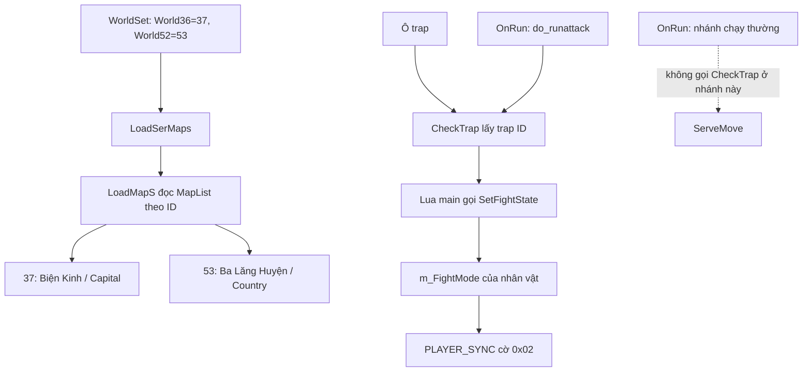

TÓM TẮT 5 DÒNG
1. [THẤY] Snapshot MapList ghi Biện Kinh ID 37 (Capital), Ba Lăng Huyện ID 53 (Country), và cả hai có vị trí riêng: Folder/ServerNew-20260116T043145Z-3-001/ServerNew/_bin_v2_/gs/Settings/MapList.ini:428-431,654-657.
2. [THẤY] WorldSet_gs001 đặt ID 37 ở World36 và ID 53 ở World52, Count=800: Folder/ServerNew-20260116T043145Z-3-001/ServerNew/_bin_v2_/gs/maps/maps/WorldSet_gs001.ini:2,40,56.
3. [THẤY] Bốn trap cổng Ba Lăng gọi SetFightState(1/0) theo trạng thái nhân vật: Folder/ServerNew-20260116T043145Z-3-001/ServerNew/_bin_v2_/gs/script/trap/thon/balang/cong2h.lua:7-12.
4. [THẤY] CheckTrap được gọi trong nhánh do_runattack của OnRun và thực thi script trap theo ID: SwordOnline/SwordOnline/jxOnline/gameserver/Sources/Core/Src/KNpc.cpp:3523-3527,15298-15325.
5. [CHƯA KIỂM] Chỉ khảo sát tĩnh; chưa chạy build, exe, VM hoặc game để xác nhận khác biệt runtime.

# HG2-12 — Ba Lăng Huyện và Biện Kinh: dữ liệu map và trap

Loại: khảo sát
Chủ đề: Đối chiếu khai báo map, danh sách nạp world, script trap và trạng thái chiến đấu cho Ba Lăng Huyện và Biện Kinh.
Từ khóa: Ba Lăng Huyện, Biện Kinh, 巴陵县, 汴京, MapList.ini, WorldSet_gs001.ini, MapType, CheckTrap, SetFightState
Trạng thái: DONE — hoàn tất khảo sát tĩnh trong phạm vi; runtime không thuộc phép thử được duyệt.
Độ phủ: 12 trên 12 đối chiếu tĩnh; hành vi runtime chưa đo theo phạm vi chỉ đọc.
Liên quan: JX1_OPS/DESIGN/CHUAN-BAO-CAO.md; JX1_OPS/DESIGN/MUC-LUC-TRI-THUC.md.
Cần tôi quyết định: không

## Phạm vi và độ phủ

| Phần tử | Kết quả | Bằng chứng |
|---|---|---|
| MapList: Biện Kinh | Đã phủ: ID 37, MapType Capital, MapPos 424,252 | Folder/ServerNew-20260116T043145Z-3-001/ServerNew/_bin_v2_/gs/Settings/MapList.ini:428-431 |
| MapList: Ba Lăng Huyện | Đã phủ: ID 53, MapType Country, MapPos 351,391 | Folder/ServerNew-20260116T043145Z-3-001/ServerNew/_bin_v2_/gs/Settings/MapList.ini:654-657 |
| MapList UTF-8 ở Settings/vn | Đã phủ: tên Hán, đường dẫn, vị trí và MapType khớp bản MapList chính | Folder/ServerNew-20260116T043145Z-3-001/ServerNew/_bin_v2_/gs/Settings/vn/MapList.ini:465-468,699-704 |
| WorldSet_gs001 bản thường | Đã phủ: Count 800, World36=37, World52=53 | Folder/ServerNew-20260116T043145Z-3-001/ServerNew/_bin_v2_/gs/maps/WorldSet_gs001.ini:2,40,56 |
| WorldSet_gs001 bản có chú giải | Đã phủ: cùng cặp ID, chú giải Bien Kinh và Ba Lang Huyen | Folder/ServerNew-20260116T043145Z-3-001/ServerNew/_bin_v2_/gs/maps/maps/WorldSet_gs001.ini:2,40,56 |
| Đường nạp world/map | Đã phủ: WorldXX ánh xạ sang ID rồi gọi LoadMapS | SwordOnline/SwordOnline/jxOnline/gameserver/Sources/Core/Src/KSubWorldSet.cpp:441-465; KSubWorld.cpp:811-930 |
| Cờ chiến đấu cấp map | Đã phủ: m_nWFight mặc định -1, setter Lua gán giá trị, nhánh đồng bộ xét 0/1 | SwordOnline/SwordOnline/jxOnline/gameserver/Sources/Core/Src/KSubWorld.cpp:83-86; ScriptFuns.cpp:18248-18254; KNpc.cpp:8218-8221 |
| Cờ trạng thái người chơi/client | Đã phủ: SetFightState đổi m_FightMode; gói đồng bộ cờ 0x02; client nhận cờ | SwordOnline/SwordOnline/jxOnline/gameserver/Sources/Core/Src/ScriptFuns.cpp:21133-21151; KNpc.cpp:7806-7810; Folder/Client2912-20260116T044348Z-3-001/Client2912/Client/Classes/gamecore/KProtocolProcess.cpp:3005-3008 |
| Trap bốn cổng Ba Lăng | Đã phủ: cong2h/cong4h/cong8h/cong10h đặt vị trí và gọi SetFightState 1/0 | Folder/ServerNew-20260116T043145Z-3-001/ServerNew/_bin_v2_/gs/script/trap/thon/balang/cong2h.lua:7-12; các tệp cùng thư mục dùng cùng nhánh |
| Điểm thực thi trap | Đã phủ: CheckTrap bỏ qua trap cũ/0 rồi gọi main; lời gọi trong OnRun nằm ở nhánh do_runattack | SwordOnline/SwordOnline/jxOnline/gameserver/Sources/Core/Src/KNpc.cpp:3509-3534,15298-15325 |
| Trap Biện Kinh và chuyển map thực tế | Chưa xác minh: không thấy thư mục trap tương ứng dưới script/trap/thon; chưa biết trap ID/vị trí đang dùng | Tra cứu giới hạn trong bundle script; không chạy game/VM/exe |
| Quan hệ phiên bản các snapshot | Chưa xác minh: config/script lấy từ Folder/ServerNew, code client và server từ các cây riêng | Đường dẫn bằng chứng tại các hàng trên; không có kiểm chứng runtime |

## Giải mã tên

| Tên gốc | Mã hóa | Chữ đúng UTF-8 | Nguồn |
|---|---|---|---|
| ÖÐÔ­±±Çø\ã꾩\ã꾩 | GBK, khôi phục byte | 中原北区\汴京\汴京; Biện Kinh (汴京) | Folder/ServerNew-20260116T043145Z-3-001/ServerNew/_bin_v2_/gs/Settings/MapList.ini:428-429 |
| Á½ºþÇø\°ÍÁêÏØ | GBK, khôi phục byte | 两湖区\巴陵县; Ba Lăng Huyện (巴陵县) | Folder/ServerNew-20260116T043145Z-3-001/ServerNew/_bin_v2_/gs/Settings/MapList.ini:654-655 |
| BiÖn Kinh | TCVN3, chuỗi legacy | Biện Kinh (汴京) | Folder/ServerNew-20260116T043145Z-3-001/ServerNew/_bin_v2_/gs/Settings/MapList.ini:429 |
| Ba L¨ng HuyÖn | TCVN3, chuỗi legacy | Ba Lăng Huyện (巴陵县) | Folder/ServerNew-20260116T043145Z-3-001/ServerNew/_bin_v2_/gs/Settings/MapList.ini:655 |
| Bien Kinh, chú giải | ASCII không dấu | Biện Kinh (汴京) | Folder/ServerNew-20260116T043145Z-3-001/ServerNew/_bin_v2_/gs/maps/maps/WorldSet_gs001.ini:40 |
| Ba Lang Huyen, chú giải | ASCII không dấu | Ba Lăng Huyện (巴陵县) | Folder/ServerNew-20260116T043145Z-3-001/ServerNew/_bin_v2_/gs/maps/maps/WorldSet_gs001.ini:56 |
| 汴京, trường 37_name bản UTF-8 | UTF-8 | Biện Kinh (汴京) | Folder/ServerNew-20260116T043145Z-3-001/ServerNew/_bin_v2_/gs/Settings/vn/MapList.ini:466 |
| 巴陵县, trường 53_name bản UTF-8 | UTF-8 | Ba Lăng Huyện (巴陵县) | Folder/ServerNew-20260116T043145Z-3-001/ServerNew/_bin_v2_/gs/Settings/vn/MapList.ini:700 |

## Sắp theo cấu trúc game

Đối chiếu theo map ID tăng dần; hai map là mục riêng trong WorldSet.

| World slot | Map ID | Tên và nhóm |
|---:|---:|---|
| World36 | 37 | Biện Kinh (汴京), Capital |
| World52 | 53 | Ba Lăng Huyện (巴陵县), Country |

## Kết quả đối chiếu

### Cấu hình và nạp map

- [THẤY] Bản MapList chính ghi Biện Kinh ID 37, đường dẫn GBK 中原北区\汴京\汴京, MapType Capital, vị trí 424,252; Ba Lăng Huyện ID 53, đường dẫn 两湖区\巴陵县, MapType Country, vị trí 351,391. Bản Settings/vn ghi tên Hán UTF-8 và giữ nguyên đường dẫn, MapPos, MapType của hai ID (MapList.ini:428-431,654-657; Settings/vn/MapList.ini:465-468,699-704).
- [THẤY] Hai tệp WorldSet đều ánh xạ ID 37 ở World36, ID 53 ở World52 và Count=800. Bản có chú giải nhận dạng tên map (WorldSet_gs001.ini:2,40,56 ở cả hai đường dẫn).
- [THẤY] LoadSerMaps đọc Init.Count, lấy ID từ WorldXX rồi gọi LoadMapS; LoadMapS dùng ID để lấy các trường MapList và đường dẫn .wor (KSubWorldSet.cpp:441-465; KSubWorld.cpp:811-930). Hai tệp WorldSet trong snapshot đều là ứng viên; tên tham số của hàm không chỉ ra tệp nào được cấu hình gọi.
- [THẤY] Không có 37_NewWorldScript hoặc 53_NewWorldScript trong các đoạn MapList của hai ID; có Default_NewWorldScript chung tại MapList.ini:6690. LoadMapS dùng cấu hình riêng nếu có .lua, nếu không lấy giá trị mặc định (KSubWorld.cpp:890-907). Chưa đối chiếu việc script mặc định có được gọi ở sự kiện khởi tạo map hay không.
- [THẤY] MapType khác nhau, nhưng nhánh KPlayer::Revive xử lý cả City, Country, Capital và Battlefield cùng nhánh khi hồi sinh về thành/thôn; riêng nhánh này chưa giải thích khác biệt đi qua cổng (KPlayer.cpp:7277-7295).

### Trap và trạng thái chiến đấu

- [THẤY] Bốn script cổng Ba Lăng ở script/trap/thon/balang xét GetFightState: nếu 0, đặt tọa độ phía ngoài rồi bật fight; nếu khác 0, đặt tọa độ phía trong rồi tắt fight. Tọa độ từng cổng khác nhau. Bằng chứng đại diện cong2h.lua:7-12; đã đọc cùng nhánh trong cong4h.lua:7-13, cong8h.lua:7-13, cong10h.lua:7-13.
- [THẤY] KNpc::CheckTrap kiểm tra loại NPC, index, world/region, lấy trap ID tại ô hiện hành, bỏ qua ID không đổi hoặc 0, rồi gọi hàm main của script trap (KNpc.cpp:15298-15325).
- [THẤY] Trong OnRun, lời gọi CheckTrap xuất hiện tại nhánh do_runattack; nhánh chạy thường gọi ServeMove mà không gọi CheckTrap ở vị trí này (KNpc.cpp:3509-3534).
- [CHƯA KIỂM] Giả thuyết kiểm được: đường đi bộ có thể bỏ qua nhánh gọi CheckTrap này, nên trap cổng không thực thi SetFightState. Source tĩnh không chứng minh các đường gọi khác không tồn tại trong bản đang dùng; chưa thử nghiệm game.
- [THẤY] Lua SetFightState đặt m_FightMode của người chơi; server đưa trạng thái vào cờ 0x02 của PLAYER_SYNC; client đọc cờ để cập nhật m_FightMode (ScriptFuns.cpp:21133-21151; KNpc.cpp:7806-7810; KProtocolProcess.cpp:3005-3008).
- [THẤY] Cờ cấp map riêng m_nWFight khởi tạo -1; setter SetSubMapFightModle ghi trường này; nhánh đồng bộ ép fight bật khi cờ bằng 1 và hết bảo hộ, hoặc tắt khi cờ bằng 0 (KSubWorld.cpp:83-86; ScriptFuns.cpp:18248-18254; KNpc.cpp:8218-8221). Không tìm thấy lời gọi setter gắn riêng ID 37/53 trong lượt tìm script. Chưa quy nguyên nhân cho cờ này.

## MỤC SỔ THÔNG SỐ

| Nhóm | Tên/hằng số | file:dòng | Giá trị | Đơn vị | Ảnh hưởng | Đổi an toàn | Nguồn đo |
|---|---|---|---:|---|---|---|---|
| Nhận diện | ID Biện Kinh | Folder/ServerNew-20260116T043145Z-3-001/ServerNew/_bin_v2_/gs/Settings/MapList.ini:428-431 | 37 | ID map | Tra WorldSet/MapList | CẨN THẬN | Đọc tĩnh snapshot |
| Nhận diện | ID Ba Lăng Huyện | Folder/ServerNew-20260116T043145Z-3-001/ServerNew/_bin_v2_/gs/Settings/MapList.ini:654-657 | 53 | ID map | Tra WorldSet/MapList | CẨN THẬN | Đọc tĩnh snapshot |
| WorldSet | Slot Biện Kinh | Folder/ServerNew-20260116T043145Z-3-001/ServerNew/_bin_v2_/gs/maps/maps/WorldSet_gs001.ini:40 | 36 → 37 | slot → ID | Ánh xạ world sang map | CẨN THẬN | Đọc tĩnh snapshot |
| WorldSet | Slot Ba Lăng | Folder/ServerNew-20260116T043145Z-3-001/ServerNew/_bin_v2_/gs/maps/maps/WorldSet_gs001.ini:56 | 52 → 53 | slot → ID | Ánh xạ world sang map | CẨN THẬN | Đọc tĩnh snapshot |
| Phân loại | MapType Biện Kinh/Ba Lăng | Folder/ServerNew-20260116T043145Z-3-001/ServerNew/_bin_v2_/gs/Settings/MapList.ini:431,657 | Capital/Country | chuỗi | Nhánh xử lý theo loại map | CẨN THẬN | Đọc tĩnh snapshot |
| Map fight | m_nWFight ban đầu | SwordOnline/SwordOnline/jxOnline/gameserver/Sources/Core/Src/KSubWorld.cpp:85 | -1 | cờ | Chưa rơi vào điều kiện ép 0/1 được trích | CẨN THẬN | Đọc tĩnh source |
| Trap | SetFightState | Folder/ServerNew-20260116T043145Z-3-001/ServerNew/_bin_v2_/gs/script/trap/thon/balang/cong2h.lua:9,12 | 1/0 | trạng thái | Đổi fight mode nếu script chạy | CẨN THẬN | Đọc tĩnh script |

## Đề xuất tối ưu kiểm chứng

1. Ưu tiên kiểm tra đường đi vào trap: so sánh đi bộ với nhánh do_runattack để xác định đường nào thực gọi CheckTrap; hiện chưa cần thay MapType.
2. Nếu được duyệt một phiên kiểm tra runtime riêng, ghi map ID, trap ID, vị trí trước/sau cổng, GetFightState và cờ đồng bộ trên cùng nhân vật tại hai map.
3. Trước khi gán kết quả cho server thực tế, xác nhận snapshot Folder/ServerNew, server source SwordOnline và client Folder/Client2912 cùng phiên bản; hiện chưa có bằng chứng chúng khớp runtime.

## Đã xác minh / Chưa xác minh

**Đã xác minh — đọc tĩnh:**
- MapList thường và Settings/vn xác nhận cùng tên Hán, ID, MapType và MapPos cho hai map; MapList thường còn có trường hồi sinh riêng tại dòng 442 và 668.
- Hai WorldSet snapshot đều nạp hai ID ở World36/World52.
- Source xác nhận luồng nạp world/map, xử lý trap, setter trạng thái và đồng bộ cờ client.
- Script trap Ba Lăng trong snapshot có nhánh bật/tắt fight state.

**Chưa xác minh:**
- Chưa chứng minh các snapshot từ Folder/ServerNew, cây source server và client là đúng phiên bản đang vận hành; không dựng/chạy build hoặc exe, không vào VM/game, không kết nối mạng.
- Chưa biết WorldSet nào được nạp, trap ID/toạ độ thật tại Biện Kinh, trạng thái bảo hộ nhân vật, hoặc việc đi bộ qua cổng tái hiện khác biệt.
- Tên legacy trong MapList thường cần đọc theo TCVN3 cho nhãn tiếng Việt và khôi phục byte GBK cho đường dẫn Hán; bản Settings/vn dùng UTF-8.

## Bàn giao

- Báo cáo: JX1_OPS/REPORTS/HG2-12.md.
- Không sửa mã/cấu hình, không chạy build/exe/VM/game/mạng; không stage/commit/push. Task ghi “Tổng quan commit hộ”.
- Không tạo bảng chỉ mục vì ngoài vùng_file JX1_OPS/REPORTS/HG2-12.md.
- Không ghi được D:\JX-wt\HG2-12.nhip: đường dẫn nằm ngoài writable root của worktree; các mốc đã báo trong trao đổi.
- Không cập nhật JX1_OPS/TASKS/HG2-12.md: file nằm ngoài vùng_file; kết quả được ghi ở đây.
- Kỹ năng đã dùng: jx1-retrofit, jx1-read-server, jx1-read-client, jx1-parameters, jx1-knowledge, jx1-report.

## Kết quả cuối

DONE — đối chiếu tĩnh và báo cáo đã hoàn tất; runtime chưa kiểm theo phạm vi chỉ đọc. Chưa ghi nhịp .nhip hoặc cập nhật file task vì các đường dẫn đó ngoài quyền ghi/vùng_file trong phiên này.
