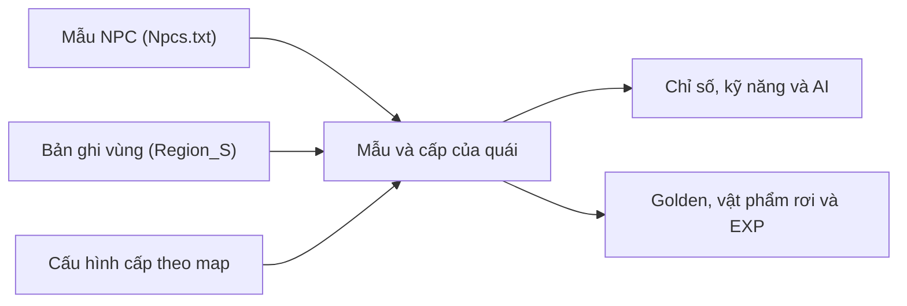

# TÓM TẮT 5 DÒNG
1. [XÁC MINH TĨNH] Npcs.txt có 2.435 template × 106 cột; 1.412 hàng ghi rõ Kind=0, 19 hàng Kind trống cần tách riêng.
2. Hai PAK server cho 94.098 bản ghi shKind=0 trên 195 map; đọc được .wor của 955/993 ID map, không coi bản ghi là quái đang sống.
3. HP/EXP/chỉ số phụ thuộc Lua và cấp spawn; có ngưỡng HP animal cấp 50, standard cấp 30; có 16 hàng nâng cấp golden.
4. Đã tổng hợp ngũ hành, AI, bảng rơi, mẫu đo sát thương và ca TESTER liên hệ H-09/E-05; không xuất nguyên bảng.
5. DONE khảo sát tĩnh bảng/source/spawn PAK với độ phủ đã nêu; chưa kiểm runtime/build, spawn Lua động và 38 map không khớp .wor; không VM/mạng/exe game/server, không sửa source.

# I-03 — Khảo sát quái vật

Loại: khảo sát\
Chủ đề: Mẫu quái, chỉ số theo cấp, AI, quái golden, vật phẩm rơi và vị trí sinh quái.\
Từ khóa: I-03, quái vật, sinh quái, Npcs.txt, Kind, Series, AIMode, golden, Region_S\
Trạng thái: DONE, đã khảo sát tĩnh bảng, luồng xử lý và hai PAK trong phạm vi I-03.\
Độ phủ: Đã kiểm kê 2.435 trên tổng 2.435 mẫu NPC. I-03 đối chiếu được 955 trên tổng 993 ID map với .wor trong hai PAK.\
Liên quan: [I-04 — Bản đồ](I-04-khao-sat-map.md), [I-05 — NPC chức năng](I-05-npc-chuc-nang.md), [I-02 — Vật phẩm bán](I-02-vat-pham-ban.md), [E-05b — Kịch bản TESTER](E-05b-kich-ban-full-cycle.md).\
Cần tôi quyết định: không.

## Phạm vi và độ phủ

Kiểm lại cột ASCII của bảng legacy và khóa INI trên GS. Số liệu giải mã vùng kế thừa từ mục Kiểm kê spawn tĩnh trong hai PAK server bên dưới. `A/` chỉ client bản A `D:/JX-build/qh9A/Classes`.

| Phần tử | Độ phủ | Đối chiếu |
|---|---|---|
| Kind=0, mẫu quái và động vật | Đã phủ 1.412 mẫu | `GS/Settings/Npcs.txt:1–2436`. Đây là số hàng ghi rõ Kind=0. |
| Kind=3 đối thoại, Kind=4 chim, Kind=5 chuột | Đã phủ số lượng | 958, 23 và 23 hàng theo `GS/Settings/Npcs.txt:1–2436`. Các hàng thuộc nhóm NPC khác được tách khỏi 1.412 mẫu quái. |
| Trống Kind và Kind=1/2 | Đã phủ kiểm kê | 19 hàng trống, 0 hàng ghi rõ Kind=1/2. Ví dụ ô trống tại `GS/Settings/Npcs.txt:1716`. Chưa phủ hành vi của 19 mẫu khi được nạp. |
| Ngũ hành và AI | Đã phủ kiểm kê nhóm | Kim, Mộc, Thủy, Hỏa, Thổ và nil lần lượt có 803, 99, 185, 155, 163, 7 mẫu Kind=0. Tên trường `Series` và `AIMode` tại `GS/Settings/Npcs.txt:1`. |
| HP, EXP, chỉ số, kháng và kỹ năng | Đã phủ đường xử lý và mẫu số học | Mục Cấp, HP và EXP đã khảo sát `GS/script/npclevelscript/animal.lua:392` và `GS/script/npclevelscript/standard.lua:359`. Còn 75 hàng Kind=0 trống `LevelScript` và các trường hợp thiếu file rời. |
| Cấu hình cấp theo map | Đã phủ kiểm kê 993 ID | Có 131 ID có đủ cờ và cấp tối thiểu bằng cấp tối đa dương. 862 ID còn lại thiếu tổ hợp ấy. Khóa tổng và ví dụ `GS/Settings/MapList.ini:2`, `:608–610`. |
| Golden và bảng rơi | Đã phủ kiểm kê | 16 hàng golden trong `GS/Settings/npc/NpcGoldTemplate.txt:2–17`. Đã đếm 201 và 496 file từ `Settings/droprate` và `Settings/mapdroprate`, xem ví dụ `GS/Settings/droprate/npcdroprate20.ini:2`. Chưa phủ từng section hay xác suất thực tế. |
| Vị trí sinh quái trong hai PAK | Đã phủ 955 ID theo I-03 | `GS/Settings/MapList.ini:1–6690` cấp danh mục 993 ID đối chiếu. Báo cáo cũ ghi 94.098 bản ghi shKind=0 trên 195 map. R-06a kiểm sự hiện diện và kích thước hai PAK. |
| ID chưa khớp .wor, file vùng rời và Lua | Chưa phủ | 38 ID chưa khớp .wor trong hai PAK theo I-03. Chưa phủ fallbacks, Lua động và mật độ lúc chạy. |
| Quái mẫu cho TESTER | Đã phủ mẫu và thiết kế ca đo | Ví dụ vật lý ở `GS/Settings/Npcs.txt:7` và `:153`. Mục Ca test cho TESTER của I-03 ghi mẫu đo sát thương và liên hệ H-09/E-05. Chưa chạy các ca. |
| Hiển thị máu phía client | Đã phủ mẫu đường nguồn | `A/gamecore/KNpcTemplate.cpp:87` lấy HP từ script, `A/gamecore/KProtocolProcess.cpp:2527` đọc HP tối đa. Chưa kiểm đồng bộ khi chạy. |

## Phạm vi và nguồn

- Ngày: 2026-11-17. Workspace `D:\JX-wt\I-03`, nhánh `task/I-03` đúng task. Trạng thái ban đầu: chỉ `?? JX1_OPS/TASKS/I-03.md`; giữ nguyên nội dung task, chỉ bổ sung mục Kết quả khi hoàn tất.
- Nguồn server: `D:\JX-source\server\jxOnline\gameserver\Sources\Core\Src`.
- Dữ liệu gốc: `C:\Jx1CocoV3\Folder\ServerNew-20260116T043145Z-3-001\ServerNew\_bin_v2_\gs`.
- Client gốc: `C:\Jx1CocoV3\Folder\Client2912-20260116T044348Z-3-001\Client2912\Client`.
- Dẫn chứng dưới dùng `GS/` = thư mục gs trong gói server trên; `SRC/` = Core/Src trên; `HDR/` = `D:\JX-source\server\jxOnline\header\`; `ENG/` = `D:\JX-source\server\jxOnline\gameserver\Sources\Engine\Src\`; `CLIENT/` = `Classes/gamecore/` trong client gốc trên.
- Dùng đoạn Python qua `python -I -`: đọc bytes/tab bằng csv, Counter, regex khóa INI, hashlib; dùng module PAK sẵn có để giải nén dữ liệu map trong bộ nhớ. Không thực thi Lua, không tạo parser/script phụ trên đĩa. Nhãn dùng bảng mã cũ; thống kê theo khóa ASCII/ID/hàng, không đoán tên Việt từ chuỗi sai bảng mã.
- Không xuất bảng đầy đủ. Không tạo bản private vì không cần cho tóm tắt và `D:\JX-reports-private\` ngoài vùng ghi được cấp; dữ liệu gốc vẫn nguyên vị trí.

| Tệp gốc | Byte | SHA-256 |
|---|---:|---|
| GS/Settings/Npcs.txt | 753.810 | c4aaa27fb06811effb23d7f8d12fef1f9d9f82164e74e00f86ac4bf5119389e7 |
| GS/Settings/MapList.ini | 198.453 | 46c4a3d27a1fe7bcdea73d294b255ed84d9d0ed9c236afe856effe62fd1702a9 |
| GS/Settings/npc/NpcGoldTemplate.txt | 3.117 | 406ea5e701c57b0d4129b3732ebe2d4248ca850a7e9e0749db22da24632f9c28 |

## ĐÃ XÁC MINH

### 1. Template, chỉ số và định danh

[NGUỒN] `HDR/GameDataDef.h:364`: kind_normal=0, player=1, partner=2, dialoger=3, bird=4, mouse=5. `HDR/CoreUseNameDef.h:141` trỏ NPC_SETTING_FILE tới settings/NpcS.txt; `SRC/KCore.cpp:626` nạp bảng. Chỉ kiểm Npcs.txt, không gộp Npcs_.txt/bản sao.

| Nhóm | Số hàng |
|---|---:|
| Kind=0 tường minh, template quái/động vật | 1.412 |
| Kind=3, đối thoại | 958 |
| Kind=4 / Kind=5 | 23 / 23 |
| Kind trống | 19 |
| Tổng dữ liệu / cột | 2.435 / 106 |

Mọi hàng đều đủ 106 ô; STT tuần tự 1..2.435. Không có Kind=1/2 tường minh. **19 ô Kind trống có thể thành kind_normal** theo default 0 ở `SRC/KNpcTemplate.cpp:654`, không chắc bị bỏ qua; ví dụ `GS/Settings/Npcs.txt:1716`. Tổng 1.412 chỉ tính ô ghi số 0.

**ID template=STT−1=hàng vật lý−2**, do `SRC/KNpcTemplate.cpp:642` dùng ID+2. Ví dụ STT=1/hàng2 là ID=0. ID template khác ID instance; không dùng tên làm khóa đo.

| Nhóm trường (header GS/Settings/Npcs.txt:1) | Đường đọc và giới hạn |
|---|---|
| HP | LifeParam1..3 → int(Lua Life); <=0 thì 100×L. Dòng đọc LifeParam bị comment, không nhân hệ số này trong nhánh server đã đọc. `SRC/KNpcTemplate.cpp:887`, `:893`, `:896`. |
| EXP | ExpParam × int(Lua Exp)/100; <=0 thay bằng10. `SRC/KNpcTemplate.cpp:877`, `:883`. |
| AR/Defense | ARParam/DefenseParam nhân kết quả Lua rồi chia100, fallback100/10 khi <=0. `SRC/KNpcTemplate.cpp:904`, `:913`. |
| Damage cơ sở | MinDamageParam*/MaxDamageParam*, fallback1/5 khi <=0; chưa phải damage cuối lên người chơi. `SRC/KNpcTemplate.cpp:922`, `:930`. |
| Kháng | Fire/Cold/Light/Poison/PhysicsResist là chuỗi tham số Lua, có cột trần *ResistMax; không đọc như số cố định. `SRC/KNpcTemplate.cpp:690`, `:948`. |
| Hồi máu/tốc độ/phạm vi | LifeReplenish qua Lua; WalkSpeed/RunSpeed, AttackSpeed/CastSpeed, VisionRadius/ActiveRadius, HitRecover, ReviveFrame/IsRevive đọc riêng. `SRC/KNpcTemplate.cpp:666`, `:693`, `:731`, `:900`. |
| Skill | Skill1..4 + Level1..4; AuraSkillId/AuraSkillLevel, PasstSkillId/PasstSkillLevel. ID đọc số, cấp gọi Lua. `SRC/KNpcTemplate.cpp:789`, `:803`, `:841`, `:859`. |

Trong 1.412 hàng: LevelScript trống75; Skill1 trống80; LifeParam1..3 trống52 hàng; FireResist trống51. Bốn cột Skill1..4 có 235 ID khác0 khác nhau, chưa chứng minh hoạt động. Có4 tham chiếu LevelScript không thấy file rời, ví dụ chinesebeast.lua (`GS/Settings/Npcs.txt:1144`); chưa kiểm script.pak. Nếu không lấy được script, `SRC/KNpcSet.cpp:2204` fallback về g_pNpcLevelScript.

### 2. Ngũ hành và AI

`HDR/GameDataDef.h:329`: 0 Kim, 1 Mộc, 2 Thủy, 3 Hỏa, 4 Thổ, 5 nil. Chỉ tính Kind=0 tường minh:

| Series | Kim0 | Mộc1 | Thủy2 | Hỏa3 | Thổ4 | nil5 |
|---|---:|---:|---:|---:|---:|---:|
| Template | 803 | 99 | 185 | 155 | 163 | 7 |

Template Series không bảo đảm Series instance: `SRC/KRegion.cpp:663` xử lý ngũ hành tự động theo map; `SRC/KNpcSet.cpp:569` gán Series từ spawn, `:570` có thể ghi đè cả Kind. Khi đo phải ghi giá trị cuối và thứ tự override/tính chỉ số.

| AIMode trong bảng | 0 | 1 | 2 | 3 | 4 | 5 | 6 | 7 | 8 | 9 | 10 | trống |
|---|---:|---:|---:|---:|---:|---:|---:|---:|---:|---:|---:|---:|
| Template Kind=0 | 37 | 1.051 | 33 | 102 | 13 | 0 | 11 | 1 | 1 | 34 | 61 | 68 |

[NGUỒN] `SRC/KNpcAI.cpp:61` chặn __isDoNone/maxHP<=0; `:64`, `:70`, `:77`, `:84` có nhánh đi theo/chở tiêu/companion/tuyến riêng. Nhánh thường hẹn theo AIMAXTime (`:94`), mode0 đứng, mode1..6 gọi ProcessAIType01..06 (`:98`). **Mode7..10 nằm trong comment**, default không xử lý tại switch này (`:119`): 97 template cần kiểm, chưa kết luận chúng đứng im vì còn nhánh khác/script/binary khác. 68 ô trống đọc default0 (`SRC/KNpcTemplate.cpp:676`).

AIParam1..10 và AIMaxTime đọc tại `SRC/KNpcTemplate.cpp:677`, `:728`; không diễn giải mọi giá trị thành %. Lua animal có nhánh trả AIMode=3 (`GS/script/npclevelscript/animal.lua:120`), nhưng InitNpcBaseData đã đọc lấy AIMode trực tiếp từ bảng; không suy ra mọi nhánh Lua đều được gọi.

### 3. Cấp, HP và EXP theo cấp

Npcs.txt không chứa cấp spawn cố định. `SRC/KNpcSet.cpp:535` ghép nLevel/nTemplateID từ KSPNpc. LoadServerNpc áp min/max map khi cả hai>0 và max>=min (`SRC/KRegion.cpp:657`), sau đó đưa cấp<=0 về1; đoạn này không kiểm _NpcAutoLevelFlag. Nhánh file NPC rời ở `SRC/KRegion.cpp:341` khác nhánh trên, không mặc định hai đường giống nhau.

`SRC/KNpcTemplate.cpp:1009` gọi GetNpcKeyData(Series,L,Style,a,b,c), lấy về int. Với makeboss: `GS/script/npclevelscript/makeboss.lua:160` → `property.lua:4`, `:9` → `lib.lua:28`: floor(aL²+bL+c). Kháng/cấp skill tuyến tính floor(kL+c): `property.lua:34`, `:84`; `lib.lua:23`.

Ví dụ **số học suy ra từ source, chưa thực thi Lua/game**: ID0 animal (Npcs.txt:2), ID169 standard (Npcs.txt:171), đều ExpParam=100. Các script này dùng đoạn tuyến tính riêng cho cấp1..100, không thay bằng một đa thức chung:

| Cấp | HP animal ID0 | HP standard ID169 | EXP cơ sở mỗi mẫu |
|---|---:|---:|---:|
| 1 | 53 | 53 | 45 |
| 15 | 162 | 162 | 145 |
| 25 | 420 | 420 | 265 |
| 30 | 570 | 2.850 | 290 |
| 49 | 1.990 | 9.950 | 525 |
| 50 | 8.200 | 10.250 | 530 |
| 95 | 26.020 | 32.525 | 1.100 |

Nguồn: `animal.lua:392`, `:434`, `:441`, `:509`; `standard.lua:359`, `:408`, `:476`. HP animal nhân4 khi L>=50; standard nhân5 khi L>=30. Không ngoại suy cho mọi script, golden/buff hoặc cấp>100.

EXP nhận khác EXP cơ sở: `SRC/KNpcDeathCalcExp.cpp:138` lấy hệ số server; `:146` phân nhánh đội; `:189` kiểm NO_DROP_EXP; `:190` chuyển EXP×IsJinYan×nExpSale cùng cấp/gold type tới Player.AddExp. Chưa theo hết AddExp/chênh cấp/bonus/giới hạn; bảng trên không phải EXP cuối của bot.

### 4. Thống kê theo cấp/map cấu hình

[XÁC MINH] `GS/Settings/MapList.ini:2` Count=1000, nhưng có993 khóa ID đường dẫn và993 _name. `GS/maps/WorldSet_gs001.ini:2` riêng Count=800. Có ID trong danh sách không chứng minh map/region nạp được.

131 map có _NpcAutoLevelFlag=1, min=max>0. Đây là số **map cấu hình**, không phải số template hay instance:

| Cấp min=max | Số map | ID map mẫu | Dòng bắt đầu MapList.ini | Đuôi NormalDropRate |
|---|---:|---:|---:|---|
| 15 | 3 | 50 | 598 | npcdroprate10.ini |
| 25 | 11 | 3 | 32 | npcdroprate20.ini |
| 35 | 12 | 4 | 45 | npcdroprate30.ini |
| 45 | 15 | 5 | 63 | npcdroprate40.ini |
| 55 | 18 | 12 | 184 | npcdroprate50.ini |
| 65 | 17 | 26 | 351 | npcdroprate60.ini |
| 75 | 16 | 9 | 131 | npcdroprate70.ini |
| 85 | 18 | 10 | 150 | npcdroprate80.ini |
| 95 | 21 | 75 | 912 | npcdroprate90.ini |
| Tổng | 131 | — | — | — |

862 ID còn lại thiếu bộ cấu hình cấp trên; không gán cấp0. Min/max đọc ở `SRC/KSubWorld.cpp:896`. Theo nhãn MapType (gộp hoa/thường tên khóa): Battlefield80, Cave49, Tong33, Field23, Country10, City5, Capital4, Others1, thiếu788; tổng993.

Map1 (`GS/Settings/MapList.ini:5`) có NormalDropRate=npcdroprate10.ini, GoldenType=13, AutoGoldenNpc=2000; chưa diễn giải2000 thành %/số boss nếu chưa theo hết thuật toán ngẫu nhiên. Bảng trên chỉ thống kê cấu hình; phần kiểm kê PAK cuối báo cáo bổ sung số bản ghi/template theo map và phân bố cấp. Các Region_C.dat rời ở maps/fongkieu là dữ liệu client, không thay Region_S của server. Chưa có mật độ runtime hay tổng spawn Lua động.

### 5. Tầng boss/golden và bảng rơi

`GS/Settings/npc/NpcGoldTemplate.txt:1` có16 hàng. `SRC/KNpcGold.cpp:644` gán hàng i+2 vào type i+1; giới hạn source30 (`SRC/KNpcGold.h:13`) không phải30 hàng đã cấu hình. 717/1.412 template Kind=0 dùng makeboss.lua; tên script không đủ chứng minh boss đang hoạt động.

| Gold type | Dòng bảng | EXP nhân | HP nhân | AR nhân | Defense nhân | Damage min/max nhân | SkillID / cấp đọc |
|---|---:|---:|---:|---:|---:|---:|---|
| 1 | 2 | 20 | 10 | 20 | 1 | 5 / 5 | 146 / 1 |
| 4 | 5 | 1 | 10 | 20 | 5 | 8 / 8 | 146 / 1 |
| 13 | 14 | 5 | 10 | 20 | 10 | 10 / 10 | 146 / 1 |
| 16 | 17 | 5 | 10 | 20 | 10 | 10 / 10 | 146 / 1 |

Nhân HP/EXP: `SRC/KNpcGold.cpp:393`, `:531`; skill thứ5/aura: `:367`, `:516`. SkillLevel ghi `1|10`, nhưng loader dùng GetInteger (`:661`), `ENG/KTabFile.cpp:403` dùng atoi: theo source đọc thành1, không phải cấp10/công thức. Đọc AiMode/DeathScript/DropRate trong golden đang comment (`KNpcGold.cpp:672`, `:695`), chưa nhận những cột này có hiệu lực.

| Nhóm đệ quy | File .ini | Tổng Count khai báo | Count min..max/file |
|---|---:|---:|---:|
| GS/Settings/droprate/ | 201 | 10.734 | 0..65 |
| GS/Settings/mapdroprate/ | 496 | 30.196 | 0..589 |

Mọi file trên có khóa Count; tổng là cộng Count khai báo, không phải số item duy nhất/số rơi/xác suất; chưa đối chiếu mọi section hay chứng minh mọi file được dùng.

Kind=0 có1.411 ô DropRateFile trống, chỉ1 có đường dẫn. Nhưng `SRC/KNpcTemplate.cpp:698` comment dòng đọc cột, `:724` đặt con trỏ rơi null tại nhánh không có đường dẫn. Luồng khác lấy NormalDropRate/GoldenDropRate theo map (`SRC/KNpcGold.cpp:264`, `:414`), hoặc từ spawn (`SRC/KNpcSet.cpp:606`); không kết luận quái không rơi từ ô trống.

MapList.ini có167 NormalDropRate+164 GoldenDropRate=331 tham chiếu,22 đường dẫn khác nhau, **0 thiếu file rời** theo các đường dẫn đó. Ví dụ `GS/Settings/droprate/npcdroprate20.ini:2`: Count52, RandRange1.000.000, MoneyRate5, MoneyNum75. `goldennpc/golden_lv10.ini:2`: Count51, RandRange3.000.000, MoneyRate10, MoneyNum150. Loader `SRC/KNpcTemplate.cpp:303`, `:319`, `:337` đọc Count/miền random/Genre,Detail,Particular,RandRate. Chưa đủ cơ sở gọi RandRate/RandRange là xác suất rơi cuối: còn lượt rơi, tiền, map/script, điều kiện chết.

### 6. Client gốc

`CLIENT/CoreUseNameDef.h:133` cũng trỏ settings/NpcS.txt; `CLIENT/KCore.cpp:398` nạp bảng, `CLIENT/KNpcTemplate.cpp:24` dùng ID+2, `:87` tính HP từ script. Chưa xác minh bảng settings client rời tương đương byte với server, không nhận hai phía cân bằng khớp nhau.

`CLIENT/KProtocolProcess.cpp:2522` nhận nCurrentLifeMax; `:2532` nhân nLifeDamagePerCent rồi chia1000 để gán m_CurrentLife. Khi đo cần tính lượng tử hóa/đồng bộ, không dùng riêng thanh máu client làm bằng chứng HP/damage chính xác. Layout/gói runtime chưa kiểm.

## Ca test cho TESTER — liên hệ H-09/E-05

[BÁO CÁO] `JX1_OPS/REPORTS/E-05b-kich-ban-full-cycle.md:28` mới chứng minh gửi một SKILL tới NPC fixture; `:29` BỎ QUA verify_kill, cần giải mã/ghép skill69, NPC76/77, hurt91/death92 theo báo cáo đó. I-03 chưa xác minh các ID/layout giao thức này. `:33` còn thiếu snapshot HP/trang bị/hành trang. Không đổi code TESTER.

Checkout không có TASKS/H-09.md. `JX1_OPS/TASKS/BACKLOG.md:89` mô tả H-09 là tổng hợp (#045); đề xuất giao bảng kiểm soát trang bị và kết quả sát thương cho H-09, chưa nhận H-09 đã có tiêu chí/tính năng đo.

Mỗi ca ghi: hash/settings/bản server, map/region/tọa độ, ID instance/template/STT, cấp/Series/GoldType thực tế, skill ID/cấp, trang bị/chỉ số người đánh (H-09), HP trước/sau và hồi máu, hit/miss/crit/kháng/phản đòn/buff, tick/thời gian. Giữ cùng cấp/trang bị/cự ly, không đội/bonus EXP cho baseline; ghi mọi hệ số chưa kiểm soát. **Không ca nào được chạy trong I-03**; PM chuẩn bị phiên thử riêng.

| Ca | Mẫu/điều kiện | Kỳ vọng/chấm |
|---|---|---|
| T01 ID/baseline | Map50 ID151/STT152/Npcs.txt:153; map3 ID5/STT6/Npcs.txt:7, thường | Đã thấy lần lượt51/159 bản ghi tĩnh. Theo cấu hình map L15/25 và animal: HP162/420, EXP cơ sở145/265. ID151 skill101/mode2; ID5 skill53/mode6. Xác nhận instance/level/không golden trước đo; chưa chứng minh spawn runtime. |
| T02 ngưỡng cấp | ID0 L49/50; ID169 STT170 Npcs.txt:171 L29/30 | HP animal1.990→8.200; standard540→2.850. PM cần fixture cấp tương ứng. Gửi SKILL chưa tính PASS damage. |
| T03 công thức/kháng âm | ID461, STT462, Npcs.txt:463, makeboss, L50 thường | Theo số học source: HP90, AR1.000, Defense600, damage cơ sở min50/max20 (**min>max**), EXP300.000, skill164/cấp10; kháng Hỏa0/Lạnh0/Lôi22/Độc−150/Vật lý0. Chưa theo chuẩn hóa cuối; dùng bắt đảo min-max/kháng âm, không nhận damage runtime hợp lệ. |
| T04 HP lớn | ID1755, STT1756, Npcs.txt:1757, makeboss, L50 thường | Theo source: HP500.000, AR1.000, Defense400, kháng năm loại95, skill627/cấp10. EXP đa thức0→fallback10; damage0→fallback1..5. Nhiều hit để thấy hồi máu/kháng. |
| T05 Series/trang bị H-09 | Cùng ID/cấp/gold, đổi từng Series/nguồn damage, giữ trang bị | So hit/miss và HP delta; ghi Series override/kháng/trần/buff. Chưa có dự đoán damage cuối; thiếu quan sát thì BỎ QUA, không tự đặt ngưỡng PASS. |
| T06 AI bất thường | ID1067, STT1068, Npcs.txt:1069, mode9; so mode1/3/6 | Ghi nhánh owner/rank, aggro/cự ly/tick/skill; kiểm giả thuyết mode9 không được switch thường dispatch, chưa báo lỗi chỉ từ source. |
| T07 golden/rơi/EXP | Cùng template/cấp, type1/13 và thường, map có bảng rơi đã biết | So HP×10, EXP cơ sở×20/5; aura146/cấp đọc1. Đếm nhiều kill/lượt rơi, tách tiền/item; không suy xác suất từ một kill. |
| T08 E-05 verify_kill | ID/cấp/map đã xác minh thực, gửi skill rồi theo hurt/death/EXP | PASS khi đúng instance, hit/HP delta, chết/phần thưởng; thiếu decoder BOT thì BỎ QUA có lý do. Exit0/gửi gói không thay verify_kill. |

## CHƯA XÁC MINH

- Source có khớp exe/server thực không; không build/test/game, không mạng/VM.
- Mật độ spawn runtime, world/region thực nạp, spawn Lua/event/respawn; đã đọc bản ghi hai PAK trong bộ nhớ nhưng 38 ID map chưa khớp .wor, chưa tính NPC_S.dat rời/.mps/fallback.
- Bốn LevelScript thiếu file rời có nằm trong script.pak không; 19 Kind trống/75 LevelScript trống có được spawn/dùng fallback thực không.
- Chỉ số cuối sau override/cap/golden/buff, damage/hit/miss, AI thực chạy, EXP cuối AddExp và xác suất rơi; số học ví dụ là [NGUỒN], không phải runtime.
- H-09 chưa có task/tiêu chí chi tiết; E-05 chưa xác minh kill thật. Bước tiếp: kiểm nguồn map/fallback của 38 ID chưa khớp, spawn script động; PM chuẩn bị fixture T01..T08 từ mẫu map/template đã định vị.

## Lỗi công cụ, kiểm tra và bàn giao

- Folder tương đối không có (`Cannot find path ... because it does not exist`): xác định gói thật ở C:\Jx1CocoV3\Folder. `rg` không có (`The term 'rg' is not recognized`): dùng pathlib/Python, không cài công cụ.
- PowerShell encoding mặc định làm sai dấu: dùng UTF-8 cho tài liệu. Python stdout CP1252 gặp UnicodeEncodeError: đổi stdout UTF-8. Pipeline PowerShell còn thay dấu trong chuỗi ghi báo cáo thành dấu hỏi: đã thay phần đó bằng apply_patch Unicode và kiểm tra lại; không suy tên từ chuỗi hỏng.
- Lệnh liệt kê source ban đầu trả quá rộng và bị cắt: lấy lại bằng đúng file/symbol/số liệu tổng hợp. Một lần patch hoàn thiện báo cáo bị `multiple operations target` do delete+add cùng path; chuyển sang update tại chỗ, bản nháp giữ nguyên cho tới khi update thành công.
- Dò PAK lần đầu không khớp tên map do lowercase Unicode làm đổi byte bảng mã cũ; sửa về bytes.lower theo ASCII và khớp được map3. Đếm ban đầu loại trừ cạnh phải/dưới; đối chiếu KSubWorld.cpp:967 thấy kích thước có +1, đã chạy lại bao gồm hai cạnh. Chỉ giữ số liệu lượt cuối: 94.098 shKind=0; không dùng số sơ bộ93.804.
- Đã kiểm hình dạng 2.435×106, STT, tổng nhóm, tham chiếu rơi, hash3 bảng, cùng công thức GetLife/GetExp của animal/standard; kiểm biên/đọc hết section PAK đạt0 lỗi. Chưa chạy unit test/build/runtime vì khảo sát tĩnh; không ca TESTER nào được nhận PASS.
- Kiểm tra tài liệu cuối: lần đầu assertion tìm tiêu đề tiếng Việt thất bại do chuỗi trong pipeline bị đổi bảng mã; dùng Unicode escape cho chuỗi kiểm, chạy lại đạt `STATIC_REPORT_CHECKS OK`. Tổng10 dải cấp đúng94.098, ba hash đều64 ký tự, không có ký tự thay thế U+FFFD; hai dấu hỏi duy nhất là ký hiệu Git `??` ban đầu. Đã xem diff hai file mới một lần: task20 dòng, báo cáo trước dòng kiểm này222 dòng; không có diff source.
- Trạng thái chuyên môn: **DONE — khảo sát tĩnh bảng/source/spawn PAK**, giới hạn runtime/độ phủ đã liệt kê. Chỉ ghi báo cáo này và mục Kết quả task.
- **Git BLOCKED — BỊ CHẶN – CHƯA PUSH.** `git add -- JX1_OPS/TASKS/I-03.md JX1_OPS/REPORTS/I-03-khao-sat-quai-vat.md` thử1 lần, exit128: `fatal: Unable to create 'D:/jx1-reports/.git/worktrees/I-03/index.lock': Permission denied`. Không stage/commit được, không thử vượt sandbox hay sửa quyền/config. HEAD nền `eec698a78102277ab66e90f1a18ee30c38ebd7dd`, không có SHA mới/link GitHub. Không push do người dùng cấm mạng thật. PM có thể stage đúng hai file trên và commit `I-03: khảo sát tĩnh quái vật và mẫu TESTER` trong môi trường có quyền Git; không tự gộp/push.

## Kiểm kê spawn tĩnh trong hai PAK server

[XÁC MINH TĨNH] Dùng module sẵn có `C:/Jx1CocoV3/docs-analysis/tools/pak_extract.py`, giải nén trong bộ nhớ, không xuất dữ liệu thô. Hash trên byte tên gốc, lowercase ASCII, không lowercase Unicode Latin-1. Căn cứ `ENG/KFilePath.cpp:444`; `SRC/Scene/SceneDataDef.h:12`, `:20`, `:30`, `:312`, `:318`; `SRC/KRegion.cpp:201`, `:639`, `:654`, `:723`. Header NPC12 byte, KSPNpc cố định60 byte và script biến độ dài; kiểm biên/đọc hết section. Rect bao gồm cạnh phải/dưới (`SRC/KSubWorld.cpp:967`).

- maps.pak: 14.542.936 byte, 87.245 entry; maps01.pak: 626.551 byte, 706 entry.
- 993 ID map; 955 có .wor/rect đọc được; 38 không khớp .wor theo tên trong hai PAK; 0 rect lỗi; 84.160 đường dẫn region server duy nhất phân tích; 0 ID xung đột nội dung giữa hai PAK; 0 lỗi giải mã/kiểm biên.
- Tổng theo ID map đọc được: **95.952 bản ghi NPC = 94.098 shKind=0 + 1.854 shKind=3**; 195 map có shKind=0; 172 template quái khác nhau. Dữ liệu region dùng bởi nhiều ID map được tính cho mỗi ID; không coi là quái đang sống.

| ID map | Region đọc được | NPC mọi Kind | shKind=0 | Template quái khác nhau | Cấp min..max map |
|---|---:|---:|---:|---:|---|
| 3 | 397 | 338 | 338 | 4 | 25..25 |
| 4 | 337 | 230 | 230 | 3 | 35..35 |
| 5 | 280 | 182 | 182 | 2 | 45..45 |
| 9 | 387 | 359 | 358 | 3 | 75..75 |
| 10 | 194 | 266 | 266 | 3 | 85..85 |
| 12 | 101 | 46 | 46 | 1 | 55..55 |
| 26 | 41 | 33 | 33 | 2 | 65..65 |
| 50 | 85 | 122 | 122 | 10 | 15..15 |
| 75 | 150 | 216 | 216 | 3 | 95..95 |

Phân bố shKind=0 sau mô phỏng override min=max và fallback cấp<=0 về1 của LoadServerNpc (không chạy server); cấp thô trong PAK trải1..100:

| Cấp | Bản ghi |
|---|---:|
| 1–10 | 12.541 |
| 11–20 | 16.497 |
| 21–30 | 3.792 |
| 31–40 | 5.207 |
| 41–50 | 5.109 |
| 51–60 | 3.158 |
| 61–70 | 2.184 |
| 71–80 | 5.411 |
| 81–90 | 12.889 |
| 91–100 | 27.310 |
| Tổng | 94.098 |

Map không khớp .wor không gán0 quái. Region không có entry có thể trống hoặc nằm ở nguồn khác, chưa phân biệt. Chưa đếm NPC_S.dat rời fallback, .mps, Lua spawn động, điều kiện script lọc spawn và danh sách world thực nạp. Đây là kiểm kê bản ghi tĩnh có độ phủ hữu hạn, không phải tổng quái runtime.

Một vài mẫu định vị (template ID, số bản ghi): map3 (5,159)/(6,122); map50 (151,51)/(154,48); map4 (168,146)/(167,81); map75 (155,113)/(156,75). Ví dụ map3 còn cấp thô20..30 và90 trong PAK, nhưng cấu hình map ghi đè25; không lấy cấp thô làm kết quả cuối.

## Phát hiện khi chuẩn hóa

- [NGUỒN] Số hàng theo Kind và Series, 16 mẫu golden và số file/khóa Count ở hai thư mục rơi khớp khi đếm lại. `GS/pak/maps.pak` và `GS/pak/maps01.pak` có kích thước khớp ghi chép I-03.
- [NGUỒN] Phép gộp hoa thường tính cả `42_Maptype=Cave` tại `GS/Settings/MapList.ini:522`, giải thích số 49 Cave và 788 ID thiếu loại trong I-03. Đối chiếu với [ghi chú đếm khóa của I-04](I-04-khao-sat-map.md#phát-hiện-khi-chuẩn-hóa).
- [CHƯA KIỂM] R-06a chưa giải mã lại bản ghi PAK. Kết quả 955 ID khớp .wor và 38 ID còn thiếu được dẫn từ phép đọc của I-03, vẫn cần nguồn khác cho các ID còn thiếu.
