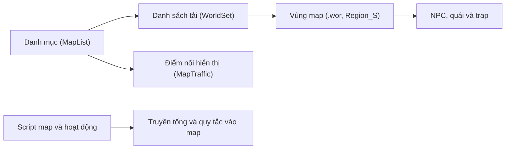

TÓM TẮT 1/5: I-04 — PARTIAL: đã khảo sát tĩnh catalog, tải map, spawn, truyền tống, PK/giao dịch và hoạt động; còn thiếu dữ liệu spawn trong PAK và cấm cưỡi.
TÓM TẮT 2/5: Catalog gốc có 993 ID; bản Settings/vn có 1.020 ID. WorldSet_gs001 có 872 mục nhưng Count=800, không phải 872 map đã nạp.
TÓM TẮT 3/5: Spawn nằm trong region_s.dat hoặc Npc_S.dat/Trap.dat; graph MapTraffic có 342 cặp có hướng, chỉ là cấu hình phía client.
TÓM TẮT 4/5: PK/chiến đấu phụ thuộc vùng, nhân vật và script; City/Country không đủ để gắn nhãn an toàn cho toàn map.
TÓM TẮT 5/5: Không sửa mã/dữ liệu gốc, không dùng mạng/VM, không chạy exe game/build/runtime; chỉ ghi báo cáo trong vùng I-04, chưa commit/push.

# I-04 — Khảo sát tĩnh map

Loại: khảo sát\
Chủ đề: Danh mục, cấu hình tải, điểm nối, quy tắc và hoạt động theo bản đồ.\
Từ khóa: I-04, bản đồ, MapList, WorldSet_gs001, MapType, MapTraffic, Tống Kim, PK, truyền tống\
Trạng thái: PARTIAL, đã khảo sát tĩnh, còn thiếu spawn trong PAK và đường áp dụng cấm cưỡi.\
Độ phủ: Đã kiểm kê 993 trên tổng 993 ID catalog gốc. MapTraffic có liên kết đến 156 trên tổng 993 ID.\
Liên quan: [I-03 — Quái vật](I-03-khao-sat-quai-vat.md), [I-05 — NPC chức năng](I-05-npc-chuc-nang.md), [Thế giới JX1](../DESIGN/THE-GIOI-TONG-QUAN.md).\
Cần tôi quyết định: không.

## Phạm vi và độ phủ

`Settings/MapList.ini` trộn đường dẫn GBK và tên Việt legacy. Các phép đếm dùng khóa ASCII. Bản `Settings/vn/MapList.ini` được đọc riêng theo UTF-8 ở I-04. `A/` chỉ client bản A `D:/JX-build/qh9A/Classes`.

| Phần tử | Độ phủ | Đối chiếu |
|---|---|---|
| ID và tên trong catalog gốc | Đã phủ 993/993 ID và 993 tên | `GS/Settings/MapList.ini:2–6690` ghi Count=1000, dải ID thực có từ 1 đến 995 và thiếu 989, 990. |
| ID và tên trong catalog `vn` | Đã phủ 1.020/1.020 ID và 1.020 tên | `GS/Settings/vn/MapList.ini:1–7106`. Chưa xác minh bản được nạp. |
| Thành, đô thành, thôn/huyện và dã ngoại | Đã phủ kiểm kê | Đối chiếu các nhóm City, Capital, Country, Field ở `GS/Settings/MapList.ini:8`, `:431`, `:657`, `:24`. |
| Hang/động, chiến trường, bang hội, nhóm khác và ID thiếu loại | Đã phủ kiểm kê loại khai báo | Các nhóm Cave, Battlefield, Tong, Others và phần thiếu khóa nằm trong bảng MapType của I-04. Vị trí khóa khác cách viết được ghi ở cuối file. |
| Phó bản và cấp phù hợp của nhân vật | Chưa phủ toàn bộ | Khóa Cave tại `GS/Settings/MapList.ini:66` là nhãn hang/động. Có mốc báo danh tại `GS/script/battles/battlejoin.lua:19`, `:39`, `:43` và `:45`. Chưa lập được danh mục phó bản và cấp nhân vật cho mọi ID. |
| Cấp NPC theo map | Đã phủ 131 ID có cặp Min/Max | `GS/Settings/MapList.ini:608–610` minh họa cờ và cặp cấp. 862 ID còn lại thiếu cặp đủ điều kiện theo phép đếm tĩnh. |
| WorldSet gs001 và MapsetInfo | Đã phủ kiểm kê | `GS/maps/WorldSet_gs001.ini:2` ghi Count=800 với 872 mục vật lý. Mục cuối trong Count ở `:803`, mục kế ở `:804`. Còn 72 mục ngoài Count và 121 ID catalog vắng trong WorldSet. `GS/Settings/MapsetInfo.txt:1–259` có 258 hàng dữ liệu. |
| File quái và trap theo vùng | Đã phủ đường định vị, chưa phủ nội dung PAK trong I-04 | `GS/Settings/MapList.ini:1636` là đường dẫn gốc của ví dụ map 140. Phần gốc ghi cách ghép .wor và Region_S. [I-03](I-03-khao-sat-quai-vat.md#kiểm-kê-spawn-tĩnh-trong-hai-pak-server) có kiểm kê hai PAK riêng. |
| Điểm nối trên bản đồ | Đã phủ cấu hình, 156/993 ID có mặt trong các cặp nối | `GS/Settings/MapTraffic.ini:2–13661` có 493 điểm Type=0 theo khóa duy nhất, tạo 342 cặp có hướng. Ví dụ 1 → 7 ở `:3–6`. Client bản A nạp tại `A/gamecore/KCore.cpp:412`. |
| Truyền tống qua trap và Lua | Chưa phủ toàn bộ đường nối | `GS/script/trap/thon/balang/cong10h.lua:7–13` là một ví dụ. Chưa ghép trap trong PAK vào đồ thị server. |
| PK, chiến đấu, cấm giao dịch | Đã phủ ví dụ tĩnh, chưa phủ ma trận từng map | Các cột cấu hình ở `GS/Settings/ForbititMap.txt:1–37`. Có ví dụ đổi trạng thái ở cổng Ba Lăng và cấm giao dịch ở `GS/script/missions/yandibaozang/readymap/include.lua:114`. |
| Cấm cưỡi, mất tiền/đồ, chi phí và sát thương | Chưa phủ toàn bộ | Mục quy tắc map của I-04 ghi các API đã định vị. Chưa nối được đường áp dụng cấm cưỡi. |
| Tống Kim, vượt ải, Viêm Đế, liên đấu | Đã phủ ví dụ tĩnh | Xem `GS/script/battles/battlehead.lua:273`, `:277`, `GS/script/tnlteam/mission/challangeoftime/head.lua:22`, `GS/script/missions/yandibaozang/readymap/include.lua:114` và `GS/script/tnlteam/mission/liendau/dondau/head.lua:468`. |
| Map gợi ý luyện công và map Bot | Đã phủ gợi ý, chưa phủ danh sách Bot đã duyệt | `GS/script/System/recommendmap.ini:9` và `:15` cho ví dụ gợi ý, `GS/script/System/autoplayer.lua:32` có nhánh auto cũ. |

Ngày: 2026-11-17. Trạng thái: **PARTIAL**. Không xuất nguyên catalog, spawn hoặc graph dài lên kho báo cáo.

## Phạm vi và nhãn bằng chứng

[XÁC MINH] = số đếm/giá trị đọc trực tiếp từ file. [NGUỒN] = hành vi thấy trong source/Lua, không xác nhận binary thực hiện đúng. [GIẢ THUYẾT] = ứng viên thử nghiệm. [CHƯA BIẾT] = chưa đủ bằng chứng.

| Ký hiệu | Gốc đường dẫn local chỉ đọc |
|---|---|
| GS | C:\Jx1CocoV3\Folder\ServerNew-20260116T043145Z-3-001\ServerNew\_bin_v2_\gs |
| SV | D:\JX-source\server\jxOnline\gameserver\Sources\Core\Src |
| HDR | D:\JX-source\server\jxOnline\header |
| CL | C:\Jx1CocoV3\Folder\Client2912-20260116T044348Z-3-001\Client2912\Client |

Số dòng lấy sau giải mã và splitlines() bằng Python; Lua có CR bất thường có thể hiện số dòng khác trong công cụ khác. Python luôn chạy python -I -, chỉ dùng thư viện chuẩn, không import/chạy code dự án, không tạo script phụ.

GS/Settings/MapList.ini trộn byte đường dẫn Trung Quốc GBK và tên Việt legacy; giải mã toàn file GB18030 tạo 131 ký tự thay thế. Thống kê dùng khóa ASCII, tên ví dụ là tên Việt thông dụng đối chiếu đường dẫn Trung Quốc, chưa chuyển mã hoàn chỉnh tên Việt. Settings/vn/MapList.ini và ForbititMap.txt giải mã UTF-8-sig không có ký tự thay thế. Tên thư mục vn không chứng minh bộ đó đang được nạp.

## ĐÃ XÁC MINH — Catalog và cấu hình tải

| Dữ liệu | Số lượng | Ý nghĩa/giới hạn |
|---|---:|---|
| GS/Settings/MapList.ini | 993 ID, 993 tên | ID 1–995, thiếu 989/990; Count=1000 dòng 2 không bằng số ID |
| GS/Settings/vn/MapList.ini | 1.020 ID, 1.020 tên | ID 1–1020, một bộ khác; không trộn với catalog gốc |
| Catalog gốc có MapType | 204 ID | 789 ID thiếu khóa; source dùng mặc định NoNpc |
| Cặp NpcAutoLevelMin/Max | 131 ID | Level NPC, không phải cấp yêu cầu của nhân vật |
| GS/maps/WorldSet_gs001.ini | 872 mục, 872 ID khác nhau | World00–World871, nhưng Count=800 |
| Phạm vi vòng tải gs001 theo source | 800 mục đầu | World00–World799; tất cả có ID trong catalog gốc; chưa chứng minh nạp thành công |
| Catalog ngoài 800 mục đầu | 193 ID | 72 mục ngoài Count + 121 ID không có trong WorldSet này |
| GS/Settings/MapsetInfo.txt | 258 dòng, 258 ID | Gs1–4 mỗi nhóm 41, Gs5:46, Gs6:48; city=1:16, city=0:242 |
| GS/Settings/ForbititMap.txt | 36 dòng, 26 cột | Nhiều danh sách theo cột; không phải 36 bộ quy tắc đồng bộ theo MapID |

[NGUỒN] HDR/CoreUseNameDef.h:161 định nghĩa MAP_DROPRATE_FILE = \Settings\mapList.ini; SV/KCore.cpp:609 nạp g_NpcMapDropRate. SV/KCore.cpp:654 ghép \maps\WorldSet_<tên tham số>.ini. SV/KSubWorldSet.cpp:448 đọc Count, :449 kiểm MAX_SUBWORLD, :458 lặp i < Count, :464 gọi LoadMapS. Không suy số map runtime từ số dòng file.

[XÁC MINH] GS/maps/WorldSet_gs001.ini:803 là World799=878; dòng 804 là World800=879, ngoài vòng tải 800 mục. Map957 có catalog tại MapList.ini:6489 nhưng không có trong cả 872 mục WorldSet gs001. Không kết luận map đó không tồn tại ở GS khác.

| MapType | Catalog gốc | Trong 800 mục đầu | Diễn giải |
|---|---:|---:|---|
| City | 5 | 5 | Thành |
| Capital | 4 | 4 | Đô thành |
| Country | 10 | 10 | Thôn/huyện, có thể gồm trong và ngoài cổng |
| Field | 23 | 23 | Dã ngoại |
| Cave | 48 | 44 | Hang/động; không mặc nhiên là phó bản riêng |
| Battlefield | 80 | 62 | Gồm chiến trường và điểm báo danh, không phải số trận đang mở |
| Tong | 33 | 32 | Map bang hội |
| Others | 1 | 1 | Khác |
| Thiếu MapType | 789 | 619 | Không tự phân loại |
| **Tổng** | **993** | **800** | |

Bản Settings/vn có City5, Capital2, Country10, Field25, Cave104, Battlefield80, Tong33, NoNpc1, thiếu loại760. Catalog gốc có khóa trùng 98_MapPos; bản vn còn có 341_MapType trùng. Thống kê dùng giá trị cuối để đếm; chưa kiểm chính sách khóa trùng của loader. Không dùng bản vn để tự bổ sung bản gốc.

### Ví dụ ID, tên, loại và cấp

| ID | Tên diễn giải | Loại | Nguồn/cấp |
|---|---|---|---|
| 1 | Phượng Tường / 凤翔 | City | GS/Settings/MapList.ini:5, :8 |
| 2 | Hoa Sơn / 华山 | Field | MapList.ini:21, :24; không có cặp auto-level tại ID này |
| 37 | Biện Kinh / 汴京 | Capital | MapList.ini:428, :431 |
| 53 | Ba Lăng Huyện / 巴陵县 | Country | MapList.ini:654, :657; trạng thái combat đổi theo cổng |
| 3 | Kiếm Các Tây Bắc / 剑阁西北 | Field | MapList.ini:32, :35; NPC auto-level25 ở :37, :38 |
| 5 | Kinh Hoàng động / 经皇洞迷宫 | Cave | MapList.ini:63, :66; NPC auto-level45 ở :74, :75 |
| 26 | Trúc Tơ động tầng1 / 竹丝洞一层 | Cave | MapList.ini:351, :354; NPC auto-level65 ở :362, :363 |
| 140 | Dược Vương Cốc / 药王谷 | Cave | MapList.ini:1636, :1639; NPC auto-level15 ở :1641, :1642 |
| 195 | Nhạn Đãng Sơn / 雁荡山 | Field | MapList.ini:2299, :2302; NPC auto-level15 ở :2310, :2311 |
| 323/324/325 | Báo danh Tống Kim sơ/trung/cao | Battlefield | MapList.ini:3056, :3063, :3070; script chia cấp40–79/80–119/≥120 |
| 380 | Xung phong cao cấp / 冲锋战场 | Battlefield | MapList.ini:3530, :3534; chưa xác minh trận hiện hành |
| 957 | Mật thất vượt ải / 闯关密室 | Thiếu loại | MapList.ini:6489; hoạt động có mapping, không có trong WorldSet gs001 này |

[NGUỒN] SV/KSubWorld.cpp:896 đọc Min/Max; SV/KRegion.cpp:657–658 dùng chúng thay sNpcCell.nLevel khi cả hai >0 và Max≥Min. 131 cặp gốc đều Min=Max: cấp15:3 ID; 25:11; 35:12; 45:15; 55:18; 65:17; 75:16; 85:18; 95:21. Không chuyển các mốc này thành yêu cầu cấp người chơi hoặc cân bằng đã thử.

Cấp nhân vật dùng cơ chế riêng: SV/ScriptFuns.cpp:6099, :6113 đặt m_minLimitLevel/m_maxLimitLevel; GS/script/global/global_move.lua:5 nhận giới hạn, :9 truyền về map37, :10 gọi SetFightState(0). GS/script/battles/battlejoin.lua:19, :39, :43, :45 chia Tống Kim 40–79/80–119/≥120, từ chối dưới40. Chưa lập được bảng cấp phù hợp cho toàn bộ993 map.

## ĐÃ XÁC MINH — Quái và file spawn

[NGUỒN] Chuỗi tải spawn tĩnh:

1. SV/KSubWorld.cpp:929 lấy đường dẫn từ MapList, :935 ghép <path>.wor, :939 tải bằng KIniFile, :962 đọc rect region. Thất bại .wor trả -1.
2. :1057 gọi KRegion::LoadObjectS theo từng region.
3. SV/KRegion.cpp:159, :161 ghép \maps\<path>\v_<Y:03>\<X:03>_region_s.dat; SV/Scene/SceneDataDef.h:12 định nghĩa tên region_s.dat. Đây là file nhị phân gộp obstacle/trap/NPC/object.
4. KRegion.cpp:197 đọc trap, :201–202 đọc NPC; :639 đọc KNpcFileHead, :652–654 đọc từng KSPNpc. :781–782 không thêm NPC qua đường này nếu loại chứa Tong.
5. Khi thiếu file gộp, nhánh :211 trở đi thử <X>_OBSTACLE.DAT, <X>_Trap.dat, <X>_Npc_S.dat tại :216, :255, :290; hằng tương ứng ở SceneDataDef.h:42, :43, :47.

Ví dụ map140: source ghép maps\西北北区\药王谷\药王谷.wor rồi vùng dưới maps\西北北区\药王谷\药王谷\v_<Y>\<X>_region_s.dat hoặc file rời. Đây là đường dẫn **source yêu cầu**, chưa chứng minh entry có trong PAK.

[XÁC MINH] GS/pak/maps.pak có14.542.936 byte; maps01.pak có626.551 byte. Chưa đọc index/entry PAK, chưa đếm số quái, tọa độ, trap bên trong. Không lấy số file rời làm số spawn. GS/Settings/Npcs.txt có các cột mẫu NPC Kind/Camp/Series/RideHorse/ActionScript/LevelScript…, không phải bảng tọa độ spawn theo map.

[NGUỒN] Spawn/điểm sự kiện còn có nguồn riêng: GS/Settings/battles/maps/forest/mapinfo.txt:6–8 trỏ map đơn đấu363/364/365, :15 trỏ file homepos; GS/script/tnlteam/mission/challangeoftime/head.lua:171 có NPC sự kiện nLevel=95. Chưa cộng những hệ này thành số quái thực tế.

## ĐÃ XÁC MINH — Truyền tống và graph

[XÁC MINH] GS/Settings/MapTraffic.ini có370 lần khai báo section số, **368 section khác nhau**, 33 khóa Type trùng cùng giá trị. Sau gom theo (section,số điểm) và bỏ khoảng trắng: Type0=493, Type1=1.273, Type2=1.396 điểm. Đếm thô theo dòng là493/1.286/1.416; không coi số dòng là số điểm duy nhất.

493 điểm Type0 có Index đích tạo **342 cặp có hướng khác nhau, 156 ID đầu/cuối**. Mọi ID đích có trong catalog gốc. Có5 cặp chưa có cạnh ngược trong cấu hình:148→146,148→152,224→136,336→121,341→319. Đây không phải lỗi runtime đã xác nhận. Nhiều điểm nối cùng cặp map giải thích493 khác342.

| Nguồn → đích | Point → TargetPoint trong MapTraffic | Dòng |
|---|---|---|
| 1 → 7 | (1484,601) → (89,448) | GS/Settings/MapTraffic.ini:3–6 |
| 1 → 99 | (1281,976) → (106,191) | :8–11 |
| 1 → 3 | (212,724) → (784,132) | :13–16 |
| 37 → 38 | (1112,761) → (65,200) | :640–643 |
| 37 → 100 | (1677,1622) → (501,41) | :660–663 |

Sơ đồ rút gọn theo cấu hình: Phượng Tường(1) → {7,99,Kiếm Các Tây Bắc(3)}; Biện Kinh(37) → {38,Chu Tiên trấn(100)}. Mũi tên thể hiện chiều có dữ liệu, không xác nhận cổng đã hoạt động.

[NGUỒN] SV/KCore.cpp:710–711 load MapTraffic trong #ifndef _SERVER. CL/Classes/gamecore/KCore.cpp:412 load cùng tên file; CL/Classes/gameui/KuiMinMap.cpp:358–371 đọc Type/Point/Content và bỏ qua Type0 tại :365. Tọa độ bảng trên là tọa độ **bảng bản đồ**, không tự truyền vào NewWorld() như tọa độ world. Không thấy MapList.ini/MapTraffic.ini dạng rời trong Resources/data của client gốc đã tra; chưa mở gói để đối chiếu byte dữ liệu client/server.

Đường truyền tống server cần kiểm trap/Lua: SV/KNpc.cpp:15589 CheckTrap chỉ áp dụng kind_player; :15600 lấy trap ô hiện tại, :15616 gọi script main. SV/KNpc.cpp:15223 ChangeWorld tra map đích, :15229/:15237 có nhánh trao đổi server nếu map không local. Chưa giải graph đầy đủ từ Lua có biến, điều kiện nhiệm vụ và trap trong PAK.

## ĐÃ XÁC MINH — PK/không PK và quy tắc map

| Quy tắc | Bằng chứng tĩnh | Kết luận/giới hạn |
|---|---|---|
| Trong/ngoài cổng Ba Lăng | GS/script/trap/thon/balang/cong10h.lua:7–13 SetPos rồi SetFightState(1/0); nhánh SVS ở :3–5 thoát riêng | Cùng ID53 có thể đổi combat theo đường đi; chưa xác nhận trap gắn đúng trong dữ liệu |
| Cờ chiến đấu subworld | SV/ScriptFuns.cpp:18250–18254 đặt m_nWFight; SV/KNpc.cpp:8509–8512 áp dụng1/0 | City/Field không tự quyết quyền đánh nhau |
| Cờ PK subworld | ScriptFuns.cpp:18241–18245 đặt m_nWPKFlag | Đoạn áp dụng gần KNpc.cpp:8495 đang comment; không khẳng định cờ tự ép PK runtime |
| Khóa đổi PK/thù sát | ScriptFuns.cpp:11670, :11679 đặt cờ nhân vật | Cần kiểm luồng vào/ra hoạt động |
| Cấm giao dịch | ScriptFuns.cpp:11693–11698 → KPlayer.h:836 → KPlayer.cpp:6563–6566 chặn TradeApplyOpen khi __forBitTrade | Đã nối API Lua tới consumer server |
| Ví dụ cấm giao dịch | GS/script/missions/yandibaozang/readymap/include.lua:102 truyền map theo biến; :107 Fight=0, :111 PKFlag=1, :112 khóa PK, :114 ForbitTrade=1; missions/yandibaozang/include.lua:51 bỏ cấm | Không suy rộng mọi Battlefield đều cấm; cần kiểm reset mọi đường thoát |
| Giới hạn cấp | ScriptFuns.cpp:6099, :6113 và battlejoin.lua | Tách cấp người chơi với level NPC |
| Mất tiền/đồ, chi phí, sát thương | LuaSetMapNoLostMoney/NoLostItem/NoCost/NoDamage tại ScriptFuns.cpp:6151/:6173/:6194/:6215 | Có API; chưa đủ ma trận map và consumer |
| Cấm cưỡi | Chưa nối được cấu hình → cờ → consumer chắc chắn | **CHƯA BIẾT**; RideHorse trong mẫu NPC không chứng minh cấm cưỡi theo map |

HDR/CoreUseNameDef.h:167, SV/KCore.cpp:602 nạp ForbititMap.txt. Không đọc các cột MapID/PkModel/ItemTrad/FightState/ForbitMap/NeedLevel như thuộc tính chung của cùng dòng MapID: SV/KNpc.cpp:7865–7877 CheckMaps quét **cả cột được truyền vào** để tìm giá trị; SV/ScriptFuns.cpp:14410–14427 CheckForbitMapA cũng vậy. Chưa đủ bằng chứng gán toàn bộ36 dòng thành36 map có26 quy tắc.

## ĐÃ XÁC MINH — Map hoạt động và Bot

| Nhóm | Bằng chứng | Ý nghĩa |
|---|---|---|
| Tống Kim báo danh | GS/script/battles/battlehead.lua:273 = {323,324,325}; :274 tọa độ hai phe | Ba map báo danh theo cấp, không phải map trận duy nhất |
| Tống Kim/chiến trường | battlehead.lua:277 có69 ID trong tbBATTLEMAP; catalog có80 Battlefield | Hai tập nghĩa khác nhau, không phải số trận đang mở; ví dụ380 được cả catalog và script nhắc |
| Vượt ải | tnlteam/mission/challangeoftime/head.lua:183 nhóm464–479; :202 nhóm cao bắt đầu480; :22 map957 | Mapping hoạt động có sẵn;957 không có trong WorldSet gs001 |
| Viêm Đế bảo tàng | missions/yandibaozang/readymap/include.lua:100–114 | Đích theo subworld nhiệm vụ, có khóa giao dịch/PK, chưa quy về literal ID |
| Liên đấu | tnlteam/mission/liendau/dondau/head.lua:468, :848 | Có bật/bỏ ForbitTrade; chưa kiểm hết nhánh reset và map trận |
| Gợi ý luyện công gốc | script/System/recommendmap.ini:61 section [0]–[60],59 MapId khác nhau | Ví dụ140 dòng9,195 dòng15; không phải bảng cấp nhân vật đã cân bằng |
| Autoplayer gốc | script/System/autoplayer.lua:19–21 kiểm GetPlayFF; :26 WorldPos; :32 NewWorld(78,…) | Tính năng auto cũ không chứng minh có Bot tập trung theo yêu cầu dự án |

[GIẢ THUYẾT] Ứng viên bộ thử Bot nhỏ:53 kiểm trong/ngoài cổng,195 kiểm đi/đánh dã ngoại,140 kiểm hang/spawn. 140/195 có trong800 mục đầu ở WorldSet_gs001.ini:143/:198. Chưa có whitelist map Bot được xác nhận trong phạm vi khảo sát; không triển khai Bot. Q-01/Q-04/Q-26 trong JX1_OPS/STATE/QUYET-DINH.md là yêu cầu dự án, không suy autoplay cũ đáp ứng Bot chung thế giới/ẩn người chơi theo map.

## CHƯA XÁC MINH — phần còn lại

1. Chưa đọc PAK nên chưa biết .wor/region của mỗi ID có đủ, số và tọa độ quái, trap→script thực tế; chưa so dữ liệu client trong gói. Source có thể khác exe.
2. Chưa có ma trận PK, giao dịch/cưỡi và cấp phù hợp cho toàn993 ID;789 ID thiếu loại. Riêng cấm cưỡi chưa có consumer đủ chắc.
3. Graph MapTraffic chỉ bao phủ156 ID, chưa phải graph toàn thế giới; chưa giải Lua điều kiện/biến và trap. Năm cặp một chiều có thể có đường về qua cơ chế khác.
4. Chưa kiểm consumer/triển khai MapsetInfo chia6 GS; không kết luận đang có6 tiến trình.
5. Tên Việt legacy chưa chuyển mã hoàn chỉnh; không sửa encoding, Count hay cấu hình gốc trong task này.

## Ca bàn giao TESTER — CHƯA CHẠY

Chỉ thực hiện trong lượt được phép dùng môi trường thử; đây là ca đề xuất, không phải PASS.

| Ca | Kiểm tra khi được duyệt | Bằng chứng cần |
|---|---|---|
| MAP-01 | Tham số tiến trình/WorldSet, so800 mục với log load | Số map thực nạp, ID OK/Fail |
| MAP-02 | Đọc PAK offline bằng công cụ được duyệt cho140/195 | Entry/hash .wor, region, số NPC/trap/tọa độ |
| MAP-03 | Qua từng cổng Ba Lăng hai chiều và nhánh SVS | ID/tọa độ/FightState/PK trước–sau, đúng script trap |
| MAP-04 | So37→100 và một cặp thiếu cạnh ngược với trap thực tế | Tọa độ world, chiều về, điều kiện; tách tọa độ ảnh |
| MAP-05 | Báo danh ở cấp39/40/79/80/119/120 | Từ chối/chọn323/324/325, map trận thực |
| MAP-06 | Giao dịch trong hoạt động ForbitTrade và sau thoát/chết/đăng nhập lại | Phản hồi server và cờ reset |
| MAP-07 | Tìm consumer cưỡi rồi thử tại thành/dã ngoại/hoạt động | Quyền cưỡi và mã từ chối; không suy từ mẫu NPC |
| MAP-08 | Kiểm957 ở WorldSet đúng GS và PAK | Nạp ở GS nào hoặc chưa cấu hình; không tự tăng Count |
| MAP-09 | Kiểm ứng viên Bot53/140/195 bằng tài khoản thử được duyệt | Nạp map/đường đi/quái/combat, chưa tự đo tải |

## Kết quả và điểm tiếp tục

- Đúng worktree D:\JX-wt\I-04, nhánh task/I-04. Git status đầu lượt chỉ có TASKS/I-04.md chưa theo dõi; giữ nguyên file đó.
- BACKLOG hiện có không có I-04; vẫn khảo sát theo chỉ thị trực tiếp của người dùng và task active được chỉ định. Không sửa backlog/trạng thái chung.
- Chỉ ghi file báo cáo này. Không thêm mục Kết quả vào TASKS/I-04.md: vung_file của task chỉ cấp REPORTS/I-04-*.md, phù hợp yêu cầu người dùng chỉ ghi vùng task.
- Chưa commit: chỉ thị hiện tại giới hạn ghi vào vùng báo cáo, metadata Git của worktree nằm ngoài vùng được ghi. Chưa push: không có yêu cầu push và task cấm mạng thật. Không tạo SHA hoặc bằng chứng GitHub giả.
- Bước tiếp theo: PM kiểm báo cáo PARTIAL; ở task được phép đọc PAK, kiểm spawn/trap và dữ liệu client trước, rồi hoàn thiện consumer cấm cưỡi/ma trận quy tắc. Không đổi cấu hình nạp để thử trong lượt này.

## Kiểm tra tĩnh và lỗi đã xử lý

- Đối chiếu tổng:204+789=993; tổng từng loại800 mục đầu=800;993−800=193; tổng9 nhóm NPC auto-level=131. Tách số dòng/ID, section trùng/điểm duy nhất; không nhận runtime PASS.
- rg không có: “The term 'rg' is not recognized…”; chuyển sang PowerShell/Python chuẩn. Một lệnh Get-ChildItem -LiteralPath … -Include … lọc không hiệu quả làm output bị cắt; bỏ cách đó, dùng lọc tên và trích xuất hẹp.
- Lần in Unicode đầu gặp “UnicodeEncodeError: 'charmap' codec can't encode characters”; đổi stdout Python sang UTF-8 rồi đọc lại file cần thiết.
- Nháp đã lưu trong chính báo cáo; pipe Python làm mất dấu tiếng Việt của nháp nên bản cuối được ghi bằng JSON ASCII giải mã ra UTF-8 và kiểm lại. Lần apply_patch đầu bị từ chối “multiple operations target …” do xóa/thêm cùng đường dẫn; không đổi file, lần Update File tiếp theo lỗi “Failed to write file …”; chuyển sang Python -I ghi đúng file được phép, không thử apply_patch lần ba.
- Không sửa source/settings, không chạy game/exe/VM/build, không test runtime, không kết nối mạng; không ghi mật khẩu/khóa/dump hoặc nội dung cấu hình nhạy cảm. Không tạo báo cáo phụ.

### Nhận diện phiên bản dữ liệu

SHA-256 chỉ của dữ liệu map đã đọc, không xác nhận binary.

| File dưới GS | SHA-256 |
|---|---|
| Settings/MapList.ini | 46c4a3d27a1fe7bcdea73d294b255ed84d9d0ed9c236afe856effe62fd1702a9 |
| Settings/vn/MapList.ini | 9efb3457dfab749c6c2053d3973882a75947fd1b9d6ed3f2272fd5459fd0d031 |
| maps/WorldSet_gs001.ini | 535319b393ebf9524d6c8e2570cb793d5d95b74d4da7a11372940f40cee1ba52 |
| Settings/MapTraffic.ini | 9a4178f89ba04dd8bc474181ca79567d8a3534489cd606ea81af6ec896c9106f |

## Phát hiện khi chuẩn hóa

- [NGUỒN] ID 42 dùng khóa `42_Maptype=Cave` ở `GS/Settings/MapList.ini:522` và `GS/Settings/vn/MapList.ini:560`. Đếm đúng chính tả `MapType` tái lập số cũ của I-04 là 48 Cave và 789 ID thiếu khóa. Gộp hoa thường cho 49 và 788. ID 42 nằm trong 800 mục đầu tại `GS/maps/WorldSet_gs001.ini:45`, nên cùng cách gộp cho 45 Cave và 618 ID thiếu khóa ở tập này. Bản `vn` lần lượt cho 104/760 và 105/759 khi lấy giá trị sau cùng của ID 341 tại `GS/Settings/vn/MapList.ini:3513`.
- [CHƯA KIỂM] Cần xem loader xử lý hoa thường và khóa trùng thế nào trước khi dùng các nhóm trên để gán loại map khi chạy.
- [NGUỒN] I-04 dừng trước bước giải mã PAK. I-03 đã ghi kết quả kiểm kê riêng cho 955/993 ID. Phần trap nối đến script cụ thể vẫn chưa phủ trong I-04.
