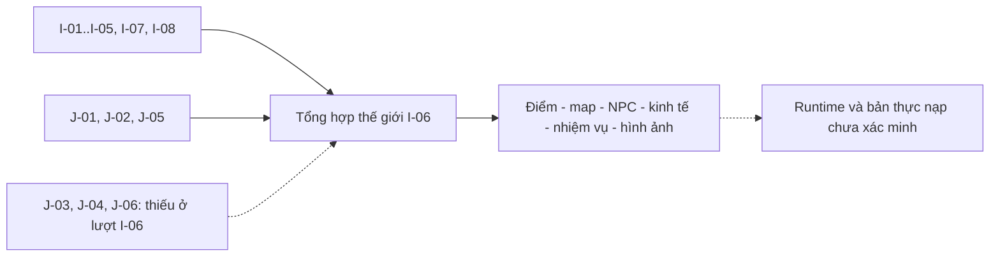

TÓM TẮT 1: [NGUỒN] PARTIAL toàn task: đã hoàn tất tài liệu tổng hợp I-01..I-05, I-07 và I-08, nhưng commit bị chặn quyền ghi Git metadata.
TÓM TẮT 2: [NGUỒN] Đã nối map/quái/NPC, điểm phát triển, cửa hàng/tiền tệ và nhiệm vụ; tách số liệu cấu hình, template, spawn và runtime.
TÓM TẮT 3: [NGUỒN] Animation gồm J-01, J-02, J-05; chưa có báo cáo J-03/J-04/J-06 trong worktree, dù task J-06 ghi done.
TÓM TẮT 4: [NGUỒN] Đã đối chiếu chênh lệch đếm shop, phần PAK bổ sung cho map và các rủi ro task/tiền/animation; kèm sổ thông số và đề xuất ưu tiên.
TÓM TẮT 5: [NGUỒN] Chỉ đọc/ghi tài liệu JX1_OPS; không sửa source, dùng Main VM, mạng, binary game, build/test runtime hoặc ghi khóa/mật khẩu.

# I-06 — Tổng hợp thế giới game

Loại: tổng hợp
Chủ đề: Nối các khảo sát về thế giới, kinh tế, nhiệm vụ và animation theo phạm vi lịch sử I-06.
Từ khóa: thế giới, world, map, NPC, tiền tệ, task, SPR, animation, I-06
Trạng thái: PARTIAL — giữ kết quả lịch sử; tổng hợp tài liệu xong, commit lượt I-06 bị chặn.
Độ phủ: đã phủ 10 trên tổng 13 nguồn dự kiến của lượt I-06 (7 nguồn I và 3/6 nguồn J); không phải độ phủ runtime toàn game.
Liên quan: [Tổng quan thế giới](../DESIGN/THE-GIOI-TONG-QUAN.md), [I-06b](I-06b.md), [I-07](I-07-cac-loai-tien-te.md), [I-08](I-08-he-thong-nhiem-vu.md)
Cần tôi quyết định: không — phần thiếu nguồn/runtime bàn giao theo kết luận cũ.

## Phạm vi và độ phủ

[ĐÃ XÁC MINH ở cấp tài liệu] Đơn vị đếm là **nguồn được tổng hợp tại lượt I-06**, không phải trạng thái hiện nay của cả chuỗi báo cáo. Đối chiếu tài liệu gốc chỉ đọc `JX1_OPS/DESIGN/THE-GIOI-TONG-QUAN.md:11` đến `:24`; bảng này đã có cập nhật I-06b, nên các hàng J-03/J-04 không được dùng để sửa ngược lịch sử I-06.

| Phần tử | Độ phủ của I-06 | Nguồn đối chiếu hiện có / giới hạn |
|---|---|---|
| I-01 — điểm | Đã phủ tài liệu | `JX1_OPS/DESIGN/THE-GIOI-TONG-QUAN.md:11`; runtime còn thiếu |
| I-02 — cửa hàng | Đã phủ tài liệu | `JX1_OPS/DESIGN/THE-GIOI-TONG-QUAN.md:12`; chưa thử giao dịch |
| I-03 — quái/spawn | Đã phủ tài liệu | `JX1_OPS/DESIGN/THE-GIOI-TONG-QUAN.md:13`; PAK hữu hạn |
| I-04 — map | Đã phủ tài liệu | `JX1_OPS/DESIGN/THE-GIOI-TONG-QUAN.md:14`; nguồn PARTIAL |
| I-05 — NPC chức năng | Đã phủ tài liệu | `JX1_OPS/DESIGN/THE-GIOI-TONG-QUAN.md:15`; chưa nối đủ instance/menu |
| I-07 — tiền tệ | Đã phủ tài liệu | `JX1_OPS/DESIGN/THE-GIOI-TONG-QUAN.md:16`; nguồn BLOCKED lịch sử |
| I-08 — nhiệm vụ | Đã phủ tài liệu | `JX1_OPS/DESIGN/THE-GIOI-TONG-QUAN.md:17`; chưa kiểm binding/DB |
| J-01 — nhân vật trần | Đã phủ tài liệu | `JX1_OPS/DESIGN/THE-GIOI-TONG-QUAN.md:18`; thiếu cặp asset |
| J-02 — quái/NPC | Đã phủ tài liệu | `JX1_OPS/DESIGN/THE-GIOI-TONG-QUAN.md:19`; metadata tĩnh |
| J-03 — kỹ năng | Chưa phủ trong lượt I-06 | Nay có file, được I-06b tổng hợp; `JX1_OPS/DESIGN/THE-GIOI-TONG-QUAN.md:20` |
| J-04 — lớp nhân vật | Chưa phủ trong lượt I-06 | Nay có file, được I-06b tổng hợp; `JX1_OPS/DESIGN/THE-GIOI-TONG-QUAN.md:21` |
| J-05 — chọn/cắt khung | Đã phủ tài liệu | `JX1_OPS/DESIGN/THE-GIOI-TONG-QUAN.md:22`; chưa đo tỷ lệ mất khung |
| J-06 — làm mượt animation | Chưa phủ | `JX1_OPS/DESIGN/THE-GIOI-TONG-QUAN.md:23`; task không thay báo cáo |

Đối chiếu dữ liệu gốc bổ sung của R-06b, chỉ để kiểm miền phạm vi: `G/Settings/Task/taskguide.txt:2` có 14 dòng dữ liệu; `A/Classes/gamecore/KNpc.h:106` đến `:120` có 15 giá trị hành động trước sentinel. `G` = server gs được task R-06b chỉ định; `A` = `D:/JX-build/qh9A`. Các lần đọc legacy dùng GB18030 (tương thích phần GBK), chỉ tin token/cột; tài liệu này lưu UTF-8 không BOM. Không dùng số đếm đó xác nhận lại số liệu thế giới trong thân báo cáo.

## Nội dung báo cáo gốc

Năm dòng tra cứu ở đầu dẫn lại tóm tắt lịch sử. Tóm tắt, số liệu, kết luận và bằng chứng gốc bên dưới được giữ nguyên; phần bổ sung R-06b không phải một lượt khảo sát gameplay mới.

## TOM TAT 5 DONG

1. PARTIAL toàn task: đã hoàn tất tài liệu tổng hợp I-01..I-05, I-07 và I-08, nhưng commit bị chặn quyền ghi Git metadata.
2. Đã nối map/quái/NPC, điểm phát triển, cửa hàng/tiền tệ và nhiệm vụ; tách số liệu cấu hình, template, spawn và runtime.
3. Animation gồm J-01, J-02, J-05; chưa có báo cáo J-03/J-04/J-06 trong worktree, dù task J-06 ghi done.
4. Đã đối chiếu chênh lệch đếm shop, phần PAK bổ sung cho map và các rủi ro task/tiền/animation; kèm sổ thông số và đề xuất ưu tiên.
5. Chỉ đọc/ghi tài liệu JX1_OPS; không sửa source, dùng Main VM, mạng, binary game, build/test runtime hoặc ghi khóa/mật khẩu.

## Phạm vi và đầu ra

- Task đã đọc: `JX1_OPS/TASKS/I-06.md`; worktree `D:\JX-wt\I-06`, nhánh `task/I-06` đúng giao việc.
- Trước ghi, Git chỉ có `?? JX1_OPS/TASKS/I-06.md`. Giữ nguyên file task có sẵn, không đưa vào commit tài liệu.
- Đầu ra chính: [THE-GIOI-TONG-QUAN.md](../DESIGN/THE-GIOI-TONG-QUAN.md). Báo cáo cuối duy nhất của lượt này là file I-06 này.
- Nguồn: bảy báo cáo I và ba báo cáo J được liên kết trong bảng phạm vi của tài liệu chính; task J-06 chỉ dùng để đối chiếu trạng thái/đầu ra thiếu. Không đọc source hay dữ liệu game ngoài JX1_OPS.

## ĐÃ XÁC MINH trong phạm vi tài liệu

| Kết quả | Bằng chứng và ý nghĩa |
|---|---|
| Đủ bảy phần I cần tổng hợp | I-01, I-02, I-03, I-04, I-05, I-07, I-08 đều có báo cáo; không coi trạng thái tổng hợp DONE là hoàn tất runtime của nguồn |
| Chênh lệch shop có lời giải từ cách đếm | I-05: 2.649 ô/479 mã; I-02 tách 5 ô chữ, còn 2.644 ô ID dương/474 ID khác nhau; dùng số của I-02 cho tham chiếu goods hợp lệ |
| Spawn PAK bổ sung một phần map | I-03 dẫn 955/993 map có .wor đọc được và 95.952 bản ghi NPC; không nhận đây là số sống hay ánh xạ đầy đủ NPC chức năng |
| Tiền và điểm được tách | Xu khác ExtPoint; vinh dự shop dùng task 2051, Tống Kim dùng 192; I-01 bổ sung danh vọng trần 100.000 cho phần I-07 chưa đọc đủ |
| Rủi ro task được giữ đúng mức | I-08 báo count BYTE và key 192 dùng trong phụ tuyến; cần kiểm cùng tập script nạp, chưa xác nhận mất DB/collision runtime |
| Animation có dữ liệu hữu hạn | J-01/J-02/J-05 có source/metadata; chưa có cặp asset đúng bản, tỷ lệ rơi frame, FPS/RAM hoặc kết luận làm mượt J-06 |

## CHƯA XÁC MINH và điểm tiếp tục

- Các kết quả source/dữ liệu trong tài liệu chính đều dẫn lại báo cáo nguồn; I-06 không tái khảo sát độc lập và không xác nhận chúng khớp binary/PAK thực nạp.
- I-04/I-05 còn PARTIAL; I-07 tự ghi BLOCKED về backlog ở lượt nguồn. Giữ nguyên trạng thái đó; I-06 được giao trực tiếp và hoàn tất việc tổng hợp hiện có, không nhận thay phần thiếu.
- Chưa có đầu ra J-03/J-04/J-06; J-06 task done không đủ để xác nhận kết luận. Điểm tiếp tục là nhận báo cáo tương ứng và bổ sung ở lượt tài liệu sau.
- HuoYueDu, skill lửa trại 1705/1706, 38 map chưa khớp, NPC/menu, TASKSYS, reset, tính nguyên tử thưởng/tiền, ABI/persistence và chất lượng animation còn cần bằng chứng riêng.
- Chưa chạy build, test, game, TESTER, benchmark hoặc DB round-trip; không kết nối Main VM hay server. Phần tổng hợp tài liệu đã xong; bước commit bị chặn như ghi bên dưới.

## MUC SO THONG SO

Sổ đầy đủ dạng rút gọn, đơn vị, mức an toàn và file:line dẫn nguồn nằm tại mục cùng tên trong [tổng quan](../DESIGN/THE-GIOI-TONG-QUAN.md#muc-so-thong-so). Các số tiêu biểu:

| Nhóm | Thông số dẫn lại | Giá trị | Ý nghĩa/giới hạn | Nguồn |
|---|---|---|---|---|
| Điểm | Tiềm năng/kỹ năng mỗi cấp | 5/1 | Nhánh LevelUp nguồn, chưa chạy | I-01; `KPlayer.cpp:61,62,3264` |
| Map | Count/mục WorldSet | 800/872 | Mục xét tải khác số map chạy | I-04; `KSubWorldSet.cpp:448,458` |
| Shop | Goods/ID tham chiếu hợp lệ | 1.464/474 | Dòng bảng/ID, không phải giao dịch | I-02; mục Số liệu |
| NPC | Kind=0/Kind=3 | 1.412/958 | Template, không phải instance | I-03/I-05; mục đếm Npcs.txt |
| Task | Count lưu bền | BYTE, 255 | Record khác 0, không phải quota quest | I-08; `S3DBInterface.h:193` |
| Animation | Render mục tiêu | 1/60 giây | Chưa phải FPS đo được | J-05; `AppDelegate.cpp:119` |

Đây là sổ dẫn tài liệu; không thông số nào được đổi trong I-06.

## DE XUAT TOI UU

Ưu tiên manifest phiên bản và hợp đồng tiền/task; sau đó kiểm persistence/phát thưởng, nối NPC→script và đối chiếu gameplay theo chuỗi. Animation cần asset đúng bản cùng baseline tick/frame/FPS/RAM trước quyết định thêm khung hoặc đổi timing. Thứ tự và điều kiện chi tiết nằm trong [tổng quan](../DESIGN/THE-GIOI-TONG-QUAN.md#de-xuat-toi-uu); chưa triển khai thay đổi hoặc chạy ca test.

## Lỗi, cách xử lý và kiểm tra

- `rg` không có trong PowerShell: lỗi `The term 'rg' is not recognized`. Chuyển sang `Get-ChildItem`/`Select-String` trong JX1_OPS, không cài công cụ hoặc thử lại lỗi đó.
- Hai lần đọc gộp báo cáo dài bị công cụ cắt đầu ra (`truncated output`). Đã đọc bổ sung các đoạn cần thiết theo mục/dải dòng nhỏ; không coi phần bị cắt là đã đọc đủ và không tạo parser/script phụ. Không cần đọc toàn văn các phần ngoài mục tiêu tổng hợp.
- Kiểm tra tự động đề mục bắt buộc, liên kết nội bộ tới file hiện có và tóm tắt đúng năm dòng: **PASS**. Đủ bảy phần I và phạm vi J đã được đối chiếu từ báo cáo nguồn.
- `git add -- JX1_OPS/DESIGN/THE-GIOI-TONG-QUAN.md JX1_OPS/REPORTS/I-06.md` thất bại: `fatal: Unable to create 'D:/jx1-reports/.git/worktrees/I-06/index.lock': Permission denied`. Không có staging/commit thành công. Metadata worktree nằm ngoài writable root `D:\JX-wt\I-06`; không đổi quyền, không dùng index/repository thay thế hoặc cấu hình để vượt sandbox. Không thử lại thao tác ghi bị chặn.
- Vì staging thất bại, chưa chạy được chuỗi kiểm tra cached dự kiến. Đã xem diff hai file local bằng `git diff --no-index` với `NUL`; mã thoát 1 biểu thị có khác biệt. Lần kiểm `--check` đầu đã xử lý nhầm mã 1 thành lỗi dù không có chẩn đoán whitespace; chuyển sang kiểm trailing whitespace trực tiếp bằng PowerShell, không ghi Git metadata. Kết quả kiểm cuối được trả trong bàn giao.

## Kết quả và Git

**PARTIAL** — hoàn tất hai đầu ra tài liệu thuộc phạm vi đã giao; **BLOCKED ở bước commit** do quyền ghi Git metadata. Không sửa task/source hoặc tài liệu nguồn. Các hạn chế chưa xác minh được liệt kê ở trên và trong tài liệu chính.

Nhánh đã xác nhận: `task/I-06`. **Commit SHA: chưa có** vì `git add` thất bại trước commit. **BỊ CHẶN – CHƯA PUSH**; không yêu cầu push và không kết nối GitHub để công bố. Không tuyên bố có bằng chứng commit/GitHub.

Điểm tiếp tục: trong môi trường được phép ghi Git metadata của worktree, stage đúng hai file `JX1_OPS/DESIGN/THE-GIOI-TONG-QUAN.md` và `JX1_OPS/REPORTS/I-06.md`, kiểm staged diff rồi commit trên `task/I-06`. Giữ nguyên file task untracked có sẵn; không cần chạy lại khảo sát.

## Bàn giao chuẩn hóa R-06b

[ĐÃ XÁC MINH] Đã bổ sung khối thông tin, sơ đồ, bảng 13 nguồn và liên kết; nội dung I-06 giữ nguyên. [CHƯA XÁC MINH] Không tái kiểm source lịch sử, binary, PAK, DB hoặc runtime; không build, chạy exe/VM/mạng. Commit chuẩn hóa và kết quả kiểm tài liệu được ghi tại [R-06b](R-06b.md), tách với lỗi Git lịch sử của I-06. Bước tiếp theo về nghiệp vụ vẫn theo mục CHƯA XÁC MINH gốc.

## Phát hiện khi chuẩn hóa

- [ĐÃ XÁC MINH ở cấp tài liệu] Dòng tóm tắt và mục thiếu J-03/J-04 mô tả thời điểm I-06. Hai file hiện có trong worktree, và `JX1_OPS/DESIGN/THE-GIOI-TONG-QUAN.md:20`/`:21` ghi I-06b đã tổng hợp; không sửa lặng các câu lịch sử.
- [ĐÃ XÁC MINH ở cấp tài liệu] Báo cáo này giữ PARTIAL toàn task do Git, còn `JX1_OPS/DESIGN/THE-GIOI-TONG-QUAN.md:3` ghi DONE trong phạm vi tổng hợp. Hai mức phạm vi khác nhau được giữ cạnh nhau, không đổi kết luận.
- [CHƯA XÁC MINH] Bằng chứng source trong thân là dẫn lại các lượt nguồn. Không coi đường dẫn hoặc số dòng lịch sử là đã được R-06b tái xác minh; không phát hiện ký tự thay thế U+FFFD trong văn bản UTF-8 của file.
