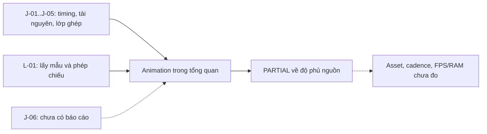

TÓM TẮT 1: [NGUỒN] PARTIAL — đã cập nhật Animation và bảng độ phủ theo J-01..J-05, L-01; chưa tìm thấy báo cáo J-06 trong worktree được giao.
TÓM TẮT 2: [NGUỒN] Bổ sung bảy nhóm hiệu ứng, vòng đời/release, lớp ghép/SORT và phân biệt logic mục tiêu 18 tick/giây với render mục tiêu 60 Hz.
TÓM TẮT 3: [NGUỒN] L-01 được ghi đúng là thiết kế thử A/B về lấy mẫu/phép chiếu; chưa patch, thêm khung, đo chất lượng hay chi phí thực tế.
TÓM TẮT 4: [NGUỒN] Chỉ sửa `JX1_OPS/DESIGN/THE-GIOI-TONG-QUAN.md` và viết báo cáo này; không sửa code/task, không đọc hoặc ghi khóa.
TÓM TẮT 5: [NGUỒN] Đã kiểm tài liệu và liên kết cục bộ; không chạy game/exe, build/test runtime, VM hoặc mạng; không stage/commit/push.

# I-06b — Cập nhật Animation và bảng độ phủ thế giới

Loại: tổng hợp
Chủ đề: Bổ sung các tầng animation, lớp ghép và lấy mẫu ảnh vào tổng quan thế giới.
Từ khóa: hoạt ảnh, animation, SPR, SORT, vòng đời, tick, render, J-06, L-01
Trạng thái: PARTIAL — giữ kết luận cũ vì thiếu báo cáo J-06.
Độ phủ: đã phủ 6 trên tổng 7 nguồn (J-01..J-05 và L-01); J-06 chưa phủ, runtime chưa đo.
Liên quan: [Tổng quan thế giới](../DESIGN/THE-GIOI-TONG-QUAN.md), [I-06](I-06.md), [J-01](J-01-animation-nhan-vat-tran.md), [J-03](J-03-hoat-anh-ky-nang.md), [J-04](J-04-lop-chong-nhan-vat.md), [L-01](L-01-lam-muot-hinh-anh.md), [Task J-06](../TASKS/J-06.md)
Cần tôi quyết định: không — cần đầu ra J-06 để tiếp tục phần thiếu, không tự tạo kết luận thay.

## Phạm vi và độ phủ

[ĐÃ XÁC MINH ở cấp tài liệu] Đơn vị đếm là nguồn của phần cập nhật animation, đối chiếu tài liệu tổng hợp gốc chỉ đọc. Sáu nguồn hiện có không đồng nghĩa sáu phần đã được xác nhận runtime.

| Phần tử | Độ phủ | Nguồn đối chiếu / giới hạn |
|---|---|---|
| J-01 — nhân vật trần | Đã phủ tài liệu | `JX1_OPS/DESIGN/THE-GIOI-TONG-QUAN.md:18`; còn thiếu cặp asset |
| J-02 — quái/NPC | Đã phủ tài liệu | `JX1_OPS/DESIGN/THE-GIOI-TONG-QUAN.md:19`; mới có metadata |
| J-03 — kỹ năng | Đã phủ tài liệu | `JX1_OPS/DESIGN/THE-GIOI-TONG-QUAN.md:20`; bảy nhóm, vòng đời tĩnh |
| J-04 — lớp nhân vật | Đã phủ tài liệu | `JX1_OPS/DESIGN/THE-GIOI-TONG-QUAN.md:21`; thiếu SORT/asset thực nạp |
| J-05 — chọn/cắt khung | Đã phủ tài liệu | `JX1_OPS/DESIGN/THE-GIOI-TONG-QUAN.md:22`; chưa đo tỷ lệ mất khung |
| J-06 — làm mượt animation | Chưa phủ | `JX1_OPS/DESIGN/THE-GIOI-TONG-QUAN.md:23`; chỉ có task, chưa có báo cáo |
| L-01 — làm mượt hình ảnh | Đã phủ tài liệu | `JX1_OPS/DESIGN/THE-GIOI-TONG-QUAN.md:24`; kế hoạch A/B, không thay J-06 |

Đối chiếu miền dữ liệu gốc R-06b: client A `D:/JX-build/qh9A/Classes/gamecore/KNpc.h:106` đến `:120` liệt kê 15 giá trị trước `cdo_count`; `Classes/engine/KbugInfo.h:245`/`:247`/`:248` tách Frames, Directions, nInterval theo game frame. Đây chỉ là kiểm cấu trúc tĩnh ở bản A, không xác minh lại công thức, FPS hay hash của các nguồn O/C lịch sử. Legacy đọc GB18030, token số/ASCII được ưu tiên; báo cáo UTF-8 không BOM.

## Nội dung báo cáo gốc

Các tóm tắt và kết quả sau giữ nguyên lịch sử I-06b; không coi những câu về Git/nhánh cũ là trạng thái của lượt R-06b.

## TOM TAT 5 DONG

1. **PARTIAL** — đã cập nhật Animation và bảng độ phủ theo J-01..J-05, L-01; chưa tìm thấy báo cáo J-06 trong worktree được giao.
2. Bổ sung bảy nhóm hiệu ứng, vòng đời/release, lớp ghép/SORT và phân biệt logic mục tiêu 18 tick/giây với render mục tiêu 60 Hz.
3. L-01 được ghi đúng là thiết kế thử A/B về lấy mẫu/phép chiếu; chưa patch, thêm khung, đo chất lượng hay chi phí thực tế.
4. Chỉ sửa `JX1_OPS/DESIGN/THE-GIOI-TONG-QUAN.md` và viết báo cáo này; không sửa code/task, không đọc hoặc ghi khóa.
5. Đã kiểm tài liệu và liên kết cục bộ; không chạy game/exe, build/test runtime, VM hoặc mạng; không stage/commit/push.

## DA XAC MINH

- Đọc task `JX1_OPS/TASKS/I-06b.md:11`: cập nhật mục Animation/bảng độ phủ, chỉ đọc báo cáo/mã, không sửa mã. Git kiểm tra một lần trước ghi: nhánh `task/I-06b`, chỉ có file task I-06b untracked có sẵn; giữ nguyên file này.
- Báo cáo hiện có: `J-01-animation-nhan-vat-tran.md:24,27,48,54`; `J-02-animation-quai-npc.md:11,18,48`; `J-03-hoat-anh-ky-nang.md:28,43,57,61,71`; `J-04-lop-chong-nhan-vat.md:22,33,39,56,62,66`; `J-05-cat-khung-animation.md:18,20,33,48`; `L-01-lam-muot-hinh-anh.md:19,27,32,41,74,82,88,158` (đều thuộc `JX1_OPS/REPORTS`). Chỉ đối chiếu nội dung và dòng báo cáo; không xác minh lại source game.
- `JX1_OPS/TASKS/J-06.md:4` ghi `done`, `:9` chỉ định báo cáo `J-06-*.md`, `:11` nêu yêu cầu đánh giá, `:12` nêu đầu ra. Dò tên trong `REPORTS` và dò `*J-06*` trong `JX1_OPS` chỉ tìm thấy task; không có kết quả báo cáo J-06 để tổng hợp. Không tìm ở worktree/repo khác hoặc suy kết luận từ task.
- Bảng độ phủ thêm hàng riêng J-03, J-04, J-06, L-01; giữ PARTIAL của các nguồn và giới hạn metadata/asset/runtime. Các nhận xét lịch sử “chưa có J-05” trong nguồn được giải thích theo thời điểm, không sửa nguồn.
- Mục Animation bổ sung timing/vòng đời kỹ năng, năm nhóm cập nhật so với sức chứa legacy, appearance override và SORT; tách source gốc với mirror glow/sét. L-01 được tách khỏi quyết định khung giữa J-06. Sổ thông số, dòng liên kết trạng thái→hình ảnh, khoảng trống, đề xuất Animation và bàn giao được cập nhật để thống nhất nội dung.

## CHUA XAC MINH

- Chưa có báo cáo J-06: chưa chốt cần/không cần khung giữa, số khung cần thêm, công sức hoặc chi phí APK/RAM/texture do thêm frame. Đây là phần còn thiếu của phạm vi J-01..J-06, không được thay bằng kế hoạch L-01.
- Chưa kiểm source/binary/asset đúng bản, header SPR thực nạp, bảng SORT, cadence, FPS/frame-time, duration/frame cuối, alias state hoặc cleanup owner trong game. Những nghi vấn của J-03/J-04 là bằng chứng tĩnh dẫn lại.
- Chưa triển khai A/B, shader xBRZ, phép chiếu float, target mật độ cao hay thay asset. Con số RAM 1→4 MiB/target là phép tính có điều kiện của L-01, không phải đo RAM hoặc dung lượng APK.

## Kiểm tra thực chạy / chưa chạy

- Đã chạy đọc UTF-8 bằng PowerShell, `Select-String` kiểm heading/dòng truy vết và dò file J-06 trong phạm vi `JX1_OPS`.
- Kiểm tra tài liệu cục bộ **PASS**: 16 đích liên kết tồn tại, 90 dòng bảng đúng số cột, đúng năm dòng tóm tắt, đủ nhãn xác minh và không còn câu cũ gộp J-03/J-04 là thiếu báo cáo.
- Đã xem diff một lần cho thiết kế và báo cáo mới; `git diff --no-index` trả 1 vì hai phía khác nhau, không phải lỗi đọc file. Kiểm whitespace bằng `git diff --check` cho file tracked và `git diff --no-index --check` cho báo cáo mới; không coi các kiểm tra tài liệu này là test game.
- **Chưa chạy:** build, unit/integration test mã, TESTER, benchmark, APK/client/server/exe, DB, VM, mạng. Task chỉ tổng hợp báo cáo nên không chạy các thao tác đó.

## Lỗi / cách thử / kết quả

- `rg` không có (`The term 'rg' is not recognized`): chuyển sang `Get-ChildItem`/`Select-String` giới hạn thư mục; không cài công cụ.
- Bộ lọc tên lần đầu chỉ khớp `J-01.md` nên không trả các báo cáo có hậu tố: sửa mẫu theo `J-01-...md` đến J-06/L-01, đã tìm đủ sáu báo cáo hiện có.
- Đọc gộp báo cáo bị cắt output: đọc lại các đoạn cần dùng có số dòng, không dùng đoạn bị cắt làm bằng chứng đã đọc đầy đủ. Chỉnh các mốc J-01 và J-06 theo dòng vật lý đã kiểm.
- Thiếu báo cáo J-06 dù prompt nói “nay đã có”: hoàn thành phần độc lập bằng các báo cáo có thật, ghi rõ thiếu nguồn trong thiết kế và báo cáo; không tự soạn kết luận J-06.

## Bàn giao

Trạng thái **PARTIAL** về độ phủ J-01..J-06; phần tổng hợp nguồn hiện có đã hoàn tất. Đầu ra thiết kế: `JX1_OPS/DESIGN/THE-GIOI-TONG-QUAN.md:3` (trạng thái), `:9` (bảng độ phủ), `:107` (Animation), `:165` (đối chiếu), `:179` (sổ thông số). Báo cáo này là đầu ra thứ hai duy nhất. Không stage/commit/push; không có SHA hoặc bằng chứng GitHub để công bố. PM cần đưa báo cáo J-06 đã duyệt vào worktree này; bước tiếp tục là đọc và bổ sung đúng hàng độ phủ/kết luận Animation, không làm lại phần đã có bằng chứng.

## Bàn giao chuẩn hóa R-06b

[ĐÃ XÁC MINH] Khối thông tin, sơ đồ và bảng 7 nguồn đã bổ sung; không sửa kết luận hoặc sổ thông số trong thiết kế. [CHƯA XÁC MINH] Không chạy A/B, build, exe, VM, mạng hoặc phép đo animation. Kết quả kiểm tài liệu và commit chuẩn hóa ghi tại [R-06b](R-06b.md); bàn giao nghiệp vụ I-06b vẫn là nhận báo cáo J-06.

## Phát hiện khi chuẩn hóa

- [ĐÃ XÁC MINH ở cấp tài liệu] J-06 vẫn không có file báo cáo khớp tên trong `JX1_OPS/REPORTS`; không dùng trạng thái task thay đầu ra (`JX1_OPS/DESIGN/THE-GIOI-TONG-QUAN.md:23`).
- [CHƯA XÁC MINH] O/C trong nguồn cũ khác root A được R-06b cho đọc. Không đồng nhất 18 tick/giây, 60 Hz hoặc phép tính RAM với số đo mới trên bản A; giữ nguyên giới hạn cũ.
- [ĐÃ XÁC MINH ở cấp văn bản] Các mốc dòng báo cáo nguồn trong thân là mốc lịch sử; chuẩn hóa có thể làm dịch dòng, nên tra thêm tên mục/symbol. Không phát hiện U+FFFD khi đọc UTF-8; chưa kiểm font trong game.
