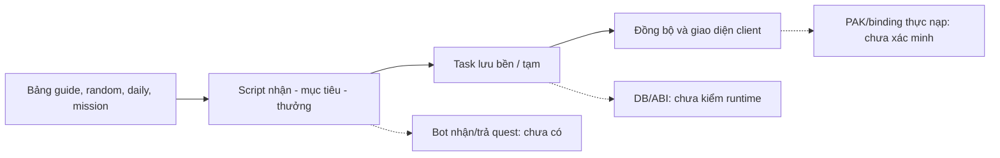

TÓM TẮT 1: [NGUỒN] Giữ kết luận DONE khảo sát tĩnh I-08; biến task lưu bền/tạm không phải danh mục quest hoạt động.
TÓM TẮT 2: [NGUỒN] Bảng phạm vi bổ sung 8 nhóm dữ liệu nhiệm vụ và 3 mặt cắt lưu bền, UI/gói tin, Bot.
TÓM TẮT 3: [NGUỒN] R-06b đối chiếu G: 14 dòng guide, 4 loại random, 17 mẫu kill, 33 mission, 47 timer, 117/107 tên entity/rate.
TÓM TẮT 4: [CHƯA KIỂM] Runtime, binding TASKSYS, PAK thực nạp, ABI/DB và quest mở hảo hữu còn theo giới hạn khảo sát gốc.
TÓM TẮT 5: [NGUỒN] Chỉ chuẩn hóa tài liệu, giữ nguyên tóm tắt/kết luận/sổ thông số cũ; không build, chạy test game, exe, VM hoặc mạng.

# I-08 — Hệ thống nhiệm vụ

Loại: khảo sát
Chủ đề: Phân loại dữ liệu nhiệm vụ, biến trạng thái, nhận/trả/thưởng, UI và khả năng Bot theo khảo sát tĩnh.
Từ khóa: nhiệm vụ, quest, TASKSYS, GetTask, nTaskCount, daily, random, mission, taskguide, Bot
Trạng thái: DONE — chỉ trong phạm vi khảo sát tĩnh I-08, giữ nguyên giới hạn chưa chạy.
Độ phủ: đã phủ mô tả tĩnh 11 trên tổng 11 nhóm (8 nhóm dữ liệu và 3 mặt cắt); runtime chưa phủ; tổng quest hoạt động chưa đếm được vì thiếu manifest/binding thực nạp.
Liên quan: [I-07](I-07-cac-loai-tien-te.md), [I-06](I-06.md), [A-12](A-12-hao-huu-mac-do.md), [A-14](A-14-hao-huu-trang-bi-thiet-ke.md), [E-02](E-02-hanh-vi-bot.md), [Tổng quan thế giới](../DESIGN/THE-GIOI-TONG-QUAN.md)
Cần tôi quyết định: không — các ca TESTER/binding/DB cần task riêng theo bàn giao cũ.

## Phạm vi và độ phủ

[ĐÃ XÁC MINH ở cấp dữ liệu/source] Bảng gồm đủ 8 nhóm dữ liệu của khảo sát gốc và 3 mặt cắt kỹ thuật; **đã phủ mô tả tĩnh** không có nghĩa đã hoàn tất mọi quest hoặc đã chạy hệ đó. `G/` = `C:/Jx1CocoV3/Folder/ServerNew-20260116T043145Z-3-001/ServerNew/_bin_v2_/gs/`; `A/` = `D:/JX-build/qh9A/`. R-06b chỉ đọc G/A; các root S/H/L/C/O trong thân vẫn là bằng chứng lịch sử, chưa tái kiểm. Legacy đọc GB18030; chỉ dùng tên cột, token và số khi chữ Việt không tin cậy. Báo cáo lưu UTF-8 không BOM.

| Phần tử | Độ phủ | Bằng chứng trực tiếp R-06b / phần còn thiếu |
|---|---|---|
| Chính tuyến | Đã phủ mô tả tĩnh | G `script/task/newtask/master/newtaskprize.lua:15`/`:16`/`:17` đọc 1001/1002/1003; chưa thử thưởng |
| Phụ tuyến | Đã phủ mô tả tĩnh | G `script/task/newtask/branch/branch_prize.lua:51` có gate 1050/bit 192; 36 cổng là số lịch sử giữ nguyên, chưa đếm lại mọi gate |
| Daily | Đã phủ mô tả tĩnh | G `Settings/Task/taskguide.txt:6` đến `:8`; G `Settings/Task/dailytask/killmonster.txt:2` có 17 TaskId duy nhất, KillCount đều 20; reset/kill credit chưa kiểm |
| Random/vòng lặp | Đã phủ mô tả tĩnh | G `Settings/Task/task_type.txt:2` đến `:5` có 4 loại; các bảng random đọc lại được 117/107 tên; loop runtime chưa kiểm |
| Sự kiện/mission | Đã phủ mô tả tĩnh | G `Settings/Task/missions.txt:2`: 33 bản ghi; G `Settings/TimerTask.txt:2`: 47 bản ghi; không cộng thành số quest |
| Lịch định kỳ | Đã phủ mô tả tĩnh | G `Settings/Task/tasklist.ini:2` Count=1; `Settings/Task/tasklist_default.ini:2` Count=39; chưa biết loader chọn bản nào |
| Môn phái/kỹ năng | Đã phủ mô tả tĩnh | G `Settings/Task/taskguide.txt:3`/`:4`; G `script/task/lv120skill/item/lv120skillbook.lua:12` và `lv150skillbook.lua:12`; chưa có tổng quest từng phái |
| Đồng bạn | Đã phủ dấu vết tĩnh | G `Settings/Task/taskguide.txt:10`/`:11`/`:12`; G `script/task/random/task_head.lua:24` IncludeLib PARTNER; chưa phủ chuỗi mở roster thực |
| Kho task và lưu bền | Đã phủ mô tả tĩnh | A `Classes/gamecore/KPlayerTask.h:13`/`:30`; G `Settings/TaskID.txt:1` chỉ header; BYTE/save/DB là bằng chứng server lịch sử chưa tái kiểm |
| UI và gói tin | Đã phủ mô tả tĩnh | A `Classes/gameui/KuiTaskInfo.cpp:124`/`:955`; A `Classes/gamecore/KProtocolProcess.cpp:1552`; G guide có 16 đường Lua riêng, 0 file rời tại G; chưa kiểm PAK/APK |
| Hảo hữu/Bot/TESTER | Đã phủ phân tích và kế hoạch | Nguồn gián tiếp: mục Vòng lặp mục tiêu hảo hữu và ma trận Q01..Q14 trong thân; chưa phủ nhận/trả quest Bot hoặc chạy TESTER |

Cách đếm R-06b: bỏ header và dòng trắng ở guide/kill/mission/timer; random bỏ thêm dòng mô tả vật lý 2 và đếm TaskName duy nhất theo từng bảng. Kết quả talk/coll/kill/next: entity 9/32/32/44, rate 5/28/32/42; tổng lần lượt 117/107, không phải 117 quest hoạt động. Nguồn: G `Settings/Task/random/{talk,coll,kill,next}/entity.txt:3` và `Settings/Task/random/rate_{talk,coll,kill,nexttask}.txt:3`. Hai cột đường script của G `Settings/Task/taskguide.txt:2` có tổng 16 đường khác nhau; chỉ kiểm file rời, chưa tra PAK.

## Nội dung báo cáo gốc

TÓM TẮT 1: [NGUỒN] Server dùng biến task lưu bền và tạm; task ID hợp lệ 0..9999, không đồng nghĩa 10.000 nhiệm vụ.
TÓM TẮT 2: [NGUỒN] nTaskCount là BYTE; save đếm mọi biến khác 0 rồi thu hẹp, cần kiểm biên 255/256 trước mở rộng hảo hữu.
TÓM TẮT 3: [NGUỒN] Random có 117 tên nội dung/107 tên bảng chọn; daily kill có 17 mẫu nhưng script chọn 1..16; 36 cổng thưởng phụ tuyến.
TÓM TẮT 4: [NGUỒN] Coco có panel/trace/gói task; 16 đường script hướng dẫn không có file rời, IncludeLib TASKSYS trong source là no-op; Bot chưa có nhận/trả quest.
TÓM TẮT 5: DONE khảo sát tĩnh ngày 17/11/2026; có ma trận TESTER và sổ thông số; chưa chạy test/build/runtime, chưa commit/push, không mạng/VM/exe.

## Phạm vi và điểm tiếp tục

Worktree `D:\JX-wt\I-08`, branch `task/I-08` đúng task; Git trước ghi có sẵn `?? JX1_OPS/TASKS/I-08.md`. Giữ nguyên nội dung task gốc. Chỉ ghi báo cáo I-08 và mục Kết quả được task yêu cầu trực tiếp. Không stage/commit/push khi chưa được yêu cầu; không mạng thật.

Đã đọc A-12/A-14 và E-02 phần liên quan. E-04 mới có dòng backlog, chưa có file task/báo cáo E-04 tại worktree. Dòng I-08 chưa có trong BACKLOG cục bộ; làm theo giao việc trực tiếp của chủ dự án và file I-08 hiện hữu, không sửa backlog.

Quy ước bằng chứng: `S/` = `D:/JX-source/server/jxOnline/gameserver/Sources/Core/Src/`; `H/` = `D:/JX-source/server/jxOnline/gameserver/Headers/`; `L/` = `D:/JX-source/server/jxOnline/gameserver/Lib/`; `C/` = `D:/JX-source/client/Classes/`; `G/` = `C:/Jx1CocoV3/Folder/ServerNew-20260116T043145Z-3-001/ServerNew/_bin_v2_/gs/`. Dòng vật lý từ 1; legacy đọc GB18030, chuỗi Việt chưa giải mã tin cậy thì chỉ dùng token/cột số. Không xuất bảng dài, dữ liệu tài khoản hoặc thông tin truy cập.

## ĐÃ XÁC MINH

- `S/KPlayerTask.h:13` đặt MAX_TASK=10000; `:57` dùng unordered_map cho giá trị bền/tạm. `S/KPlayerTask.cpp:84` đọc giá trị vắng thành 0, `:104` ghi có kiểm miền, `:69` xóa biến tạm. Đây là kho key/value dùng cả cho gameplay ngoài nhiệm vụ.
- `L/S3DBInterface.h:193` khai báo BYTE nTaskCount; `:206` record gồm int ID/int value. `S/KPlayerDBFuns.cpp:1844` quét MAX_TASK, ghi mọi giá trị khác 0, `:1862` gán count về BYTE; load `:1346` lấy đúng count đó. `S/KPlayer.h:284` buffer role 128 KiB. Chưa build ABI hay round-trip DB.
- `G/Settings/Task/taskguide.txt:2` có hướng dẫn tân thủ; `:3` môn phái; `:6`–`:8` daily; `:10`–`:11` giáo dục/cốt truyện đồng bạn. Thư mục `G/script/ui/task` tồn tại nhưng rỗng: chưa đủ chứng minh UI script có trong PAK.
- `G/Settings/Task/task_type.txt:2`–`:5` khai báo random talk/collect/kill/scroll. `G/Settings/TaskID.txt:1` chỉ có header, không phải catalog đầy đủ.

## CHƯA XÁC MINH

Runtime, source có khớp binary/PAK thực nạp hay không, số nhiệm vụ hoạt động duy nhất theo loại, đầy đủ script nhiệm vụ đồng bạn, nhận/thưởng đồ thực tế, độ bền DB, ABI và kill credit Bot. Không build hoặc chạy TESTER trong task khảo sát tĩnh.

## Bảng số liệu và cách đếm

[XÁC MINH] Đếm trực tiếp bằng `python -I -` trong bộ nhớ, không tạo parser/script phụ. Bảng thông thường bỏ header và dòng trắng; bộ `random/` còn bỏ dòng vật lý 2 là mô tả cột. Đếm tên bằng cột TaskName, không dùng ID trống/lặp của `rate_nexttask`. Không cộng bảng thưởng, bảng hội thoại hay file NPC thành số nhiệm vụ. Bỏ `Copy`, `--`, `.old`, `.rar`, bản `taskdata---.ini`, hai bảng `_thong1/_thong2` và cây `talk/talk` khỏi số chính. Các số dưới đây là cấu trúc dữ liệu/source đang có, **không phải tổng nhiệm vụ đang chạy**.

| Loại | Số lượng xác minh tĩnh | Đơn vị/giới hạn | Bằng chứng |
| --- | --- | --- | --- |
| Chính tuyến | 3 tuyến trạng thái | Biến 1001/1002/1003 theo chính/trung/tà; không đếm mỗi bước là quest riêng | G/script/task/newtask/master/newtaskprize.lua:14; G/script/task/newtask/newtask_head.lua:42 |
| Phụ tuyến | 36 cổng thưởng, 12 mỗi phe | Tập duy nhất (task ID, biến bit, bit); 1050..1061, cờ 192/193/194; không phải 36 NPC | G/script/task/newtask/branch/branch_prize.lua:51,102,152; nhánh nhận thưởng tới :196 |
| Daily | 3 loại khai báo; kill/gather có luồng mẫu, talk vô hiệu trong NPC mẫu | Kill 17 TaskId duy nhất, 16 ID được SHAGUAI chọn; gather 4 mẫu, mỗi mẫu cần 3 lần | G/Settings/Task/taskguide.txt:6; G/Settings/Task/dailytask/killmonster.txt:2; DLY:64,136; DLH:29 |
| Random/vòng lặp | 4 loại trong task_type; 117 tên entity, 107 tên bảng chọn | Các tên có thể là công đoạn/phần của scroll, không cộng thành 117 quest hoạt động | G/Settings/Task/task_type.txt:2; bảng chi tiết dưới |
| Sự kiện/mission | 33 khóa mission, 47 khóa timer | Bảng route script, nhiều timer chung một sự kiện | G/Settings/Task/missions.txt:2; G/Settings/TimerTask.txt:2 |
| Lịch định kỳ | 1 mục ở task/tasklist.ini; 39 mục ở tasklist_default.ini | Manifest chính/default, không cộng; chưa xác nhận loader/runtime chọn bản nào | G/Settings/Task/tasklist.ini:2; tasklist_default.ini:2 |
| Môn phái/kỹ năng | 1 mục môn phái + 1 mục kỹ năng 150 trong guide; 2 biến thể sách 120/150 | Có 4 file item/mineitem nhưng không tính thành 4 nhiệm vụ; chưa có tổng quest theo từng phái | G/Settings/Task/taskguide.txt:3; G/script/task/lv120skill/item/lv120skillbook.lua:12; lv150skillbook.lua:12 |
| Đồng bạn | 2 mục guide (giáo dục/cốt truyện), 1 mục scroll liên quan PARTNER | Chưa thấy chuỗi quest mở roster hảo hữu mới hoàn chỉnh | G/Settings/Task/taskguide.txt:10; G/script/task/random/task_head.lua:24 |

Hai đường dẫn legacy dài dùng bí danh để giữ file:line chính xác:

- `DLY` = `G/script/Á½ºþÇø/npc/ÈÕ³£ÈÎÎñ/Áú¶ù.lua` (267 dòng).
- `DLH` = `G/script/Á½ºþÇø/npc/ÈÕ³£ÈÎÎñ/Áú¶ù_Í·Îļþ.lua` (83 dòng).
- `LOOP` = `G/script/missions/ÈÎÎñ/Ò°ÛŶԻ°Í·Îļþ.lua` (1322 dòng, loại bản Copy).

| Bộ random | Dòng entity / tên duy nhất | Dòng award / tên duy nhất | Tên trong rate | Entity thiếu rate / thiếu award |
| --- | --- | --- | --- | --- |
| talk | 13 / 9 | 20 / 8 | 5 | 4 / 1 |
| coll | 64 / 32 | 104 / 32 | 28 | 4 / 0 |
| kill | 32 / 32 | 38 / 32 | 32 | 0 / 0 |
| next (scroll lớp sau) | 292 / 44 | 204 / 44 | 42 | 2 / 0 |

Nguồn: `G/Settings/Task/random/{talk,coll,kill,next}/{entity,award}.txt:3` và `rate_{talk,coll,kill,nexttask}.txt:3`. Không có tên rate thiếu entity. Thiếu rate có thể là nội dung không được chọn theo thiết kế; không tự sửa. `rate_show.txt` chỉ có header/mô tả, không có mẫu. `task_type.txt:3,4` trỏ tới `coll/condition.txt`, `kill/condition.txt` không tồn tại dạng rời; hai bảng condition talk/next chỉ có header/mô tả.

| Dữ liệu vòng lặp | Số dòng dữ liệu | Ý nghĩa |
| --- | --- | --- |
| tasklink_buygoods / findgoods / showgoods | 35 / 526 / 45 | 45 dòng showgoods chỉ có 33 TaskID duy nhất |
| tasklink_findmaps / upground / worldmaps / arrayitem | 208 / 45 / 11 / 18 | Pool nội dung, có thể liên quan nhiều bước |
| tasklink_mainlink / levellink | 6 / 5 | Loại hành động / mốc cấp |
| award_basic / award_link / award_loop | 95 / 139 / 10 | Bản ghi phần thưởng, không phải số quest |
| killer/killer.txt | 160 | Mẫu mục tiêu, chưa chứng minh đều spawn/nhận được |

Nguồn đều `G/Settings/Task/<tên>.txt:2`; `LOOP:38` tới `:54` tham chiếu các bảng. Không đưa nguyên bảng/tên toàn bộ vật phẩm vào báo cáo.

## Cấu trúc, ID và giới hạn lưu bền

[NGUỒN] Phải tách ít nhất bốn loại mã: key `GetTask/SetTask` trong 0..9999; mã/tên quest của hệ TASKSYS; khóa timer/mission; TaskId mục UI. `ScriptFuns.cpp:17776` triển khai `TaskNo` bằng `g_FileName2Id(strName)`, không phải lookup theo hàng `TaskID.txt`. Không lấy hash này ghi thẳng làm key 0..9999. `TaskID.txt` chỉ có header; biến task còn giữ phái (130 tại `S/KPlayerTask.cpp:113`), điểm, timer và trạng thái gameplay khác.

[NGUỒN] `GetTaskTemp/SetTaskTemp` dùng map tạm, `ClearTempVar` xóa; không thấy serialize map tạm trong đường save đã đọc. Set giá trị 0 vẫn giữ entry map nhưng save chỉ ghi khác 0. Vì vậy quota count là tổng **biến khác 0 của role**, gồm dữ liệu hảo hữu nếu nhét vào task, không phải số quest nhận cùng lúc.

[NGUỒN] Save quét ID tăng dần, không thấy chặn `nTaskCount > 255` trong `S/KPlayerDBFuns.cpp:1844` tới `:1863`; gán int về BYTE. Nếu BYTE 8 bit đúng header đang dùng: 255 giữ 255, 256 thành 0, 257 thành 1; load đọc đúng count đã thu hẹp. Đây là suy luận ngôn ngữ từ source, **chưa tái hiện mất dữ liệu trên DB**. Kiểm null `pTaskData` không chứng minh còn dung lượng buffer. Load chia lô `DBLOADPERTIME_TASK=20` tại `S/KPlayerDef.h:8`, có tùy chọn bỏ task tại `S/KPlayerDBFuns.cpp:1353`; không suy tùy chọn đang bật.

[BÁO CÁO]/[NGUỒN] A-12/A-14 cảnh báo đúng với header này. Ví dụ thiết kế A-12 166 biến hảo hữu khác 0 sẽ còn 89 record trước biên 255; đây là ngân sách giả định, không phải mức sử dụng role thực. Không cấp thêm key hàng loạt cho 10 bộ đồ. Header include tùy `_STANDALONE` (`S/KPlayerDBFuns.cpp:8`); cần kiểm producer/consumer/ABI thực, không tự đổi BYTE thành int.

## Trạng thái, nhận, hoàn thành và phần thưởng

| Hệ | Luồng xác minh từ source | Điều kiện/phần thưởng và rủi ro |
| --- | --- | --- |
| TASKSYS chung | 0 chưa nhận/reset → 1 START → 2 FINISH → 3 AWARD; hủy về 0 | `G/script/task/system/task_function.lua:7,12,24,41`; StartTask, CloseTask, GetTaskStatus cần binding thực |
| Điều kiện nhận | Cấp lớn/nhỏ/bằng, nhiệm vụ trước đã bắt đầu/đã thưởng; bảng điều kiện trống trả 1 sớm | `task_main.lua:44,55,67,93,101,126`; early return ở :56 nằm trước kiểm đã nhận :126, cần ca nhận lặp |
| Mục tiêu | Hội thoại đúng NPC/map; thu thập đồ/đồ vàng; cờ kill và drop quest | `task_main.lua:328,369,376,383`; `task_head.lua:225,272,781`; không dùng death packet thay xác nhận tiến độ |
| Trả/thưởng | Xóa đồ theo index rồi xử lý thưởng; OnAward chặn state 3; đóng/set 3 khi trả thành công | `task_main.lua:747,769,793`; `task_function.lua:41`; cần kiểm rollback/lặp/mất kết nối |
| Chính tuyến | Các giá trị bước riêng theo 1001..1003, callback hội thoại/chiến đấu; không dùng enum 0/1/2/3 cho mọi tuyến | `newtaskprize.lua:19` mốc 50 → thưởng → 60; mốc 120 → 130; kết thúc về 1000. NPC chính có cổng cấp 30/40/50 (`master/zhengpai/zhengpaitasknpc.lua:43,48,53`) |
| Phụ tuyến | 1050..1061 giữ bước, 192/193/194 giữ bit thưởng; cờ phụ và counter kill | `branch_prize.lua:51,481,594,711`; phần thưởng loại AddItem có chỗ chỉ là comment (:64), không coi comment là đồ đã phát |
| Daily kill | 2802 mẫu, 2803 tiến độ; hoàn thành khi đạt KillCount, reset hai biến, tăng byte 1 của 2807 | `DLY:124,150,177,184,188`; 2807 byte 2 cho gather. DLY dùng giới hạn của Gather cả ở nhánh kill (:129), hiện cùng 200 nên chưa chứng minh lỗi runtime |
| Daily gate/thưởng | Menu chặn GetPlayFF và skill state 1076/1075; kill chọn theo dải cấp, fallback cũng chỉ 1..16 | `DLY:24,29,34,136`; thưởng exp ngẫu nhiên 10000..20000, tiền 10000, tối đa 4 lượt AddEventItem từ longer.txt hàng 2..10 (`:69,73,77,82,90,190`) |
| Daily gather/talk | Gather dùng 2804/3433, cần đủ nCount; tăng byte 2 và tối đa 3 lượt item | `DLH:19,29`; `DLY:205,217,228,230`; hủy talk :64 và nhận talk :258 đều chỉ báo vô hiệu |
| Random | Cấp >=60, ngày mới/giới hạn 10 random và 8 scroll/ngày; biến 1301..1309, state 1303; đổi/reset quest cũ trước ApplyTask | `random/task_head.lua:50,68,76,174,214,253`; state 1 được đặt khi có nhiệm vụ chờ (:94), không coi là AWARD |
| Loop | 20 bước/chain, 20 chain/loop, 20 loop; các trạng thái pack byte trong task 1020 và biến 1035 | `LOOP:11,66,1065,1176`; công thức giá trị thưởng :178, hệ số 0.1/0.2; công thức tổng :1259 còn hằng 400, thay cấu hình phải rà đồng bộ |
| Timer/mission | Timer lưu key 220/221, gọi OnTimer; đóng với interval 0 | `S/KTaskFuns.h:12,54`; `S/KTaskFuns.cpp:105,118,135,157,190`; timer có chu kỳ không đồng nghĩa daily reset |
| Môn phái/kỹ năng | Sách 120 yêu cầu cấp 120/chưa có task skill; sách 150 đòi cấp 150 và đã có skill 120 | `G/script/task/lv120skill/item/lv120skillbook.lua:12,17`; `lv150skillbook.lua:12,17,49`; không lấy 4 file item/mineitem thành 4 chuỗi khác nhau |

[NGUỒN] NPC daily nhận/hoàn thành mẫu không có reset ngày trong 267 dòng đã đọc, dù header có các ID thời gian. Reset có thể do class/global khác; **chưa xác minh**. Các giá trị KillCount toàn bộ 17 dòng là 20. Có các map death script khác đọc tên quái/counter, nhưng chưa kiểm loader map và attribution killer trên runtime.

[NGUỒN] Phát thưởng chung hỗ trợ tiền `Earn`, exp `AddOwnExp`, vật phẩm `AddItem`, vàng `AddGoldItem`, nhiệm vụ kế/scroll: `task_head.lua:510,522,531,568,598`. Vòng AddItem :544 không kiểm return mỗi lần trong đoạn đã đọc; cần kiểm túi đầy và không tăng trạng thái khi phát thiếu. Main mẫu thực gọi `AddItem(0,10,2,1,1,1)`, `AddGoldItem(0,184)`, `AddGoldItem(0,177)` và chọn một template 168..176 (`newtaskprize.lua:21,28,45`). Chỉ xác nhận lời gọi, chưa kiểm nội dung item template hay khả năng hảo hữu mặc/chuyển đồ.

[NGUỒN] `award_basic.txt` chứa TaskValue tới 9.900.000.000 (:2); đây là giá trị kinh tế trong bảng, không mặc định là task value lưu int. `LOOP:432` dùng tonumber; cần đo pipeline và mọi cast khi triển khai, không kết luận tràn int runtime từ tên cột.

## Điểm có thể không khớp giữa dữ liệu và source

1. `S/ScriptFuns.cpp:3842` (LuaIncludeLib) chỉ đọc chuỗi rồi return 0; không nạp thư viện. Script TASKSYS/PARTNER dựa IncludeLib (`task/system/task_head.lua:16`, `random/task_head.lua:24`). Trong file đăng ký đã tìm có TaskNo nhưng chưa thấy binding TaskId/GetTaskStatus/SetTaskStatus. **Chưa chứng minh có engine TASKSYS hoạt động trong build này**; binding ở nơi khác/binary khác vẫn chưa kiểm.
2. `random/task_head.lua:41` có 4 khóa chuỗi ánh xạ sang tabTalk/tabColl/tabShow/tabKill. So byte thô với 5 nhãn ở `rate_type.txt:3` tới :7 cho giao bằng 0; bảng có nhãn scroll nhưng map này không có key scroll. `selectType` :126 và `selectTask` :138 chuyển tên loại vào `stuTaskFile[strType]`. Đây là lệch dữ liệu/source cần fixture xác nhận; không tự dịch chuỗi hay tuyên bố crash runtime.
3. Bảng chọn và nội dung không đầy đủ tương ứng (bảng đếm ở trên); missing coll/kill condition rời, talk thiếu 1 khóa award. Không tự bổ sung dữ liệu mẫu vào source.
4. `DLY:6` Include một tên legacy chứa nhãn `Long nhi` trong nội dung đã giải mã, trong khi file header cạnh nó mang tên khác. Encoding/path mapping có thể là nguyên nhân; chưa kết luận loader resolve được header. Rào này phải kiểm trước thử daily bằng TESTER.

## Gói tin và giao diện client gốc/Coco

[XÁC MINH] Client gốc được đọc tại `C:/Jx1CocoV3/Folder/Client2912-20260116T044348Z-3-001/Client2912/Client/Classes/` (ký hiệu `O/`). Đây cũng là source Cocos; không có cơ sở coi nó là một client PC độc lập khác. So byte 8 file liên quan: 7 file giống D:/JX-source (KPlayerTask.h/.cpp, KProtocol.h/KProtocolDef.h, KuiTaskInfo.cpp, Kuitasktrace.cpp, KuiTaskInfoVN.cpp); KProtocolProcess.cpp khác, nên kiểm riêng callback task: O/gamecore/KProtocolProcess.cpp:1546 và C/gamecore/KProtocolProcess.cpp:1548 cùng cập nhật m_Tasklate qua SetSaveVal. Không mở rộng kết luận giống nhau sang toàn client/APK.

| Thành phần | Đã có | Thiếu/chưa kiểm |
| --- | --- | --- |
| Kho state | Client unordered_map, MAX_TASK 10000, 20 task info, desc 512 byte | 20 là mảng UI, không phải trần count DB/quest toàn game (`C/gamecore/KPlayerTask.h:13,30,34,36`) |
| UI danh sách | KuiTaskInfo nạp `\\Ui\\uitasklist.ini`, đọc Name/Unit/TaskId/Type/Class/Trace/Count | `C/gameui/KuiTaskInfo.cpp:124,936`; chưa thấy INI file rời trong Resources/data client gốc |
| UI chi tiết | GDI_SCRIPT_VAL_WITH chạy `\\Ui\\FsNewTaskWindow.lua`, newtaskmain/newtaskrequestinfo | `C/gamecore/CoreShell.cpp:1269,1284,1299`; cần xác minh PAK và script runtime |
| Theo dõi/đi tới | SetSaveVal gọi upTaskdata, KTaskPathInfo cho map/x/y và nút chỉ đường | `C/gamecore/KPlayerTask.cpp:81`; `C/gameui/KuiTaskInfo.cpp:860`; `Kuitasktrace.cpp:1268`; chưa chứng minh pathfinding/thao tác tới đích hoạt động |
| Bản VN | KuiTaskInfoVN kế thừa và gọi AddTaskIndex | `C/vn/gameui/KuiTaskInfoVN.cpp:78`; chưa kiểm chữ/SPR/touch trên APK |
| Nội dung guide | 14 dòng, 16 đường Lua riêng biệt (guide/trace), 0 file rời tìm được dưới G | `G/Settings/Task/taskguide.txt:2`; chưa tra index/nội dung PAK. Không kết luận game thiếu hẳn 16 script |

| Hướng/gói | Hợp đồng source | Bằng chứng/giới hạn |
| --- | --- | --- |
| C2S c2s_gettaskval | ProtocolType + int TaskId + UINT player DWID | H/KProtocol.h:1125; C/gamecore/KProtocol.h:1070; handler S/KProtocolProcess.cpp:8634 |
| S2C s2c_taskcallback | ProtocolType + int TaskId + UINT DWID + int TaskVal | H/KProtocol.h:1133; callback C/gamecore/KProtocolProcess.cpp:1548; cập nhật cache rồi trace |
| C2S c2s_settaskval | Có TaskId/DWID/value trên struct, nhưng handler đặt giá trị **0**, bỏ m_TaskVal | H/KProtocol.h:1108; S/KProtocolProcess.cpp:8324. Không phải API nhận/thưởng quest, không dùng cho Bot |
| NPC/menu/script | c2s_npctalk, c2s_playerselui, s2c_scriptaction; Lua ApplyTask/OnMenuTask* thực hiện logic | Đăng ký S/KProtocolProcess.cpp:217,241; H/KProtocolDef.h:112; G/script/task/system/task_function.lua:12. Chưa có hợp đồng bytes/correlation đủ cho quest Bot |

Cả hai header có pack(1) (`H/KProtocol.h:18`, `C/gamecore/KProtocol.h:10`). Với ABI int/UINT 32 bit, GET dự kiến 9 byte và callback/SET 13 byte; đây là tính layout từ source, không phải sizeof build/capture. Bảng size dùng sizeof tại `S/KProtocol.cpp:147,278,287` và `C/gamecore/KProtocol.cpp:145`. Giữ tên symbol, chưa công bố numeric ID để tránh áp sai enum/profile.

[NGUỒN] Sender `S/ScriptFuns.cpp:451`, `S/KPlayerTask.cpp:118` và handler GET :8643 khai báo callback không zero-init và không gán m_pDwid trong đoạn này. Client hiện chỉ đọc TaskId/TaskVal; Bot không được tin DWID của callback chưa khởi tạo. GET tìm player xung quanh rồi gửi về player tìm được, không chắc về người yêu cầu. SET cũng tra player xung quanh, không thấy kiểm owner/GM trong handler đã đọc. Chưa kiểm guard upstream/FindAroundPlayer, không gửi gói thử hoặc xác nhận khai thác; cần task review riêng trước mở API cho Bot.

Lua GetTask phía client gửi request rồi trả cache hiện có (`S/ScriptFuns.cpp:4001`), nên giá trị vừa đọc không đồng nghĩa ACK mới. SetTask/SyncTaskValue server có thể đồng bộ push. Không suy request nhận quest thành công chỉ từ send hoặc chỉ từ mở menu.

## Vòng lặp mục tiêu hảo hữu và khả năng Bot

| Ứng viên | Giá trị cho mục tiêu | Điều kiện trước khi dùng |
| --- | --- | --- |
| Daily kill/gather | Vòng ngắn có counter và exp/tiền, nhiều lượt vật phẩm; phù hợp thử pipeline nhận → làm → trả | Xác minh Include header, reset ngày, NPC/map loader, AddEventItem longer.txt và loại vật liệu. Không gọi vật liệu là đồ mặc hảo hữu khi chưa đối chiếu item |
| Chính tuyến mẫu | Có lời gọi thưởng ngựa/GoldItem và mốc thưởng rõ, phù hợp thử phần thưởng một lần | Kiểm template, túi đầy, cờ không nhận lặp, điều kiện mặc của hảo hữu theo A-12/A-14; không biến phần thưởng một lần thành farm vô hạn |
| Loop theo bảng | Pool mục tiêu lớn và bảng phần thưởng sẵn, có thể dùng làm tiến trình dài hạn | Hợp đồng giá trị lớn, packing task1020, các hằng 20/400, binding và bảng rate phải được xác minh trước |
| Partner education/master/random | Guide có chủ đề đồng bạn; random gọi PARTNER_GetCurPartner/AddState | Mới là dấu vết nội dung; IncludeLib PARTNER hiện no-op trong source đã đọc, chưa có quest mở roster bền/mở nhiều hảo hữu |

[NGUỒN] `G/script/System/player/levelup.lua:21` có TONGBAN → Addyabiao/SetTonBanNun, nhưng LevelUp :9 không gọi hàm đó trong đoạn đã đọc. GM cũng có đường triệu hồi; đây không phải bằng chứng nhiệm vụ mở hảo hữu cho người chơi. Chưa xác minh nhiệm vụ gốc nào thưởng mở slot/CompanionId bền.

[ĐỀ XUẤT] Mục tiêu sản phẩm sau khảo sát: một quest khởi đầu mở con đầu, daily thưởng nguyên liệu/đồ thường, tiến trình dài hạn mở thêm con bằng mốc đã duyệt. Cần thưởng do server quyết định, cấp slot có khóa bền chống lặp và hợp đồng roster/version riêng theo A-14; không ghi hàng trăm key task hay dùng NetId làm ID bền. Chưa đặt tỷ lệ, giá, số lượt mở slot hoặc mặc định phần thưởng mới.

[NGUỒN] `JX1_OPS/BOT/behavior.py:51,100,166,200` có decode/step/hunt và heal TODO; không có nhận/trả quest, decode taskcallback, dialogue/menu correlation hoặc giải quyết give-item. E-02 report :81 nêu target_deaths không xác nhận killer; không tăng counter quest theo số death Bot thấy. Không chạy lại bộ test E-02 trong khảo sát này, không nhận kết quả test trước thành test mới.

[BÁO CÁO] E-04 mới là hạng mục ở `JX1_OPS/TASKS/BACKLOG.md:64`; tài liệu `DESIGN/BOT/SHARED_BOT_SOCIAL_AND_INTERACTION_SYSTEM.md:82,123` yêu cầu inventory/tiền thực và xử lý timeout/crash/duplicate. Đây là yêu cầu thiết kế, không phải module xã hội đã chạy. Quest cần nhường trạng thái busy cho trade/party, kiểm inventory từ server, chờ ACK/state mới và có resume sau reconnect; chưa triển khai trong I-08.

## Ma trận bàn giao TESTER — chưa chạy

Khung hiện tại là offline (`JX1_OPS/TESTER/README.md:43`): Scenario/Step, run(context) tự assert; expected chỉ là mô tả. Không thêm scenario/code vì vung_file chỉ cho báo cáo và mục Kết quả task. Không chạy smoke_login/full_cycle hay loopback/network. Các ca dưới là đặc tả cho task triển khai TESTER kế tiếp; giai đoạn runtime chỉ được thực hiện khi được duyệt riêng.

| Ca | Fixture/thao tác cần dựng | Kỳ vọng/bằng chứng thu | Mức |
| --- | --- | --- | --- |
| Q01 miền ID | -1,0,9999,10000; bền/tạm; set0; clear temp | Key ngoài miền không ghi, absent=0, clear temp không xóa bền; log trạng thái đã lọc | major |
| Q02 count DB | Role tổng hợp có 254/255/256/257 biến khác 0, thêm roster giả định và role sát đầy buffer | Đếm trước/offset/length/count sau; round-trip không truncate; giữ bản fixture gốc; hiện source báo nguy cơ fail từ 256 | blocker |
| Q03 timer | Set/close/save/load timer, restTime 0 và còn hạn | OnTimer đúng callback, không gán timer-event thành daily quest; kiểm đơn vị tick runtime riêng | major |
| Q04 binding/data | TASKSYS/PARTNER và các hàm TaskId/StartTask/GetTaskStatus; random loại/candidate | Chứng minh binding được nạp; thiếu phải FAIL/BỎ QUA rõ, không PASS mặc định; rate label map đúng | blocker |
| Q05 state chung | Nhận lại khi condition rỗng, thiếu cấp/quest trước, hủy, nhận lại | 0→1→2→3 đúng, không phát thưởng lúc chưa đủ điều kiện/đã nhận | major |
| Q06 daily mẫu cuối | Ép lựa chọn theo dải cấp, so đủ 17 dòng, đặc biệt ID17 | Ghi rõ ID17 hiện không được chọn qua SHAGUAI; đạt 19/20/21 kill chỉ hoàn thành một lần | major |
| Q07 daily ngày/byte | Hai byte 2807 riêng, 199→200, qua ngày theo đồng hồ fixture; cancel không hoàn thành | Không vượt quota, ngày mới reset đúng, kill không tăng gather, trạng thái chặn auto/skill có lý do | major |
| Q08 thưởng/túi | Không đủ ô, AddItem/AddEventItem lỗi ở giữa; retry callback, crash giữa thưởng/cờ | Không mất đồ/gain hai lần; không chốt đã thưởng khi phát thiếu; tổng item/tiền/exp trước-sau | blocker |
| Q09 main/branch | Mốc bước đã khảo sát, bit thưởng đã bật/tắt, gọi lặp | Mỗi cổng phát một lần, bước/cờ nhất quán; comment AddItem không được coi là thưởng | major |
| Q10 packet | Fixture pack1/32-bit 9/13 byte và cắt ngắn/thừa; callback DWID rác, reply chậm/khác phiên | Parser fail an toàn, không dùng DWID rác, cache cũ không được coi ACK; không tự gửi SET task | blocker |
| Q11 quyền task | Mô hình request nhắm role khác/ngoài tầm và guard upstream | Chỉ tác động role được phép; cần harness/offline trước, không probe mạng trong I-08 | blocker |
| Q12 Coco | INI/Lua/SPR trong PAK, UI list/detail/VN/trace, đổi map/relogin | Có bằng chứng asset resolve, task push hiện đúng panel, waypoint không bị coi là đã tới | major |
| Q13 Bot credit/busy | Death từ người khác, quest counter server chậm, trade đang diễn ra, disconnect/retry | Chờ state server, không nhận kill credit từ death quan sát, nhường busy, không lặp nhận/thưởng | blocker |
| Q14 mở hảo hữu | Đề xuất quest unlock, request lặp, reconnect, đầy roster, đồ thưởng không đủ điều kiện | Cấp CompanionId/slot đúng một lần, không mất đồ/nhân bản, không cần vượt count task cũ | blocker |

Không gán PASS cho các ca chưa có harness. Log dùng alias role, chỉ packet direction/ID/length và body đã che theo TESTER README:54; không raw credential, key, dump hoặc IP riêng. Khi được duyệt, output test vẫn phải nằm vùng task mới cho phép, không tự ghi vào REPORTS/TEST từ I-08.

## Kết quả, lỗi công cụ và điểm tiếp tục

**DONE trong phạm vi khảo sát tĩnh.** Đã cung cấp cấu trúc/giới hạn, phân loại và số đếm có đơn vị, luồng state/gate/reward, Lua, protocol, UI gốc/Coco, khoảng trống hảo hữu/Bot, ma trận TESTER và sổ thông số. Tổng quest hoạt động duy nhất toàn game, tổng môn phái theo từng phái, PAK/binary/ABI/DB và runtime vẫn **CHƯA XÁC MINH**; không suy kết quả chạy từ source.

Lỗi đã gặp và xử lý: đọc task lần đầu bằng encoding mặc định lỗi dấu, đọc lại UTF-8; `rg : The term 'rg' is not recognized ...`, chuyển công cụ cục bộ; Get-ChildItem -LiteralPath kết hợp -Include không lọc như mong đợi gây output lớn, chuyển glob Python theo tên; output gộp bị truncate, thu hẹp đoạn và đếm tổng thay bảng dài; tên legacy đi qua pipe không khớp literal, tìm bằng token ASCII trong file rồi dùng chính Path hiện hữu; một SyntaxWarning `invalid escape sequence` trong literal regex, lệnh vẫn hoàn thành, các lệnh sau dùng raw string. Không có lỗi build/test vì không chạy. Không sửa source/dữ liệu để xử lý lỗi hiển thị/tìm kiếm.

Bản nháp đã được ghi trong quá trình làm, sau đó hoàn thiện cùng một file này. Bước tiếp theo cho PM/TESTER: xác định chính xác source/binary/data được nạp, ưu tiên Q02/Q04/Q08/Q10; sau đó chọn một NPC daily và một cổng thưởng chính tuyến cho fixture. Đóng các rào này trước thiết kế mở slot hảo hữu. Không cần chạy VM hay kết nối để đọc báo cáo.

Commit SHA: **chưa có**; không stage/commit vì chưa được yêu cầu. Push/GitHub link: **chưa có**, không thực hiện theo giới hạn không mạng thật. Toàn bộ đầu ra giữ local. Không sửa credential/config, không gửi dữ liệu ra dịch vụ ngoài.

## ĐỀ XUẤT TỐI ƯU

| Đề xuất cho task sau | Lợi ước tính | Rủi ro | Cách đo lại |
| --- | --- | --- | --- |
| Save chỉ duyệt map khác 0, kiểm budget/count/offset trước serialize; đổi schema có version nếu cần | Từ 10000 lần GetSaveVal/role/save xuống theo số key thực; chưa có số ms | Thay thứ tự record, zero entry, tương thích loader, nguy cơ mất dữ liệu | Fixture Q01/Q02; đo thời gian/payload trước-sau trên cùng role, không đổi header cũ đơn lẻ |
| Kiểm manifest quest trước nạp: binding, đường file, schema, nhãn type, entity/rate/award | Phát hiện sớm 10 tên không có trong rate, 1 tên talk thiếu award và 2 condition rời thiếu | Nội dung bị tắt cố ý/asset nằm PAK có thể báo nhầm | Cho phép trạng thái disabled rõ; đối chiếu loader/PAK, không tự bổ sung bảng |
| Đồng bộ task theo delta/batch có version | Hàm SyncTaskSystemValus hiện có thể phát 301 callback/lần gọi; batch có thể giảm số packet, chưa đo tần suất gọi | Cache cũ, reconnect snapshot, vượt MTU/length | Đo số call, packet/byte/thời gian; Q10/Q12; chỉ chốt sau xác minh thực sự được gọi |
| Tách thưởng thành giao dịch có chống lặp và kiểm túi trước | Giảm rủi ro mất/nhân vật phẩm, tạo nền dùng lại cho hảo hữu | Migration/state cũ, crash giữa item và cờ | Q08/Q09/Q14, chèn lỗi từng điểm, so inventory/tiền/exp và roster |
| Chọn daily kill làm mẫu Bot sau xác minh data | Tận dụng Hunt đã có, phạm vi nhỏ hơn toàn bộ hệ quest | Attribution, pathfinding, busy/trade, reset ngày và Include chưa resolve | Q04/Q06/Q07/Q13, xác nhận server counter thay đếm death |

Chưa thay đổi thông số; không ước đoán ms/FPS/lợi kinh tế hoặc tỷ lệ phần thưởng khi chưa đo.

## MỤC SỔ THÔNG SỐ

| Nhóm | Tên/hằng số | File:line | Giá trị hiện tại | Đơn vị | Ảnh hưởng | Đổi an toàn | Nguồn đo |
| --- | --- | --- | --- | --- | --- | --- | --- |
| Kho task | MAX_TASK | S/KPlayerTask.h:13 | 10000 | ID, miền 0..9999 | Miền đọc/ghi và vòng save | KHÔNG, cần đồng bộ hợp đồng | Source trực tiếp |
| Kho tạm | MAX_TEMP_TASK | S/KPlayerTask.h:14 | 10000 | ID | Miền biến tạm | CẨN THẬN | Source trực tiếp |
| Lưu role | nTaskCount | L/S3DBInterface.h:193 | BYTE, tối đa biểu diễn 255 | record khác 0 | Thu hẹp count; không phải quota nhiệm vụ | KHÔNG, cần version/migration | Header + save/load |
| Lưu role | m_GaemSaveBuffer | S/KPlayer.h:284 | 128*1024 | byte/role | Dùng chung task/item/skill/base | CẨN THẬN | Source trực tiếp |
| Lưu role | DBLOADPERTIME_TASK | S/KPlayerDef.h:8 | 20 | record/lô load | Thời gian load, không tăng miền count | CẨN THẬN | Source trực tiếp |
| Phái | key m_FactionNo | S/KPlayerTask.cpp:113 | 130 | task ID | Key dùng chung ngoài quest | KHÔNG | Source trực tiếp |
| Timer | TASKVALUE_TIMERTASK_TAST | S/KTaskFuns.h:12 | 220 | task ID | Lưu timer ID | KHÔNG | Source trực tiếp |
| Timer | TASKVALUE_TIMERTASK_RESTTIME | S/KTaskFuns.h:13 | 221 | task ID | Lưu thời gian còn lại | KHÔNG | Source trực tiếp |
| Timer | ulTime=0 | S/KTaskFuns.h:57 | 0 | tick (đơn vị runtime chưa kiểm) | Đóng timer | KHÔNG | Source trực tiếp |
| Waypoint | TASKVALUE_MAXWAYPOINT_COUNT | S/KTaskFuns.h:7 | 3 | record | Cùng không gian task | CẨN THẬN | Source trực tiếp |
| Station | TASKVALUE_MAXSTATION_COUNT | S/KTaskFuns.h:10 | 32 | record | Cùng không gian task | CẨN THẬN | Source trực tiếp |
| Di chuyển | g_WayPointPriceUnit | S/KTaskFuns.cpp:23 | 1 | hệ số | Giá waypoint, không là thưởng quest | CẨN THẬN | Source trực tiếp |
| Di chuyển | g_StationPriceUnit | S/KTaskFuns.cpp:24 | 1 | hệ số | Giá station | CẨN THẬN | Source trực tiếp |
| Di chuyển | g_DockPriceUnit | S/KTaskFuns.cpp:25 | 1 | hệ số | Giá dock | CẨN THẬN | Source trực tiếp |
| UI | nTaskInfo | C/gamecore/KPlayerTask.h:34 | 20 | phần tử | UI/cache có giới hạn riêng | CẨN THẬN | Source trực tiếp |
| UI | nTaskDesc | C/gamecore/KPlayerTask.h:36 | 512 | byte | Buffer mô tả | CẨN THẬN | Source trực tiếp |
| UI | cTaskInfo.nTaskIconPath | S/KPlayerTask.h:41 | 128 | byte | Độ dài đường icon | CẨN THẬN | Source trực tiếp |
| UI | cTaskInfo.nTaskName | S/KPlayerTask.h:44 | 32 | byte | Độ dài tên | CẨN THẬN | Source trực tiếp |
| Lua chung | TASK_TEMP_ID | G/script/task/system/task_head.lua:26 | 201 | task tạm | Quest đang đưa đồ | KHÔNG | Source trực tiếp |
| Lua chung | TASK_CHECKITEM_NUM | G/script/task/system/task_head.lua:29 | 202 | task tạm | Số item đã kiểm | KHÔNG | Source trực tiếp |
| Lua chung | TASK_CHECKITEM_START | G/script/task/system/task_head.lua:32 | 203 | task tạm | Bắt đầu dải item index | KHÔNG | Source trực tiếp |
| Lua chung | TAKS_CHECKITEM_MAX | G/script/task/system/task_head.lua:35 | 20 | item | Trần kiểm đồ | CẨN THẬN | Source trực tiếp |
| Lua chung | SyncTaskSystemValus start | G/script/task/system/task_head.lua:898 | 2000 | task ID | Đầu miền sync | CẨN THẬN | Source trực tiếp |
| Lua chung | SyncTaskSystemValus end | G/script/task/system/task_head.lua:898 | 2300 | task ID | Cuối miền sync, gồm cả biên | CẨN THẬN | Source trực tiếp |
| Chính tuyến | Cổng cấp ví dụ | G/script/task/newtask/master/zhengpai/zhengpaitasknpc.lua:43 | 30 | cấp | Chuyển nhánh sau bước 60/70 | CẨN THẬN | Source trực tiếp |
| Chính tuyến | Cổng cấp ví dụ | G/script/task/newtask/master/zhengpai/zhengpaitasknpc.lua:48 | 40 | cấp | Chuyển nhánh sau bước 130/140 | CẨN THẬN | Source trực tiếp |
| Chính tuyến | Cổng cấp ví dụ | G/script/task/newtask/master/zhengpai/zhengpaitasknpc.lua:53 | 50 | cấp | Chuyển nhánh sau bước 200/210 | CẨN THẬN | Source trực tiếp |
| Chính tuyến | AddItem reward | G/script/task/newtask/master/newtaskprize.lua:21 | (0,10,2,1,1,1) | tuple API | Thưởng theo source, template chưa đối chiếu | CẨN THẬN | Source trực tiếp |
| Chính tuyến | AddGoldItem quality | G/script/task/newtask/master/newtaskprize.lua:22 | 184 | template | Thưởng mốc đầu | CẨN THẬN | Source trực tiếp |
| Chính tuyến | AddGoldItem quality | G/script/task/newtask/master/newtaskprize.lua:28 | 177 | template | Thưởng mốc sau | CẨN THẬN | Source trực tiếp |
| Chính tuyến | AddItem reward | G/script/task/newtask/master/newtaskprize.lua:40 | (6,1,71,1,1,1) | tuple API | Vật phẩm thưởng | CẨN THẬN | Source trực tiếp |
| Chính tuyến | random min | G/script/task/newtask/master/newtaskprize.lua:45 | 1 | nhánh | Chọn một thưởng cuối | CẨN THẬN | Source trực tiếp |
| Chính tuyến | random max | G/script/task/newtask/master/newtaskprize.lua:45 | 9 | nhánh | Chọn một thưởng cuối | CẨN THẬN | Source trực tiếp |
| Chính tuyến | GoldItem cuối | G/script/task/newtask/master/newtaskprize.lua:47 | 168..176 | template, 9 giá trị liên tiếp | Pool reward cuối, không danh mục đồ hảo hữu | CẨN THẬN | Source trực tiếp :47..63 |
| Phụ tuyến | AddItem quặng mẫu | G/script/task/newtask/branch/branch_prize.lua:358 | (6,1,147,3,0,0) | tuple API | Reward quặng theo nhánh | CẨN THẬN | Source trực tiếp |
| Phụ tuyến | Bậc quặng tiếp | G/script/task/newtask/branch/branch_prize.lua:366 | 4 | level arg | Phần thưởng | CẨN THẬN | Source trực tiếp |
| Phụ tuyến | Bậc quặng cuối | G/script/task/newtask/branch/branch_prize.lua:370 | 5 | level arg | Phần thưởng | CẨN THẬN | Source trực tiếp |
| Phụ tuyến | Vật phẩm phụ | G/script/task/newtask/branch/branch_prize.lua:433 | (6,1,72,1,0,0,0) | tuple API | Reward riêng | CẨN THẬN | Source trực tiếp |
| Phụ tuyến | Vật phẩm phụ | G/script/task/newtask/branch/branch_prize.lua:437 | (6,1,73,1,0,0,0) | tuple API | Reward riêng | CẨN THẬN | Source trực tiếp |
| Random | MIN_LEVEL | G/script/task/random/task_head.lua:76 | 60 | cấp | Nhận random | CẨN THẬN | Source trực tiếp |
| Random | Daily random cap | G/script/task/random/task_head.lua:185 | 10 | lượt/ngày | Kinh tế, nhịp chơi | CẨN THẬN | Source trực tiếp |
| Random | Daily scroll cap | G/script/task/random/task_head.lua:225 | 8 | lượt/ngày | Kinh tế, nhịp chơi | CẨN THẬN | Source trực tiếp |
| Random | getTaskLevel min | G/script/task/random/task_head.lua:276 | 10 | cấp bucket | Chọn cột rate | CẨN THẬN | Source trực tiếp |
| Random | getTaskLevel max | G/script/task/random/task_head.lua:277 | 100 | cấp bucket | Chọn cột rate | CẨN THẬN | Source trực tiếp |
| Random | getTaskLevel bước | G/script/task/random/task_head.lua:279 | 10 | cấp/bucket | Làm tròn cột rate | CẨN THẬN | Source trực tiếp |
| Random | PARTNER_AddState skill | G/script/task/random/task_head.lua:98 | 662 | state ID | Hiển thị trạng thái partner | CẨN THẬN | Source trực tiếp |
| Random | PARTNER_AddState level | G/script/task/random/task_head.lua:98 | 1 | cấp state | Hiển thị partner | CẨN THẬN | Source trực tiếp |
| Random | PARTNER_AddState time | G/script/task/random/task_head.lua:98 | 50 | source chú thích giây, chưa đo | Thời gian state | CẨN THẬN | Source trực tiếp |
| Daily | Kill quota | DLH:15 | 200 | lượt/ngày theo header | Byte counter tối đa 255, reset cần kiểm | CẨN THẬN | Source trực tiếp |
| Daily | Gather quota | DLH:25 | 200 | lượt/ngày theo header | Byte counter tối đa 255 | CẨN THẬN | Source trực tiếp |
| Daily | Gather nCount | DLH:34 | 3 | lần/mẫu; 4 mẫu đều 3 | Thời gian làm | CẨN THẬN | Source trực tiếp :34,47,60,73 |
| Daily | KillCount | G/Settings/Task/dailytask/killmonster.txt:2 | 20 | quái/mẫu; 17 mẫu đều 20 | Thời gian làm | CẨN THẬN | Đếm cột số |
| Daily | Exp min | DLY:73 | 10000 | exp/lượt hoàn thành | Tăng cấp | CẨN THẬN | Source trực tiếp |
| Daily | Exp max | DLY:73 | 20000 | exp/lượt hoàn thành | Tăng cấp | CẨN THẬN | Source trực tiếp |
| Daily | Earn | DLY:77 | 10000 | đơn vị tiền API | Kinh tế | CẨN THẬN | Source trực tiếp |
| Daily | longer.txt row min | DLY:82 | 2 | dòng vật lý | Chọn reward | CẨN THẬN | Source trực tiếp |
| Daily | longer.txt row max | DLY:82 | 10 | dòng vật lý | Chọn reward | CẨN THẬN | Source trực tiếp |
| Daily | Kill reward draws | DLY:190 | 4 | lượt AddEventItem tối đa | Có break/khả năng thất bại | CẨN THẬN | Source trực tiếp |
| Daily | Gather reward draws | DLY:230 | 3 | lượt AddEventItem tối đa | Có break/khả năng thất bại | CẨN THẬN | Source trực tiếp |
| Daily | Cấp chọn kill | DLY:136 | >10..40→1..4; >40..70→5..7; >70..90→8..10; >90..120→11..13; >120..160→14..16; còn lại 1..16 | cấp→TaskId | ID17 không được chọn | CẨN THẬN | Source trực tiếp :136..147 |
| Daily | Gather lựa chọn | DLY:247 | 1..4 | mẫu | Pool gather | CẨN THẬN | Source trực tiếp |
| Daily | Block skill A | DLY:29 | 1076 | skill state ID | Chặn menu nhận | CẨN THẬN | Source trực tiếp |
| Daily | Block skill B | DLY:34 | 1075 | skill state ID | Chặn menu nhận | CẨN THẬN | Source trực tiếp |
| Loop | TL_MAXTIMES | LOOP:11 | 20 | bước/chain | Nhịp tiến trình | CẨN THẬN | Source trực tiếp |
| Loop | TL_MAXLINKS | LOOP:12 | 20 | chain/loop | Nhịp tiến trình | CẨN THẬN | Source trực tiếp |
| Loop | TL_MAXLOOPS | LOOP:13 | 20 | loop | Nhịp tiến trình | CẨN THẬN | Source trực tiếp |
| Loop | YESHOU_XIANZHICISHU | LOOP:26 | 1000 | lượt theo tên hằng | Callsite áp giới hạn chưa kiểm | CẨN THẬN | Source trực tiếp |
| Loop | YESHOU_NEEDLEVEL | LOOP:28 | 1 | cấp theo tên hằng | Callsite áp gate chưa kiểm | CẨN THẬN | Source trực tiếp |
| Loop | reward factor chain/times | LOOP:178 | 0.1 | hệ số | Giá trị thưởng | CẨN THẬN | Source trực tiếp |
| Loop | reward factor loops | LOOP:178 | 0.2 | hệ số | Giá trị thưởng | CẨN THẬN | Source trực tiếp |
| Loop | pack byte limit | LOOP:1073 | 254 | giá trị byte | Giới hạn nhánh pack state | KHÔNG | Source trực tiếp |
| Loop | total-loop factor | LOOP:1259 | 400 | bước/loop | Hằng cứng phải đồng bộ 20*20 | CẨN THẬN | Source trực tiếp |
| Kỹ năng | gate sách 120 | G/script/task/lv120skill/item/lv120skillbook.lua:12 | 120 | cấp | Điều kiện dùng sách | CẨN THẬN | Source trực tiếp |
| Kỹ năng | gate sách 150 | G/script/task/lv120skill/item/lv150skillbook.lua:12 | 150 | cấp | Điều kiện dùng sách | CẨN THẬN | Source trực tiếp |
| Triệu hồi tham khảo, không quest unlock | boosid | G/script/System/player/levelup.lua:30 | 920 | template | Đường TONGBAN chưa chứng minh được gọi | CẨN THẬN | Source trực tiếp |
| Triệu hồi tham khảo | series random | G/script/System/player/levelup.lua:31 | 0..4 | series ID | Đường TONGBAN riêng | CẨN THẬN | Source trực tiếp |
| Triệu hồi tham khảo | level random | G/script/System/player/levelup.lua:32 | 85..95 | cấp | Đường TONGBAN riêng | CẨN THẬN | Source trực tiếp |
| Triệu hồi tham khảo | SetNpcLiveTime | G/script/System/player/levelup.lua:37 | 18000 | đơn vị API chưa đo | Không là unlock bền | CẨN THẬN | Source trực tiếp |
| GM tham khảo, không quest unlock | boosid | G/script/item/gm.lua:2365 | 906 | template | Không dùng làm gameplay mở khóa | KHÔNG | Source trực tiếp |
| GM tham khảo | SetNpcLiveTime | G/script/item/gm.lua:2370 | 3600 | đơn vị API chưa đo | Không là unlock bền | KHÔNG | Source trực tiếp |
| Cấu hình | Count | G/Settings/Task/tasklist.ini:2 | 1 | mục lịch | Không coi default là đang nạp | CẨN THẬN | File trực tiếp |
| Cấu hình | IsOpen | G/Settings/Task/tasklist.ini:12 | 1 | boolean | Mục refresh NPC được khai báo mở | CẨN THẬN | File trực tiếp |
| Cấu hình | TaskInterval / TaskTime | G/Settings/Task/tasklist.ini:6 | 0,0 | định dạng đôi, đơn vị loader chưa kiểm | Lịch định kỳ | CẨN THẬN | File trực tiếp |
| Cấu hình | TaskETime | G/Settings/Task/tasklist.ini:8 | -1,-1 | sentinel | Lịch định kỳ | CẨN THẬN | File trực tiếp |
| Cấu hình default | Count | G/Settings/Task/tasklist_default.ini:2 | 39 | mục lịch | Không cộng vào manifest chính | CẨN THẬN | File trực tiếp |
| Cấu hình default mẫu | TaskInterval | G/Settings/Task/tasklist_default.ini:6 | 2,0 | định dạng đôi chưa đo | Lịch thông báo mẫu | CẨN THẬN | File trực tiếp |
| Cấu hình | taskdata Count | G/Settings/Task/taskdata.ini:2 | 0 | mục | Không phải số quest toàn game | CẨN THẬN | File trực tiếp |
| Bảng vòng lặp | levellink TaskLevel→TaskStart | G/Settings/Task/levellink.txt:2 | 1→1;20→3;50→6;80→11;100→16 | cấp→mốc | Chọn chain theo cấp | CẨN THẬN | File trực tiếp, 5 dòng |
| Bảng reward | award_basic.TaskValue | G/Settings/Task/award_basic.txt:2 | 10000..9900000000 | giá trị kinh tế, không mặc định exp/int task | Có giá trị vượt int32; kiểm pipeline | CẨN THẬN | Min/max cột, min :96 |
| Bảng reward | award_link.Num | G/Settings/Task/award_link.txt:2 | 100..8000 | mốc theo cột | Chọn phần thưởng theo tiến trình | CẨN THẬN | Min/max cột, max :140 |
| Bảng reward | award_link.TaskValue | G/Settings/Task/award_link.txt:2 | 10000 | giá trị bảng | Reward link | CẨN THẬN | Toàn cột số :2..140 |
| Bảng reward | award_loop.TaskValue | G/Settings/Task/award_loop.txt:2 | 2000000..10000000 | giá trị bảng | Reward loop | CẨN THẬN | Min/max cột, max :8 |
| Rate random | talk các cột Rate10..Rate100 | G/Settings/Task/random/rate_type.txt:3 | 0 | trọng số | Talk không được chọn ở bảng loại này | CẨN THẬN | File trực tiếp |
| Rate random | coll các cột Rate10..Rate100 | G/Settings/Task/random/rate_type.txt:4 | 1000 | trọng số | Chọn loại collect | CẨN THẬN | File trực tiếp |
| Rate random | kill Rate10..70 / Rate80 / Rate90 / Rate100 | G/Settings/Task/random/rate_type.txt:5 | 0 / 100 / 200 / 300 | trọng số | Chọn loại kill theo cấp | CẨN THẬN | File trực tiếp |
| Rate random | show các cột Rate10..Rate100 | G/Settings/Task/random/rate_type.txt:6 | 0 | trọng số | Show không được chọn ở bảng này | CẨN THẬN | File trực tiếp |
| Rate random | scroll Rate10..50 / Rate60..100 | G/Settings/Task/random/rate_type.txt:7 | 0 / 1500 | trọng số | Chọn loại scroll, map Lua thiếu key | CẨN THẬN | File trực tiếp |
| Rate random mẫu | coll candidate Rate10..100 | G/Settings/Task/random/rate_coll.txt:3 | 10000 | trọng số | Chọn mẫu, không phải phần trăm | CẨN THẬN | Dòng mẫu trực tiếp |
| Rate random mẫu | kill candidate Rate10..100 | G/Settings/Task/random/rate_kill.txt:3 | 1000 | trọng số | Chọn mẫu | CẨN THẬN | Dòng mẫu trực tiếp |
| Rate random mẫu | next Rate | G/Settings/Task/random/rate_nexttask.txt:3 | 5000 | trọng số | Chọn scroll lớp sau | CẨN THẬN | Dòng mẫu trực tiếp |
| Entity talk | GoodsNum | G/Settings/Task/random/talk/entity.txt:4 | 1..10 | item | Đồ cần thu thập | CẨN THẬN | Min/max cột, max :6 |
| Entity coll | GoodsNum | G/Settings/Task/random/coll/entity.txt:10 | 1..10 | item | Đồ cần thu thập | CẨN THẬN | Min/max cột, max :89 |
| Entity next | GoodsNum | G/Settings/Task/random/next/entity.txt:4 | 1..9 | item | Đồ cần thu thập | CẨN THẬN | Min/max cột, max :43 |
| Entity | DelGoods (talk/coll/next) | G/Settings/Task/random/coll/entity.txt:4 | 1 ở mọi ô số đã đếm | boolean | Có xóa đồ khi nộp | CẨN THẬN | Cột cùng tên talk:4/next:4 |
| Award talk | ExpNum | G/Settings/Task/random/talk/award.txt:3 | 1000..15000 | exp | Tăng cấp | CẨN THẬN | Min/max cột, max :8 |
| Award coll | ExpNum | G/Settings/Task/random/coll/award.txt:3 | 300000..5000000 | exp | Tăng cấp | CẨN THẬN | Min/max cột, max :124 |
| Award kill | ExpNum | G/Settings/Task/random/kill/award.txt:3 | 300000..5000000 | exp | Tăng cấp | CẨN THẬN | Min/max cột, max :6 |
| Award next | ExpNum | G/Settings/Task/random/next/award.txt:35 | 500000..1500000 | exp | Tăng cấp | CẨN THẬN | Min/max cột, max :238 |
| Award coll/kill/next | GoodsNum | G/Settings/Task/random/coll/award.txt:7 | 1 ở ô số đã đếm | item/reward row | Đếm lần phát | CẨN THẬN | Cột cùng tên kill:7/next:3 |
| Award talk | ArrayRate | G/Settings/Task/random/talk/award.txt:4 | 1..99 | trọng số | Pool award | CẨN THẬN | Min/max cột, max :3 |
| Award coll | ArrayRate | G/Settings/Task/random/coll/award.txt:6 | 5..70 | trọng số | Pool award | CẨN THẬN | Min/max cột, max :126 |
| Award kill | ArrayRate | G/Settings/Task/random/kill/award.txt:7 | 5..70 | trọng số | Pool award | CẨN THẬN | Min/max cột, max :8 |
| Award next | ArrayRate | G/Settings/Task/random/next/award.txt:24 | 1..90 | trọng số | Pool award | CẨN THẬN | Min/max cột, max :99 |
| Bảng loop | mainlink.level1 | G/Settings/Task/tasklink_mainlink.txt:2 | 100..8000 | trọng số | Chọn kiểu bước đầu | CẨN THẬN | Min/max cột, min :3 |
| Bảng loop | mainlink.level20 | G/Settings/Task/tasklink_mainlink.txt:2 | 0..7000 | trọng số | Chọn kiểu bước cuối | CẨN THẬN | Min/max cột, max :5 |

Các dòng min/max là thống kê ô số của **một tham số/cột**, không khẳng định mọi giá trị trung gian tồn tại và không phải thông số mới đề nghị. Giá trị ID trạng thái/packet/test vector, số đếm kiểm kê và kích thước ABI suy ra là hợp đồng/bằng chứng ở phần trên, không phải nút cân bằng để chỉnh. Các bảng item/treasure/tọa độ chỉ được nhận diện tên/schema để định vị; I-08 không xuất lại hàng loạt thông số của các hệ đó.

## Bàn giao chuẩn hóa R-06b

[ĐÃ XÁC MINH] Thêm khối thông tin, sơ đồ, bảng đủ 11 nhóm và các số đếm dữ liệu G/A nêu trên. Tóm tắt, kết luận, ma trận TESTER và sổ thông số gốc giữ nguyên. [CHƯA XÁC MINH] Không kiểm runtime, DB, ABI, nội dung PAK hoặc chạy test game/build/exe/VM/mạng. Kết quả kiểm tài liệu và commit chuẩn hóa ghi tại [R-06b](R-06b.md); việc tiếp theo về nghiệp vụ vẫn theo các ca Q01..Q14 gốc.

## Phát hiện khi chuẩn hóa

- [ĐÃ XÁC MINH] Các phép đếm guide/random/kill/mission/timer nêu trong bảng bổ sung khớp dữ liệu G được đọc lại; chỉ xác nhận đơn vị dữ liệu, không nâng kết luận runtime hoặc tổng quest hoạt động.
- [ĐÃ XÁC MINH ở bản A] Mốc TaskId của UI hiện tại là `D:/JX-build/qh9A/Classes/gameui/KuiTaskInfo.cpp:955`, callback SetSaveVal là `Classes/gamecore/KProtocolProcess.cpp:1552`. Các mốc C/O 936/1548/1546 trong thân thuộc source lịch sử khác; giữ nguyên thay vì gán sang bản A.
- [CHƯA XÁC MINH] Thư viện TASKSYS/PARTNER, count BYTE và ABI/DB không được R-06b đọc lại ở root S/H/L cũ. Không dùng client A làm bằng chứng đã sửa hay đã chạy server.
- [CHƯA XÁC MINH về mã hóa] Các bí danh legacy DLY/DLH/LOOP trong thân có tên hiển thị dạng mojibake. Giữ nguyên bằng chứng cũ, không dịch/sửa tên file hoặc suy đường dẫn mới; báo cáo UTF-8 không có U+FFFD.
