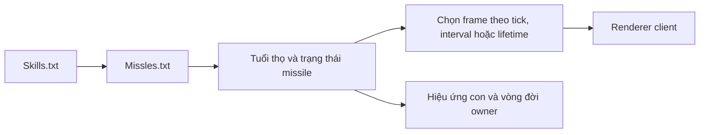

TÓM TẮT 1..5
1. [XÁC MINH SOURCE] Vòng logic client nhắm 18 tick/giây; `KSprControl::GetNextFrame` chỉ tiến một khung khi tick đổi, không gate theo interval và không bù tick bỏ qua. [NGUỒN]
2. [XÁC MINH SOURCE/DATA] Đạn bay dùng tuổi thọ tick để chọn frame; mẫu missile 68/6/412 có 4/3/5 frame mỗi hướng, chu kỳ loop tính toán 4/3/10 tick. [NGUỒN]
3. [XÁC MINH SOURCE] Niệm, trúng và hiệu ứng treo có đường release trước vẽ; effect thuộc danh sách missile còn phụ thuộc vòng đời owner. [NGUỒN]
4. [XÁC MINH SOURCE] Caller state truyền trùng biến đầu ra hướng/interval với tọa độ; chưa thể coi metadata aura là thông số phát thực tế. Chưa thấy nhánh chọn frame theo ngũ hành/phái trong renderer đã rà. [NGUỒN]
5. PARTIAL — đã khảo sát bảy nhóm và mẫu cấu hình; thiếu đối chiếu header SPR/Settings client thực nạp, số khung niệm/chém riêng và thời lượng hiển thị thực tế. [CHƯA KIỂM]

# J-03 — Hoạt ảnh và hiệu ứng kỹ năng
Loại: khảo sát
Chủ đề: Đối chiếu vòng đời, chọn frame và thời lượng của hiệu ứng kỹ năng.
Từ khóa: kỹ năng, missile, đạn, aura, buff, SPR, GetNextFrame, LifeTime, PreCastSpr
Trạng thái: PARTIAL — source/config đã khảo sát tĩnh; header SPR và runtime chưa xác minh.
Độ phủ: đã khảo sát 7/7 nhóm hiệu ứng và 4/4 mẫu cấu hình; header asset và thời lượng runtime chưa phủ.
Liên quan: JX1_OPS/REPORTS/A-15a-ky-nang-phai-1-4.md, JX1_OPS/REPORTS/A-15b-ky-nang-phai-5-8.md, JX1_OPS/REPORTS/A-15c-ky-nang-phai-9-cuoi.md, JX1_OPS/REPORTS/H-01-ngu-hanh.md, JX1_OPS/REPORTS/H-14-mat-khung-hieu-ung.md, JX1_OPS/REPORTS/J-02-animation-quai-npc.md, JX1_OPS/REPORTS/J-05-cat-khung-animation.md
Cần tôi quyết định: không

## Quan hệ

## Phạm vi và độ phủ
`T` là `C:/Jx1CocoV3/Folder/ServerNew-20260116T043145Z-3-001/ServerNew/_bin_v2_/gs/Settings`; `qh9A` là `D:/JX-build/qh9A/Classes`, root client được task chỉ định.

| Phần tử phạm vi | Đã phủ | Chưa phủ |
|---|---|---|
| Đồng hồ tick và chọn frame | `KSprControl::GetNextFrame` và renderer VN có tại `qh9A/gamecore/KSprControl.cpp:342-373`, `qh9A/vn/gamecore/KNpcResVN.cpp:21-60` | Chưa đo nhịp runtime/FPS |
| Bảy nhóm hiệu ứng | Niệm; bay/đạn; trúng/va chạm/biến mất; vùng đất; aura/buff; đường chém/vệt vũ khí; hiệu ứng treo. Symbol đại diện tại `qh9A/gamecore/KSkills.cpp:2974`, `qh9A/gamecore/KMissleRes.cpp:128-200`, `qh9A/gamecore/KNpcRes.cpp:2095-2165` | Header SPR và số frame thực chưa có |
| Bốn mẫu cấu hình skill | Skill IDs 80, 110, 1347, 94 tại `T/Skills.txt:81,111,1347,95` | Không phải catalog toàn bộ kỹ năng |
| Bốn mẫu cấu hình missile | Missile IDs 5, 6, 68, 412 tại `T/Missles.txt:6,7,69,413` | Chưa kiểm asset SPR tương ứng |
| Vòng đời, release và state | Các đường xử lý có trong `qh9A/gamecore/KSkills.cpp:2974`, `qh9A/gamecore/KMissleRes.cpp:128-200`, `qh9A/vn/gamecore/KNpcResVN.cpp:21-60` | Chưa tái hiện release sớm hoặc xác minh thời lượng trên màn hình |
| Asset/header và thời lượng hiển thị | Giới hạn được ghi trong phần `CHƯA XÁC MINH` bên dưới | Chưa đọc header SPR/Settings client thực nạp; chưa đo thời lượng runtime |

## Phạm vi và nguồn bằng chứng

Khảo sát tĩnh ngày 17/11/2026. Chỉ đọc source/data cục bộ; không sửa code, build, chạy game/exe, kết nối mạng hoặc VM. Python dùng `python -I -`. Chỉ ghi báo cáo này và mục kết quả cuối task; không tạo catalog dài hay ghi ngoài vùng task.

Quy ước đường dẫn và dòng vật lý:

- `C/` = `C:/Jx1CocoV3/Folder/Client2912-20260116T044348Z-3-001/Client2912/Client/Classes/gamecore/`.
- `G/` = cùng gốc `Classes/gamescene/`; `V/` = cùng gốc `Classes/vn/gamecore/`.
- `S/` = `D:/JX-source/server/jxOnline/gameserver/Sources/Core/Src/`.
- `T/` = `C:/Jx1CocoV3/Folder/ServerNew-20260116T043145Z-3-001/ServerNew/_bin_v2_/gs/Settings/`.
- `ST` = `T/npcres/״̬ͼÐζÔÕÕ±í.txt` (tên file legacy thực tế). Đọc byte bằng `gb18030`; ưu tiên ID, cột số và tên script ASCII, không suy phái từ tên hiển thị lỗi mã.

Nhãn xác minh áp dụng cho source/data đã đọc, không chứng minh source khớp binary hoặc T/ là bộ Settings client đang dùng. Mẫu data thuộc gói server. Chưa đọc header SPR tương ứng. Ký hiệu N = tổng frame, D = số hướng, F=floor(N/D), I = interval, L = thời gian bay logic, c = tuổi bay hiện tại.

## ĐÃ XÁC MINH

### Đồng hồ và chọn khung

`G/KgameWorld.cpp:5624–5639` điều tiết `g_pCoreShell->Breathe()` bằng hệ số 18 và elapsed timer; `C/CoreShell.cpp:2806–2810` gọi main loop; `C/KSubWorldSet.cpp:242` gọi Activate; `C/KSubWorld.cpp:148` tăng `m_dwCurrentTime`. Đây là mục tiêu nhịp logic trong source, không phải FPS đo được. Server cũng tăng tuổi thọ missile (`S/KMissle.cpp:344,497`) và tick subworld (`S/KSubWorld.cpp:295`); chưa chứng minh đồng bộ hai phía.

`C/KSprControl.cpp:37–73` lưu N/D/I và timer. Cùng tên SPR thì trả về ngay (`:49–50`), không restart. `GetNextFrame` (`:342–373`) chỉ so tick khác timer rồi tăng đúng một frame; I được ép tối thiểu nhưng không tham gia điều kiện tăng. Nhiều draw trong cùng tick không tăng thêm; bỏ lỡ nhiều tick rồi gọi lại cũng chỉ tăng một frame. Không có catch-up theo elapsed tại hàm này.

Renderer NPC được khai báo sử dụng là `KNpcResVN` (`C/KNpc.h:19,816`; `V/KNpcResVN.h:11–13`). `V/KNpcResVN.cpp:38,59,84,114` map frame thân/part theo `dirOffset + F*nCurFrame/nAllFrame` bằng phép chia nguyên: có thể bỏ frame asset khi action có ít bước hơn F. State cập nhật tại `:164–167`; special/frame SPR tại `:176–185`. Báo cáo dùng đường vẽ VN, không lấy renderer base để khẳng định đường này.

Đạn tăng `m_nCurrentLife` mỗi Activate (`C/KRegion.cpp:465`; `C/KMissle.cpp:526`), hết hạn tại `:419`. Paint truyền `L=LifeTime-StartLifeTime`, `c=CurrentLife-StartLifeTime` (`:1185,1192`). `C/KMissleRes.cpp:154–200` chọn frame bay:

- Loop thường: `floor(c/I)%F`; interval có tác dụng trực tiếp.
- Non-loop: `floor(F*c/L)`; I không tham gia. L bằng không được thay bằng F (`:169–170`).
- Subloop riêng tại `:185–192`; Start=Stop giữ một frame. Nhánh sau dùng `(c-SubStart)/I`, cần xác minh ý định đơn vị trước khi sửa.
- Frame vượt cuối thì return trước đoạn duyệt effect (`:199–200` so với `:219–244`); không mặc định effect con luôn được draw/dọn trong mọi lần gọi.

### Bảy nhóm hiệu ứng

| Nhóm | Bằng chứng source | Frame, thời lượng và kết thúc |
|---|---|---|
| Niệm / tiền chiêu | `PreCastSpr`: `C/KSkills.cpp:2974`; caller `C/KNpc.cpp:2334–2338`; setter `C/KNpcRes.cpp:2363–2377`; vẽ `V/KNpcResVN.cpp:400–413` | N/D từ header SPR chưa đọc nên chưa chốt số. Tiến theo tick quan sát khi draw; CheckEnd rồi release tại `V/:176–179`, trước đoạn vẽ. Duration niệm không đồng nhất action cast. |
| Bay / đạn | `C/KMissle.cpp:195–196,270–274,312–318`; `C/KMissleRes.cpp:141–207` | N/D/I từ AnimFileInfo2; loop theo c/I, non-loop theo c/L. Có mẫu số bên dưới; lifetime logic không bảo đảm mọi frame đã xuất hiện trên màn hình. |
| Trúng / va chạm / biến mất | `C/KMissle.cpp:1560–1599,1854–1928`; `C/KSkillSpecial.cpp:73–112` | Enum `C/SkillDef.h:41–48` và loader i+1: AnimFile1=wait, 2=fly, 3=vanish, 4=collision. Deadline node = begin+I*N/D; ảnh tiến qua GetNextFrame(FALSE), có release trước vẽ. Damage/event và hình không cùng điều kiện. |
| Vùng đất | `C/KSkills.cpp:1620–1676,1695–1794` | Zone phát missile theo lưới ChildSkillNum × ChildSkillNum và lọc tròn; start cộng wait/generation, lifetime cộng start. Animation từ missile con; chưa thấy renderer mặt đất riêng trong đường này. Mẫu 94→5 là vùng đứng. |
| Aura / buff | Loader `C/KSkills.cpp:2870,2949`; caller `C/KNpc.cpp:714`; `C/KNpcRes.cpp:2095–2165`; table `C/KNpcResNode.cpp:839–910` | Có metadata N/D/I, loop, layer, back-range; mẫu 10/16/30 frame bên dưới. State hiện theo danh sách NPC; vòng ảnh không quyết định thời hạn buff. Lỗi alias đầu ra ngăn suy tốc độ thực từ bảng. |
| Đường chém / vệt vũ khí | NeedShadow `C/KSkills.cpp:2969`; caller `C/KNpc.cpp:2340–2348`; blur `C/KNpcRes.cpp:2444–2457`; melee riêng `C/KNpc.cpp:2443–2498` | Phân biệt part vũ khí/action, blur và missile mang hình chém. Part map theo action ở renderer VN; không có F/duration chung mọi phái. Chưa ghép ClientWeaponSkill/asset nên chưa chốt số khung chém riêng. |
| Hiệu ứng treo | `C/KMissle.cpp:1908–1928`; `C/KSkillSpecial.cpp:96–110`; `C/KNpcRes.cpp:2382–2401`; `V/KNpcResVN.cpp:599–617` | Nhánh target match-ID cập nhật vị trí khi draw, mất match giữ vị trí cuối; nhánh NPC SetFrameSpr vẽ ở vị trí NPC hiện tại. m_cFrameSpr là slot đơn (`C/KNpcRes.h:124`); tên khác có thể thay ảnh, tên trùng không restart. |

Action attack/cast dùng công thức từ `m_AttackFrame`/`m_CastFrame` và tốc độ hiện tại (`C/KNpc.cpp:2381,2399`). Không lấy các công thức này làm N của SPR tiền chiêu hay thời hạn buff. Nhánh melee ở dispatch `C/KSkills.cpp:569–571` rỗng; không suy rằng toàn bộ melee xử lý tại đó.

### Vòng đời và nghi vấn nạp state

**Release trước vẽ:** `V/KNpcResVN.cpp:176–185`, `C/KSkillSpecial.cpp:84–90` gọi CheckEnd sau khi tiến frame, release rồi mới kiểm tên để vẽ. Nếu lần tiến tới frame cuối trả TRUE, ảnh có thể bị release trước khi frame cuối được gửi xuống renderer. Đây là kết quả thứ tự câu lệnh, chưa phải quan sát lỗi trong game; trường hợp một frame/tick khởi tạo cần xét riêng.

**Effect thuộc missile:** node được thêm vào `m_MissleRes.m_SkillSpecialList` (`C/KMissle.cpp:1928`). DoCollision với ColVanish tạo vanish effect rồi gọi DoVanish ngay (`:1583–1590`); DoVanish gọi MissleSet.Remove (`:1549`); `C/KMissleSet.cpp:116–121` → `KMissle::Release` (`C/KMissle.cpp:150–162`) → `KMissleRes::Clear` (`C/KMissleRes.cpp:93–108`) xóa list. Nhánh này có nguy cơ xóa effect vừa tạo trước draw. Paint còn đường đợi SpecialMovieIsAllEnd (`C/KMissle.cpp:1195–1203`), nhưng không loại bỏ đường remove trực tiếp trên. Không coi effect trong list là detached sống độc lập đến deadline. SPR đã gắn riêng vào NPC có vòng đời slot NPC riêng.

**Trùng biến đầu ra state:** `C/KNpcRes.cpp:2143` truyền `&nTotalDir, &nInterVal` cho cả cặp hướng/interval lẫn MapPosX/MapPosY. GetInfo ghi metadata đúng (`C/KNpcResNode.cpp:907–908`) rồi ghi đè qua MapPos (`:909–910`). Hai mảng tọa độ khai báo ở `.h:94–95`; constructor/Init đã đọc (`.cpp:821–876`) không khởi tạo/nạp chúng, tìm trong hai file chỉ thấy khai báo và chỗ đọc. Đây là nghi vấn lỗi source có bằng chứng, chưa kết luận giá trị bộ nhớ/runtime. Không dùng D/I trong ST để khẳng định tốc độ aura hiệu dụng.

`MAX_SKILL_STATE=18` (`C/GameDataDef.h:132`), chia ba nhóm sáu slot. Renderer VN hoạt động vẽ head `:238–273`, body sau `:278–299`, body trước `:505–526`, foot `:330–345`. Các khối DrawPrimitives_State `:368–397,688–702` là comment. Back-range bao gồm đầu, loại trừ cuối. PlayType được loader lưu nhưng vòng state `V/:167` gọi GetNextFrame() mặc định; nhãn non-loop trong bảng không chứng minh đã dừng ở đây.

### Mẫu cấu hình và phép tính thời lượng

Đây là mẫu nhỏ, không phải catalog. Dòng vật lý gồm header; ID không luôn bằng dòng trừ một. Quy đổi tick/18 là phép tính điều kiện, không phải đo runtime.

| Skill → missile | Script phái; Series | Fly N/D/I → F | Loop; LifeTime | Chu kỳ ảnh / thời gian bay danh nghĩa |
|---|---|---|---|---|
| 80→68 (`T/Skills.txt:81`; `T/Missles.txt:69`) | emei.lua; 2 | 64/16/1 → 4 | 1; 16 tick | 4 tick ≈ 0,222 s / 16 tick ≈ 0,889 s |
| 110→6 (`Skills:111`; `Missles:7`) | cuiyan.lua; -1 | 48/16/1 → 3 | 1; 20 tick | 3 tick ≈ 0,167 s / 20 tick ≈ 1,111 s |
| 1347→412 (`Skills:1347`; `Missles:413`) | huashan.lua; 2 | 80/16/2 → 5 | 1; 20 tick | 10 tick ≈ 0,556 s / 20 tick ≈ 1,111 s |
| 94→5 (`Skills:95`; `Missles:6`) | emei.lua; -1; Form=5 Zone | 20/1/1 → 20 | 0; 19 tick | Không loop; floor(20*c/19) / 19 tick ≈ 1,056 s |

Cả bốn liên kết có BaseSkill=1, ChildSkillNum=1. Missile 5 có MoveKind=0, ColVanish=0; ba mẫu bay có MoveKind=1, ColVanish=1. Với c nguyên 0…18, công thức missile 5 chỉ cho frame 0…18; c=19 cho frame=20 vượt cuối. Đây là minh họa toán học, không khẳng định draw thực có đủ dãy c đó. WaitTime bốn skill đều 5; MslsGenerate=0 trả WaitTime (`C/KSkills.cpp:3088–3090`), không tự cộng MslsGenerateData 5/6 của skill 1347/94.

Collision AnimFileInfo4 của missile 68/6/412/5 là `14,1,1` / `6,1,2` / `16,1,1` / `18,1,2`. Deadline cách begin 14/12/16/36 tick theo source. Đây không phải duration nhìn thấy: controller bỏ qua I, còn release trước vẽ và cleanup owner. AnimFileInfo3/vanish của bốn record rỗng; không lấy tuple collision đại diện vanish.

| Skill/script → state | ST N/D/I | Layer, loop, back-range | Bằng chứng |
|---|---|---|---|
| 16/shaolin.lua →45 | 10/1/8 | Foot, Loop, 0…0 | T/Skills.txt:17; ST:46 |
| 69/wudu.lua →6 | 30/1/18 | Foot, Loop, 0…0 | Skills:70; ST:7 |
| 81,83,86/emei.lua →37,38,39 | mỗi state 16/1/16 | Foot, Loop, 0…0 | Skills:82,84,87; ST:38–40 |
| 100/cuiyan.lua →31 | 16/1/18 | Body, Loop, [4,12) | Skills:101; ST:32 |

Ba dòng đầu IsAura=1; skill 100 IsAura=0 vẫn có state hình. Các mẫu đều Series=-1. Không tính chu kỳ phát thực từ ST vì alias nêu trên; ngay cả khi D/I đúng, GetNextFrame vẫn không gate I. Chưa lần đủ thời hạn buff trong script/gameplay nên chưa chốt số giây tồn tại.

## Liên hệ H-01, A-15, H-14 và J-05

[H-01](H-01-ngu-hanh.md) xác định enum ngũ hành và đường kháng/damage. Loader đọc Series ở `C/KSkills.cpp:2936`, `S/KSkills.cpp:3044`; các hàm chọn frame/render đã rà không có nhánh chọn N/D/I theo Series. Mẫu 80 và 1347 cùng Series=2 có 4 và 5 frame/hướng; 110 Series=-1 vẫn có ảnh. Không lấy ngũ hành làm chỉ số duration; chưa loại trừ khác biệt asset/script ngoài đường đã đọc.

[A-15a](A-15a-ky-nang-phai-1-4.md), [A-15b](A-15b-ky-nang-phai-5-8.md), [A-15c](A-15c-ky-nang-phai-9-cuoi.md) đối chiếu catalog/phái. Skill 80 (emei.lua), 110 và 100 (cuiyan.lua) dùng cùng chuỗi PreCastSpr (`T/Skills.txt:81,111,101`); 1347 (huashan.lua, `:1347`) dùng chuỗi khác. Phái có thể dùng lại asset niệm; không suy frame từ phái/Series. Catalog không chứng minh NPC đã được gán/cast thành công.

[H-14](H-14-mat-khung-hieu-ung.md) khảo sát sét/glow tùy biến ở mirror; không áp timer wall-clock riêng của nó cho SPR kỹ năng gốc. Liên hệ là cần tách nhịp logic, chọn frame, gọi draw và release; mất hình tương tự không chứng minh cùng nguyên nhân.

J-05 chưa có task/report trong lần kiểm tra thư mục; chỉ liên hệ mục tiêu cắt/bỏ khung ở backlog, không tuyên bố đã xác minh J-05. Bàn giao các điểm có thể kiểm riêng:

1. Phép chia nguyên part/non-loop: `V/KNpcResVN.cpp:38`; `C/KMissleRes.cpp:197`, mẫu 20 frame/19 tick.
2. Không catch-up/gate I và cùng tên không restart: `C/KSprControl.cpp:354–357,49–50`.
3. Release trước draw: `V/KNpcResVN.cpp:176–185`; `C/KSkillSpecial.cpp:84–90`.
4. Deadline so với vòng đời owner: `C/KMissle.cpp:1589–1590,1549`; `C/KMissleRes.cpp:93–108,223`.
5. Return sớm trước list effect (`C/KMissleRes.cpp:199–219`), slot NPC đơn và alias state (`C/KNpcRes.cpp:2143`). Chưa quy mọi điểm về một lỗi runtime.

## ĐỀ XUẤT TỐI ƯU

1. Ưu tiên kiểm tra hợp đồng GetInfo: tách biến tọa độ khỏi D/I, xác định khởi tạo/nạp tọa độ. Không dùng đổi I trong data để che lỗi caller.
2. Đối chiếu deadline I*F với cách phát của KSprControl; chốt đơn vị/chiến lược bù tick trước khi sửa. End-time đã chia D, không có bằng chứng lỗi quên chia số hướng.
3. Kiểm tra vẽ frame cuối rồi release và ownership effect khi missile mất; giữ nguyên gameplay khi thử phương án ảnh. Không tăng LifeTime chỉ để kéo dài hình.
4. Khi có phê duyệt runtime riêng: log tick/frame, timestamp, số Draw, release reason, owner removal, target match-ID, offscreen và FPS khác nhau ở các điểm J-05. Chưa thực hiện.
5. Ghép header SPR/Settings đúng phiên bản cho niệm, vũ khí/chém, hit/treo. Chỉ mở rộng catalog khi biết provenance; bảng dài đặt vùng private được phép, báo cáo công khai giữ mẫu đã lọc.

## CHƯA XÁC MINH

- Chưa đọc header SPR niệm/chém/hit hoặc chứng minh data mẫu khớp asset và Settings client nạp; thiếu số khung niệm/chém riêng đủ bằng chứng.
- Chưa có ma trận mọi skill/phái/series, biến thể level/event con, thời hạn buff hoặc mọi caller slot effect NPC.
- Chưa xác minh binary/build flags, nạp tài nguyên, duration thực, frame cuối, offscreen/FPS, đồng bộ server; không suy runtime từ source.
- Chưa có định nghĩa đơn vị header interval xuyên suốt producer SPR; /50 là biểu thức source, không đủ khẳng định mọi I là ms. Speed chưa quy ra pixel/giây; DmgInterval chưa lần đủ để chốt nhịp damage.
- Không chạy test/build vì chỉ khảo sát tĩnh; không có kết quả test đạt.

## Lỗi thao tác, kiểm chứng và bàn giao

Lỗi đã gặp và xử lý: đường tương đối Folder/ không tồn tại → dùng canonical tuyệt đối; rg không có → PowerShell/Python; stdout cp1252 gây UnicodeEncodeError → UTF-8; tên file legacy qua pipeline thành ? gây `OSError: [Errno 22] Invalid argument` → chọn bằng Unicode escape; regex có `SyntaxWarning: invalid escape sequence` → dùng raw string khi cần. Lần thay báo cáo bằng patch delete/add cùng đường bị từ chối `multiple operations target` → chuyển sang một patch update, bản nháp không bị xóa. Không lặp một lỗi quá ba lần.

Các tham chiếu mirror/renderer base và diễn giải end-time trong nháp đã đối chiếu lại canonical; bản cuối phân biệt renderer VN, khối comment và phép chia D. Đã kiểm trực tiếp timer, alias state, lifecycle missile và record mẫu. Có một lần gọi nhầm inventory giao diện chỉ đọc danh sách ứng dụng; không điều khiển UI, mở trang hay chạy ứng dụng, không dùng inventory làm bằng chứng kỹ thuật.

Trạng thái cuối: **PARTIAL** — hoàn tất khảo sát source bảy nhóm và mẫu data; thiếu provenance/header SPR, số khung/thời lượng niệm/chém đủ bằng chứng. Điểm tiếp tục: ghép asset client đúng phiên bản cho các mẫu, sau đó mới quyết định task runtime riêng. Không có blocker mạng cần thử vượt quyền. Mã nguồn giữ nguyên.

Commit SHA: **chưa tạo** — lượt này chỉ ghi vùng task, không yêu cầu commit. Chưa push vì user cấm mạng; không thử push, không có bằng chứng GitHub và không tuyên bố đã công bố.

## MỤC SỔ THÔNG SỐ

Sổ tóm tắt, mỗi tên tham số một dòng; các giá trị cùng tham số ghi theo ID để tránh catalog dài. Đánh giá đổi an toàn không phải quyền sửa trong task; không thay tham số nào. Nguồn là source/cấu hình hoặc phép tính, không phải đo runtime.

| nhóm | tên/hằng số | file:line | giá trị | đơn vị | ảnh hưởng | đổi an toàn (CÓ/CẨN THẬN/KHÔNG) | nguồn đo |
|---|---|---|---|---|---|---|---|
| Loop | hệ số Breathe | G/KgameWorld.cpp:5633–5636 | 18 | tick/s mục tiêu | nhịp logic | CẨN THẬN | source |
| Loop | bước m_dwCurrentTime | C/KSubWorld.cpp:148 | +1/Activate | tick | đồng hồ game | KHÔNG | source |
| SPR | bước GetNextFrame | C/KSprControl.cpp:350–357 | +1 khi tick khác; I tối thiểu 1 | frame | không catch-up/gate I | CẨN THẬN | source |
| SPR | giới hạn D và N | C/KSprControl.cpp:54–69 | D≥1; N≥D; N≥1 | hướng/frame | miền frame | KHÔNG | source |
| Niệm | fallback header I | C/KNpcRes.cpp:2369–2370 | 100 | đơn vị header chưa chốt | thay I không hợp lệ | CẨN THẬN | source |
| Niệm | trần header I | C/KNpcRes.cpp:2371–2372 | 1000 | đơn vị header chưa chốt | clamp I | CẨN THẬN | source |
| SPR | conversion setter | C/KNpcRes.cpp:2377,2401; C/KSkillSpecial.cpp:48–67 | floor(F*I/50) | giá trị controller | I lưu, chưa gate | CẨN THẬN | biểu thức source |
| Treo | fallback interval | C/KNpcRes.cpp:2386–2390 | mInterval nếu I≤0 hoặc I>1000 | đơn vị header | thay I header lỗi | CẨN THẬN | source; chưa khẳng định default |
| Missile | fallback N | C/KMissle.cpp:270 | 100 | frame | parse thiếu N | CẨN THẬN | source |
| Missile | fallback D | C/KMissle.cpp:272 | 16 | hướng | parse thiếu D | CẨN THẬN | source |
| Missile | fallback I | C/KMissle.cpp:274 | 1 | tick trong loop | parse thiếu I | CẨN THẬN | source |
| Missile | fly N | T/Missles.txt:69,7,413,6 | ID68=64; 6=48; 412=80; 5=20 | frame tổng | F=N/D | CẨN THẬN | AnimFileInfo2 |
| Missile | fly D | T/Missles.txt:69,7,413,6 | ID68/6/412=16; 5=1 | hướng | F | CẨN THẬN | AnimFileInfo2 |
| Missile | fly I | T/Missles.txt:69,7,413,6 | ID68/6/5=1; 412=2 | tick/frame loop | tốc độ loop | CẨN THẬN | AnimFileInfo2 |
| Missile | LifeTime | T/Missles.txt:69,7,413,6; C/KMissle.cpp:419 | ID68=16; 6/412=20; 5=19 | tick bay trước cộng delay | vòng đời | CẨN THẬN | cấu hình + caller |
| Missile | Speed | T/Missles.txt:69,7,413,6 | ID68=24; 6=18; 412=20; 5=10 | chuyển động chưa chốt | di chuyển | CẨN THẬN | cấu hình |
| Missile | DmgInterval | T/Missles.txt:69,7,413,6 | ID68=1; 6/412=0; 5=20 | chưa lần đủ | gameplay, không phải I ảnh | CẨN THẬN | cấu hình; không suy nghĩa 0 |
| Missile | LoopPlay | T/Missles.txt:69,7,413,6 | ID68/6/412=1; 5=0 | cờ | loop hay map theo L | CẨN THẬN | cấu hình + renderer |
| Missile | SubLoop | T/Missles.txt:6,7,69,413 | bốn mẫu=0 | cờ | bật subloop | CẨN THẬN | cấu hình |
| Missile | SubStart | T/Missles.txt:6,7,69,413 | bốn mẫu=0 | frame | đầu subloop | CẨN THẬN | cấu hình |
| Missile | SubStop | T/Missles.txt:6,7,69,413 | bốn mẫu=0 | frame | cuối subloop | CẨN THẬN | cấu hình |
| Missile | ColVanish | T/Missles.txt:6,7,69,413 | ID5=0; 6/68/412=1 | cờ | remove sau va chạm | CẨN THẬN | cấu hình |
| Missile | MoveKind | T/Missles.txt:6,7,69,413 | ID5=0; 6/68/412=1 | enum | movement | CẨN THẬN | cấu hình |
| Hit | collision N | T/Missles.txt:69,7,413,6 | ID68=14; 6=6; 412=16; 5=18 | frame tổng | F effect/deadline | CẨN THẬN | AnimFileInfo4 |
| Hit | collision D | T/Missles.txt:69,7,413,6 | bốn mẫu=1 | hướng | F effect | CẨN THẬN | AnimFileInfo4 |
| Hit | collision I | T/Missles.txt:69,7,413,6 | ID68/412=1; 6/5=2 | tick trong deadline | deadline, không gate ảnh | CẨN THẬN | AnimFileInfo4 + source |
| Hit | end-time | C/KMissle.cpp:1923–1924 | begin+floor(I*N/D) | tick | xóa khi current>end | CẨN THẬN | source; mẫu Δ14/12/16/36 |
| Skill | WaitTime | T/Skills.txt:81,111,1347,95 | bốn mẫu=5 | tick qua caller | delay | CẨN THẬN | cấu hình + C/KSkills.cpp:1793 |
| Skill | MslsGenerate | T/Skills.txt:81,111,1347,95 | bốn mẫu=0 | enum | trả WaitTime | CẨN THẬN | C/KSkills.cpp:3088–3090 |
| Skill | MslsGenerateData | T/Skills.txt:81,111,1347,95 | ID80/110=0; 1347=5; 94=6 | theo style | không cộng ở style 0 | CẨN THẬN | cấu hình + source |
| Skill | ChildSkillNum | T/Skills.txt:81,111,1347,95 | bốn mẫu=1 | con/cạnh zone tùy form | mật độ effect | CẨN THẬN | cấu hình + zone source |
| Skill | MisslesForm | T/Skills.txt:81,111,1347,95 | ID80/110/1347=1; 94=5 | enum | cách phát, 5=zone | CẨN THẬN | cấu hình + dispatch |
| State | MAX_SKILL_STATE | C/GameDataDef.h:132; C/KNpcRes.cpp:2150 | 18, chia 3 →6/layer | slot | sức chứa state | CẨN THẬN | source |
| State | ST N | ST:46,7,38–40,32 | state45=10; 6=30; 37/38/39/31=16 | frame tổng | metadata ảnh | CẨN THẬN | cấu hình; alias chưa giải quyết |
| State | ST D | ST:46,7,38–40,32 | mọi mẫu=1 | hướng | metadata F | CẨN THẬN | chưa phải D hiệu dụng |
| State | ST I | ST:46,7,38–40,32 | state45=8; 6/31=18; 37/38/39=16 | đơn vị bảng | không gate GetNextFrame | CẨN THẬN | chưa phải I hiệu dụng |
| State | BackStart | ST:32,7,38–40,46 | state31=4; còn lại=0 | frame đầu | sau thân | CẨN THẬN | cấu hình + V/KNpcResVN.cpp:282 |
| State | BackEnd | ST:32,7,38–40,46 | state31=12; còn lại=0 | frame cuối loại trừ | trước thân | CẨN THẬN | cấu hình + V/KNpcResVN.cpp:509 |
| State | PlayType | C/KNpcResNode.cpp:861–866; ST mẫu | Loop→0; khác→1; mẫu đều Loop | enum | draw gọi mặc định loop | CẨN THẬN | loader + V/KNpcResVN.cpp:167 |

## Phát hiện khi chuẩn hóa
- Báo cáo cũ dùng root client `C:/Jx1CocoV3/.../Client2912/Client`; task quy định qh9A. Các symbol đại diện hiện có ở qh9A, nhưng không tái xác minh toàn bộ nội dung cũ; kết luận và số liệu được giữ nguyên.
- Các dòng mẫu ở `T/Skills.txt` và `T/Missles.txt` thuộc server Settings root của task. Tên hiển thị tiếng Việt/legacy trong console bị lỗi mã hóa; bảng phạm vi chỉ dựa ID, dòng và cột số.
