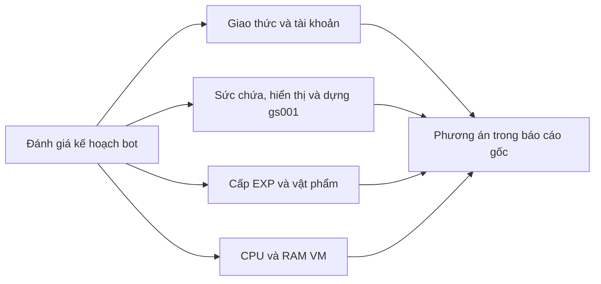

TÓM TẮT 1 [NGUỒN] Giao thức client–gs001 **không có tài liệu**; có mã nguồn cả hai phía (đủ để đọc, không phải đoán thuần), nhưng chưa có bot nào đã chạy được.\
TÓM TẮT 2 [NGUỒN] Sức chứa cứng 500 người (`MAX_PLAYER`), 1 luồng, 18 Hz; chưa đo số online thật.\
TÓM TẮT 3 [NGUỒN] Có chỗ lọc "ai thấy ai", nhưng là theo ô bản đồ (region), không theo bán kính; vá được trong `KRegion::BroadCast` (cần dựng lại gs001).\
TÓM TẮT 4 [NGUỒN] Dựng từ nguồn được (VS2022 v143 x64), nhưng gs001 tự dựng crash (0xC0000005) sau "public net IP"; nguyên nhân gốc chưa tìm ra.\
TÓM TẮT 5 [NGUỒN] Tạo tài khoản bot: ghi thẳng `Account_Info` + `Account_Habitus` (SQL), nhân vật tạo qua client/Bishop; cấp EXP/vật phẩm hợp lệ có sẵn qua Lua (`AddOwnExp`, `AddItem`) nhưng chạy trong script server. Trong R-07a chưa build, chạy exe hay VM.

# JIBS — Đánh giá kế hoạch Bot (7 câu)

Loại: khảo sát
Chủ đề: Đánh giá bảy câu hỏi cho kế hoạch bot JX1.
Từ khóa: kế hoạch bot, giao thức, sức chứa, lọc hiển thị, nhân vật, JIBS, gs001, KRegion, Lua
Trạng thái: PARTIAL — Đã khảo sát phương án, còn câu hỏi về mức dùng CPU/RAM và thử nghiệm theo báo cáo gốc.
Độ phủ: đã phủ 6 trên tổng 7 câu hỏi bằng phân tích hoặc dữ liệu cũ. Câu 7 còn thiếu số đo thực dùng.
Liên quan: [A-06](A-06-bang-goi-tin.md), [A-07](A-07-goc-re-crash-gs001.md), [B-02](B-02-loc-hien-thi.md), [B-04a](B-04a-bo-do-tick-bang-thong.md).
Cần tôi quyết định: có (chọn hướng bot: giao thức thô hay vá server; xem cuối).

## Phạm vi và độ phủ

Tóm tắt dẫn từ báo cáo gốc. Bảy câu lấy theo tiêu đề các mục dưới đây. Đường dẫn `Classes/` thuộc client bản A `D:/JX-build/qh9A`. Đường dẫn `script/` thuộc thư mục server `gs` được giao. Báo cáo dùng UTF-8. `KProtocolProcess.cpp` và `KSelPlayer.cpp` được đối chiếu qua các dòng ASCII. goldacition.lua đọc được dưới dạng UTF-8/ASCII. Với gucaxia.lua, chỉ đối chiếu dòng ASCII gọi hàm.

| Hạng mục | Độ phủ | Căn cứ và giới hạn |
|---|---|---|
| 1. Giao thức client–gs001 | Đã phủ | `JIBS-danh-gia-bot.md:46`. Đối chiếu phía client tại `Classes/gamecore/KProtocolProcess.cpp:3030`. Chưa đối chiếu luồng đầy đủ hoặc xác nhận đăng nhập bot. |
| 2. Sức chứa gs001 | Đã phủ | `JIBS-danh-gia-bot.md:51` và `JIBS-danh-gia-bot.md:52` ghi giới hạn và nhịp gốc. Thư mục `gs` được giao thiếu tệp C++ tương ứng. Chưa đo tải. |
| 3. Lọc hiển thị | Đã phủ | `JIBS-danh-gia-bot.md:59`. `JX1_OPS/CONTEXT-PACK/GS001-MAP.md:3` định vị `KRegion::BroadCast`. Chưa có tệp C++ đó trong thư mục `gs` được giao. |
| 4. Dựng gs001 và lỗi A2 | Đã phủ | `JIBS-danh-gia-bot.md:65` ghi lần dựng và lỗi lịch sử. Nguyên nhân còn mở, chưa tái hiện trong R-07a. |
| 5. Tài khoản và nhân vật bot | Đã phủ | `JIBS-danh-gia-bot.md:70` ghi hướng cũ. `Classes/gameui/KSelPlayer.cpp:715` liệt kê phản hồi tạo hoặc xóa nhân vật trong nhóm gói nhận. Chưa đối chiếu DB hay tạo hàng loạt. |
| 6. Cấp EXP và vật phẩm | Đã phủ | `script/global/goldacition.lua:15` gọi `AddOwnExp` và `script/global/gucaxia.lua:80` gọi `AddItem`. Đã kiểm lời gọi tĩnh. Chưa kiểm khi chạy. |
| 7. CPU/RAM thật của VM | Chưa phủ | `JIBS-danh-gia-bot.md:81` ghi mức cấp. `JIBS-danh-gia-bot.md:82` ghi rõ chưa đo mức dùng thực. |

Nhãn: "Chứng cứ" = đã đọc mã/báo cáo; "Chưa kiểm" = chưa chạy/đo.

## 1. Giao thức client–gs001
- Chứng cứ (tái dùng `reports/16-khao-sat-bot-ai.md`, `29`, `44`): khung gói 2 byte độ dài; mã hóa XOR khóa cuộn từ `ACCOUNT_BEGIN` (0x20); đăng nhập MD5 qua Bishop 56722 rồi chuyển sang gs001 51189 (`gateway/.../Bishop/GameServer.cpp`, `SmartClient.cpp`; client `gameui/KSelPlayer.cpp`). Lệnh đi/chạy (Run), skill, ngồi (Sit), đội, chat đều có gói riêng; client nhận cờ chiến đấu `0x02` ở `gamecore/KProtocolProcess.cpp`.
- Tài liệu: **không có** tài liệu giao thức; chỉ có mã (client Cocos `Client/Classes` và server `Core/Src`). Bảng gói tin là việc A-06 (chưa làm, Codex đang lỗi model 404).
- Chưa kiểm: chưa có bot nào đăng nhập hoàn chỉnh bằng giao thức thô; chưa đối chiếu mã nguồn với exe đang chạy (nguồn mới hơn exe).

## 2. Sức chứa gs001
- `MAX_PLAYER 500` cứng (`Core/Src/KPlayerDef.h:17`); giá trị MaxPlayer trong ini bị ghi đè về 500 (`MultiServer/GameServer/KSOServer.cpp:770-772`).
- Vòng lặp: `GAME_FPS 18` (`KSOServer.cpp:90`), `Breathe()` (dòng 1425) có vòng bù nhịp (dòng 1442) rồi `MainLoop()` (dòng 1450): **một luồng**. Số NPC tối đa lấy từ `Gameconfig MaxNpcCount` (`Core/Src/KCore.cpp:292`).
- Báo cáo 41/43/59: đã xác nhận 18 Hz; thử 36/54 Hz có kế hoạch riêng.
- Chưa kiểm: số online thật chịu được trước khi tick trễ (chưa đo); 500 cứng nên bot + người thật dùng chung 500 chỗ.

**Nhịp (Q-27):** 18 Hz là bản chạy thật; 36 Hz nhánh thử, 54 Hz kế hoạch.

## 3. Lọc hiển thị
- Gửi đồng bộ theo vùng: `KNpc::SendDataToNearRegion` (`KNpc.cpp:14103`) gọi `KRegion::BroadCast` cho ô của NPC và 8 ô lân cận (bảng `POff`/`m_nConnectRegion`).
- `KRegion::BroadCast` (`KRegion.cpp:2223`): duyệt `m_PlayerList`, tối đa `MAX_BROADCAST_COUNT = 100` người/ô (`KRegion.h:15`), gửi cho người có `m_nNetConnectIdx >= 0` và `m_bSleepMode == FALSE`. Điều kiện khoảng cách (`MAX_SYNC_RANGE 32`) **bị comment**, nên không có lọc theo bán kính.
- Vá được: chỗ chèn điều kiện "viewer thấy NPC này không" nằm đúng trong vòng lặp này (cần dựng lại gs001, xem mục 4).
- Chưa kiểm: các đường gửi khác không qua hàm này (`BroadCastState` `KNpc.cpp:14485`, `SendSyncData` `KNpc.cpp:7663`); chưa thử vá.

## 4. Dựng lại gs001, vì sao A2 crash
- Chứng cứ (`reports/35`, `44`): dựng được bằng VS2022 v143 x64 với vài chỗ lách; gs001 tự dựng chạy tới "public net IP" rồi crash 0xC0000005; exe gốc + DLL A2 chạy ổn.
- Nguyên nhân A2 crash: **chưa kết luận** (báo cáo 44 ghi giả thuyết, chưa có bằng chứng chốt). Mã nguồn mới hơn exe gốc nên khác hành vi là khả dĩ.
- Chưa kiểm: bản dựng khớp byte với exe gốc; cách làm sạch crash (cần debug trên VM thử, hiện treo).

## 5. Tạo hàng loạt tài khoản/nhân vật Bot
- Tài khoản: dòng trong `Account_Info` (mật khẩu MD5 viết hoa) và `Account_Habitus` còn hạn (`S3PAccount.cpp`; thực hành ở `reports/02-b2-account-db.md`).
- Nhân vật: tạo qua luồng tạo nhân vật của client/Goddess (`Goddess/DBTable.cpp`, `IDBRoleServer.cpp`); bot phải nói được bước này qua Bishop.
- An toàn: chỉ làm trên DB bản copy ở VM thử; không dùng tài khoản/mật khẩu thật, không ghi mật khẩu vào file (truyền qua biến môi trường); `reports/09` đã xóa tài khoản thật khỏi DB.
- Chưa kiểm: tạo hàng loạt (chưa thử); giới hạn số nhân vật/tài khoản; ảnh hưởng của `S3Relay` (bang, bạn bè).

## 6. Cấp EXP/vật phẩm hợp lệ
- Có: Lua server `AddOwnExp` (`ScriptFuns.cpp:15908`, gọi `DirectAddExp`), `AddItem`/`AddItemEx` (đăng ký `ScriptFuns.cpp:25958-25959`), `AddGoldItem*` (8578-8765). Đây là đường cấp **qua script server**, dùng được cho bot (script NPC/quest chạy trong gs001).
- Cách hợp lệ không sửa mã C++: viết script Lua ở `gs\script\...`.
- Chưa kiểm: có lệnh GM trực tiếp từ client không (chưa dò); script của bản đang chạy có gọi được các hàm trên không.

## 7. CPU/RAM thật của VM
- Cấu hình: 4 CPU, 6144 MB (cả `JX-Server-D` và `JX-Test-36`, `VBoxManage showvminfo`; `reports/42`). Hiện `JX-Server-D` running, `JX-Test-36` kẹt "stopping".
- **Chưa đo mức dùng thật** (VM thử treo, Main VM chỉ đọc theo Q-18). Cần đo CPU/RAM trong guest khi gs001 chạy có tải rồi mới kết luận.

## Đề xuất / Cần tôi quyết định: có
Chọn hướng bot: (a) thô qua giao thức (không đụng server, nhưng chưa có tài liệu) hoặc (b) vá `KRegion::BroadCast` (cần giải crash gs001 tự dựng trước). Khuyến nghị (a) trước, A-06 làm bảng gói tin, sau khi Codex được sửa model.

## Đã xác minh / Chưa xác minh

- **ĐÃ XÁC MINH:** nội dung cả bảy mục trong báo cáo gốc, các điểm đọc tĩnh ở client và hai lời gọi Lua trong bảng.
- **CHƯA XÁC MINH:** mã C++ server và cấu hình lọc hiển thị của nhánh cũ, khả năng đăng nhập bot, mức tải, nguyên nhân lỗi A2, dữ liệu tài khoản và mức dùng CPU/RAM của VM.

## Bàn giao

R-07a bàn giao phần chuẩn hóa và [chỉ mục](./_CHIMUC/R-07a.tsv). Quyết định về kế hoạch bot vẫn theo mục Đề xuất của báo cáo gốc.

## Phát hiện khi chuẩn hóa

- `JIBS-danh-gia-bot.md:47` ghi A-06 chưa có bảng gói tin tại thời điểm viết. Tệp [A-06](A-06-bang-goi-tin.md) hiện có báo cáo đối chiếu tĩnh (`A-06-bang-goi-tin.md:7` và `A-06-bang-goi-tin.md:11`).
- Thư mục `gs` được giao có Lua nhưng thiếu `Core/Src/KPlayerDef.h`, `Core/Src/KRegion.cpp`, `MultiServer/GameServer/KSOServer.cpp` và `Settings/visibility.ini`. Các dẫn chứng về giới hạn và lọc hiển thị vẫn ở mức báo cáo gốc.
- Câu 7 có số liệu cấp phát cấu hình. Số đo sử dụng thật còn thiếu.
