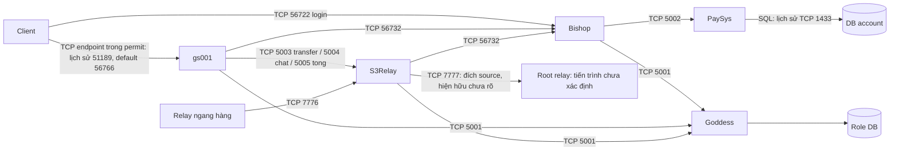

TÓM TẮT 1/5: Khảo sát tĩnh K-01 ngày 17/11/2026; không chạy exe, build, test game, mạng hoặc VM.
TÓM TẮT 2/5: Client đăng nhập qua Bishop; khi được cấp GUID thì mở kết nối riêng tới gs001, nơi xử lý di chuyển và chiến đấu.
TÓM TẮT 3/5: PaySys quản lý tài khoản/quyền chơi, Goddess quản lý nhân vật, S3Relay cung cấp transfer/chat/tong; S3Relay→PaySys trực tiếp [CHƯA XÁC ĐỊNH].
TÓM TẮT 4/5: Nguồn mô tả logic đầy đủ 18 Hz; chế độ outer 36 thêm nửa bước movement, chưa chứng minh runtime 36 Hz.
TÓM TẮT 5/5: Đã lập bản đồ cổng, ba luồng và điểm đo; 51189 là ghi nhận lịch sử, default source GS là 56766; mọi độ trễ thực tế [CHƯA XÁC ĐỊNH].

# K-01 — Bản đồ truyền tín hiệu client-server

Trạng thái: **DONE — hoàn tất khảo sát tĩnh**. Runtime còn [CHƯA XÁC ĐỊNH] như liệt kê dưới đây. Chỉ ghi báo cáo K-01 và mục Kết quả của task theo yêu cầu đích danh trong task. Không sửa mã/cấu hình.

## ĐÃ XÁC MINH / CHƯA XÁC MINH

- [BÁO CÁO] Luồng login: `JX1_OPS/REPORTS/A-02-luong-dang-nhap.md:32` đến `:64`.
- [NGUỒN] Các cổng liên dịch vụ mặc định: `D:/JX-source/server/jxOnline/gameserver/Sources/MultiServer/GameServer/KSOServer.cpp:307` đến `:311`, đọc cấu hình tại `:731` đến `:739`.
- [BÁO CÁO] Tick, ACT/MOVE, damage và batching: `JX1_OPS/REPORTS/H-13-tick-do-tre-don.md:25` đến `:80`.
- [NGUỒN] Client gốc: mục tiêu render 60 Hz `O/AppDelegate.cpp:119`, logic gate18 `O/gamescene/KgameWorld.cpp:5633`, di chuyển gate5 `O/gamecore/GameDataDef.h:29`; listener các dịch vụ được đối chiếu riêng trong bảng tiến trình.
- [CHƯA XÁC ĐỊNH] Binary có khớp source, listener hiện tại, tick/FPS thực tế, độ trễ từng chặng, hành vi khi dịch vụ chết.

## Nguồn và cách đọc bằng chứng

Tiếp tục bản nháp đã có, giữ các phát hiện và đối chiếu phần thiếu. Đã tổng hợp A-02, A-05, A-06, A-07c, E-01, E-10, E-12, H-13 và phần liên quan của ENVIRONMENT. Số dòng source tính theo LF vật lý; các ký hiệu sau là tiền tố tuyệt đối, không phải đường dẫn tương đối của workspace.

| Ký hiệu | Gốc |
|---|---|
| S | `D:/JX-source/server/jxOnline/gameserver/Sources` |
| G | `D:/JX-source/server/jxOnline/gateway/Sources` |
| GH | `D:/JX-source/server/jxOnline/gateway/Headers` |
| O | `C:/Jx1CocoV3/Folder/Client2912-20260116T044348Z-3-001/Client2912/Client/Classes` |
| R | `D:/JX-wt/K-01/JX1_OPS/REPORTS` |

`[NGUỒN]` là kết luận tĩnh tại source được chỉ ra; `[BÁO CÁO]` là kết quả kế thừa, chưa lặp phép đo. `[SUY LUẬN]` chỉ hệ quả dự kiến từ phụ thuộc, không phải thử tắt tiến trình. Mọi Hz dưới đây là nhịp thiết kế/ước lượng có điều kiện; Hz hiệu lực đều **[CHƯA XÁC ĐỊNH]**. Nơi không có timer cố định ghi “theo sự kiện”, không gán 18 Hz cho TCP/DB/login.

| Tài liệu đầu vào | Phần dùng và giới hạn |
|---|---|
| `R/A-02-luong-dang-nhap.md:32`, `:49`, `:55`, `:77` | Login, tài khoản và lưu role; nguồn gateway cũ trong A-02 ở cây `C:/Jx1CocoV3/SwordOnline/SwordOnline/jxOnline`, không mặc định đồng nhất mọi dòng với G. |
| `R/A-05-diem-tuong-tac-gs001.md:20`, `:61`, `:78`, `:113` | Near-region sync, va chạm/damage, chat/relay; chứng minh gameplay có đường trực tiếp tại GS. |
| `R/A-06-bang-goi-tin.md:33`, `:54`, `:95` | Tên/ID, layout và bảng dispatch; cùng version không đủ chứng minh ABI tương thích. |
| `R/A-07c-link-gs001.md:83`, `:88` | Có phụ lục VM cập nhật sau phần build: listener 51189 từng được ghi nhận, bộ rebuild sau đó chết khoảng 225 s; không kết luận bộ mới ổn định từ ghi nhận vài phút đầu. |
| `R/E-01-thieu-giao-thuc.md:38`, `:41`, `:45`, `:53` | WORD framing, XOR, login/GUID, giới hạn parser và ABI; test offline của E-01 không phải test của K-01. |
| `R/E-10-bot-tao-role-logout-offline.md:20`, `:34` | Đóng socket BOT không phải ACK lưu DB; không tự đặt logout thành một gói save. |
| `R/E-12-khao-sat-goi-tuong-tac.md:75`, `:97` | Chat extended, encoding văn bản và XOR; không mặc định text wire là UTF-8. |
| `R/H-13-tick-do-tre-don.md:25`, `:41`, `:58`, `:70` | Tick, làn lệnh, HP/số nổi, batching; phân biệt bản client Coco với O. |
| `JX1_OPS/ENVIRONMENT.md:44`, `:85` | Lịch sử gs001 nối các dịch vụ và chuỗi 6 tiến trình; không xác nhận trạng thái đang chạy trong lượt này. |

## Vai trò tiến trình, phụ thuộc và ảnh hưởng khi chết

Các cổng dưới đây chỉ mô tả dịch vụ nội bộ LAN/loopback; không phải đề nghị mở firewall, không có địa chỉ/cổng chuyển tiếp ngoài LAN. Listener thực tế hiện tại của mọi tiến trình **[CHƯA XÁC ĐỊNH]**.

| Tiến trình | Làm gì, nối với ai | Listener / bằng chứng | Chết thì ảnh hưởng gì |
|---|---|---|---|
| SQL Server (`sqlservr.exe`) | DB tài khoản, hạn/điểm và xác thực dịch vụ cho PaySys; không tính tọa độ/hit. | 1433 là cổng lịch sử, không phải hằng số bắt buộc: `R/A-02-luong-dang-nhap.md:39`; SQL account/queries ở `:68`. | [SUY LUẬN] PaySys không hoàn tất truy vấn mới; đăng nhập/tính quyền chơi có thể lỗi. Phiên đang chơi bị ngắt hay còn chạy bao lâu [CHƯA XÁC ĐỊNH]. |
| `Sword3PaySys.exe` / PaySys | Xác thực tài khoản, hạn/điểm, tài khoản dịch vụ; Bishop là bên nối vào. | TCP 5002 mặc định `GH/ServerPort.h:4`; lấy port từ cấu hình với default macro tại `G/Sword3PaySys/S3AccServer/main.cpp:110`, listener `:211`; `R/A-02-luong-dang-nhap.md:56`, `:68`. | [SUY LUẬN] Login mới không xác thực được; cập nhật quyền/phiên bị ảnh hưởng. Không có bằng chứng rằng mỗi đòn đánh phải chờ PaySys. Chính sách timeout/kick đang online [CHƯA XÁC ĐỊNH]. |
| `Goddess.exe` | Role list/create/load/save; DB nhân vật, có nhánh Berkeley DB và backend khác; Bishop, GS, S3Relay nối vào. | TCP 5001 mặc định `G/MultiServer/Goddess/Goddess.cpp:77`, config `:1529`, OpenService `:1466`; DB `R/A-02-luong-dang-nhap.md:77`. | [SUY LUẬN] Không load role/login mới hoặc lưu role bình thường; GS có thể vẫn còn thế giới trong RAM. Độ bền save cuối và mất dữ liệu khi crash [CHƯA XÁC ĐỊNH]; A-02 ghi DB_TXN_NOSYNC, không coi save request là fsync. |
| `S3Relay.exe` | Transfer/liên GS, chat, bang hội/bạn bè. Ba kênh riêng từ GS; tự nối Goddess và Bishop; có peer/root relay. | TCP 5003 transfer, 5004 chat, 5005 tong: `G/MultiServer/S3Relay/Global.cpp:464`, `:489`, `:476`; peer listener 7776 `:395`, `:402`; root 7777 là **đích kết nối ra** `:411`, `:418`, không phải listener S3Relay ở đoạn này. | [SUY LUẬN] Chat/bang/bạn bè/transfer phụ thuộc relay bị gián đoạn; đánh quái cùng GS có đường xử lý riêng. GS có tiếp tục hay tự thoát/timeout sau đó [CHƯA XÁC ĐỊNH]. |
| `Bishop.exe` | Gateway login, gọi PaySys/Goddess, chọn GS, đồng bộ role + GUID, trả permit/endpoint; quản lý liên hệ tài khoản–GS. | Client TCP 56722; GS/dịch vụ TCP 56732 theo `GH/ServerPort.h:6`, `:7`; OpenService `G/MultiServer/Bishop/Intercessor.cpp:323`, `:335`; config `Network.cpp:63`, `:70`, `:72`, `:73`. | [SUY LUẬN] Login mới/chọn role/điều phối GS hỏng; client đã chuyển socket vẫn có đường tới GS, nhưng không bảo đảm phiên sống mãi vì còn account/leave-game/reconnect. `S/MultiServer/GameServer/KSOServer.cpp:5339`, `:5450`. |
| `gs001.exe` | Thế giới/map/NPC/AI, di chuyển, skill/missile/hit/damage; authoritative HP, broadcast, load/save role. Nối Bishop, Goddess và cả ba kênh S3Relay. | Client TCP **56766 default source**, `S/MultiServer/GameServer/KSOServer.cpp:306`, `:725`, `:863`; **51189 ghi nhận lịch sử**, `R/A-07c-link-gs001.md:85`. Đích thực do permit gửi về client, `O/gameui/KSelPlayer.cpp:1117`. | [SUY LUẬN] Mất xử lý thế giới/HP và kết nối người chơi trên instance này; DB save cuối có thể chưa hoàn tất. Không suy ra các GS khác cũng chết. |
| Client game Cocos / APK | UI, dự đoán động tác local, hai socket Bishop→GS theo giai đoạn, render từ sync. | Không có listener game client được xác định; socket TCP ra ở `O/network/SocketClient.cpp:203`, `:212`; chuyển GS ở `O/gameui/KSelPlayer.cpp:1117`, `:1149`. | Client dừng thì không gửi/hiển thị; GS xử lý rời mạng/save theo đường riêng, thời điểm và độ bền [CHƯA XÁC ĐỊNH]. E-10 chỉ chứng minh cleanup BOT offline. |
| `S3RelayServer.exe`, tool/cập nhật khác | [CHƯA XÁC ĐỊNH] tên binary không đủ chứng minh vai trò root/router hoặc đường đi gameplay. Không đồng nhất với `S3Relay.exe`. | 7777 trong source là RELAY_ROUTE_PORT, `GH/ServerPort.h:13`; binary sở hữu listener [CHƯA XÁC ĐỊNH]. Không khảo sát/chạy tool cấm `JxStudio.exe`, `str_tool.exe`, `Autoupdate.exe`. | [CHƯA XÁC ĐỊNH] phạm vi tác động; không thêm chúng vào chuỗi bắt buộc của ba thao tác khi chưa có bằng chứng. |

**Thứ tự vận hành kế thừa:** SQL → PaySys → Goddess (Start) → S3Relay → Bishop (Login/Startup) → gs001 → client. Đây là thứ tự thao tác lịch sử, không phải DAG phụ thuộc cứng: S3Relay còn nối Bishop nên có thể phải chờ/retry khi Bishop chưa lên. Bằng chứng kết nối G/Global bên dưới; `JX1_OPS/ENVIRONMENT.md:44`, `:85` xác nhận lịch sử chuỗi. Thời gian chờ sẵn sàng, retry/backoff và tiêu chí “GS nạp xong” **[CHƯA XÁC ĐỊNH]**; không dùng thứ tự này như lệnh khởi chạy trong task.

## Sơ đồ kết nối và hướng mở socket

Mũi tên là bên chủ động nối đến listener; dữ liệu có thể trả hai chiều trên cùng socket. Các cổng không phải tất cả đều nằm trên cùng máy ở mọi triển khai.

| Cạnh | Anchor / phạm vi |
|---|---|
| GS→Bishop/Goddess/Relay | Default `S/MultiServer/GameServer/KSOServer.cpp:307`–`:311`; đọc config `:731`–`:739`; ConnectTo tại `:1007` (DB), `:1060` (transfer), `:1114` (chat), `:1165` (tong), `:1224` (Bishop). |
| S3Relay→Goddess/Bishop | `G/MultiServer/S3Relay/Global.cpp:428`, `:445`; listener Host/Chat/Tong gọi Startup `:466`, `:491`, `:478`; wrapper OpenService `NetServer.cpp:80`. |
| Bishop→PaySys/Goddess | `G/MultiServer/Bishop/SmartClient.cpp:60`, `:87`, `:89` (PaySys), `Intercessor.cpp:274` (Goddess); login chi tiết theo `R/A-02-luong-dang-nhap.md:55`. |
| Role DB | `R/A-02-luong-dang-nhap.md:77`: file DB do Goddess đọc/ghi, không phải listener TCP khác mặc định. Backend SQL khác nếu cấu hình chọn, backend hiệu lực [CHƯA XÁC ĐỊNH]. |

**Điểm chưa rõ cần giữ:** A-02 có câu S3Relay đăng nhập dịch vụ PaySys (`R/A-02-luong-dang-nhap.md:64`), nhưng đối chiếu G/S3Relay hiện thấy root client và nhánh login root (`S3Relay.cpp:203`), chưa chứng minh socket S3Relay→PaySys trực tiếp. Không vẽ cạnh đó thành đã xác minh. Root 7777 là phụ thuộc source, không kết luận một listener hiện đang tồn tại.

## Giao thức, khung gói tin, mã hóa

| Tầng / liên kết | Đã xác định từ source hoặc báo cáo | Chưa xác minh |
|---|---|---|
| TCP client↔Bishop/GS | SOCK_STREAM, WORD tổng độ dài gồm 2 byte header, sau đó payload. Source cast WORD dùng profile Windows little-endian; payload có thể chứa nhiều record. `O/network/SocketClient.cpp:203`, `:212`; `ClientStage.cpp:140`, `:157`, `:283`; `R/E-01-thieu-giao-thuc.md:38`. TCP có thể chia/gộp, không đồng nhất một send với một record/segment. | ABI/endianness của đúng binary [CHƯA XÁC ĐỊNH]. Không có bằng chứng dùng UDP cho ba luồng này. |
| Bắt tay / bảo vệ client | AccountBegin mode 0, trạng thái encode/decode riêng mỗi chiều; client nhận các trường khởi tạo ở `O/network/SocketClient.cpp:487`–`:510`. `O/network/ClientStage.cpp:146`, `:160`, `:245`, `:262` chỉ xử lý mode 0 và XOR payload; header chiều dài ở ngoài XOR. Không ghi giá trị khóa thực. | Không phải bằng chứng TLS, xác thực tính toàn vẹn hay chống sửa gói. Mọi chi tiết hiệu lực trong exe/DLL [CHƯA XÁC ĐỊNH]. |
| XOR cuộn | `O/network/KSG_EncodeDecode.cpp:14`–`:35`: word 4 byte XOR với trạng thái 32 bit, phần dư lấy byte thấp; cập nhật theo phép nhân/cộng unsigned sau payload. Đây là mã hóa/obfuscation tầng ứng dụng, không phải nén. | Không chạy round-trip/capture trong K-01. |
| Nội dung record gameplay | ID BYTE; gói cố định theo bảng sizeof, biến độ dài theo WORD sau ID; vòng tách record `O/gamescene/KgameWorld.cpp:5126`, `:5142`–`:5145`. Run gồm X/Y/map; skill gồm skill/X/Y; target NPC dùng X=-1,Y=ID. `O/gamecore/KProtocol.cpp:186`, `:237`; `R/E-01-thieu-giao-thuc.md:46`. | A-06 có lệch struct `NPC_NORMAL_SYNC`, `CURPLAYER_NORMAL_SYNC`, extended enum; cùng version không bảo đảm parse đúng. Không chốt sizeof cho runtime từ header đơn lẻ. |
| Bishop↔PaySys/Goddess/GS | Account request/result, role list/blob, GUID/permit; có CP/packager cho role dữ liệu lớn theo A-02. `R/A-02-luong-dang-nhap.md:55`–`:62`. Gateway Heaven source có WORD và encode ở `G/MultiServer/Heaven/ServerStage.cpp:433`, `:488`, decode `:1037`. | Không áp mã hóa của một hàm flush cho toàn bộ DLL khác; wrapper/packing chính xác từng liên kết nội bộ và binary được nạp [CHƯA XÁC ĐỊNH]. |
| GS↔S3Relay | 5003/5005 dùng extended theo `GH/ServerPort.h:9`, `:11`; 5004 standard `:10`. `S/MultiServer/GameServer/KSOServer.cpp:3592`–`:3690` chọn client, gắn nguồn rồi relay; `R/E-12-khao-sat-goi-tuong-tac.md:75`. | Không có cơ sở gán đường chat/transfer vào mọi move/hit. Encoding văn bản phụ thuộc U2V/U2G/TEncodeText, `R/E-12-khao-sat-goi-tuong-tac.md:97`. |
| GS→client buffering | Heaven phía gameserver gom buffer rồi đóng WORD/write; flush đầy có thể sớm. `S/MultiServer/Heaven/ServerStage.cpp:375`, `:399`, `:413`, `:479`, `:497`; encode trong đoạn được H-13 đọc bị comment. **Gateway Heaven có encode hoạt động, không được nhập hai bản.** | `SendPackToClient(const unsigned long&)` kiểm >=0 rồi lọc ID, nhưng callsite truyền -1; `S/MultiServer/Heaven/ServerStage.cpp:429`, `:443`, `:445`; `S/MultiServer/GameServer/KSOServer.cpp:4384`. DLL runtime có khớp implementation này không [CHƯA XÁC ĐỊNH]. |

MD5 của mật khẩu nằm trong payload login (`O/gameui/Klogin.cpp:471`–`:495`, theo A-02/E-01); MD5 là băm trường xác thực, **không phải mã hóa cả kết nối**. Không trích trường tài khoản, hash mật khẩu, khóa hay dữ liệu phiên thực.

## Ba thao tác mẫu: chặng và nhịp

Quy ước: `Fc` = nhịp update/render client, mục tiêu source 60 Hz (`O/AppDelegate.cpp:119`); `Lc` = logic client mục tiêu 18 Hz (`O/gamescene/KgameWorld.cpp:5633`); `Ls` = lượt logic đầy đủ server, thiết kế khoảng 18 Hz. Source outer 36 xen kẽ half/full (`S/Core/Src/CoreServerShell.cpp:2237`, `:2238`), không đổi `Ls` thành 36. Không có số latency thực trong bảng.

### Đăng nhập → chọn role → vào thế giới

| Chặng | Gói / xử lý và file:dòng | Nhịp Hz / điểm chờ |
|---|---|---|
| 1. Bấm login, chuẩn bị account | Client dựng MD5 và c2s_login (65), region/map/version; `O/gameui/Klogin.cpp:471`–`:495`; `R/E-01-thieu-giao-thuc.md:41`, `:42`. | Theo sự kiện input; tần số input thực [CHƯA XÁC ĐỊNH]. Không gán 18 Hz. |
| 2. TCP tới Bishop | Encode/framing và Write `O/network/ClientStage.cpp:136`–`:172`; Bishop cổng 56722 `G/MultiServer/Bishop/Intercessor.cpp:335`. | Theo socket/scheduler; RTT, queue [CHƯA XÁC ĐỊNH]. |
| 3. Bishop xác thực qua PaySys→SQL→trả kết quả | Chuỗi WaitForAccPwd→QueryAccPwd→VerifyAccount→QueryRoleList; source trong A-02 `Bishop/GamePlayer.cpp:734`, `:908`–`:940`; PaySys `S3PAccount.cpp:50`–`:125`, `:593`–`:640`; `R/A-02-luong-dang-nhap.md:56`. | Theo yêu cầu/DB; Hz không cố định. `G/MultiServer/Bishop/Intercessor.cpp:523`, `:678` có Sleep(1), không chứng minh login đạt 1000 Hz. |
| 4. Bishop→Goddess role list→client | A-02 `Bishop/GamePlayer.cpp:1412`–`:1428`, `:1495`; `Goddess/IDBRoleServer.cpp:923`–`:962`; client nhận list `O/gameui/Klogin.cpp:1033`–`:1065`. | Backend theo sự kiện; client lấy dữ liệu ở update `Klogin.cpp:524`, `:543`, mục tiêu Fc≈60, thực [CHƯA XÁC ĐỊNH]. |
| 5. Bấm chọn role, load blob | c2s_dbplayerselect (108), `O/gameui/KSelPlayer.cpp:1176`–`:1190`; Bishop getroleinfo và chuyển role `R/A-02-luong-dang-nhap.md:58`. | Sự kiện + DB; thời gian người dùng chọn role không phải độ trễ mạng. |
| 6. Bishop↔GS, GUID/permit | A-02 `Bishop/GameServer.cpp:1415`–`:1446` (GUID/blob), `:991`–`:1021` (permit), `Bishop/GamePlayer.cpp:2411`–`:2433` (trả client); socket GS→Bishop 56732. | Theo queue dịch vụ; Hz/cadence tiếp nhận role [CHƯA XÁC ĐỊNH], không suy từ tick combat. |
| 7. Client nối GS, gửi GUID, bỏ gateway | `O/gameui/KSelPlayer.cpp:1105`–`:1149`; endpoint lấy từ permit, không hardcode 51189 trong hàm. | Client update mục tiêu Fc≈60, socket theo sự kiện; bắt tay kênh mới tách kênh Bishop. |
| 8. Sync thế giới và ACK vào game | `R/E-01-thieu-giao-thuc.md:47`, `:54`, `:56`: CLIENT_SYNC_END và CP_LOCK; payload ACK Cocos 9 byte, có nhánh source cũ 1 byte, phải phân biệt `_SERVER`. Client lấy GS packet `O/gameui/KSelPlayer.cpp:727`; game update `O/gamescene/KgameWorld.cpp:5119`, callback `:5140`. | Sync nhiều record, queue + Fc; snapshot thế giới và nhịp ACK runtime [CHƯA XÁC ĐỊNH]. Có GUID chưa đủ chứng minh đã vào game thành công. |

### Chạm đất → nhân vật đi/chạy → người khác thấy

| Chặng | Xử lý và file:dòng | Nhịp Hz / điểm chờ |
|---|---|---|
| 1. Chạm điểm, đổi tọa độ | `O/gamescene/KgameWorld.cpp:12267` gọi GotoWhere; `O/gamecore/CoreShell.cpp:5034` gate, `:5058` đổi screen→MPS, `:5093`–`:5099` vừa lệnh local vừa gửi walk/run. | Theo input, bị gate bộ đếm; không phải mọi touch đều ra TCP. |
| 2. Giới hạn gửi và payload | `O/gamecore/GameDataDef.h:29` ngưỡng 5; `KPlayer.cpp:234` tăng mỗi Active, `CoreShell.cpp:5103` reset. Run `KProtocol.cpp:186`–`:195`; walk `:214`–`:222`. | Lc mục tiêu 18; nếu Active đúng một lần/Lc thì tối đa khoảng 18/5=3,6 Hz cho nhánh GotoWhere liên tục, khoảng 277,78 ms giữa lần đủ gate. **Có điều kiện**, không áp cho mọi AI/script/nhánh gửi. |
| 3. TCP trực tiếp tới GS | `O/network/ClientStage.cpp:157`, `:160`, `:172`; server dispatch `S/MultiServer/GameServer/KSOServer.cpp:3763`→`S/Core/Src/CoreServerShell.cpp:523`→`KPlayerSet.cpp:1269`. | Theo socket/queue, tần số dispatch thực [CHƯA XÁC ĐỊNH]. Không đi qua PaySys/Bishop cho mỗi bước chân. |
| 4. GS nhận đích và làn MOVE | `S/Core/Src/KProtocolProcess.cpp:5436`–`:5449`, `:5452`–`:5481`; gọi SendSerCommand(do_walk/do_run); `KNpc.cpp:6892` vào CmdLane; ACT/MOVE theo H-13 `:6764`, `:6799`. | Lệnh nhận ≠ vị trí đã tiến; execution phụ thuộc lượt logic/bận/ACT thay thế. Ls≈18. |
| 5. Mô phỏng vị trí | `S/Core/Src/KNpc.cpp:6336`, `:6348`, `:6374`–`:6376` chia movement giữa half/full khi 36; `KRegion.cpp:1112`, `:1115`, `:1141`. | 18 outer: bước full≈18 Hz; 36 outer: có thêm half movement, cơ hội≈36 Hz nếu nhánh chạy. Không phải tất cả game logic 36 Hz. |
| 6. Phát cho người gần / self | `S/Core/Src/KNpc.cpp:16036`–`:16046` broadcast lệnh + self; NormalSync `:7886`–`:8055`, `:8235`–`:8258`; `KRegion.cpp:1138`. `R/A-05-diem-tuong-tac-gs001.md:20`. | Full NormalSync thường mỗi 2 lượt≈9 Hz, có khoảng 3 lượt quanh reset counter; movement half có sync thêm. Flush lịch dự kiến 9 Hz ở outer18 / 36 Hz ở outer36, chưa xác minh sentinel/DLL. |
| 7. Nhận→áp→vẽ | `O/gamescene/KgameWorld.cpp:5119`, `:5140`; `O/gamecore/CoreShell.cpp:2743`; `O/gamecore/KProtocolProcess.cpp:645` NetCommandRun, `:881` NetCommandWalk. | Decode theo socket; dispatch trong update Fc mục tiêu60, mô phỏng local Lc18; vị trí render/frame thực [CHƯA XÁC ĐỊNH]. Client có thể thấy bước local trước khi server/đối thủ thấy. |

### Bấm đánh quái → hit server → thấy mất máu

Giả định mẫu: nhân vật sống, có skill hợp lệ, ở fight mode, quái hợp lệ trong tầm; chọn đường skill/missile đang được H-13 mô tả. Skill tức thời/AoE/AI/không trúng có nhánh riêng, không mặc định mọi đòn sinh cùng số gói.

| Chặng | Xử lý và file:dòng | Nhịp Hz / điểm chờ |
|---|---|---|
| 1. Nút đánh→chọn mục tiêu | `O/gamescene/KgameWorld.cpp:2996`→`O/gamecore/CoreShell.cpp:457`, `:459` MainAttack→mainSkillattack; `O/gamecore/KNpcAI.cpp:1326`, `:1406`–`:1423` ngoài fight mode sẽ ngồi; `:1453`, `:1477`, `:1486` chọn quái/đặt skill. | Theo input, không có Hz cố định. Có thể không phát skill do điều kiện/tầm/không có quái. |
| 2. AI/local→gửi skill | Target trên NPC được đọc tại `O/gamecore/KNpcAI.cpp:618`, ProcessPlayer gọi FollowPeople `:631`; nhịp NPC gọi AI `O/gamecore/KNpc.cpp:641`→`KNpcAI.cpp:68`. Đủ điều kiện, FollowPeople vừa lệnh local `:827` vừa SendClientCmdSkill `:828`; `O/gamecore/KProtocol.cpp:237`–`:250` đóng c2s_npcskill. `O/gamecore/KPlayer.cpp:510`, `:512` là nhánh gửi khác, không ghép thành caller của FollowPeople. | Logic local thiết kế Lc18, event send theo nhánh; phần chọn/tiếp cận mục tiêu có thể dài hơn 1 lượt. Không khẳng định mọi lượt AI đều gửi hoặc mọi nút/build runtime chọn nhánh này. |
| 3. Socket client→dispatch GS | Cùng framing/socket với move; `S/MultiServer/GameServer/KSOServer.cpp:3763`; `S/Core/Src/KProtocolProcess.cpp:215` map c2s_npcskill, `:5581`–`:5606` kiểm target/skill rồi SendSerCommand. | Socket theo sự kiện, queue/dispatch [CHƯA XÁC ĐỊNH]. |
| 4. ACT chờ→bắt đầu thi triển | `S/Core/Src/KNpc.cpp:6764` lưu ACT, xóa MOVE; `:6788` TTL, `:6799` busy, `:6829` ProcCommandLegacy; `:1321`, `:1324` tìm/DoSkill; `:3647`, `:3682` cooldown. | Ls≈18; lệnh mới có thể thay lệnh cũ hoặc hết TTL. Không cộng TTL thành delay bắt buộc. |
| 5. Broadcast động tác / mốc Cast | `S/Core/Src/KNpc.cpp:3693` s2c_skillcast, `:3737`, `:3744` broadcast, `:3749` DoOrdinSkill; `:3814`, `:3829` tổng frame; `:3984`, `:3989`, `:4016` WaitForFrame/60%/Cast. | Full frame≈18 Hz; floor(totalFrame*60/100), kết thúc kiểm tra trước. Skillcast là động tác, chưa phải xác nhận hit. |
| 6. Sinh/chờ/bay/va chạm | `S/Core/Src/KSkills.cpp:1776`, `:1955`, `:3038` wait/generate; `KMissle.cpp:389`, `:408`, `:414`, `:710`, `:1851` tuổi/va chạm/ProcessDamage. | Ls≈18; thời gian chờ và bay tùy dữ liệu, không phải RTT. Vùng/target thay đổi làm hit hoặc miss. |
| 7. Tính damage và trừ HP | `S/Core/Src/KMissle.cpp:1531`, `:1544` ReceiveDamage; `KNpc.cpp:4494`, `:4496` hit check nếu bUseAR, `:4686` CalcDamage, `:5719` trừ HP. | Trong lượt full Ls≈18; HP authoritative ở server. Không đợi SQL/PaySys cho từng hit theo đường đã khảo sát. |
| 8. Lấy mẫu HP→near-region→flush | `S/Core/Src/KNpc.cpp:8193` s2c_syncnpcmin, `:8212` HP phần nghìn; `:8335`, `:8343` broadcast. `KRegion.cpp:1138` sync **trước** NPC.Activate, sau đó mới missile `:1200`. Flush `S/MultiServer/GameServer/KSOServer.cpp:4383`, `:5371`. | Sync full thường≈9 Hz, có ngoại lệ reset; có thể bỏ lỡ HP vừa thay trong cùng lượt và đợi lượt sau. Flush dự kiến9/36 Hz còn điều kiện sentinel/DLL; không cộng các chờ thành latency đo được. |
| 9. Client nhận HP→số nổi→vẽ | `O/gamescene/KgameWorld.cpp:5119`, `:5140`; `O/gamecore/KProtocolProcess.cpp:2524`, `:2533`, `:2544`–`:2547` lấy chênh HP rồi SetBlood; `O/gamecore/KNpc.cpp:10320`, `:10339`, `:10348`, `:10413`; gọi PaintBlood `O/gamescene/KgameWorld.cpp:5817`. | Dispatch/vẽ theo Fc mục tiêu60; tuổi50 giảm mỗi paint, không phải 50 tick server. Nhiều hit trong một sync có thể gộp một số, lượng tử HP/1000 có thể làm mất biến thiên nhỏ. |

## [CHƯA XÁC ĐỊNH] và chặng có thể đo sau này

K-01 chỉ đề xuất điểm đo cho một task riêng được duyệt, không mở kết nối hay bật log. Timestamp monotonic trong từng tiến trình; dùng ID thử tổng hợp, loại gói, size và thời gian, không raw payload/account/hash/khóa. Không lấy hiệu timestamp hai máy khi chưa có cơ chế đồng bộ và ước lượng sai số; ưu tiên khoảng thời gian cùng tiến trình, RTT và sequence sự kiện thử.

| Đoạn đo | Điểm đầu→cuối / anchor | Trả lời được gì |
|---|---|---|
| Login UI→gửi / nhận→hiển thị | `O/gameui/Klogin.cpp:471`, `:495`, `:543`; chọn role `KSelPlayer.cpp:1181`, `:1117` | Chi phí UI/hash, đợi response theo frame, thời gian chọn role phải tách riêng. |
| Bishop/PaySys/SQL/Goddess | A-02 `Bishop/GamePlayer.cpp:908`, `:940`, `:1412`, `:1495`, `:1523`; PaySys S3PAccount queries; Goddess load | Dịch vụ/DB nào chậm; không suy tổng latency từ 18 Hz GS. |
| Permit→GS login→sync ACK | `O/gameui/KSelPlayer.cpp:1117`, `:1134`; `R/E-01-thieu-giao-thuc.md:47` | Tách bắt tay socket, nạp role/sync và ACK. ABI, application-key check của đúng bộ binary còn phải xác minh mà không ghi giá trị khóa. |
| Input→MOVE send→GS dispatch | `O/gamecore/CoreShell.cpp:5034`, `:5099`; `S/MultiServer/GameServer/KSOServer.cpp:3763` | Gate5 client hay socket/GS queue gây chậm; cần đếm cả input không được gửi. |
| Skill receive→ACT execute→Cast→damage | `S/Core/Src/KNpc.cpp:6892`, `:6829`, `:4016`, `:5719` | Tách busy/TTL/overwrite/cooldown, animation, wait/missile travel, hit/miss. Ghi cả lệnh bị loại để tránh chỉ thống kê đòn thành công. |
| HP đổi→NormalSync→buffer→Write | `S/Core/Src/KNpc.cpp:5719`, `:8212`; `S/MultiServer/Heaven/ServerStage.cpp:413`, `:497` | Trước hết chứng minh flush(-1) với DLL thật; rồi đo sync và batching riêng. Số lần flush không phải số TCP segment. |
| Client nhận→decode→HP apply→paint | `O/network/ClientStage.cpp:262`; `O/gamescene/KgameWorld.cpp:5119`; `O/gamecore/KProtocolProcess.cpp:2533`; `O/gamecore/KNpc.cpp:10413` | Chi phí client/frame và gộp nhiều hit; không nhầm VFX local với HP thật. |
| Tick và tải | `S/MultiServer/GameServer/KSOServer.cpp:1428`, `:1447`, `:4443`; `S/Core/Src/CoreServerShell.cpp:2238`, `:2263`; client `O/gamescene/KgameWorld.cpp:5633` | Khoảng lượt thực, full/half, backlog, p50/p95/p99 khi đứng yên/chạy/AoE. Chưa có phép đo hay số người tối đa. |

Chưa xác minh: bộ exe/DLL có khớp từng cây source; ABI/sizeof/offsetof; cổng hiệu lực và root/peer topology; nhánh VN/gameworld nào được build và callstack runtime; tick/FPS/wakeup; hành vi reconnect/kick khi từng dịch vụ chết; save ACK/flush đĩa. Các con số `T=1000/18≈55,56 ms`, `2T≈111,11 ms`, `1000/36≈27,78 ms` chỉ là chu kỳ lý thuyết, không phải độ trễ đầu cuối. Không có căn cứ cộng tất cả chúng thành một con số latency cố định.

## Kiểm chứng, lỗi và bàn giao

- Git ban đầu: `task/K-01`, chỉ hai file K-01 untracked; giữ công việc có sẵn và tiếp tục bản nháp. Không reset/clean/checkout, không sửa source canonical.
- Chỉ đọc báo cáo/source và trích đoạn dòng; không test/build, không chạy Python hay exe game/server, không mạng/VM/SQL, không đọc DB/dump hoặc giá trị credential. Chưa đo runtime là giới hạn chủ định của task, không phải test đạt.
- Lỗi công cụ: `rg : The term 'rg' is not recognized ...` một lần, chuyển PowerShell; lần đọc đầu mặc định sai encoding, dùng UTF-8 cho báo cáo; đầu ra gộp quá dài bị truncate, chuyển trích đoạn có số dòng. Hai đường dẫn đoán sai `gamecore/KCoreShell.cpp` và `Bishop/NetworkConfig.cpp` báo Cannot find path; tra đúng `CoreShell.cpp` / `Network.cpp`, không tạo file phụ hay sửa source. Không có lỗi nào thử quá 3 lần.
- Rà diff một lượt cho hai file untracked; báo cáo đủ 5 dòng tóm tắt, sơ đồ đóng fence, ba luồng, sổ 8 cột và task có một mục Kết quả. Lần kiểm cấu trúc đầu dùng ngưỡng sai cho bảng 2 cột nên báo 24 dòng; điều kiện được sửa về 3 dấu phân cách tối thiểu, không phải lỗi nội dung bảng.
- Không stage/commit/push vì yêu cầu hiện tại chỉ khảo sát và ghi vùng file task; commit SHA/link: không có. Không tuyên bố GitHub đã nhận thay đổi.
- Bản nháp được lưu ngay trong báo cáo này trong lúc khảo sát; hoàn thiện và kiểm tra nội dung trước bàn giao. Bước tiếp theo thuộc task đo riêng: chốt bộ binary/ABI rồi đo các chặng ở bảng trên; không cần khảo sát lại phần nguồn đã có anchor nếu chưa đổi.

## MỤC SỔ THÔNG SỐ

| Nhóm | Tên/hằng số | file:line | Giá trị | Đơn vị | Ảnh hưởng | Đổi an toàn | Nguồn đo |
|---|---|---|---|---|---|---|---|
| Cổng LAN | ACCSVR_ACCOUNT_VERIFY_PORT | GH/ServerPort.h:4; G/Sword3PaySys/S3AccServer/main.cpp:110, :211 | default 5002 | TCP port | Bishop→PaySys | CẨN THẬN | source, listener hiện tại chưa đo |
| Cổng LAN | ROLEDBSVR_ROLEDB_PORT / g_nServerPort | GH/ServerPort.h:5; G/MultiServer/Goddess/Goddess.cpp:77, :1529 | default 5001 | TCP port | role load/save | CẨN THẬN | source/config default |
| Cổng LAN | GATEWAY_USER_VERIFY_PORT / ClientOpenPort | GH/ServerPort.h:6; G/MultiServer/Bishop/Network.cpp:72; Intercessor.cpp:335 | macro 56722; config reader default0 | TCP port | client→Bishop | CẨN THẬN | source, config hiệu lực chưa đọc |
| Cổng LAN | GATEWAY_GAMESVR_SERVICE_PORT / GameSvrOpenPort | GH/ServerPort.h:7; G/MultiServer/Bishop/Network.cpp:73; Intercessor.cpp:323 | macro 56732; config reader default0 | TCP port | GS/Relay→Bishop | CẨN THẬN | source, listener chưa đo |
| Cổng LAN | GameServer/Port | S/MultiServer/GameServer/KSOServer.cpp:306, :725, :863 | default56766; lịch sử51189 ở R/A-07c-link-gs001.md:85 | TCP port | client→GS, permit quảng bá endpoint | CẨN THẬN | source + báo cáo cũ, chưa đo lại |
| Cổng LAN | RELAY_GAMESVR_SERVICE_PORT | GH/ServerPort.h:9; G/MultiServer/S3Relay/Global.cpp:464, :466 | 5003 | TCP port | transfer | CẨN THẬN | source |
| Cổng LAN | RELAY_GAMESVR_CHATSERVICE_PORT | GH/ServerPort.h:10; G/MultiServer/S3Relay/Global.cpp:489, :491 | 5004 | TCP port | chat | CẨN THẬN | source |
| Cổng LAN | RELAY_GAMESVR_TONGSERVICE_PORT | GH/ServerPort.h:11; G/MultiServer/S3Relay/Global.cpp:476, :478 | 5005 | TCP port | tong | CẨN THẬN | source |
| Cổng LAN | RELAY_SIBLING_PORT | GH/ServerPort.h:12; G/MultiServer/S3Relay/Global.cpp:395, :402 | 7776 | TCP port | peer relay listener | CẨN THẬN | source, peer thực chưa rõ |
| Cổng LAN | RELAY_ROUTE_PORT | GH/ServerPort.h:13; G/MultiServer/S3Relay/Global.cpp:411, :418 | 7777 | TCP port đích | kết nối root, không phải listener S3Relay tại đây | CẨN THẬN | source, root exe chưa rõ |
| Cổng LAN | SQL account | R/A-02-luong-dang-nhap.md:39 | lịch sử1433, không phải default source đã xác minh trong K-01 | TCP port | PaySys→SQL | CẨN THẬN | báo cáo cũ, chưa đo lại |
| Tick | g_nLogicFps / LogicFps outer | S/MultiServer/GameServer/KSOServer.cpp:91, :1445 | default18; nhận18/36 | lượt/s mục tiêu | gate MainLoop | KHÔNG | source theo R/H-13-tick-do-tre-don.md:27; runtime chưa đo |
| Tick | GAME_FPS core / half-full | S/Core/Src/CoreServerShell.cpp:2227, :2237, :2238, :2263 | core18; outer36 xen kẽ half/full | lượt/s mục tiêu | combat full≈18, movement thêm half | KHÔNG | source theo H-13:31, không phải full36 |
| Timer | Breathe gate / Sleep | S/MultiServer/GameServer/KSOServer.cpp:1447, :1458, :1468 | 1000*loop<=elapsed*FPS; Sleep0/1 | ms tham số, không phải wakeup | pacing/jitter | CẨN THẬN | source theo H-13:27, :29 |
| Client | setAnimationInterval | O/AppDelegate.cpp:119 | 1/60 | s/frame mục tiêu | Fc≈60 | CẨN THẬN | source, FPS thực chưa đo |
| Client | Breathe gate | O/gamescene/KgameWorld.cpp:5633, :5635 | 18 | lượt/s mục tiêu | Lc, AI/local movement | KHÔNG | source hoạt động, block18 phía đầu update đã comment |
| Client MOVE | defMAX_PLAYER_SEND_MOVE_FRAME | O/gamecore/GameDataDef.h:29; KPlayer.cpp:234; CoreShell.cpp:5034, :5103 | 5 | lượt Active client | gate nhánh GotoWhere, 3,6Hz nếu Lc18/Active1lần | CẨN THẬN | source + suy ra có điều kiện, chưa đo |
| Framing | s_len_protocol | O/network/ClientStage.cpp:140, :157, :283 | 2, tổng gồm header | byte | phân frame TCP | KHÔNG | source + E-01:38 |
| Transport | m_uKeyMode | O/network/ClientStage.cpp:146, :245 | chỉ mode0 được xử lý | enum mode | nhánh XOR | KHÔNG | source, không ghi giá trị khóa |
| Wire | c2s_login / GUID login / select role | R/E-01-thieu-giao-thuc.md:42, :44, :45; O/gameui/KSelPlayer.cpp:1134, :1181 | 65 / 66 / 108 | protocol ID BYTE | login Bishop→GS | KHÔNG | source tổng hợp, ABI runtime chưa kiểm |
| ACT | TtlActMs | S/Core/Src/KNpc.cpp:6657 | default250 | ms | bỏ skill chờ quá hạn, không phải delay cố định | CẨN THẬN | source theo H-13:228 |
| Skill | ATTACKACTION_EFFECT_PERCENT | S/Core/Src/KNpc.cpp:60, :3989, :7145 | 60 | % frame | mốc Cast làm tròn nguyên | CẨN THẬN | source theo H-13:50, :191 |
| Sync | NormalSync parity/reset | S/Core/Src/KRegion.cpp:1138, :1147 | lẻ; reset>2*N | lượt full | thường cách2 lượt, có biên3 | CẨN THẬN | source theo H-13:68 |
| HP wire | nLifeDamagePerCent | S/Core/Src/KNpc.cpp:8212; O/gamecore/KProtocolProcess.cpp:2533 | 1000 | phần nghìn HPmax | lượng tử HP và số nổi | KHÔNG | source, đổi wire cần đồng bộ hai đầu |
| Buffer | cadence SendPackToClient | S/MultiServer/GameServer/KSOServer.cpp:4383, :5371; S/MultiServer/Heaven/ServerStage.cpp:429, :443, :445 | outer18: lẻ≈9; outer36: mỗi lượt≈36 | lời gọi/s mục tiêu | batching; sentinel-1 unsigned còn mâu thuẫn | CẨN THẬN | source theo H-13:62, :64; chưa xác minh DLL |
| Buffer | write buffer threshold | S/MultiServer/Heaven/ServerStage.cpp:168, :399, :413 | bufferSize−32; bufferSize hiệu lực [CHƯA XÁC ĐỊNH] | byte | có thể flush sớm khi đầy | CẨN THẬN | source theo H-13:181 |
| Ping | defMAX_PING_TIMEOUT / INTERVAL / CONNECTION_TIMEOUT | S/MultiServer/GameServer/KSOServer.cpp:4393, :4394, :4395 | 30*GAME_FPS / 5*GAME_FPS / 15*GAME_FPS | lượt outer | timeout/lịch ping, không phải TTL ACT | CẨN THẬN | source theo H-13:184–186, runtime chưa kiểm |
| Render | tuổi số nổi | O/gamecore/KNpc.cpp:10348, :10413 | 50 | lượt PaintBlood | thời gian tồn tại số, không phải latency khởi phát | CẨN THẬN | source theo H-13:78 |

Các cột “Đổi an toàn” là đánh giá cho task tương lai, **không cấp quyền thay đổi** trong K-01. CẨN THẬN nghĩa cần bản copy, đối chiếu đầu bên kia và kiểm chứng riêng; KHÔNG nghĩa không đổi độc lập theo khảo sát này. Không có giá trị nào ở sổ là kết quả đo runtime mới.
