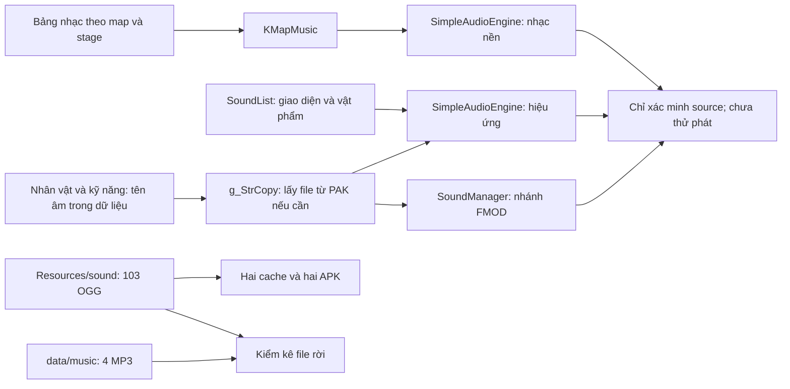

TÓM TẮT 1/5: [NGUỒN] DONE — hoàn tất kiểm kê tĩnh âm thanh và nhạc K-02d trên đúng client bản A và dữ liệu gs được giao; không sửa kết luận cũ.
TÓM TẮT 2/5: [NGUỒN] Có 107 file game rời, 17.346.877 byte: 103 OGG và 4 MP3; toàn cây client trừ .git_old có 344 file theo đuôi âm thanh, 54.844.371 byte, gồm cache/SDK.
TÓM TẮT 3/5: [NGUỒN] Đã đọc header 107/107 file game, mã đọc, hai cache và hai APK; ba bảng server có 148 lượt tham chiếu/52 đường dẫn chưa khớp tên trong 107 file game rời.
TÓM TẮT 4/5: [CHƯA KIỂM] Mức hiểu tĩnh 70% theo 7/10 tiêu chí; chưa kiểm tra âm thanh trong PAK/backup, ánh xạ đầy đủ NPC–phái–kỹ năng hoặc giải mã/phát toàn bộ stream.
TÓM TẮT 5/5: [NGUỒN] Không chạy build, exe game/công cụ, VM hoặc mạng; không commit/push theo yêu cầu mới nhất; giới hạn file nhịp ngoài writable root ghi tại K-02d.md.

# K-02d — Kiểm kê asset gốc: âm thanh và nhạc

Loại: khảo sát
Chủ đề: Kiểm kê file âm thanh, nhạc nền, gói Android và đường đọc trong source client bản A.
Từ khóa: âm thanh, nhạc nền, sound, music, Ogg Vorbis, MP3, PAK, SimpleAudioEngine, SoundManager, KMapMusic
Trạng thái: DONE — hoàn tất khảo sát tĩnh; các phần chưa kiểm tra được công khai, không có xác nhận runtime.
Độ phủ: header 107/107 file game rời; metadata 344/344 file thuộc bộ đuôi âm thanh; 2/2 cache, 2/2 APK, 3/3 bảng tham chiếu server; nội dung âm thanh PAK server 0/4 gói.
Liên quan: JX1_OPS/TASKS/K-02d.md; JX1_OPS/REPORTS/K-02d.md; JX1_OPS/REPORTS/K-01-ban-do-truyen-tin-hieu.md; JX1_OPS/DESIGN/CHUAN-BAO-CAO.md; JX1_OPS/DESIGN/HUONG-DAN-TRA-CUU.md; JX1_OPS/DESIGN/MUC-LUC-TRI-THUC.md.
Cần tôi quyết định: không; kiểm PAK, bổ sung tài nguyên và thử phát cần task riêng.



## Phạm vi và độ phủ

Khảo sát ngày 18/11/2026, múi giờ +07:00. Hai báo cáo đầu ra chưa có khi bắt đầu; task đã có sẵn, untracked. Đã ghi bản báo cáo sớm lúc 19:47 rồi bổ sung cùng file. Không có báo cáo hoàn chỉnh cũ phải làm lại.

| Ký hiệu | Gốc tuyệt đối |
|---|---|
| C | D:/JX-build/qh9A |
| P | D:/JX-build/qh9A/Classes |
| E | D:/JX-build/qh9A/cocos2d/cocos |
| J | D:/JX-build/qh9A/cocos2d/cocos/platform/android/java/src/org/cocos2dx/lib |
| G | C:/Jx1CocoV3/Folder/ServerNew-20260116T043145Z-3-001/ServerNew/_bin_v2_/gs |

Các ký hiệu P/...:dòng, G/...:dòng trỏ tới file thật, số dòng tính bằng LF vật lý. File nhị phân và thư mục không có dòng văn bản: dẫn đường dẫn, metadata hoặc offset byte, không gán dòng giả. M1–M5 là phép kiểm thực chạy bên dưới, không phải runtime game.

| Phần tử phạm vi | Đã phủ / chưa phủ | Kết quả và giới hạn |
|---|---|---|
| C, trừ .git_old | Đã phủ metadata theo bộ đuôi M1 | 14.495 file tổng; 344 file theo đuôi âm thanh; không cộng entry APK vào file rời |
| C/data/music | Đã phủ 4/4 | MP3 game; chưa biết bài nào hiệu lực ở runtime |
| C/Resources/sound, không gồm con | Đã phủ 36/36 | .ogg, nhóm tên sound_m; chưa ánh xạ từng NPC |
| C/Resources/sound/skill, không gồm mingjiao | Đã phủ 62/62 | 27 tên sound_k, 2 firework, 33 tên Hán |
| C/Resources/sound/skill/mingjiao | Đã phủ 5/5 | Giữ mã tên; chưa đối chiếu phái, nhánh, cấp học |
| Hai cache sound dưới build/intermediates/assets/debug | Đã phủ 206/206 bản sao | 103/cây, SHA-256 từng đường dẫn khớp nguồn |
| C/proj.android/app/libs/api/*/examples/media | Đã phủ metadata 31/31 file âm thanh SDK | Không cộng vào 107 file game; codec toàn bộ SDK chưa kiểm tra |
| Hai APK trên đĩa bản A | Đã phủ 2/2 về các đuôi/tên cấu hình đã lọc | 103 OGG/gói, hash khớp nguồn; không cài/chạy APK |
| G/DataFiles, GameData, maps, pak, Settings, script, Msg, TongSet | Đã phủ metadata 8/8 thư mục | 6.632 file, 86.359.082 byte; 0 file âm thanh rời theo M1 |
| SoundList và hai bảng music trong G/Settings | Đã phủ 3/3 bảng | 148 lượt tham chiếu/52 đường dẫn khác nhau |
| G/pak/*.pak | Metadata 4/4; nội dung âm thanh 0/4 | Không suy số âm thanh bên trong từ tên gói |
| G/gs.zip; ZIP/RAR/7z dự phòng; ZIP phông/UI trong client | Chưa kiểm tra nội dung âm thanh | Không gán số file âm thanh trong container bằng 0 |
| G/account, DumpInfo, Logs, gameser_log | Ngoài phạm vi đọc nội dung | Không đọc dữ liệu tài khoản/log/dump hay cấu hình kết nối |
| Full decode, phát âm, thiết bị đang cài và runtime | Chưa kiểm tra | Task không cấp phép build/game/VM/mạng |

Không dùng qh7, D:/Android/b/Client hay source server ngoài G. Phép tìm mục âm thanh trong GS001-MAP không có kết quả phù hợp; file Graphify P/graphify-out/.graphify_root ghi dấu chấm, không chứng minh version bằng đường dẫn tuyệt đối. Không chạy Graphify/update graph; dùng source thật. Không thay bản A bằng gốc client cũ của K-01.

## Giải mã tên

Danh mục cuối mục này giữ đủ 107 tên file game rời. Tên lấy từ hệ thống file Windows là Unicode; cột “Chữ đúng UTF-8” giữ tên quan sát được, gồm chữ Hán. Không tự đặt tên bài có dấu cho tên ASCII không dấu hoặc giải nghĩa mã viết tắt thành kỹ năng.

Bảng server có phần Hán đọc bằng GBK/CP936; khóa và đường dẫn âm thanh đang xét là ASCII. Kiểm strict cho thấy KMapMusic.cpp và SoundManager.cpp không phải UTF-8 thuần; KStrBase.cpp và UiSoundSetting.cpp là UTF-8 hợp lệ nhưng có bình luận cũ lỗi chữ. Không sửa encoding nguồn; anchor theo LF byte, kiểm lại symbol. Không có căn cứ dùng TCVN3 để tự sửa tên trong lượt này.

Tên NTFS Unicode không được gắn nhãn GBK một cách giả định. Nghĩa Việt chính thức, phái/nhánh/cấp học của tên Hán và mã viết tắt chưa kiểm tra. Hai tên 刀剑刺中声.ogg và 枪刺中声.ogg có cùng SHA-256 nhưng vẫn là hai đường dẫn; không xóa/gộp.

<!-- DANH_MUC_AUDIO_BEGIN -->
| Nhóm cấu trúc | Tên gốc / nguồn file dưới C (nhị phân, không có dòng) | Mã hóa tên | Chữ đúng UTF-8, chưa diễn giải nghĩa | Byte |
|---|---|---|---|---:|
| Nhạc nền, map chưa xác định | data/music/daianhhung.mp3 | Unicode NTFS | daianhhung.mp3 | 3121943 |
| Nhạc nền, map chưa xác định | data/music/nhachay.mp3 | Unicode NTFS | nhachay.mp3 | 4057335 |
| Nhạc nền, map chưa xác định | data/music/start.mp3 | Unicode NTFS | start.mp3 | 4352191 |
| Nhạc nền, map chưa xác định | data/music/tamsanhduyen.mp3 | Unicode NTFS | tamsanhduyen.mp3 | 4141497 |
| Kỹ năng / chưa rõ phái-nhánh-cấp | Resources/sound/skill/firework01.ogg | Unicode NTFS | firework01.ogg | 37433 |
| Kỹ năng / chưa rõ phái-nhánh-cấp | Resources/sound/skill/firework02.ogg | Unicode NTFS | firework02.ogg | 61093 |
| Kỹ năng / mã mingjiao | Resources/sound/skill/mingjiao/mj_ckdnd_c.ogg | Unicode NTFS | mj_ckdnd_c.ogg | 12683 |
| Kỹ năng / mã mingjiao | Resources/sound/skill/mingjiao/mj_thln_c.ogg | Unicode NTFS | mj_thln_c.ogg | 13807 |
| Kỹ năng / mã mingjiao | Resources/sound/skill/mingjiao/mj_thln_f.ogg | Unicode NTFS | mj_thln_f.ogg | 9592 |
| Kỹ năng / mã mingjiao | Resources/sound/skill/mingjiao/mj_thpt_c.ogg | Unicode NTFS | mj_thpt_c.ogg | 10818 |
| Kỹ năng / mã mingjiao | Resources/sound/skill/mingjiao/mj_thpt_f.ogg | Unicode NTFS | mj_thpt_f.ogg | 7137 |
| Kỹ năng / chưa rõ phái-nhánh-cấp | Resources/sound/skill/sound_k001.ogg | Unicode NTFS | sound_k001.ogg | 14463 |
| Kỹ năng / chưa rõ phái-nhánh-cấp | Resources/sound/skill/sound_k002.ogg | Unicode NTFS | sound_k002.ogg | 15625 |
| Kỹ năng / chưa rõ phái-nhánh-cấp | Resources/sound/skill/sound_k003.ogg | Unicode NTFS | sound_k003.ogg | 14412 |
| Kỹ năng / chưa rõ phái-nhánh-cấp | Resources/sound/skill/sound_k004.ogg | Unicode NTFS | sound_k004.ogg | 15532 |
| Kỹ năng / chưa rõ phái-nhánh-cấp | Resources/sound/skill/sound_k005.ogg | Unicode NTFS | sound_k005.ogg | 14207 |
| Kỹ năng / chưa rõ phái-nhánh-cấp | Resources/sound/skill/sound_k006.ogg | Unicode NTFS | sound_k006.ogg | 13855 |
| Kỹ năng / chưa rõ phái-nhánh-cấp | Resources/sound/skill/sound_k007.ogg | Unicode NTFS | sound_k007.ogg | 13132 |
| Kỹ năng / chưa rõ phái-nhánh-cấp | Resources/sound/skill/sound_k008.ogg | Unicode NTFS | sound_k008.ogg | 14417 |
| Kỹ năng / chưa rõ phái-nhánh-cấp | Resources/sound/skill/sound_k009.ogg | Unicode NTFS | sound_k009.ogg | 14028 |
| Kỹ năng / chưa rõ phái-nhánh-cấp | Resources/sound/skill/sound_k010.ogg | Unicode NTFS | sound_k010.ogg | 13198 |
| Kỹ năng / chưa rõ phái-nhánh-cấp | Resources/sound/skill/sound_k011.ogg | Unicode NTFS | sound_k011.ogg | 28355 |
| Kỹ năng / chưa rõ phái-nhánh-cấp | Resources/sound/skill/sound_k014.ogg | Unicode NTFS | sound_k014.ogg | 8425 |
| Kỹ năng / chưa rõ phái-nhánh-cấp | Resources/sound/skill/sound_k015.ogg | Unicode NTFS | sound_k015.ogg | 23814 |
| Kỹ năng / chưa rõ phái-nhánh-cấp | Resources/sound/skill/sound_k017.ogg | Unicode NTFS | sound_k017.ogg | 14298 |
| Kỹ năng / chưa rõ phái-nhánh-cấp | Resources/sound/skill/sound_k023.ogg | Unicode NTFS | sound_k023.ogg | 9632 |
| Kỹ năng / chưa rõ phái-nhánh-cấp | Resources/sound/skill/sound_k028.ogg | Unicode NTFS | sound_k028.ogg | 17036 |
| Kỹ năng / chưa rõ phái-nhánh-cấp | Resources/sound/skill/sound_k029.ogg | Unicode NTFS | sound_k029.ogg | 22242 |
| Kỹ năng / chưa rõ phái-nhánh-cấp | Resources/sound/skill/sound_k031.ogg | Unicode NTFS | sound_k031.ogg | 15445 |
| Kỹ năng / chưa rõ phái-nhánh-cấp | Resources/sound/skill/sound_k032.ogg | Unicode NTFS | sound_k032.ogg | 7824 |
| Kỹ năng / chưa rõ phái-nhánh-cấp | Resources/sound/skill/sound_k036.ogg | Unicode NTFS | sound_k036.ogg | 16514 |
| Kỹ năng / chưa rõ phái-nhánh-cấp | Resources/sound/skill/sound_k037.ogg | Unicode NTFS | sound_k037.ogg | 18053 |
| Kỹ năng / chưa rõ phái-nhánh-cấp | Resources/sound/skill/sound_k038.ogg | Unicode NTFS | sound_k038.ogg | 60612 |
| Kỹ năng / chưa rõ phái-nhánh-cấp | Resources/sound/skill/sound_k040.ogg | Unicode NTFS | sound_k040.ogg | 17469 |
| Kỹ năng / chưa rõ phái-nhánh-cấp | Resources/sound/skill/sound_k041.ogg | Unicode NTFS | sound_k041.ogg | 16979 |
| Kỹ năng / chưa rõ phái-nhánh-cấp | Resources/sound/skill/sound_k044.ogg | Unicode NTFS | sound_k044.ogg | 16590 |
| Kỹ năng / chưa rõ phái-nhánh-cấp | Resources/sound/skill/sound_k045.ogg | Unicode NTFS | sound_k045.ogg | 9037 |
| Kỹ năng / chưa rõ phái-nhánh-cấp | Resources/sound/skill/sound_k046.ogg | Unicode NTFS | sound_k046.ogg | 69892 |
| Kỹ năng / chưa rõ phái-nhánh-cấp | Resources/sound/skill/不灭不绝.ogg | Unicode NTFS | 不灭不绝.ogg | 30837 |
| Kỹ năng / chưa rõ phái-nhánh-cấp | Resources/sound/skill/亢龙无悔.ogg | Unicode NTFS | 亢龙无悔.ogg | 16761 |
| Kỹ năng / chưa rõ phái-nhánh-cấp | Resources/sound/skill/冰爆.ogg | Unicode NTFS | 冰爆.ogg | 19191 |
| Kỹ năng / chưa rõ phái-nhánh-cấp | Resources/sound/skill/刀剑刺中声.ogg | Unicode NTFS | 刀剑刺中声.ogg | 10409 |
| Kỹ năng / chưa rõ phái-nhánh-cấp | Resources/sound/skill/剑飞惊天.ogg | Unicode NTFS | 剑飞惊天.ogg | 19717 |
| Kỹ năng / chưa rõ phái-nhánh-cấp | Resources/sound/skill/剥极而复.ogg | Unicode NTFS | 剥极而复.ogg | 15928 |
| Kỹ năng / chưa rõ phái-nhánh-cấp | Resources/sound/skill/天下无狗.ogg | Unicode NTFS | 天下无狗.ogg | 19869 |
| Kỹ năng / chưa rõ phái-nhánh-cấp | Resources/sound/skill/夺魂镖.ogg | Unicode NTFS | 夺魂镖.ogg | 13679 |
| Kỹ năng / chưa rõ phái-nhánh-cấp | Resources/sound/skill/幽冥骷髅.ogg | Unicode NTFS | 幽冥骷髅.ogg | 18790 |
| Kỹ năng / chưa rõ phái-nhánh-cấp | Resources/sound/skill/怒雷指.ogg | Unicode NTFS | 怒雷指.ogg | 11689 |
| Kỹ năng / chưa rõ phái-nhánh-cấp | Resources/sound/skill/投石问路.ogg | Unicode NTFS | 投石问路.ogg | 12915 |
| Kỹ năng / chưa rõ phái-nhánh-cấp | Resources/sound/skill/推山填海.ogg | Unicode NTFS | 推山填海.ogg | 60096 |
| Kỹ năng / chưa rõ phái-nhánh-cấp | Resources/sound/skill/普通爆炸.ogg | Unicode NTFS | 普通爆炸.ogg | 16581 |
| Kỹ năng / chưa rõ phái-nhánh-cấp | Resources/sound/skill/朱蛤青冥.ogg | Unicode NTFS | 朱蛤青冥.ogg | 12778 |
| Kỹ năng / chưa rõ phái-nhánh-cấp | Resources/sound/skill/枪刺中声.ogg | Unicode NTFS | 枪刺中声.ogg | 10409 |
| Kỹ năng / chưa rõ phái-nhánh-cấp | Resources/sound/skill/沧海明月.ogg | Unicode NTFS | 沧海明月.ogg | 15155 |
| Kỹ năng / chưa rõ phái-nhánh-cấp | Resources/sound/skill/治疗术.ogg | Unicode NTFS | 治疗术.ogg | 11172 |
| Kỹ năng / chưa rõ phái-nhánh-cấp | Resources/sound/skill/沿门托钵.ogg | Unicode NTFS | 沿门托钵.ogg | 18901 |
| Kỹ năng / chưa rõ phái-nhánh-cấp | Resources/sound/skill/浮云散雪.ogg | Unicode NTFS | 浮云散雪.ogg | 35582 |
| Kỹ năng / chưa rõ phái-nhánh-cấp | Resources/sound/skill/烈火情天.ogg | Unicode NTFS | 烈火情天.ogg | 14240 |
| Kỹ năng / chưa rõ phái-nhánh-cấp | Resources/sound/skill/狂风骤电.ogg | Unicode NTFS | 狂风骤电.ogg | 15042 |
| Kỹ năng / chưa rõ phái-nhánh-cấp | Resources/sound/skill/玄一无象.ogg | Unicode NTFS | 玄一无象.ogg | 14243 |
| Kỹ năng / chưa rõ phái-nhánh-cấp | Resources/sound/skill/疾风咒.ogg | Unicode NTFS | 疾风咒.ogg | 23161 |
| Kỹ năng / chưa rõ phái-nhánh-cấp | Resources/sound/skill/碧海潮生.ogg | Unicode NTFS | 碧海潮生.ogg | 30937 |
| Kỹ năng / chưa rõ phái-nhánh-cấp | Resources/sound/skill/血手毒杀.ogg | Unicode NTFS | 血手毒杀.ogg | 22378 |
| Kỹ năng / chưa rõ phái-nhánh-cấp | Resources/sound/skill/行龙不雨.ogg | Unicode NTFS | 行龙不雨.ogg | 27149 |
| Kỹ năng / chưa rõ phái-nhánh-cấp | Resources/sound/skill/见人伸手.ogg | Unicode NTFS | 见人伸手.ogg | 13437 |
| Kỹ năng / chưa rõ phái-nhánh-cấp | Resources/sound/skill/迅雷咒.ogg | Unicode NTFS | 迅雷咒.ogg | 13157 |
| Kỹ năng / chưa rõ phái-nhánh-cấp | Resources/sound/skill/追心箭.ogg | Unicode NTFS | 追心箭.ogg | 10907 |
| Kỹ năng / chưa rõ phái-nhánh-cấp | Resources/sound/skill/霹雳弹.ogg | Unicode NTFS | 霹雳弹.ogg | 13113 |
| Kỹ năng / chưa rõ phái-nhánh-cấp | Resources/sound/skill/风卷残雪.ogg | Unicode NTFS | 风卷残雪.ogg | 13451 |
| Kỹ năng / chưa rõ phái-nhánh-cấp | Resources/sound/skill/风花雪月.ogg | Unicode NTFS | 风花雪月.ogg | 18384 |
| Kỹ năng / chưa rõ phái-nhánh-cấp | Resources/sound/skill/飘雪穿云.ogg | Unicode NTFS | 飘雪穿云.ogg | 11659 |
| Âm hiệu sound_m / NPC chưa xác định | Resources/sound/sound_m01.ogg | Unicode NTFS | sound_m01.ogg | 10358 |
| Âm hiệu sound_m / NPC chưa xác định | Resources/sound/sound_m02.ogg | Unicode NTFS | sound_m02.ogg | 12649 |
| Âm hiệu sound_m / NPC chưa xác định | Resources/sound/sound_m03.ogg | Unicode NTFS | sound_m03.ogg | 11211 |
| Âm hiệu sound_m / NPC chưa xác định | Resources/sound/sound_m04.ogg | Unicode NTFS | sound_m04.ogg | 8801 |
| Âm hiệu sound_m / NPC chưa xác định | Resources/sound/sound_m05.ogg | Unicode NTFS | sound_m05.ogg | 8932 |
| Âm hiệu sound_m / NPC chưa xác định | Resources/sound/sound_m06.ogg | Unicode NTFS | sound_m06.ogg | 6638 |
| Âm hiệu sound_m / NPC chưa xác định | Resources/sound/sound_m07.ogg | Unicode NTFS | sound_m07.ogg | 8668 |
| Âm hiệu sound_m / NPC chưa xác định | Resources/sound/sound_m08.ogg | Unicode NTFS | sound_m08.ogg | 9588 |
| Âm hiệu sound_m / NPC chưa xác định | Resources/sound/sound_m09.ogg | Unicode NTFS | sound_m09.ogg | 8186 |
| Âm hiệu sound_m / NPC chưa xác định | Resources/sound/sound_m10.ogg | Unicode NTFS | sound_m10.ogg | 17881 |
| Âm hiệu sound_m / NPC chưa xác định | Resources/sound/sound_m12.ogg | Unicode NTFS | sound_m12.ogg | 17233 |
| Âm hiệu sound_m / NPC chưa xác định | Resources/sound/sound_m13.ogg | Unicode NTFS | sound_m13.ogg | 21181 |
| Âm hiệu sound_m / NPC chưa xác định | Resources/sound/sound_m14.ogg | Unicode NTFS | sound_m14.ogg | 9277 |
| Âm hiệu sound_m / NPC chưa xác định | Resources/sound/sound_m15.ogg | Unicode NTFS | sound_m15.ogg | 9991 |
| Âm hiệu sound_m / NPC chưa xác định | Resources/sound/sound_m16.ogg | Unicode NTFS | sound_m16.ogg | 6471 |
| Âm hiệu sound_m / NPC chưa xác định | Resources/sound/sound_m18.ogg | Unicode NTFS | sound_m18.ogg | 10358 |
| Âm hiệu sound_m / NPC chưa xác định | Resources/sound/sound_m19.ogg | Unicode NTFS | sound_m19.ogg | 16410 |
| Âm hiệu sound_m / NPC chưa xác định | Resources/sound/sound_m20.ogg | Unicode NTFS | sound_m20.ogg | 6914 |
| Âm hiệu sound_m / NPC chưa xác định | Resources/sound/sound_m21.ogg | Unicode NTFS | sound_m21.ogg | 9605 |
| Âm hiệu sound_m / NPC chưa xác định | Resources/sound/sound_m22.ogg | Unicode NTFS | sound_m22.ogg | 8633 |
| Âm hiệu sound_m / NPC chưa xác định | Resources/sound/sound_m23.ogg | Unicode NTFS | sound_m23.ogg | 8801 |
| Âm hiệu sound_m / NPC chưa xác định | Resources/sound/sound_m24.ogg | Unicode NTFS | sound_m24.ogg | 8932 |
| Âm hiệu sound_m / NPC chưa xác định | Resources/sound/sound_m25.ogg | Unicode NTFS | sound_m25.ogg | 6638 |
| Âm hiệu sound_m / NPC chưa xác định | Resources/sound/sound_m26.ogg | Unicode NTFS | sound_m26.ogg | 8668 |
| Âm hiệu sound_m / NPC chưa xác định | Resources/sound/sound_m27.ogg | Unicode NTFS | sound_m27.ogg | 9588 |
| Âm hiệu sound_m / NPC chưa xác định | Resources/sound/sound_m28.ogg | Unicode NTFS | sound_m28.ogg | 8152 |
| Âm hiệu sound_m / NPC chưa xác định | Resources/sound/sound_m29.ogg | Unicode NTFS | sound_m29.ogg | 17881 |
| Âm hiệu sound_m / NPC chưa xác định | Resources/sound/sound_m31.ogg | Unicode NTFS | sound_m31.ogg | 13366 |
| Âm hiệu sound_m / NPC chưa xác định | Resources/sound/sound_m32.ogg | Unicode NTFS | sound_m32.ogg | 21181 |
| Âm hiệu sound_m / NPC chưa xác định | Resources/sound/sound_m33.ogg | Unicode NTFS | sound_m33.ogg | 9277 |
| Âm hiệu sound_m / NPC chưa xác định | Resources/sound/sound_m34.ogg | Unicode NTFS | sound_m34.ogg | 9991 |
| Âm hiệu sound_m / NPC chưa xác định | Resources/sound/sound_m35.ogg | Unicode NTFS | sound_m35.ogg | 6471 |
| Âm hiệu sound_m / NPC chưa xác định | Resources/sound/sound_m37.ogg | Unicode NTFS | sound_m37.ogg | 6914 |
| Âm hiệu sound_m / NPC chưa xác định | Resources/sound/sound_m38.ogg | Unicode NTFS | sound_m38.ogg | 16410 |
| Âm hiệu sound_m / NPC chưa xác định | Resources/sound/sound_m39.ogg | Unicode NTFS | sound_m39.ogg | 11504 |
| Âm hiệu sound_m / NPC chưa xác định | Resources/sound/sound_m40.ogg | Unicode NTFS | sound_m40.ogg | 11786 |
<!-- DANH_MUC_AUDIO_END -->

## Sắp theo cấu trúc game

Thứ tự: nhạc nền → giao diện/vật phẩm → nhân vật/kỹ năng/âm hiệu → bản sao đóng gói → ví dụ SDK. Không coi thứ tự file là cấu trúc game.

| Nhóm game | Nguồn file:dòng | Độ chắc/giới hạn |
|---|---|---|
| Nhạc theo bản đồ, giờ game, chiến đấu | P/gamecore/KMapMusic.cpp:116–134, :142–167, :231–283; G/Settings/music/MusicSet.txt:1–103 | Đã xác minh schema/chọn tên; chưa gắn 4 MP3 rời với từng map |
| Giao diện và vật phẩm | G/Settings/SoundList.txt:1–19, :21–49; P/gameui/UiSoundSetting.cpp:42–80, :89–106 | Hai nhóm Ui/Game, 22 tham chiếu không comment; chưa tìm thấy tài nguyên tên đó |
| Nhân vật/NPC | P/gamecore/KNpcRes.cpp:2572–2609 | Hàm dùng m_szSoundName; chưa gán 36 tên sound_m cho từng NPC/map |
| Kỹ năng nam/nữ | P/gamecore/KSkills.cpp:2975–2976, :4141–4180 | Có ManCastSnd/FMCastSnd; chưa lập đủ phái → nhánh → cấp học cho 67 file nhánh skill |
| Đạn kỹ năng | P/gamecore/KMissleRes.cpp:265–298; KMissle.cpp:450, :1933 | Có hàm; hai caller đã kiểm ở KMissle.cpp đang comment, chưa chứng minh phát hoạt động |
| Vật thể thế giới | P/gamecore/KObj.cpp:217, :839–870 | Có SoundFile và hai nhánh phát; ánh xạ từng vật thể/map chưa kiểm tra |

Không xếp 33 tên Hán vào môn phái bằng trí nhớ. Khoảng trống ánh xạ không đồng nghĩa môn phái bị thiếu file.

## Số file và dung lượng theo thư mục, phần mở rộng

### File game rời và bản sao build

| Thư mục dưới C | Đuôi | File | Byte |
|---|---|---:|---:|
| data/music | .mp3 | 4 | 15.672.966 |
| Resources/sound, không gồm con | .ogg | 36 | 394.545 |
| Resources/sound/skill, không gồm mingjiao | .ogg | 62 | 1.225.329 |
| Resources/sound/skill/mingjiao | .ogg | 5 | 54.037 |
| Tổng game rời, không cộng cache/SDK/APK | .mp3 + .ogg | 107 | 17.346.877 |
| proj.android/app/build/intermediates/assets/debug/sound, không gồm con | .ogg | 36 | 394.545 |
| .../debug/sound/skill, không gồm mingjiao | .ogg | 62 | 1.225.329 |
| .../debug/sound/skill/mingjiao | .ogg | 5 | 54.037 |
| proj.android/app/build/intermediates/assets/debug/mergeDebugAssets/sound, không gồm con | .ogg | 36 | 394.545 |
| .../debug/mergeDebugAssets/sound/skill, không gồm mingjiao | .ogg | 62 | 1.225.329 |
| .../debug/mergeDebugAssets/sound/skill/mingjiao | .ogg | 5 | 54.037 |

Mỗi cache: 103 file/1.673.911 byte; M3 so từng đường dẫn và SHA-256: 103 khớp, 0 khác, 0 thiếu/cây. Trong 62 file skill trực tiếp: sound_k 27/515.086 byte, firework 2/98.526 byte, tên Hán 33/611.717 byte. Có 106 nội dung SHA-256 khác nhau trong 107 đường dẫn game.

### Ví dụ SDK, không cộng vào game

| Thư mục dưới C/proj.android/app/libs/api | Đuôi | File | Byte |
|---|---|---:|---:|
| core/examples/media | .fsb | 1 | 319.936 |
| core/examples/media | .mp3 | 1 | 138.368 |
| core/examples/media | .ogg | 4 | 38.234 |
| core/examples/media | .wav | 5 | 764.674 |
| core/examples/media/granular | .wav | 6 | 54.458 |
| studio/examples/media | .bank | 9 | 32.491.224 |
| studio/examples/media | .fsb | 1 | 112.864 |
| studio/examples/media | .ogg | 4 | 229.914 |
| Tổng SDK | Các đuôi trên | 31 | 34.149.672 |

### Tổng toàn client theo đuôi file rời

| Đuôi | File | Byte |
|---|---:|---:|
| .ogg | 317 | 5.289.881 |
| .mp3 | 5 | 15.811.334 |
| .wav | 11 | 819.132 |
| .fsb | 2 | 432.800 |
| .bank | 9 | 32.491.224 |
| Tổng | 344 | 54.844.371 |

Kiểm chéo: 344 = 107 game + 206 cache + 31 SDK; 54.844.371 = 17.346.877 + 2 × 1.673.911 + 34.149.672. Byte là Length, không phải dung lượng phân bổ đĩa, RAM decode hoặc dữ liệu tải mạng.

### Server

| Thư mục dưới G | Tổng file duyệt metadata | Tổng byte | Âm thanh rời theo M1 |
|---|---:|---:|---:|
| DataFiles | 2 | 3.269 | 0 |
| GameData | 3 | 1.445 | 0 |
| maps | 503 | 8.652.538 | 0 |
| pak | 7 | 15.620.528 | 0 |
| Settings | 2.022 | 26.907.896 | 0 |
| script | 4.085 | 35.168.680 | 0 |
| Msg | 1 | 931 | 0 |
| TongSet | 9 | 3.795 | 0 |
| Tổng | 6.632 | 86.359.082 | 0 |

Bốn PAK ở G/pak: maps.pak 14.542.936 byte; maps01.pak 626.551; script.pak 91.771; skill.pak 349.370; tổng 15.610.628 byte. Ba file còn lại là .mps, không coi là âm thanh. Không có sound.pak/music.pak theo tên tại đây; chưa kiểm tra âm thanh mang ID bên trong bốn gói hay backup. Không xem G là kho âm client đầy đủ chỉ vì có bảng tham chiếu.

## Định dạng và cách đọc

### Header file thật

- [NGUỒN, M2] Cả 103 OGG nguồn có OggS ở offset 0, gói nhận dạng Vorbis ở đầu stream, 2 kênh, 44.100 Hz. Chưa kiểm CRC mọi trang, duration/bitrate hoặc decode toàn bộ.
- [NGUỒN, M2] Bốn MP3 đều có ID3 và frame header FF FB 90 64: nhận dạng frame MPEG-1 Layer III, 128 kbit/s, 44.100 Hz, joint stereo. Đây là thuộc tính frame đầu tìm được; không suy toàn bài CBR hoặc hoàn toàn hợp lệ.

| File dưới C/data/music | Byte | Offset frame đầu sau ID3 |
|---|---:|---:|
| daianhhung.mp3 | 3.121.943 | 32 |
| nhachay.mp3 | 4.057.335 | 32 |
| start.mp3 | 4.352.191 | 1.109 |
| tamsanhduyen.mp3 | 4.141.497 | 1.290 |

WAV/FSB/BANK chỉ nằm trong nhóm ví dụ SDK đã đếm; định dạng nội bộ và khả năng đọc toàn bộ các file đó chưa kiểm tra. Không coi 11 WAV SDK là 11 âm game.

### Mã đọc có sẵn trong bản A

| Tầng | Nguồn file:dòng, symbol | Điều xác minh được |
|---|---|---|
| Đóng gói | C/proj.android/app/build.gradle:59–63, :127–131; C/CMakeLists.txt:51 | Resources là nguồn assets; không mặc định data/music nằm trong APK |
| Danh sách build | C/CMakeLists.txt:170, :182, :234–235, :378; C/proj.android/app/jni/Android.mk:121, :133, :185–186, :333 | Có KMapMusic, KNpcRes, Klogin_f, SoundManager; chưa chứng minh binary khớp source |
| Cấu hình nhạc | P/gamecore/CoreUseNameDef.h:71–72; P/gamecore/KMapMusic.cpp:92–167, :188 | LoadSetFile dùng KTabFile/KIniFile; Init lấy SimpleAudioEngine |
| Nhạc theo map/time | P/gamecore/KMapMusic.cpp:231–283, :290–310 | Chọn tên, ghép đường dẫn, playBackgroundMusic; có đường phát lại sau kết thúc |
| Nhạc đăng nhập | P/gameui/Klogin_f.cpp:1117–1142; P/vn/gameui/Klogin_f_VN.cpp:71–101 | Chọn một trong Music001/002/003; VN kiểm file tồn tại trước phát |
| Ui/Game | P/gameui/UiSoundSetting.h:10; UiSoundSetting.cpp:42–80, :89–106 | Đọc SoundList rồi playEffect; khác định dạng sound.lst của FMOD |
| NPC/nhân vật | P/gamecore/KNpcRes.cpp:2572–2609 | g_StrCopy rồi chọn playEffect/MyPlaySound |
| Kỹ năng nam/nữ | P/gamecore/KSkills.cpp:2975–2976, :4141–4180 | ManCastSnd/FMCastSnd; chuẩn hóa đường dẫn; hai nhánh phát |
| Vật thể | P/gamecore/KObj.cpp:217, :839–870 | SoundFile và hai nhánh phát; chưa xác minh runtime |
| File rời/PAK | P/engine/KStrBase.cpp:829–865, g_StrCopy; KPakFile.cpp:256–294; KPakList.cpp:234–291 | Nếu chưa có file rời thì tìm phần tử PAK, đọc và ghi đích trong logic client; không gọi hàm khi khảo sát |
| Dấu phân cách | P/engine/KStrBase.cpp:728–739, __replaceNmae | Đổi backslash thành slash; không đổi .wav thành .ogg |
| FMOD | P/manager/SoundManager.cpp:57–60, :126–170, :298–313 | System_Create/init(32), createSound(FMOD_DEFAULT), playSound |
| Backend mặc định source | P/gamescene/KUpdateLayer.cpp:141–142, :408 | Dòng hoạt động SOUND_MODEL_NOR; dòng FMOD và LoadSoundList đã kiểm đang comment; chưa biết runtime |
| Android SimpleAudioEngine | E/audio/android/cddSimpleAudioEngine.cpp:35–40; E/audio/android/jni/cddandroidAndroidJavaEngine.cpp:82–95, :171–192 | Tạo AndroidJavaEngine; nhạc qua JNI, effect chọn AudioEngine::play2d hoặc JNI |
| Java Android | J/Cocos2dxHelper.java:477–478, :517–518; Cocos2dxMusic.java:274–288; Cocos2dxSound.java:351–358 | MediaPlayer/SoundPool đọc file tuyệt đối hoặc assets |
| Decoder engine | E/audio/android/AudioDecoderOgg.cpp:65, :86; AudioDecoderMp3.cpp:44–67; AudioDecoderWav.cpp:80 | Có ov_open_callbacks/ov_read, decodeMP3, sf_open_read; chưa chạy decoder |

Trong bảng, tên file rút gọn kế sau dấu chấm phẩy giữ cùng thư mục đã ghi trước đó.

P/gamecore/KPlayer.cpp:4353–4359 nhận UI_PLAYMUSIC nhưng gọi ScriptPlay ở :4358 đang comment. KMapMusic.cpp:501–513 có ScriptPlay dùng playEffect; không kết luận caller script đang hoạt động. Hai caller âm đạn trong KMissle.cpp:450, :1933 cũng comment.

E/audio/android/cddSimpleAudioEngine.cpp:56–74 có hàm base rỗng, nhưng :35–40 tạo subclass AndroidJavaEngine; phải lần sang subclass, không kết luận game mất âm từ base rỗng.

Công cụ đọc thực dùng: PowerShell/.NET, FileStream đọc header, Get-FileHash SHA-256, ZipArchive chỉ đọc. Không chạy trình phát/converter/tool game, không thực thi mã decoder/PAK, không tạo parser/script phụ.

## Hai APK và mã hóa tên ZIP

| APK dưới C | Byte APK | Entry âm thanh | Byte chưa nén | So với nguồn |
|---|---:|---:|---:|---|
| proj.android/app/build/outputs/apk/debug/projectdebug-debug.apk | 78.951.057 | 103 .ogg | 1.673.911 | 103 khớp SHA-256, 0 nội dung lạ |
| proj.android/app/release/projectdebug-release.apk | 109.658.329 | 103 .ogg | 1.673.911 | 103 khớp SHA-256, 0 nội dung lạ |

Mỗi APK không có entry .mp3/.wav/.bank/.fsb, .pak/.obb hoặc tên SoundList/MusicSet/MusicFightSet trong các phép lọc M4. Tổng compressed length của 103 OGG cũng là 1.673.911 byte/gói. Đây là APK trên đĩa, không phải bản đang cài thiết bị.

Encoding ZIP mặc định ban đầu làm 33 tên Hán nhìn như thiếu, chỉ 70 tên ASCII khớp. So hash vẫn đủ 103. Đọc central directory APK debug: ba mẫu tên Hán có flags 0x0000, byte tên là UTF-8 đúng. Mở cả hai APK với entryNameEncoding=UTF-8 xác nhận 103/103 đường dẫn. Không ghi lỗi thiếu 33 âm hay lỗi nội dung APK; chưa chứng minh lỗi loader Android.

## Tài nguyên thiếu hoặc chưa tìm thấy

| Nguồn | Lượt tham chiếu | Tên khác nhau | Đối chiếu |
|---|---:|---:|---|
| G/Settings/SoundList.txt:1–49, bỏ comment | 22 | 22 WAV | 0 tên khớp 107 file game; sound_i001.wav ở :3 |
| G/Settings/music/MusicSet.txt:1–103 | 102 | 30 MP3 | Map ID 1–102; 0 tên khớp 4 MP3 rời |
| G/Settings/music/MusicFightSet.ini:5–151 | 24 | 14 MP3 | 8 stage; 14 tên là tập con của 30 tên map |
| Hợp ba bảng | 148 | 52 | 22 WAV + 30 MP3; 0/52 khớp basename trong 107 file game |

Ví dụ map 1 → Music120 ở G/Settings/music/MusicSet.txt:2, map 2 → Music210 ở :3; stage 0 dùng Music210/211 ở MusicFightSet.ini:19–20. Chưa xác minh tên Việt của map; không tự gán địa danh.

Ba tên nhạc đăng nhập Music001/002/003 cũng chưa thấy trong nhóm game rời, khác tập 30 tên map. Bốn MP3 rời hiện có khác các tên login/map; không tự đổi tên hoặc coi chúng là bản thay thế tương đương.

Không có file rời tên SoundList.txt/MusicSet.txt/MusicFightSet.ini dưới C/data và C/Resources trong phép tìm tên; hai APK cũng không có entry tên đó. Bảng server chỉ chứng minh schema/tham chiếu, chưa chứng minh bảng hiệu lực trên client cài đặt. Chưa tìm thấy không đồng nghĩa thiết bị đang chơi thiếu tài nguyên.

Không tìm thấy .pak dưới C/data/C/Resources. Âm thanh trong 4 PAK server, gs.zip và backup chưa kiểm tra. Không lấy việc .wor vắng làm kết luận thiếu âm thanh; đó là phạm vi bản đồ.

## Đã hiểu bao nhiêu phần trăm

Mức hiểu tĩnh 70% = 7 tiêu chí đã trả lời / 10 tiêu chí, trọng số bằng nhau. Không phải phần trăm thời lượng nhạc, byte đã decode, chất lượng âm hay hoàn thiện cả game.

| Tiêu chí | Kết quả |
|---|---|
| 1. Đúng gốc, phân ranh game/cache/SDK | Đã trả lời |
| 2. Số file/byte theo thư mục/đuôi | Đã trả lời |
| 3. Header đủ 107 file game rời | Đã trả lời |
| 4. So cache/APK với nguồn | Đã trả lời |
| 5. API đọc/phát, nhánh backend source | Đã trả lời |
| 6. Schema map/stage, Ui/Game | Đã trả lời |
| 7. Chỉ ra tham chiếu chưa tìm thấy | Đã trả lời |
| 8. Mọi âm gắn NPC/map/phái → nhánh → cấp học | Chưa kiểm tra đầy đủ |
| 9. Kiểm hết âm trong PAK/backup | Chưa kiểm tra |
| 10. Full decode và phát đúng trên runtime | Chưa kiểm tra, không chạy trong task |

Header game rời 107/107 = 100%; nội dung âm thanh PAK server 0/4 gói. Mẫu số khác nhau; không suy số âm thanh bên trong bằng 0.

## MỤC SỔ THÔNG SỐ

| Nhóm | Tên/hằng số | file:dòng | Giá trị | Đơn vị | Ảnh hưởng | Đổi an toàn (CÓ/CẨN THẬN/KHÔNG) | Nguồn đo |
|---|---|---|---|---|---|---|---|
| Map | defONE_MAP_MAX_MUSIC | P/gamecore/KMapMusic.h:18 | 4 | slot/map | Giới hạn số nhạc đọc/map | CẨN THẬN | Đọc tĩnh |
| Chiến đấu | defMUSIC_MAX_STAGE | P/gamecore/KMapMusic.h:20 | 32 | stage | Giới hạn số giai đoạn | CẨN THẬN | Đọc tĩnh |
| Chiến đấu | defMUSIC_STATE_MAX_MAP | P/gamecore/KMapMusic.h:21 | 64 | map/stage | Giới hạn danh sách map | CẨN THẬN | Đọc tĩnh |
| Chiến đấu | defMUSIC_STATE_MAX_MUSIC | P/gamecore/KMapMusic.h:22 | 16 | bài/stage | Giới hạn danh sách bài | CẨN THẬN | Đọc tĩnh |
| Cấu hình | StageNum | G/Settings/music/MusicFightSet.ini:6 | 8 | stage | Số stage của bảng được đọc | CẨN THẬN | Chưa chứng minh hiệu lực client |
| Backend | __sound_model | P/gamescene/KUpdateLayer.cpp:141–142 | SOUND_MODEL_NOR | enum | Chọn nhánh source | CẨN THẬN | Không phải đo runtime |
| FMOD | System::init | P/manager/SoundManager.cpp:60 | 32 | kênh yêu cầu | Số kênh khởi tạo nhánh FMOD | CẨN THẬN | Chưa gọi init |
| FMOD | volume | P/manager/SoundManager.cpp:76, :148, :162 | 0,5 | tỷ lệ tuyến tính | Âm lượng nhánh này | CẨN THẬN | Mặc định source |
| OGG nguồn | channels/sample_rate | C/Resources/sound/**/*.ogg, header M2 | 2 / 44.100 | kênh / Hz | Kiểu stream | KHÔNG | 103/103 header |
| MP3 frame đầu | MPEG frame | C/data/music/*.mp3, offset bảng M2 | MPEG-1 Layer III / 128 / 44.100 | loại / kbit/s / Hz | Nhận dạng frame đầu | KHÔNG | 4/4 file |

Không cấp quyền đổi mã/cấu hình; không có “CÓ” khi chưa thử an toàn. Không suy RAM/FPS hoặc thời gian thực từ kích thước nén/thông số source.

## Phép kiểm thực chạy

| Mã | Phép kiểm chỉ đọc | Kết quả |
|---|---|---|
| M1 | Get-ChildItem -Recurse -File; lọc Extension; Group-Object; Measure-Object Length -Sum | Số liệu client/server như bảng; không đọc nội dung account/log/dump |
| M2 | FileStream.Read header OGG/MP3; kích thước ID3 và tối đa 4.096 byte tìm frame tiếp | 103 Vorbis; 4 MP3 có header frame; chưa full decode |
| M3 | Get-FileHash -Algorithm SHA256 theo đường dẫn nguồn/cache | 106 nội dung/107 đường dẫn game; 103 khớp/cây cache |
| M4 | ZipArchiveMode.Read; tổng Length/CompressedLength; SHA256 stream entry; central directory mẫu; entryNameEncoding=UTF-8 | Hai APK đủ 103 OGG, hash khớp; không sửa archive |
| M5 | Select-String file đã khoanh; đếm tham chiếu không comment; so basename; anchor LF byte | 148 lượt/52 tên; 0 khớp game rời; mã đọc như bảng |

Bộ đuôi M1: .wav, .wave, .mp3, .ogg, .oga, .flac, .aac, .m4a, .wma, .mid, .midi, .aif, .aiff, .caf, .opus, .amr, .it, .xm, .mod, .s3m, .bank, .fsb, .fev. Chỉ năm đuôi trong bảng tổng client có file. Không phát hiện asset đổi đuôi/ẩn trong container bằng phép lọc này.

Tái lập riêng nhóm game: Get-ChildItem -LiteralPath 'D:\JX-build\qh9A\Resources\sound','D:\JX-build\qh9A\data\music' -Recurse -File | Group-Object DirectoryName,Extension; cộng Length bằng Measure-Object. Không cần tải/chạy công cụ game.

## ĐÃ XÁC MINH / CHƯA XÁC MINH

ĐÃ XÁC MINH: metadata, header, cache/APK, tên cấu hình/schema trong giới hạn bảng phạm vi; các symbol/file:dòng được đối chiếu file thật bản A. Hai APK so đủ hash 103 entry; đủ tên khi chỉ định UTF-8. Danh mục cuối lượt được đọc lại, kiểm tổng với metadata.

CHƯA XÁC MINH: âm trong PAK/backup; toàn vẹn mọi frame/trang, duration/loudness; codec toàn bộ SDK; tên Việt chính thức và ánh xạ mọi âm; cấu hình/binary hiệu lực trên thiết bị; chất lượng/hành vi phát thật. Test game/build/full-decode chưa chạy; exe game/tool, VM, mạng không chạy theo task.

## Phát hiện khi chuẩn hóa, lỗi và cách xử lý

Không có báo cáo K-02-am-thanh cũ để đổi kết luận; không sửa K-01/K-03/mã nguồn. jx1-retrofit áp dụng khuôn và việc ghi rõ phần thiếu.

| Vấn đề/cách thử | Kết quả/xử lý |
|---|---|
| Get-Content mặc định hiển thị sai chữ Việt | Đọc lại UTF-8; bản gốc đúng; ghi UTF-8 không BOM |
| rg không có | Hai chỗ cùng lệnh đầu báo CommandNotFound; báo một lần, chuyển PowerShell, không cài |
| Đầu ra dài; -Include với LiteralPath không lọc như dự định | Có lần trích nhầm dòng graph JSON rất dài; không dùng làm bằng chứng; chuyển đúng file/lọc Extension trước tìm |
| Bộ giải mã làm lệch dòng khi đọc source | Chốt LF byte, kiểm lại symbol, không giữ anchor lệch |
| ZIP mặc định làm 33 tên Hán nhìn như thiếu | Hash đủ 103; đọc byte tên mẫu, mở UTF-8: đủ 103/103 ở cả hai APK |
| ZipArchiveMode chưa nạp assembly | Lệnh chỉ đọc lỗi TypeNotFound/null; nạp System.IO.Compression rồi đọc lại thành công |
| Ghép báo cáo bằng một patch vừa delete vừa add cùng đường dẫn | Công cụ từ chối trước ghi; đọc lại xác nhận bản nháp còn nguyên, chuyển ghi UTF-8 trực tiếp đúng báo cáo |
| D:/JX-wt/K-02d.nhip ngoài writable root | Không thử vượt sandbox/đổi quyền; lưu mốc tại K-02d.md, chưa tạo file nhịp đích |

Không lỗi nào thử lại cùng cách quá ba lần; phép kiểm tĩnh không phải game test đạt.

## Đề xuất tối ưu

- Dùng danh mục 107 file và 52 tham chiếu chưa khớp để giao kiểm gói cụ thể; không đổi tên/chép MP3 làm nhạc thay thế khi chưa có bằng chứng.
- Task ngữ nghĩa tiếp theo nối bảng kỹ năng/NPC/map với tên âm; xếp phái → nhánh → cấp học, giữ tên Hán gốc và tên Việt có nguồn.
- Giữ nguồn/cache/APK thành các lớp kiểm kê riêng để tránh cộng lặp; không xóa file/cache/trùng nội dung trong lượt này.
- Full decode/runtime cần task riêng được duyệt trên đúng binary và cấu hình; báo cáo này không thay kết quả thử.

## Bàn giao

Đầu ra chính là báo cáo này; bàn giao tác nghiệp ở JX1_OPS/REPORTS/K-02d.md và mục Kết quả cuối task theo yêu cầu trực tiếp. Không stage/commit/push theo yêu cầu mới nhất “Tổng quan commit hộ”; SHA chưa có. Không tuyên bố GitHub đã nhận thay đổi.

Không tạo REPORTS/_CHIMUC/K-02d.tsv vì ngoài vùng file được giao; đặt dòng bảy cột để PM gộp dưới đây. Không sửa mục lục tri thức hoặc BAI_HOC.

```tsv
file	loại	chủ đề	từ khóa	trạng thái	độ phủ	liên quan
JX1_OPS/REPORTS/K-02-am-thanh.md	khảo sát	Kiểm kê âm thanh và nhạc bản A	âm thanh; nhạc; sound; music; OGG; MP3; PAK; KMapMusic	DONE — khảo sát tĩnh	107/107 header game; 344 file theo đuôi gồm cache/SDK; 2 APK; 3 bảng tham chiếu; 70% theo 7/10 tiêu chí	JX1_OPS/TASKS/K-02d.md; JX1_OPS/REPORTS/K-02d.md; JX1_OPS/REPORTS/K-01-ban-do-truyen-tin-hieu.md
```

Đề xuất hàng mục lục để PM gộp: Âm thanh và nhạc nền bản A | K-02-am-thanh.md, K-02d.md | KMapMusic, UiSoundSetting, SoundManager, g_StrCopy; Resources/sound; data/music | khảo sát tĩnh; PAK/runtime chưa kiểm tra.

Kỹ năng đã dùng: jx1-retrofit, jx1-read-server, jx1-read-client, jx1-parameters, jx1-knowledge, jx1-report; đã nạp từ .agents/skills trong worktree. Chỉ áp dụng phần đúng phạm vi task.
