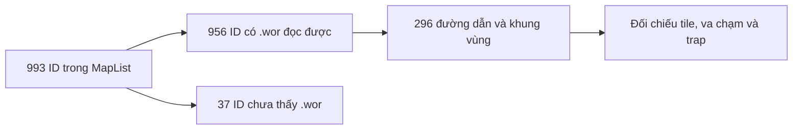

TÓM TẮT 1/5: [NGUỒN] DONE — K-02c đã kiểm kê tĩnh bản đồ server và client A.
TÓM TẮT 2/5: [NGUỒN] Đọc được `.wor` cho 956/993 ID, tương ứng 296/324 đường dẫn. Còn 37 ID chưa thấy trong cây tệp rời và chỉ mục PAK server.
TÓM TẮT 3/5: [NGUỒN] 84.160 tọa độ khớp chỉ mục vùng server. Kiểm đủ 479 tệp vùng client rời trong cây server để thống kê tile, va chạm và trap.
TÓM TẮT 4/5: [CHƯA KIỂM] Gói tải ngoài APK client A, toàn bộ nội dung vùng PAK server và hành vi khi game chạy.
TÓM TẮT 5/5: [NGUỒN] Đã chạy đối chiếu dữ liệu tĩnh. Không chạy build, exe game, VM, mạng hoặc test trong game.

# K-02c — Kiểm kê asset gốc: bản đồ

Tệp này giữ đường dẫn ghi trong task. [Báo cáo K-02c](K-02c.md) có bảng 37 ID chưa thấy `.wor`, dung lượng theo thư mục, giải mã tên, thông số và bằng chứng `file:dòng`.

