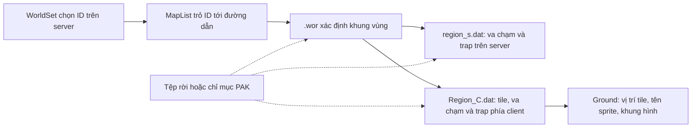

TÓM TẮT 1/5: [NGUỒN] DONE — đã kiểm kê tĩnh bản đồ server và client A theo các root được giao.
TÓM TẮT 2/5: [NGUỒN] 956/993 ID có `.wor` đọc được, tương ứng 296/324 đường dẫn. Còn 37 ID (28 đường dẫn) chưa thấy trong cây tệp rời và chỉ mục PAK server.
TÓM TẮT 3/5: [NGUỒN] 84.160 tọa độ vùng khớp chỉ mục `region_s.dat`. Bộ `Region_C.dat` rời có dữ liệu tile ở 462 vùng, va chạm ở 351 vùng và phần trap rỗng ở cả 479 tệp.
TÓM TẮT 4/5: [NGUỒN] Client A và hai APK có sẵn chỉ cung cấp lớp bản đồ phụ trong phạm vi kiểm kê. [CHƯA KIỂM] Gói client tải riêng và độ phủ trap từng vùng trong PAK server.
TÓM TẮT 5/5: [NGUỒN] Đã chạy phép đọc tĩnh và kiểm tra số liệu. Không chạy build, exe game, VM, mạng hoặc test trong game. Tổng quan nhận bàn giao để commit.

# K-02c — Kiểm kê asset gốc: bản đồ

Loại: khảo sát\
Chủ đề: Tệp `.wor`, lớp tile, vùng trap và va chạm trên server và client A.\
Từ khóa: bản đồ, vùng, tile, MapList.ini, WorldSet, .wor, PAK, trap, va chạm\
Trạng thái: DONE — hoàn tất kiểm kê tĩnh các nguồn được giao.\
Độ phủ: đã đối chiếu 993/993 ID (`324/324` đường dẫn) và kiểm 479/479 tệp vùng rời đã tìm thấy.\
Liên quan: [K-03c](K-03c.md), [K-01](K-01-ban-do-truyen-tin-hieu.md), [Hướng dẫn tra cứu](../DESIGN/HUONG-DAN-TRA-CUU.md)\
Cần tôi quyết định: không

## Phạm vi và độ phủ

Ký hiệu đường dẫn chỉ đọc trong các bằng chứng

| Gốc | Vị trí | Vai trò |
|---|---|---|
| `G/` | `C:/Jx1CocoV3/Folder/ServerNew-20260116T043145Z-3-001/ServerNew/_bin_v2_/gs/` | Dữ liệu server được giao |
| `C/` | `D:/JX-build/qh9A/` | Client A, kể cả danh mục của hai APK có sẵn trong cây này |
| `S/` | `D:/JX-build/src18/jxOnline/gameserver/Sources/` | Mã đọc tài nguyên server theo hướng dẫn tra cứu. Header được dẫn riêng khi nằm ngoài thư mục này. |

| Phần tử | Độ phủ | Kết quả |
|---|---:|---|
| ID theo `G/Settings/MapList.ini:1` | 993/993 ID đã đối chiếu | Đọc được `.wor` cho 956/993 ID (**96,27%**). 37 ID chưa thấy ở các nguồn đã kiểm. |
| Đường dẫn `.wor` sau khi gộp ID dùng chung tệp | 324/324 đường dẫn đã đối chiếu | 1 rời, 295 trong PAK, 28 chưa thấy. Độ phủ tệp đọc được là 296/324 (**91,36%**). |
| Danh sách theo cấu hình `WorldSet_gs001.ini` | 800/800 mục trong `[Init] Count` đã đối chiếu | 772 ID có `.wor` (**96,50%**), 28 chưa thấy. Cấu hình có 872 khóa, `World800`–`World871` nằm ngoài `Count=800`. |
| Tệp vùng trong PAK server | 148.672 tọa độ thuộc 296 khung `rect` đã dò tên | 84.160 lượt khớp `region_s.dat`, 84.156 mã chỉ mục riêng. Đã đọc nội dung mẫu vùng, chưa kiểm từng vùng PAK. |
| Tệp vùng `Region_C.dat` rời trong cây server | 479/479 header và bảng phần đã kiểm | Phủ 479/506 tọa độ (**94,66%**) của ID 995. Phần tile có ở 462 tệp, va chạm có ở 351 tệp, trap rỗng ở cả 479 tệp. |
| Cây client A và APK trong phạm vi | 2/2 danh mục ZIP APK đã kiểm, cùng cây tệp rời | Có `.map`, `.pth`, cấu hình và ảnh phụ. Không thấy `.wor`, tệp vùng hoặc `.pak` trong các nguồn client này. |
| Hai RAR dưới `G/maps` | 2/2 tệp đã đo dung lượng và đọc chữ ký | Nội dung RAR chưa kiểm tra đầy đủ. Cấu hình tìm PAK ở `G/package.ini:1–4`. |

## Giải mã tên

Đối chiếu các tên xuất hiện bên dưới với [bảng K-03c](K-03c.md) và [chỉ mục K-03c](_CHIMUC/K-03c.tsv). Giữ khóa vùng Hán theo GBK. Chữ UTF-8 của khóa vùng dùng để tra tài nguyên, chưa có bằng chứng về tên Việt mà game hiển thị cho các vùng.

| Tên gốc | Mã hóa | Chữ đúng (UTF-8) | Nguồn |
|---|---|---|---|
| `Ph\xADîng T\xADêng` | TCVN3, `\xAD` biểu diễn byte gốc | Phượng Tường (凤翔), ID 1 | `G/Settings/MapList.ini:5–6`, `JX1_OPS/REPORTS/K-03c.md:63` |
| `KiÕm M«n Quan` | TCVN3 | Kiếm Môn Quan, ID 995 | `G/Settings/MapList.ini:6684–6685`, `JX1_OPS/REPORTS/_CHIMUC/K-03c.tsv:994` |
| 西北南区 | GBK | 西北南区 | `G/Settings/MapList.ini:5` |
| 西南北区 | GBK | 西南北区 | `G/Settings/MapList.ini:131` |
| 中原北区 | GBK | 中原北区 | `G/Settings/MapList.ini:428` |
| 两湖区 | GBK | 两湖区 | `G/Settings/MapList.ini:654` |
| 中原南区 | GBK | 中原南区 | `G/Settings/MapList.ini:968` |
| 西北北区 | GBK | 西北北区 | `G/Settings/MapList.ini:1391` |
| 西南南区 | GBK | 西南南区 | `G/Settings/MapList.ini:1846` |
| 江南区 | GBK | 江南区 | `G/Settings/MapList.ini:2108` |
| 特殊用地 | GBK | 特殊用地 | `G/Settings/MapList.ini:2526` |
| 东北区 | GBK | 东北区 | `G/Settings/MapList.ini:2982` |
| `rongyuxitong` | ASCII | `rongyuxitong`, chưa xác định tên Việt từ khóa thư mục | `G/Settings/MapList.ini:6052` |
| `fongkieu` | ASCII | `fongkieu`, chưa xác định tên Việt từ khóa thư mục | `G/Settings/MapList.ini:6684` |

## Sắp theo cấu trúc game

**[ĐÃ XÁC MINH]** Thứ tự là vùng theo phân đoạn đầu của đường dẫn, sau đó là ID. Số dòng dẫn về lần đầu khóa vùng xuất hiện. Danh sách thiếu tính theo ID để có thể tra cả các ID dùng chung một tệp.

| Vùng | ID | `.wor` rời | Có trong PAK | ID chưa thấy `.wor` | Dòng đầu trong `G/Settings/MapList.ini` |
|---|---:|---:|---:|---|---:|
| 西北南区 | 17 | 0 | 16 | 987 | 5 |
| 西南北区 | 32 | 0 | 30 | 95, 97 | 131 |
| 中原北区 | 86 | 0 | 84 | 107–108 | 428 |
| 两湖区 | 29 | 0 | 25 | 63–64, 96, 98 | 654 |
| 中原南区 | 35 | 0 | 33 | 88–89 | 968 |
| 西北北区 | 54 | 0 | 52 | 133–134 | 1391 |
| 西南南区 | 25 | 0 | 22 | 156–157, 159 | 1846 |
| 江南区 | 71 | 0 | 69 | 191–192 | 2108 |
| 特殊用地 | 632 | 0 | 613 | 334–335, 356, 592, 598–604, 902–904, 975–976, 985, 988, 994 | 2526 |
| 东北区 | 10 | 0 | 10 | — | 2982 |
| `rongyuxitong` | 1 | 0 | 1 | — | 6052 |
| `fongkieu` | 1 | 1 | 0 | — | 6684 |
| **Tổng** | **993** | **1** | **955** | **37** | |

## Kiểm kê tệp theo thư mục và phần mở rộng

**[ĐÃ XÁC MINH]** Cột cuối dùng số tệp / byte theo kích thước tệp trên đĩa. Các dòng `G/maps` và `C/Resources/maps` ghi tệp ngay trong thư mục, rồi tách thư mục con để tránh đếm hai lần.

| Thư mục | Tổng tệp / byte | Phần mở rộng hoặc nhóm được đo |
|---|---:|---|
| `G/maps` | 11 / 1.698.677 | `.ini` 9 / 33.264, `.rar` 2 / 1.665.413 |
| `G/maps/maps` | 5 / 38.577 | `.ini` 5 / 38.577 |
| `G/maps/fongkieu` | 482 / 2.623.188 | `.dat` 479 / 2.551.187, `.wor` 1 / 111, `.jpg` 1 / 65.746, `.db` 1 / 6.144 |
| Thư mục bản sao bản vá trong `G/maps` | 5 / 4.292.096 | `.dll` 4 / 3.695.104, `.exe` 1 / 596.992. Chỉ đếm metadata, nằm ngoài số asset bản đồ. |
| `G/pak` (2 gói bản đồ) | 2 / 15.169.487 | `maps01.pak` 626.551, `maps.pak` 14.542.936 |
| `G/Settings` (6 tệp liên quan) | 6 / 600.104 | `.ini` 4 / 593.594, `.txt` 2 / 6.510 |
| `C/Resources/maps` | 38 / 56.215 | `.dat` 1 / 26.156, `.ini` 3 / 13.865, `.map` 28 / 8.675, `.txt` 5 / 1.371, `.DS_Store` 1 / 6.148 |
| `C/Resources/maps/CityMaps` | 36 / 14.405 | `.map` 36 / 14.405 |
| `C/Resources/maps/Paths` | 5 / 365 | `.pth` 5 / 365 |
| `C/Resources/map` | 8 / 131.560 | `.png` 7 / 125.412, `.DS_Store` 1 / 6.148 |
| `C/Resources` và `C/data/data` (cấu hình gói) | 4 / 2.353 | `.ini` 4 / 2.353. Ba tệp `package*.ini` trong `Resources` và một `data/data/package.ini`. |
| Mỗi APK client A có sẵn, mục `assets/maps` và `assets/map` | 85 / 190.249 | 64 `.map`, 5 `.pth`, 3 `.ini`, 1 `.dat`, 5 `.txt`, 7 `.png`. Số byte là kích thước mục ZIP sau giải nén theo danh mục. |

`G/Settings` gồm `MapList.ini` 198.453 byte, `MapList_.ini` 189.190 byte, `MapTraffic.ini` 205.895 byte, `TrapSetting.ini` 56 byte, `ForbititMap.txt` 3.878 byte và `MapsetInfo.txt` 2.632 byte. Mẫu số sử dụng `MapList.ini` đang được mã chỉ tới. Bản có dấu gạch dưới chỉ được đo dung lượng. SHA-256 của `MapList.ini` khớp `JX1_OPS/REPORTS/K-03c.md:54`.

Hai APK nằm trong `C/proj.android/app/build/outputs/apk/debug/projectdebug-debug.apk` và `C/proj.android/app/release/projectdebug-release.apk`. Các mục ZIP liên quan chiếm lần lượt 147.169 và 145.463 byte theo kích thước nén trong danh mục. Cấu hình A tham chiếu `mapfix.pak`/`map.pak` tại `C/Resources/package.ini:26–27`, `C/Resources/package_vn.ini:25–26` và `C/data/data/package.ini:28–29`.

## Định dạng và mã đọc

**[ĐÃ XÁC MINH]** Trên server, `KCore` tạo tên `WorldSet_<tên>.ini` và gọi `LoadSerMaps`. Hàm này lặp theo `[Init] Count`, lấy các khóa `World%02d` rồi chuyển ID cho `LoadMapS`. Hàm `LoadMapS` lấy giá trị từ `[List]` của `MapList.ini`, ghép `maps\<đường dẫn>.wor` và đọc `[MAIN] rect`. Hai đầu của hình chữ nhật đều được tính. Xem `S/Core/Src/KCore.cpp:609`, `:653–656`, `D:/JX-build/src18/jxOnline/header/CoreUseNameDef.h:161`, `S/Core/Src/KSubWorldSet.cpp:441–464` và `S/Core/Src/KSubWorld.cpp:925–969`. Bản cấu hình đọc trên đĩa có `World799=878` tại `G/maps/WorldSet_gs001.ini:803` và `World871=995` tại `:875`.

**[ĐÃ XÁC MINH]** Ở client A, `LoadMapC` tra ID trong `settings/MapList.ini` rồi gọi `OpenPlace`. `OpenPlace` mở `maps\<đường dẫn>.wor`, đọc `IsInDoor` và `rect`. Cảnh chuyển thư mục map cho `LoadRe`, hàm ghép `v_<y ba chữ số>/<x ba chữ số>_Region_C.dat`. Xem `C/Classes/gamecore/KSubWorld.cpp:751–771`, `C/Classes/gamescene/KScenePlaceC.cpp:525–550`, `:583–602`, `:1255` và `C/Classes/gamescene/KScenePlaceRegionC.cpp:84–102`.

| Lớp dữ liệu | Dạng trên đĩa và cách đọc | Bằng chứng trong mã |
|---|---|---|
| `.wor` | INI có `[MAIN]`. `rect` gồm trái, trên, phải, dưới, tính theo tọa độ vùng. Đọc được 296 khung. | `S/Core/Src/KSubWorld.cpp:935–969`, `C/Classes/gamescene/KScenePlaceC.cpp:583–602` |
| PAK | Header `PACK` 32 byte. Mỗi mục chỉ mục Windows có 16 byte gồm mã đường dẫn, vị trí, kích thước sau giải nén và trường kích thước nén kèm mã nén. Trình đọc INI dùng `KPakFile`, có thể tra tệp rời hoặc PAK tùy chế độ. | `S/Engine/Src/XPackFile.h:17–58`, `S/Engine/Src/XPackFile.cpp:34–82`, `S/Engine/Src/KIniFile.cpp:72–129`, `S/Engine/Src/KPakFile.cpp:245–274`, `C/Classes/engine/KPakFile.cpp:256–278` |
| Vùng server | `v_<y>/<x>_region_s.dat`. `LoadObjectS` đọc bảng phần rồi nạp va chạm, trap, NPC và vật thể. Nếu không mở được tệp gộp, hàm thử các tệp phần riêng. | `S/Core/Src/KRegion.cpp:147–206`, `:211–280`, `S/Core/Src/KSubWorld.cpp:1045–1057` |
| Vùng client | `Region_C.dat` bắt đầu bằng số phần. Mỗi phần gồm vị trí và độ dài. Vị trí tính từ hết bảng đầu tệp. Theo thứ tự là va chạm, trap, NPC, vật thể, nền, vật dựng. Client thử `Ground.dat`, `BuildinObj.Dat`, `OBSTACLE.DAT` và `Trap.dat` rời khi không mở được tệp gộp. | `C/Classes/gamescene/SceneDataDef.h:12–47`, `C/Classes/gamescene/KScenePlaceRegionC.cpp:84–194` |
| Tile nền | `Ground.dat` hoặc phần nền trong `Region_C.dat`. `LoadGroundLayer` đọc số ô nền, số vật phủ nền, vị trí phần vật phủ. Một ô lưu tọa độ lưới, tên sprite và số khung hình. | `C/Classes/gamescene/SceneDataDef.h:70–104`, `C/Classes/gamescene/KScenePlaceRegionC.cpp:562–597`, `:1089` |
| Va chạm | Mảng 16 × 32 ô, 4 byte mỗi ô. `LoadServerObstacle` đòi đúng kích thước mảng. `GetObstacleInfo` phía client giải mã kiểu cản và dùng vị trí trong ô để phân xử. | `S/Core/Src/KRegion.h:22–23`, `:205`, `S/Core/Src/KRegion.cpp:559–584`, `C/Classes/gamescene/KScenePlaceRegionC.h:441`, `C/Classes/gamescene/KScenePlaceRegionC.cpp:645–671`, `:2293–2320` |
| Trap | Header 12 byte, mỗi bản ghi 8 byte gồm tọa độ bắt đầu, số ô liên tiếp theo X, byte dành riêng và ID script. Server đọc bảng theo ô. Khi ID thay đổi sang ID khác 0, `CheckTrap` phía server gọi hàm `main` của script cho nhân vật người chơi. | `S/Core/Src/Scene/SceneDataDef.h:265–277`, `S/Core/Src/KRegion.cpp:592–622`, `:1564–1579`, `S/Core/Src/KNpc.cpp:15589–15616`, `C/Classes/gamescene/KScenePlaceRegionC.cpp:675–704` |
| Bản đồ phụ client | `LoadDataMap` tra `MapMenu.ini` để mở `.map`, nếu thiếu thì thử `CityMaps/City<ID>.map`. Hàm đọc cặp tọa độ và dữ liệu dẫn đường. Đã kiểm kê `.pth` và `YSInfoX.dat`. Chưa kiểm tra bộ đọc riêng của hai loại này. | `C/Resources/maps/MapMenu.ini:1`, `C/Classes/vn/gamescence/KScenePlaceCVN.cpp:77–133` |

### Đối chiếu tệp trong PAK

**[ĐÃ XÁC MINH]** Kiểm tra tệp rời theo giá trị `ID=đường dẫn`. Khi dò PAK, giữ byte đường dẫn GBK, chuẩn hóa theo mã Windows và đối chiếu mã đường dẫn 32 bit. `KPakList::pFindElemFile` ghép đường dẫn gói và `FileNameToId` tính mã bằng byte `char` có dấu. Phép đối chứng dùng byte không dấu chỉ khớp một ID. 324 đường dẫn `.wor` có 324 mã riêng. Xem `S/Engine/Src/KFilePath.cpp:135–158`, `:259–275`, `S/Engine/Src/KPakList.cpp:75–113` và `S/Engine/Src/XPackFile.cpp:289–305`.

| Nguồn | Số mục chỉ mục | `.wor` khớp theo đường dẫn | Byte `.wor` lưu / sau đọc |
|---|---:|---:|---:|
| `G/pak/maps01.pak` | 706 | 1 | 90 / 92 |
| `G/pak/maps.pak` | 87.245 | 294 | 52.735 / 68.779 |
| `G/maps` | — | 1 | 111 / 111 |
| **Tổng `.wor` kiểm nội dung** | | **296** | **52.936 / 68.982** |

**[ĐÃ XÁC MINH]** Đã đọc đủ `[MAIN]` và `rect` ở các mục PAK khớp, gồm 20 mục lưu nguyên, 274 mục loại `0x20` đọc bằng UCL NRV2B và 1 mục loại `0x04` đọc bằng UCL NRV2E. Logic giải nén được đối chiếu với `XPackFile::ExtractRead`, `ReadElemFile` và mã UCL có sẵn trong repo nguồn. Phép kiểm chạy trong PowerShell, kiểm biên dữ liệu và số byte vào/ra, không tạo tệp giải nén. Hai PAK còn lại dưới `G/pak`, `script.pak` và `skill.pak`, có lần lượt 425 và 499 mục chỉ mục, đều không khớp mã của 324 đường dẫn `.wor`. Xem `S/Engine/Src/XPackFile.cpp:236–278`, `:349–367`, `S/Engine/Src/ucl/n2b_d.c:138–145` và `S/Engine/Src/ucl/n2e_d.c:147`.

### Vùng theo khung bản đồ

**[ĐÃ XÁC MINH]** 296 khung có tổng cộng 148.672 tọa độ vùng. Đối chiếu theo tên cho 84.160 lượt khớp `region_s.dat` qua 294 đường dẫn map, 706 lượt `Region_C.dat` qua 4 đường dẫn map, 2 `Ground.dat`, 11 `OBSTACLE.DAT` và 5 `Trap.dat`. Có 6 tọa độ không khớp tệp server gộp nhưng khớp ít nhất một tệp va chạm hoặc trap rời trong PAK. Giá trị dùng làm độ phủ chỉ mục server là `84.160 / 148.672 = 56,61%`. Bốn lượt `region_s.dat` trùng mã đã được tách riêng trong số 84.156 mã duy nhất. Kết quả là phép đối chiếu tên với chỉ mục, mẫu số gồm cả các vùng biên bên trong `rect`.

**[ĐÃ XÁC MINH]** ID 1 (Phượng Tường) có khung 49 × 31 và 1.031 lượt khớp `region_s.dat`. Mẫu `v_103/103_region_s.dat` trong `maps.pak` có sáu phần, 2.048 byte va chạm và 36 byte trap, gồm 12 byte tiêu đề và ba bản ghi. Tọa độ mẫu dùng khóa `G/Settings/MapList.ini:5` và cách ghép tên ở `S/Core/Src/KRegion.cpp:157–198`.

**[ĐÃ XÁC MINH]** ID 995 (Kiếm Môn Quan) có `rect=96,96,118,117`, tương ứng 23 × 22 = 506 tọa độ. `G/maps/fongkieu/kiem_mon_quan.wor:1–6` là tệp `.wor` rời duy nhất. Đã kiểm bảng sáu phần của cả 479 tệp `Region_C.dat` rời ở thư mục cùng tên. Tất cả tọa độ nằm trong `rect`, không trùng và không có phần vượt quá kích thước tệp. 27 tọa độ còn lại không có tệp rời. Hai gói PAK không có mục khớp tên vùng server/client hoặc ba tệp phần nền, va chạm và trap đã dò cho ID này.

| Phần trong 479 tệp của ID 995 | Tệp có phần khác rỗng | Byte | Chi tiết |
|---|---:|---:|---|
| Tile nền | 462 | 1.535.543 | Header khai báo tổng 29.568 ô nền và 231 vật phủ nền |
| Vật dựng | 292 | 271.888 | Đã kiểm vị trí và độ dài phần |
| Va chạm | 351 | 718.848 | Mỗi phần 2.048 byte, tổng 30.840 ô có giá trị khác 0 |
| Trap | 0 | 0 | Cả 479 bảng phần đều ghi độ dài trap bằng 0 |
| NPC và vật thể | 0 | 0 | Cả 479 bảng phần đều ghi hai độ dài bằng 0 |

## Mục sổ thông số

| Nhóm | Tên/hằng số | file:dòng | Giá trị | Đơn vị | Ảnh hưởng | Đổi an toàn | Nguồn đo |
|---|---|---|---:|---|---|---|---|
| WorldSet | `Count` | `G/maps/WorldSet_gs001.ini:2` | 800 | mục chọn | Giới hạn vòng đọc WorldSet trong mã | CẨN THẬN | Cấu hình tĩnh |
| ID 995 | `[MAIN] rect` | `G/maps/fongkieu/kiem_mon_quan.wor:4` | 96,96,118,117 | tọa độ vùng | Khung 506 vị trí, tính cả hai biên | KHÔNG | INI tệp rời, đối chiếu công thức ở `S/Core/Src/KSubWorld.cpp:962–969` |
| Va chạm | `REGION_GRID_WIDTH/HEIGHT` | `S/Core/Src/KRegion.h:22–23`, `C/Classes/gamecore/KRegion.h:17–18` | 16 × 32 | ô/vùng | 512 ô mỗi vùng, 2.048 byte khi lưu int 32 bit | KHÔNG | Mã và chiều dài phần trong các tệp mẫu |
| Cảnh client | `RWPP_AREGION_WIDTH/HEIGHT` | `C/Classes/gamescene/KScenePlaceRegionC.h:35–38` | 512 × 1.024 | đơn vị cảnh/vùng | Quy đổi tọa độ vùng sang góc đầu của cảnh | KHÔNG | Mã tĩnh, `C/Classes/gamescene/KScenePlaceRegionC.cpp:93–96` |
| Cảnh client | `RWP_OBSTACLE_WIDTH/HEIGHT` | `C/Classes/gamescene/KScenePlaceRegionC.h:199–203` | 32 × 32 | đơn vị cảnh/ô | Kích thước một ô để tra va chạm | KHÔNG | Mã tĩnh |
| Trap | `KTrapFileHead` / `KSPTrap` | `S/Core/Src/Scene/SceneDataDef.h:265–277` | 12 / 8 | byte | Độ dài phần là `12 + 8 × số bản ghi` | KHÔNG | Mã và mẫu 36 byte |

## Đã xác minh / Chưa xác minh

- **ĐÃ XÁC MINH** — PowerShell đọc metadata hai cây, header và chỉ mục của PAK server, toàn bộ 296 khung tìm thấy, 479 bảng phần tệp vùng rời, mẫu vùng nén và danh mục ZIP của hai APK. Đã đối chiếu đường dẫn, kích thước, số ID và số mẫu với mã ở các bảng trên.
- **CHƯA XÁC MINH** — Nội dung từng vùng PAK, hình ảnh từng tile, script của từng trap và lớp bản đồ tải ngoài hai APK chưa kiểm tra. Hai RAR chỉ được kiểm chữ ký và kích thước. Chưa xác minh ID hoặc vùng nào được nạp khi game chạy. Không chạy build, exe game, VM, mạng hoặc test trong game.
- Máy thiếu `rg` nên dùng `Select-String` và `Get-ChildItem` để giới hạn đọc theo thư mục và ký hiệu. Phép dò toàn bộ tọa độ lần đầu gặp lỗi cú pháp `foreach` trong PowerShell. Đã sửa cú pháp và chạy lại thành công.

## Đề xuất tối ưu

**[ĐỀ XUẤT]** Giữ danh sách 37 ID như điểm vào khi tra thiếu asset. Ưu tiên 28 ID nằm trong giới hạn `Count` của WorldSet được khảo sát. Khi có gói bản đồ client A, đối chiếu cùng danh mục và mẫu số rồi mới đánh giá thiếu tile phía client.

## Bàn giao

Tổng quan nhận báo cáo để commit qua nhánh `task/K-02c`. Phiên khảo sát chưa stage, commit hay push. [Tệp theo đường dẫn chỉ định trong task](K-02-ban-do.md).

Hàng đề nghị cho bảng chỉ mục của chuẩn báo cáo.

| File | Loại | Chủ đề | Từ khóa | Trạng thái | Độ phủ | Liên quan |
|---|---|---|---|---|---|---|
| `JX1_OPS/REPORTS/K-02c.md` | khảo sát | Kiểm kê asset bản đồ | bản đồ, MapList, .wor, PAK, tile, trap, va chạm | DONE | 993/993 ID đã đối chiếu, đọc được 956 ID và 296/324 đường dẫn | K-02, K-03c, K-01 |

Hàng đề nghị cho `JX1_OPS/DESIGN/MUC-LUC-TRI-THUC.md`.

| Chủ đề | Báo cáo | File, hàm chính | Độ chắc |
|---|---|---|---|
| Asset bản đồ, `.wor` theo ID, tile, va chạm và trap | `REPORTS/K-02c.md` | `KSubWorld::LoadMapS`, `KRegion::LoadObjectS`, `KScenePlaceRegionC::LoadRe` | Khảo sát tĩnh trên dữ liệu gốc |

## Nhịp làm việc

| Giờ máy ngày 18/11/2026 (UTC+07:00) | Việc | Tiến độ ước tính |
|---|---|---:|
| 20:18:57 | Kiểm tra nhánh, đọc chuẩn, task và các skill | 0% |
| 20:24:53 | Kiểm kê tệp rời, ghi bản nháp đầu tiên | 35% |
| 20:32:36 | Đối chiếu 993 ID với PAK và kiểm 479 tệp vùng rời | 65% |
| 20:39:03 | Đọc các khung đóng gói và mẫu phần trap/va chạm server | 85% |
| 20:40:42 | Đã đối chiếu tọa độ vùng và danh mục của hai APK client | 95% |
| 20:48:48 | Chốt báo cáo và ghi mục Kết quả cuối task | 100% |

Quyền ghi giới hạn trong `D:\JX-wt\K-02c`. Đường dẫn `D:\JX-wt\K-02c.nhip` ở ngoài vùng đó nên các mốc được lưu trong bảng trên.

Kỹ năng đã dùng: jx1-retrofit, jx1-read-server, jx1-read-client, jx1-parameters, jx1-knowledge, jx1-report.
