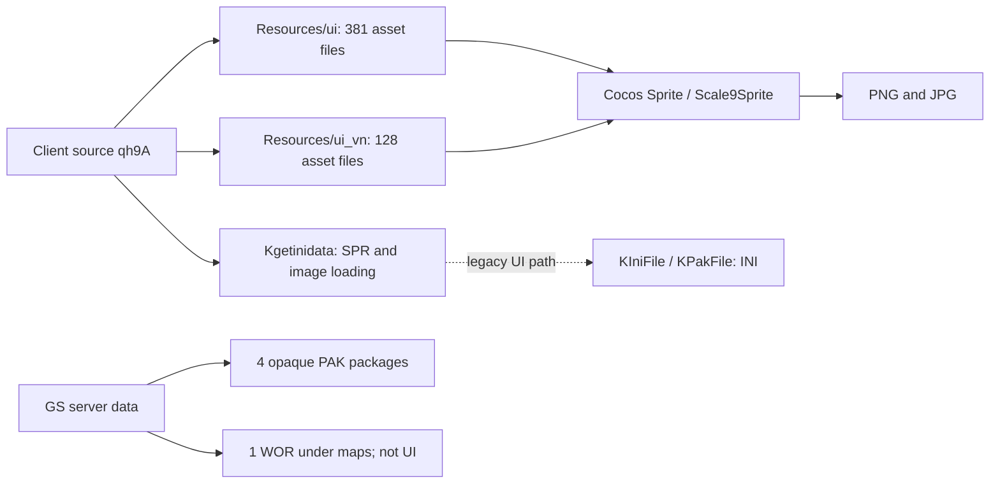

TÓM TẮT 1/5: [NGUỒN] Đã lập kiểm kê tĩnh UI client qh9A; 509 tệp rời trong hai thư mục UI đã được thống kê.
TÓM TẮT 2/5: [NGUỒN] Tổng 20,151,897 byte: 498 PNG, 1 JPG, 1 plist, 6 PSD, 1 TPS, 2 ZIP.
TÓM TẮT 3/5: [NGUỒN] Cocos2d-x nạp PNG/JPG; Kgetinidata xử lý SPR; KIniFile đọc INI qua KPakFile.
TÓM TẮT 4/5: [CHƯA KIỂM] Chưa xem từng ảnh/PSD/TPS/ZIP; 4 gói PAK của GS chưa đọc nội dung; chưa kiểm runtime.
TÓM TẮT 5/5: [NGUỒN] Không build, exe, VM, mạng; không commit/push theo task; chưa có SHA.

# K-02e — Kiểm kê asset giao diện UI
Loại: khảo sát
Chủ đề: Kiểm kê tệp giao diện rời của client qh9A và đối chiếu cách mã nguồn đọc các định dạng.
Từ khóa: giao diện UI, qh9A, PNG, JPG, SPR, INI, plist, Cocos2d-x
Trạng thái: PARTIAL — đã đếm đầy đủ hai thư mục UI rời; chưa giải mã nội dung từng asset và gói PAK.
Độ phủ: 509/509 tệp asset rời trong Resources/ui và Resources/ui_vn đã được đếm theo thư mục, đuôi và byte; không bao gồm nội dung gói PAK.
Liên quan: JX1_OPS/DESIGN/CHUAN-BAO-CAO.md, JX1_OPS/DESIGN/MUC-LUC-TRI-THUC.md, JX1_OPS/DESIGN/HUONG-DAN-TRA-CUU.md
Cần tôi quyết định: có — task ghi vung_file là K-02-giao-dien.md, còn prompt chỉ định K-02e.md.

## Phạm vi và độ phủ

| Phần tử | Kết quả | Trạng thái | Giới hạn |
|---|---|---|---|
| Client qh9A / Resources/ui | 381 asset rời, 17,843,665 byte; đã nhóm toàn bộ theo thư mục và phần mở rộng | Đã phủ inventory | Không xem nội dung từng ảnh; .DS_Store được loại khỏi tổng asset |
| Client qh9A / Resources/ui_vn | 128 asset rời, 2,308,232 byte; gồm PNG và plist | Đã phủ inventory; một plist chỉ được đọc cấu trúc đầu | Chưa xác nhận mọi frame được nạp khi chạy |
| Layout INI trong hai thư mục UI | 0 tệp INI rời | Chưa phủ nội dung layout | Klogin.cpp tham chiếu INI legacy dưới UI VFS; chưa xác minh tệp trong gói |
| SPR và WOR trong hai thư mục UI | 0 SPR, 0 WOR | Đã kiểm kê phần rời | Server maps có 1 WOR nhưng đó là dữ liệu bản đồ, ngoài UI |
| Gói phía server gs/pak | 4 PAK, 15,610,628 byte | Chưa phủ nội dung bên trong | Không bóc gói trong task này; không suy ra có hay không asset UI |
| Cây GS GameData, Settings, maps | Đếm các phần mở rộng liên quan; không đọc nội dung INI | Chưa phân loại nội dung thành UI | Đây là dữ liệu server, không phải thư mục giao diện client |

### Tổng theo thư mục UI

| Thư mục | Số asset | Dung lượng (byte) | Thành phần |
|---|---:|---:|---|
| Resources/ui | 381 | 17,843,665 | PNG 371; JPG 1; PSD 6; TPS 1; ZIP 2 |
| Resources/ui_vn | 128 | 2,308,232 | PNG 127; plist 1 |
| Tổng | 509 | 20,151,897 | Không tính .DS_Store 1 tệp / 8,196 byte |

### Chi tiết thư mục và phần mở rộng

| Thư mục tương đối dưới Resources | Đuôi | Tệp | Byte |
|---|---|---:|---:|
| ui (gốc) | .jpg | 1 | 344,414 |
| ui (gốc) | .png | 50 | 2,933,134 |
| ui (gốc) | .psd | 1 | 4,791,106 |
| ui (gốc) | .tps | 1 | 19,459 |
| ui (gốc) | .DS_Store | 1 | 8,196 |
| ui/at | .png | 24 | 283,085 |
| ui/btn | .png | 9 | 32,065 |
| ui/buttons | .png | 41 | 812,464 |
| ui/buttons | .psd | 3 | 2,036,849 |
| ui/buttons | .zip | 2 | 2,069,469 |
| ui/buttons/old | .png | 11 | 321,428 |
| ui/chat | .png | 12 | 5,913 |
| ui/checkbox | .png | 8 | 33,763 |
| ui/function | .png | 1 | 23,846 |
| ui/gameworld | .png | 40 | 343,289 |
| ui/gameworld/market | .png | 5 | 426,668 |
| ui/gameworld/trace | .png | 8 | 17,412 |
| ui/gameworld/UiItem | .png | 14 | 228,459 |
| ui/gameworld/uiplayerselfun | .png | 18 | 122,958 |
| ui/main | .png | 28 | 799,929 |
| ui/main | .psd | 1 | 138,515 |
| ui/selects | .png | 5 | 9,278 |
| ui/selnpc | .png | 8 | 92,729 |
| ui/state | .png | 17 | 1,366,422 |
| ui/state | .psd | 1 | 94,613 |
| ui/switch | .png | 7 | 27,296 |
| ui/tools | .png | 65 | 469,102 |
| ui_vn (gốc) | .png | 1 | 467,211 |
| ui_vn (gốc) | .plist | 1 | 68,913 |
| ui_vn/KgameWorld | .png | 28 | 193,836 |
| ui_vn/KuiChatList | .png | 18 | 307,822 |
| ui_vn/KuiPlayerSelFun | .png | 18 | 122,958 |
| ui_vn/KuiTopControl | .png | 7 | 45,856 |
| ui_vn/toolbar | .png | 55 | 1,101,636 |

### Dữ liệu liên quan trong root GS

| Thư mục | Đuôi | Tệp | Byte | Ghi chú |
|---|---|---:|---:|---|
| GameData | .ini | 3 | 1,445 | Chỉ đếm, không đọc nội dung |
| Settings | .ini | 767 | 3,977,025 | Chỉ đếm, không xem là layout UI |
| maps | .ini | 14 | 71,841 | Chỉ đếm |
| maps | .jpg | 1 | 65,746 | Tài nguyên ở thư mục bản đồ |
| maps | .wor | 1 | 111 | Có tệp WOR trong root server, không phải bằng chứng UI |
| pak | .pak | 4 | 15,610,628 | Nội dung gói chưa được kiểm kê |

### Cách đọc và mức hiểu

- PNG/JPG: mã UI gọi Cocos `Scale9Sprite::create("ui/editbg.png")` tại `D:/JX-build/qh9A/Classes/gameui/KuiAutoPlay.cpp:549`; `Sprite::create("ui_vn/KuiChatList/khungchat.png")` tại `D:/JX-build/qh9A/Classes/gameui/KuiChatList.cpp:146`. `Kgetinidata::findinidata_new` nhánh PNG/JPG gọi `getpicPath` tại `D:/JX-build/qh9A/Classes/engine/Kgetinidata.cpp:580` đến `:588`.
- SPR: bộ đọc riêng `Kgetinidata::findinidata_one` kiểm phần mở rộng `.spr` tại `D:/JX-build/qh9A/Classes/engine/Kgetinidata.cpp:101` đến `:112`; nhánh mới cũng kiểm `.spr` tại `:593` và tạo texture ở `:735`. Không có tệp SPR rời trong hai thư mục UI đã kiểm.
- INI: `KIniFile::Load` mở qua `KPakFile` tại `D:/JX-build/qh9A/Classes/engine/KIniFile.cpp:71` đến `:119`; đọc chuỗi/số qua `GetString` và `GetInteger` tại `:829` đến `:859`. `Klogin.cpp:158` đọc một layout INI và lấy trường Image, ImgType ở `:160` đến `:161`; đường dẫn source hiện rõ ở mục Giải mã tên.
- plist: `Resources/ui_vn/UiKgameWorld.plist:5` khai báo bảng frames; các frame có textureRect như `:17`. Đây là dữ liệu atlas XML; chưa tìm thấy lời gọi nạp chính tệp plist trong phần source UI đã truy vấn.
- PSD, TPS, ZIP: đã đếm tệp; chưa xác định trình đọc trong phạm vi mã và TOOLS đã kiểm; không mở hoặc giải nén.
- WOR: tìm thấy một tệp 111 byte dưới GS/maps; chưa đọc nội dung và chưa xác định reader. Không có WOR trong Resources/ui hoặc Resources/ui_vn.
- Mức hiểu nội dung asset: 0/509 = 0% theo tiêu chí đọc/giải mã từng tệp. Mức kiểm kê định dạng: 509/509 = 100% theo tiêu chí đếm file, phần mở rộng, thư mục và byte; không đồng nghĩa hiểu nội dung.

## Giải mã tên

| Tên gốc | Mã hóa | Chữ đúng UTF-8 | Nguồn file:dòng |
|---|---|---|---|
| 登陆过程背景窗口.ini | GBK/CP936 | 登陆过程背景窗口.ini (tên cửa sổ nền quá trình đăng nhập) | `D:/JX-build/qh9A/Classes/gameui/Klogin.cpp:158` |
| Không có tên kỹ năng, trang bị, quái, NPC hoặc bản đồ được phân loại trong tập UI rời | — | Không áp dụng | Danh sách tệp chỉ được phân nhóm theo thư mục/đuôi |

## Sắp theo cấu trúc game

- Nhóm giao diện chung theo `Resources/ui`: nút, chat, checkbox, màn chính, bản đồ game, trạng thái, công cụ và các nhóm con `market`, `trace`, `UiItem`.
- Nhóm giao diện Việt theo `Resources/ui_vn`: `KgameWorld`, `KuiChatList`, `KuiPlayerSelFun`, `KuiTopControl`, `toolbar`.
- Đây là sắp xếp theo cây thư mục và nhãn màn hình trong tên; chưa đối chiếu toàn bộ tệp với màn hình đang hoạt động, nên không kết luận thứ tự nạp hoặc quan hệ fallback.

## Đã xác minh / Chưa xác minh

### Đã xác minh
- Root client theo task là `D:/JX-build/qh9A`; root server được giới hạn ở `C:/Jx1CocoV3/Folder/ServerNew-20260116T043145Z-3-001/ServerNew/_bin_v2_/gs`.
- 509 asset rời trong hai thư mục UI có tổng 20,151,897 byte; số liệu được nhóm trực tiếp bằng Get-ChildItem/Measure-Object theo thư mục và phần mở rộng.
- Hai thư mục UI không có INI, SPR hoặc WOR rời; root server có bốn PAK và một WOR trong `maps`.
- Cây code client có các nhánh đọc SPR, PNG/JPG và INI như các anchor file:dòng phía trên.

### Chưa xác minh
- Nội dung và vai trò hiển thị của từng PNG/JPG, PSD, TPS, ZIP; kích thước thực tế sau giải nén hoặc khi đóng gói.
- Nội dung bên trong bốn PAK server và việc các gói có chứa asset UI hay không.
- Tệp layout INI legacy được `Klogin.cpp` tham chiếu có tồn tại trong VFS/PAK của một client triển khai cụ thể hay không.
- Quan hệ giữa `UiKgameWorld.plist` và mã nạp khi runtime; tệp SPR/WOR nào được dùng trong bản client đang chạy.
- Build, exe, VM, mạng, thiết bị, ảnh chụp màn hình và runtime đều chưa chạy/đo theo giới hạn task.

## Mục sổ thông số

Không có thông số runtime hoặc giá trị cấu hình game được đo trong task này. Bảng số lượng/byte ở trên là inventory tĩnh, không phải tham số vận hành.

## Đề xuất tối ưu

Chưa đề xuất thay đổi hiệu năng hoặc cấu hình vì chưa kiểm nội dung từng hình, gói PAK và runtime. Việc tiếp theo phù hợp là lập một task riêng để đối chiếu asset theo màn hình và kiểm gói dữ liệu đã được phê duyệt.

## Bàn giao

- Báo cáo này là bản kiểm kê mới; `JX1_OPS/REPORTS/K-02-giao-dien.md` và `JX1_OPS/REPORTS/K-02e.md` đều chưa tồn tại ở đầu task, nên không có kết luận cũ bị thay đổi.
- Chỉ mục TSV chưa tạo vì task yêu cầu giới hạn sửa tệp; PM có thể gộp dòng chỉ mục khi xác nhận phạm vi.
- Không stage, commit hoặc push; chưa có SHA. Bước tiếp theo: PM đối chiếu `vung_file` đang trỏ K-02-giao-dien với đường dẫn báo cáo K-02e được prompt chỉ định.
- `D:/JX-wt/K-02e.nhip` không thể ghi do nằm ngoài vùng ghi của sandbox; không tạo file thay thế trong worktree.
- Kỹ năng đã dùng: jx1-retrofit, jx1-read-server, jx1-read-client, jx1-parameters, jx1-knowledge, jx1-report.

### Phát hiện khi chuẩn hóa
- `rg` không có trong môi trường; các lần tìm kiếm được giới hạn bằng `Select-String` và `Get-ChildItem` theo root task. Hai lệnh PowerShell phụ ban đầu lỗi cú pháp do pipe ngay sau `foreach`; sửa bằng cách gom kết quả vào `$rows`, rồi lệnh đếm và kiểm UTF-8 đều chạy thành công.
- Lần đọc tài liệu đầu dùng encoding mặc định gây mojibake; tài liệu được đọc lại bằng UTF-8. Literal tên INI ở `Klogin.cpp:158` được kiểm thêm bằng GBK/CP936 và ghi đúng Unicode.
- Metadata task chỉ định `JX1_OPS/REPORTS/K-02-giao-dien.md`, trong khi prompt yêu cầu `JX1_OPS/REPORTS/K-02e.md`; báo cáo theo đường dẫn prompt và giữ nguyên tệp `K-02-giao-dien.md`.
