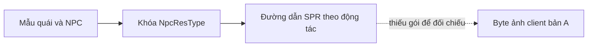

TÓM TẮT 1/5: [NGUỒN] PARTIAL — kiểm kê sprite quái và NPC, phần K-02b của K-02.
TÓM TẮT 2/5: [NGUỒN] 2.412/2.435 mẫu có tham chiếu SPR (99,06%), gồm 3.010 đường dẫn khác nhau.
TÓM TẮT 3/5: [NGUỒN] Bản A khai báo 34 tên PAK, không thấy PAK/SPR rời trong vùng quét. Server có 4 PAK với 88.875 mục chỉ mục.
TÓM TẮT 4/5: [CHƯA KIỂM] Chưa đối chiếu byte ảnh client, nội dung nén của gói server và vị trí quái/NPC theo bản đồ.
TÓM TẮT 5/5: [NGUỒN] Chưa chạy build, exe game, VM hoặc mạng. Tổng quan nhận tài liệu để commit.

# K-02b — Trang dẫn kiểm kê sprite quái và NPC

Loại: khảo sát\
Chủ đề: Tra kết quả kiểm kê sprite quái và NPC.\
Từ khóa: quái, NPC, sprite, SPR, PAK, NpcResType, K-02b\
Trạng thái: PARTIAL — thiếu gói client để kiểm byte ảnh.\
Độ phủ: 2.435/2.435 mẫu server đã đối chiếu tham chiếu.\
Liên quan: [Báo cáo K-02b](K-02b.md), [K-03b](K-03b.md), [K-03c](K-03c.md).\
Cần tôi quyết định: không

Bảng kiểm kê theo thư mục và phần mở rộng, giải mã tên, sắp theo bản đồ và nhóm mẫu, sổ thông số và dẫn chứng mã đọc nằm trong [báo cáo K-02b](K-02b.md).
