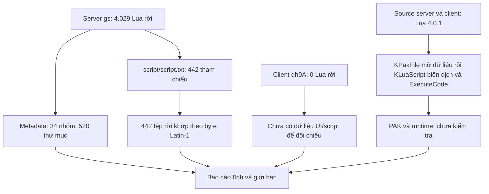

TÓM TẮT 1 [NGUỒN] DONE — hoàn thành kiểm kê tĩnh Lua rời tại đúng gốc server gs và client bản A qh9A; không xác nhận runtime.
TÓM TẮT 2 [NGUỒN] Server có 4.029 tệp .lua, 9.557.607 byte trong 520 thư mục; client có 0 .lua rời; đã phủ 34/34 nhóm server.
TÓM TẮT 3 [NGUỒN] Danh sách script.txt khớp 442/442 tham chiếu; có 2 Lua rỗng, 12 bản .lua.bak/.old và 17 đường phụ thuộc đã biết vắng theo phép đối chiếu công bố.
TÓM TẮT 4 [CHƯA KIỂM] Mức hiểu cấu trúc 6/8 = 75%; chưa giải gói, kiểm toàn bộ phụ thuộc hoặc chạy Lua; dòng 125 servertimer hiện có đủ hai nháy, khác ghi nhận D-01.
TÓM TẮT 5 [NGUỒN] Không chạy build/exe/VM/mạng, không sửa nguồn hoặc kết luận cũ; không commit/push, Tổng quan commit; nhịp ngoài worktree bị sandbox chặn.
# K-02g — Kiểm kê asset gốc: script Lua

Loại: khảo sát
Chủ đề: Số lượng, dung lượng, nhóm vùng, định dạng và đường nạp Lua server/client bản A cùng các bất thường đã biết.
Từ khóa: Lua, script, máy chủ, server, máy khách, client, qh9A, GBK, nạp tệp, kiểm kê
Trạng thái: DONE — hoàn thành phạm vi khảo sát tĩnh; nhịp ngoài worktree bị chặn được bàn giao riêng tại K-02g.md.
Độ phủ: đã phủ 2/2 gốc dữ liệu, 34/34 nhóm thư mục Lua server và 4.029/4.029 tệp ở mức metadata/kiểm byte; không tương đương đọc hiểu từng script.
Liên quan: `JX1_OPS/TASKS/K-02g.md`; `JX1_OPS/REPORTS/K-02g.md`; `JX1_OPS/REPORTS/K-01-ban-do-truyen-tin-hieu.md`; `JX1_OPS/REPORTS/A-03-kiem-ke-cau-hinh.md`; `JX1_OPS/REPORTS/D-01-bang-hoat-dong.md`; `JX1_OPS/REPORTS/A-08c-lua-trai-nuong-ca.md`; `JX1_OPS/DESIGN/CHUAN-BAO-CAO.md`.
Cần tôi quyết định: không (đối với kiểm kê tĩnh; cần phiên có quyền phù hợp nếu bắt buộc ghi nhịp ngoài worktree).

## Phạm vi và độ phủ

| Phần tử phạm vi | Độ phủ | Bằng chứng / giới hạn |
|---|---|---|
| Server gs: toàn cây tệp rời | Đã phủ | E1: 7.227 tệp metadata, trong đó 4.029 .lua; chỉ đọc nội dung Lua và các manifest/cấu hình liên quan |
| 10 nhóm theo vùng, gồm khu đặc biệt | Đã phủ | 1.967 .lua; 1.374.484 byte; từng nhóm ở bảng dưới |
| 24 nhóm dùng chung, gồm tệp ngay gốc script | Đã phủ | 2.062 .lua; 8.183.123 byte; từng nhóm ở bảng dưới |
| Đuôi và dung lượng trong script | Đã phủ | E2: 4.085 tệp mọi đuôi; Lua đang kiểm kê tách khỏi bản lưu và kho nén |
| Client bản A qh9A: toàn cây tệp rời | Đã phủ | E1: 14.608 tệp metadata; 0 .lua/.luac/.lub, 0 tên .lua.* và không thấy script.txt hoặc .pak rời |
| Nhận diện byte của 4.029 Lua server | Đã phủ | E3: kiểm BOM, chữ ký, NUL, UTF-8/GBK nghiêm ngặt; không chạy parser |
| Mã nguồn đọc Lua server và client | Đã phủ ở mức source | Các hàm/file:dòng ở mục đường nạp; source chưa được chứng minh khớp binary |
| Bất thường đã biết và phụ thuộc được chọn từ D-01 | Đã phủ mẫu công bố | 8 đường ASCII và 9 literal Hán vắng; không phải kiểm toán đầy đủ Include bắc cầu |
| Thành phần Lua trong PAK/RAR/ZIP, dữ liệu tải sau và bản chạy thực | Chưa phủ | Chưa giải gói, chưa chạy; số lượng và dung lượng Lua bên trong chưa đếm được |

### Gốc và quy ước nguồn

| Ký hiệu | Gốc tuyệt đối |
|---|---|
| `GS/` | `C:\Jx1CocoV3\Folder\ServerNew-20260116T043145Z-3-001\ServerNew\_bin_v2_\gs\` |
| `CA/` | `D:\JX-build\qh9A\Classes\` (client bản A duy nhất của lượt này) |
| `S/` | `D:\JX-source\server\jxOnline\gameserver\Sources\` |

Gốc source S được định vị từ `JX1_OPS/REPORTS/K-01-ban-do-truyen-tin-hieu.md:25`, sau đó mở đúng file hiện tại; không dùng source thay cho kiểm kê dữ liệu GS. Không dùng qh7 hoặc gốc client bị loại trong task. Số dòng source theo LF vật lý, tính từ 1. `[NGUỒN]`/ĐÃ XÁC MINH chỉ kết quả đọc tĩnh; dẫn báo cáo cũ được ghi rõ là nguồn kế thừa. Metadata thư mục/tệp rỗng không có dòng văn bản: nguồn là lệnh E1/E2, không gán số dòng giả.

## Giải mã tên

[NGUỒN] Mười tên vùng vật lý được giữ nguyên. Thử đảo mojibake bằng `Latin-1.encode(tên trên đĩa)` rồi `GBK.decode(bytes)`; cả 10/10 round-trip về đúng tên gốc. Cột Việt diễn nghĩa nhãn vùng, không đổi tên trên đĩa hoặc chứng minh map đang hoạt động. Đây là mã hóa của tên đường dẫn, khác mã hóa nội dung Lua.

| Tên gốc | Mã hóa / cách đọc | Chữ đúng UTF-8 | Nguồn |
|---|---|---|---|
| `¶«±±Çø` | Tên trên đĩa là mojibake Latin-1 của byte GBK | Đông Bắc — 东北区 | `GS/script/script.txt:1` |
| `Î÷±±±±Çø` | Tên trên đĩa là mojibake Latin-1 của byte GBK | Tây Bắc, phần bắc — 西北北区 | `GS/script/script.txt:191` |
| `Î÷±±ÄÏÇø` | Tên trên đĩa là mojibake Latin-1 của byte GBK | Tây Bắc, phần nam — 西北南区 | `GS/script/script.txt:297` |
| `ÖÐÔ­±±Çø` | Tên trên đĩa là mojibake Latin-1 của byte GBK | Trung Nguyên, phần bắc — 中原北区 | `GS/script/script.txt:17` |
| `ÖÐÔ­ÄÏÇø` | Tên trên đĩa là mojibake Latin-1 của byte GBK | Trung Nguyên, phần nam — 中原南区 | `GS/script/script.txt:53` |
| `½­ÄÏÇø` | Tên trên đĩa là mojibake Latin-1 của byte GBK | Giang Nam — 江南区 | `GS/script/script.txt:107` |
| `Á½ºþÇø` | Tên trên đĩa là mojibake Latin-1 của byte GBK | Lưỡng Hồ — 两湖区 | E1: metadata thư mục, không có dòng văn bản |
| `Î÷Äϱ±Çø` | Tên trên đĩa là mojibake Latin-1 của byte GBK | Tây Nam, phần bắc — 西南北区 | `GS/script/script.txt:335` |
| `Î÷ÄÏÄÏÇø` | Tên trên đĩa là mojibake Latin-1 của byte GBK | Tây Nam, phần nam — 西南南区 | `GS/script/script.txt:373` |
| `ÌØÊâÓõØ` | Tên trên đĩa là mojibake Latin-1 của byte GBK | Khu dùng đặc biệt — 特殊用地 | E1: metadata thư mục, không có dòng văn bản |
| `擂台赛` | GBK ở cấu hình, giữ literal | Lôi đài — 擂台赛 | `GS/Settings/Task/missions.txt:2–3` |
| `攻城战` | GBK ở cấu hình | Công thành chiến — 攻城战 | `GS/Settings/Task/missions.txt:4` |
| `渡船` | GBK ở cấu hình | Đò / vượt sông — 渡船; tên thương mại của hoạt động chưa kiểm tra | `GS/Settings/Task/missions.txt:5` |
| `宋金战场pk战`, `宋金战场pk大战` | GBK ở cấu hình | Chiến trường Tống Kim, nhánh PK — 宋金战场; giữ hậu tố gốc | `GS/Settings/Task/missions.txt:6` |
| `过关斩将` | GBK ở cấu hình | Quá Quan Trảm Tướng — 过关斩将 | `GS/Settings/Task/missions.txt:7` |
| `封神竞技` | GBK ở cấu hình | Thi đấu Phong Thần — 封神竞技 | `GS/Settings/Task/missions.txt:8` |
| `攻城拔寨` | GBK ở cấu hình | Công Thành Bạt Trại — 攻城拔寨 | `GS/Settings/Task/missions.txt:9` |
| `襄阳`, `ÏåÑô` | GBK trong cấu hình; tên trên đĩa có mojibake Latin-1 | Tương Dương — 襄阳 | `GS/Settings/Task/missions.txt:15–20`; E1 với đường tệp rỗng |
| `巴陵活动`, `巴陵` | GBK ở Include | Hoạt động Ba Lăng — 巴陵活动 / 巴陵 | `GS/script/task/balinboss.lua:5–6` |

Các tên ASCII như `liendau`, `kiem_mon_quan`, `qua_huy_hoang`, `yandibaozang`, `bw`, `subject`, `laotou` là ID/thư mục kỹ thuật trong báo cáo; không tự gán tên nhân vật/NPC hoặc tên sự kiện khi chưa có bảng tên gốc. Lời thoại Việt legacy, tên NPC trong tên file và toàn bộ tên riêng bên trong 4.029 script chưa giải mã đầy đủ; chưa có phép đối chiếu TCVN3 toàn tập. Không dùng tên thư mục `Utf8Script` để suy mọi tệp bên trong đều UTF-8.

## Sắp theo cấu trúc game

Thứ tự dưới đây là thế giới/vùng → hệ thống dùng chung → client. Nhãn hệ thống dùng để tra cứu theo tên thư mục, chưa chứng minh toàn bộ logic của mỗi tệp. Không chia từng phái → nhánh → cấp học: task này kiểm kê loại asset, chưa đọc ngữ nghĩa toàn bộ 534 script trong `skill` hoặc ánh xạ đầy đủ NPC/map.

### 1. Thế giới và vùng server

| Nhóm theo cấu trúc game | Thư mục vật lý dưới GS | Số .lua | Byte | Độ phủ |
|---|---|---:|---:|---|
| Đông Bắc | `script\¶«±±Çø` | 29 | 10.621 | Đã phủ |
| Tây Bắc, phần bắc | `script\Î÷±±±±Çø` | 212 | 132.927 | Đã phủ |
| Tây Bắc, phần nam | `script\Î÷±±ÄÏÇø` | 187 | 53.494 | Đã phủ |
| Trung Nguyên, phần bắc | `script\ÖÐÔ­±±Çø` | 298 | 170.282 | Đã phủ |
| Trung Nguyên, phần nam | `script\ÖÐÔ­ÄÏÇø` | 293 | 120.433 | Đã phủ |
| Giang Nam | `script\½­ÄÏÇø` | 259 | 118.061 | Đã phủ |
| Lưỡng Hồ | `script\Á½ºþÇø` | 296 | 637.877 | Đã phủ |
| Tây Nam, phần bắc | `script\Î÷Äϱ±Çø` | 207 | 81.973 | Đã phủ |
| Tây Nam, phần nam | `script\Î÷ÄÏÄÏÇø` | 173 | 45.904 | Đã phủ |
| Khu dùng đặc biệt | `script\ÌØÊâÓõØ` | 13 | 2.912 | Đã phủ |
| **Tổng 10 nhóm** | | **1.967** | **1.374.484** | **Đã phủ** |

### 2. Hệ thống dùng chung server

| Cụm tra cứu | Thư mục vật lý dưới GS | Số .lua | Byte | Độ phủ |
|---|---|---:|---:|---|
| Khởi động và thư viện | `script` (chỉ 4 tệp ngay gốc) | 4 | 59.673 | Đã phủ |
| Khởi động và thư viện | `script\System` | 37 | 143.393 | Đã phủ |
| Khởi động và thư viện | `script\header` | 36 | 255.304 | Đã phủ |
| Khởi động và thư viện | `script\lib` | 10 | 44.173 | Đã phủ |
| Khởi động và thư viện | `script\global` | 105 | 705.799 | Đã phủ |
| Khởi động và thư viện | `script\class` | 18 | 101.739 | Đã phủ |
| Khởi động và thư viện | `script\Utf8Script` | 1 | 18.038 | Đã phủ |
| Khởi động và thư viện | `script\log_game` | 4 | 6.146 | Đã phủ |
| Nhân vật và kỹ năng | `script\skill` | 534 | 1.271.052 | Đã phủ |
| Nhân vật và kỹ năng | `script\npclevelscript` | 59 | 710.482 | Đã phủ |
| Nhân vật và kỹ năng | `script\deadth` | 40 | 36.879 | Đã phủ |
| Vật phẩm | `script\item` | 133 | 657.627 | Đã phủ |
| Vật phẩm | `script\mineitem` | 190 | 436.653 | Đã phủ |
| Thế giới và chuyển vùng | `script\maps` | 42 | 52.653 | Đã phủ |
| Thế giới và chuyển vùng | `script\trap` | 49 | 36.018 | Đã phủ |
| Thế giới và chuyển vùng | `script\Pass` | 5 | 125.157 | Đã phủ |
| Nhiệm vụ và hoạt động | `script\task` | 155 | 1.176.838 | Đã phủ |
| Nhiệm vụ và hoạt động | `script\missions` | 204 | 859.305 | Đã phủ |
| Nhiệm vụ và hoạt động | `script\battles` | 159 | 473.669 | Đã phủ |
| Nhiệm vụ và hoạt động | `script\tnlteam` | 177 | 570.402 | Đã phủ |
| Nhiệm vụ và hoạt động | `script\feature` | 4 | 9.068 | Đã phủ |
| Nhiệm vụ và hoạt động | `script\warlord` | 29 | 128.618 | Đã phủ |
| Nhánh tên riêng chưa giải thích toàn bộ | `script\subject` | 61 | 296.104 | Đã phủ |
| Nhánh tên riêng chưa giải thích toàn bộ | `script\laotou` | 6 | 8.333 | Đã phủ |
| **Tổng 24 nhóm** | | **2.062** | **8.183.123** | **Đã phủ** |

Các số đếm mỗi hàng bao gồm mọi thư mục con, trừ hàng `script` chỉ tính tệp ngay gốc. Các hàng không chồng lấn: 1.967 + 2.062 = 4.029; 1.374.484 + 8.183.123 = 9.557.607 byte (xấp xỉ 9,115 MiB; 1 MiB = 1.048.576 byte). Dung lượng là Length logic, không phải kích thước cấp phát đĩa.

### 3. Client bản A

[NGUỒN] Đã quét toàn cây `D:\JX-build\qh9A`, gồm tệp ẩn: không có `.lua`, `.luac`, `.lub`, bản `.lua.*` hoặc `script.txt` rời; cũng không thấy tệp đuôi `.pak`. `Ui/script.txt`, `Resources/Ui/script.txt`, `Resources/script` và `script` đều không có đúng đường kiểm. Điều này mô tả cây đang được giao, không kết luận client không dùng Lua hoặc APK/bản cài không có Lua. Mã client vẫn gọi nạp `\\Ui` (`CA/gamecore/KCore.cpp:392`) và script cấp NPC (`CA/gamecore/KCore.cpp:179–190`; `CA/gamecore/CoreUseNameDef.h:109`). Dữ liệu tương ứng trong gói, thư mục writable hoặc tải sau chưa kiểm tra.

## Phương pháp và kết quả đo tĩnh

### E1 — Kiểm kê Lua rời

Thực chạy ngày 18/11/2026, UTC+07:00; lượt cuối gồm tệp ẩn lúc 20:05:32 (server), 20:05:35 (client). Dùng `Get-ChildItem -LiteralPath <gốc> -File -Recurse -Force -ErrorAction Stop`, chọn `Extension -ieq '.lua'`, cộng `Length`, nhóm theo `script/<thư mục cấp đầu>`; tệp ngay gốc là một nhóm riêng. Đơn vị là đường tệp trên đĩa, không khử trùng nội dung và không đếm Lua bên trong kho/gói. Không có lỗi quyền đọc trong lượt đếm cuối. Có 520 thư mục trực tiếp chứa ít nhất một .lua; không phải tổng thư mục của GS. Không có .lua mang thuộc tính Hidden.

### E2 — Tách đuôi trong GS/script

| Đuôi | Số tệp | Byte logic | Phạm vi giải thích |
|---|---:|---:|---|
| .lua | 4.029 | 9.557.607 | Tập chính kiểm kê |
| .bak | 11 | 207.942 | Cả 11 có tên kết thúc .lua.bak; không cộng vào .lua |
| .old | 1 | 197 | Một bản tên kết thúc .lua.old; không cộng vào .lua |
| .txt | 10 | 33.550 | Có manifest script.txt; không mặc định mọi .txt là Lua |
| .ini | 3 | 4.952 | Metadata, không khảo sát nội dung cấu hình khác |
| .dat | 16 | 163.685 | Chưa xác định định dạng; không coi là Lua |
| .rar | 5 | 210.582 | Chưa mở / chưa đếm Lua bên trong |
| .zip | 1 | 49.805 | Chưa mở / chưa đếm Lua bên trong |
| .dmp | 4 | 24.905.524 | Chỉ đếm metadata; không đọc/copy dump |
| .DS_Store | 5 | 34.836 | Metadata, không coi là Lua |
| **Tổng script/** | **4.085** | **35.168.680** | **Mọi đuôi, không phải tổng Lua** |

Không có `.luac` hoặc `.lub` rời tại hai gốc. Ngoài `script`, cây GS có 4 `.pak`, tổng 15.610.628 byte; chỉ đếm metadata để ghi giới hạn, chưa mở gói và không cộng dung lượng gói vào dung lượng Lua. Thống kê 4.029 Lua phù hợp đối chiếu R-01 ghi trong `JX1_OPS/REPORTS/A-03-kiem-ke-cau-hinh.md:196`; số 0 Lua của cây source lịch sử ở A-03 không bị thay bằng số này (`:206`).

### E3 — Định dạng và cách đọc

[NGUỒN] Đọc byte của 4.029 tệp .lua bằng .NET, không chạy nội dung. Nhóm sau loại trừ nhau:

| Phân loại byte | Số tệp | Ý nghĩa chính xác |
|---|---:|---|
| Rỗng | 2 | Length = 0; không có dòng để trích |
| Chỉ ASCII, không rỗng | 583 | Mọi byte < 0x80; dùng ASCII/UTF-8 để xem token |
| Có non-ASCII, UTF-8 nghiêm ngặt đọc được | 34 | Hợp lệ theo decoder UTF-8; chưa chứng minh encoding tác giả định dùng |
| UTF-8 lỗi, GBK/CP936 nghiêm ngặt đọc được | 1.818 | Ứng viên legacy GBK; không coi lời thoại Việt đã được giải mã đúng |
| Cả UTF-8 và GBK nghiêm ngặt đều lỗi | 1.592 | Cần đối chiếu byte/TCVN3 hoặc dữ liệu trộn; không tự chuyển mã |
| **Tổng** | **4.029** | **2 + 583 + 34 + 1.818 + 1.592** |

Không thấy BOM UTF-8/UTF-16, byte NUL hoặc chữ ký đầu tệp `1B 4C 75 61` trong tập này. Đây là kiểm tra dấu hiệu tệp văn bản, không phải chứng nhận cú pháp Lua. `GS/script/System/serverscript.lua` (570 byte) và `GS/script/servertimer.lua` (7.848 byte) đều không qua UTF-8/GBK nghiêm ngặt, khớp giới hạn mã hóa đã ghi tại `JX1_OPS/REPORTS/A-03-kiem-ke-cau-hinh.md:208`.

Cách đọc đã dùng: Markdown bằng UTF-8; Lua/source legacy đọc byte, tách LF rồi xem ASCII để không làm mất dấu nháy; chỉ giải mã GBK nghiêm ngặt cho nhãn Hán phù hợp. Công cụ có sẵn là PowerShell/.NET và mã đọc trong repo nguồn ở mục kế tiếp. Không chạy exe/công cụ Lua hoặc tạo parser phụ. Không dùng Lua hiện đại bất kỳ để khẳng định cú pháp của dialect cũ đã đạt.

### E4 — Manifest script/script.txt

[NGUỒN] `GS/script/script.txt` dài 26.095 byte, có 442 dòng/tham chiếu .lua, 442 đường duy nhất, 442/442 có file rời tương ứng. Cách thử: đọc từng dòng bằng Latin-1 để giữ ánh xạ 1 byte → 1 ký tự, bỏ CR/LF/khoảng trắng biên, nối gốc GS với đường bỏ dấu `\` đầu rồi `Test-Path -LiteralPath -PathType Leaf` trên Windows (không phân biệt hoa/thường). Đây là phép đối chiếu tên vật lý đang mojibake, không phải thử chuyển mã của engine/VM. `GS/script.txt` không có ở ngay gốc; loader source ghép script.txt dưới đường script ở nhánh server (`S/Core/Src/KSortScript.cpp:208–242`).

## Mã nguồn nạp loại asset

[NGUỒN] Đã mở trực tiếp các file dưới S và CA; không dùng số dòng của đồ thị làm kết luận. Cả hai cây source có `LUA_VERSION "Lua 4.0.1"` tại `S/Library/LuaLib/src/lua.h:50` và `CA/engine/lualib/lua.h:50`; macro CompileBuffer tới `lua_compilebuffer` tại `:359` của mỗi header. Không suy phiên bản binary từ header.

| Chặng | Server | Client bản A |
|---|---|---|
| Điểm vào khởi tạo | `S/Core/Src/KCore.cpp:617–620`: _SERVER chọn `\\script`; nhánh kia `\\Ui` | `CA/gamecore/KCore.cpp:392`: `g_IniScriptEngine("\\Ui",FALSE)` |
| Chọn tập script | `S/Core/Src/KSortScript.cpp:208–242`: quét thư mục nếu nIsSer, rồi đọc script.txt | `CA/gamecore/KSortScript.cpp:174–208`: cùng hai đường; FALSE bỏ quét thư mục, vẫn đọc manifest |
| Chọn đuôi tệp rời | `S/Core/Src/KSortScript.cpp:359–365`: hậu tố .LUA sau đổi hoa; lỗi Load có nhánh báo | `CA/gamecore/KSortScript.cpp:315–321`: kiểm hậu tố .LUA; bản .bak/.old không thuộc quét này |
| Mở byte Lua | `S/Engine/Src/KLuaScript.cpp:123–159`: KPakFile.Open, Size, Read, LoadBuffer | `CA/engine/KLuaScript.cpp:124–160`: tương tự, Open có m_converType |
| Biên dịch rồi thực thi mức đầu tệp | `S/Engine/Src/KLuaScript.cpp:96–115,159–182`: CompileBuffer; lỗi compile trả FALSE, sau đó ExecuteCode | `CA/engine/KLuaScript.cpp:96–116,160–179`: CompileBuffer rồi ExecuteCode |
| Ưu tiên đĩa / gói | `S/Engine/Src/KPakFile.cpp:245–274`: mode 0 thử đĩa rồi PAK; nhánh còn lại thử PAK rồi đĩa | `CA/engine/KPakFile.cpp:256–277`: cùng thứ tự hai nhánh |
| Callback khởi động | `S/Core/Src/CoreServerShell.cpp:2203–2215`: lấy serverscript.lua rồi gọi StartGame | Script NPC được nạp riêng tại `CA/gamecore/KCore.cpp:179–190`; đường ở `CA/gamecore/CoreUseNameDef.h:109` |
| Script tuần tự của client | Không khảo sát riêng nhánh này phía server | `CA/gamecore/LuaFuns.cpp:122–133` gọi Load/RunMain; `CA/engine/KStepLuaScript.cpp:97–125` có nhánh CANCOMPILETOLUB gọi LoadBuffer/ExecuteCode; chưa xác định macro build thực |

Load không chỉ đọc/kiểm cú pháp: source còn thực thi mã đầu tệp. Lượt này chỉ đọc source, không gọi loader. Chế độ PAK hiệu lực, macro build, codepage của đường dẫn và binary nào được triển khai đều chưa kiểm tra.

## Tệp thiếu và nghi vấn lỗi nạp đã biết

### 1. Phụ thuộc ASCII vắng trong cây GS

[NGUỒN] Tám `Test-Path -LiteralPath ... -PathType Leaf` dưới đây đều False, đối chiếu lại các đường đã ghi tại `JX1_OPS/REPORTS/D-01-bang-hoat-dong.md:41,44–45`. “Vắng” chỉ file rời, chưa chứng minh lỗi runtime hoặc không có bản trong PAK.

| Đường tính từ GS | Nơi tham chiếu đã mở trực tiếp | Kết quả |
|---|---|---|
| `script/tnlteam/missions/liendau/dondau/npc_liendau.lua` | `GS/script/System/serverscript.lua:10` | Vắng; `tnlteam/mission/liendau/dondau/head.lua` và `mission.lua` có, không tự thay đường |
| `script/tnlteam/qua_huy_hoang/lib_huyhoang.lua` | `GS/script/tnlteam/kiem_mon_quan/mission.lua:4`; `timerboard.lua:2` | Vắng |
| `script/activitysys/g_activity.lua` | `GS/script/missions/yandibaozang/npc_death.lua:11` | Vắng |
| `script/activitysys/playerfunlib.lua` | Cùng file `npc_death.lua:12` | Vắng |
| `script/activitysys/config/1005/partysupport.lua` | Cùng file `npc_death.lua:16` | Vắng |
| `script/missions/bw/bwmission.lua` | `GS/Settings/Task/missions.txt:34` | Vắng |
| `script/missions/bw/bwtimer.lua` | `GS/Settings/TimerTask.txt:43` | Vắng |
| `script/missions/bw/bwtotaltimer.lua` | `GS/Settings/TimerTask.txt:44` | Vắng |

### 2. Chín literal Hán legacy vắng dưới tên Unicode được thử

[NGUỒN] Đọc cấu hình GBK để lấy chữ đúng; thử đúng literal Unicode dưới GS, kết quả 9/9 False. Một số tên trên đĩa là mojibake như bảng vùng: không đồng nhất phép thử Unicode này với engine nhận tên theo byte ANSI. Đây là kiểm lại tập chín đường của D-01:42, không phải số tất cả tham chiếu thiếu trong mọi cấu hình.

| Đường tính từ GS | Tham chiếu | Kết quả |
|---|---|---|
| `script/missions/擂台赛/擂台赛.lua` | `GS/Settings/Task/missions.txt:3` | Vắng theo literal Unicode |
| `script/missions/攻城战/攻城战.lua` | Cùng file `:4` | Vắng theo literal Unicode |
| `script/missions/渡船/渡船.lua` | Cùng file `:5` | Vắng theo literal Unicode |
| `script/missions/宋金战场pk战/宋金战场pk大战.lua` | Cùng file `:6` | Vắng theo literal Unicode |
| `script/missions/过关斩将/过关斩将.lua` | Cùng file `:7` | Vắng theo literal Unicode |
| `script/missions/封神竞技/封神竞技.lua` | Cùng file `:8` | Vắng theo literal Unicode |
| `script/missions/攻城拔寨/攻城拔寨.lua` | Cùng file `:9` | Vắng theo literal Unicode |
| `script/missions/襄阳/襄阳.lua` | Cùng file `:15–20` | Vắng theo literal Unicode |
| `script/missions/巴陵活动/巴陵.lua` | `GS/script/task/balinboss.lua:5` | Vắng theo literal Unicode |

### 3. Tệp rỗng

[NGUỒN] Hai đường có Length = 0: `GS/script/global/npcchucnang/nangcapphiphong.lua` và `GS/script/ÖÐÔ­ÄÏÇø/ÏåÑô/ÏåÑô/npc/passerby_liuyungu.lua`. Không có dòng để trích. Rỗng không tự chứng minh lỗi biên dịch hoặc lỗi nạp: cần biết callback nào được yêu cầu và loader thực dùng bản nào. Không bổ sung nội dung hoặc xóa chúng.

## Mức hiểu và phần còn thiếu

Chỉ số hiểu cấu trúc loại asset theo checklist cố định 8 mục dưới đây: 6 mục đủ bằng chứng / 8 mục = **75%**. Đây không phải 75% ngữ nghĩa game hoặc 75% script chạy được. Độ phủ kiểm kê Lua rời là 4.029/4.029 = **100%**; % hiểu logic từng script chưa đánh giá, vì chưa đọc toàn bộ luồng/callback/API của từng tệp.

| Mục hiểu cấu trúc | Kết quả |
|---|---|
| 1. Số tệp và dung lượng đúng hai gốc | Đã hiểu ở mức metadata |
| 2. Nhóm vùng và hệ thống không chồng lấn | Đã hiểu ở mức cây thư mục |
| 3. Đuôi chính, bản lưu và tệp rỗng | Đã phân biệt |
| 4. Dấu hiệu định dạng và giới hạn encoding | Đã định lượng; chưa nhận diện encoding tác giả cho mọi tệp |
| 5. Chuỗi mã nạp server | Đã đối chiếu source |
| 6. Chuỗi mã nạp client và thiếu dữ liệu rời | Đã đối chiếu source/filesystem |
| 7. Toàn bộ phụ thuộc và ánh xạ game của 4.029 script | Chưa kiểm tra đầy đủ |
| 8. Nội dung gói và kết quả nạp bằng binary đúng bản | Chưa kiểm tra |

Thiếu cho bước sau: dữ liệu UI/script client tương ứng; thống kê Lua bên trong 4 PAK và 6 kho nén trong script; codepage/tên byte thực trên bản triển khai; provenance binary; kiểm cú pháp bằng đúng Lua/dialect và lỗi nạp thực tế. Không cần .wor để đếm Lua; .wor là asset bản đồ ngoài loại đang kiểm, không tuyên bố vắng hoặc kiểm kê lại nó.

## Mục sổ thông số

| Nhóm | Tên/hằng số | file:dòng / nguồn đo | Giá trị | Đơn vị | Ảnh hưởng | Đổi an toàn (CÓ/CẨN THẬN/KHÔNG) | Nguồn đo |
|---|---|---|---:|---|---|---|---|
| Kiểm kê | Lua rời server | E1, metadata đúng gốc GS | 4.029 | đường tệp | Mẫu số kiểm kê, không phải số nạp thành công | KHÔNG — số đo, không phải nút chỉnh | Get-ChildItem/Length, chỉ đọc |
| Kiểm kê | Dung lượng Lua server | E1 | 9.557.607 | byte logic | Khối lượng dữ liệu rời | KHÔNG — số đo | Cộng Length |
| Kiểm kê | Lua rời client | E1 | 0 | đường tệp | Thiếu tập asset rời để kiểm nội dung | KHÔNG — số đo, không thay dữ liệu thiếu bằng kết quả runtime | Quét toàn qh9A |
| Manifest | script.txt | `GS/script/script.txt:1–442`; E4 | 442/442 | tham chiếu / khớp | Chỉ xác nhận phép đối chiếu tên đã công bố | CẨN THẬN — không cấp quyền sửa | Đọc byte Latin-1 + Test-Path |
| Engine | LUA_VERSION | `S/Library/LuaLib/src/lua.h:50`; `CA/engine/lualib/lua.h:50` | 4.0.1 | phiên bản source | Dialect/công cụ kiểm phải tương thích | CẨN THẬN | Đọc header; binary chưa đo |
| Engine | MAX_SCRIPT_IN_SET | `S/Core/Src/KSortScript.h:13–16`; `CA/gamecore/KSortScript.h:12` | 5.000 | slot source | Trần mảng/nhánh nạp; không suy slot rảnh từ số file | CẨN THẬN | Đọc tĩnh, chưa đo số nạp |
| Engine | m_nPakFileMode | `S/Engine/Src/KPakFile.cpp:254–270`; `CA/engine/KPakFile.cpp:262–275` | 0 / nhánh còn lại | chế độ source | Đĩa trước / gói trước | CẨN THẬN | Giá trị hiệu lực chưa đo |

## Đề xuất tối ưu

1. PM dùng bảng 34 nhóm làm mốc kiểm kê; giữ tách file rời, bản lưu và gói để tránh cộng trùng.
2. Nếu mở nhiệm vụ tiếp, ưu tiên đối chiếu byte tên đường và PAK cho các phụ thuộc vắng trước khi sửa Lua. Không tự đổi tên thư mục mojibake hoặc ghi lại encoding hàng loạt.
3. Chỉ sau khi có quyền thử riêng mới dùng đúng engine/dialect để kiểm nạp; bảo đảm không vô tình ExecuteCode khi chỉ muốn kiểm cú pháp. Lượt này không triển khai đề xuất hoặc chạy công cụ mới.

## Đã xác minh / Chưa xác minh

**ĐÃ XÁC MINH:** E1–E4; tổng các bảng; hai tệp rỗng; 10 tên vùng round-trip; các file source và dòng nạp đã trích; 17 kết quả tồn tại trong tập chọn; hai byte 0x22 tại servertimer.lua:125. Đã đọc chuẩn báo cáo, mục lục, hướng dẫn tra cứu, K-01 và phần liên quan của A-03/D-01/A-08c. Không có báo cáo K-02g cũ để làm lại; đã ghi bản sớm rồi bổ sung.

**CHƯA XÁC MINH:** cú pháp/thực thi của từng script, kết quả nạp hoặc game chạy; toàn bộ Include động/bắc cầu; tệp bên trong PAK/RAR/ZIP; Lua trong bản cài hoặc dữ liệu tải sau của client; source khớp exe/DLL; encoding đúng của mọi lời thoại; tác động runtime của các đường vắng. Không chạy build, compiler Lua, game exe, VM, mạng hoặc test runtime. Test thực chạy chỉ là kiểm kê filesystem, decoder nghiêm ngặt, Test-Path, đối chiếu byte và kiểm báo cáo.

## Bàn giao

Đầu ra chính là tệp này; nhật ký lỗi/cách thử/kết quả, nhịp thay thế và kết quả bàn giao ở `JX1_OPS/REPORTS/K-02g.md`. Theo prompt mới nhất, chỉ sửa báo cáo này, báo cáo K-02g.md và mục Kết quả cuối task K-02g.md; không sửa source, dữ liệu gốc, báo cáo cũ, chỉ mục chung hoặc BAI_HOC. Yêu cầu chỉ mục chuẩn được đề xuất ngay dưới đây để PM gộp, không tự tạo `_CHIMUC/K-02g.tsv` ngoài vung_file. Không stage/commit/push; chưa có SHA mới, Tổng quan thực hiện commit.

Đề xuất hàng chỉ mục (PM gộp):

| file | loại | chủ đề | từ khóa | trạng thái | độ phủ | liên quan |
|---|---|---|---|---|---|---|
| JX1_OPS/REPORTS/K-02-script-lua.md | khảo sát | Kiểm kê Lua server/client bản A và giới hạn nạp | Lua, script, server, client, qh9A, GBK | DONE — kiểm kê tĩnh | 2/2 gốc; 34/34 nhóm; 4.029 Lua rời; hiểu cấu trúc 6/8 | K-02g; A-03; D-01; A-08c; K-01 |

## Phát hiện khi chuẩn hóa / đối chiếu báo cáo cũ

1. [NGUỒN + BÁO CÁO CŨ] D-01:3,52 và A-08d:86 ghi servertimer.lua:125 thiếu nháy. Byte file hiện tại tại dòng 125 là `20 20 20 20 20 20 20 20 72 65 74 75 72 6E 20 22 54 A9 6E 20 54 68 F1 22`: có đủ **hai** byte 0x22; không tái khẳng định lỗi thiếu nháy ở dòng này. SHA-256 tệp đang đọc: `72813489EE1CDA0AA6124404F194403EB600F2C2E0D8F87B5F9573F3FABAA6A7`. Chưa xác định do bản nguồn thay đổi hay cách giải mã trong lượt cũ; không sửa kết luận cũ và không coi toàn file đã đạt cú pháp.
2. [BÁO CÁO KẾ THỪA] A-08c:117 đã cảnh báo một số nghi vấn thiếu nháy của D-01 ở nhóm câu cá không tái hiện khi xem byte; K-02g không lặp chúng thành lỗi xác nhận và chưa tái kiểm toàn nhóm đó.
3. [NGUỒN] Hai gốc GS/CA hiện tại khác cây source lịch sử của A-03. Số 4.029 Lua hiện tại phù hợp phần bổ sung R-01 tại A-03:196; giữ nguyên số liệu/kết luận lịch sử ở báo cáo cũ.

Kỹ năng đã dùng: jx1-retrofit (giữ nguyên kết luận cũ, ghi khác biệt riêng), jx1-read-server, jx1-read-client, jx1-parameters, jx1-knowledge, jx1-report.
