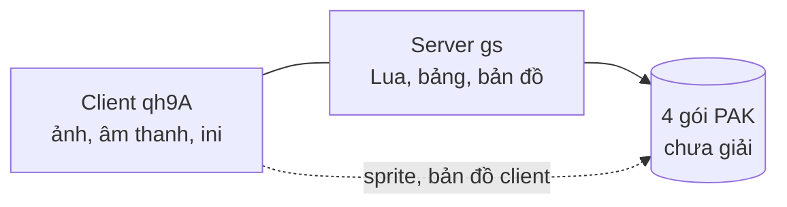

TÓM TẮT 1/5: [NGUỒN] K-02 kiểm kê tài nguyên gốc của client bản A (qh9A) và server gs theo 7 loại; cả 7 báo cáo con đã gộp.
TÓM TẮT 2/5: [NGUỒN] Client chỉ có ảnh PNG/JPG, âm thanh OGG/MP3 và dữ liệu ini rời; không có `.spr`, `.pak`, `.wor`, `.lua` rời. Phần lớn nằm trong PAK hoặc ở server.
TÓM TẮT 3/5: [NGUỒN] Server có 4.029 Lua, 2.007 tệp bảng dưới Settings, 4 gói PAK (88.875 mục chỉ mục), 956/993 bản đồ có `.wor` đọc được.
TÓM TẮT 4/5: [CHƯA KIỂM] Chưa giải nén nội dung PAK nên chưa đếm được sprite thật, chưa xác nhận 37 bản đồ thiếu `.wor` nằm ở đâu.
TÓM TẮT 5/5: [NGUỒN] Chỉ đọc tĩnh, không chạy exe/VM/mạng/build. Cần tôi quyết định: không.

# K-02 — Mục lục tài nguyên gốc (tổng)

Trang này chỉ là chỉ dẫn. Số liệu và nguồn nằm trong từng báo cáo con. Thứ gì chưa kiểm thì báo cáo con đã ghi "chưa kiểm tra".

| Loại | Có gì (tóm gọn) | Ở đâu | Báo cáo con |
|---|---|---|---|
| Nhân vật | 6 nhóm bộ phận × 4 phần vẽ, 2 lớp (thân / hiệu ứng); thứ tự vẽ tra theo hành động–hướng–khung. Client không có `.spr` rời; server có `Settings/NpcRes` 93 tệp và 4 PAK (15,6 MB) chưa giải. | client `Resources`, server `gs` | `K-02-nhan-vat.md` |
| Quái và NPC | 2.412/2.435 mẫu trỏ tới bảng có đường dẫn SPR (3.010 đường dẫn). Không khớp được ID trong chỉ mục 4 PAK server. | server bảng NPC, PAK | `K-02-quai-npc.md` |
| Bản đồ | 956/993 ID bản đồ có `.wor` đọc được; 37 ID (28 đường dẫn) chưa thấy. 84.160 tọa độ vùng khớp chỉ mục. | server `maps`, `Region_*.dat` | `K-02-ban-do.md` |
| Âm thanh | 107 tệp game rời: 103 OGG + 4 MP3, 17,3 MB. 52 đường dẫn trong bảng server chưa khớp tên tệp rời. | client `Resources` | `K-02-am-thanh.md` |
| Giao diện | 509 tệp rời, 20,2 MB: 498 PNG, 1 JPG, 1 plist, 6 PSD, 1 TPS, 2 ZIP. | client `Resources/ui`, `ui_vn` | `K-02-giao-dien.md` |
| Dữ liệu ini/bảng | 2.107 tệp `.txt/.ini` ở server (2.007 dưới Settings), 482 ở client. Hai bản mã đọc bằng KTabFile và KIniFile. | server `Settings`, client `data` | `K-02-du-lieu-ini.md` |
| Script Lua | Server 4.029 tệp, 9,6 MB, 520 thư mục; client 0 Lua rời. `script.txt` khớp 442/442; 2 tệp rỗng, 12 bản `.bak/.old`. | server `gs\script` | `K-02-script-lua.md` |

## Điều nên nhớ
1. Sprite (hình nhân vật, quái, NPC) không nằm rời ở đâu trong phạm vi đã quét; muốn đếm thật phải giải PAK (việc kế tiếp, cần công cụ PAK trong `docs-analysis/tools`).
2. 37 bản đồ thiếu `.wor` trùng với ghi chú cũ "28 bản đồ gs001 không nạp được": đây là cùng một vấn đề nhìn từ hai phía, chưa kiểm chứng đủ.
3. Còn hai tệp lẻ `K-02d.md`, `K-02g.md` trong `REPORTS/` là bản nháp của tiểu yêu; nội dung chính ở `K-02-am-thanh.md`, `K-02-script-lua.md`.
