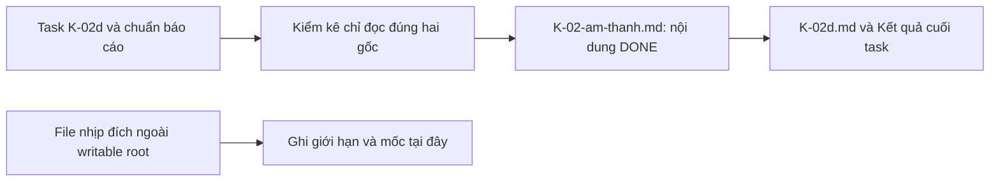

TÓM TẮT 1/5: [NGUỒN] PARTIAL về tác nghiệp — nội dung kiểm kê tĩnh K-02d đã DONE; file nhịp ngoài writable root chưa tạo được.
TÓM TẮT 2/5: [NGUỒN] Kết quả chính: 107 file game rời/17.346.877 byte, gồm 103 OGG và 4 MP3; toàn cây client theo bộ đuôi kiểm kê có 344 file/54.844.371 byte, gồm cache/SDK.
TÓM TẮT 3/5: [NGUỒN] Đã ghi K-02-am-thanh.md, báo cáo bàn giao này và mục Kết quả cuối task; mức hiểu tĩnh 70% theo 7/10 tiêu chí.
TÓM TẮT 4/5: [CHƯA KIỂM] PAK/backup, full decode/runtime và ánh xạ đầy đủ NPC–phái–kỹ năng chưa kiểm tra; không tuyên bố game test đạt.
TÓM TẮT 5/5: [NGUỒN] Không build, exe game/công cụ, VM, mạng, stage/commit/push; chưa có SHA, Tổng quan/PM commit theo yêu cầu mới nhất.

# K-02d — Bàn giao kiểm kê âm thanh và nhạc

Loại: tổng hợp
Chủ đề: Bàn giao kết quả kiểm kê tĩnh K-02d và giới hạn thao tác của phiên.
Từ khóa: K-02d, kiểm kê, âm thanh, nhạc nền, sound, music, OGG, MP3, PAK
Trạng thái: PARTIAL — khảo sát tĩnh DONE; chưa ghi file nhịp đích vì ngoài writable root.
Độ phủ: 1/1 báo cáo kiểm kê chính, 1/1 bàn giao và mục Kết quả cuối task; 107/107 header game, 2/2 cache, 2/2 APK, 3/3 bảng tham chiếu.
Liên quan: JX1_OPS/REPORTS/K-02-am-thanh.md; JX1_OPS/TASKS/K-02d.md; JX1_OPS/DESIGN/CHUAN-BAO-CAO.md; JX1_OPS/REPORTS/K-01-ban-do-truyen-tin-hieu.md.
Cần tôi quyết định: không; không cần hỏi lại quyền cho việc khảo sát đã duyệt.

## Mốc tiến độ

| Giờ địa phương +07:00 | Bước | Ước tính |
|---|---|---:|
| 2026-11-18 19:47 | Bắt đầu; đọc chuẩn/task/sáu skill; tạo báo cáo sớm | 10% |
| 2026-11-18 19:50 | Xong metadata file rời, header và hai cache; đối chiếu source | 40% |
| 2026-11-18 19:53 | Xong mã đọc, ba bảng tham chiếu và hai APK | 80% |
| 2026-11-18 20:00 | Sắp xong; đã ghi nội dung đầy đủ và danh mục 107 file; rà báo cáo | 95% |
| 2026-11-18 20:02 | Hoàn tất nội dung; đọc lại UTF-8 không BOM, cấu trúc, 107 dòng danh mục/tổng byte, mục Kết quả và 15 anchor source đều khớp | 100% nội dung |

D:/JX-wt/K-02d.nhip nằm ngoài writable root D:/JX-wt/K-02d của phiên. Không tạo được file đó theo chính sách ghi; không thử vượt sandbox, thay quyền hay cấu hình. Các mốc được giữ tại đây, không coi là đã hoàn thành yêu cầu tạo file nhịp đích. Đây là nguyên nhân trạng thái tác nghiệp PARTIAL, không phải bằng chứng thiếu khảo sát tĩnh.

## Phạm vi và độ phủ

| Phần | Kết quả |
|---|---|
| Báo cáo asset được giao | Đã hoàn tất JX1_OPS/REPORTS/K-02-am-thanh.md; có 5 dòng đầu, metadata, Mermaid, phạm vi, giải mã tên, cấu trúc game, sổ thông số, kiểm chứng và bàn giao |
| Bàn giao và task | Ghi báo cáo này và mục Kết quả theo yêu cầu trực tiếp; giữ nguyên nội dung task có trước |
| Dữ liệu client | Chỉ đọc D:/JX-build/qh9A; không dùng gốc client khác |
| Dữ liệu server | Chỉ đọc gốc gs được task chỉ định; không đọc nội dung account/log/dump/khóa |
| Chỉ mục TSV/mục lục chung | Không tạo/sửa ngoài vùng được giao; dòng TSV và hàng mục lục đề xuất đã đặt trong báo cáo chính để PM gộp |
| File nhịp đích | Chưa ghi, ngoài vùng được phép |
| Commit/push | Không thực hiện theo yêu cầu mới nhất; chưa có SHA |

## Giải mã tên

Giữ tên Unicode NTFS và chữ Hán trong danh mục 107 file tại báo cáo chính. Chưa suy tên Việt có dấu cho bài nhạc, nghĩa viết tắt hoặc phái/kỹ năng; không sửa encoding gốc. Bảng server đọc phần Hán bằng GBK, anchor source kiểm theo LF vật lý.

## Sắp theo cấu trúc game

Báo cáo chính xếp nhạc theo map/stage → UI/vật phẩm → NPC/kỹ năng/vật thể → đóng gói → SDK. Ánh xạ đầy đủ phái → nhánh → cấp học chưa kiểm tra; không phân phái bằng trí nhớ.

## Kết quả và bằng chứng

- Metadata game rời: 103 OGG + 4 MP3, 17.346.877 byte; 106 nội dung hash khác nhau/107 đường dẫn. Toàn client theo bộ đuôi: 344 file/54.844.371 byte, đã tách 206 cache và 31 SDK.
- Header OGG: 103 Vorbis stereo 44.100 Hz; MP3: ID3 và frame MPEG-1 Layer III đầu. Không decode/phát toàn bài.
- Hai cache: 103 đường dẫn khớp SHA-256/cây. Hai APK: 103 OGG khớp nội dung/gói; mở tên entry với UTF-8 xác nhận đủ 103/103, không có lỗi “thiếu 33 âm Hán”.
- Ba bảng server: 148 lượt/52 đường dẫn; 0 tên khớp 107 file game rời. Nhạc đăng nhập tham chiếu thêm ba tên MP3 chưa thấy. Đây là so tên dữ liệu trên đĩa, chưa chứng minh thiết bị đang chơi thiếu âm.
- Source chính: KMapMusic.cpp:116–167, :231–283; UiSoundSetting.cpp:42–106; KNpcRes.cpp:2572–2609; KSkills.cpp:2975–2976, :4141–4180; KStrBase.cpp:829–865; SoundManager.cpp:126–170, :298–313. Gốc P và các nguồn sâu hơn được định nghĩa trong báo cáo chính.

## MỤC SỔ THÔNG SỐ

Sổ tám cột nằm trong báo cáo chính: giới hạn nhạc/map, stage/map/bài, backend mặc định source, kênh/volume FMOD, header OGG/MP3. Tất cả là đọc tĩnh; không cấp quyền đổi giá trị.

## ĐÃ XÁC MINH / CHƯA XÁC MINH

ĐÃ XÁC MINH: M1–M5 của báo cáo chính đã thực chạy chỉ đọc; metadata/header/hash/ZIP và symbol từ file thật. Kiểm báo cáo theo tổng danh mục 107 file, 17.346.877 byte và cấu trúc chuẩn; kết quả rà cuối được ghi trong mốc hoàn tất.

CHƯA XÁC MINH: nội dung âm thanh trong PAK/backup, full decode, duration/loudness, codec mọi ví dụ SDK, ánh xạ mọi âm, binary/cấu hình hiệu lực và hành vi phát. Build/test game/exe/VM/mạng chưa chạy. Không tuyên bố runtime đạt.

## Lỗi, cách thử và kết quả

Lỗi công cụ và cách khắc phục chi tiết ở “Phát hiện khi chuẩn hóa, lỗi và cách xử lý” của báo cáo chính: encoding hiển thị, rg không có, lọc file/đầu ra quá dài, lệch dòng do decoder, tên ZIP mặc định, thiếu assembly ZIP, patch trùng đường dẫn. Đều đã chuyển cách đọc/ghi phù hợp và kiểm lại; không sửa nguồn/archive. Hạn chế file nhịp chưa xử lý vì nằm ngoài quyền ghi của phiên; không thử vượt rào chắn. Không lặp cùng lỗi quá ba lần.

## Đề xuất tối ưu

PM gộp chỉ mục từ dòng TSV trong báo cáo chính, giao kiểm gói/ánh xạ ngữ nghĩa nếu cần. Không tự đổi tên MP3 thành tài nguyên tham chiếu, không xóa bản sao hoặc sửa source để làm “khớp” kiểm kê.

## Bàn giao

Không stage/commit/push. Task cũ yêu cầu commit nhưng chỉ dẫn trực tiếp mới nhất nói không cần commit; tuân theo chỉ dẫn mới nhất. Chưa có SHA hoặc bằng chứng GitHub; Tổng quan/PM kiểm diff và commit đúng các file nhiệm vụ.

Chỉ ghi báo cáo asset, báo cáo bàn giao theo tên được yêu cầu và mục Kết quả cuối task. Không sửa BAI_HOC, mục lục chung, cấu hình hay source gốc. Các phần chưa kiểm được ghi rõ để không cần khảo sát lại phần có bằng chứng.

Kỹ năng đã dùng: jx1-retrofit, jx1-read-server, jx1-read-client, jx1-parameters, jx1-knowledge, jx1-report; nạp từ .agents/skills của worktree.
