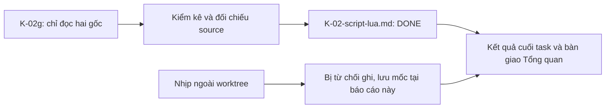

TÓM TẮT 1 [NGUỒN] PARTIAL — nội dung kiểm kê K-02g đã DONE; yêu cầu ghi D:\JX-wt\K-02g.nhip bị sandbox từ chối.
TÓM TẮT 2 [NGUỒN] Server: 4.029 Lua, 9.557.607 byte, 34 nhóm; client qh9A: 0 Lua rời; script.txt khớp 442/442 tham chiếu.
TÓM TẮT 3 [NGUỒN] Đã hoàn thiện JX1_OPS/REPORTS/K-02-script-lua.md và báo cáo này; kết quả được ghi cuối JX1_OPS/TASKS/K-02g.md.
TÓM TẮT 4 [CHƯA KIỂM] Chưa giải gói hoặc xác minh runtime; không chạy build, exe, VM hoặc mạng, không sửa dữ liệu/source/kết luận cũ.
TÓM TẮT 5 [NGUỒN] Không stage/commit/push theo yêu cầu mới nhất; chưa có SHA mới, Tổng quan commit và xử lý nhịp ngoài sandbox nếu còn cần.
# K-02g — Bàn giao kiểm kê asset script Lua

Loại: tổng hợp
Chủ đề: Bàn giao kiểm kê Lua rời server/client bản A và giới hạn chưa xác minh.
Từ khóa: K-02g, Lua, script, kiểm kê, server, client, qh9A, bàn giao, GBK
Trạng thái: PARTIAL — khảo sát và tài liệu DONE; không ghi được nhịp ở đường dẫn ngoài worktree.
Độ phủ: 2/2 gốc dữ liệu; 34/34 nhóm Lua server; 4.029/4.029 tệp ở mức metadata/byte; hiểu cấu trúc 6/8 theo checklist của báo cáo chính.
Liên quan: `JX1_OPS/TASKS/K-02g.md`; `JX1_OPS/REPORTS/K-02-script-lua.md`; `JX1_OPS/DESIGN/CHUAN-BAO-CAO.md`; `JX1_OPS/REPORTS/A-03-kiem-ke-cau-hinh.md`; `JX1_OPS/REPORTS/D-01-bang-hoat-dong.md`.
Cần tôi quyết định: không cho phần kiểm kê; nếu bắt buộc có file nhịp ngoài worktree thì cần phiên có quyền phù hợp, không yêu cầu vượt sandbox.

## Phạm vi và độ phủ

| Hạng mục | Kết quả | Nguồn |
|---|---|---|
| Kiểm tra điểm tiếp tục | Đúng nhánh task/K-02g; git status ban đầu sạch; hai báo cáo K-02 chưa có | Một lượt `git status --short --branch` và liệt kê đúng tên báo cáo trước ghi |
| Metadata Lua và phân nhóm | Đã phủ hai gốc, 34 nhóm, 520 thư mục chứa Lua | `JX1_OPS/REPORTS/K-02-script-lua.md:30–42,86–142` |
| Đuôi, định dạng và manifest | Đã phủ tập Lua rời; tách bản lưu/gói; 442/442 tham chiếu khớp | Cùng báo cáo `:144–181` |
| Mã nguồn nạp hai phía | Đã đọc trực tiếp file thật, có file:dòng | Cùng báo cáo `:183–198` |
| Thiếu file và khác biệt báo cáo cũ | Đã đối chiếu 17 đường được công bố, 2 tệp rỗng; ghi khác biệt nháy riêng | Cùng báo cáo `:200–235,288–292` |
| Mức hiểu và sổ thông số | Có công thức 6/8 = 75%, không gán thành % logic script hoặc % chạy được | Cùng báo cáo `:237–264` |
| Báo cáo và mục Kết quả task | Đã ghi theo prompt | Hai báo cáo và cuối task K-02g |
| Nhịp đúng đường D:\JX-wt\K-02g.nhip | Chưa phủ: bị chặn ghi ngoài worktree | UnauthorizedAccessException; chỉ thử ghi một lần, không đổi quyền |
| Build/exe/VM/mạng và nội dung kho gói | Chưa chạy / chưa kiểm tra theo giới hạn | Không có kết quả runtime được nhận là đã đạt |

## Giải mã tên

Báo cáo bàn giao không thêm tên riêng game. Bảng mười tên vùng mojibake/GBK và chín nhãn hoạt động/map được dẫn ở `JX1_OPS/REPORTS/K-02-script-lua.md:54–80`. Tên/ID ASCII và lời thoại Việt legacy chưa giải mã đầy đủ được ghi giới hạn tại đó; không sửa tên hay byte gốc.

## Sắp theo cấu trúc game

Báo cáo chính xếp thế giới/vùng → hệ thống dùng chung → client. Tổng 10 nhóm theo vùng là 1.967 tệp/1.374.484 byte; 24 nhóm còn lại là 2.062 tệp/8.183.123 byte. Không tự dựng bảng phái/kỹ năng/cấp học từ kiểm kê đường tệp.

## Kết quả chính

- Đã có báo cáo chính 295 dòng, UTF-8 không BOM, năm dòng tóm tắt, một sơ đồ Mermaid, bảng phạm vi/giải mã/cấu trúc game, sổ thông số và đề xuất chỉ mục.
- Toàn GS có 4.029 .lua rời; cả thư mục script có 4.085 tệp mọi đuôi. Hai con số khác đơn vị, không thay kết luận A-03 cũ.
- Client qh9A không có Lua rời và script.txt trong cây đã quét, dù source có Lua 4.0.1 và các đường nạp. Chưa suy ra dữ liệu trong bản cài hoặc được tải sau.
- Tám đường ASCII phụ thuộc vắng và chín literal Hán vắng theo phép thử đã công bố; chưa xác nhận lỗi nạp runtime hoặc thiếu trong PAK.
- Byte hiện tại của servertimer.lua:125 có hai dấu nháy 0x22, khác D-01:3,52 và A-08d:86. Giữ nguyên báo cáo cũ; ghi đối chiếu mới cùng SHA-256 tại báo cáo chính:290.

## Mục sổ thông số

| Nhóm | Tên/hằng số | file:dòng / nguồn | Giá trị | Đơn vị | Ảnh hưởng | Đổi an toàn (CÓ/CẨN THẬN/KHÔNG) | Nguồn đo |
|---|---|---|---|---|---|---|---|
| Bàn giao | Độ phủ kiểm kê Lua rời | Báo cáo chính:12,142 | 4.029/4.029 | tệp | Phạm vi metadata đầy đủ | KHÔNG — số đo | Get-ChildItem/Length |
| Bàn giao | Mức hiểu cấu trúc | Báo cáo chính:237–250 | 6/8 = 75% | mục checklist | Không phải % script chạy được | KHÔNG — chỉ số báo cáo | Checklist công bố |
| Bàn giao | Mốc nhịp | Lỗi ghi ở phần dưới | Chưa ghi đúng đường | mốc ngoài worktree | Thiếu tín hiệu cho Tổng quan | CẨN THẬN — cần quyền đúng phạm vi | Một lần WriteAllText thất bại |

Sổ thông số chi tiết của loại asset ở `JX1_OPS/REPORTS/K-02-script-lua.md:254–264`, gồm phiên bản Lua source, trần slot và chế độ đĩa/gói; các giá trị source không được coi là runtime.

## Nhật ký mốc lớn thay thế nhịp bị chặn

Thời gian địa phương UTC+07:00. Các dòng dưới lưu trong worktree, không giả nhận đã ghi được file nhịp mà prompt yêu cầu.

| Giờ ngày 18/11/2026 | Bước | Ước tính phần nội dung |
|---|---|---:|
| 20:04 | Bắt đầu; đọc chuẩn/task/sáu skill; đúng nhánh, chưa có file K-02 để tiếp tục | 10% |
| 20:05:35 | Xong kiểm kê cả tệp ẩn và hai gốc; đã ghi báo cáo sớm | 40% |
| 20:08:37 | Xong lượt phân loại byte và giải mã nhãn vùng; đối chiếu source loader | 65% |
| 20:11:23 | Xong manifest, đường thiếu và kiểm riêng byte nháy hiện tại | 85% |
| 20:15:24 | Sắp xong: báo cáo chính đủ nội dung, đọc lại UTF-8/khung mục đạt | 95% |

## Lỗi / cách thử / kết quả

| Lỗi / giới hạn | Cách thử thực tế | Kết quả / xử lý |
|---|---|---|
| Ghi file nhịp bị chặn | Gọi `[IO.File]::WriteAllText` một lần vào `D:\JX-wt\K-02g.nhip`; đọc lại báo không có tệp | `UnauthorizedAccessException: Access to the path is denied.` Đường ở ngoài writable root. Không đổi ACL/credential/config, không vượt sandbox, không giả nhận thành công |
| rg không có trong PATH | Dùng rg ở lượt tìm đầu; hai truy vấn độc lập cùng lượt trả CommandNotFoundException | Chuyển Select-String/Get-ChildItem giới hạn thư mục; không cài, không tìm lại rg |
| Get-Content mặc định hiển thị sai dấu | Lượt đọc chuẩn/task đầu hiển thị mojibake | Đọc lại với UTF-8 và đặt encoding đầu ra; nguồn không bị ghi lại |
| Đầu ra tìm kiếm/source gộp bị rút gọn | Thu hẹp file/khoảng dòng cần kết luận, giữ số dòng LF | Đọc được đoạn quyết định; không dựa phần bị cắt |
| Wildcard đi cùng -LiteralPath | Một lệnh tìm Include với ký tự * báo Illegal characters in path | Đổi sang Get-ChildItem lấy đường thật rồi Select-String; tìm được tham chiếu mission/timerboard |
| Mảng PowerShell ghép đường bị trải phẳng | Lệnh lấy nhiều đoạn source tạo tên file kèm số dòng, báo FileNotFoundException và lỗi null kéo theo | Đổi sang đối tượng có thuộc tính p/a/b; đọc lại các đoạn thành công, không tạo script phụ hoặc đổi nguồn |
| UTF-8/GBK decoder từ chối một số Lua | Decoder nghiêm ngặt trong phép phân loại toàn tập | Đây là dữ liệu đo: 1.592 tệp lỗi cả hai decoder; xem ASCII/byte và ghi giới hạn, không suy lỗi cú pháp |

## Đã xác minh / Chưa xác minh

**ĐÃ XÁC MINH:** các phép đo filesystem, bảng 34 nhóm cộng đúng 4.029 tệp/9.557.607 byte; script.txt 442 đường duy nhất đều khớp theo cách đối chiếu đã ghi; BOM/chữ ký/NUL/decoder; các source file:dòng và đường thiếu được nêu trong báo cáo chính. Đã đọc lại báo cáo chính: UTF-8 nghiêm ngặt đạt, không BOM/U+FFFD, đúng năm dòng tóm tắt và một Mermaid.

**CHƯA XÁC MINH:** Lua trong PAK/RAR/ZIP; dữ liệu client ngoài cây giao; toàn bộ Include bắc cầu, ngữ nghĩa mọi script, source khớp binary, bản chạy thực và kết quả runtime. Không chạy build, test game, Lua compiler/loader, exe, VM hoặc mạng. Nhịp đúng đường ngoài worktree chưa ghi được.

## Kiểm tra thực chạy và bàn giao

Kiểm tra thực chạy trong lượt này là các lệnh chỉ đọc nêu tại E1–E4, Test-Path các đường được chọn, đọc byte/decoder và kiểm tài liệu. Đối chiếu cuối ba file gồm UTF-8 không BOM, năm dòng tóm tắt/hai báo cáo, Mermaid/các mục bắt buộc, tổng bảng, đường file:dòng, nội dung mục Kết quả và diff đúng phạm vi. Đây không phải build hoặc kiểm thử Lua/game.

Không stage/commit/push; chưa có SHA mới vì prompt yêu cầu Tổng quan commit. Việc task gốc ghi commit được thay bằng chỉ đạo mới nhất. Ngoài báo cáo chính thuộc vung_file, hai chỉnh sửa bổ sung được prompt trực tiếp yêu cầu là báo cáo này và mục Kết quả cuối task; không mở rộng sang file khác.

Không tạo chỉ mục riêng ngoài vung_file và không sửa MUC-LUC-TRI-THUC/BAI_HOC. Hàng chỉ mục để PM gộp đã đặt tại báo cáo chính:282–286. Tổng quan có thể commit ba file tài liệu sau khi xem; nếu vẫn cần tín hiệu nhịp ngoài worktree, xử lý bằng phiên có quyền hợp lệ. Không có yêu cầu gửi thông báo qua ứng dụng ngoài.

## Đề xuất tối ưu

Giữ mốc kiểm kê và ưu tiên khảo sát riêng phần gói/tên byte trước khi sửa một đường Include. Bù asset client bằng đúng bản được giao khi có nguồn được duyệt; mọi chạy compiler/binary/VM phải có task riêng cho phép. Không lặp kiểm kê đã có bằng chứng nếu chưa đổi dữ liệu.

Kỹ năng đã dùng: jx1-retrofit, jx1-read-server, jx1-read-client, jx1-parameters, jx1-knowledge, jx1-report.
