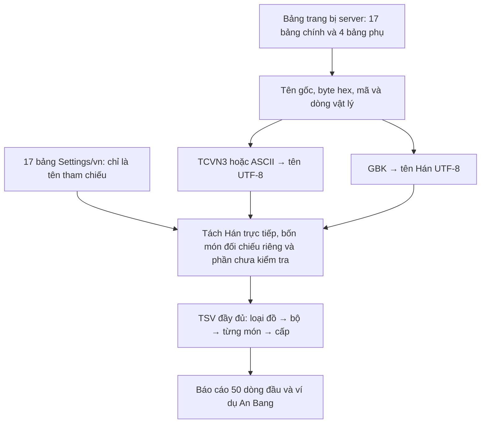

TÓM TẮT 1/5: [NGUỒN] DONE — lập bảng tra trang bị tĩnh, phủ 13.858/13.858 bản ghi trong 21 bảng có dữ liệu; kiểm thêm unique.txt rỗng.
TÓM TẮT 2/5: [NGUỒN] Giữ tên và byte gốc: 10.591 tên TCVN3, 28 tên ASCII, 3.239 tên GBK; An Bang có bốn món gốc, GoldIndex/SetID 164–167.
TÓM TẮT 3/5: [NGUỒN] Báo cáo có bảng 50 dòng đầu; bảng tra đầy đủ là JX1_OPS/REPORTS/_CHIMUC/K-03a.tsv, 13.858 dòng dữ liệu và 37 cột.
TÓM TẮT 4/5: [CHƯA KIỂM] Có 10.615 đối ứng Hán chưa kiểm tra; dữ liệu PAK/client triển khai và ID runtime chưa kiểm tra; ghi file nhịp ngoài sandbox bị từ chối.
TÓM TẮT 5/5: [NGUỒN] Không chạy build, exe game/server, VM hoặc mạng; không commit/push theo yêu cầu, Tổng quan thực hiện bàn giao Git.

# K-03a — Bảng ánh xạ tên trang bị TCVN3, UTF-8 và Hán

Loại: tổng hợp
Chủ đề: Tra tên trang bị về mã dữ liệu và dòng định nghĩa, giữ riêng phiên bản, biến thể và phần chưa kiểm tra.
Từ khóa: trang bị, Items, TCVN3, UTF-8, GBK, An Bang, 安邦, GoldItem, platinaequip, SetID
Trạng thái: DONE — hoàn tất bảng tra tĩnh trong phạm vi đã kiểm; giới hạn đối ứng Hán và dữ liệu triển khai được ghi từng dòng.
Độ phủ: 13.858/13.858 bản ghi trong 21 bảng có dữ liệu; 22/22 bảng định nghĩa đã mở, gồm unique.txt rỗng; 17 bảng tên Hán tham chiếu.
Liên quan: JX1_OPS/DESIGN/CHUAN-BAO-CAO.md; JX1_OPS/DESIGN/MUC-LUC-TRI-THUC.md; JX1_OPS/REPORTS/K-01-ban-do-truyen-tin-hieu.md; JX1_OPS/REPORTS/R-01.md; JX1_OPS/REPORTS/H-02-magic-attrib.md; JX1_OPS/REPORTS/H-06-he-thong-an.md; JX1_OPS/REPORTS/H-07-trang-suc-mat-na-phi-phong.md.
Cần tôi quyết định: không — không yêu cầu mở rộng quyền hoặc chạy game.



## Phạm vi và độ phủ

[ĐÃ XÁC MINH] Tiếp tục đúng worktree `D:/JX-wt/K-03a`, nhánh `task/K-03a`; Git ban đầu sạch và hai đầu ra chưa tồn tại. Đọc chuẩn trước task. Không sửa báo cáo cũ, mã nguồn hoặc byte dữ liệu game. File task chỉ bổ sung mục Kết quả theo yêu cầu đích danh.

[ĐÃ XÁC MINH] Gốc nguồn được định vị từ `JX1_OPS/REPORTS/R-01.md:49`, `JX1_OPS/REPORTS/H-02-magic-attrib.md:20`, `JX1_OPS/REPORTS/H-02-magic-attrib.md:24` rồi mở file thật:

| Ký hiệu | Gốc tuyệt đối và phiên bản được đọc |
|---|---|
| G | `C:/Jx1CocoV3/Folder/ServerNew-20260116T043145Z-3-001/ServerNew/_bin_v2_/gs` — dữ liệu gói server local |
| S | `D:/JX-source/server/jxOnline/gameserver/Sources/Core/Src` — source server, chỉ đối chiếu đường dẫn/loader/cột |
| A | `D:/JX-build/qh9A/Classes` — source client bản A; không thay bằng cây client khác |

| Bảng hoặc phần tử phạm vi | Tổng bản ghi | Đã trích | Trạng thái | Nguồn định nghĩa |
|---|---:|---:|---|---|
| `meleeweapon.txt` | 70 | 70 | Đã phủ | `G/Settings/item/004/meleeweapon.txt:2` → `:71` |
| `rangeweapon.txt` | 30 | 30 | Đã phủ | `G/Settings/item/004/rangeweapon.txt:2` → `:31` |
| `armor.txt` | 290 | 290 | Đã phủ | `G/Settings/item/004/armor.txt:2` → `:291` |
| `helm.txt` | 141 | 141 | Đã phủ | `G/Settings/item/004/helm.txt:2` → `:142` |
| `boot.txt` | 40 | 40 | Đã phủ | `G/Settings/item/004/boot.txt:2` → `:41` |
| `belt.txt` | 20 | 20 | Đã phủ | `G/Settings/item/004/belt.txt:2` → `:21` |
| `amulet.txt` | 20 | 20 | Đã phủ | `G/Settings/item/004/amulet.txt:2` → `:21` |
| `ring.txt` | 10 | 10 | Đã phủ | `G/Settings/item/004/ring.txt:2` → `:11` |
| `cuff.txt` | 20 | 20 | Đã phủ | `G/Settings/item/004/cuff.txt:2` → `:21` |
| `pendant.txt` | 20 | 20 | Đã phủ | `G/Settings/item/004/pendant.txt:2` → `:21` |
| `horse.txt` | 321 | 321 | Đã phủ | `G/Settings/item/004/horse.txt:2` → `:322` |
| `Mask.txt` | 967 | 967 | Đã phủ | `G/Settings/item/004/Mask.txt:1` → `:967` |
| `PiFeng.txt` | 14 | 14 | Đã phủ | `G/Settings/item/004/PiFeng.txt:2` → `:15` |
| `YinJian.txt` | 13 | 13 | Đã phủ | `G/Settings/item/004/YinJian.txt:2` → `:14` |
| `ShiPin.txt` | 260 | 260 | Đã phủ | `G/Settings/item/004/ShiPin.txt:2` → `:261` |
| `GoldItem.txt` | 5945 | 5945 | Đã phủ | `G/Settings/item/004/GoldItem.txt:2` → `:5946` |
| `platinaequip.txt` | 5670 | 5670 | Đã phủ | `G/Settings/item/004/platinaequip.txt:2` → `:5671` |
| Bảng phụ: `mantle.txt` | 3 | 3 | Đã phủ | `G/Settings/item/004/mantle.txt:2` → `:4` |
| Bảng phụ: `signet.txt` | 1 | 1 | Đã phủ | `G/Settings/item/004/signet.txt:2` → `:2` |
| Bảng phụ: `Charm.txt` | 2 | 2 | Đã phủ | `G/Settings/item/004/Charm.txt:2` → `:3` |
| Bảng phụ: `brokenequip.txt` | 1 | 1 | Đã phủ | `G/Settings/item/004/brokenequip.txt:2` → `:2` |
| `unique.txt` | 0 | 0 | Đã phủ: 0 byte, không có dòng để trích | `G/Settings/item/004/unique.txt` — file rỗng; không bịa số dòng |
| 17 bảng `G/Settings/vn` cùng tên 17 bảng chính | 14.497 dòng tên tham chiếu | 17/17 file | Đã đọc; tương đương tên Việt/Hán phần lớn chưa kiểm tra | Header `名称/名称-VN`, ví dụ `G/Settings/vn/GoldItem.txt:1` |
| Client bản A: đường nạp, enum loại, chỉ số record, chuyển mã | 5 file | 5/5 | Đã phủ các đoạn liên quan | `A/gamecore/KBasPropTbl.cpp:16`; `A/gamecore/KItem.h:54`; `A/engine/KGbktoUtf8.h:132`; `A/vn/Translate.cpp:37`; `A/gamecore/KItemGenerator.CPP:775` |
| Bảng trùng tên dưới `Settings/item`, bản `_cu`, `_bak`, bản sao và PAK client | Chưa đếm tổng thể | 0 trong bảng tra chính | Chưa phủ: khác phiên bản/phạm vi; chưa kiểm tra | Loader nguồn chọn `item/004`, không dùng bản sao làm bằng chứng hiệu lực |

[ĐÃ XÁC MINH] 13.851 dòng ở 17 bảng chính và 7 dòng ở bốn bảng phụ tạo thành 13.858 dòng TSV. Một dòng TSV là một dòng định nghĩa, không phải một tên duy nhất hay một vật phẩm đang phát hành. Các tên trùng và khoảng trắng cuối được giữ. Tổng toàn bộ phiên bản game chưa đếm được do PAK và bản sao nằm ngoài phạm vi trích.

## Giải mã tên — 50 dòng đầu của TSV

[ĐÃ XÁC MINH] Cột tên UTF-8 là chuyển mã của tên trong dữ liệu, không sửa chính tả, chữ hoa/thường hoặc dịch lại. Vì vậy giữ cả “Trãm Mã Kiếm”, “Thiên Nhận Kiếm”, “Tú Cốt Thương” đúng byte gốc. Hán ở bảng xem trước dưới đây chỉ là tên cùng vị trí trong bảng tham chiếu, **chưa kiểm tra tương đương**; không dùng nó để sửa tên Việt.

`M` = `G/Settings/item/004/meleeweapon.txt`; `HM` = `G/Settings/vn/meleeweapon.txt`. Nguồn `M:n; HM:n` chỉ rõ hai dòng vật lý. `G/D/P/L` lần lượt là ItemGenre/DetailType/ParticularType/Level, không phải ID vật phẩm đang mang.

| STT | Tên UTF-8 | Tên TCVN3 gốc, hiển thị CP1252 | Mã hóa | Hán tham chiếu | G/D/P/L | Nguồn file:dòng |
|---:|---|---|---|---|---|---|
| 1 | Thiết Trủy thủ | ThiÕt Trñy thñ | TCVN3 | 铁匕首 [chưa kiểm tra] | 0/0/0/1 | M:2; HM:2 |
| 2 | Cang Kiếm | Cang KiÕm | TCVN3 | 钢剑 [chưa kiểm tra] | 0/0/0/2 | M:3; HM:3 |
| 3 | Thanh Phong Kiếm | Thanh Phong KiÕm | TCVN3 | 青峰剑 [chưa kiểm tra] | 0/0/0/3 | M:4; HM:4 |
| 4 | Long Tuyền Kiếm | Long TuyÒn KiÕm | TCVN3 | 龙泉剑 [chưa kiểm tra] | 0/0/0/4 | M:5; HM:5 |
| 5 | Trãm Mã Kiếm | Tr·m M· KiÕm | TCVN3 | 斩马剑 [chưa kiểm tra] | 0/0/0/5 | M:6; HM:6 |
| 6 | Ô Kim Kiếm | ¤ Kim KiÕm | TCVN3 | 乌金剑 [chưa kiểm tra] | 0/0/0/6 | M:7; HM:7 |
| 7 | Xỉ Khiếp | XØ KhiÕp | TCVN3 | 齿铗 [chưa kiểm tra] | 0/0/0/7 | M:8; HM:8 |
| 8 | Thất Xích Kiếm | ThÊt XÝch KiÕm | TCVN3 | 七尺剑 [chưa kiểm tra] | 0/0/0/8 | M:9; HM:9 |
| 9 | Thiên Nhận Kiếm | Thiªn NhËn KiÕm | TCVN3 | 万仞剑 [chưa kiểm tra] | 0/0/0/9 | M:10; HM:10 |
| 10 | Huyền Thiết Kiếm | HuyÒn ThiÕt KiÕm | TCVN3 | 玄铁剑 [chưa kiểm tra] | 0/0/0/10 | M:11; HM:11 |
| 11 | Yêu Đao | Yªu §ao | TCVN3 | 腰刀 [chưa kiểm tra] | 0/0/1/1 | M:12; HM:12 |
| 12 | Đơn Đao | §¬n §ao | TCVN3 | 单刀 [chưa kiểm tra] | 0/0/1/2 | M:13; HM:13 |
| 13 | Quỷ Đầu Đao | Quû §Çu §ao | TCVN3 | 鬼头刀 [chưa kiểm tra] | 0/0/1/3 | M:14; HM:14 |
| 14 | Nhạn Linh Đao | Nh¹n Linh §ao | TCVN3 | 雁翎刀 [chưa kiểm tra] | 0/0/1/4 | M:15; HM:15 |
| 15 | Nguyệt Nha Đao | NguyÖt Nha §ao | TCVN3 | 月牙刀 [chưa kiểm tra] | 0/0/1/5 | M:16; HM:16 |
| 16 | Phá Phong Đao | Ph¸ Phong §ao | TCVN3 | 破风刀 [chưa kiểm tra] | 0/0/1/6 | M:17; HM:17 |
| 17 | Cổn Châu Bảo đao | Cæn Ch©u B¶o ®ao | TCVN3 | 滚珠宝刀 [chưa kiểm tra] | 0/0/1/7 | M:18; HM:18 |
| 18 | Yển Nguyệt Đao | YÓn NguyÖt §ao | TCVN3 | 偃月刀 [chưa kiểm tra] | 0/0/1/8 | M:19; HM:19 |
| 19 | Thanh Long Đao | Thanh Long §ao | TCVN3 | 青龙刀 [chưa kiểm tra] | 0/0/1/9 | M:20; HM:20 |
| 20 | Đại Phong Đao | §¹i Phong §ao | TCVN3 | 大风刀 [chưa kiểm tra] | 0/0/1/10 | M:21; HM:21 |
| 21 | Thiêu Hỏa Côn | Thiªu Háa C«n | TCVN3 | 烧火棍 [chưa kiểm tra] | 0/0/2/1 | M:22; HM:22 |
| 22 | Tề Mi Côn | TÒ Mi C«n | TCVN3 | 齐眉棍 [chưa kiểm tra] | 0/0/2/2 | M:23; HM:23 |
| 23 | Bàn Hoa Côn | Bµn Hoa C«n | TCVN3 | 盘花棍 [chưa kiểm tra] | 0/0/2/3 | M:24; HM:24 |
| 24 | Hổ Vĩ Côn | Hæ VÜ C«n | TCVN3 | 虎尾棍 [chưa kiểm tra] | 0/0/2/4 | M:25; HM:25 |
| 25 | Tiêu Bổng | Tiªu Bæng | TCVN3 | 哨棒 [chưa kiểm tra] | 0/0/2/5 | M:26; HM:26 |
| 26 | Can Bổng | Can Bæng | TCVN3 | 杆棒 [chưa kiểm tra] | 0/0/2/6 | M:27; HM:27 |
| 27 | Lang Nha Bổng | Lang Nha Bæng | TCVN3 | 狼牙棒 [chưa kiểm tra] | 0/0/2/7 | M:28; HM:28 |
| 28 | Hỗn Thiết Bổng | Hçn ThiÕt Bæng | TCVN3 | 混铁棒 [chưa kiểm tra] | 0/0/2/8 | M:29; HM:29 |
| 29 | Giác Hải Bổng | Gi¸c H¶i Bæng | TCVN3 | 搅海棒 [chưa kiểm tra] | 0/0/2/9 | M:30; HM:30 |
| 30 | Kim Cô Bổng | Kim C« Bæng | TCVN3 | 金箍棒 [chưa kiểm tra] | 0/0/2/10 | M:31; HM:31 |
| 31 | Thiết Thương | ThiÕt Th­¬ng | TCVN3 | 铁枪 [chưa kiểm tra] | 0/0/3/1 | M:32; HM:32 |
| 32 | Trường Thương | Tr­êng Th­¬ng | TCVN3 | 长枪 [chưa kiểm tra] | 0/0/3/2 | M:33; HM:33 |
| 33 | Điểm Cang Thương | §iÓm Cang Th­¬ng | TCVN3 | 点钢枪 [chưa kiểm tra] | 0/0/3/3 | M:34; HM:34 |
| 34 | Câu Liêm Thương | C©u Liªm Th­¬ng | TCVN3 | 钩镰枪 [chưa kiểm tra] | 0/0/3/4 | M:35; HM:35 |
| 35 | Hoàn tử Thương | Hoµn tö Th­¬ng | TCVN3 | 环子枪 [chưa kiểm tra] | 0/0/3/5 | M:36; HM:36 |
| 36 | Báo vĩ thương | B¸o vÜ th­¬ng | TCVN3 | 豹尾枪 [chưa kiểm tra] | 0/0/3/6 | M:37; HM:37 |
| 37 | Nhạn Linh Thương | Nh¹n Linh Th­¬ng | TCVN3 | 雁翎枪 [chưa kiểm tra] | 0/0/3/7 | M:38; HM:38 |
| 38 | Tú Cốt Thương | Tó Cèt Th­¬ng | TCVN3 | 透骨枪 [chưa kiểm tra] | 0/0/3/8 | M:39; HM:39 |
| 39 | Hỏa Nhuệ Thương | Háa NhuÖ Th­¬ng | TCVN3 | 火尖枪 [chưa kiểm tra] | 0/0/3/9 | M:40; HM:40 |
| 40 | Phá Thiên Kích | Ph¸ Thiªn KÝch | TCVN3 | 破天戟 [chưa kiểm tra] | 0/0/3/10 | M:41; HM:41 |
| 41 | Toán Đầu chùy | To¸n §Çu chïy | TCVN3 | 蒜头锤 [chưa kiểm tra] | 0/0/4/1 | M:42; HM:42 |
| 42 | Bát Lăng chùy | B¸t L¨ng chïy | TCVN3 | 八棱锤 [chưa kiểm tra] | 0/0/4/2 | M:43; HM:43 |
| 43 | Ngũ Tinh chùy | Ngò Tinh chïy | TCVN3 | 五星锤 [chưa kiểm tra] | 0/0/4/3 | M:44; HM:44 |
| 44 | Tích Lịch chùy | TÝch LÞch chïy | TCVN3 | 霹雳锤 [chưa kiểm tra] | 0/0/4/4 | M:45; HM:45 |
| 45 | Lượng Ngân chùy | L­îng Ng©n chïy | TCVN3 | 亮银锤 [chưa kiểm tra] | 0/0/4/5 | M:46; HM:46 |
| 46 | Lang Nha chùy | Lang Nha chïy | TCVN3 | 狼牙锤 [chưa kiểm tra] | 0/0/4/6 | M:47; HM:47 |
| 47 | Liệt Tâm chùy | LiÖt T©m chïy | TCVN3 | 裂心锤 [chưa kiểm tra] | 0/0/4/7 | M:48; HM:48 |
| 48 | Kim Qua chùy | Kim Qua chïy | TCVN3 | 金瓜锤 [chưa kiểm tra] | 0/0/4/8 | M:49; HM:49 |
| 49 | Nghiệt Long chùy | NghiÖt Long chïy | TCVN3 | 孽龙锤 [chưa kiểm tra] | 0/0/4/9 | M:50; HM:50 |
| 50 | Phá Thiên chùy | Ph¸ Thiªn chïy | TCVN3 | 破天锤 [chưa kiểm tra] | 0/0/4/10 | M:51; HM:51 |

Bảng đầy đủ: [`_CHIMUC/K-03a.tsv`](_CHIMUC/K-03a.tsv). Mỗi dòng có tên UTF-8, tên TCVN3 gốc nếu có, tên Hán đã xác minh hoặc “chưa kiểm tra”, mã dữ liệu, nguồn định nghĩa, nguồn Hán và byte hex để đối chiếu chính xác.

## Sắp theo cấu trúc game

[ĐÃ XÁC MINH] TSV xếp đồ nền theo loại trang bị → ParticularType → Level; Hoàng kim và Bạch kim theo loại bảng → Group → GroupExtend/UpSet → tiền tố biến thể → loại món → ParticularType → Level. Mỗi món vẫn có một dòng riêng. Bảng phụ xếp cuối và ghi rõ loader chưa kiểm tra. Không gom chung hai món chỉ vì tên UTF-8 giống nhau; không suy tên bộ từ trí nhớ.

[ĐÃ XÁC MINH] Với Hoàng kim, cột 53 `SetID` đi vào `m_nId`, cột 54 `Group` đi vào `m_nSet`, cột 55 `GroupNum` đi vào `m_nSetNum`, cột 56 `GroupExtend` đi vào `m_nUpSet`, cột 57 `SetId` đi vào `m_nSetId`: `S/KBasPropTbl.CPP:1540`, `S/KBasPropTbl.CPP:1541`, `S/KBasPropTbl.CPP:1544`. Hai cột có tên gần giống nhau được giữ theo **vị trí cột**, không gộp bằng tên không phân biệt hoa/thường. Bạch kim dùng Group/GroupNum ở cột 59/60 và SetId ở cột 64: `S/KBasPropTbl.CPP:1696`, `S/KBasPropTbl.CPP:1701`.

### Tra An Bang và liệt kê đủ bốn món gốc

[ĐÃ XÁC MINH] Bộ gốc có Group=34, GroupNum=4, GroupExtend=30; cột SetId lần lượt 1, 2, 3, 4. Đã đối chiếu riêng tên từng món với bốn dòng Hán tương ứng. `GK` = `G/Settings/item/004/GoldItem.txt`; `HGK` = `G/Settings/vn/GoldItem.txt`.

| Tên UTF-8 | TCVN3 gốc | Hán, UTF-8 trong bảng tham chiếu | Mã dữ liệu | G/D/P/L | Nguồn file:dòng |
|---|---|---|---|---|---|
| An Bang Băng Tinh Thạch Hạng Liên | An Bang B¨ng Tinh Th¹ch H¹ng Liªn | 安邦之冰晶石项链 | GoldIndex=164; SetID=164 | 0/4/0/10 | GK:166; HGK:166 |
| An Bang Cúc Hoa Thạch Chỉ hoàn | An Bang Cóc Hoa Th¹ch ChØ hoµn | 安邦之菊花石指环 | GoldIndex=165; SetID=165 | 0/3/0/8 | GK:167; HGK:167 |
| An Bang Điền Hoàng Thạch Ngọc Bội | An Bang §iÒn Hoµng Th¹ch Ngäc Béi | 安邦之田黄石玉佩 | GoldIndex=166; SetID=166 | 0/9/1/8 | GK:168; HGK:168 |
| An Bang Kê Huyết Thạch Giới Chỉ | An Bang Kª HuyÕt Th¹ch Giíi ChØ | 安邦之鸡血石戒指 | GoldIndex=167; SetID=167 | 0/3/0/8 | GK:169; HGK:169 |

[ĐÃ XÁC MINH] Tra `ten_khong_dau` khớp nguyên cụm `an bang` và Group=34 thấy **56 dòng**: 28 ở mỗi bảng Hoàng kim/Bạch kim, gồm bảy nhóm bốn món. Đây là các biến thể; không coi tất cả là bốn vật phẩm duy nhất. Trong mỗi bảng, các cụm dòng là 166–169, 212–215, 218–221, 387–390, 396–399, 410–413, 426–429; các mốc `GK:166`, `GK:212`, `GK:218`, `GK:387`, `GK:396`, `GK:410`, `GK:426` đã mở trực tiếp. Bạch kim ở `G/Settings/item/004/platinaequip.txt:166` có tiền tố “Đồ phổ Hoàng Kim”, nên không thay mã Hoàng kim bằng mã Bạch kim từ tên gần giống.

Cách tra tại worktree, chỉ đọc file kết quả:

```powershell
Import-Csv -LiteralPath 'JX1_OPS/REPORTS/_CHIMUC/K-03a.tsv' -Delimiter "`t" -Encoding UTF8 |
    Where-Object { $_.ten_khong_dau -match '(^| )an bang( |$)' -and $_.Group -eq '34' } |
    Select-Object nhom, ten_utf8, ma_id, Group, nguon_file_dong
```

## Cách đọc mã và mức chắc chắn

[ĐÃ XÁC MINH] `ItemGenre=0` là các dòng trang bị trong 17 bảng chính; enum DetailType 0–14 được mở tại `A/gamecore/KItem.h:54` đến `A/gamecore/KItem.h:68`. Bộ mã G/D/P/L là dữ liệu định nghĩa; cột Level là cấp của dòng item, không tự đồng nghĩa cấp nhân vật hay cấp cường hóa.

[ĐÃ XÁC MINH] Loader dùng record bắt đầu từ 0 rồi cộng 2 để đọc dòng vật lý, bỏ một dòng tiêu đề: `S/KBasPropTbl.CPP:95`; số record lấy height−1 tại `S/KBasPropTbl.CPP:810`. GoldIndex/PlatinaIndex trong TSV là **dòng vật lý−2 theo loader nguồn**, tách khỏi SetID trong file và ID instance. `KLibOfBPT::GetGoldItemRecord` nằm tại `S/KBasPropTbl.CPP:410`; `GetRecord(i)` dùng chỉ số i tại `S/KBasPropTbl.CPP:1564`, `S/KBasPropTbl.CPP:1568`; client bản A gọi trực tiếp với nIndex tại `A/gamecore/KItemGenerator.CPP:1554`. [CHƯA XÁC MINH] Hành vi và ID của binary/runtime.

[ĐÃ XÁC MINH] Đồ nền thường dùng `ParticularType*10+Level−1`, mặt nạ dùng ParticularType: `S/KItemGenerator.CPP:662`, `S/KItemGenerator.CPP:666`, `S/KItemGenerator.CPP:668`; client bản A tương ứng `A/gamecore/KItemGenerator.CPP:775`, `A/gamecore/KItemGenerator.CPP:779`, `A/gamecore/KItemGenerator.CPP:781`. Không dùng công thức này để tự sửa, loại dòng hoặc khẳng định mọi tuple duy nhất.

### Mã hóa và tên Hán

[ĐÃ XÁC MINH] Phân loại theo **trường tên của từng dòng**, không gán một encoding duy nhất cho cả file. 10.591 tên TCVN3 được chuyển sang Unicode; 28 tên ASCII được giữ nguyên; 3.239 tên GBK được giải mã CP936. Cột `ten_tcvn3_goc` ghi “không có — GBK” với tên Hán gốc; không bịa phiên âm Việt. `ten_goc_hien_thi_cp1252` là cách hiển thị byte cũ, **CP1252 không phải encoding ngôn ngữ của dữ liệu**; `byte_ten_hex` là chuẩn đối chiếu lossless.

[ĐÃ XÁC MINH] Client bản A khai báo V2U → tcvn2utf tại `A/engine/KGbktoUtf8.h:25` và gọi chuyển TCVN → UTF-8 ở `A/engine/KGbktoUtf8.h:139`; `translate` chọn nhánh theo ngôn ngữ tại `A/vn/Translate.cpp:44`, `A/vn/Translate.cpp:49`, rồi có bước sửa hiển thị tại `A/vn/Translate.cpp:52`. K-03a chỉ chuyển mã văn bản, không chạy hàm game hay áp sửa hiển thị; tên trên UI thực tế chưa kiểm tra.

Phép trích dùng bảng 74 cặp ký tự TCVN3 thông dụng trong phiên xử lý; hai chuỗi dưới ghép từng vị trí, ký tự ASCII ngoài bảng giữ nguyên. Đây là quy tắc trích của K-03a, không phải khẳng định đã chạy thư viện iconv của game. Tất cả tên TCVN3 xuất ra đã chuyển ngược về chuỗi cũ và byte cũ để kiểm tra.

```text
µ¸¶·¹¨»¾¼½Æ©ÇÊÈÉË®ÌÐÎÏѪÒÕÓÔÖ×ÝØÜÞßãáâä«åèæçé¬êíëìîïóñòô­õøö÷ùúýûüþ¡¢£¤¥¦§
àáảãạăằắẳẵặâầấẩẫậđèéẻẽẹêềếểễệìíỉĩịòóỏõọôồốổỗộơờớởỡợùúủũụưừứửữựỳýỷỹỵĂÂÊÔƠƯĐ
```

| Bảng | TCVN3 | ASCII | GBK |
|---|---:|---:|---:|
| `meleeweapon.txt` | 70 | 0 | 0 |
| `rangeweapon.txt` | 30 | 0 | 0 |
| `armor.txt` | 285 | 5 | 0 |
| `helm.txt` | 137 | 3 | 1 |
| `boot.txt` | 37 | 3 | 0 |
| `belt.txt` | 20 | 0 | 0 |
| `amulet.txt` | 20 | 0 | 0 |
| `ring.txt` | 10 | 0 | 0 |
| `cuff.txt` | 20 | 0 | 0 |
| `pendant.txt` | 20 | 0 | 0 |
| `horse.txt` | 290 | 10 | 21 |
| `Mask.txt` | 761 | 2 | 204 |
| `PiFeng.txt` | 13 | 1 | 0 |
| `YinJian.txt` | 13 | 0 | 0 |
| `ShiPin.txt` | 260 | 0 | 0 |
| `GoldItem.txt` | 4584 | 2 | 1359 |
| `platinaequip.txt` | 4019 | 2 | 1649 |
| `mantle.txt` | 0 | 0 | 3 |
| `signet.txt` | 0 | 0 | 1 |
| `Charm.txt` | 2 | 0 | 0 |
| `brokenequip.txt` | 0 | 0 | 1 |
| Tổng | 10.591 | 28 | 3.239 |

[ĐÃ XÁC MINH] 3.239 tên Hán nằm trực tiếp trong byte tên GBK; bốn món An Bang có đối ứng Hán đối chiếu riêng, tổng 3.243 dòng có Hán xác minh. **10.615 dòng còn lại chưa kiểm tra tương đương Hán**; bảng TSV giữ tên cùng vị trí của nguồn tham chiếu trong cột riêng `han_tham_chieu_chua_kiem`, kèm `nguon_han_tham_chieu`, không coi nó là bản dịch đã xác minh. Tên Hán trong `Settings/vn` được đọc nghiêm ngặt bằng UTF-8; tên Hán trong cột nguồn định nghĩa được đọc GBK. Không gán nhãn GBK cho file UTF-8 chỉ vì chứa chữ Hán.

[CHƯA XÁC MINH] Căn cước đối ứng toàn bộ `Settings/vn` không có ID liên kết: có file dài/ngắn khác bảng định nghĩa và có tên không tương đương. Với Mask, tham chiếu dự kiến cộng 1 do có header; đây chỉ là vị trí ứng viên, không áp thành ánh xạ chắc chắn. Ví dụ `G/Settings/item/004/PiFeng.txt:2` là “Phi phong Lăng Vân”, còn `G/Settings/vn/PiFeng.txt:2` là “至尊披风”; `G/Settings/item/004/armor.txt:288` là “Nhận áo mới”, còn `G/Settings/vn/armor.txt:288` là “冰晶裙”. Không sửa lặng các tên hoặc kết luận cũ.

### Các cột TSV và chỉ mục giao Tổng quan

Bảy cột đầu đúng khuôn chỉ mục: `file, loại, chủ đề, từ khóa, trạng thái, độ phủ, liên quan`. Các cột sau là dữ liệu tra tên. `trạng thái=DONE` nói việc trích bản ghi đã xong; mức xác minh tên Hán nằm trong các cột riêng, không bị nâng thành DONE theo metadata.

| Cột/nhóm cột | Ý nghĩa |
|---|---|
| nhom, bo, loai_trang_bi | Loại bảng, bộ số Group/UpSet và loại món; chưa có tên bộ thì giữ mã số |
| ten_utf8, ten_khong_dau | Tên chuyển mã nguyên nội dung và khóa tìm đã bỏ dấu, chuẩn hóa khoảng trắng riêng |
| ten_tcvn3_goc, ten_goc_hien_thi_cp1252, byte_ten_hex, ma_hoa_ten | Bảo toàn dạng cũ, byte và encoding của chính tên |
| ten_han, nguon_han, xac_minh_han | Hán trực tiếp/đối chiếu riêng; thiếu bằng chứng ghi “chưa kiểm tra” |
| han_tham_chieu_chua_kiem, nguon_han_tham_chieu, xac_minh_tham_chieu | Giữ ứng viên Hán chưa xác minh tương đương, tránh mất dữ liệu tra cứu |
| ma_id, ItemGenre, DetailType, ParticularType, Level | Mã có namespace bảng và bộ mã định nghĩa; không phải ID instance |
| chi_so_du_lieu_0, record_0_neu_loader_bo_header | Thứ tự bản ghi có thật và chỉ số theo giả định bỏ header của loader, đặc biệt tách riêng Mask |
| SetID_c53_gold, Group, GroupNum, GroupExtend_UpSet, SetId_vi_tri_mon | Giữ nguyên các mã bộ và hai cột SetID/SetId khác nhau |
| nguon_file_dong, muc_xac_minh, ghi_chu | Dòng định nghĩa chính xác, mức đọc tĩnh và bất nhất/bảng phụ |

## MỤC SỔ THÔNG SỐ

| Nhóm | Tên/hằng số | file:dòng | Giá trị | Đơn vị | Ảnh hưởng | Đổi an toàn (CÓ/CẨN THẬN/KHÔNG) | Nguồn đo |
|---|---|---|---|---|---|---|---|
| Phạm vi loader server | TABFILE_PATH | S/KBasPropTbl.CPP:16 | settings/item/004 | đường dẫn dữ liệu | Định vị 17 bảng chính | KHÔNG — task chỉ đọc | Đọc tĩnh source |
| Phạm vi client A | TABFILE_PATH | A/gamecore/KBasPropTbl.cpp:16 | update10/settings/item/004 | đường dẫn ảo | Không đồng nhất dữ liệu server rời với PAK client | KHÔNG — task chỉ đọc | Đọc tĩnh source, runtime chưa đo |
| Chỉ số dòng | nRow += 2; height−1 | S/KBasPropTbl.CPP:95; S/KBasPropTbl.CPP:810 | 2; 1 header | dòng vật lý | Tra GoldIndex và nhận diện Mask thiếu header | KHÔNG | Đọc tĩnh |
| Bộ mã đồ nền | Particular*10+Level−1; Mask=Particular | S/KItemGenerator.CPP:662; S/KItemGenerator.CPP:668 | 10; −1 | chỉ số record | Phân biệt tuple định nghĩa và record | KHÔNG | Đọc tĩnh, chưa tạo item |
| Bộ An Bang | Group/GroupNum/GroupExtend | G/Settings/item/004/GoldItem.txt:166 | 34 / 4 / 30 | mã bộ / số món / mã mở rộng | Nhóm đủ bốn món gốc | KHÔNG | Đọc tĩnh bốn dòng 166–169 |
| An Bang | GoldIndex; SetID_c53 | G/Settings/item/004/GoldItem.txt:166; G/Settings/item/004/GoldItem.txt:169 | 164–167 | mã trong bảng Hoàng kim | Ví dụ tra tên ra mã | KHÔNG | Dữ liệu và công thức loader, chưa chạy |

## ĐỀ XUẤT TỐI ƯU

[ĐỀ XUẤT] K-02 tra bằng `ten_khong_dau`, rồi hiển thị đồng thời `nhom + ma_id + nguon_file_dong`. Giữ riêng tiền tố biến thể và bộ Group/UpSet; với Hán chưa kiểm tra, hiển thị đúng nhãn chưa kiểm tra. Chỉ bổ sung ánh xạ chắc chắn khi có khóa nguồn hoặc kiểm từng món; không sửa tên gốc theo kết quả tìm gần đúng. Không đề xuất thay cấu hình/mã game từ bảng tên.

## ĐÃ XÁC MINH

- Đã mở trực tiếp 22 bảng định nghĩa, trong đó unique.txt rỗng, và 17 bảng tên tham chiếu. Phủ đủ 13.858 bản ghi; bảy dòng phụ được đánh dấu. Sổ SHA-256 bên dưới ghim 39 file dữ liệu đã đọc, không phải hash exe hay dữ liệu tài khoản.
- Đã đọc source thật tại S và A để kiểm TABFILE_PATH, vị trí cột, enum DetailType, cách tính record và tuyến chuyển mã. Bản đồ/Graphify chỉ định vị; không cần dựng hay cập nhật đồ thị vì task không truy caller/callee sâu.
- Đã thực chạy trích trong Node REPL vào bộ nhớ, không tạo script phụ; đếm dòng và kiểm bộ mã số, 37 cột, không có tab/xuống dòng trong giá trị TSV; kiểm chuyển ngược 10.591 tên TCVN3 và 28 tên ASCII. Không có byte tên bị thay.
- Kiểm độc lập bằng PowerShell Import-Csv và bộ mã .NET: 13.858 dòng đọc được; đối chiếu CP1252 → byte hex **13.858/13.858 đạt**; CP936 → byte hex **3.239/3.239 đạt**. Đây là kiểm văn bản/chuyển mã, không phải test game.
- Giữ nguyên tất cả báo cáo và kết luận cũ; chỉ bổ sung đầu ra K-03a và mục Kết quả trong task. Không stage, commit hoặc push.

- Kiểm tra sau ghi đã đạt: ba file UTF-8 không BOM; 13.858 nguồn dòng duy nhất, 37 cột TSV, đúng 50 dòng xem trước, một sơ đồ Mermaid và một mục Kết quả; SHA-256 của 39/39 file dữ liệu nguồn không đổi giữa lúc trích và kiểm cuối.

## CHƯA XÁC MINH

- Tương đương ngữ nghĩa Việt/Hán của 10.615 dòng; tên Việt/phiên âm của các dòng chỉ có GBK. Đã ghi “chưa kiểm tra” theo từng dòng, giữ riêng ứng viên và nguồn.
- Bảng client đóng gói, thứ tự ưu tiên PAK/file rời, dữ liệu thực được binary nạp, ID instance và hành vi tạo/trang bị/hiển thị. Không đọc thay nguồn canonical hoặc chạy lại khảo sát runtime.
- Bản sao, bảng cũ và các phiên bản ngoài phạm vi được liệt kê trong độ phủ; tổng mọi trang bị của mọi phiên bản chưa đếm được.
- Build, unit/integration test game, client/server, VM và mạng **chưa chạy** vì task chỉ cho đọc tĩnh. Không có kết quả runtime để tuyên bố đạt.
- Nhịp tại `D:/JX-wt/K-03a.nhip` không ghi được do nằm ngoài writable root; các mốc tiếp theo được báo trong hội thoại, không lách sandbox hoặc tự đổi quyền.

## Bàn giao

Trạng thái **DONE cho bảng tra tĩnh**. Đầu ra: `JX1_OPS/REPORTS/K-03a.md` và `JX1_OPS/REPORTS/_CHIMUC/K-03a.tsv`; đã ghi Kết quả cuối `JX1_OPS/TASKS/K-03a.md` theo prompt. Không có commit SHA vì người dùng yêu cầu Tổng quan commit hộ; chưa push, không có bằng chứng GitHub để nhận đã push.

Dòng đề nghị Tổng quan gộp vào mục lục tri thức (không tự sửa mục lục):

| Chủ đề | Báo cáo / tài liệu | File, hàm chính | Độ chắc |
|---|---|---|---|
| Tra tên trang bị TCVN3/UTF-8/Hán, bộ An Bang và mã định nghĩa | K-03a; REPORTS/_CHIMUC/K-03a.tsv | GoldItem.txt; platinaequip.txt; KBasPropTbl; 13.858 dòng có nguồn | Khảo sát tĩnh; Hán chưa kiểm tra ghi riêng |

Bước tiếp: Tổng quan commit đúng ba file theo vùng giao và yêu cầu ghi Kết quả; K-02 dùng schema TSV, giữ giới hạn Hán và không dùng SetID/GoldIndex lẫn nhau. Phần nhịp bị chặn được bàn giao bằng lỗi thật dưới đây, không cần làm lại trích dữ liệu đã có bằng chứng.

## Phát hiện khi chuẩn hóa, lỗi/cách thử/kết quả

| Vấn đề | Cách thử và bằng chứng | Kết quả / cách xử lý |
|---|---|---|
| Không có rg | Một lệnh rg ban đầu trả CommandNotFoundException | Chuyển Get-ChildItem/Select-String giới hạn thư mục; không cài hoặc thử lại |
| Bị chặn ghi nhịp | Một lần WriteAllText tới D:/JX-wt/K-03a.nhip, lỗi “Access to the path 'D:\JX-wt\K-03a.nhip' is denied.” | Không ghi được mốc bắt đầu/phần xong/sắp xong vào đường dẫn yêu cầu; không đổi ACL, credential hoặc bypass sandbox; báo Tổng quan ở đây |
| Kết quả tìm ban đầu mất cột do định dạng PowerShell; đầu ra quá dài bị rút gọn | Đọc lại đúng trích đoạn, định dạng file:dòng thành chuỗi | Đã lấy đủ anchor cần dùng; không coi phần bị cắt là bằng chứng đã đọc |
| Một lần chuỗi báo cáo dài gây lỗi cú pháp Node REPL | Tool trả Unexpected token trước khi thực thi | Chuyển truyền nội dung qua chuỗi JSON; không có file bị ghi dở ở lần lỗi |
| Phân loại mã hóa sơ bộ bằng chuỗi ASCII chưa đủ | Kiểm byte và tên Hán trực tiếp; phát hiện tên TCVN3 ngắn và sáu tên VIP GBK có ASCII | Bổ sung kiểm bộ ký tự và so khớp tên Hán có thật; đầu ra cuối không có tên chưa giải mã, không áp một encoding cho cả bảng |
| Mask không có header | G/Settings/item/004/Mask.txt:1 đã là ItemGenre=0, DetailType=11, ParticularType=0; S/KBasPropTbl.CPP:95 bỏ dòng đầu | Giữ đủ 967 dòng; tách dataIndex và loaderIndex; hành vi runtime chưa kiểm tra, không sửa file |
| Sáu dòng Hoàng kim có SetID khác chỉ số dòng | G/Settings/item/004/GoldItem.txt:5941 đến :5946: SetID 5933–5938, chỉ số theo loader 5939–5944 | Giữ cả hai cột, nêu rõ bất nhất; không đồng nhất SetID với GoldIndex hoặc đổi số cũ |
| Tên theo bảng Hán không luôn tương đương | PiFeng.txt:2 và armor.txt:288 giữa item/004 với vn; GoldItem thiếu sáu dòng ở vn | Tên ứng viên giữ riêng, chưa kiểm tra; không dùng vị trí dòng làm khóa chắc chắn |
| Tìm chuỗi con an bang có thể lẫn Hàn Băng | Truy vấn chuỗi con trả 76 dòng, trong đó 20 dòng Hàn Băng thuộc Group=159; ví dụ G/Settings/item/004/GoldItem.txt:1667 | Ví dụ tra đã dùng ranh giới từ và Group=34, trả đúng 56 dòng biến thể An Bang |
| Bảng phụ không nằm trong mảng 15 bảng nền | G/Settings/item/004/mantle.txt:2; signet.txt:2; Charm.txt:2; brokenequip.txt:2; A/gamecore/KBasPropTbl.cpp:57 | Trích thêm bảy dòng để tra, gắn bảng phụ; chưa khẳng định được loader/runtime chọn |

Các phát hiện trên bổ sung phạm vi và độ chắc của K-03a, không thay kết luận/số liệu trong H-02, H-06, H-07 hay R-01. Không có lỗi bị thử quá ba lần.

### SHA-256 ghim dữ liệu đã đọc

[ĐÃ XÁC MINH] Hash tính cục bộ từ byte file, chỉ để đối chiếu phiên bản; không chứa nội dung tài khoản, khóa hoặc mật khẩu.

| File dữ liệu | SHA-256 |
|---|---|
| `G/Settings/item/004/meleeweapon.txt` | `103fb154e196bf01a7a4bec4d0fb1a357a9144f51141fba3ff69aabae3aef2cc` |
| `G/Settings/vn/meleeweapon.txt` | `b85e685f4cd4904304330b2713f3d3bb3b68c586cab804b6499352ffabf83994` |
| `G/Settings/item/004/rangeweapon.txt` | `987d0b55f8619685a851db4a9d030869c2e9a2cd83c80038086db694eec76109` |
| `G/Settings/vn/rangeweapon.txt` | `108cb47f2ae6bb20b18b8c85f4ca091a5b75e27a368674480fc379cce74cf989` |
| `G/Settings/item/004/armor.txt` | `cd15f3187f0d7fb52cc8042aeeebf7a7effd381fb7cc68bd19ac838f2cda99ee` |
| `G/Settings/vn/armor.txt` | `536ca1576d59c5ba5186a5dbad1731dda4c7bb9ca5376de203fdebcdfd685e70` |
| `G/Settings/item/004/helm.txt` | `0b8e6655ed88a78d6663e8f7fcacf57aec3a6d05fc73ba7bfc3feca6f23df9af` |
| `G/Settings/vn/helm.txt` | `1e86b415564d0dca16c28c7e7205ee61775168c909bce00cacac907428a4a01a` |
| `G/Settings/item/004/boot.txt` | `1ab793c63da04b4ed66882b7bd66534b29a16bb1dfd9146051c1acf996988002` |
| `G/Settings/vn/boot.txt` | `18f9ee2f1c3c7ea6cfa88d8cc83710ed71dab83f84b090ed0b1a144307f02eec` |
| `G/Settings/item/004/belt.txt` | `c362595198e2706a8221c390841b8a1d5a5cf7e21c326d3a7a79b5cf235cb3e1` |
| `G/Settings/vn/belt.txt` | `30bc2077fe909b844062f7c71ad9ac33eeb714bf27e0732e369194ea7662b5b7` |
| `G/Settings/item/004/amulet.txt` | `1a9522a92210a205b221577b46c31da5a5546d2c204b6790472ccbe9703d7c56` |
| `G/Settings/vn/amulet.txt` | `b41a51b20729381c62a8241a3169d2d7af1f24b2b2cf69619ae508097c305558` |
| `G/Settings/item/004/ring.txt` | `1e7e507fe3382b60fea3541ec6bd090396d6929f64ab80220fadecfe36b1383e` |
| `G/Settings/vn/ring.txt` | `7ffc8e40de490c70be49821ead1d3ea25de2361f87da0ea7aa660103be474f18` |
| `G/Settings/item/004/cuff.txt` | `78d3fb96958a3ba73592c5a498d52fa17dd18073200d62286997dd732c42bad4` |
| `G/Settings/vn/cuff.txt` | `f9115451d75fe83db8338362d4a1641db9a4324fb11f89515e301119146008f2` |
| `G/Settings/item/004/pendant.txt` | `9d003c8b6e2ae21dbb7dd4aef401f314584cb130aef67fb1f1c574cebc37e7a7` |
| `G/Settings/vn/pendant.txt` | `3d9c7f6faf168a4781716b4f2394b5b4c988f905b3efde25ee4560cecbd85c38` |
| `G/Settings/item/004/horse.txt` | `d16f8eb99db1bf7a283c19ed2a26941ab992e519c8f5f48f6a52e0ebb917c06f` |
| `G/Settings/vn/horse.txt` | `c53d34ac538d80eda3096dd1f39c25334f39c885afd61a6cc370ba3ee6db700a` |
| `G/Settings/item/004/Mask.txt` | `43be7435a030c77b82f3eb9818ed942bfb87b0354bdd9b968678bc20584c416a` |
| `G/Settings/vn/Mask.txt` | `92a87cc26e6d35242567ac7eb9ef6b88234f61e491781624bc47f68ae78d93f9` |
| `G/Settings/item/004/PiFeng.txt` | `98c4dce6ee07de9aa884b7b539d7e9c80887acba1884f05daa58959d822a6857` |
| `G/Settings/vn/PiFeng.txt` | `eaba806adb90f092b3c29569828a0efc946689aeaa613cfb95c0203b13153452` |
| `G/Settings/item/004/YinJian.txt` | `d141ac617a22bf84adeebb7a7dcdd41f29dc166d02f1639ea87c525096e310c9` |
| `G/Settings/vn/YinJian.txt` | `d887859fd9d1adee8c0f3f09c6ee5500dd179d4b2462269406733cf04cc3af2a` |
| `G/Settings/item/004/ShiPin.txt` | `958bf87710c4fbe2752acf26cfbd2e4450ea1f27c6a19a587d0727780795dd38` |
| `G/Settings/vn/ShiPin.txt` | `58717d2a6c4aec618953b44198168314dd006cf14406e3fb515b779c1e9d9f36` |
| `G/Settings/item/004/GoldItem.txt` | `ce63d39d8c00b8514eed291817558f3b191e497e0e41c3d354284e285a80791e` |
| `G/Settings/vn/GoldItem.txt` | `f31522258d4784996122ccc0f101022ff80b008c8fec7624f29acc36da02df4e` |
| `G/Settings/item/004/platinaequip.txt` | `515824ae15a658cf2f76aad2e8398db83b0c1ee932467ef3dd92f893abfbf098` |
| `G/Settings/vn/platinaequip.txt` | `92905c38c87d27184cede1a5fce2685780d58b65ce3586fa64de1e40b5bad7cf` |
| `G/Settings/item/004/mantle.txt` | `07b904886fc9f7f565ad965dc91887c8461af1c21248e98e4fa3dd85faafb6fd` |
| `G/Settings/item/004/signet.txt` | `589fff1e46f6af161153736829ef762deb59035051f76c0d3eaa51d4058fae35` |
| `G/Settings/item/004/Charm.txt` | `b0c3c50a87ee54f83859564ce8f3489ec6482dba7cde34a736b9b0d6bc18df2b` |
| `G/Settings/item/004/brokenequip.txt` | `c3057bc9c56bbca23dc978f895afdac190a52712c27a143578cd2884c79005b3` |
| `G/Settings/item/004/unique.txt` | `e3b0c44298fc1c149afbf4c8996fb92427ae41e4649b934ca495991b7852b855` |

Kỹ năng đã dùng: jx1-retrofit, jx1-read-server, jx1-read-client, jx1-parameters, jx1-knowledge, jx1-report.
