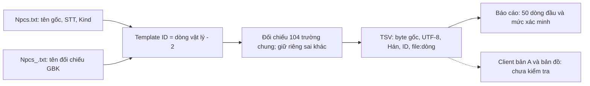

TÓM TẮT 1/5: [NGUỒN] PARTIAL — đã đối chiếu đủ 2.435/2.435 template quái và NPC server; dữ liệu client bản A và quan hệ bản đồ chưa kiểm tra.
TÓM TẮT 2/5: [NGUỒN] Giữ nguyên TSV có sẵn: 1.410 tên TCVN3, 911 tên/nhãn GBK và 114 ô ASCII, gồm 2 tên trống; ID, byte gốc và nguồn dòng đều khớp.
TÓM TẮT 3/5: [NGUỒN] Báo cáo có bảng đúng 50 dòng đầu; TSV đầy đủ ở JX1_OPS/REPORTS/_CHIMUC/K-03b.tsv, 2.435 hàng dữ liệu × 27 cột.
TÓM TẮT 4/5: [CHƯA KIỂM] Còn 116 nhãn chưa dịch, 88 hàng không có chữ Hán trong bảng đối chiếu; 9 cặp tên khác nhau và 6 hàng khác thuộc tính được tách rõ.
TÓM TẮT 5/5: [NGUỒN] Không chạy build, game/exe, VM hoặc mạng; không commit/push theo yêu cầu. Ghi nhịp ngoài worktree bị từ chối; PM tiếp nhận tài liệu local.

# K-03b — Bảng ánh xạ tên TCVN3–UTF-8–Hán, nhóm quái và NPC

Loại: tổng hợp
Chủ đề: Bảng tra tên quái và NPC TCVN3–UTF-8–Hán theo template
Từ khóa: quái, NPC, TCVN3, UTF-8, GBK, Npcs.txt, Npcs_.txt, template_id, K-03b
Trạng thái: PARTIAL — bảng template server đã đủ; dữ liệu client bản A, tên chưa dịch và liên kết bản đồ chưa kiểm tra.
Độ phủ: 2.435/2.435 template server; bản đồ/client chưa kiểm tra
Liên quan: JX1_OPS/DESIGN/CHUAN-BAO-CAO.md; JX1_OPS/DESIGN/MUC-LUC-TRI-THUC.md; JX1_OPS/REPORTS/K-01-ban-do-truyen-tin-hieu.md; JX1_OPS/REPORTS/I-03-khao-sat-quai-vat.md; JX1_OPS/REPORTS/I-05-npc-chuc-nang.md; JX1_OPS/REPORTS/R-04c.md
Cần tôi quyết định: không — phần chưa kiểm được bàn giao cho K-03/K-02; Tổng quan lưu commit theo yêu cầu.

## Sơ đồ quan hệ chính

## Phạm vi và độ phủ

**[NGUỒN]** Tiếp tục worktree `D:/JX-wt/K-03b`, nhánh `task/K-03b`. Lần kiểm Git đầu chỉ thấy TSV K-03b có sẵn, chưa có báo cáo. TSV được giữ nguyên byte; không trích xuất hoặc tạo lại bảng đã có. Chỉ bổ sung báo cáo và mục Kết quả cuối task theo prompt.

| Phần tử phạm vi | Độ phủ | Bằng chứng và giới hạn |
|---|---|---|
| Quái/động vật, Kind=0 | đã phủ 1.412/1.412 template | Từng ID và dòng nguồn trong TSV, hàng vật lý 2–1.413; định nghĩa Kind tại `H/GameDataDef.h:364`. |
| NPC đối thoại, Kind=3 | đã phủ 958/958 template | TSV hàng 1.414–2.371; `H/GameDataDef.h:367`. Đây là nhóm đối thoại trong bảng, chưa xác nhận chức năng hoặc số NPC xuất hiện. |
| NPC loại chim, Kind=4 | đã phủ 23/23 template | TSV hàng 2.372–2.394; `H/GameDataDef.h:368`. |
| NPC loại chuột, Kind=5 | đã phủ 23/23 template | TSV hàng 2.395–2.417; `H/GameDataDef.h:369`. |
| Kind trống | đã phủ 19/19 template, giữ riêng | TSV hàng 2.418–2.436; ví dụ `G/Settings/Npcs.txt:1716`. Không nhập vào 1.412 hàng có số 0 tường minh. |
| Tên nguồn server | đã phủ 2.435/2.435 hàng, ID 0..2.434 | `G/Settings/Npcs.txt:1` là header; dữ liệu từ dòng 2 tới 2.436, 106 ô/hàng. |
| Bảng đối chiếu Hán | đã phủ 2.435/2.435 hàng cấu trúc; 2.347 hàng có chữ Hán | `G/Settings/Npcs_.txt:1`, 105 ô/hàng, không có STT; 88 hàng chỉ có Latin, ghi thiếu chữ Hán. |
| Bảng 50 dòng đầu | đã phủ 50/50 hàng đầu của TSV | Bảng Giải mã tên bên dưới tương ứng TSV dòng 2 tới 51. |
| Dữ liệu tên client bản A | chưa kiểm tra | Đã kiểm đường đọc source tại `Q/gamecore/KNpcTemplate.cpp:24`, `:26`; chưa có đối chiếu bảng NPC client/PAK với server. |
| Quái/NPC theo từng bản đồ, tên đặt bởi Lua hoặc dữ liệu vùng | chưa kiểm tra | `map_id` và `kiem_tra_ban_do` ghi rõ chưa kiểm tra cho cả 2.435 hàng; không coi bảng template là toàn bộ tên runtime. |

## Nguồn, mã hóa và quy tắc ID

**[NGUỒN]** Đã đọc chuẩn trước task; dùng K-01, I-03, I-05 và R-04c để định vị, sau đó mở file thật và kiểm dòng hiện tại. Các ký hiệu của báo cáo này:

| Ký hiệu | Gốc tuyệt đối |
|---|---|
| G | `C:/Jx1CocoV3/Folder/ServerNew-20260116T043145Z-3-001/ServerNew/_bin_v2_/gs` — dữ liệu server, cũng là tiền tố giữ nguyên trong TSV K-03b. |
| S | `D:/JX-source/server/jxOnline/gameserver/Sources/Core/Src` |
| H | `D:/JX-source/server/jxOnline/header` |
| Q | `D:/JX-build/qh9A/Classes` — source client bản A, được định vị từ `JX1_OPS/REPORTS/R-04c.md:53`. |

Chú ý tiền tố **G của K-03b trỏ tới dữ liệu gs** theo bảng trên; K-01 dùng cùng chữ G cho gateway/Sources (`JX1_OPS/REPORTS/K-01-ban-do-truyen-tin-hieu.md:26`). Khi ghép báo cáo phải dùng root đầy đủ của từng tài liệu.

**[NGUỒN]** Server đọc `Name` ở `S/KNpcTemplate.cpp:644`, với `nNpcTempRow = nNpcTemplateId + 2` tại `:642`. Vì vậy **template_id = STT − 1 = dòng vật lý − 2** trong Npcs.txt. Bảng Npcs_.txt đối chiếu bằng vị trí cùng template, không có cột ID độc lập. Không dùng tên hoặc STT thay cho ID instance.

**[NGUỒN]** Client bản A cũng dùng ID+2 tại `Q/gamecore/KNpcTemplate.cpp:24`, đọc Name tại `:26`, đường settings/NpcS.txt tại `Q/gamecore/CoreUseNameDef.h:133`, nạp tại `Q/gamecore/KCore.cpp:398`. `Q/engine/KGbktoUtf8.h:25` ánh xạ V2U sang tcvn2utf; `:139` yêu cầu chuyển TCVN→UTF-8. Đây là bằng chứng đường đọc/chuyển mã tĩnh; chưa chứng minh hiển thị của binary hoặc dữ liệu client đang dùng.

**[NGUỒN]** Mã hóa ghi theo từng ô Name, vì Npcs.txt có tên Việt mã cũ, GBK và ASCII xen kẽ. `ten_goc_hien_byte` là cách trình bày byte theo Windows-1252 để đọc lại dạng cũ; `ten_goc_hex` mới là biểu diễn byte chính xác, kể cả ký tự khó nhìn như byte AD. TSV và báo cáo lưu UTF-8 không BOM, không sửa byte dữ liệu game.

| File gốc | Kích thước | SHA-256 kiểm trong lượt này |
|---|---:|---|
| G/Settings/Npcs.txt | 753.810 byte | `c4aaa27fb06811effb23d7f8d12fef1f9d9f82164e74e00f86ac4bf5119389e7` |
| G/Settings/Npcs_.txt | 734.570 byte | `862e21477196a62663db56c65efbfba6c3085702cce54dbf1111672cab65fe92` |

## Giải mã tên — đúng 50 dòng đầu của TSV

**[NGUỒN]** Giữ nguyên chữ hoa/thường, khoảng trắng và cách ghi trong dữ liệu; không biên tập lại tên sau giải mã. Cột chữ Hán lấy từ bảng đối chiếu cùng template. Cả 50 hàng sau khớp 104 trường chung ngoài Name/STT; sự khớp cấu trúc hỗ trợ việc nối hàng, chưa xác nhận đây là bản dịch Việt–Hán chính thức. Phần còn lại xem TSV đầy đủ, gồm cờ sai khác và phần chưa kiểm.

| STT bảng | Template ID | Chữ đúng UTF-8 | Tên gốc | Mã hóa gốc | Chữ Hán đối chiếu | Nguồn tên gốc | Nguồn Hán |
|---:|---:|---|---|---|---|---|---|
| 1 | 1015 | (cao cấp) ảnh Côn | (cao cÊp) ¶nh C«n | TCVN3 | 高级时间的挑战影棍 | `G/Settings/Npcs.txt:1017` | `G/Settings/Npcs_.txt:1017` |
| 2 | 1019 | (cao cấp) Chú thuật quái | (cao cÊp) Chó thuËt qu¸i | TCVN3 | 高级时间的挑战减跑速诅咒怪 | `G/Settings/Npcs.txt:1021` | `G/Settings/Npcs_.txt:1021` |
| 3 | 1038 | (cao cấp) đại Boss | (cao cÊp) ®¹i Boss | TCVN3 | 高级时间的挑战大boss | `G/Settings/Npcs.txt:1040` | `G/Settings/Npcs_.txt:1040` |
| 4 | 1016 | (cao cấp) Đao Tử | (cao cÊp) §ao Tö | TCVN3 | 高级时间的挑战刀仔 | `G/Settings/Npcs.txt:1018` | `G/Settings/Npcs_.txt:1018` |
| 5 | 1018 | (cao cấp) Hắc Cân | (cao cÊp) H¾c C©n | TCVN3 | 高级时间的挑战黑巾 | `G/Settings/Npcs.txt:1020` | `G/Settings/Npcs_.txt:1020` |
| 6 | 1017 | (cao cấp) Lang Bổng | (cao cÊp) Lang Bæng | TCVN3 | 高级时间的挑战狼棒 | `G/Settings/Npcs.txt:1019` | `G/Settings/Npcs_.txt:1019` |
| 7 | 1023 | (cao cấp) npc Chú thuật | (cao cÊp) npc Chó thuËt | TCVN3 | 高级时间的挑战减攻速诅咒怪 | `G/Settings/Npcs.txt:1025` | `G/Settings/Npcs_.txt:1025` |
| 8 | 1022 | (cao cấp) npc giảm tốc | (cao cÊp) npc gi¶m tèc | TCVN3 | 高级时间的挑战迟缓怪 | `G/Settings/Npcs.txt:1024` | `G/Settings/Npcs_.txt:1024` |
| 9 | 1021 | (cao cấp) npc hôn mê | (cao cÊp) npc h«n mª | TCVN3 | 高级时间的挑战眩晕怪 | `G/Settings/Npcs.txt:1023` | `G/Settings/Npcs_.txt:1023` |
| 10 | 1025 | (cao cấp) npc phản đòn | (cao cÊp) npc ph¶n ®ßn | TCVN3 | 高级时间的挑战反弹怪 | `G/Settings/Npcs.txt:1027` | `G/Settings/Npcs_.txt:1027` |
| 11 | 1024 | (cao cấp) npc siêu mạnh | (cao cÊp) npc siªu m¹nh | TCVN3 | 高级时间的挑战超强怪 | `G/Settings/Npcs.txt:1026` | `G/Settings/Npcs_.txt:1026` |
| 12 | 1020 | (cao cấp) npc té ngã | (cao cÊp) npc tÐ ng· | TCVN3 | 高级时间的挑战后仰怪 | `G/Settings/Npcs.txt:1022` | `G/Settings/Npcs_.txt:1022` |
| 13 | 1014 | (cao cấp) Phá Lang | (cao cÊp) Ph¸ Lang | TCVN3 | 高级时间的挑战破浪 | `G/Settings/Npcs.txt:1016` | `G/Settings/Npcs_.txt:1016` |
| 14 | 1008 | (cao cấp) Phi Sa | (cao cÊp) Phi Sa | TCVN3 | 高级时间的挑战飞沙 | `G/Settings/Npcs.txt:1010` | `G/Settings/Npcs_.txt:1010` |
| 15 | 1007 | (cao cấp) Sương Đao | (cao cÊp) S­¬ng §ao | TCVN3 | 高级时间的挑战霜刀 | `G/Settings/Npcs.txt:1009` | `G/Settings/Npcs_.txt:1009` |
| 16 | 1009 | (cao cấp) Sương Liêm | (cao cÊp) S­¬ng Liªm | TCVN3 | 高级时间的挑战霜镰 | `G/Settings/Npcs.txt:1011` | `G/Settings/Npcs_.txt:1011` |
| 17 | 1012 | (cao cấp) Thần Tý | (cao cÊp) ThÇn Tý | TCVN3 | 高级时间的挑战神臂 | `G/Settings/Npcs.txt:1014` | `G/Settings/Npcs_.txt:1014` |
| 18 | 1010 | (cao cấp) Thừa Phong | (cao cÊp) Thõa Phong | TCVN3 | 高级时间的挑战乘风 | `G/Settings/Npcs.txt:1012` | `G/Settings/Npcs_.txt:1012` |
| 19 | 1011 | (cao cấp) Thủy Quỷ | (cao cÊp) Thñy Quû | TCVN3 | 高级时间的挑战水鬼 | `G/Settings/Npcs.txt:1013` | `G/Settings/Npcs_.txt:1013` |
| 20 | 1026 | (cao cấp) tiểu Boss nam 1 | (cao cÊp) tiÓu Boss nam 1 | TCVN3 | 高级时间的挑战小boss男1 | `G/Settings/Npcs.txt:1028` | `G/Settings/Npcs_.txt:1028` |
| 21 | 1027 | (cao cấp) tiểu Boss nam 2 | (cao cÊp) tiÓu Boss nam 2 | TCVN3 | 高级时间的挑战小boss男2 | `G/Settings/Npcs.txt:1029` | `G/Settings/Npcs_.txt:1029` |
| 22 | 1028 | (cao cấp) tiểu Boss nam 3 | (cao cÊp) tiÓu Boss nam 3 | TCVN3 | 高级时间的挑战小boss男3 | `G/Settings/Npcs.txt:1030` | `G/Settings/Npcs_.txt:1030` |
| 23 | 1029 | (cao cấp) tiểu Boss nam 4 | (cao cÊp) tiÓu Boss nam 4 | TCVN3 | 高级时间的挑战小boss男4 | `G/Settings/Npcs.txt:1031` | `G/Settings/Npcs_.txt:1031` |
| 24 | 1030 | (cao cấp) tiểu Boss nam 5 | (cao cÊp) tiÓu Boss nam 5 | TCVN3 | 高级时间的挑战小boss男5 | `G/Settings/Npcs.txt:1032` | `G/Settings/Npcs_.txt:1032` |
| 25 | 1031 | (cao cấp) tiểu Boss nam 6 | (cao cÊp) tiÓu Boss nam 6 | TCVN3 | 高级时间的挑战小boss男6 | `G/Settings/Npcs.txt:1033` | `G/Settings/Npcs_.txt:1033` |
| 26 | 1032 | (cao cấp) tiểu Boss nam 7 | (cao cÊp) tiÓu Boss nam 7 | TCVN3 | 高级时间的挑战小boss男7 | `G/Settings/Npcs.txt:1034` | `G/Settings/Npcs_.txt:1034` |
| 27 | 1033 | (cao cấp) tiểu Boss nam 8 | (cao cÊp) tiÓu Boss nam 8 | TCVN3 | 高级时间的挑战小boss男8 | `G/Settings/Npcs.txt:1035` | `G/Settings/Npcs_.txt:1035` |
| 28 | 1034 | (cao cấp) tiểu Boss nữ 1 | (cao cÊp) tiÓu Boss n÷ 1 | TCVN3 | 高级时间的挑战小boss女1 | `G/Settings/Npcs.txt:1036` | `G/Settings/Npcs_.txt:1036` |
| 29 | 1035 | (cao cấp) tiểu Boss nữ 2 | (cao cÊp) tiÓu Boss n÷ 2 | TCVN3 | 高级时间的挑战小boss女2 | `G/Settings/Npcs.txt:1037` | `G/Settings/Npcs_.txt:1037` |
| 30 | 1036 | (cao cấp) tiểu Boss nữ 3 | (cao cÊp) tiÓu Boss n÷ 3 | TCVN3 | 高级时间的挑战小boss女3 | `G/Settings/Npcs.txt:1038` | `G/Settings/Npcs_.txt:1038` |
| 31 | 1037 | (cao cấp) tiểu Boss nữ 4 | (cao cÊp) tiÓu Boss n÷ 4 | TCVN3 | 高级时间的挑战小boss女4 | `G/Settings/Npcs.txt:1039` | `G/Settings/Npcs_.txt:1039` |
| 32 | 1013 | (cao cấp) Tranh Hán | (cao cÊp) Tranh H¸n | TCVN3 | 高级时间的挑战狰汉 | `G/Settings/Npcs.txt:1015` | `G/Settings/Npcs_.txt:1015` |
| 33 | 935 | (khu vực cao cấp) ảnh Côn | (khu vùc cao cÊp) ¶nh C«n | TCVN3 | 高级龙舟影棍 | `G/Settings/Npcs.txt:937` | `G/Settings/Npcs_.txt:937` |
| 34 | 936 | (khu vực cao cấp) Đao Tử | (khu vùc cao cÊp) §ao Tö | TCVN3 | 高级龙舟刀仔 | `G/Settings/Npcs.txt:938` | `G/Settings/Npcs_.txt:938` |
| 35 | 938 | (khu vực cao cấp) Hắc Cân | (khu vùc cao cÊp) H¾c C©n | TCVN3 | 高级龙舟黑巾 | `G/Settings/Npcs.txt:940` | `G/Settings/Npcs_.txt:940` |
| 36 | 937 | (khu vực cao cấp) Lang Bổng | (khu vùc cao cÊp) Lang Bæng | TCVN3 | 高级龙舟狼棒 | `G/Settings/Npcs.txt:939` | `G/Settings/Npcs_.txt:939` |
| 37 | 934 | (khu vực cao cấp) Phá Lang | (khu vùc cao cÊp) Ph¸ Lang | TCVN3 | 高级龙舟破浪 | `G/Settings/Npcs.txt:936` | `G/Settings/Npcs_.txt:936` |
| 38 | 928 | (khu vực cao cấp) Phi Sa | (khu vùc cao cÊp) Phi Sa | TCVN3 | 高级龙舟飞沙 | `G/Settings/Npcs.txt:930` | `G/Settings/Npcs_.txt:930` |
| 39 | 927 | (khu vực cao cấp) Sương Đao | (khu vùc cao cÊp) S­¬ng §ao | TCVN3 | 高级龙舟霜刀 | `G/Settings/Npcs.txt:929` | `G/Settings/Npcs_.txt:929` |
| 40 | 929 | (khu vực cao cấp) Sương Liêm | (khu vùc cao cÊp) S­¬ng Liªm | TCVN3 | 高级龙舟霜镰 | `G/Settings/Npcs.txt:931` | `G/Settings/Npcs_.txt:931` |
| 41 | 932 | (khu vực cao cấp) Thần Tý | (khu vùc cao cÊp) ThÇn Tý | TCVN3 | 高级龙舟神臂 | `G/Settings/Npcs.txt:934` | `G/Settings/Npcs_.txt:934` |
| 42 | 930 | (khu vực cao cấp) Thừa Phong | (khu vùc cao cÊp) Thõa Phong | TCVN3 | 高级龙舟乘风 | `G/Settings/Npcs.txt:932` | `G/Settings/Npcs_.txt:932` |
| 43 | 931 | (khu vực cao cấp) Thủy Quỷ | (khu vùc cao cÊp) Thñy Quû | TCVN3 | 高级龙舟水鬼 | `G/Settings/Npcs.txt:933` | `G/Settings/Npcs_.txt:933` |
| 44 | 933 | (khu vực cao cấp) Tranh Hán | (khu vùc cao cÊp) Tranh H¸n | TCVN3 | 高级龙舟狰汉 | `G/Settings/Npcs.txt:935` | `G/Settings/Npcs_.txt:935` |
| 45 | 983 | (sơ cấp) ảnh Côn | (s¬ cÊp) ¶nh C«n | TCVN3 | 初级时间的挑战影棍 | `G/Settings/Npcs.txt:985` | `G/Settings/Npcs_.txt:985` |
| 46 | 1006 | (sơ cấp) đại Boss | (s¬ cÊp) ®¹i Boss | TCVN3 | 初级时间的挑战大boss | `G/Settings/Npcs.txt:1008` | `G/Settings/Npcs_.txt:1008` |
| 47 | 984 | (sơ cấp) Đao Tử | (s¬ cÊp) §ao Tö | TCVN3 | 初级时间的挑战刀仔 | `G/Settings/Npcs.txt:986` | `G/Settings/Npcs_.txt:986` |
| 48 | 986 | (sơ cấp) Hắc Cân | (s¬ cÊp) H¾c C©n | TCVN3 | 初级时间的挑战黑巾 | `G/Settings/Npcs.txt:988` | `G/Settings/Npcs_.txt:988` |
| 49 | 985 | (sơ cấp) Lang Bổng | (s¬ cÊp) Lang Bæng | TCVN3 | 初级时间的挑战狼棒 | `G/Settings/Npcs.txt:987` | `G/Settings/Npcs_.txt:987` |
| 50 | 987 | (sơ cấp) npc Chú thuật | (s¬ cÊp) npc Chó thuËt | TCVN3 | 初级时间的挑战减跑速诅咒怪 | `G/Settings/Npcs.txt:989` | `G/Settings/Npcs_.txt:989` |

## Sắp theo cấu trúc game

**[NGUỒN]** TSV chia theo nhóm game: quái/động vật → NPC đối thoại → loại chim → loại chuột → Kind trống. Trong từng nhóm giữ thứ tự tra tên của bảng có sẵn; mỗi dòng là một template, không gộp các tên trùng. Có 2.219 chuỗi Name sau giải mã khác nhau, tính cả chuỗi trống; 216 hàng lặp chuỗi tên không có nghĩa trùng ID.

**[CHƯA KIỂM]** Chưa sắp theo bản đồ: bảng template không cung cấp quan hệ một template xuất hiện ở những map nào; cần nối dữ liệu vùng và đường tạo NPC từ Lua. Báo cáo I-03 đã khảo sát bản ghi vùng (`JX1_OPS/REPORTS/I-03-khao-sat-quai-vat.md:191`), nhưng K-03b chưa lặp hoặc nhập dữ liệu ấy. Vì vậy không tự gán map từ tên quái, thứ tự file hoặc Kind; cả hai cột bản đồ giữ “chưa kiểm tra”.

## TSV đầy đủ và cách tra

Đường dẫn đầy đủ: `D:/JX-wt/K-03b/JX1_OPS/REPORTS/_CHIMUC/K-03b.tsv`.

Liên kết trong kho: [K-03b.tsv](_CHIMUC/K-03b.tsv). **[NGUỒN]** 2.435 hàng dữ liệu, một header, 27 cột phân tách bằng tab; UTF-8 không BOM. SHA-256 giữ nguyên so với lúc tiếp tục: `3062bde2aa0f918b6eeb3fe9525ba8190808d0044a187df332ee35e1ca7fd2e7`.

| Cột/nhóm cột | Ý nghĩa sử dụng |
|---|---|
| file, loại, chủ đề, từ khóa, trạng thái, độ phủ, liên quan | Bảy cột đầu theo chuẩn chỉ mục; metadata báo cáo được lặp ở mỗi dòng tên. PM có thể lấy một bộ metadata duy nhất khi ghép mục lục. |
| nhom, kind, template_id, stt | Phân loại game và mã template; Kind trống được ghi “trống”, không sửa thành 0. |
| ten_utf8, ten_khong_dau | Tên đã giải mã và khóa tìm: bỏ dấu, đổi đ→d, chữ thường, gộp khoảng trắng; giữ nguyên cột tên để đối chiếu. |
| ten_tcvn3_goc, ten_goc_hien_byte, ma_hoa_ten_goc, ten_goc_hex | Giữ dạng TCVN3 nếu có; tên GBK không giả làm TCVN3. Dùng hex để khôi phục chính xác byte của ô Name. |
| ten_han, nguon_han | Tên Hán có sẵn trong Name GBK hoặc lấy từ bảng đối chiếu. Với nhãn chưa dịch, đây chỉ là tên của bảng đối chiếu. |
| ten_han_doi_chieu, nguon_han_doi_chieu, kiem_tra_cau_truc_han | Tên ở Npcs_.txt và mức khớp; không xóa khác biệt giữa hai bảng. |
| nguon_ten, nguon_phan_loai, trang_thai_ten_viet | Nguồn file:dòng và phần tên Việt còn chưa kiểm. |
| map_id, kiem_tra_ban_do | Chưa kiểm tra cho tất cả template trong đợt này. |

**[NGUỒN]** Tra tên bằng phép so chính xác trên `ten_khong_dau`, rồi trả tất cả template khớp; tìm gần đúng chỉ là bước gợi ý. Khóa `an bang` không có hàng trùng chính xác trong 2.435 template này. Tìm chuỗi con có thể bắt nhầm phần “dẫn bang” trong tên dài; kết quả âm không chứng minh tên đó vắng ở toàn bộ game.

Ví dụ tên NPC đã đối chiếu:

| Tên gốc | Mã hóa | Chữ đúng UTF-8 | Hán đối chiếu | Mã và nguồn |
|---|---|---|---|---|
| Ng­êi h­íng dÉn bang héi | TCVN3 | Người hướng dẫn bang hội | 帮会接引人 | ID 1783, STT 1784; `G/Settings/Npcs.txt:1785`; `G/Settings/Npcs_.txt:1785`. |

## Mục sổ thông số

| Nhóm | Tên/hằng số | file:dòng | Giá trị | Đơn vị | Ảnh hưởng | Đổi an toàn (CÓ/CẨN THẬN/KHÔNG) | Nguồn đo |
|---|---|---|---|---|---|---|---|
| ID | nNpcTempRow | `S/KNpcTemplate.cpp:642`; `Q/gamecore/KNpcTemplate.cpp:24` | template_id + 2 | dòng vật lý | Quy tắc định vị Name; không nhầm STT hoặc ID instance | KHÔNG — task chỉ đọc | Đọc tĩnh source, chưa chạy game |
| Phân loại | NPCKIND | `H/GameDataDef.h:364`; `:367`; `:368`; `:369` | 0, 3, 4, 5; 19 ô trống giữ riêng | loại template | Quyết định nhóm tra cứu, chưa suy ra chức năng/runtime | KHÔNG — task chỉ đọc | Đọc header và toàn bảng |
| Giá trị mặc định | Kind | `S/KNpcTemplate.cpp:654` | 0 khi GetInteger dùng mặc định | loại template | Source có default; không biến 19 ô trống thành 19 quái đã xác nhận | KHÔNG — task chỉ đọc | Đọc tĩnh, chưa chạy loader |
| Cấu trúc | Npcs.txt / Npcs_.txt | `G/Settings/Npcs.txt:1`; `G/Settings/Npcs_.txt:1` | 2.435 hàng mỗi bảng; 106/105 cột; 104 cột chung ngoài Name/STT | hàng/cột | Kiểm nối đúng vị trí và giữ cờ sai khác | KHÔNG — không sửa bảng nguồn | Đếm và so toàn bộ trong bộ nhớ |

## Đã xác minh

**[NGUỒN] Các kiểm tra thực chạy trong lượt tiếp tục:**

- Đọc UTF-8 nghiêm ngặt của TSV; kiểm đủ 2.435 hàng × 27 cột, ID duy nhất và liên tục 0..2.434. Từng hàng khớp STT, Kind, byte hex, cách hiện byte và file:dòng với Npcs.txt; không có sai khác.
- Giải mã lại toàn bộ 1.410 tên TCVN3 bằng bảng ký tự đối chiếu trong bộ nhớ: khớp 1.410/1.410. Giải mã GBK các tên nguồn và toàn bộ Name trong Npcs_.txt; giữ 88 trường hợp bảng đối chiếu chỉ có Latin. Tên ASCII và tên trống giữ nguyên.
- So 104 trường chung của hai bảng trên toàn bộ 2.435 vị trí: 2.429 hàng khớp đầy đủ, 6 hàng có khác biệt được ghi đúng trong TSV. Cờ tổng hợp của 116 nhãn chưa dịch và 9 tên khác nhau không thay thế kết quả so thuộc tính.
- Kiểm khóa tìm không dấu theo quy tắc gộp khoảng trắng: khớp 2.435/2.435. Kiểm các file liên quan tồn tại; không sửa các báo cáo cũ.
- Đọc trực tiếp các dòng source server/client nêu trên; xác nhận quy tắc ID và đường chuyển mã tĩnh. Hash Npcs.txt trùng bản ghi I-03 tại `JX1_OPS/REPORTS/I-03-khao-sat-quai-vat.md:20`.

## Chưa xác minh

- **[CHƯA KIỂM]** Dữ liệu NPC client bản A và các PAK/settings đang được dùng. Tìm giới hạn trong Resources và data của qh9A không thấy Npcs.txt/Npcs_.txt hoặc settings*.pak/maps*.pak; không suy từ source rằng bảng client giống server.
- **[CHƯA KIỂM]** Tên Việt cho 795 tên GBK ngoài nhãn chưa dịch; nghĩa/phiên âm có dấu của 112 tên ASCII; 116 nhãn chưa dịch; nội dung hai tên trống. Không tự dịch hoặc sáng tác tên thay dữ liệu.
- **[CHƯA KIỂM]** Chữ Hán của 88 hàng bảng đối chiếu chỉ có Latin. Npcs_.txt là bảng đối chiếu cùng vị trí, chưa có xác nhận tương đương ngữ nghĩa cho mọi cặp tên.
- **[CHƯA KIỂM]** Map, spawn, tên được script đổi/đặt động, số đối tượng đang sống, binary khớp source và hiển thị tiếng Việt thực tế.
- **[CHƯA KIỂM]** Không chạy build/test game, exe/DLL, client, server, VM hoặc mạng. Kiểm trong lượt này chỉ là kiểm dữ liệu và tài liệu nội tuyến; Mermaid chưa được render bằng engine.

## Lỗi, cách thử và kết quả

| Lỗi/điểm gặp | Cách thử hoặc xử lý | Kết quả |
|---|---|---|
| Ghi `D:/JX-wt/K-03b.nhip` bị chặn | Thử Set-Content một lần lúc bắt đầu | Exit 1, “Access to the path ... is denied.” File nằm ngoài root ghi `D:/JX-wt/K-03b`; không đổi quyền, không ghi nhịp vào vị trí giả thay thế. Các mốc sau không thử lại cùng đường dẫn bị chặn. |
| Không có rg | Dùng Select-String/Get-ChildItem giới hạn root liên quan | Định vị được nguồn; không cài công cụ. |
| Lượt so đầu báo sai khác do quy ước trình bày | Phân biệt Kind “trống” với byte rỗng, Windows-1252 với Latin-1; giữ tab cuối dòng và nhãn không có Hán | So lại đúng quy ước của TSV: 0 lỗi ở ID/STT/Kind/byte/nguồn; không sửa dữ liệu để ép khớp. |
| Bảng ký tự kiểm TCVN3 lần đầu thiếu byte AD | Kiểm độ dài hai vế; thêm đúng ký tự ư của byte AD trong phép kiểm nội tuyến | Lần đầu dừng ở kiểm độ dài; lần sau khớp toàn bộ 1.410 tên. Không tạo script phụ. |
| So khóa không dấu ban đầu chưa gộp khoảng trắng | Bổ sung trim và gộp khoảng trắng theo quy tắc bảng có sẵn | 69 khác biệt hình thức trở thành 0; cột tên gốc vẫn giữ khoảng trắng ban đầu. |

## Đề xuất tối ưu

**[NGUỒN]** K-02 có thể dùng trực tiếp khóa `ten_khong_dau` và `template_id`, trả nhiều kết quả khi trùng tên, kèm cờ xác minh Hán và map. **[CHƯA KIỂM]** Đợt bổ sung tiếp theo cần nối dữ liệu vùng/script với template trước khi sắp theo bản đồ và xác nhận bảng NPC của client bản A. Không cần tạo lại 2.435 dòng tên đã đối chiếu.

## Bàn giao

- Đầu ra local: báo cáo này và TSV đầy đủ giữ nguyên. Chỉ thêm mục Kết quả cuối `JX1_OPS/TASKS/K-03b.md` theo yêu cầu trực tiếp; không đổi front matter, mục tiêu, nguồn hoặc vung_file.
- Trạng thái: PARTIAL; đủ bảng template server, phần chưa kiểm nêu trên còn nguyên. Không stage/commit/push vì người dùng giao Tổng quan commit; không có SHA commit mới và không tuyên bố GitHub đã nhận.
- PM/Tổng quan tiếp nhận ba đường dẫn báo cáo, TSV và task; cập nhật nhịp ngoài worktree cần môi trường có quyền ghi đúng file. Không yêu cầu sửa sandbox hoặc credential.
- Đề nghị mục lục tri thức cho PM gộp: `Tên quái/NPC, TCVN3–UTF-8–Hán | K-03b và _CHIMUC/K-03b.tsv | Name, Kind, template_id, file:dòng | khảo sát tĩnh; 2.435 template server, client/map chưa kiểm tra`.

## Phát hiện khi chuẩn hóa

**[NGUỒN]** Các phát hiện dưới đây được ghi bổ sung; không sửa kết luận, số liệu hoặc bằng chứng trong K-01, I-03, I-05 và R-04c.

1. Không thể áp một mã hóa cho toàn bộ Npcs.txt. Trong TSV đã có 1.410 ô TCVN3, 911 ô GBK và 114 ô ASCII; trong đó 116 ô GBK là nhãn chưa dịch, 2 ô ASCII rỗng (`G/Settings/Npcs.txt:771`, `:1675`).
2. Hai bảng cùng 2.435 vị trí nhưng có 6 hàng khác thuộc tính: ID 48, 50, 537, 547, 2350 khác LifeParam (`G/Settings/Npcs.txt:50`, `:52`, `:539`, `:549`, `:2352`, so cùng dòng Npcs_.txt); ID 724 khác ExpParam1 và LifeParam1 (`G/Settings/Npcs.txt:726`). Không coi hai bảng là bản sao đồng nhất.
3. Có 9 tên Hán của Name GBK khác tên bảng đối chiếu: ID 1427, 1555, 1660, 1661, 1662, 1912, 1913, 1914, 1963 (`G/Settings/Npcs.txt:1429`, `:1557`, `:1662`, `:1663`, `:1664`, `:1914`, `:1915`, `:1916`, `:1965`; bảng Npcs_.txt cùng dòng). TSV giữ cả hai tên, không coi là bản dịch tương đương.
4. 116 nhãn chưa dịch gồm 56 hàng Kind=0 và 60 hàng Kind=3; tên Hán kèm theo chỉ là tên bảng đối chiếu. Không thay nhãn gốc bằng tên đã dịch.
5. Tên tìm mẫu “An Bang” chưa có kết quả trùng chính xác trong bảng quái/NPC này; phạm vi này không bao gồm bảng tên bản đồ hoặc mọi tên đặt động.

Kỹ năng đã dùng: jx1-retrofit, jx1-read-server, jx1-read-client, jx1-parameters, jx1-knowledge, jx1-report.
