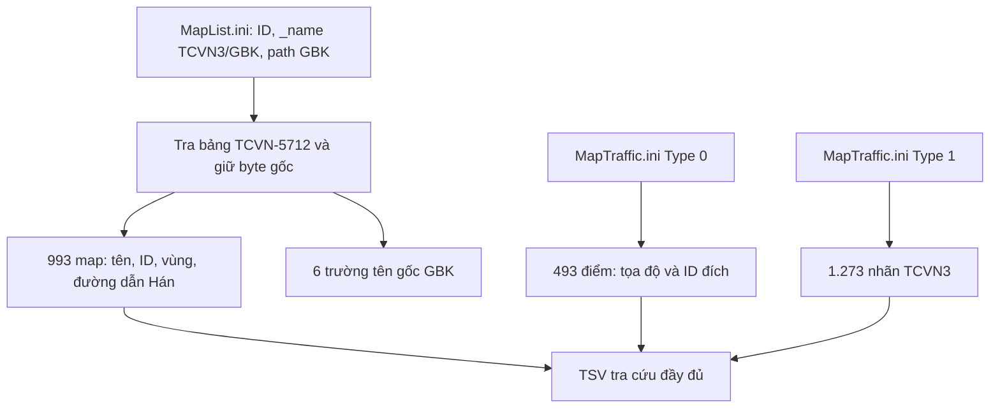

TÓM TẮT 1/5: [NGUỒN] PARTIAL — đối chiếu 993/993 mục MapList; 987 tên Việt TCVN3 giải mã được; 6 trường _name được nhận diện là GBK và cũng có giá trị UTF-8.
TÓM TẮT 2/5: [NGUỒN] TSV có thêm 12 vùng, 493 điểm chuyển map và 1.273 nhãn; không gán tên riêng cho cổng chỉ có tọa độ.
TÓM TẮT 3/5: [NGUỒN] Bảng 50 map đầu theo vùng và TSV đầy đủ nằm tại JX1_OPS/REPORTS/_CHIMUC/K-03c.tsv.
TÓM TẮT 4/5: [CHƯA KIỂM] Không tìm thấy tên “An Bang” trong trường tên map/nhãn đã đọc; vùng chỉ có khóa đường dẫn GBK.
TÓM TẮT 5/5: [NGUỒN]/[CHƯA KIỂM] Chỉ đọc; không build, chạy exe/VM, mạng hay test runtime; không commit/push.

# K-03c — Bảng ánh xạ tên TCVN3 – UTF-8 – Hán, nhóm bản đồ

Loại: tổng hợp
Chủ đề: Đối chiếu tên map TCVN3, đường dẫn Hán tự, vùng và các điểm cấu hình chuyển map trong bộ dữ liệu đã chỉ định.
Từ khóa: bản đồ, map, TCVN3, MapList.ini, MapTraffic.ini, ID, GBK, vùng, cổng
Trạng thái: PARTIAL — có catalog tên và quan hệ chuyển; 6 trường tên gốc là GBK, vùng không có tên Việt riêng, điểm nối không có tên riêng.
Độ phủ: 993/993 map; 987/993 tên Việt TCVN3; 12/12 khóa vùng; 493/493 điểm Type 0; 1.273/1.273 nhãn Type 1; 2771 dòng TSV.
Liên quan: JX1_OPS/REPORTS/I-04-khao-sat-map.md; JX1_OPS/REPORTS/K-01-ban-do-truyen-tin.md; JX1_OPS/DESIGN/CHUAN-BAO-CAO.md
Cần tôi quyết định: không

## Phạm vi và độ phủ

| Phần tử | Đã phủ / tổng | Kết quả và giới hạn |
|---|---:|---|
| MapList.ini: bản ghi map đủ ID, name, path | 993/993 | ID trống trong dải 1–995 là 989/990; catalog không đại diện mọi bản dữ liệu. |
| Tên trường _name giải mã TCVN3 | 987/987 | 6 trường còn lại có encoding GBK; không chuyển nhầm chúng qua TCVN3. |
| Tiền tố vùng trên path | 12/12 | Khóa vùng lấy nguyên từ path; chưa có tên vùng tiếng Việt tương ứng. |
| MapTraffic Type 0 | 493/493 | Có tọa độ và ID đích; 342 cặp nguồn→đích duy nhất; record không có tên riêng cho cổng. |
| MapTraffic Type 1 | 1273/1273 | Nhãn TCVN3 theo map; giữ 7 trường rỗng và bản ghi lặp. |
| Tên “An Bang” | 0 kết quả trong _name/Content đã đọc | Không tìm thấy trong catalog này; không gán sang ID khác. |

## Nguồn và cách giải mã

| Ký hiệu | Đường dẫn chỉ đọc | Vai trò |
|---|---|---|
| G/ | C:/Jx1CocoV3/Folder/ServerNew-20260116T043145Z-3-001/ServerNew/_bin_v2_/gs/ | Dữ liệu MapList.ini và MapTraffic.ini. |
| S/ | D:/JX-source/server/jxOnline/gameserver/Sources/ | Bảng TCVN-5712 trong AutoUpdateRes/src/tcvn.h. |
| C/ | C:/Jx1CocoV3/Folder/Client2912-20260116T044348Z-3-001/Client2912/Client/Classes/ | Khai báo hàm chuyển TCVN sang UTF-8. |

[ĐÃ XÁC MINH] MapList.ini có 993 cặp ID=path / ID_name=...; _name gồm 987 trường TCVN3 và sáu trường GBK (ID 873, 874, 895, 905, 933, 957). Path chứa phân đoạn GBK. Bảng TCVN-5712 ở S/AutoUpdateRes/src/tcvn.h:21, :42–:100; phía client khai báo converter tại C/engine/KGbktoUtf8.h:131–:149. Byte gốc ghi bằng hex để giữ nguyên dữ liệu. Sáu tên GBK được đọc trực tiếp theo GBK và ghi rõ encoding.

[ĐÃ XÁC MINH] Source gọi g_MapTraffic.Load trong nhánh #ifndef _SERVER tại S/Core/Src/KCore.cpp:710–:711; Type 0/Type 1 là bản ghi cấu hình, không phải xác nhận cổng hoạt động hay đang được server dùng. Type 0 lưu điểm, tọa độ đích và ID đích; Type 1 lưu nhãn. Không suy ra tên cổng từ Type 0.

Nguồn dữ liệu: G/Settings/MapList.ini và G/Settings/MapTraffic.ini. Hàng MAP trỏ tới cả dòng path và _name; hàng REGION dùng khóa đầu path, không phải ID riêng. MAP_TRANSFER_POINT dùng tên hai map ghép từ MapList để tra quan hệ, không phải tên gốc của cổng. Các tên trùng giữ thành nhiều hàng.

SHA-256 MapList.ini: 46c4a3d27a1fe7bcdea73d294b255ed84d9d0ed9c236afe856effe62fd1702a9
SHA-256 MapTraffic.ini: 9a4178f89ba04dd8bc474181ca79567d8a3534489cd606ea81af6ec896c9106f

## Giải mã tên — 50 map đầu

Thứ tự: nhóm theo tiền tố vùng xuất hiện trong catalog, rồi ID tăng dần. Cột tên gốc dùng byte-view Windows-1252 cho TCVN3; các byte C1 và 0xAD hiển thị dưới dạng \xHH, còn cột hex giữ nguyên toàn bộ byte. Sáu tên GBK được hiển thị trực tiếp và ghi mã hóa riêng. Path Hán là chuỗi GBK, không phải bản dịch tên Việt.

| ID | Tên UTF-8 | Mã hóa gốc | Tên gốc (byte-view) | Byte gốc (hex) | Chữ Hán / path | Vùng | file:dòng nguồn |
|---:|---|---|---|---|---|---|---|
| 1 | Phượng Tường | TCVN3 | Ph\xADîng T\xADêng | 5068ADEE6E672054ADEA6E67 | 西北南区\凤翔 | 西北南区 | G/Settings/MapList.ini:5, :6 |
| 2 | Hoa Sơn | TCVN3 | Hoa S¬n | 486F612053AC6E | 西北南区\华山 | 西北南区 | G/Settings/MapList.ini:21, :22 |
| 3 | Kiếm Các Tây Bắc | TCVN3 | KiÕm C¸c T©y B¾c | 4B69D56D2043B8632054A9792042BE63 | 西北南区\剑阁西北\剑阁西北 | 西北南区 | G/Settings/MapList.ini:32, :33 |
| 4 | Kim Quang động | TCVN3 | Kim Quang ®éng | 4B696D205175616E6720AEE96E67 | 西北南区\剑阁西北\金光洞迷宫 | 西北南区 | G/Settings/MapList.ini:45, :46 |
| 5 | Kinh Hoàng động | TCVN3 | Kinh Hoµng ®éng | 4B696E6820486FB56E6720AEE96E67 | 西北南区\剑阁西北\经皇洞迷宫 | 西北南区 | G/Settings/MapList.ini:63, :64 |
| 6 | Tỏa Vân động | TCVN3 | Táa V©n ®éng | 54E1612056A96E20AEE96E67 | 西北南区\剑阁西北\锁云洞迷宫 | 西北南区 | G/Settings/MapList.ini:82, :83 |
| 7 | Tần Lăng | TCVN3 | TÇn L¨ng | 54C76E204CA86E67 | 西北南区\秦陵\秦陵 | 西北南区 | G/Settings/MapList.ini:101, :102 |
| 8 | Lăng Tần Thủy Hoàng | TCVN3 | L¨ng TÇn Thñy Hoµng | 4CA86E672054C76E205468F17920486FB56E67 | 西北南区\秦陵\秦始皇陵地下一层 | 西北南区 | G/Settings/MapList.ini:113, :114 |
| 99 | Vĩnh Lạc trấn | TCVN3 | VÜnh L¹c trÊn | 56DC6E68204CB963207472CA6E | 西北南区\永乐镇 | 西北南区 | G/Settings/MapList.ini:1173, :1174 |
| 201 | Băng Hà động | TCVN3 | B¨ng Hµ ®éng | 42A86E672048B520AEE96E67 | 西北南区\冰河洞迷宫 | 西北南区 | G/Settings/MapList.ini:2387, :2388 |
| 206 | Tần Lăng tầng 2 | TCVN3 | TÇn L¨ng tÇng 2 | 54C76E204CA86E672074C76E672032 | 西北南区\秦陵\秦始皇陵地下二层 | 西北南区 | G/Settings/MapList.ini:2472, :2473 |
| 207 | Tần Lăng tầng 3 | TCVN3 | TÇn L¨ng tÇng 3 | 54C76E204CA86E672074C76E672033 | 西北南区\秦陵\秦始皇陵地下三层 | 西北南区 | G/Settings/MapList.ini:2489, :2490 |
| 212 | Hoa Sơn tuyệt đỉnh | TCVN3 | Hoa S¬n tuyÖt ®Ønh | 486F612053AC6E20747579D67420AED86E68 | 西北南区\华山绝顶 | 西北南区 | G/Settings/MapList.ini:2522, :2523 |
| 333 | Hoa Sơn phái | TCVN3 | Hoa S¬n ph¸i | 486F612053AC6E207068B869 | 西北南区\华山派\华山派 | 西北南区 | G/Settings/MapList.ini:3136, :3137 |
| 864 | Lôi đài Hoa Sơn (Trung cấp) | TCVN3 | L«i ®µi Hoa S¬n (Trung cÊp) | 4CAB6920AEB56920486F612053AC6E20285472756E672063CA7029 | 西北南区\华山绝顶 | 西北南区 | G/Settings/MapList.ini:5822, :5823 |
| 865 | Lôi đài Hoa Sơn (Cao cấp) | TCVN3 | L«i ®µi Hoa S¬n (Cao cÊp) | 4CAB6920AEB56920486F612053AC6E202843616F2063CA7029 | 西北南区\华山绝顶 | 西北南区 | G/Settings/MapList.ini:5827, :5828 |
| 987 | Hoa Sơn phái | TCVN3 | Hoa S¬n ph¸i | 486F612053AC6E207068B869 | 西北南区\华山派2013 | 西北南区 | G/Settings/MapList.ini:6646, :6647 |
| 9 | Trường Giang Nguyên Đầu | TCVN3 | Tr\xADêng Giang Nguyªn §Çu | 5472ADEA6E67204769616E67204E677579AA6E20A7C775 | 西南北区\长江源头\长江源头 | 西南北区 | G/Settings/MapList.ini:131, :132 |
| 10 | Nhạn Thạch động | TCVN3 | Nh¹n Th¹ch ®éng | 4E68B96E205468B9636820AEE96E67 | 西南北区\长江源头\雁石洞迷宫 | 西南北区 | G/Settings/MapList.ini:150, :151 |
| 11 | Thành Đô | TCVN3 | Thµnh §« | 5468B56E6820A7AB | 西南北区\成都\成都 | 西南北区 | G/Settings/MapList.ini:169, :170 |
| 12 | Địa đạo hậu viện Tín Tướng Tự | TCVN3 | §Þa ®¹o hËu viÖn TÝn T\xADíng Tù | A7DE6120AEB96F2068CB75207669D66E2054DD6E2054ADED6E672054F9 | 西南北区\成都\成都信相寺后院地道迷宫 | 西南北区 | G/Settings/MapList.ini:184, :185 |
| 13 | Nga My phái | TCVN3 | Nga My ph¸i | 4E6761204D79207068B869 | 西南北区\峨嵋派\峨嵋派 | 西南北区 | G/Settings/MapList.ini:203, :204 |
| 14 | Mãnh Hổ động | TCVN3 | M·nh Hæ ®éng | 4DB76E682048E620AEE96E67 | 西南北区\峨嵋派\猛虎洞穴迷宫 | 西南北区 | G/Settings/MapList.ini:212, :213 |
| 15 | Giảng Kinh Đường | TCVN3 | Gi¶ng Kinh §\xADêng | 4769B66E67204B696E6820A7ADEA6E67 | 西南北区\峨嵋派\讲经堂 | 西南北区 | G/Settings/MapList.ini:224, :225 |
| 16 | Tiền điện | TCVN3 | TiÒn ®iÖn | 5469D26E20AE69D66E | 西南北区\峨嵋派\前殿 | 西南北区 | G/Settings/MapList.ini:228, :229 |
| 17 | Chính điện | TCVN3 | ChÝnh ®iÖn | 4368DD6E6820AE69D66E | 西南北区\峨嵋派\正殿 | 西南北区 | G/Settings/MapList.ini:232, :233 |
| 18 | Tử Thiên điện | TCVN3 | Tö Thiªn ®iÖn | 54F620546869AA6E20AE69D66E | 西南北区\峨嵋派\左偏殿 | 西南北区 | G/Settings/MapList.ini:236, :237 |
| 19 | Kiếm Các Tây Nam | TCVN3 | KiÕm C¸c T©y Nam | 4B69D56D2043B8632054A979204E616D | 西南北区\剑阁西南 | 西南北区 | G/Settings/MapList.ini:240, :241 |
| 20 | Giang Tân Thôn | TCVN3 | Giang T©n Th«n | 4769616E672054A96E205468AB6E | 西南北区\江津村 | 西南北区 | G/Settings/MapList.ini:252, :253 |
| 21 | Thanh Thành Sơn | TCVN3 | Thanh Thµnh S¬n | 5468616E68205468B56E682053AC6E | 西南北区\青城山\青城山 | 西南北区 | G/Settings/MapList.ini:267, :268 |
| 22 | Bạch Vân động | TCVN3 | B¹ch V©n ®éng | 42B963682056A96E20AEE96E67 | 西南北区\青城山\白云洞迷宫 | 西南北区 | G/Settings/MapList.ini:286, :287 |
| 23 | Thần Tiên động | TCVN3 | ThÇn Tiªn ®éng | 5468C76E205469AA6E20AEE96E67 | 西南北区\青城山\神仙洞迷宫 | 西南北区 | G/Settings/MapList.ini:304, :305 |
| 24 | Hưởng Thủy động | TCVN3 | H\xADëng Thñy ®éng | 48ADEB6E67205468F17920AEE96E67 | 西南北区\青城山\响水洞迷宫 | 西南北区 | G/Settings/MapList.ini:323, :324 |
| 25 | Đường Môn | TCVN3 | §\xADêng M«n | A7ADEA6E67204DAB6E | 西南北区\唐门\唐门 | 西南北区 | G/Settings/MapList.ini:342, :343 |
| 26 | Trúc Tử động tầng 1 | TCVN3 | Tróc Tö ®éng tÇng 1 | 5472F3632054F620AEE96E672074C76E672031 | 西南北区\唐门\竹丝洞一层 | 西南北区 | G/Settings/MapList.ini:351, :352 |
| 27 | Trúc Tử động tầng 2 | TCVN3 | Tróc Tö ®éng tÇng 2 | 5472F3632054F620AEE96E672074C76E672032 | 西南北区\唐门\竹丝洞二层 | 西南北区 | G/Settings/MapList.ini:370, :371 |
| 28 | Trúc Tử động tầng 3 | TCVN3 | Tróc Tö ®éng tÇng 3 | 5472F3632054F620AEE96E672074C76E672033 | 西南北区\唐门\竹丝洞三层 | 西南北区 | G/Settings/MapList.ini:389, :390 |
| 29 | ám khí phòng | TCVN3 | ¸m khÝ phßng | B86D206B68DD207068DF6E67 | 西南北区\唐门\暗器房 | 西南北区 | G/Settings/MapList.ini:396, :397 |
| 30 | Hỏa khí phòng | TCVN3 | Háa khÝ phßng | 48E161206B68DD207068DF6E67 | 西南北区\唐门\火器房 | 西南北区 | G/Settings/MapList.ini:400, :401 |
| 31 | Võ công phòng | TCVN3 | Vâ c«ng phßng | 56E22063AB6E67207068DF6E67 | 西南北区\唐门\武功房 | 西南北区 | G/Settings/MapList.ini:404, :405 |
| 32 | Y dược phòng | TCVN3 | Y d\xADîc phßng | 592064ADEE63207068DF6E67 | 西南北区\唐门\医药房 | 西南北区 | G/Settings/MapList.ini:408, :409 |
| 33 | Phòng khách | TCVN3 | Phßng kh¸ch | 5068DF6E67206B68B86368 | 西南北区\唐门\会客大厅 | 西南北区 | G/Settings/MapList.ini:412, :413 |
| 34 | Phòng nghị sự | TCVN3 | Phßng nghÞ sù | 5068DF6E67206E6768DE2073F9 | 西南北区\唐门\议事大厅 | 西南北区 | G/Settings/MapList.ini:416, :417 |
| 35 | Chính phòng | TCVN3 | ChÝnh phßng | 4368DD6E68207068DF6E67 | 西南北区\唐门\正房 | 西南北区 | G/Settings/MapList.ini:420, :421 |
| 36 | Tử tiêu đường | TCVN3 | Tö tiªu ®\xADêng | 54F6207469AA7520AEADEA6E67 | 西南北区\唐门\祭祖厅 | 西南北区 | G/Settings/MapList.ini:424, :425 |
| 95 | Tân Thôn khách cơ | TCVN3 | T©n Th«n kh¸ch c¬ | 54A96E205468AB6E206B68B863682063AC | 西南北区\新手客栈 | 西南北区 | G/Settings/MapList.ini:1156, :1157 |
| 97 | Giang Tân thôn-Vô Danh động | TCVN3 | Giang T©n th«n-V« Danh ®éng | 4769616E672054A96E207468AB6E2D56AB2044616E6820AEE96E67 | 西南北区\江津新手洞 | 西南北区 | G/Settings/MapList.ini:1164, :1167 |
| 202 | Phù Dung động | TCVN3 | Phï Dung ®éng | 5068EF2044756E6720AEE96E67 | 西南北区\芙蓉洞迷宫 | 西南北区 | G/Settings/MapList.ini:2404, :2405 |
| 229 | Tử Tiêu đình (chiến đấu) | TCVN3 | Tö Tiªu ®×nh (chiÕn ®Êu) | 54F6205469AA7520AED76E682028636869D56E20AECA752920 | 西南北区\唐门\战斗祭祖厅 | 西南北区 | G/Settings/MapList.ini:2655, :2656 |
| 37 | Biện Kinh | TCVN3 | BiÖn Kinh | 4269D66E204B696E68 | 中原北区\汴京\汴京 | 中原北区 | G/Settings/MapList.ini:428, :429 |

## Vùng theo cấu trúc path

Khóa vùng được giữ theo dữ liệu GBK; không có tên tiếng Việt trong trường path.

| Khóa vùng UTF-8 (gốc GBK) | Map trong catalog | file:dòng nguồn đầu tiên |
|---|---:|---|
| 西北南区 | 17 | `G/Settings/MapList.ini:5` |
| 西南北区 | 32 | `G/Settings/MapList.ini:131` |
| 中原北区 | 86 | `G/Settings/MapList.ini:428` |
| 两湖区 | 29 | `G/Settings/MapList.ini:654` |
| 中原南区 | 35 | `G/Settings/MapList.ini:968` |
| 西北北区 | 54 | `G/Settings/MapList.ini:1391` |
| 西南南区 | 25 | `G/Settings/MapList.ini:1846` |
| 江南区 | 71 | `G/Settings/MapList.ini:2108` |
| 特殊用地 | 632 | `G/Settings/MapList.ini:2526` |
| 东北区 | 10 | `G/Settings/MapList.ini:2982` |
| rongyuxitong | 1 | `G/Settings/MapList.ini:6052` |
| fongkieu | 1 | `G/Settings/MapList.ini:6684` |

## Sắp theo cấu trúc game và cổng

Map được nhóm theo tiền tố vùng trong path, rồi ID tăng dần. TSV xếp lần lượt MAP, REGION, MAP_TRANSFER_POINT (map nguồn rồi số điểm), MAP_LABEL (map nguồn rồi số nhãn).

[ĐÃ XÁC MINH] 493 điểm Type 0 tạo 342 cặp ID nguồn→đích. Hai tên map được tra ngược từ MapList; cổng không có tên riêng trong record, chỉ có tọa độ và ID đích. Có 1273 nhãn Type 1; mỗi hàng giữ ID section/item và dòng Content. Đây là cấu hình, chưa xác minh trong game.

## Tệp TSV đầy đủ

JX1_OPS/REPORTS/_CHIMUC/K-03c.tsv — 2771 hàng dữ liệu, 12 cột, UTF-8 không BOM. Loại hàng: MAP, REGION, MAP_TRANSFER_POINT, MAP_LABEL. Tên trùng không gộp; Content rỗng được giữ; sáu trường GBK được phân biệt encoding.

## MỤC SỔ THÔNG SỐ

Bảng dưới ghi số đếm catalog, không phải thông số runtime hoặc chỉ thị chỉnh sửa.

| Nhóm | Tên / tập dữ liệu | file:dòng | Giá trị | Đơn vị | Ảnh hưởng | Đổi an toàn | Nguồn đo |
|---|---|---|---|---|---|---|---|
| Catalog | MapList ID/path/_name | G/Settings/MapList.ini:2, :5–6 | Count khai báo 1000; 993 cặp ID/path/name thực có | bản ghi | Tra cứu tĩnh; không chứng minh đã nạp | Không áp dụng — chỉ đọc | Đếm bản ghi file |
| Liên kết | MapTraffic Type 0 | G/Settings/MapTraffic.ini:3–6 | 493 điểm; 342 cặp map duy nhất | điểm/cặp | Tọa độ và ID đích | Không áp dụng — chỉ đọc | Đếm bản ghi file |
| Nhãn | MapTraffic Type 1 | G/Settings/MapTraffic.ini:18–20 | 1273 hàng, 7 Content rỗng | hàng | Nhãn cấu hình theo map | Không áp dụng — chỉ đọc | Đếm bản ghi file |

## Đề xuất tối ưu

Để tra cứu, tìm theo tên UTF-8 rồi xác nhận bằng ID và file:dòng; giữ cột encoding và byte hex khi nối với bản dữ liệu khác. Không gán tên cổng từ một điểm chỉ có tọa độ. Đối chiếu version/hash trước khi hợp nhất các catalog.

## Đã xác minh / Chưa xác minh

ĐÃ XÁC MINH:
- 993 ID có đủ path/name; 987 trường TCVN3, 6 trường GBK. Dải ID 1–995 thiếu 989 và 990.
- 12 khóa vùng, 493 điểm Type 0 / 342 cặp ID, 1273 dòng Type 1. Mọi target Type 0 và map nguồn Type 1 đều có trong catalog.
- 7 Content Type 1 rỗng; bản ghi được giữ trong TSV. Không có kết quả chính xác cho “An Bang” trong _name/Content đã đối chiếu.
- Từng hàng TSV có file:dòng; output UTF-8 không BOM. Số đếm lấy từ hai file chỉ đọc.

CHƯA XÁC MINH:
- Tên Việt riêng cho 12 vùng, tên riêng cho điểm chuyển Type 0, và ý nghĩa thực tế của từng nhãn Type 1.
- Tên “An Bang” ngoài catalog hiện hành này; không suy diễn rằng không tồn tại trong bộ khác.
- PAK, client đang nạp, binary, runtime, tọa độ thực địa và cổng đang hoạt động. Không build, chạy exe/VM, mạng hay test game.

## Kiểm tra, lỗi và bàn giao
- rg không khả dụng; dùng PowerShell giới hạn thư mục, không cài công cụ. Lần đọc chẩn đoán gặp console không xuất Unicode; đặt stdout UTF-8 và đọc lại.
- Ghi nhịp vào D:/JX-wt/K-03c.nhip bị từ chối vì file nằm ngoài worktree được cấp quyền; không tạo file thay thế ngoài phạm vi.
- Chỉ sửa báo cáo, TSV và mục Kết quả cuối task theo chỉ thị; không sửa source/config/dữ liệu gốc. Không stage/commit/push.
- Bước tiếp theo: dùng nguồn có trường Việt hóa vùng/tên cổng khi được giao; giữ phần chưa xác minh tới khi có bằng chứng.

liên quan: JX1_OPS/REPORTS/I-04-khao-sat-map.md; JX1_OPS/REPORTS/K-01-ban-do-truyen-tin.md; JX1_OPS/DESIGN/CHUAN-BAO-CAO.md

Kỹ năng đã dùng: jx1-retrofit, jx1-read-server, jx1-read-client, jx1-parameters, jx1-knowledge, jx1-report
